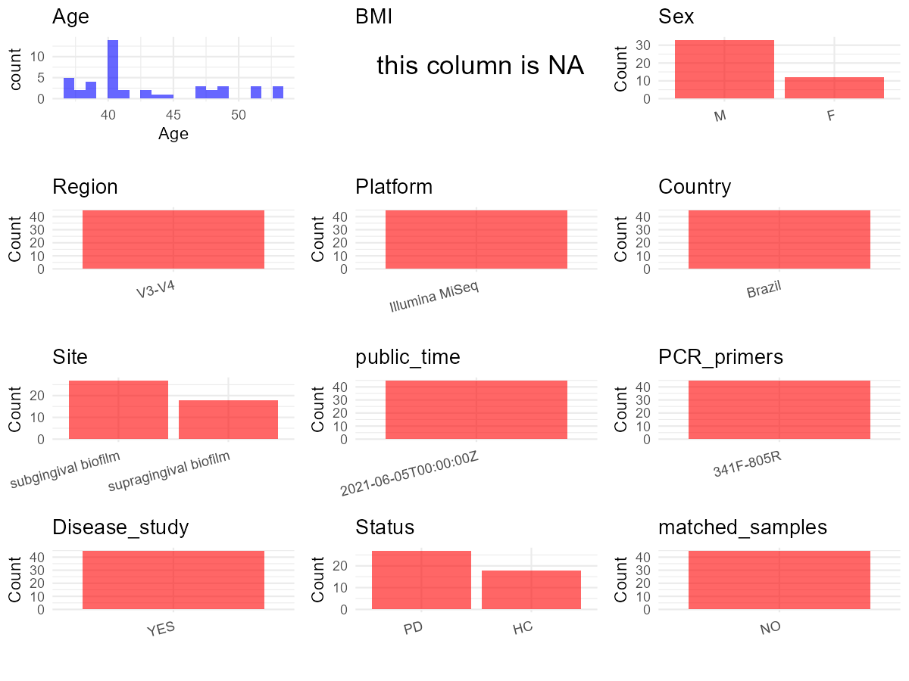

R Notebook: Metadata Processing Workflow
================

# Step 1: Obtain Initial Metadata from Each Project

To obtain the initial metadata: 1. Search for the BioProject ID (e.g.,
“PRJEBXXXX”) on the [NCBI SRA
website](https://www.ncbi.nlm.nih.gov/Traces/study/). 2. In the “Select”
table, click on “Metadata” and download the file. 3. The downloaded file
is typically named “SraRunTable.csv” and contains metadata for the
project.

``` r
# Load necessary libraries
library(dplyr)
library(ggplot2)
library(cowplot)
library(stringr)

# Set working directory (update this path to your local directory)
setwd("E:/bioproject_YL/PRJNA735261")

# Read the initial metadata files
initial_meta <- read.csv("SraRunTable.csv", header = T) 

# Remove entries non-oral samples
initial_meta <- initial_meta[initial_meta$samp_mat_process != "Fecal", ]

# Display the first few rows of the metadata
head(initial_meta)
```

    ##           Run Assay.Type AvgSpotLen    Bases  BioProject    BioSample
    ## 2 SRR14739958   AMPLICON        602 62550810 PRJNA735261 SAMN19573606
    ## 3 SRR14739959   AMPLICON        602 52710518 PRJNA735261 SAMN19573605
    ## 4 SRR14739960   AMPLICON        596 88312486 PRJNA735261 SAMN19573658
    ## 6 SRR14739962   AMPLICON        597 72298472 PRJNA735261 SAMN19573657
    ## 7 SRR14739963   AMPLICON        597 86035506 PRJNA735261 SAMN19573656
    ## 9 SRR14739965   AMPLICON        596 82022733 PRJNA735261 SAMN19573654
    ##                BioSampleModel    Bytes               Center.Name
    ## 2 Metagenome or environmental 33675345 UNIVERSIDADE DE SAO PAULO
    ## 3 Metagenome or environmental 28587657 UNIVERSIDADE DE SAO PAULO
    ## 4 Metagenome or environmental 46967450 UNIVERSIDADE DE SAO PAULO
    ## 6 Metagenome or environmental 39059690 UNIVERSIDADE DE SAO PAULO
    ## 7 Metagenome or environmental 45887552 UNIVERSIDADE DE SAO PAULO
    ## 9 Metagenome or environmental 43456509 UNIVERSIDADE DE SAO PAULO
    ##   Collection_Date Consent DATASTORE.filetype DATASTORE.provider
    ## 2  Not applicable  public   fastq,run.zq,sra         gs,ncbi,s3
    ## 3  Not applicable  public   fastq,run.zq,sra         gs,ncbi,s3
    ## 4  Not applicable  public   fastq,run.zq,sra         gs,ncbi,s3
    ## 6  Not applicable  public   fastq,run.zq,sra         gs,ncbi,s3
    ## 7  Not applicable  public   fastq,run.zq,sra         gs,ncbi,s3
    ## 9  Not applicable  public   fastq,run.zq,sra         gs,ncbi,s3
    ##                       DATASTORE.region  Experiment geo_loc_name_country
    ## 2 gs.us-east1,ncbi.public,s3.us-east-1 SRX11074663         uncalculated
    ## 3 gs.us-east1,ncbi.public,s3.us-east-1 SRX11074662         uncalculated
    ## 4 gs.us-east1,ncbi.public,s3.us-east-1 SRX11074661         uncalculated
    ## 6 gs.us-east1,ncbi.public,s3.us-east-1 SRX11074659         uncalculated
    ## 7 gs.us-east1,ncbi.public,s3.us-east-1 SRX11074658         uncalculated
    ## 9 gs.us-east1,ncbi.public,s3.us-east-1 SRX11074656         uncalculated
    ##   geo_loc_name_country_continent   geo_loc_name Host_Age  Host_disease
    ## 2                   uncalculated Not applicable       43       Healthy
    ## 3                   uncalculated Not applicable       43       Healthy
    ## 4                   uncalculated Not applicable       37 Periodontitis
    ## 6                   uncalculated Not applicable       37 Periodontitis
    ## 7                   uncalculated Not applicable       37 Periodontitis
    ## 9                   uncalculated Not applicable       53 Periodontitis
    ##           HOST host_sex INSTRUMENT_MODEL     Instrument
    ## 2 Homo sapiens     male   Illumina MiSeq Illumina MiSeq
    ## 3 Homo sapiens     male   Illumina MiSeq Illumina MiSeq
    ## 4 Homo sapiens     male   Illumina MiSeq Illumina MiSeq
    ## 6 Homo sapiens     male   Illumina MiSeq Illumina MiSeq
    ## 7 Homo sapiens     male   Illumina MiSeq Illumina MiSeq
    ## 9 Homo sapiens     male   Illumina MiSeq Illumina MiSeq
    ##           isolation_source        lat_lon library_layout     Library.Name
    ## 2            Supragingival Not applicable         PAIRED      Control_15S
    ## 3              Subgingival Not applicable         PAIRED      Control_15R
    ## 4            Supragingival Not applicable         PAIRED Periodontitis_9S
    ## 6 Subgingival non affected Not applicable         PAIRED Periodontitis_9R
    ## 7     Subgingival affected Not applicable         PAIRED Periodontitis_9P
    ## 9            Supragingival Not applicable         PAIRED Periodontitis_8S
    ##   library_selection library_source library_strategy LibraryLayout
    ## 2               PCR    METAGENOMIC         AMPLICON        PAIRED
    ## 3               PCR    METAGENOMIC         AMPLICON        PAIRED
    ## 4               PCR    METAGENOMIC         AMPLICON        PAIRED
    ## 6               PCR    METAGENOMIC         AMPLICON        PAIRED
    ## 7               PCR    METAGENOMIC         AMPLICON        PAIRED
    ## 9               PCR    METAGENOMIC         AMPLICON        PAIRED
    ##   LibrarySelection LibrarySource         Organism Platform platform
    ## 2              PCR   METAGENOMIC human metagenome ILLUMINA ILLUMINA
    ## 3              PCR   METAGENOMIC human metagenome ILLUMINA ILLUMINA
    ## 4              PCR   METAGENOMIC human metagenome ILLUMINA ILLUMINA
    ## 6              PCR   METAGENOMIC human metagenome ILLUMINA ILLUMINA
    ## 7              PCR   METAGENOMIC human metagenome ILLUMINA ILLUMINA
    ## 9              PCR   METAGENOMIC human metagenome ILLUMINA ILLUMINA
    ##   ref_biomaterial          ReleaseDate          create_date version
    ## 2   not collected 2021-06-05T00:00:00Z 2021-06-05T10:22:00Z       1
    ## 3   not collected 2021-06-05T00:00:00Z 2021-06-05T10:22:00Z       1
    ## 4   not collected 2021-06-05T00:00:00Z 2021-06-05T10:22:00Z       1
    ## 6   not collected 2021-06-05T00:00:00Z 2021-06-05T10:22:00Z       1
    ## 7   not collected 2021-06-05T00:00:00Z 2021-06-05T10:22:00Z       1
    ## 9   not collected 2021-06-05T00:00:00Z 2021-06-05T10:22:00Z       1
    ##   samp_mat_process Sample.Name source_material_id SRA.Study
    ## 2             Oral      CPC15S             CPC15S SRP322833
    ## 3             Oral      CPC15R             CPC15R SRP322833
    ## 4             Oral        PC9S               PC9S SRP322833
    ## 6             Oral        PC9R               PC9R SRP322833
    ## 7             Oral        PC9P               PC9P SRP322833
    ## 9             Oral        PC8S               PC8S SRP322833

# Step 2: Create a Uniform Metadata Template

The uniform metadata should include the following columns:

1.  **BioProject**: Project ID (e.g., “PRJNA339212”)
2.  **Run**: Sample ID (e.g., “ERRXXXXXX” or “SRRXXXXXX”)
3.  **sample_name**: Original sample name submitted by the authors (not
    the database-assigned ID)
4.  **Age**: Age of the subject (if available)
5.  **BMI**: Body Mass Index (if available)
6.  **Sex**: Sex of the subject (“F” or “M”)
7.  **Region**: Targeted 16S rRNA region (e.g., “V3-V4”)
8.  **Platform**: Sequencing platform (e.g., “Illumina MiSeq”)
9.  **Country**: Country of sample origin (e.g., “China”)
10. **Site**: Sample site (e.g., “saliva”, “dental plaque”)
11. **public_time**: Data release date (format: “YYYY-MM-DD”)
12. **PCR_primers**: PCR primers used (e.g., “515F-806R”)
13. **title**: Title of the associated publication
14. **Disease_study**: Whether the study involves a disease (“YES” or
    “NO”)
15. **Status**: Disease status (e.g., “T2DM”, “HC”). Note: If the study
    includes both disease and healthy samples, this must be specified
    per sample.
16. **matched_samples**: matched samples (“YES” or “NO”)

``` r
# Create a uniform metadata dataframe
metadata <- data.frame(
  BioProject = initial_meta$BioProject,
  Run = initial_meta$Run,
  sample_name = initial_meta$Sample.Name,
  Age = initial_meta$Host_Age, 
  BMI = NA,  
  Sex = initial_meta$host_sex, 
  Platform = initial_meta$Instrument,
  Country = "Brazil",
  Site = initial_meta$isolation_source,
  public_time = initial_meta$ReleaseDate,
  Status = initial_meta$Host_disease,
  stringsAsFactors = FALSE
)

# Add biofilm as a suffix to all values in the Site column
metadata <- metadata %>%
  mutate(Site = case_when(
    str_detect(Site, "^Supragingival") ~ "supragingival biofilm",
    str_detect(Site, "^Subgingival") ~ "subgingival biofilm",
    TRUE ~ NA))

# Use abbreviations to indicate gender
metadata <- metadata %>%
  mutate(Sex = recode(Sex, "female" = "F", "male" = "M"))
```

# Step 3: Manually Add Information from the Publication

Some information (e.g. PCR primers, study title, disease status) must be
manually extracted from the publication and added to the metadata.

``` r
# Add information obtained from the publication
metadata$Region <- "V3-V4"
metadata$PCR_primers <- "341F-805R"
metadata$title <- "Oral dysbiosis in severe forms of periodontitis is associated with gut dysbiosis and correlated with salivary inflammatory mediators A preliminary study"
metadata$Disease_study <- "YES"
# Assign disease status based on sample_name patterns
metadata <- metadata %>%
  mutate(Status = case_when(
      grepl("Periodontitis", Status) ~ "PD",
      grepl("Healthy", Status) ~ "HC",
      TRUE ~ NA))

# Check initial data distribution
cat("Initial sample distribution:\n")
```

    ## Initial sample distribution:

``` r
table(metadata$sample_name)
```

    ## 
    ## CPC12R CPC12S CPC14R CPC14S CPC15R CPC15S  CPC1R  CPC1S  CPC2R  CPC2S  CPC4R 
    ##      1      1      1      1      1      1      1      1      1      1      1 
    ##  CPC4S  CPC6R  CPC6S  CPC7R  CPC7S  CPC8R  CPC8S  PC11P  PC11R  PC11S  PC12P 
    ##      1      1      1      1      1      1      1      1      1      1      1 
    ##  PC12R  PC12S  PC13P  PC13R  PC13S  PC14P  PC14R  PC14S   PC5P   PC5R   PC5S 
    ##      1      1      1      1      1      1      1      1      1      1      1 
    ##   PC6P   PC6R   PC6S   PC7P   PC7R   PC7S   PC8P   PC8R   PC8S   PC9P   PC9R 
    ##      1      1      1      1      1      1      1      1      1      1      1 
    ##   PC9S 
    ##      1

``` r
table(metadata$Site)
```

    ## 
    ##   subgingival biofilm supragingival biofilm 
    ##                    27                    18

``` r
# Calculate sampling frequency per subject
sample_counts <- table(metadata$sample_name)
cat("\nNumber of samples per subject:\n")
```

    ## 
    ## Number of samples per subject:

``` r
print(sample_counts)
```

    ## 
    ## CPC12R CPC12S CPC14R CPC14S CPC15R CPC15S  CPC1R  CPC1S  CPC2R  CPC2S  CPC4R 
    ##      1      1      1      1      1      1      1      1      1      1      1 
    ##  CPC4S  CPC6R  CPC6S  CPC7R  CPC7S  CPC8R  CPC8S  PC11P  PC11R  PC11S  PC12P 
    ##      1      1      1      1      1      1      1      1      1      1      1 
    ##  PC12R  PC12S  PC13P  PC13R  PC13S  PC14P  PC14R  PC14S   PC5P   PC5R   PC5S 
    ##      1      1      1      1      1      1      1      1      1      1      1 
    ##   PC6P   PC6R   PC6S   PC7P   PC7R   PC7S   PC8P   PC8R   PC8S   PC9P   PC9R 
    ##      1      1      1      1      1      1      1      1      1      1      1 
    ##   PC9S 
    ##      1

``` r
# Create matched_samples column
metadata$matched_samples <- ifelse(metadata$sample_name %in% names(sample_counts[sample_counts >= 2]), "YES", "NO")

cat("\nMatched samples distribution:\n")
```

    ## 
    ## Matched samples distribution:

``` r
table(metadata$matched_samples)
```

    ## 
    ## NO 
    ## 45

``` r
# Identify samples for removal: single samples excluding supragingival biofilm and subgingival biofilm
single_samples <- names(sample_counts[sample_counts == 1])
samples_to_remove <- metadata$sample_name %in% single_samples & 
                     !(metadata$Site %in% c("supragingival biofilm", "subgingival biofilm"))

cat("\nNumber of samples to be removed:", sum(samples_to_remove), "\n")
```

    ## 
    ## Number of samples to be removed: 0

``` r
# Remove identified samples
metadata_clean <- metadata[!samples_to_remove, ]

cat("\nFinal sample distribution after cleaning:\n")
```

    ## 
    ## Final sample distribution after cleaning:

``` r
table(metadata_clean$sample_name)
```

    ## 
    ## CPC12R CPC12S CPC14R CPC14S CPC15R CPC15S  CPC1R  CPC1S  CPC2R  CPC2S  CPC4R 
    ##      1      1      1      1      1      1      1      1      1      1      1 
    ##  CPC4S  CPC6R  CPC6S  CPC7R  CPC7S  CPC8R  CPC8S  PC11P  PC11R  PC11S  PC12P 
    ##      1      1      1      1      1      1      1      1      1      1      1 
    ##  PC12R  PC12S  PC13P  PC13R  PC13S  PC14P  PC14R  PC14S   PC5P   PC5R   PC5S 
    ##      1      1      1      1      1      1      1      1      1      1      1 
    ##   PC6P   PC6R   PC6S   PC7P   PC7R   PC7S   PC8P   PC8R   PC8S   PC9P   PC9R 
    ##      1      1      1      1      1      1      1      1      1      1      1 
    ##   PC9S 
    ##      1

``` r
table(metadata_clean$Site)
```

    ## 
    ##   subgingival biofilm supragingival biofilm 
    ##                    27                    18

``` r
table(metadata_clean$matched_samples)
```

    ## 
    ## NO 
    ## 45

``` r
# Use cleaned dataset for subsequent analysis
metadata <- metadata_clean
```

# Step 4: Summarize and Validate the Metadata

``` r
# Check the number of unique runs and sample names
print(paste("Number of unique runs:", length(unique(metadata$Run))))
```

    ## [1] "Number of unique runs: 45"

``` r
print(paste("Number of unique sample names:", length(unique(metadata$sample_name))))
```

    ## [1] "Number of unique sample names: 45"

# Step 5: Visualize the Metadata

``` r

```


# Step 6: Finalize and Export the Metadata

``` r
# Reorder columns to match the desired format
metadata <- metadata[, c(
  "BioProject", "Run", "sample_name", "Age", "BMI", "Sex", 
  "Region", "Platform", "Country", "Site", "public_time", 
  "PCR_primers", "title", "Disease_study", "Status", "matched_samples"
)]

# Export the uniform metadata to a CSV file
write.csv(metadata, file = "metadata.csv", quote = FALSE)
head(metadata)
```

    ##    BioProject         Run sample_name Age BMI Sex Region       Platform Country
    ## 1 PRJNA735261 SRR14739958      CPC15S  43  NA   M  V3-V4 Illumina MiSeq  Brazil
    ## 2 PRJNA735261 SRR14739959      CPC15R  43  NA   M  V3-V4 Illumina MiSeq  Brazil
    ## 3 PRJNA735261 SRR14739960        PC9S  37  NA   M  V3-V4 Illumina MiSeq  Brazil
    ## 4 PRJNA735261 SRR14739962        PC9R  37  NA   M  V3-V4 Illumina MiSeq  Brazil
    ## 5 PRJNA735261 SRR14739963        PC9P  37  NA   M  V3-V4 Illumina MiSeq  Brazil
    ## 6 PRJNA735261 SRR14739965        PC8S  53  NA   M  V3-V4 Illumina MiSeq  Brazil
    ##                    Site          public_time PCR_primers
    ## 1 supragingival biofilm 2021-06-05T00:00:00Z   341F-805R
    ## 2   subgingival biofilm 2021-06-05T00:00:00Z   341F-805R
    ## 3 supragingival biofilm 2021-06-05T00:00:00Z   341F-805R
    ## 4   subgingival biofilm 2021-06-05T00:00:00Z   341F-805R
    ## 5   subgingival biofilm 2021-06-05T00:00:00Z   341F-805R
    ## 6 supragingival biofilm 2021-06-05T00:00:00Z   341F-805R
    ##                                                                                                                                                      title
    ## 1 Oral dysbiosis in severe forms of periodontitis is associated with gut dysbiosis and correlated with salivary inflammatory mediators A preliminary study
    ## 2 Oral dysbiosis in severe forms of periodontitis is associated with gut dysbiosis and correlated with salivary inflammatory mediators A preliminary study
    ## 3 Oral dysbiosis in severe forms of periodontitis is associated with gut dysbiosis and correlated with salivary inflammatory mediators A preliminary study
    ## 4 Oral dysbiosis in severe forms of periodontitis is associated with gut dysbiosis and correlated with salivary inflammatory mediators A preliminary study
    ## 5 Oral dysbiosis in severe forms of periodontitis is associated with gut dysbiosis and correlated with salivary inflammatory mediators A preliminary study
    ## 6 Oral dysbiosis in severe forms of periodontitis is associated with gut dysbiosis and correlated with salivary inflammatory mediators A preliminary study
    ##   Disease_study Status matched_samples
    ## 1           YES     HC              NO
    ## 2           YES     HC              NO
    ## 3           YES     PD              NO
    ## 4           YES     PD              NO
    ## 5           YES     PD              NO
    ## 6           YES     PD              NO

## Notes for Students:

1.  **Metadata Accuracy**: Always cross-check the metadata with the
    original publication to ensure accuracy.
2.  **Manual Entries**: Columns like `PCR_primers`, and `Status` often
    require manual entry based on the publication.
3.  **Disease Status**: Be careful when assigning `Status`—some studies
    include both disease and healthy samples.
4.  **Visualization**: The plots help quickly identify the distribution
    of values in each column, which is useful for quality control.
5.  **Reproducibility**: Update the working directory and file paths to
    match your local environment.
