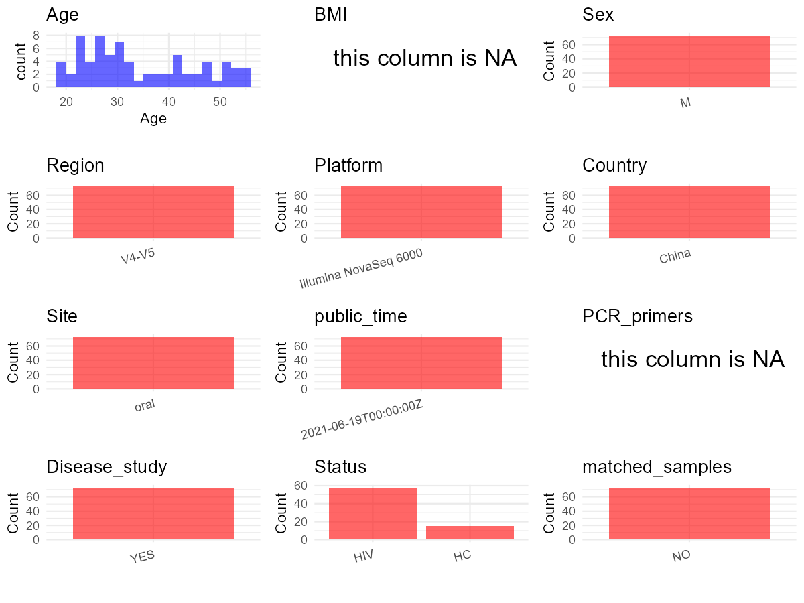

R Notebook: Metadata Processing Workflow
================

# Step 1: Obtain Initial Metadata from Each Project

To obtain the initial metadata: 1. Search for the BioProject ID (e.g.,
“PRJEBXXXX”) on the [NCBI SRA
website](https://www.ncbi.nlm.nih.gov/Traces/study/). 2. In the “Select”
table, click on “Metadata” and download the file. 3. The downloaded file
is typically named “SraRunTable.csv” and contains metadata for the
project.

``` r
# Load necessary libraries
library(dplyr)
library(ggplot2)
library(cowplot)

# Set working directory (update this path to your local directory)
setwd("D:/oral_project/PRJNA739016")

# Read the initial metadata files
initial_meta<-read.csv("SraRunTable.csv",header = T)

# Combine the two metadata files
#meta <- rbind(initial_meta, initial_meta1)

#Remove entries non-oral samples
#initial_meta <- subset(initial_meta,isolate %in% c("saliva","tongue coat"))

# Check the number of samples containing "HT" in Sample.Name (e.g., healthy controls)
#nrow(subset(meta, grepl("HT", Sample.Name)))

# Display the first few rows of the metadata
head(initial_meta)
```

    ##           Run AGE Assay.Type AvgSpotLen    Bases
    ## 1 SRR14864652  31    RNA-Seq        500 41159000
    ## 2 SRR14864653  30    RNA-Seq        500 47464000
    ## 3 SRR14864654  55    RNA-Seq        500 40061500
    ## 4 SRR14864656  52    RNA-Seq        500 48696500
    ## 5 SRR14864657  28    RNA-Seq        500 43977000
    ## 6 SRR14864659  44    RNA-Seq        500 42268500
    ##                           BIOMATERIAL_PROVIDER  BioProject    BioSample
    ## 1 Beijing Key Laboratory for HIV/AIDS Research PRJNA739016 SAMN19770497
    ## 2 Beijing Key Laboratory for HIV/AIDS Research PRJNA739016 SAMN19770496
    ## 3 Beijing Key Laboratory for HIV/AIDS Research PRJNA739016 SAMN19770560
    ## 4 Beijing Key Laboratory for HIV/AIDS Research PRJNA739016 SAMN19770558
    ## 5 Beijing Key Laboratory for HIV/AIDS Research PRJNA739016 SAMN19770495
    ## 6 Beijing Key Laboratory for HIV/AIDS Research PRJNA739016 SAMN19770556
    ##   BioSampleModel    Bytes                                        Center.Name
    ## 1          Human 13660263 BEIJING YOUAN HOSPITAL, CAPITAL MEDICAL UNIVERSITY
    ## 2          Human 15637000 BEIJING YOUAN HOSPITAL, CAPITAL MEDICAL UNIVERSITY
    ## 3          Human 13041808 BEIJING YOUAN HOSPITAL, CAPITAL MEDICAL UNIVERSITY
    ## 4          Human 15864390 BEIJING YOUAN HOSPITAL, CAPITAL MEDICAL UNIVERSITY
    ## 5          Human 14512300 BEIJING YOUAN HOSPITAL, CAPITAL MEDICAL UNIVERSITY
    ## 6          Human 13735075 BEIJING YOUAN HOSPITAL, CAPITAL MEDICAL UNIVERSITY
    ##   Consent DATASTORE.filetype DATASTORE.provider
    ## 1  public   fastq,run.zq,sra         gs,ncbi,s3
    ## 2  public   fastq,run.zq,sra         gs,ncbi,s3
    ## 3  public   fastq,run.zq,sra         gs,ncbi,s3
    ## 4  public   fastq,run.zq,sra         gs,ncbi,s3
    ## 5  public   fastq,run.zq,sra         gs,ncbi,s3
    ## 6  public   fastq,run.zq,sra         gs,ncbi,s3
    ##                       DATASTORE.region disease disease_stage  Experiment
    ## 1 gs.us-east1,ncbi.public,s3.us-east-1     HIV         Acute SRX11182312
    ## 2 gs.us-east1,ncbi.public,s3.us-east-1     HIV         Acute SRX11182311
    ## 3 gs.us-east1,ncbi.public,s3.us-east-1  Health        Health SRX11182310
    ## 4 gs.us-east1,ncbi.public,s3.us-east-1  Health        Health SRX11182308
    ## 5 gs.us-east1,ncbi.public,s3.us-east-1     HIV         Acute SRX11182307
    ## 6 gs.us-east1,ncbi.public,s3.us-east-1  Health        Health SRX11182305
    ##              Instrument isolate  Library.Name LibraryLayout LibrarySelection
    ## 1 Illumina NovaSeq 6000 Beijing 10HIV-A.51y.0        PAIRED              PCR
    ## 2 Illumina NovaSeq 6000 Beijing  9HIV-A.40y.0        PAIRED              PCR
    ## 3 Illumina NovaSeq 6000 Beijing     73C-D.39y        PAIRED              PCR
    ## 4 Illumina NovaSeq 6000 Beijing     71C-D.35y        PAIRED              PCR
    ## 5 Illumina NovaSeq 6000 Beijing  8HIV-A.31y.0        PAIRED              PCR
    ## 6 Illumina NovaSeq 6000 Beijing     69C-D.31y        PAIRED              PCR
    ##   LibrarySource     Organism Platform          ReleaseDate          create_date
    ## 1         OTHER Homo sapiens ILLUMINA 2021-06-19T00:00:00Z 2021-06-19T03:08:00Z
    ## 2         OTHER Homo sapiens ILLUMINA 2021-06-19T00:00:00Z 2021-06-19T03:08:00Z
    ## 3         OTHER Homo sapiens ILLUMINA 2021-06-19T00:00:00Z 2021-06-19T03:08:00Z
    ## 4         OTHER Homo sapiens ILLUMINA 2021-06-19T00:00:00Z 2021-06-19T03:09:00Z
    ## 5         OTHER Homo sapiens ILLUMINA 2021-06-19T00:00:00Z 2021-06-19T03:09:00Z
    ## 6         OTHER Homo sapiens ILLUMINA 2021-06-19T00:00:00Z 2021-06-19T03:09:00Z
    ##   version   Sample.Name sample_titlereplicate  sex SRA.Study tissue
    ## 1       1 10HIV-A.51y.0                    10 male SRP324680   oral
    ## 2       1  9HIV-A.40y.0                     9 male SRP324680   oral
    ## 3       1     73C-D.39y                    73 male SRP324680   oral
    ## 4       1     71C-D.35y                    71 male SRP324680   oral
    ## 5       1  8HIV-A.31y.0                     8 male SRP324680   oral
    ## 6       1     69C-D.31y                    69 male SRP324680   oral

# Step 2: Create a Uniform Metadata Template

The uniform metadata should include the following columns:

1.  **BioProject**: Project ID (e.g., “PRJNA339212”)
2.  **Run**: Sample ID (e.g., “ERRXXXXXX” or “SRRXXXXXX”)
3.  **sample_name**: Original sample name submitted by the authors (not
    the database-assigned ID)
4.  **Age**: Age of the subject (if available)
5.  **BMI**: Body Mass Index (if available)
6.  **Sex**: Sex of the subject (“F” or “M”)
7.  **Region**: Targeted 16S rRNA region (e.g., “V3-V4”)
8.  **Platform**: Sequencing platform (e.g., “Illumina MiSeq”)
9.  **Country**: Country of sample origin (e.g., “China”)
10. **Site**: Sample site (e.g., “saliva”, “dental plaque”)
11. **public_time**: Data release date (format: “YYYY-MM-DD”)
12. **PCR_primers**: PCR primers used (e.g., “515F-806R”)
13. **title**: Title of the associated publication
14. **Disease_study**: Whether the study involves a disease (“YES” or
    “NO”)
15. **Status**: Disease status (e.g., “T2DM”, “HC”). Note: If the study
    includes both disease and healthy samples, this must be specified
    per sample.
16. **matched_samples**: matched samples (“YES” or “NO”)

``` r
# Create a uniform metadata dataframe
metadata <- data.frame(
  BioProject = initial_meta$BioProject,
  Run = initial_meta$Run,
  sample_name = initial_meta$Sample.Name,
  Age = initial_meta$AGE,
  BMI = NA,
  Sex = initial_meta$sex,
  Region = "V4-V5",
  Platform = initial_meta$Instrument,
  Country = "China",
  Site = initial_meta$tissue,
  public_time = initial_meta$ReleaseDate,
  stringsAsFactors = FALSE
)
```

# Step 3: Manually Add Information from the Publication

Some information (e.g. PCR primers, study title, disease status) must be
manually extracted from the publication and added to the metadata.

``` r
# Add information obtained from the publication
metadata$PCR_primers <- NA
metadata$title <- "Alteration in Oral Microbiome Among Men Who Have Sex With Men With Acute and Chronic HIV Infection on Antiretroviral Therapy"
metadata$Disease_study <- "YES"
# Assign disease status based on sample_name patterns
metadata <- metadata %>%
  mutate(Status = case_when(
    grepl("D", sample_name) ~ "HC",
    grepl("HIV", sample_name) ~ "HIV"
  ))

#get subjects id according to sample id
metadata$sample_name<-gsub("","",metadata$sample_name)
#get subjects id with Saliva available
keep_subjects<-subset(metadata,Site %in% "oral")
#remove subjects without Saliva samples
metadata<-subset(metadata,sample_name %in% keep_subjects$sample_name)
#get subjects sampling counts
sample_counts <- table(metadata$sample_name)
# Create matched_samples column, any subjects have >=2 samples will be label "YES", otherwise "NO"
metadata$matched_samples <- ifelse(metadata$sample_name %in% names(sample_counts[sample_counts >= 2]), "YES", "NO")
```

``` r
metadata <- metadata %>%
  mutate(
    Sex = case_when(
      Sex == "female" ~ "F",
      Sex == "male" ~ "M",
    )
  )
```

# Step 4: Summarize and Validate the Metadata

``` r
# Check the number of unique runs and sample names
print(paste("Number of unique runs:", length(unique(metadata$Run))))
```

    ## [1] "Number of unique runs: 73"

``` r
print(paste("Number of unique sample names:", length(unique(metadata$sample_name))))
```

    ## [1] "Number of unique sample names: 73"

# Step 5: Visualize the Metadata

``` r

```


# Step 6: Finalize and Export the Metadata

``` r
# Reorder columns to match the desired format
metadata <- metadata[, c(
  "BioProject", "Run", "sample_name", "Age", "BMI", "Sex", 
  "Region", "Platform", "Country", "Site", "public_time", 
  "PCR_primers", "title", "Disease_study", "Status","matched_samples"
)]

# Export the uniform metadata to a CSV file
write.csv(metadata, file = "metadata.csv", quote = TRUE)
head(metadata)
```

    ##    BioProject         Run   sample_name Age BMI Sex Region
    ## 1 PRJNA739016 SRR14864652 10HIV-A.51y.0  31  NA   M  V4-V5
    ## 2 PRJNA739016 SRR14864653  9HIV-A.40y.0  30  NA   M  V4-V5
    ## 3 PRJNA739016 SRR14864654     73C-D.39y  55  NA   M  V4-V5
    ## 4 PRJNA739016 SRR14864656     71C-D.35y  52  NA   M  V4-V5
    ## 5 PRJNA739016 SRR14864657  8HIV-A.31y.0  28  NA   M  V4-V5
    ## 6 PRJNA739016 SRR14864659     69C-D.31y  44  NA   M  V4-V5
    ##                Platform Country Site          public_time PCR_primers
    ## 1 Illumina NovaSeq 6000   China oral 2021-06-19T00:00:00Z          NA
    ## 2 Illumina NovaSeq 6000   China oral 2021-06-19T00:00:00Z          NA
    ## 3 Illumina NovaSeq 6000   China oral 2021-06-19T00:00:00Z          NA
    ## 4 Illumina NovaSeq 6000   China oral 2021-06-19T00:00:00Z          NA
    ## 5 Illumina NovaSeq 6000   China oral 2021-06-19T00:00:00Z          NA
    ## 6 Illumina NovaSeq 6000   China oral 2021-06-19T00:00:00Z          NA
    ##                                                                                                                          title
    ## 1 Alteration in Oral Microbiome Among Men Who Have Sex With Men With Acute and Chronic HIV Infection on Antiretroviral Therapy
    ## 2 Alteration in Oral Microbiome Among Men Who Have Sex With Men With Acute and Chronic HIV Infection on Antiretroviral Therapy
    ## 3 Alteration in Oral Microbiome Among Men Who Have Sex With Men With Acute and Chronic HIV Infection on Antiretroviral Therapy
    ## 4 Alteration in Oral Microbiome Among Men Who Have Sex With Men With Acute and Chronic HIV Infection on Antiretroviral Therapy
    ## 5 Alteration in Oral Microbiome Among Men Who Have Sex With Men With Acute and Chronic HIV Infection on Antiretroviral Therapy
    ## 6 Alteration in Oral Microbiome Among Men Who Have Sex With Men With Acute and Chronic HIV Infection on Antiretroviral Therapy
    ##   Disease_study Status matched_samples
    ## 1           YES    HIV              NO
    ## 2           YES    HIV              NO
    ## 3           YES     HC              NO
    ## 4           YES     HC              NO
    ## 5           YES    HIV              NO
    ## 6           YES     HC              NO

## Notes for Students:

1.  **Metadata Accuracy**: Always cross-check the metadata with the
    original publication to ensure accuracy.
2.  **Manual Entries**: Columns like `PCR_primers`, and `Status` often
    require manual entry based on the publication.
3.  **Disease Status**: Be careful when assigning `Status`—some studies
    include both disease and healthy samples.
4.  **Visualization**: The plots help quickly identify the distribution
    of values in each column, which is useful for quality control.
5.  **Reproducibility**: Update the working directory and file paths to
    match your local environment.
