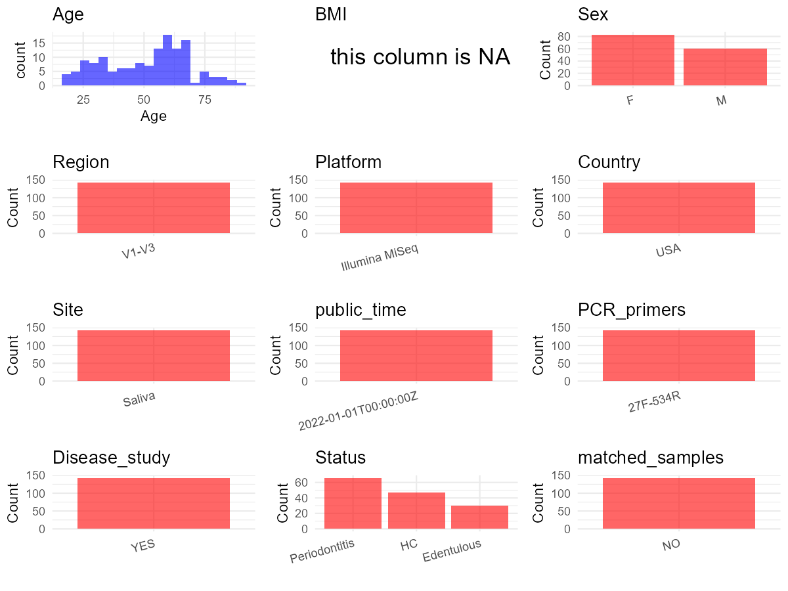

R Notebook: Metadata Processing Workflow
================

# Step 1: Obtain Initial Metadata from Each Project

To obtain the initial metadata: 1. Search for the BioProject ID (e.g.,
“PRJEBXXXX”) on the [NCBI SRA
website](https://www.ncbi.nlm.nih.gov/Traces/study/). 2. In the “Select”
table, click on “Metadata” and download the file. 3. The downloaded file
is typically named “SraRunTable.csv” and contains metadata for the
project.

``` r
# Load necessary libraries
library(dplyr)
library(ggplot2)
library(cowplot)

# Set working directory (update this path to your local directory)
setwd("D:/oral_project/PRJNA739492")

# Read the initial metadata files
initial_meta<-read.csv("SraRunTable.csv",header = T)

# Combine the two metadata files
#meta <- rbind(initial_meta, initial_meta1)

#Remove entries non-oral samples
#initial_meta <- subset(initial_meta,isolate %in% c("saliva","tongue coat"))

# Check the number of samples containing "HT" in Sample.Name (e.g., healthy controls)
#nrow(subset(meta, grepl("HT", Sample.Name)))

# Display the first few rows of the metadata
head(initial_meta)
```

    ##           Run Assay.Type AvgSpotLen    Bases  BioProject    BioSample
    ## 1 SRR14874921   AMPLICON        301  6935341 PRJNA739492 SAMN19790416
    ## 2 SRR14874922   AMPLICON        301 11097569 PRJNA739492 SAMN19790415
    ## 3 SRR14874923   AMPLICON        301 15417521 PRJNA739492 SAMN19790414
    ## 4 SRR14874924   AMPLICON        301 21183176 PRJNA739492 SAMN19790413
    ## 5 SRR14874925   AMPLICON        301 14078071 PRJNA739492 SAMN19790412
    ## 6 SRR14874926   AMPLICON        301  5914951 PRJNA739492 SAMN19790411
    ##                                  BioSampleModel    Bytes
    ## 1 MIMARKS.specimen,MIGS/MIMS/MIMARKS.human-oral  4845668
    ## 2 MIMARKS.specimen,MIGS/MIMS/MIMARKS.human-oral  7736772
    ## 3 MIMARKS.specimen,MIGS/MIMS/MIMARKS.human-oral 10603409
    ## 4 MIMARKS.specimen,MIGS/MIMS/MIMARKS.human-oral 14614316
    ## 5 MIMARKS.specimen,MIGS/MIMS/MIMARKS.human-oral  9696252
    ## 6 MIMARKS.specimen,MIGS/MIMS/MIMARKS.human-oral  4226236
    ##                         Center.Name Collection_Date Consent       Cultivar
    ## 1 UNIVERSITY OF ILLINOIS AT CHICAGO      2018-11-09  public not applicable
    ## 2 UNIVERSITY OF ILLINOIS AT CHICAGO      2018-11-09  public not applicable
    ## 3 UNIVERSITY OF ILLINOIS AT CHICAGO      2018-11-02  public not applicable
    ## 4 UNIVERSITY OF ILLINOIS AT CHICAGO      2018-10-26  public not applicable
    ## 5 UNIVERSITY OF ILLINOIS AT CHICAGO      2018-10-26  public not applicable
    ## 6 UNIVERSITY OF ILLINOIS AT CHICAGO      2018-10-19  public not applicable
    ##   DATASTORE.filetype DATASTORE.provider                     DATASTORE.region
    ## 1   fastq,run.zq,sra         gs,ncbi,s3 gs.us-east1,ncbi.public,s3.us-east-1
    ## 2   fastq,run.zq,sra         gs,ncbi,s3 gs.us-east1,ncbi.public,s3.us-east-1
    ## 3   fastq,run.zq,sra         gs,ncbi,s3 gs.us-east1,ncbi.public,s3.us-east-1
    ## 4   fastq,run.zq,sra         gs,ncbi,s3 gs.us-east1,ncbi.public,s3.us-east-1
    ## 5   fastq,run.zq,sra         gs,ncbi,s3 gs.us-east1,ncbi.public,s3.us-east-1
    ## 6   fastq,run.zq,sra         gs,ncbi,s3 gs.us-east1,ncbi.public,s3.us-east-1
    ##   dentate        Ecotype    env_broad_scale env_local_scale env_medium
    ## 1     Yes not applicable microbiome in oral     oral cavity     saliva
    ## 2     Yes not applicable microbiome in oral     oral cavity     saliva
    ## 3     Yes not applicable microbiome in oral     oral cavity     saliva
    ## 4     Yes not applicable microbiome in oral     oral cavity     saliva
    ## 5     Yes not applicable microbiome in oral     oral cavity     saliva
    ## 6     Yes not applicable microbiome in oral     oral cavity     saliva
    ##    Experiment geo_loc_name_country geo_loc_name_country_continent
    ## 1 SRX11192467                  USA                  North America
    ## 2 SRX11192466                  USA                  North America
    ## 3 SRX11192465                  USA                  North America
    ## 4 SRX11192464                  USA                  North America
    ## 5 SRX11192463                  USA                  North America
    ## 6 SRX11192462                  USA                  North America
    ##         geo_loc_name Host_Age         HOST host_sex host_tissue_sampled
    ## 1 USA: Chicago\\, IL 22.88843 Homo sapiens     male              Saliva
    ## 2 USA: Chicago\\, IL 62.12183 Homo sapiens     male              Saliva
    ## 3 USA: Chicago\\, IL 55.66324 Homo sapiens   female              Saliva
    ## 4 USA: Chicago\\, IL 46.46954 Homo sapiens   female              Saliva
    ## 5 USA: Chicago\\, IL 27.06366 Homo sapiens   female              Saliva
    ## 6 USA: Chicago\\, IL 43.69884 Homo sapiens     male              Saliva
    ##       Instrument isol_growth_condt        isolate             lat_lon
    ## 1 Illumina MiSeq    not applicable not applicable 41.8781 N 87.6298 W
    ## 2 Illumina MiSeq    not applicable not applicable 41.8781 N 87.6298 W
    ## 3 Illumina MiSeq    not applicable not applicable 41.8781 N 87.6298 W
    ## 4 Illumina MiSeq    not applicable not applicable 41.8781 N 87.6298 W
    ## 5 Illumina MiSeq    not applicable not applicable 41.8781 N 87.6298 W
    ## 6 Illumina MiSeq    not applicable not applicable 41.8781 N 87.6298 W
    ##   Library.Name LibraryLayout LibrarySelection LibrarySource
    ## 1         NK55        SINGLE              PCR       GENOMIC
    ## 2         NK54        SINGLE              PCR       GENOMIC
    ## 3         NK51        SINGLE              PCR       GENOMIC
    ## 4         NK47        SINGLE              PCR       GENOMIC
    ## 5         NK44        SINGLE              PCR       GENOMIC
    ## 6         NK43        SINGLE              PCR       GENOMIC
    ##                Organism perio__index perturbation Platform          ReleaseDate
    ## 1 human oral metagenome           No         None ILLUMINA 2022-01-01T00:00:00Z
    ## 2 human oral metagenome          Yes         None ILLUMINA 2022-01-01T00:00:00Z
    ## 3 human oral metagenome           No         None ILLUMINA 2022-01-01T00:00:00Z
    ## 4 human oral metagenome          Yes         None ILLUMINA 2022-01-01T00:00:00Z
    ## 5 human oral metagenome           No         None ILLUMINA 2022-01-01T00:00:00Z
    ## 6 human oral metagenome          Yes         None ILLUMINA 2022-01-01T00:00:00Z
    ##            create_date version            samp_collect_device  Sample.Name
    ## 1 2021-06-21T21:26:00Z       1 Expectorated stimulated saliva Rahe189-NK55
    ## 2 2021-06-21T21:26:00Z       1 Expectorated stimulated saliva Rahe188-NK54
    ## 3 2021-06-21T21:26:00Z       1 Expectorated stimulated saliva Rahe186-NK51
    ## 4 2021-06-21T21:26:00Z       1 Expectorated stimulated saliva Rahe182-NK47
    ## 5 2021-06-21T21:26:00Z       1 Expectorated stimulated saliva Rahe179-NK44
    ## 6 2021-06-21T21:26:00Z       1 Expectorated stimulated saliva Rahe178-NK43
    ##   SRA.Study         strain tobacco_use_at_collection host_subject_id
    ## 1 SRP324960 not applicable                        No    Rahe189-NK55
    ## 2 SRP324960 not applicable                        No    Rahe188-NK54
    ## 3 SRP324960 not applicable                        No    Rahe186-NK51
    ## 4 SRP324960 not applicable                        No    Rahe182-NK47
    ## 5 SRP324960 not applicable                        No    Rahe179-NK44
    ## 6 SRP324960 not applicable                        No    Rahe178-NK43

# Step 2: Create a Uniform Metadata Template

The uniform metadata should include the following columns:

1.  **BioProject**: Project ID (e.g., “PRJNA339212”)
2.  **Run**: Sample ID (e.g., “ERRXXXXXX” or “SRRXXXXXX”)
3.  **sample_name**: Original sample name submitted by the authors (not
    the database-assigned ID)
4.  **Age**: Age of the subject (if available)
5.  **BMI**: Body Mass Index (if available)
6.  **Sex**: Sex of the subject (“F” or “M”)
7.  **Region**: Targeted 16S rRNA region (e.g., “V3-V4”)
8.  **Platform**: Sequencing platform (e.g., “Illumina MiSeq”)
9.  **Country**: Country of sample origin (e.g., “China”)
10. **Site**: Sample site (e.g., “saliva”, “dental plaque”)
11. **public_time**: Data release date (format: “YYYY-MM-DD”)
12. **PCR_primers**: PCR primers used (e.g., “515F-806R”)
13. **title**: Title of the associated publication
14. **Disease_study**: Whether the study involves a disease (“YES” or
    “NO”)
15. **Status**: Disease status (e.g., “T2DM”, “HC”). Note: If the study
    includes both disease and healthy samples, this must be specified
    per sample.
16. **matched_samples**: matched samples (“YES” or “NO”)

``` r
# Create a uniform metadata dataframe
metadata <- data.frame(
  BioProject = initial_meta$BioProject,
  Run = initial_meta$Run,
  sample_name = initial_meta$Sample.Name,
  Age = initial_meta$Host_Age,
  BMI = NA,
  Sex = initial_meta$host_sex,
  Region = "V1-V3",
  Platform = initial_meta$Instrument,
  Country = initial_meta$geo_loc_name_country,
  Site = initial_meta$host_tissue_sampled,
  public_time = initial_meta$ReleaseDate,
  dentate = initial_meta$dentate,
  perio__index = initial_meta$perio__index,
  stringsAsFactors = FALSE
)
```

``` r
metadata <- metadata %>%
  mutate(
    Sex = case_when(
      Sex == "female" ~ "F",
      Sex == "male" ~ "M",
    )
  )
```

# Step 3: Manually Add Information from the Publication

Some information (e.g. PCR primers, study title, disease status) must be
manually extracted from the publication and added to the metadata.

``` r
# Add information obtained from the publication
metadata$PCR_primers <- "27F-534R"
metadata$title <- "Old age and other factors associated with salivary microbiome variation"
metadata$Disease_study <- "YES"
# Assign disease status based on sample_name patterns
metadata <- metadata %>%
  mutate(Status = case_when(
    perio__index == "No" & dentate == "Yes" ~ "HC",  # 健康对照
    perio__index == "Yes" ~ "Periodontitis",         # 牙周炎
    dentate == "No" ~ "Edentulous",                  # 无牙颌
    TRUE ~ "Unknown"                                 # 其他情况
  )) %>%
  select(-perio__index, -dentate)  # 移除临时列
#get subjects id according to sample id
metadata$sample_name<-gsub("Guy|Rahe","",metadata$sample_name)
#get subjects id with Saliva available
keep_subjects<-subset(metadata,Site %in% "Saliva")
#remove subjects without Saliva samples
metadata<-subset(metadata,sample_name %in% keep_subjects$sample_name)
#get subjects sampling counts
sample_counts <- table(metadata$sample_name)
# Create matched_samples column, any subjects have >=2 samples will be label "YES", otherwise "NO"
metadata$matched_samples <- ifelse(metadata$sample_name %in% names(sample_counts[sample_counts >= 2]), "YES", "NO")
```

# Step 4: Summarize and Validate the Metadata

``` r
# Check the number of unique runs and sample names
print(paste("Number of unique runs:", length(unique(metadata$Run))))
```

    ## [1] "Number of unique runs: 143"

``` r
print(paste("Number of unique sample names:", length(unique(metadata$sample_name))))
```

    ## [1] "Number of unique sample names: 143"

# Step 5: Visualize the Metadata

``` r

```


# Step 6: Finalize and Export the Metadata

``` r
# Reorder columns to match the desired format
metadata <- metadata[, c(
  "BioProject", "Run", "sample_name", "Age", "BMI", "Sex", 
  "Region", "Platform", "Country", "Site", "public_time", 
  "PCR_primers", "title", "Disease_study", "Status","matched_samples"
)]

# Export the uniform metadata to a CSV file
write.csv(metadata, file = "metadata.csv", quote = TRUE)
head(metadata)
```

    ##    BioProject         Run sample_name      Age BMI Sex Region       Platform
    ## 1 PRJNA739492 SRR14874921    189-NK55 22.88843  NA   M  V1-V3 Illumina MiSeq
    ## 2 PRJNA739492 SRR14874922    188-NK54 62.12183  NA   M  V1-V3 Illumina MiSeq
    ## 3 PRJNA739492 SRR14874923    186-NK51 55.66324  NA   F  V1-V3 Illumina MiSeq
    ## 4 PRJNA739492 SRR14874924    182-NK47 46.46954  NA   F  V1-V3 Illumina MiSeq
    ## 5 PRJNA739492 SRR14874925    179-NK44 27.06366  NA   F  V1-V3 Illumina MiSeq
    ## 6 PRJNA739492 SRR14874926    178-NK43 43.69884  NA   M  V1-V3 Illumina MiSeq
    ##   Country   Site          public_time PCR_primers
    ## 1     USA Saliva 2022-01-01T00:00:00Z    27F-534R
    ## 2     USA Saliva 2022-01-01T00:00:00Z    27F-534R
    ## 3     USA Saliva 2022-01-01T00:00:00Z    27F-534R
    ## 4     USA Saliva 2022-01-01T00:00:00Z    27F-534R
    ## 5     USA Saliva 2022-01-01T00:00:00Z    27F-534R
    ## 6     USA Saliva 2022-01-01T00:00:00Z    27F-534R
    ##                                                                     title
    ## 1 Old age and other factors associated with salivary microbiome variation
    ## 2 Old age and other factors associated with salivary microbiome variation
    ## 3 Old age and other factors associated with salivary microbiome variation
    ## 4 Old age and other factors associated with salivary microbiome variation
    ## 5 Old age and other factors associated with salivary microbiome variation
    ## 6 Old age and other factors associated with salivary microbiome variation
    ##   Disease_study        Status matched_samples
    ## 1           YES            HC              NO
    ## 2           YES Periodontitis              NO
    ## 3           YES            HC              NO
    ## 4           YES Periodontitis              NO
    ## 5           YES            HC              NO
    ## 6           YES Periodontitis              NO

## Notes for Students:

1.  **Metadata Accuracy**: Always cross-check the metadata with the
    original publication to ensure accuracy.
2.  **Manual Entries**: Columns like `PCR_primers`, and `Status` often
    require manual entry based on the publication.
3.  **Disease Status**: Be careful when assigning `Status`—some studies
    include both disease and healthy samples.
4.  **Visualization**: The plots help quickly identify the distribution
    of values in each column, which is useful for quality control.
5.  **Reproducibility**: Update the working directory and file paths to
    match your local environment.
