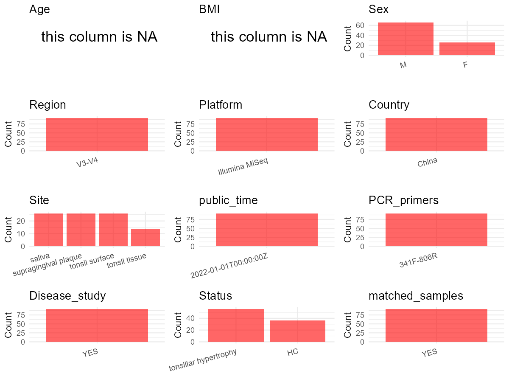

R Notebook: Metadata Processing Workflow
================

# Step 1: Obtain Initial Metadata from Each Project

To obtain the initial metadata: 1. Search for the BioProject ID (e.g.,
“PRJEBXXXX”) on the [NCBI SRA
website](https://www.ncbi.nlm.nih.gov/Traces/study/). 2. In the “Select”
table, click on “Metadata” and download the file. 3. The downloaded file
is typically named “SraRunTable.csv” and contains metadata for the
project.

``` r
# Load necessary libraries
library(dplyr)
library(ggplot2)
library(cowplot)

# Set working directory (update this path to your local directory)
setwd("D:/oral_project/PRJNA740113")

# Read the initial metadata files
initial_meta<-read.csv("SraRunTable.csv",header = T)

# Combine the two metadata files
#meta <- rbind(initial_meta, initial_meta1)

#Remove entries non-oral samples
#initial_meta <- subset(initial_meta,isolate %in% c("saliva","tongue coat"))

# Check the number of samples containing "HT" in Sample.Name (e.g., healthy controls)
#nrow(subset(meta, grepl("HT", Sample.Name)))

# Display the first few rows of the metadata
head(initial_meta)
```

    ##           Run Assay.Type AvgSpotLen    Bases  BioProject    BioSample
    ## 1 SRR14885741   AMPLICON        602 54881330 PRJNA740113 SAMN19820377
    ## 2 SRR14885742   AMPLICON        602 49530152 PRJNA740113 SAMN19820376
    ## 3 SRR14885743   AMPLICON        600 70072928 PRJNA740113 SAMN19820295
    ## 4 SRR14885744   AMPLICON        602 26260444 PRJNA740113 SAMN19820375
    ## 5 SRR14885745   AMPLICON        602 26159910 PRJNA740113 SAMN19820374
    ## 6 SRR14885746   AMPLICON        602 35781676 PRJNA740113 SAMN19820373
    ##                                  BioSampleModel    Bytes
    ## 1 MIMARKS.specimen,MIGS/MIMS/MIMARKS.human-oral 31383122
    ## 2 MIMARKS.specimen,MIGS/MIMS/MIMARKS.human-oral 28175996
    ## 3 MIMARKS.specimen,MIGS/MIMS/MIMARKS.human-oral 41026848
    ## 4 MIMARKS.specimen,MIGS/MIMS/MIMARKS.human-oral 15220373
    ## 5 MIMARKS.specimen,MIGS/MIMS/MIMARKS.human-oral 15220855
    ## 6 MIMARKS.specimen,MIGS/MIMS/MIMARKS.human-oral 20523009
    ##                                            Center.Name Collection_Date Consent
    ## 1 PEKING UNIVERSITY SCHOOL AND HOSPITAL OF STOMATOLOGY            2020  public
    ## 2 PEKING UNIVERSITY SCHOOL AND HOSPITAL OF STOMATOLOGY            2020  public
    ## 3 PEKING UNIVERSITY SCHOOL AND HOSPITAL OF STOMATOLOGY            2020  public
    ## 4 PEKING UNIVERSITY SCHOOL AND HOSPITAL OF STOMATOLOGY            2020  public
    ## 5 PEKING UNIVERSITY SCHOOL AND HOSPITAL OF STOMATOLOGY            2020  public
    ## 6 PEKING UNIVERSITY SCHOOL AND HOSPITAL OF STOMATOLOGY            2020  public
    ##   DATASTORE.filetype DATASTORE.provider                     DATASTORE.region
    ## 1   fastq,run.zq,sra         gs,ncbi,s3 gs.us-east1,ncbi.public,s3.us-east-1
    ## 2   fastq,run.zq,sra         gs,ncbi,s3 gs.us-east1,ncbi.public,s3.us-east-1
    ## 3   fastq,run.zq,sra         gs,ncbi,s3 gs.us-east1,ncbi.public,s3.us-east-1
    ## 4   fastq,run.zq,sra         gs,ncbi,s3 gs.us-east1,ncbi.public,s3.us-east-1
    ## 5   fastq,run.zq,sra         gs,ncbi,s3 gs.us-east1,ncbi.public,s3.us-east-1
    ## 6   fastq,run.zq,sra         gs,ncbi,s3 gs.us-east1,ncbi.public,s3.us-east-1
    ##   env_broad_scale env_local_scale    env_medium  Experiment
    ## 1   tonsil tissue   tonsil tissue tonsil tissue SRX11202912
    ## 2   tonsil tissue   tonsil tissue tonsil tissue SRX11202911
    ## 3          saliva          saliva        saliva SRX11202910
    ## 4   tonsil tissue   tonsil tissue tonsil tissue SRX11202909
    ## 5   tonsil tissue   tonsil tissue tonsil tissue SRX11202908
    ## 6   tonsil tissue   tonsil tissue tonsil tissue SRX11202907
    ##   geo_loc_name_country geo_loc_name_country_continent geo_loc_name         HOST
    ## 1                China                           Asia        China Homo sapiens
    ## 2                China                           Asia        China Homo sapiens
    ## 3                China                           Asia        China Homo sapiens
    ## 4                China                           Asia        China Homo sapiens
    ## 5                China                           Asia        China Homo sapiens
    ## 6                China                           Asia        China Homo sapiens
    ##       Instrument isol_growth_condt       isolate       lat_lon Library.Name
    ## 1 Illumina MiSeq    not applicable tonsil tissue not collected       T14_Th
    ## 2 Illumina MiSeq    not applicable tonsil tissue not collected       T13_Th
    ## 3 Illumina MiSeq    not applicable        saliva not collected        T04_B
    ## 4 Illumina MiSeq    not applicable tonsil tissue not collected       T12_Th
    ## 5 Illumina MiSeq    not applicable tonsil tissue not collected       T11_Th
    ## 6 Illumina MiSeq    not applicable tonsil tissue not collected       T10_Th
    ##   LibraryLayout LibrarySelection LibrarySource         Organism Platform
    ## 1        PAIRED              PCR       GENOMIC human metagenome ILLUMINA
    ## 2        PAIRED              PCR       GENOMIC human metagenome ILLUMINA
    ## 3        PAIRED              PCR       GENOMIC human metagenome ILLUMINA
    ## 4        PAIRED              PCR       GENOMIC human metagenome ILLUMINA
    ## 5        PAIRED              PCR       GENOMIC human metagenome ILLUMINA
    ## 6        PAIRED              PCR       GENOMIC human metagenome ILLUMINA
    ##            ReleaseDate replicate          create_date version
    ## 1 2022-01-01T00:00:00Z        92 2021-06-23T03:47:00Z       1
    ## 2 2022-01-01T00:00:00Z        91 2021-06-23T03:47:00Z       1
    ## 3 2022-01-01T00:00:00Z        10 2021-06-23T03:47:00Z       1
    ## 4 2022-01-01T00:00:00Z        90 2021-06-23T03:47:00Z       1
    ## 5 2022-01-01T00:00:00Z        89 2021-06-23T03:47:00Z       1
    ## 6 2022-01-01T00:00:00Z        88 2021-06-23T03:47:00Z       1
    ##              Sample.Name SRA.Study
    ## 1 AWGB16SAA2025541_37_37 SRP325217
    ## 2 AWGB16SAA2025540_37_36 SRP325217
    ## 3 AWGB16SAA2024891_35_33 SRP325217
    ## 4 AWGB16SAA2025539_37_35 SRP325217
    ## 5 AWGB16SAA2025538_37_34 SRP325217
    ## 6 AWGB16SAA2025537_37_33 SRP325217

# Step 2: Create a Uniform Metadata Template

The uniform metadata should include the following columns:

1.  **BioProject**: Project ID (e.g., “PRJNA339212”)
2.  **Run**: Sample ID (e.g., “ERRXXXXXX” or “SRRXXXXXX”)
3.  **sample_name**: Original sample name submitted by the authors (not
    the database-assigned ID)
4.  **Age**: Age of the subject (if available)
5.  **BMI**: Body Mass Index (if available)
6.  **Sex**: Sex of the subject (“F” or “M”)
7.  **Region**: Targeted 16S rRNA region (e.g., “V3-V4”)
8.  **Platform**: Sequencing platform (e.g., “Illumina MiSeq”)
9.  **Country**: Country of sample origin (e.g., “China”)
10. **Site**: Sample site (e.g., “saliva”, “dental plaque”)
11. **public_time**: Data release date (format: “YYYY-MM-DD”)
12. **PCR_primers**: PCR primers used (e.g., “515F-806R”)
13. **title**: Title of the associated publication
14. **Disease_study**: Whether the study involves a disease (“YES” or
    “NO”)
15. **Status**: Disease status (e.g., “T2DM”, “HC”). Note: If the study
    includes both disease and healthy samples, this must be specified
    per sample.
16. **matched_samples**: matched samples (“YES” or “NO”)

``` r
# Create a uniform metadata dataframe
metadata <- data.frame(
  BioProject = initial_meta$BioProject,
  Run = initial_meta$Run,
  sample_name = initial_meta$Library.Name,
  Age = NA,
  BMI = NA,
  #Sex = NA,
  Region = "V3-V4",
  Platform = initial_meta$Instrument,
  Country = initial_meta$geo_loc_name_country,
  Site = initial_meta$isolate,
  public_time = initial_meta$ReleaseDate,
  stringsAsFactors = FALSE
)
```

``` r
metadata <- metadata %>%
  mutate(
    Sex = case_when(
      grepl("T01|T02|T03|T04|T05|T06|T07|T08|T09|T10|T11|T12|H01|H02|H03|H04|H05|H06", sample_name) ~ "M",
      grepl("T13|T14|H07|H08|H09|H10|H11|H12", sample_name) ~ "F",
    )
  )
```

# Step 3: Manually Add Information from the Publication

Some information (e.g. PCR primers, study title, disease status) must be
manually extracted from the publication and added to the metadata.

``` r
# Add information obtained from the publication
metadata$PCR_primers <- "341F-806R"
metadata$title <- "A Correlation Study of the Microbiota Between Oral Cavity and Tonsils in Children With Tonsillar Hypertrophy"
metadata$Disease_study <- "YES"
# Assign disease status based on sample_name patterns
metadata <- metadata %>%
  mutate(Status = case_when(
    grepl("^H", sample_name) ~ "HC",
    grepl("^T", sample_name) ~ "tonsillar hypertrophy"
  ))

#get subjects id according to sample id
metadata$sample_name<-gsub("_Th|_B|_T|_P|_B|-T","",metadata$sample_name)
#get subjects id with Saliva available
keep_subjects<-subset(metadata,Site %in% "tonsil surface")
#remove subjects without Saliva samples
metadata<-subset(metadata,sample_name %in% keep_subjects$sample_name)
#get subjects sampling counts
sample_counts <- table(metadata$sample_name)
# Create matched_samples column, any subjects have >=2 samples will be label "YES", otherwise "NO"
metadata$matched_samples <- ifelse(metadata$sample_name %in% names(sample_counts[sample_counts >= 2]), "YES", "NO")
```

# Step 4: Summarize and Validate the Metadata

``` r
# Check the number of unique runs and sample names
print(paste("Number of unique runs:", length(unique(metadata$Run))))
```

    ## [1] "Number of unique runs: 92"

``` r
print(paste("Number of unique sample names:", length(unique(metadata$sample_name))))
```

    ## [1] "Number of unique sample names: 26"

# Step 5: Visualize the Metadata

``` r

```


# Step 6: Finalize and Export the Metadata

``` r
# Reorder columns to match the desired format
metadata <- metadata[, c(
  "BioProject", "Run", "sample_name", "Age", "BMI", "Sex", 
  "Region", "Platform", "Country", "Site", "public_time", 
  "PCR_primers", "title", "Disease_study", "Status","matched_samples"
)]

# Export the uniform metadata to a CSV file
write.csv(metadata, file = "metadata.csv", quote = TRUE)
head(metadata)
```

    ##    BioProject         Run sample_name Age BMI Sex Region       Platform Country
    ## 1 PRJNA740113 SRR14885741         T14  NA  NA   F  V3-V4 Illumina MiSeq   China
    ## 2 PRJNA740113 SRR14885742         T13  NA  NA   F  V3-V4 Illumina MiSeq   China
    ## 3 PRJNA740113 SRR14885743         T04  NA  NA   M  V3-V4 Illumina MiSeq   China
    ## 4 PRJNA740113 SRR14885744         T12  NA  NA   M  V3-V4 Illumina MiSeq   China
    ## 5 PRJNA740113 SRR14885745         T11  NA  NA   M  V3-V4 Illumina MiSeq   China
    ## 6 PRJNA740113 SRR14885746         T10  NA  NA   M  V3-V4 Illumina MiSeq   China
    ##            Site          public_time PCR_primers
    ## 1 tonsil tissue 2022-01-01T00:00:00Z   341F-806R
    ## 2 tonsil tissue 2022-01-01T00:00:00Z   341F-806R
    ## 3        saliva 2022-01-01T00:00:00Z   341F-806R
    ## 4 tonsil tissue 2022-01-01T00:00:00Z   341F-806R
    ## 5 tonsil tissue 2022-01-01T00:00:00Z   341F-806R
    ## 6 tonsil tissue 2022-01-01T00:00:00Z   341F-806R
    ##                                                                                                          title
    ## 1 A Correlation Study of the Microbiota Between Oral Cavity and Tonsils in Children With Tonsillar Hypertrophy
    ## 2 A Correlation Study of the Microbiota Between Oral Cavity and Tonsils in Children With Tonsillar Hypertrophy
    ## 3 A Correlation Study of the Microbiota Between Oral Cavity and Tonsils in Children With Tonsillar Hypertrophy
    ## 4 A Correlation Study of the Microbiota Between Oral Cavity and Tonsils in Children With Tonsillar Hypertrophy
    ## 5 A Correlation Study of the Microbiota Between Oral Cavity and Tonsils in Children With Tonsillar Hypertrophy
    ## 6 A Correlation Study of the Microbiota Between Oral Cavity and Tonsils in Children With Tonsillar Hypertrophy
    ##   Disease_study                Status matched_samples
    ## 1           YES tonsillar hypertrophy             YES
    ## 2           YES tonsillar hypertrophy             YES
    ## 3           YES tonsillar hypertrophy             YES
    ## 4           YES tonsillar hypertrophy             YES
    ## 5           YES tonsillar hypertrophy             YES
    ## 6           YES tonsillar hypertrophy             YES

## Notes for Students:

1.  **Metadata Accuracy**: Always cross-check the metadata with the
    original publication to ensure accuracy.
2.  **Manual Entries**: Columns like `PCR_primers`, and `Status` often
    require manual entry based on the publication.
3.  **Disease Status**: Be careful when assigning `Status`—some studies
    include both disease and healthy samples.
4.  **Visualization**: The plots help quickly identify the distribution
    of values in each column, which is useful for quality control.
5.  **Reproducibility**: Update the working directory and file paths to
    match your local environment.
