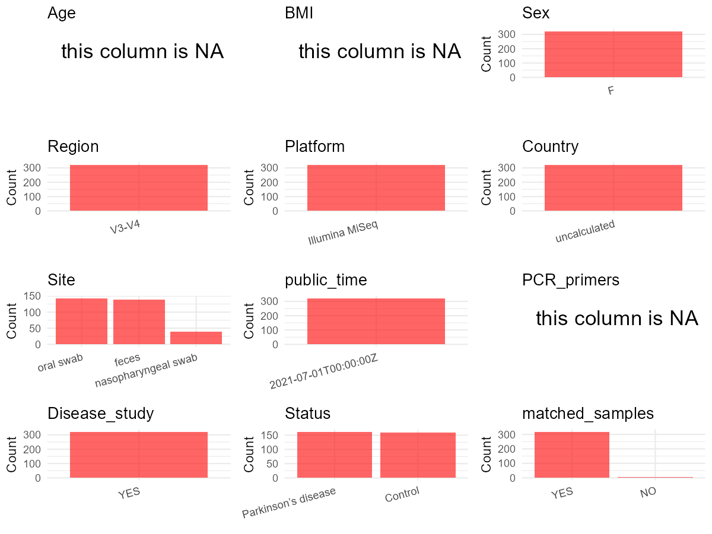

R Notebook: Metadata Processing Workflow
================

# Step 1: Obtain Initial Metadata from Each Project

To obtain the initial metadata: 1. Search for the BioProject ID (e.g.,
“PRJEBXXXX”) on the [NCBI SRA
website](https://www.ncbi.nlm.nih.gov/Traces/study/). 2. In the “Select”
table, click on “Metadata” and download the file. 3. The downloaded file
is typically named “SraRunTable.csv” and contains metadata for the
project.

``` r
# Load necessary libraries
library(dplyr)
library(ggplot2)
library(cowplot)

# Set working directory (update this path to your local directory)
setwd("D:/oral_project/PRJNA742875")

# Read the initial metadata files
initial_meta<-read.csv("SraRunTable.csv",header = T)

# Combine the two metadata files
#meta <- rbind(initial_meta, initial_meta1)

#Remove entries where Organism is "gut metagenome" (non-oral samples)
#initial_meta <- subset(initial_meta,isolation_source!= "feces")

# Check the number of samples containing "HT" in Sample.Name (e.g., healthy controls)
#nrow(subset(meta, grepl("HT", Sample.Name)))

# Display the first few rows of the metadata
head(initial_meta)
```

    ##           Run Assay.Type AvgSpotLen    Bases  BioProject    BioSample
    ## 1 SRR15012360   AMPLICON        501 66013470 PRJNA742875 SAMN19982821
    ## 2 SRR15012361   AMPLICON        501 16993384 PRJNA742875 SAMN19982749
    ## 3 SRR15012362   AMPLICON        501 60250048 PRJNA742875 SAMN19982820
    ## 4 SRR15012363   AMPLICON        501 41944347 PRJNA742875 SAMN19982819
    ## 5 SRR15012364   AMPLICON        501 60264387 PRJNA742875 SAMN19982818
    ## 6 SRR15012365   AMPLICON        501 41074330 PRJNA742875 SAMN19982817
    ##                                      BioSampleModel    Bytes Center.Name
    ## 1 MIMARKS.survey,MIGS/MIMS/MIMARKS.human-associated 41491940 CHUNLAB.INC
    ## 2 MIMARKS.survey,MIGS/MIMS/MIMARKS.human-associated 11660947 CHUNLAB.INC
    ## 3 MIMARKS.survey,MIGS/MIMS/MIMARKS.human-associated 37446941 CHUNLAB.INC
    ## 4 MIMARKS.survey,MIGS/MIMS/MIMARKS.human-associated 25470735 CHUNLAB.INC
    ## 5 MIMARKS.survey,MIGS/MIMS/MIMARKS.human-associated 37736275 CHUNLAB.INC
    ## 6 MIMARKS.survey,MIGS/MIMS/MIMARKS.human-associated 25645941 CHUNLAB.INC
    ##   Collection_Date Consent DATASTORE.filetype DATASTORE.provider
    ## 1      2020-09-16  public   fastq,run.zq,sra         gs,ncbi,s3
    ## 2      2020-03-24  public   fastq,run.zq,sra         gs,ncbi,s3
    ## 3      2020-09-14  public   fastq,run.zq,sra         gs,ncbi,s3
    ## 4      2020-09-09  public   fastq,run.zq,sra         gs,ncbi,s3
    ## 5      2020-09-09  public   fastq,run.zq,sra         gs,ncbi,s3
    ## 6      2020-08-28  public   fastq,run.zq,sra         gs,ncbi,s3
    ##                       DATASTORE.region                 env_broad_scale
    ## 1 gs.us-east1,ncbi.public,s3.us-east-1           human oral microbiome
    ## 2 gs.us-east1,ncbi.public,s3.us-east-1 human nasopharyngeal microbiome
    ## 3 gs.us-east1,ncbi.public,s3.us-east-1           human oral microbiome
    ## 4 gs.us-east1,ncbi.public,s3.us-east-1           human oral microbiome
    ## 5 gs.us-east1,ncbi.public,s3.us-east-1           human oral microbiome
    ## 6 gs.us-east1,ncbi.public,s3.us-east-1           human oral microbiome
    ##                    env_local_scale          env_medium  Experiment
    ## 1           human oral swab sample           oral swab SRX11324786
    ## 2 human nasopharyngeal swab sample nasopharyngeal swab SRX11324785
    ## 3           human oral swab sample           oral swab SRX11324784
    ## 4           human oral swab sample           oral swab SRX11324783
    ## 5           human oral swab sample           oral swab SRX11324782
    ## 6           human oral swab sample           oral swab SRX11324781
    ##   geo_loc_name_country geo_loc_name_country_continent geo_loc_name         HOST
    ## 1         uncalculated                   uncalculated Korea: Seoul Homo sapiens
    ## 2         uncalculated                   uncalculated Korea: Seoul Homo sapiens
    ## 3         uncalculated                   uncalculated Korea: Seoul Homo sapiens
    ## 4         uncalculated                   uncalculated Korea: Seoul Homo sapiens
    ## 5         uncalculated                   uncalculated Korea: Seoul Homo sapiens
    ## 6         uncalculated                   uncalculated Korea: Seoul Homo sapiens
    ##       Instrument                      lat_lon Library.Name LibraryLayout
    ## 1 Illumina MiSeq 37.52658163 N 127.10872432 E  SJC-C-046-2        PAIRED
    ## 2 Illumina MiSeq 37.52658163 N 127.10872432 E  SJC-C-033-1        PAIRED
    ## 3 Illumina MiSeq 37.52658163 N 127.10872432 E  SJC-C-045-2        PAIRED
    ## 4 Illumina MiSeq 37.52658163 N 127.10872432 E  SJC-C-044-2        PAIRED
    ## 5 Illumina MiSeq 37.52658163 N 127.10872432 E  SJC-C-043-2        PAIRED
    ## 6 Illumina MiSeq 37.52658163 N 127.10872432 E  SJC-C-042-2        PAIRED
    ##   LibrarySelection LibrarySource                        Organism
    ## 1              PCR   METAGENOMIC           human oral metagenome
    ## 2              PCR   METAGENOMIC human nasopharyngeal metagenome
    ## 3              PCR   METAGENOMIC           human oral metagenome
    ## 4              PCR   METAGENOMIC           human oral metagenome
    ## 5              PCR   METAGENOMIC           human oral metagenome
    ## 6              PCR   METAGENOMIC           human oral metagenome
    ##   patient.control_label Platform          ReleaseDate          create_date
    ## 1        Control No.046 ILLUMINA 2021-07-01T00:00:00Z 2021-07-01T06:50:00Z
    ## 2        Control No.033 ILLUMINA 2021-07-01T00:00:00Z 2021-07-01T06:50:00Z
    ## 3        Control No.045 ILLUMINA 2021-07-01T00:00:00Z 2021-07-01T06:50:00Z
    ## 4        Control No.044 ILLUMINA 2021-07-01T00:00:00Z 2021-07-01T06:50:00Z
    ## 5        Control No.043 ILLUMINA 2021-07-01T00:00:00Z 2021-07-01T06:51:00Z
    ## 6        Control No.042 ILLUMINA 2021-07-01T00:00:00Z 2021-07-01T06:51:00Z
    ##   version Sample.Name SRA.Study
    ## 1       1 SJC-C-046-2 SRP326435
    ## 2       1 SJC-C-033-1 SRP326435
    ## 3       1 SJC-C-045-2 SRP326435
    ## 4       1 SJC-C-044-2 SRP326435
    ## 5       1 SJC-C-043-2 SRP326435
    ## 6       1 SJC-C-042-2 SRP326435

# Step 2: Create a Uniform Metadata Template

The uniform metadata should include the following columns:

1.  **BioProject**: Project ID (e.g., “PRJNA339212”)
2.  **Run**: Sample ID (e.g., “ERRXXXXXX” or “SRRXXXXXX”)
3.  **sample_name**: Original sample name submitted by the authors (not
    the database-assigned ID)
4.  **Age**: Age of the subject (if available)
5.  **BMI**: Body Mass Index (if available)
6.  **Sex**: Sex of the subject (“F” or “M”)
7.  **Region**: Targeted 16S rRNA region (e.g., “V3-V4”)
8.  **Platform**: Sequencing platform (e.g., “Illumina MiSeq”)
9.  **Country**: Country of sample origin (e.g., “China”)
10. **Site**: Sample site (e.g., “saliva”, “dental plaque”)
11. **public_time**: Data release date (format: “YYYY-MM-DD”)
12. **PCR_primers**: PCR primers used (e.g., “515F-806R”)
13. **title**: Title of the associated publication
14. **Disease_study**: Whether the study involves a disease (“YES” or
    “NO”)
15. **Status**: Disease status (e.g., “T2DM”, “HC”). Note: If the study
    includes both disease and healthy samples, this must be specified
    per sample.

``` r
# Create a uniform metadata dataframe
metadata <- data.frame(
  BioProject = initial_meta$BioProject,
  Run = initial_meta$Run,
  sample_name = initial_meta$patient.control_label,
  Age = NA,
  BMI = NA,
  Sex="F",
  Region = "V3-V4",
  Platform = initial_meta$Instrument,
  Country = initial_meta$geo_loc_name_country,
  Site =initial_meta$env_medium,
  public_time = initial_meta$ReleaseDate,
  stringsAsFactors = FALSE
)
```

# Step 3: Manually Add Information from the Publication

Some information (e.g. PCR primers, study title, disease status) must be
manually extracted from the publication and added to the metadata.

``` r
# Add information obtained from the publication
metadata$PCR_primers <- NA
metadata$title <- "Oral and gut dysbiosis leads to functional alterations in Parkinson’s disease"
#metadata<-subset(uniform_meta,Site!="feces")
metadata$Disease_study <- "YES"
# Assign disease status based on sample_name patterns
metadata$Status <- initial_meta$patient.control_label
metadata<-metadata%>%
  mutate(Status=case_when(grepl("Control",Status)~"Control",grepl("Patient",Status)~"Parkinson’s disease"))
#extract subject id by remove prefix of sample_name
#metadata$sample_name <- gsub("[FSP].*", "", metadata$sample_name)
#get subjects id with Saliva available
keep_subjects<-subset(metadata,Site %in% c("oral swab"))
#remove subjects without Saliva samples
metadata<-subset(metadata,sample_name %in% keep_subjects$sample_name)
#get subjects sampling counts
sample_counts <- table(metadata$sample_name)
# Create matched_samples column, any subjects have >=2 samples will be label "YES", otherwise "NO"
metadata$matched_samples <- ifelse(metadata$sample_name %in% names(sample_counts[sample_counts >= 2]), "YES", "NO")
#metadata$BMI<-gsub("not provided",NA,metadata$BMI)
#metadata$BMI<-as.numeric(metadata$BMI)
```

# Step 4: Summarize and Validate the Metadata

``` r
# Check the number of unique runs and sample names
print(paste("Number of unique runs:", length(unique(metadata$Run))))
```

    ## [1] "Number of unique runs: 322"

``` r
print(paste("Number of unique sample names:", length(unique(metadata$sample_name))))
```

    ## [1] "Number of unique sample names: 143"

# Step 5: Visualize the Metadata

``` r

```


# Step 6: Finalize and Export the Metadata

``` r
# Reorder columns to match the desired format
metadata <- metadata[, c(
  "BioProject", "Run", "sample_name", "Age", "BMI", "Sex", 
  "Region", "Platform", "Country", "Site", "public_time", 
  "PCR_primers", "title", "Disease_study", "Status","matched_samples"
)]

# Export the uniform metadata to a CSV file
write.csv(metadata, file = "metadata.csv", quote = FALSE)
head(metadata)
```

    ##    BioProject         Run    sample_name Age BMI Sex Region       Platform
    ## 1 PRJNA742875 SRR15012360 Control No.046  NA  NA   F  V3-V4 Illumina MiSeq
    ## 2 PRJNA742875 SRR15012361 Control No.033  NA  NA   F  V3-V4 Illumina MiSeq
    ## 3 PRJNA742875 SRR15012362 Control No.045  NA  NA   F  V3-V4 Illumina MiSeq
    ## 4 PRJNA742875 SRR15012363 Control No.044  NA  NA   F  V3-V4 Illumina MiSeq
    ## 5 PRJNA742875 SRR15012364 Control No.043  NA  NA   F  V3-V4 Illumina MiSeq
    ## 6 PRJNA742875 SRR15012365 Control No.042  NA  NA   F  V3-V4 Illumina MiSeq
    ##        Country                Site          public_time PCR_primers
    ## 1 uncalculated           oral swab 2021-07-01T00:00:00Z          NA
    ## 2 uncalculated nasopharyngeal swab 2021-07-01T00:00:00Z          NA
    ## 3 uncalculated           oral swab 2021-07-01T00:00:00Z          NA
    ## 4 uncalculated           oral swab 2021-07-01T00:00:00Z          NA
    ## 5 uncalculated           oral swab 2021-07-01T00:00:00Z          NA
    ## 6 uncalculated           oral swab 2021-07-01T00:00:00Z          NA
    ##                                                                           title
    ## 1 Oral and gut dysbiosis leads to functional alterations in Parkinson’s disease
    ## 2 Oral and gut dysbiosis leads to functional alterations in Parkinson’s disease
    ## 3 Oral and gut dysbiosis leads to functional alterations in Parkinson’s disease
    ## 4 Oral and gut dysbiosis leads to functional alterations in Parkinson’s disease
    ## 5 Oral and gut dysbiosis leads to functional alterations in Parkinson’s disease
    ## 6 Oral and gut dysbiosis leads to functional alterations in Parkinson’s disease
    ##   Disease_study  Status matched_samples
    ## 1           YES Control             YES
    ## 2           YES Control             YES
    ## 3           YES Control             YES
    ## 4           YES Control             YES
    ## 5           YES Control             YES
    ## 6           YES Control             YES

## Notes for Students:

1.  **Metadata Accuracy**: Always cross-check the metadata with the
    original publication to ensure accuracy.
2.  **Manual Entries**: Columns like `PCR_primers`, and `Status` often
    require manual entry based on the publication.
3.  **Disease Status**: Be careful when assigning `Status`—some studies
    include both disease and healthy samples.
4.  **Visualization**: The plots help quickly identify the distribution
    of values in each column, which is useful for quality control.
5.  **Reproducibility**: Update the working directory and file paths to
    match your local environment.
