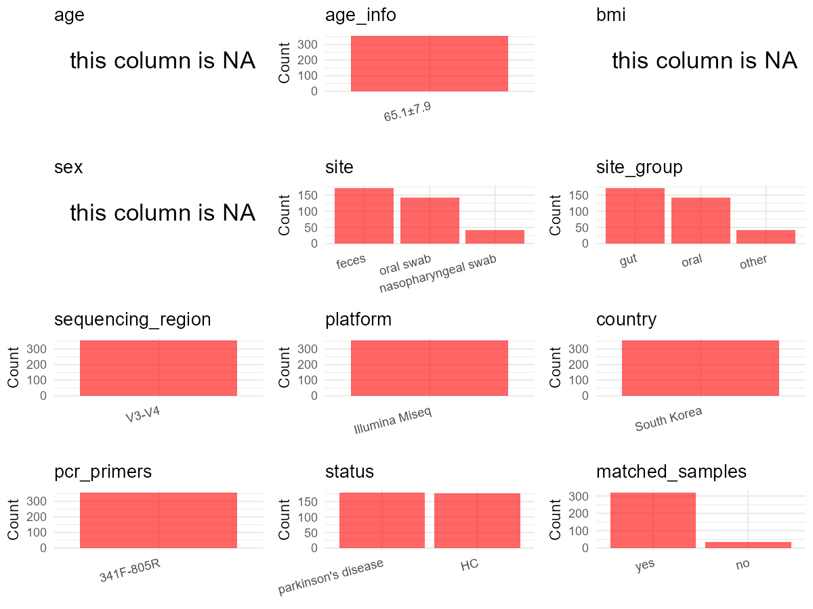

R Notebook: Metadata Processing Workflow
================

# Step 1: Obtain Initial Metadata from Each Project

This step sets the project directory, loads the raw SRA metadata, and
optionally merges supplement tables.

``` r
# Load libraries
library(dplyr)
library(ggplot2)
library(cowplot)

# (1) Setting working directory
# EDIT HERE: change project_id for each study
project_id <- "PRJNA742875" 

base_dir <- "E:/oral/26/metadata-2604/Oral-Metadata-YL-02"
setwd(file.path(base_dir, project_id))

# (2) Loading raw SRA metadata file
sra_file <- "SraRunTable.csv"
initial_meta <- read.csv(sra_file, header = TRUE)

# (3) OPTIONAL: If extra metadata (e.g., Table.x or supplemental materials) are available from the article, you may need to merge the file with initial_meta manually. Below is example code for merging. Depending on the specific case of each study, you can customize the code as needed.
# supp_table <- read.csv("supplemental_table.csv", header = TRUE)
# initial_meta <- left_join(initial_meta, supp_table, by = merge_col_name)
```

# Step 2: Data Overview

First, you need to get an overview of the data, which includes two
steps: reading the article and reading the initial metadata. This step
is very IMPORTANT!

``` r
# (1) Read the article in the following order: abstract, the beginning of the results section, and the methods. Understand the sample size, experimental design, and disease group overview. Clarify the sampling sites; for oral and gut samples, specify the exact sites like supragingival plaque, tongue, etc.

# (2) IMPORTANT: MUST go through each column of initial_meta
head(initial_meta, 10)
```

    ##            Run Assay.Type AvgSpotLen    Bases  BioProject    BioSample
    ## 1  SRR15012360   AMPLICON        501 66013470 PRJNA742875 SAMN19982821
    ## 2  SRR15012361   AMPLICON        501 16993384 PRJNA742875 SAMN19982749
    ## 3  SRR15012362   AMPLICON        501 60250048 PRJNA742875 SAMN19982820
    ## 4  SRR15012363   AMPLICON        501 41944347 PRJNA742875 SAMN19982819
    ## 5  SRR15012364   AMPLICON        501 60264387 PRJNA742875 SAMN19982818
    ## 6  SRR15012365   AMPLICON        501 41074330 PRJNA742875 SAMN19982817
    ## 7  SRR15012366   AMPLICON        501  8766192 PRJNA742875 SAMN19982816
    ## 8  SRR15012367   AMPLICON        501 11077982 PRJNA742875 SAMN19982815
    ## 9  SRR15012368   AMPLICON        501  8023083 PRJNA742875 SAMN19982814
    ## 10 SRR15012369   AMPLICON        501 11387228 PRJNA742875 SAMN19982813
    ##                                       BioSampleModel    Bytes Center.Name
    ## 1  MIMARKS.survey,MIGS/MIMS/MIMARKS.human-associated 41491940 CHUNLAB.INC
    ## 2  MIMARKS.survey,MIGS/MIMS/MIMARKS.human-associated 11660947 CHUNLAB.INC
    ## 3  MIMARKS.survey,MIGS/MIMS/MIMARKS.human-associated 37446941 CHUNLAB.INC
    ## 4  MIMARKS.survey,MIGS/MIMS/MIMARKS.human-associated 25470735 CHUNLAB.INC
    ## 5  MIMARKS.survey,MIGS/MIMS/MIMARKS.human-associated 37736275 CHUNLAB.INC
    ## 6  MIMARKS.survey,MIGS/MIMS/MIMARKS.human-associated 25645941 CHUNLAB.INC
    ## 7  MIMARKS.survey,MIGS/MIMS/MIMARKS.human-associated  5852530 CHUNLAB.INC
    ## 8  MIMARKS.survey,MIGS/MIMS/MIMARKS.human-associated  6989945 CHUNLAB.INC
    ## 9  MIMARKS.survey,MIGS/MIMS/MIMARKS.human-associated  5427883 CHUNLAB.INC
    ## 10 MIMARKS.survey,MIGS/MIMS/MIMARKS.human-associated  7350882 CHUNLAB.INC
    ##    Collection_Date Consent DATASTORE.filetype DATASTORE.provider
    ## 1       2020-09-16  public   fastq,run.zq,sra         gs,ncbi,s3
    ## 2       2020-03-24  public   fastq,run.zq,sra         gs,ncbi,s3
    ## 3       2020-09-14  public   fastq,run.zq,sra         gs,ncbi,s3
    ## 4       2020-09-09  public   fastq,run.zq,sra         gs,ncbi,s3
    ## 5       2020-09-09  public   fastq,run.zq,sra         gs,ncbi,s3
    ## 6       2020-08-28  public   fastq,run.zq,sra         gs,ncbi,s3
    ## 7       2020-08-17  public   fastq,run.zq,sra         gs,ncbi,s3
    ## 8       2020-08-19  public   fastq,run.zq,sra         gs,ncbi,s3
    ## 9       2020-08-20  public   fastq,run.zq,sra         gs,ncbi,s3
    ## 10      2020-08-14  public   fastq,run.zq,sra         gs,ncbi,s3
    ##                        DATASTORE.region                 env_broad_scale
    ## 1  gs.us-east1,ncbi.public,s3.us-east-1           human oral microbiome
    ## 2  gs.us-east1,ncbi.public,s3.us-east-1 human nasopharyngeal microbiome
    ## 3  gs.us-east1,ncbi.public,s3.us-east-1           human oral microbiome
    ## 4  gs.us-east1,ncbi.public,s3.us-east-1           human oral microbiome
    ## 5  gs.us-east1,ncbi.public,s3.us-east-1           human oral microbiome
    ## 6  gs.us-east1,ncbi.public,s3.us-east-1           human oral microbiome
    ## 7  gs.us-east1,ncbi.public,s3.us-east-1           human oral microbiome
    ## 8  gs.us-east1,ncbi.public,s3.us-east-1           human oral microbiome
    ## 9  gs.us-east1,ncbi.public,s3.us-east-1           human oral microbiome
    ## 10 gs.us-east1,ncbi.public,s3.us-east-1           human oral microbiome
    ##                     env_local_scale          env_medium  Experiment
    ## 1            human oral swab sample           oral swab SRX11324786
    ## 2  human nasopharyngeal swab sample nasopharyngeal swab SRX11324785
    ## 3            human oral swab sample           oral swab SRX11324784
    ## 4            human oral swab sample           oral swab SRX11324783
    ## 5            human oral swab sample           oral swab SRX11324782
    ## 6            human oral swab sample           oral swab SRX11324781
    ## 7            human oral swab sample           oral swab SRX11324780
    ## 8            human oral swab sample           oral swab SRX11324779
    ## 9            human oral swab sample           oral swab SRX11324778
    ## 10           human oral swab sample           oral swab SRX11324777
    ##    geo_loc_name_country geo_loc_name_country_continent geo_loc_name
    ## 1          uncalculated                   uncalculated Korea: Seoul
    ## 2          uncalculated                   uncalculated Korea: Seoul
    ## 3          uncalculated                   uncalculated Korea: Seoul
    ## 4          uncalculated                   uncalculated Korea: Seoul
    ## 5          uncalculated                   uncalculated Korea: Seoul
    ## 6          uncalculated                   uncalculated Korea: Seoul
    ## 7          uncalculated                   uncalculated Korea: Seoul
    ## 8          uncalculated                   uncalculated Korea: Seoul
    ## 9          uncalculated                   uncalculated Korea: Seoul
    ## 10         uncalculated                   uncalculated Korea: Seoul
    ##            HOST     Instrument                      lat_lon Library.Name
    ## 1  Homo sapiens Illumina MiSeq 37.52658163 N 127.10872432 E  SJC-C-046-2
    ## 2  Homo sapiens Illumina MiSeq 37.52658163 N 127.10872432 E  SJC-C-033-1
    ## 3  Homo sapiens Illumina MiSeq 37.52658163 N 127.10872432 E  SJC-C-045-2
    ## 4  Homo sapiens Illumina MiSeq 37.52658163 N 127.10872432 E  SJC-C-044-2
    ## 5  Homo sapiens Illumina MiSeq 37.52658163 N 127.10872432 E  SJC-C-043-2
    ## 6  Homo sapiens Illumina MiSeq 37.52658163 N 127.10872432 E  SJC-C-042-2
    ## 7  Homo sapiens Illumina MiSeq 37.52658163 N 127.10872432 E  SJC-C-041-2
    ## 8  Homo sapiens Illumina MiSeq 37.52658163 N 127.10872432 E  SJC-C-039-2
    ## 9  Homo sapiens Illumina MiSeq 37.52658163 N 127.10872432 E  SJC-C-038-2
    ## 10 Homo sapiens Illumina MiSeq 37.52658163 N 127.10872432 E  SJC-C-037-2
    ##    LibraryLayout LibrarySelection LibrarySource                        Organism
    ## 1         PAIRED              PCR   METAGENOMIC           human oral metagenome
    ## 2         PAIRED              PCR   METAGENOMIC human nasopharyngeal metagenome
    ## 3         PAIRED              PCR   METAGENOMIC           human oral metagenome
    ## 4         PAIRED              PCR   METAGENOMIC           human oral metagenome
    ## 5         PAIRED              PCR   METAGENOMIC           human oral metagenome
    ## 6         PAIRED              PCR   METAGENOMIC           human oral metagenome
    ## 7         PAIRED              PCR   METAGENOMIC           human oral metagenome
    ## 8         PAIRED              PCR   METAGENOMIC           human oral metagenome
    ## 9         PAIRED              PCR   METAGENOMIC           human oral metagenome
    ## 10        PAIRED              PCR   METAGENOMIC           human oral metagenome
    ##    patient.control_label Platform          ReleaseDate          create_date
    ## 1         Control No.046 ILLUMINA 2021-07-01T00:00:00Z 2021-07-01T06:50:00Z
    ## 2         Control No.033 ILLUMINA 2021-07-01T00:00:00Z 2021-07-01T06:50:00Z
    ## 3         Control No.045 ILLUMINA 2021-07-01T00:00:00Z 2021-07-01T06:50:00Z
    ## 4         Control No.044 ILLUMINA 2021-07-01T00:00:00Z 2021-07-01T06:50:00Z
    ## 5         Control No.043 ILLUMINA 2021-07-01T00:00:00Z 2021-07-01T06:51:00Z
    ## 6         Control No.042 ILLUMINA 2021-07-01T00:00:00Z 2021-07-01T06:51:00Z
    ## 7         Control No.041 ILLUMINA 2021-07-01T00:00:00Z 2021-07-01T06:51:00Z
    ## 8         Control No.039 ILLUMINA 2021-07-01T00:00:00Z 2021-07-01T06:50:00Z
    ## 9         Control No.038 ILLUMINA 2021-07-01T00:00:00Z 2021-07-01T06:51:00Z
    ## 10        Control No.037 ILLUMINA 2021-07-01T00:00:00Z 2021-07-01T06:51:00Z
    ##    version Sample.Name SRA.Study
    ## 1        1 SJC-C-046-2 SRP326435
    ## 2        1 SJC-C-033-1 SRP326435
    ## 3        1 SJC-C-045-2 SRP326435
    ## 4        1 SJC-C-044-2 SRP326435
    ## 5        1 SJC-C-043-2 SRP326435
    ## 6        1 SJC-C-042-2 SRP326435
    ## 7        1 SJC-C-041-2 SRP326435
    ## 8        1 SJC-C-039-2 SRP326435
    ## 9        1 SJC-C-038-2 SRP326435
    ## 10       1 SJC-C-037-2 SRP326435

``` r
# IMPORTANT: Check the unique values in the column of interest or query column.
lapply(initial_meta[c('env_local_scale', 'env_medium')], table) # site
```

    ## $env_local_scale
    ## 
    ##               human feces sample human nasopharyngeal swab sample 
    ##                              172                               41 
    ##           human oral swab sample 
    ##                              143 
    ## 
    ## $env_medium
    ## 
    ##               feces nasopharyngeal swab           oral swab 
    ##                 172                  41                 143

``` r
lapply(initial_meta[c('env_broad_scale', 'HOST', 'Organism')], table) # organism
```

    ## $env_broad_scale
    ## 
    ##          human feces microbiome human nasopharyngeal microbiome 
    ##                             172                              41 
    ##           human oral microbiome 
    ##                             143 
    ## 
    ## $HOST
    ## 
    ## Homo sapiens 
    ##          356 
    ## 
    ## $Organism
    ## 
    ##          human feces metagenome human nasopharyngeal metagenome 
    ##                             172                              41 
    ##           human oral metagenome 
    ##                             143

``` r
table(initial_meta$patient.control_label) # subject id
```

    ## 
    ## Control No.001 Control No.002 Control No.003 Control No.004 Control No.005 
    ##              2              2              2              2              2 
    ## Control No.006 Control No.007 Control No.008 Control No.009 Control No.010 
    ##              2              2              3              2              2 
    ## Control No.011 Control No.012 Control No.013 Control No.014 Control No.015 
    ##              3              2              2              2              1 
    ## Control No.016 Control No.017 Control No.018 Control No.019 Control No.020 
    ##              2              2              2              2              2 
    ## Control No.021 Control No.022 Control No.023 Control No.024 Control No.025 
    ##              2              3              1              2              3 
    ## Control No.026 Control No.027 Control No.028 Control No.029 Control No.030 
    ##              3              1              2              3              1 
    ## Control No.031 Control No.033 Control No.034 Control No.035 Control No.036 
    ##              3              3              3              2              2 
    ## Control No.037 Control No.038 Control No.039 Control No.041 Control No.042 
    ##              3              3              3              3              2 
    ## Control No.043 Control No.044 Control No.045 Control No.046 Control No.047 
    ##              2              2              2              3              2 
    ## Control No.048 Control No.049 Control No.050 Control No.051 Control No.052 
    ##              2              2              2              2              2 
    ## Control No.053 Control No.054 Control No.055 Control No.056 Control No.057 
    ##              2              1              1              3              1 
    ## Control No.059 Control No.060 Control No.061 Control No.062 Control No.063 
    ##              3              3              2              2              2 
    ## Control No.065 Control No.066 Control No.067 Control No.069 Control No.070 
    ##              2              3              2              1              1 
    ## Control No.071 Control No.072 Control No.073 Control No.074 Control No.078 
    ##              1              1              1              2              3 
    ## Control No.079 Control No.080 Control No.081 Control No.083 Control No.084 
    ##              3              3              3              3              1 
    ## Control No.085 Control No.087 Control No.088 Control No.090 Control No.091 
    ##              1              1              1              2              2 
    ## Control No.092 Control No.093 Control No.094 Control No.095 Control No.096 
    ##              2              2              2              2              2 
    ## Patient No.001 Patient No.002 Patient No.004 Patient No.005 Patient No.006 
    ##              2              3              2              2              1 
    ## Patient No.007 Patient No.008 Patient No.009 Patient No.010 Patient No.011 
    ##              3              2              2              1              3 
    ## Patient No.012 Patient No.013 Patient No.014 Patient No.015 Patient No.016 
    ##              1              1              2              2              2 
    ## Patient No.017 Patient No.018 Patient No.019 Patient No.020 Patient No.021 
    ##              2              1              2              2              2 
    ## Patient No.022 Patient No.023 Patient No.024 Patient No.025 Patient No.026 
    ##              2              1              3              2              2 
    ## Patient No.027 Patient No.028 Patient No.029 Patient No.030 Patient No.031 
    ##              1              3              2              2              3 
    ## Patient No.033 Patient No.034 Patient No.035 Patient No.036 Patient No.037 
    ##              3              2              2              2              3 
    ## Patient No.038 Patient No.039 Patient No.040 Patient No.041 Patient No.042 
    ##              2              3              2              3              2 
    ## Patient No.043 Patient No.044 Patient No.045 Patient No.046 Patient No.047 
    ##              2              2              2              2              1 
    ## Patient No.048 Patient No.049 Patient No.050 Patient No.051 Patient No.052 
    ##              2              2              2              2              2 
    ## Patient No.053 Patient No.054 Patient No.055 Patient No.056 Patient No.057 
    ##              2              1              1              2              1 
    ## Patient No.059 Patient No.060 Patient No.061 Patient No.062 Patient No.063 
    ##              2              2              3              3              3 
    ## Patient No.064 Patient No.065 Patient No.066 Patient No.067 Patient No.068 
    ##              2              2              2              2              3 
    ## Patient No.069 Patient No.070 Patient No.071 Patient No.072 Patient No.073 
    ##              1              2              1              1              1 
    ## Patient No.074 Patient No.075 Patient No.076 Patient No.077 Patient No.078 
    ##              2              2              3              3              3 
    ## Patient No.079 Patient No.080 Patient No.081 Patient No.083 Patient No.084 
    ##              2              2              2              1              1 
    ## Patient No.085 Patient No.087 Patient No.088 Patient No.089 Patient No.090 
    ##              1              1              1              2              2 
    ## Patient No.091 Patient No.092 Patient No.093 Patient No.094 Patient No.095 
    ##              2              2              2              2              2 
    ## Patient No.096 
    ##              2

``` r
#table(initial_meta$sequencing_meth..exp.) # output is Sequencing by synthesis
table(initial_meta$Platform) # output is Illumina. according to the methods,  Illumina is correct.
```

    ## 
    ## ILLUMINA 
    ##      356

``` r
#table(initial_meta$target_subfragment..exp.)
```

# Step 3: Removing Control and Non-human Samples

First, we need to remove control samples(including both negative
controls and positive controls) and non-human samples.

``` r
# (1) EDIT HERE: Parameter setup
control_column <- "" # column name in initial_meta
# unique(initial_meta[[control_column]])
control_keywords <- c() # Enter exact keywords

species_column <- "" # column name in initial_meta
unique(initial_meta[[species_column]])
```

    ## NULL

``` r
non_human_keywords <- c() # Enter exact keywords

# (2) Remove controls and non-human samples. DO NOT need to modify code in this part, just run it.
n_samples <- nrow(initial_meta)
# Control evaluation
if (length(control_keywords) > 0) {
  if (is.null(control_column) || control_column == "") {
    stop("Error: control_keywords provided but control_column is missing.")
  }
  
  if (!(control_column %in% colnames(initial_meta))) {
    stop(sprintf("Error: Column '%s' not found in initial_meta.", control_column))
  }
  
  control_pattern <- paste(control_keywords, collapse = "|")
  control_text <- initial_meta[[control_column]]
  is_control <- grepl(control_pattern, control_text)
  
} else {
  is_control <- rep(FALSE, n_samples)
}

# Non-human evaluation
if (length(non_human_keywords) > 0) {
  if (is.null(species_column) || species_column == "") {
    stop("Error: non_human_keywords provided but species_column is missing.")
  }
  
  if (!(species_column %in% colnames(initial_meta))) {
    stop(sprintf("Error: Column '%s' not found in initial_meta.", species_column))
  }
  
  non_human_pattern <- paste(non_human_keywords, collapse = "|")
  species_text <- initial_meta[[species_column]]
  is_non_human <- grepl(non_human_pattern, species_text)
} else {
  is_non_human <- rep(FALSE, n_samples)
}

# Execute removal
samples_to_remove <- is_control | is_non_human
initial_meta <- initial_meta[!samples_to_remove, ]

cat("Initial samples counts:",n_samples,"\n")
```

    ## Initial samples counts: 356

``` r
cat("Removed control samples:", sum(is_control), "\n")
```

    ## Removed control samples: 0

``` r
cat("Removed non-human samples:", sum(is_non_human), "\n")
```

    ## Removed non-human samples: 0

``` r
cat("Total samples removed ", sum(samples_to_remove), "\n")
```

    ## Total samples removed  0

``` r
cat("Remaining samples after Step 2:", nrow(initial_meta), "\n")
```

    ## Remaining samples after Step 2: 356

# Step 4: Creating a Uniform Metadata Template

This step converts the raw SRA table into the standard metadata format
used in our meta-analysis. The uniform metadata should include the
following columns: 1. **bioproject**: Project ID from SRA or other
database e.g. `PRJNA1234`, `CNP1234`, ‘OEP1234’, ‘qiita_1234’ 2.
**sample_id**: SRA sample/run ID. Unique id for each sample!
e.g. `DRR1234567`, `ERR1234567` and `SRR1234567`. If no such column
exists, can use column like sample_name. 3. **subject_id**: subject id
for each person if available. e.g. `patient_01`, `Host_03_before`,
`subject12` 4. **age**: Age of the subject if available. e.g. `35`, `42`
\| not `adult`, `chilren` 5. **age_info**: If the age is not explicitly
stated but approximate age range information is available, mark it in
this column. e.g., `18-55`, `children`, `infant`, `elder` 6. **bmi**:
Body Mass Index if available. e.g. `22.5`, `18.9` \| not `normal`,
`overweight` 7. **sex**: Sex of the subject. Mandatory to write as M/F
\| not `female`, `woman` 8. **sequencing_region**: Targeted 16S rRNA
region. e.g. `V3-V4`, `V4` 9. **platform**: Sequencing platform.
e.g. `Illumina MiSeq`, `454 GS FLX Titanium`, `Ion Torrent` 10.
**country**: Country of sample origin. e.g. `China`, `Japan` \| not city
name like `Beijing` 11. **site**: Sampling site. For oral and gut sites,
specify the exact sites as detailed as possible. For example, if it is
known to be supragingival plaque, do not record it as ‘dental plaque’,
unless the original text provides only a vague description.
e.g. `saliva`, `tongue coating` \| not broad term like `oral` 12.
**site_group**: only accepts one of following three values: ‘oral’,
‘gut’, or ‘other’. 13. **public_time**: Data release date.
e.g. `2021-06-22` \| not `June 2021` 14. **pcr_primers**: PCR primers
used. e.g. `515F-806R`, `27F-338R` \| not primer sequences 15.
**title**: Title of the associated publication. 16. **disease_study**:
Whether the study involves disease samples. If it’s not clear, can
record as NA. Only three values accepted: ‘yes’, ‘no’ or NA 17.
**status**: Disease status for each sample if available, else record as
NA. Only accept following abbreviations, Write full names for all other
diseases. HC: healthy control CD: Crohn’s disease CRC: colorectal cancer
COPD: chronic obstructive pulmonary disease HIV: human immunodeficiency
virus ICU: intensive care unit OSCC: oral squamous cell carcinoma RA:
rheumatoid arthritis UC: ulcerative colitis 18. **matched_samples**:
Whether the subject has matched samples. Only accept ‘yes’ or ‘no’. 19.
**is_time_series**: Whether the study is a time series study. Only
accept ‘yes’ or ‘no’.

``` r
# Extract columns from initial_meta as follows: (1) No modification needed → extract directly. (2) Modification needed → create a new column with the prefix raw_ and mark the original column as “pending”. (3) Need to find or determine based on the article.
metadata <- data.frame(
  bioproject = initial_meta$BioProject,
  sample_id = initial_meta$Run,
  subject_id = initial_meta$patient.control_label,
  age = NA,
  age_info = "65.1±7.9", # extract from Table 1: PD patients (n = 91)
  bmi = NA,
  sex = NA,
  sequencing_region = "V3-V4", # extract from methods section
  platform = "Illumina Miseq", # extract from methods section, NOT initial_meta
  country = "South Korea",
  site = initial_meta$env_medium, 
  site_group = "pending", # modify later
  public_time = initial_meta$ReleaseDate,
  pcr_primers = "341F-805R", # Format: xxF-xxR
  title = "Salivary microbiota analysis of patients with membranous nephropathy", # extract from article
  disease_study = "yes", # determine according to the article
  raw_status = initial_meta$patient.control_label,
  status = "pending", # modify later 
  matched_samples = "pending", # modify later
  is_time_series = "no", 
  stringsAsFactors = FALSE
)
metadata$public_time <- as.Date(metadata$public_time)
```

# Step 5: Manually solving pending issues

This step involves two parts: (1) handle the columns with the `raw_`
prefix, and next (2) handle the `site_group` and `matched_samples`
columns.

``` r
# (1) Handle the columns with the `raw_` prefix.
# In this part, you need to customize the code based on the situation of the raw_ columns to obtain the content of the target columns. IMPORTANT: Add comments if the modification is not straightforward!!
metadata <- metadata %>%
  mutate(status = case_when(
    grepl("Patient", raw_status) ~ "parkinson's disease",
    grepl("Control", raw_status) ~ "HC",
    TRUE ~ NA_character_
  )) # according to the 'patient.control_label' column of initial_meta
```

``` r
# (2) Filling the 'site_group' and 'matched_samples' columns
# editing site_group
unique(metadata$site)
```

    ## [1] "oral swab"           "nasopharyngeal swab" "feces"

``` r
# EDIT HERE: add oral sites
Oral_site = c("oral swab")
# EDIT HERE: add gut sites
Gut_site = c("feces")
# just run
metadata <- metadata %>%
  mutate(site_group = case_when(
    site %in% Oral_site ~ "oral",
    site %in% Gut_site ~ "gut",
    TRUE ~ "other" 
  ))

# editing matched_samples, just run.
metadata$matched_samples <- ifelse(
  ave(metadata$subject_id, metadata$subject_id, FUN = length) > 1, 
  "yes", 
  "no"
)
```

``` r
# (3) check if there is pending value in metadata. If there is pending value, go on modify the metadata.
# Function to check if a column contains "pending"
has_pending <- function(col) {
  if (is.character(col) || is.factor(col)) {
    any(col == "pending", na.rm = TRUE)
  } else {
    FALSE
  }
}

# Check for any pending value
any_pending_value <- any(sapply(metadata, has_pending))

if (!any_pending_value) {
  message("Good! No cell contains the value 'pending'.")
} else {
  pending_cols <- names(metadata)[sapply(metadata, has_pending)]
  message("Columns containing 'pending': ", paste(pending_cols, collapse = ", "))
  message("Please continue to resolve these pending columns!")
}
```

    ## Good! No cell contains the value 'pending'.

# Step 6: Visualize the Metadata

This step makes a quick set of plots for checking the distribution of
key metadata fields.

``` r
# Select columns for visualization, just run
plot_data <- metadata %>%
  select(-bioproject, -sample_id, -subject_id, -title)

create_simple_plots <- function(data) {
  plots <- list()
  continuous_vars <- c("age", "bmi")

  for (col in colnames(data)) {
    if (all(is.na(data[[col]]))) {
      p <- ggplot() +
        annotate("text", x = 0.5, y = 0.5, label = "this column is NA", size = 6) +
        labs(title = col) +
        theme_void()
    } else if (col %in% continuous_vars && is.numeric(data[[col]])) {
      p <- ggplot(data, aes(x = .data[[col]])) +
        geom_histogram(fill = "blue", alpha = 0.6, bins = 20, na.rm = TRUE) +
        labs(title = col, x = col, y = "Count") +
        theme_minimal()
    } else {
      count_data <- as.data.frame(table(data[[col]], useNA = "ifany"))
      p <- ggplot(count_data, aes(x = reorder(Var1, -Freq), y = Freq)) +
        geom_col(fill = "red", alpha = 0.6) +
        labs(title = col, x = NULL, y = "Count") +
        theme_minimal() +
        theme(axis.text.x = element_text(angle = 15, hjust = 1))
    }
    plots[[col]] <- p
  }

  return(plots)
}

# Generate and arrange plots
plots <- create_simple_plots(plot_data)
p <- plot_grid(plots$age,
               plots$age_info,
               plots$bmi,
               plots$sex,
               plots$site,
               plots$site_group,
               plots$sequencing_region,
               plots$platform,
               plots$country,
               plots$pcr_primers,
               plots$status,
               plots$matched_samples,
               ncol = 3, align = "hv", axis = "lb")
ggsave("Metadata_Summary_v2.png", plot = p, width = 8, height = 6, dpi = 150)
```

``` r
# Insert Metadata_Summary.png into the current Rmd output

```


# Step 7: Sort and export the metadata

This step saves the cleaned metadata table as the final `metadata.csv`
file.

``` r
# Reorder the data frame
fixed_cols <- c("bioproject", "sample_id", "subject_id", "age", "age_info",
                "bmi", "sex", "platform", "sequencing_region", "pcr_primers", 
                "country", "site", "site_group", "disease_study", "status", 
                "title", "public_time", "matched_samples", "is_time_series")  
metadata <- metadata %>%
  select(all_of(fixed_cols), everything())

# save metadata 
# head(metadata)
write.csv(metadata, file = "metadata_v2.csv", quote = TRUE)
```
