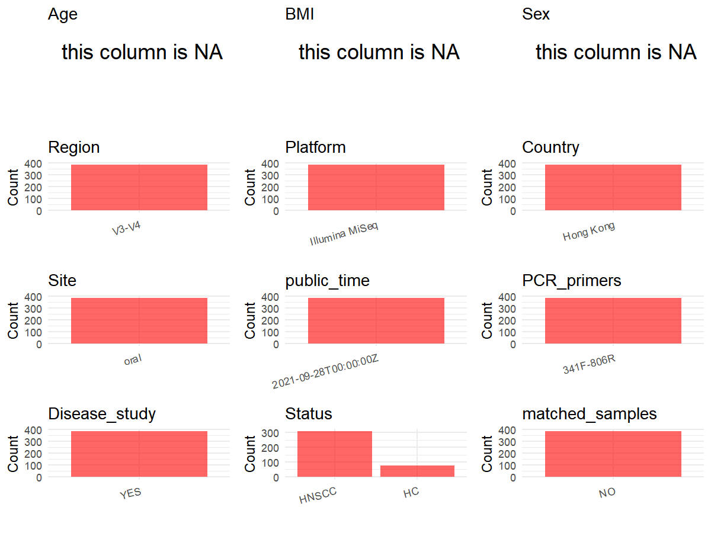

R Notebook: Metadata Processing Workflow
================

# Step 1: Obtain Initial Metadata from Each Project

To obtain the initial metadata: 1. Search for the BioProject ID (e.g.,
“PRJEBXXXX”) on the [NCBI SRA
website](https://www.ncbi.nlm.nih.gov/Traces/study/). 2. In the “Select”
table, click on “Metadata” and download the file. 3. The downloaded file
is typically named “SraRunTable.csv” and contains metadata for the
project.

``` r
library(dplyr)
```

    ## Warning: package 'dplyr' was built under R version 4.5.1

    ## 
    ## Attaching package: 'dplyr'

    ## The following objects are masked from 'package:stats':
    ## 
    ##     filter, lag

    ## The following objects are masked from 'package:base':
    ## 
    ##     intersect, setdiff, setequal, union

``` r
library(ggplot2)
```

    ## Warning: package 'ggplot2' was built under R version 4.5.1

``` r
library(cowplot)
```

    ## Warning: package 'cowplot' was built under R version 4.5.1

# Step 2: Create a Uniform Metadata Template

The uniform metadata should include the following columns:

1.  **BioProject**: Project ID (e.g., “PRJNA339212”)
2.  **Run**: Sample ID (e.g., “ERRXXXXXX” or “SRRXXXXXX”)
3.  **sample_name**: Original sample name submitted by the authors (not
    the database-assigned ID)
4.  **Age**: Age of the subject (if available)
5.  **BMI**: Body Mass Index (if available)
6.  **Sex**: Sex of the subject (“F” or “M”)
7.  **Region**: Targeted 16S rRNA region (e.g., “V3-V4”)
8.  **Platform**: Sequencing platform (e.g., “Illumina MiSeq”)
9.  **Country**: Country of sample origin (e.g., “China”)
10. **Site**: Sample site (e.g., “saliva”, “dental plaque”)
11. **public_time**: Data release date (format: “YYYY-MM-DD”)
12. **PCR_primers**: PCR primers used (e.g., “515F-806R”)
13. **title**: Title of the associated publication
14. **Disease_study**: Whether the study involves a disease (“YES” or
    “NO”)
15. **Status**: Disease status (e.g., “T2DM”, “HC”). Note: If the study
    includes both disease and healthy samples, this must be specified
    per sample.
16. **matched_samples**: matched samples (“YES” or “NO”)

``` r
setwd("D:/PRJNA744870")
initial_meta<-read.csv("SraRunTable .csv",header = T)
head(initial_meta)
```

    ##           Run Assay.Type AvgSpotLen    Bases  BioProject    BioSample
    ## 1 SRR15719926   AMPLICON        602 23042754 PRJNA744870 SAMN21215907
    ## 2 SRR15719937   AMPLICON        602 23526160 PRJNA744870 SAMN21215897
    ## 3 SRR15719951   AMPLICON        602 28818944 PRJNA744870 SAMN21215884
    ## 4 SRR15719961   AMPLICON        602 22373932 PRJNA744870 SAMN21215816
    ## 5 SRR15719966   AMPLICON        602  4212796 PRJNA744870 SAMN21215815
    ## 6 SRR15719973   AMPLICON        602 36488424 PRJNA744870 SAMN21215951
    ##                BioSampleModel    Bytes                         Center.Name
    ## 1 Metagenome or environmental 15416009 THE CHINESE UNIVERSITY OF HONG KONG
    ## 2 Metagenome or environmental 15389328 THE CHINESE UNIVERSITY OF HONG KONG
    ## 3 Metagenome or environmental 17930945 THE CHINESE UNIVERSITY OF HONG KONG
    ## 4 Metagenome or environmental 13334903 THE CHINESE UNIVERSITY OF HONG KONG
    ## 5 Metagenome or environmental  2130157 THE CHINESE UNIVERSITY OF HONG KONG
    ## 6 Metagenome or environmental 22725477 THE CHINESE UNIVERSITY OF HONG KONG
    ##   Collection_Date Consent DATASTORE.filetype DATASTORE.provider
    ## 1            2016  public   fastq,run.zq,sra         gs,ncbi,s3
    ## 2            2016  public   fastq,run.zq,sra         gs,ncbi,s3
    ## 3            2016  public   fastq,run.zq,sra         gs,ncbi,s3
    ## 4            2016  public   fastq,run.zq,sra         gs,ncbi,s3
    ## 5            2016  public   fastq,run.zq,sra         gs,ncbi,s3
    ## 6            2016  public   fastq,run.zq,sra         gs,ncbi,s3
    ##                       DATASTORE.region  Experiment geo_loc_name_country
    ## 1 gs.us-east1,ncbi.public,s3.us-east-1 SRX12015501            Hong Kong
    ## 2 gs.us-east1,ncbi.public,s3.us-east-1 SRX12015490            Hong Kong
    ## 3 gs.us-east1,ncbi.public,s3.us-east-1 SRX12015476            Hong Kong
    ## 4 gs.us-east1,ncbi.public,s3.us-east-1 SRX12015466            Hong Kong
    ## 5 gs.us-east1,ncbi.public,s3.us-east-1 SRX12015461            Hong Kong
    ## 6 gs.us-east1,ncbi.public,s3.us-east-1 SRX12015834            Hong Kong
    ##   geo_loc_name_country_continent geo_loc_name         HOST     Instrument
    ## 1                           Asia    Hong Kong Homo sapiens Illumina MiSeq
    ## 2                           Asia    Hong Kong Homo sapiens Illumina MiSeq
    ## 3                           Asia    Hong Kong Homo sapiens Illumina MiSeq
    ## 4                           Asia    Hong Kong Homo sapiens Illumina MiSeq
    ## 5                           Asia    Hong Kong Homo sapiens Illumina MiSeq
    ## 6                           Asia    Hong Kong Homo sapiens Illumina MiSeq
    ##   lat_lon             Library.Name LibraryLayout LibrarySelection LibrarySource
    ## 1 missing    Health26-Oral-16SV3V4        PAIRED              PCR       GENOMIC
    ## 2 missing    Health16-Oral-16SV3V4        PAIRED              PCR       GENOMIC
    ## 3 missing    Health03-Oral-16SV3V4        PAIRED              PCR       GENOMIC
    ## 4 missing Patient11-PostM3-16SV3V4        PAIRED              PCR       GENOMIC
    ## 5 missing Patient10-PostM3-16SV3V4        PAIRED              PCR       GENOMIC
    ## 6 missing    Health70-Oral-16SV3V4        PAIRED              PCR       GENOMIC
    ##          Organism Platform          ReleaseDate          create_date version
    ## 1 oral metagenome ILLUMINA 2021-09-28T00:00:00Z 2021-09-04T12:36:00Z       1
    ## 2 oral metagenome ILLUMINA 2021-09-28T00:00:00Z 2021-09-04T12:36:00Z       1
    ## 3 oral metagenome ILLUMINA 2021-09-28T00:00:00Z 2021-09-04T12:37:00Z       1
    ## 4 oral metagenome ILLUMINA 2021-09-28T00:00:00Z 2021-09-04T12:36:00Z       1
    ## 5 oral metagenome ILLUMINA 2021-09-28T00:00:00Z 2021-09-04T12:36:00Z       1
    ## 6 oral metagenome ILLUMINA 2021-09-28T00:00:00Z 2021-09-04T12:36:00Z       1
    ##   Sample.Name SRA.Study   isolate sample_type   strain isolation_source
    ## 1    Health26 SRP328065  Health26  oral rinse Bacteria                 
    ## 2    Health16 SRP328065  Health16  oral rinse Bacteria                 
    ## 3    Health03 SRP328065  Health03  oral rinse Bacteria                 
    ## 4   Patient11 SRP328065 Patient11  oral rinse Bacteria                 
    ## 5   Patient10 SRP328065 Patient10  oral rinse Bacteria                 
    ## 6    Health70 SRP328065  Health70  oral rinse Bacteria

``` r
metadata <- data.frame(
  BioProject = initial_meta$BioProject,
  Run = initial_meta$Run,
  sample_name = initial_meta$Sample.Name,
  Platform=initial_meta$Instrument,
  Country = initial_meta$geo_loc_name_country,
  public_time = initial_meta$ReleaseDate,
  stringsAsFactors = FALSE
)
```

# Step 3: Manually Add Information from the Publication

Some information (e.g. PCR primers, study title, disease status) must be
manually extracted from the publication and added to the metadata.

``` r
  metadata$Age <- NA_character_
  metadata$BMI <- NA_character_
  metadata$Sex <- NA_character_
  metadata$Site<-"oral"
  metadata$PCR_primers <- "341F-806R"
  metadata$Region<- "V3-V4"
  metadata$title <- "Restoration of the Oral Microbiota After Surgery for Head and Neck Squamous Cell Carcinoma Is Associated With Patient Outcomes."

  metadata$Disease_study <- "YES"
  metadata<-metadata%>%
    mutate(Status=case_when(grepl("Patient",sample_name)~"HNSCC",grepl("Health",sample_name)~"HC"))
  metadata$matched_samples <- "NO"
```

# Step 4: Summarize and Validate the Metadata

``` r
# Check the number of unique runs and sample names
print(paste("Number of unique runs:", length(unique(metadata$Run))))
```

    ## [1] "Number of unique runs: 384"

``` r
print(paste("Number of unique sample names:", length(unique(metadata$sample_name))))
```

    ## [1] "Number of unique sample names: 153"

# Step 5: Visualize the Metadata

``` r

```

<!-- -->

# Step 6: Finalize and Export the Metadata

``` r
# Reorder columns to match the desired format
metadata <- metadata[, c(
  "BioProject", "Run", "sample_name", "Age", "BMI", "Sex", 
  "Region", "Platform", "Country", "Site", "public_time", 
  "PCR_primers", "title", "Disease_study", "Status","matched_samples"
)]

# Export the uniform metadata to a CSV file
write.csv(metadata, file = "metadata.csv", quote = FALSE)
head(metadata)
```

    ##    BioProject         Run sample_name  Age  BMI  Sex Region       Platform
    ## 1 PRJNA744870 SRR15719926    Health26 <NA> <NA> <NA>  V3-V4 Illumina MiSeq
    ## 2 PRJNA744870 SRR15719937    Health16 <NA> <NA> <NA>  V3-V4 Illumina MiSeq
    ## 3 PRJNA744870 SRR15719951    Health03 <NA> <NA> <NA>  V3-V4 Illumina MiSeq
    ## 4 PRJNA744870 SRR15719961   Patient11 <NA> <NA> <NA>  V3-V4 Illumina MiSeq
    ## 5 PRJNA744870 SRR15719966   Patient10 <NA> <NA> <NA>  V3-V4 Illumina MiSeq
    ## 6 PRJNA744870 SRR15719973    Health70 <NA> <NA> <NA>  V3-V4 Illumina MiSeq
    ##     Country Site          public_time PCR_primers
    ## 1 Hong Kong oral 2021-09-28T00:00:00Z   341F-806R
    ## 2 Hong Kong oral 2021-09-28T00:00:00Z   341F-806R
    ## 3 Hong Kong oral 2021-09-28T00:00:00Z   341F-806R
    ## 4 Hong Kong oral 2021-09-28T00:00:00Z   341F-806R
    ## 5 Hong Kong oral 2021-09-28T00:00:00Z   341F-806R
    ## 6 Hong Kong oral 2021-09-28T00:00:00Z   341F-806R
    ##                                                                                                                             title
    ## 1 Restoration of the Oral Microbiota After Surgery for Head and Neck Squamous Cell Carcinoma Is Associated With Patient Outcomes.
    ## 2 Restoration of the Oral Microbiota After Surgery for Head and Neck Squamous Cell Carcinoma Is Associated With Patient Outcomes.
    ## 3 Restoration of the Oral Microbiota After Surgery for Head and Neck Squamous Cell Carcinoma Is Associated With Patient Outcomes.
    ## 4 Restoration of the Oral Microbiota After Surgery for Head and Neck Squamous Cell Carcinoma Is Associated With Patient Outcomes.
    ## 5 Restoration of the Oral Microbiota After Surgery for Head and Neck Squamous Cell Carcinoma Is Associated With Patient Outcomes.
    ## 6 Restoration of the Oral Microbiota After Surgery for Head and Neck Squamous Cell Carcinoma Is Associated With Patient Outcomes.
    ##   Disease_study Status matched_samples
    ## 1           YES     HC              NO
    ## 2           YES     HC              NO
    ## 3           YES     HC              NO
    ## 4           YES  HNSCC              NO
    ## 5           YES  HNSCC              NO
    ## 6           YES     HC              NO
