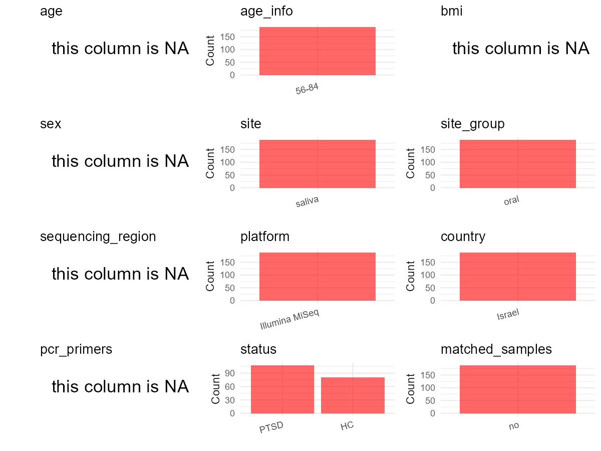

R Notebook: Metadata Processing Workflow
================

# Step 1: Obtain Initial Metadata from Each Project

This step sets the project directory, loads the raw SRA metadata, and
optionally merges supplement tables.

``` r
# Load libraries
library(dplyr)
library(ggplot2)
library(cowplot)

# (1) Setting working directory
# EDIT HERE: change project_id for each study
project_id <- "PRJNA844909" 

base_dir <- "E:/oral/26/metadata-2604/Oral-Metadata-YL-02"
setwd(file.path(base_dir, project_id))

# (2) Loading raw SRA metadata file
sra_file <- "SraRunTable.csv"
initial_meta <- read.csv(sra_file, header = TRUE)

# (3) OPTIONAL: If extra metadata (e.g., Table.x or supplemental materials) are available from the article, you may need to merge the file with initial_meta manually. Below is example code for merging. Depending on the specific case of each study, you can customize the code as needed.
#supp_table <- read.csv("supplemental_table_v2.csv", header = TRUE)
#initial_meta <- left_join(initial_meta, supp_table, by = "Sample.Name") 
```

# Step 2: Data Overview

First, you need to get an overview of the data, which includes two
steps: reading the article and reading the initial metadata. This step
is very IMPORTANT!

``` r
# (1) Read the article in the following order: abstract, the beginning of the results section, and the methods. Understand the sample size, experimental design, and disease group overview. Clarify the sampling sites; for oral and gut samples, specify the exact sites like supragingival plaque, tongue, etc.

# (2) IMPORTANT: MUST go through each column of initial_meta
head(initial_meta, 10)
```

    ##            Run Assay.Type AvgSpotLen    Bases  BioProject    BioSample
    ## 1  SRR19523482   AMPLICON        602 33787852 PRJNA844909 SAMN28841056
    ## 2  SRR19523483   AMPLICON        602 38452750 PRJNA844909 SAMN28841055
    ## 3  SRR19523484   AMPLICON        602 36068830 PRJNA844909 SAMN28841054
    ## 4  SRR19523485   AMPLICON        602 41894986 PRJNA844909 SAMN28840982
    ## 5  SRR19523486   AMPLICON        602 35732914 PRJNA844909 SAMN28841053
    ## 6  SRR19523487   AMPLICON        602 31883124 PRJNA844909 SAMN28841052
    ## 7  SRR19523488   AMPLICON        602 37001930 PRJNA844909 SAMN28841051
    ## 8  SRR19523489   AMPLICON        602 40306910 PRJNA844909 SAMN28841050
    ## 9  SRR19523490   AMPLICON        602 31443062 PRJNA844909 SAMN28841049
    ## 10 SRR19523491   AMPLICON        602 34124972 PRJNA844909 SAMN28841048
    ##                 BioSampleModel    Bytes
    ## 1  Metagenome or environmental 20149581
    ## 2  Metagenome or environmental 22892427
    ## 3  Metagenome or environmental 21477196
    ## 4  Metagenome or environmental 24842554
    ## 5  Metagenome or environmental 21002873
    ## 6  Metagenome or environmental 18946376
    ## 7  Metagenome or environmental 22158954
    ## 8  Metagenome or environmental 23526405
    ## 9  Metagenome or environmental 18504544
    ## 10 Metagenome or environmental 20168213
    ##                                 Center.Name Collection_Date Consent
    ## 1  FACULTY OF MEDICINE, TEL AVIV UNIVERSITY  not applicable  public
    ## 2  FACULTY OF MEDICINE, TEL AVIV UNIVERSITY  not applicable  public
    ## 3  FACULTY OF MEDICINE, TEL AVIV UNIVERSITY  not applicable  public
    ## 4  FACULTY OF MEDICINE, TEL AVIV UNIVERSITY  not applicable  public
    ## 5  FACULTY OF MEDICINE, TEL AVIV UNIVERSITY  not applicable  public
    ## 6  FACULTY OF MEDICINE, TEL AVIV UNIVERSITY  not applicable  public
    ## 7  FACULTY OF MEDICINE, TEL AVIV UNIVERSITY  not applicable  public
    ## 8  FACULTY OF MEDICINE, TEL AVIV UNIVERSITY  not applicable  public
    ## 9  FACULTY OF MEDICINE, TEL AVIV UNIVERSITY  not applicable  public
    ## 10 FACULTY OF MEDICINE, TEL AVIV UNIVERSITY  not applicable  public
    ##    DATASTORE.filetype DATASTORE.provider                     DATASTORE.region
    ## 1    fastq,run.zq,sra         gs,ncbi,s3 gs.us-east1,ncbi.public,s3.us-east-1
    ## 2    fastq,run.zq,sra         gs,ncbi,s3 gs.us-east1,ncbi.public,s3.us-east-1
    ## 3    fastq,run.zq,sra         gs,ncbi,s3 gs.us-east1,ncbi.public,s3.us-east-1
    ## 4    fastq,run.zq,sra         gs,ncbi,s3 gs.us-east1,ncbi.public,s3.us-east-1
    ## 5    fastq,run.zq,sra         gs,ncbi,s3 gs.us-east1,ncbi.public,s3.us-east-1
    ## 6    fastq,run.zq,sra         gs,ncbi,s3 gs.us-east1,ncbi.public,s3.us-east-1
    ## 7    fastq,run.zq,sra         gs,ncbi,s3 gs.us-east1,ncbi.public,s3.us-east-1
    ## 8    fastq,run.zq,sra         gs,ncbi,s3 gs.us-east1,ncbi.public,s3.us-east-1
    ## 9    fastq,run.zq,sra         gs,ncbi,s3 gs.us-east1,ncbi.public,s3.us-east-1
    ## 10   fastq,run.zq,sra         gs,ncbi,s3 gs.us-east1,ncbi.public,s3.us-east-1
    ##     Experiment geo_loc_name_country geo_loc_name_country_continent geo_loc_name
    ## 1  SRX15576013               Israel                           Asia       Israel
    ## 2  SRX15576012               Israel                           Asia       Israel
    ## 3  SRX15576011               Israel                           Asia       Israel
    ## 4  SRX15576010               Israel                           Asia       Israel
    ## 5  SRX15576009               Israel                           Asia       Israel
    ## 6  SRX15576008               Israel                           Asia       Israel
    ## 7  SRX15576007               Israel                           Asia       Israel
    ## 8  SRX15576006               Israel                           Asia       Israel
    ## 9  SRX15576005               Israel                           Asia       Israel
    ## 10 SRX15576004               Israel                           Asia       Israel
    ##    health_state         HOST host_subject_id     Instrument isolation_source
    ## 1          PTSD Homo sapiens            2350 Illumina MiSeq           saliva
    ## 2       Healthy Homo sapiens            2311 Illumina MiSeq           saliva
    ## 3          PTSD Homo sapiens            2290 Illumina MiSeq           saliva
    ## 4          PTSD Homo sapiens             240 Illumina MiSeq           saliva
    ## 5       Healthy Homo sapiens            2271 Illumina MiSeq           saliva
    ## 6       Healthy Homo sapiens            2221 Illumina MiSeq           saliva
    ## 7       Healthy Homo sapiens            2191 Illumina MiSeq           saliva
    ## 8          PTSD Homo sapiens            2190 Illumina MiSeq           saliva
    ## 9          PTSD Homo sapiens            2100 Illumina MiSeq           saliva
    ## 10      Healthy Homo sapiens            2061 Illumina MiSeq           saliva
    ##           lat_lon Library.Name LibraryLayout LibrarySelection LibrarySource
    ## 1  not applicable      2350lib        PAIRED              PCR   METAGENOMIC
    ## 2  not applicable      2311lib        PAIRED              PCR   METAGENOMIC
    ## 3  not applicable      2290lib        PAIRED              PCR   METAGENOMIC
    ## 4  not applicable       240lib        PAIRED              PCR   METAGENOMIC
    ## 5  not applicable      2271lib        PAIRED              PCR   METAGENOMIC
    ## 6  not applicable      2221lib        PAIRED              PCR   METAGENOMIC
    ## 7  not applicable      2191lib        PAIRED              PCR   METAGENOMIC
    ## 8  not applicable      2190lib        PAIRED              PCR   METAGENOMIC
    ## 9  not applicable      2100lib        PAIRED              PCR   METAGENOMIC
    ## 10 not applicable      2061lib        PAIRED              PCR   METAGENOMIC
    ##            Organism Platform          ReleaseDate          create_date version
    ## 1  human metagenome ILLUMINA 2023-06-22T00:00:00Z 2022-06-02T13:13:00Z       1
    ## 2  human metagenome ILLUMINA 2023-06-22T00:00:00Z 2022-06-02T13:14:00Z       1
    ## 3  human metagenome ILLUMINA 2023-06-22T00:00:00Z 2022-06-02T13:14:00Z       1
    ## 4  human metagenome ILLUMINA 2023-06-22T00:00:00Z 2022-06-02T13:14:00Z       1
    ## 5  human metagenome ILLUMINA 2023-06-22T00:00:00Z 2022-06-02T13:14:00Z       1
    ## 6  human metagenome ILLUMINA 2023-06-22T00:00:00Z 2022-06-02T13:14:00Z       1
    ## 7  human metagenome ILLUMINA 2023-06-22T00:00:00Z 2022-06-02T13:14:00Z       1
    ## 8  human metagenome ILLUMINA 2023-06-22T00:00:00Z 2022-06-02T13:15:00Z       1
    ## 9  human metagenome ILLUMINA 2023-06-22T00:00:00Z 2022-06-02T13:14:00Z       1
    ## 10 human metagenome ILLUMINA 2023-06-22T00:00:00Z 2022-06-02T13:14:00Z       1
    ##    Sample.Name SRA.Study
    ## 1         2350 SRP378203
    ## 2         2311 SRP378203
    ## 3         2290 SRP378203
    ## 4          240 SRP378203
    ## 5         2271 SRP378203
    ## 6         2221 SRP378203
    ## 7         2191 SRP378203
    ## 8         2190 SRP378203
    ## 9         2100 SRP378203
    ## 10        2061 SRP378203

``` r
# IMPORTANT: Check the unique values in the column of interest or query column.
lapply(initial_meta[c('isolation_source')], table) # site
```

    ## $isolation_source
    ## 
    ## saliva 
    ##    189

``` r
lapply(initial_meta[c('Organism', 'HOST')], table) # organism
```

    ## $Organism
    ## 
    ## human metagenome 
    ##              189 
    ## 
    ## $HOST
    ## 
    ## Homo sapiens 
    ##          189

``` r
table(initial_meta$Sample.Name) # subject id
```

    ## 
    ##   11   51   60   70   71  130  150  190  240  250  290  301  310  330  370  371 
    ##    1    1    1    1    1    1    1    1    1    1    1    1    1    1    1    1 
    ##  391  401  411  490  501  521  580  601  640  690  760  771  780  781  800  830 
    ##    1    1    1    1    1    1    1    1    1    1    1    1    1    1    1    1 
    ##  861  960 1070 1120 1170 1190 1191 1220 1251 1261 1270 1311 1320 1330 1361 1390 
    ##    1    1    1    1    1    1    1    1    1    1    1    1    1    1    1    1 
    ## 1410 1411 1440 1441 1450 1451 1480 1521 1550 1571 1581 1620 1661 1681 1711 1720 
    ##    1    1    1    1    1    1    1    1    1    1    1    1    1    1    1    1 
    ## 1721 1741 1801 1830 1850 1901 1931 1960 2030 2031 2061 2100 2190 2191 2221 2271 
    ##    1    1    1    1    1    1    1    1    1    1    1    1    1    1    1    1 
    ## 2290 2311 2350 2351 2370 2380 2391 2400 2470 2540 2560 2691 2741 2931 2951 2970 
    ##    1    1    1    1    1    1    1    1    1    1    1    1    1    1    1    1 
    ## 2981 3000 3020 3030 3050 3061 3130 3140 3191 3210 3230 3240 3251 3270 3301 3340 
    ##    1    1    1    1    1    1    1    1    1    1    1    1    1    1    1    1 
    ## 3381 3390 3411 3421 3450 3471 3480 3491 3520 3560 3590 3591 3610 3630 3640 3691 
    ##    1    1    1    1    1    1    1    1    1    1    1    1    1    1    1    1 
    ## 3880 3910 3920 3930 4001 4071 4090 4150 4180 4251 4330 4600 4720 4831 4840 4850 
    ##    1    1    1    1    1    1    1    1    1    1    1    1    1    1    1    1 
    ## 4871 4900 4930 4931 4961 5151 5221 5240 5250 5290 5351 5371 5431 5451 5471 5510 
    ##    1    1    1    1    1    1    1    1    1    1    1    1    1    1    1    1 
    ## 5520 5540 5551 5580 5591 5641 5700 5710 5751 5770 5850 5871 5930 5980 6071 6130 
    ##    1    1    1    1    1    1    1    1    1    1    1    1    1    1    1    1 
    ## 6180 6190 6191 6200 6230 6260 6270 6391 6480 6490 6491 6620 8011 
    ##    1    1    1    1    1    1    1    1    1    1    1    1    1

``` r
#table(initial_meta$sequencing_meth..exp.) # output is pyrosequencing
table(initial_meta$Platform) # output is Illumina. according to the methods, Illumina is correct.
```

    ## 
    ## ILLUMINA 
    ##      189

``` r
# table(initial_meta$target_subfragment..exp.)
```

# Step 3: Removing Control and Non-human Samples

First, we need to remove control samples(including both negative
controls and positive controls) and non-human samples.

``` r
# (1) EDIT HERE: Parameter setup
control_column <- "" # column name in initial_meta
# unique(initial_meta[[control_column]])
control_keywords <- c() # Enter exact keywords

species_column <- "" # column name in initial_meta
unique(initial_meta[[species_column]])
```

    ## NULL

``` r
non_human_keywords <- c() # Enter exact keywords

# (2) Remove controls and non-human samples. DO NOT need to modify code in this part, just run it.
n_samples <- nrow(initial_meta)
# Control evaluation
if (length(control_keywords) > 0) {
  if (is.null(control_column) || control_column == "") {
    stop("Error: control_keywords provided but control_column is missing.")
  }
  
  if (!(control_column %in% colnames(initial_meta))) {
    stop(sprintf("Error: Column '%s' not found in initial_meta.", control_column))
  }
  
  control_pattern <- paste(control_keywords, collapse = "|")
  control_text <- initial_meta[[control_column]]
  is_control <- grepl(control_pattern, control_text)
  
} else {
  is_control <- rep(FALSE, n_samples)
}

# Non-human evaluation
if (length(non_human_keywords) > 0) {
  if (is.null(species_column) || species_column == "") {
    stop("Error: non_human_keywords provided but species_column is missing.")
  }
  
  if (!(species_column %in% colnames(initial_meta))) {
    stop(sprintf("Error: Column '%s' not found in initial_meta.", species_column))
  }
  
  non_human_pattern <- paste(non_human_keywords, collapse = "|")
  species_text <- initial_meta[[species_column]]
  is_non_human <- grepl(non_human_pattern, species_text)
} else {
  is_non_human <- rep(FALSE, n_samples)
}

# Execute removal
samples_to_remove <- is_control | is_non_human
initial_meta <- initial_meta[!samples_to_remove, ]

cat("Initial samples counts:",n_samples,"\n")
```

    ## Initial samples counts: 189

``` r
cat("Removed control samples:", sum(is_control), "\n")
```

    ## Removed control samples: 0

``` r
cat("Removed non-human samples:", sum(is_non_human), "\n")
```

    ## Removed non-human samples: 0

``` r
cat("Total samples removed ", sum(samples_to_remove), "\n")
```

    ## Total samples removed  0

``` r
cat("Remaining samples after Step 2:", nrow(initial_meta), "\n")
```

    ## Remaining samples after Step 2: 189

# Step 4: Creating a Uniform Metadata Template

This step converts the raw SRA table into the standard metadata format
used in our meta-analysis. The uniform metadata should include the
following columns: 1. **bioproject**: Project ID from SRA or other
database e.g. `PRJNA1234`, `CNP1234`, ‘OEP1234’, ‘qiita_1234’ 2.
**sample_id**: SRA sample/run ID. Unique id for each sample!
e.g. `DRR1234567`, `ERR1234567` and `SRR1234567`. If no such column
exists, can use column like sample_name. 3. **subject_id**: subject id
for each person if available. e.g. `patient_01`, `Host_03_before`,
`subject12` 4. **age**: Age of the subject if available. e.g. `35`, `42`
\| not `adult`, `chilren` 5. **age_info**: If the age is not explicitly
stated but approximate age range information is available, mark it in
this column. e.g., `18-55`, `children`, `infant`, `elder` 6. **bmi**:
Body Mass Index if available. e.g. `22.5`, `18.9` \| not `normal`,
`overweight` 7. **sex**: Sex of the subject. Mandatory to write as M/F
\| not `female`, `woman` 8. **sequencing_region**: Targeted 16S rRNA
region. e.g. `V3-V4`, `V4` 9. **platform**: Sequencing platform.
e.g. `Illumina MiSeq`, `454 GS FLX Titanium`, `Ion Torrent` 10.
**country**: Country of sample origin. e.g. `China`, `Japan` \| not city
name like `Beijing` 11. **site**: Sampling site. For oral and gut sites,
specify the exact sites as detailed as possible. For example, if it is
known to be supragingival plaque, do not record it as ‘dental plaque’,
unless the original text provides only a vague description.
e.g. `saliva`, `tongue coating` \| not broad term like `oral` 12.
**site_group**: only accepts one of following three values: ‘oral’,
‘gut’, or ‘other’. 13. **public_time**: Data release date.
e.g. `2021-06-22` \| not `June 2021` 14. **pcr_primers**: PCR primers
used. e.g. `515F-806R`, `27F-338R` \| not primer sequences 15.
**title**: Title of the associated publication. 16. **disease_study**:
Whether the study involves disease samples. If it’s not clear, can
record as NA. Only three values accepted: ‘yes’, ‘no’ or NA 17.
**status**: Disease status for each sample if available, else record as
NA. Only accept following abbreviations, Write full names for all other
diseases. HC: healthy control CD: Crohn’s disease CRC: colorectal cancer
COPD: chronic obstructive pulmonary disease HIV: human immunodeficiency
virus ICU: intensive care unit OSCC: oral squamous cell carcinoma RA:
rheumatoid arthritis UC: ulcerative colitis 18. **matched_samples**:
Whether the subject has matched samples. Only accept ‘yes’ or ‘no’. 19.
**is_time_series**: Whether the study is a time series study. Only
accept ‘yes’ or ‘no’.

``` r
# Extract columns from initial_meta as follows: (1) No modification needed → extract directly. (2) Modification needed → create a new column with the prefix raw_ and mark the original column as “pending”. (3) Need to find or determine based on the article.
metadata <- data.frame(
  bioproject = initial_meta$BioProject,
  sample_id = initial_meta$Run,
  subject_id = initial_meta$Sample.Name,
  age = NA,
  age_info = "56-84", # determine according to the supplemental material
  bmi = NA,
  sex = NA,
  sequencing_region = NA, # extract from methods section
  platform = "Illumina MiSeq", # extract from methods section, NOT initial_meta
  country = initial_meta$geo_loc_name_country,
  site = initial_meta$isolation_source,
  site_group = "pending", # modify later
  public_time = initial_meta$ReleaseDate,
  pcr_primers = NA, # Format: xxF-xxR
  title = "Oral microbiota signatures in post-traumatic stress disorder (PTSD) veterans", # extract from article
  disease_study = "yes", # determine according to the article
  raw_status = initial_meta$health_state,  
  status = "pending", # modify later
  matched_samples = "pending", # modify later
  is_time_series = "no", # determine according to the article
  stringsAsFactors = FALSE
)
metadata$public_time <- as.Date(metadata$public_time)
```

# Step 5: Manually solving pending issues

This step involves two parts: (1) handle the columns with the `raw_`
prefix, and next (2) handle the `site_group` and `matched_samples`
columns.

``` r
# (1) Handle the columns with the `raw_` prefix.
# In this part, you need to customize the code based on the situation of the raw_ columns to obtain the content of the target columns. IMPORTANT: Add comments if the modification is not straightforward!!
metadata <- metadata %>%
  mutate(status = case_when(
    grepl("PTSD", raw_status) ~ "PTSD",
    grepl("Healthy", raw_status) ~ "HC", 
    TRUE ~ NA_character_
  )) # according to the 'health_state' column of initial_meta
```

``` r
# (2) Filling the 'site_group' and 'matched_samples' columns
# editing site_group
unique(metadata$site)
```

    ## [1] "saliva"

``` r
# EDIT HERE: add oral sites
Oral_site = unique(metadata$site)
# EDIT HERE: add gut sites
Gut_site = c()
# just run
metadata <- metadata %>%
  mutate(site_group = case_when(
    site %in% Oral_site ~ "oral",
    site %in% Gut_site ~ "gut",
    TRUE ~ "other" 
  ))

# editing matched_samples, just run.
metadata$matched_samples <- ifelse(
  ave(metadata$subject_id, metadata$subject_id, FUN = length) > 1, 
  "yes", 
  "no"
)
```

``` r
# (3) check if there is pending value in metadata. If there is pending value, go on modify the metadata.
# Function to check if a column contains "pending"
has_pending <- function(col) {
  if (is.character(col) || is.factor(col)) {
    any(col == "pending", na.rm = TRUE)
  } else {
    FALSE
  }
}

# Check for any pending value
any_pending_value <- any(sapply(metadata, has_pending))

if (!any_pending_value) {
  message("Good! No cell contains the value 'pending'.")
} else {
  pending_cols <- names(metadata)[sapply(metadata, has_pending)]
  message("Columns containing 'pending': ", paste(pending_cols, collapse = ", "))
  message("Please continue to resolve these pending columns!")
}
```

    ## Good! No cell contains the value 'pending'.

# Step 6: Visualize the Metadata

This step makes a quick set of plots for checking the distribution of
key metadata fields.

``` r
# Select columns for visualization, just run
plot_data <- metadata %>%
  select(-bioproject, -sample_id, -subject_id, -title)

create_simple_plots <- function(data) {
  plots <- list()
  continuous_vars <- c("age", "bmi")

  for (col in colnames(data)) {
    if (all(is.na(data[[col]]))) {
      p <- ggplot() +
        annotate("text", x = 0.5, y = 0.5, label = "this column is NA", size = 6) +
        labs(title = col) +
        theme_void()
    } else if (col %in% continuous_vars && is.numeric(data[[col]])) {
      p <- ggplot(data, aes(x = .data[[col]])) +
        geom_histogram(fill = "blue", alpha = 0.6, bins = 20, na.rm = TRUE) +
        labs(title = col, x = col, y = "Count") +
        theme_minimal()
    } else {
      count_data <- as.data.frame(table(data[[col]], useNA = "ifany"))
      p <- ggplot(count_data, aes(x = reorder(Var1, -Freq), y = Freq)) +
        geom_col(fill = "red", alpha = 0.6) +
        labs(title = col, x = NULL, y = "Count") +
        theme_minimal() +
        theme(axis.text.x = element_text(angle = 15, hjust = 1))
    }
    plots[[col]] <- p
  }

  return(plots)
}

# Generate and arrange plots
plots <- create_simple_plots(plot_data)
p <- plot_grid(plots$age,
               plots$age_info,
               plots$bmi,
               plots$sex,
               plots$site,
               plots$site_group,
               plots$sequencing_region,
               plots$platform,
               plots$country,
               plots$pcr_primers,
               plots$status,
               plots$matched_samples,
               ncol = 3, align = "hv", axis = "lb")
ggsave("Metadata_Summary_v2.png", plot = p, width = 8, height = 6, dpi = 150)
```

``` r
# Insert Metadata_Summary.png into the current Rmd output

```


# Step 7: Sort and export the metadata

This step saves the cleaned metadata table as the final `metadata.csv`
file.

``` r
# Reorder the data frame
fixed_cols <- c("bioproject", "sample_id", "subject_id", "age", "age_info",
                "bmi", "sex", "platform", "sequencing_region", "pcr_primers", 
                "country", "site", "site_group", "disease_study", "status", 
                "title", "public_time", "matched_samples", "is_time_series")  
metadata <- metadata %>%
  select(all_of(fixed_cols), everything())

# save metadata 
# head(metadata)
write.csv(metadata, file = "metadata_v2.csv", quote = TRUE)
```
