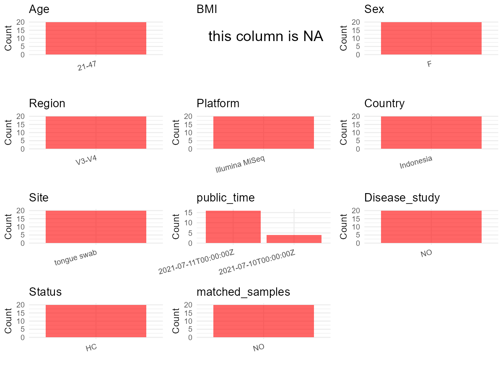

R Notebook: Metadata Processing Workflow
================

# Step 1: Obtain Initial Metadata from Each Project

To obtain the initial metadata: 1. Search for the BioProject ID (e.g.,
“PRJEBXXXX”) on the [NCBI SRA
website](https://www.ncbi.nlm.nih.gov/Traces/study/). 2. In the “Select”
table, click on “Metadata” and download the file. 3. The downloaded file
is typically named “SraRunTable.csv” and contains metadata for the
project.

``` r
# Load necessary libraries
library(dplyr)
library(ggplot2)
library(cowplot)

# Set working directory (update this path to your local directory)
setwd("E:/bioproject_YL/PRJNA745286")

# Read the initial metadata files
initial_meta <- read.csv("SraRunTable.csv", header = T)

# Display the first few rows of the metadata
head(initial_meta)
```

    ##           Run Assay.Type AvgSpotLen    Bases  BioProject    BioSample
    ## 1 SRR15096588   AMPLICON        300 42947415 PRJNA745286 SAMN20158078
    ## 2 SRR15096589   AMPLICON        300 33043508 PRJNA745286 SAMN20158079
    ## 3 SRR15096635   AMPLICON        300 23014231 PRJNA745286 SAMN20158080
    ## 4 SRR15096691   AMPLICON        300 28636558 PRJNA745286 SAMN20158081
    ## 5 SRR15096699   AMPLICON        300 24144930 PRJNA745286 SAMN20158082
    ## 6 SRR15096700   AMPLICON        299 21604843 PRJNA745286 SAMN20158083
    ##                BioSampleModel    Bytes Center.Name Collection_Date Consent
    ## 1 Metagenome or environmental 16681685    ILLUMINA      2019-10-20  public
    ## 2 Metagenome or environmental 12806447    ILLUMINA      2019-10-20  public
    ## 3 Metagenome or environmental  9068066    ILLUMINA      2019-10-20  public
    ## 4 Metagenome or environmental 11140306    ILLUMINA      2019-10-20  public
    ## 5 Metagenome or environmental  9391577    ILLUMINA      2019-10-20  public
    ## 6 Metagenome or environmental  8481030    ILLUMINA      2019-10-20  public
    ##   DATASTORE.filetype DATASTORE.provider                     DATASTORE.region
    ## 1   fastq,run.zq,sra         gs,ncbi,s3 gs.us-east1,ncbi.public,s3.us-east-1
    ## 2   fastq,run.zq,sra         gs,ncbi,s3 gs.us-east1,ncbi.public,s3.us-east-1
    ## 3   fastq,run.zq,sra         gs,ncbi,s3 gs.us-east1,ncbi.public,s3.us-east-1
    ## 4   fastq,run.zq,sra         gs,ncbi,s3 gs.us-east1,ncbi.public,s3.us-east-1
    ## 5   fastq,run.zq,sra         gs,ncbi,s3 gs.us-east1,ncbi.public,s3.us-east-1
    ## 6   fastq,run.zq,sra         gs,ncbi,s3 gs.us-east1,ncbi.public,s3.us-east-1
    ##    Experiment geo_loc_name_country geo_loc_name_country_continent
    ## 1 SRX11406439            Indonesia                           Asia
    ## 2 SRX11406440            Indonesia                           Asia
    ## 3 SRX11406486            Indonesia                           Asia
    ## 4 SRX11406542            Indonesia                           Asia
    ## 5 SRX11406550            Indonesia                           Asia
    ## 6 SRX11406551            Indonesia                           Asia
    ##         geo_loc_name         HOST ID     Instrument               lat_lon
    ## 1 Indonesia: Jakarta Homo sapiens  5 Illumina MiSeq 6.21462 S 106.84513 E
    ## 2 Indonesia: Jakarta Homo sapiens  6 Illumina MiSeq 6.21462 S 106.84513 E
    ## 3 Indonesia: Jakarta Homo sapiens  7 Illumina MiSeq 6.21462 S 106.84513 E
    ## 4 Indonesia: Jakarta Homo sapiens  8 Illumina MiSeq 6.21462 S 106.84513 E
    ## 5 Indonesia: Jakarta Homo sapiens  9 Illumina MiSeq 6.21462 S 106.84513 E
    ## 6 Indonesia: Jakarta Homo sapiens 10 Illumina MiSeq 6.21462 S 106.84513 E
    ##   Library.Name LibraryLayout LibrarySelection LibrarySource         Organism
    ## 1    293533828        PAIRED              PCR   METAGENOMIC human metagenome
    ## 2    293531819        PAIRED              PCR   METAGENOMIC human metagenome
    ## 3    293527878        PAIRED              PCR   METAGENOMIC human metagenome
    ## 4    293541734        PAIRED              PCR   METAGENOMIC human metagenome
    ## 5    293535818        PAIRED              PCR   METAGENOMIC human metagenome
    ## 6    293531825        PAIRED              PCR   METAGENOMIC human metagenome
    ##   Platform          ReleaseDate          create_date version Sample.Name
    ## 1 ILLUMINA 2021-07-11T00:00:00Z 2021-07-11T02:39:00Z       1          S5
    ## 2 ILLUMINA 2021-07-11T00:00:00Z 2021-07-11T02:59:00Z       1          S6
    ## 3 ILLUMINA 2021-07-11T00:00:00Z 2021-07-11T03:34:00Z       1          S7
    ## 4 ILLUMINA 2021-07-11T00:00:00Z 2021-07-11T04:48:00Z       1          S8
    ## 5 ILLUMINA 2021-07-11T00:00:00Z 2021-07-11T05:11:00Z       1          S9
    ## 6 ILLUMINA 2021-07-11T00:00:00Z 2021-07-11T05:24:00Z       1         S10
    ##   SRA.Study
    ## 1 SRP327784
    ## 2 SRP327784
    ## 3 SRP327784
    ## 4 SRP327784
    ## 5 SRP327784
    ## 6 SRP327784

# Step 2: Create a Uniform Metadata Template

The uniform metadata should include the following columns:

1.  **BioProject**: Project ID (e.g., “PRJNA339212”)
2.  **Run**: Sample ID (e.g., “ERRXXXXXX” or “SRRXXXXXX”)
3.  **sample_name**: Original sample name submitted by the authors (not
    the database-assigned ID)
4.  **Age**: Age of the subject (if available)
5.  **BMI**: Body Mass Index (if available)
6.  **Sex**: Sex of the subject (“F” or “M”)
7.  **Region**: Targeted 16S rRNA region (e.g., “V3-V4”)
8.  **Platform**: Sequencing platform (e.g., “Illumina MiSeq”)
9.  **Country**: Country of sample origin (e.g., “China”)
10. **Site**: Sample site (e.g., “saliva”, “dental plaque”)
11. **public_time**: Data release date (format: “YYYY-MM-DD”)
12. **PCR_primers**: PCR primers used (e.g., “515F-806R”)
13. **title**: Title of the associated publication
14. **Disease_study**: Whether the study involves a disease (“YES” or
    “NO”)
15. **Status**: Disease status (e.g., “T2DM”, “HC”). Note: If the study
    includes both disease and healthy samples, this must be specified
    per sample.
16. **matched_samples**: matched samples (“YES” or “NO”)

``` r
# Create a uniform metadata dataframe
metadata <- data.frame(
  BioProject = initial_meta$BioProject,
  Run = initial_meta$Run,
  sample_name = initial_meta$ID,
  Age = "21-47",
  BMI = NA, 
  Sex = "F",
  Region = "V3-V4",
  Platform = initial_meta$Instrument,
  Country = initial_meta$geo_loc_name_country,
  Site = "tongue swab",
  public_time = initial_meta$ReleaseDate,
  stringsAsFactors=FALSE
)
```

# Step 3: Manually Add Information from the Publication

Some information (e.g. PCR primers, study title, disease status) must be
manually extracted from the publication and added to the metadata.

``` r
# Add information obtained from the publication
metadata$PCR_primers <- "F:5'-TCGTCGGCAGCGTCAGATGTGTATAAGAGACAGCCTACGGGNGGCWGCAG-3′;5′- GTCTCGTGGGCTCGGAGATGTGTATAAGAGACAGG ACTACHVGGGTATCTAATCC−3′"
metadata$title <- "Diversity of oral microbiome of women from urban and rural areas of indonesia A pilot study"
metadata$Disease_study <- "NO"
# Assign disease status based on sample_name patterns
metadata$Status <- "HC"

# Check initial data distribution
cat("Initial sample distribution:\n")
```

    ## Initial sample distribution:

``` r
table(metadata$sample_name)
```

    ## 
    ##  1  2  3  4  5  6  7  8  9 10 11 12 13 14 15 16 17 18 19 20 
    ##  1  1  1  1  1  1  1  1  1  1  1  1  1  1  1  1  1  1  1  1

``` r
table(metadata$Site)
```

    ## 
    ## tongue swab 
    ##          20

``` r
# Calculate sampling frequency per subject
sample_counts <- table(metadata$sample_name)
cat("\nNumber of samples per subject:\n")
```

    ## 
    ## Number of samples per subject:

``` r
print(sample_counts)
```

    ## 
    ##  1  2  3  4  5  6  7  8  9 10 11 12 13 14 15 16 17 18 19 20 
    ##  1  1  1  1  1  1  1  1  1  1  1  1  1  1  1  1  1  1  1  1

``` r
# Create matched_samples column
metadata$matched_samples <- ifelse(metadata$sample_name %in% names(sample_counts[sample_counts >= 2]), "YES", "NO")

cat("\nMatched samples distribution:\n")
```

    ## 
    ## Matched samples distribution:

``` r
table(metadata$matched_samples)
```

    ## 
    ## NO 
    ## 20

``` r
# Identify samples for removal: single samples excluding tongue swab
single_samples <- names(sample_counts[sample_counts == 1])
samples_to_remove <- metadata$sample_name %in% single_samples & 
                     !(metadata$Site %in% c("tongue swab"))

cat("\nNumber of samples to be removed:", sum(samples_to_remove), "\n")
```

    ## 
    ## Number of samples to be removed: 0

``` r
# Remove identified samples
metadata_clean <- metadata[!samples_to_remove, ]

cat("\nFinal sample distribution after cleaning:\n")
```

    ## 
    ## Final sample distribution after cleaning:

``` r
table(metadata_clean$sample_name)
```

    ## 
    ##  1  2  3  4  5  6  7  8  9 10 11 12 13 14 15 16 17 18 19 20 
    ##  1  1  1  1  1  1  1  1  1  1  1  1  1  1  1  1  1  1  1  1

``` r
table(metadata_clean$Site)
```

    ## 
    ## tongue swab 
    ##          20

``` r
table(metadata_clean$matched_samples)
```

    ## 
    ## NO 
    ## 20

``` r
# Use cleaned dataset for subsequent analysis
metadata <- metadata_clean
```

# Step 4: Summarize and Validate the Metadata

``` r
# Check the number of unique runs and sample names
print(paste("Number of unique runs:", length(unique(metadata$Run))))
```

    ## [1] "Number of unique runs: 20"

``` r
print(paste("Number of unique sample names:", length(unique(metadata$sample_name))))
```

    ## [1] "Number of unique sample names: 20"

# Step 5: Visualize the Metadata

``` r

```


# Step 6: Finalize and Export the Metadata

``` r
# Reorder columns to match the desired format
metadata <- metadata[, c(
  "BioProject", "Run", "sample_name", "Age", "BMI", "Sex", 
  "Region", "Platform", "Country", "Site", "public_time", 
  "PCR_primers", "title", "Disease_study", "Status", "matched_samples"
)]

# Export the uniform metadata to a CSV file
write.csv(metadata, file = "metadata.csv", quote = FALSE)
head(metadata)
```

    ##    BioProject         Run sample_name   Age BMI Sex Region       Platform
    ## 1 PRJNA745286 SRR15096588           5 21-47  NA   F  V3-V4 Illumina MiSeq
    ## 2 PRJNA745286 SRR15096589           6 21-47  NA   F  V3-V4 Illumina MiSeq
    ## 3 PRJNA745286 SRR15096635           7 21-47  NA   F  V3-V4 Illumina MiSeq
    ## 4 PRJNA745286 SRR15096691           8 21-47  NA   F  V3-V4 Illumina MiSeq
    ## 5 PRJNA745286 SRR15096699           9 21-47  NA   F  V3-V4 Illumina MiSeq
    ## 6 PRJNA745286 SRR15096700          10 21-47  NA   F  V3-V4 Illumina MiSeq
    ##     Country        Site          public_time
    ## 1 Indonesia tongue swab 2021-07-11T00:00:00Z
    ## 2 Indonesia tongue swab 2021-07-11T00:00:00Z
    ## 3 Indonesia tongue swab 2021-07-11T00:00:00Z
    ## 4 Indonesia tongue swab 2021-07-11T00:00:00Z
    ## 5 Indonesia tongue swab 2021-07-11T00:00:00Z
    ## 6 Indonesia tongue swab 2021-07-11T00:00:00Z
    ##                                                                                                                  PCR_primers
    ## 1 F:5'-TCGTCGGCAGCGTCAGATGTGTATAAGAGACAGCCTACGGGNGGCWGCAG-3′;5′- GTCTCGTGGGCTCGGAGATGTGTATAAGAGACAGG ACTACHVGGGTATCTAATCC−3′
    ## 2 F:5'-TCGTCGGCAGCGTCAGATGTGTATAAGAGACAGCCTACGGGNGGCWGCAG-3′;5′- GTCTCGTGGGCTCGGAGATGTGTATAAGAGACAGG ACTACHVGGGTATCTAATCC−3′
    ## 3 F:5'-TCGTCGGCAGCGTCAGATGTGTATAAGAGACAGCCTACGGGNGGCWGCAG-3′;5′- GTCTCGTGGGCTCGGAGATGTGTATAAGAGACAGG ACTACHVGGGTATCTAATCC−3′
    ## 4 F:5'-TCGTCGGCAGCGTCAGATGTGTATAAGAGACAGCCTACGGGNGGCWGCAG-3′;5′- GTCTCGTGGGCTCGGAGATGTGTATAAGAGACAGG ACTACHVGGGTATCTAATCC−3′
    ## 5 F:5'-TCGTCGGCAGCGTCAGATGTGTATAAGAGACAGCCTACGGGNGGCWGCAG-3′;5′- GTCTCGTGGGCTCGGAGATGTGTATAAGAGACAGG ACTACHVGGGTATCTAATCC−3′
    ## 6 F:5'-TCGTCGGCAGCGTCAGATGTGTATAAGAGACAGCCTACGGGNGGCWGCAG-3′;5′- GTCTCGTGGGCTCGGAGATGTGTATAAGAGACAGG ACTACHVGGGTATCTAATCC−3′
    ##                                                                                         title
    ## 1 Diversity of oral microbiome of women from urban and rural areas of indonesia A pilot study
    ## 2 Diversity of oral microbiome of women from urban and rural areas of indonesia A pilot study
    ## 3 Diversity of oral microbiome of women from urban and rural areas of indonesia A pilot study
    ## 4 Diversity of oral microbiome of women from urban and rural areas of indonesia A pilot study
    ## 5 Diversity of oral microbiome of women from urban and rural areas of indonesia A pilot study
    ## 6 Diversity of oral microbiome of women from urban and rural areas of indonesia A pilot study
    ##   Disease_study Status matched_samples
    ## 1            NO     HC              NO
    ## 2            NO     HC              NO
    ## 3            NO     HC              NO
    ## 4            NO     HC              NO
    ## 5            NO     HC              NO
    ## 6            NO     HC              NO

## Notes for Students:

1.  **Metadata Accuracy**: Always cross-check the metadata with the
    original publication to ensure accuracy.
2.  **Manual Entries**: Columns like `PCR_primers`, and `Status` often
    require manual entry based on the publication.
3.  **Disease Status**: Be careful when assigning `Status`—some studies
    include both disease and healthy samples.
4.  **Visualization**: The plots help quickly identify the distribution
    of values in each column, which is useful for quality control.
5.  **Reproducibility**: Update the working directory and file paths to
    match your local environment.
