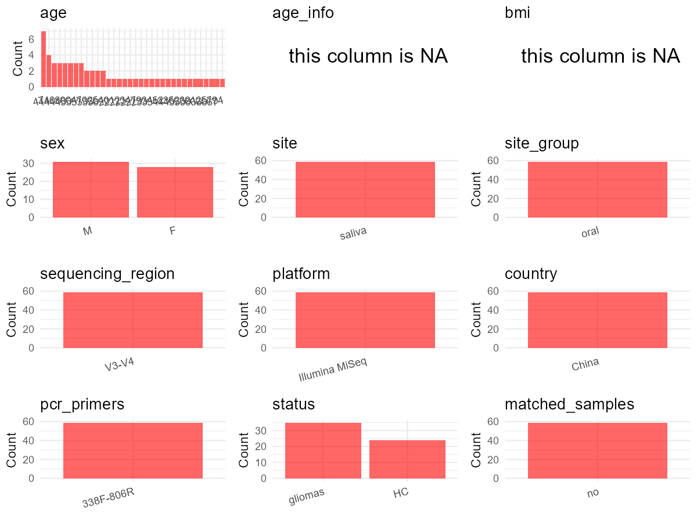

R Notebook: Metadata Processing Workflow
================

# Step 1: Obtain Initial Metadata from Each Project

This step sets the project directory, loads the raw SRA metadata, and
optionally merges supplement tables.

``` r
# Load libraries
library(dplyr)
library(ggplot2)
library(cowplot)

# (1) Setting working directory
# EDIT HERE: change project_id for each study
project_id <- "PRJNA750937" 

base_dir <- "E:/oral/26/metadata-2604/Oral-Metadata-YL-02"
setwd(file.path(base_dir, project_id))

# (2) Loading raw SRA metadata file
sra_file <- "SraRunTable.csv"
initial_meta <- read.csv(sra_file, header = TRUE)

# (3) OPTIONAL: If extra metadata (e.g., Table.x or supplemental materials) are available from the article, you may need to merge the file with initial_meta manually. Below is example code for merging. Depending on the specific case of each study, you can customize the code as needed.
# supp_table <- read.csv("supplemental_table.csv", header = TRUE)
# initial_meta <- left_join(initial_meta, supp_table, by = merge_col_name)
```

# Step 2: Data Overview

First, you need to get an overview of the data, which includes two
steps: reading the article and reading the initial metadata. This step
is very IMPORTANT!

``` r
# (1) Read the article in the following order: abstract, the beginning of the results section, and the methods. Understand the sample size, experimental design, and disease group overview. Clarify the sampling sites; for oral and gut samples, specify the exact sites like supragingival plaque, tongue, etc.

# (2) IMPORTANT: MUST go through each column of initial_meta
head(initial_meta, 10)
```

    ##            Run      AGE Assay.Type AvgSpotLen    Bases
    ## 1  SRR15307426 48 years   AMPLICON        602 19548144
    ## 2  SRR15307427 35 years   AMPLICON        602 34841954
    ## 3  SRR15307428 40 years   AMPLICON        602 31089688
    ## 4  SRR15307429 23 years   AMPLICON        602 30522002
    ## 5  SRR15307430 50 years   AMPLICON        602 40086578
    ## 6  SRR15307431 49 years   AMPLICON        602 22103032
    ## 7  SRR15307432 47 years   AMPLICON        602 38366664
    ## 8  SRR15307433 54 years   AMPLICON        602 24391234
    ## 9  SRR15307434 29 years   AMPLICON        602 35690172
    ## 10 SRR15307435 27 years   AMPLICON        602 30763404
    ##                                                                                                                                                                                       BIOMATERIAL_PROVIDER
    ## 1  Neurosurgery Clinical Medical Research Center of Sichuan Province\\, Prof. Dr. Ligang Chen\\, Department of Neurosurgery\\, the Affiliated Hospital of Southwest Medical University\\, Lu Zhou\\, China
    ## 2  Neurosurgery Clinical Medical Research Center of Sichuan Province\\, Prof. Dr. Ligang Chen\\, Department of Neurosurgery\\, the Affiliated Hospital of Southwest Medical University\\, Lu Zhou\\, China
    ## 3  Neurosurgery Clinical Medical Research Center of Sichuan Province\\, Prof. Dr. Ligang Chen\\, Department of Neurosurgery\\, the Affiliated Hospital of Southwest Medical University\\, Lu Zhou\\, China
    ## 4  Neurosurgery Clinical Medical Research Center of Sichuan Province\\, Prof. Dr. Ligang Chen\\, Department of Neurosurgery\\, the Affiliated Hospital of Southwest Medical University\\, Lu Zhou\\, China
    ## 5  Neurosurgery Clinical Medical Research Center of Sichuan Province\\, Prof. Dr. Ligang Chen\\, Department of Neurosurgery\\, the Affiliated Hospital of Southwest Medical University\\, Lu Zhou\\, China
    ## 6  Neurosurgery Clinical Medical Research Center of Sichuan Province\\, Prof. Dr. Ligang Chen\\, Department of Neurosurgery\\, the Affiliated Hospital of Southwest Medical University\\, Lu Zhou\\, China
    ## 7  Neurosurgery Clinical Medical Research Center of Sichuan Province\\, Prof. Dr. Ligang Chen\\, Department of Neurosurgery\\, the Affiliated Hospital of Southwest Medical University\\, Lu Zhou\\, China
    ## 8  Neurosurgery Clinical Medical Research Center of Sichuan Province\\, Prof. Dr. Ligang Chen\\, Department of Neurosurgery\\, the Affiliated Hospital of Southwest Medical University\\, Lu Zhou\\, China
    ## 9  Neurosurgery Clinical Medical Research Center of Sichuan Province\\, Prof. Dr. Ligang Chen\\, Department of Neurosurgery\\, the Affiliated Hospital of Southwest Medical University\\, Lu Zhou\\, China
    ## 10 Neurosurgery Clinical Medical Research Center of Sichuan Province\\, Prof. Dr. Ligang Chen\\, Department of Neurosurgery\\, the Affiliated Hospital of Southwest Medical University\\, Lu Zhou\\, China
    ##     BioProject    BioSample BioSampleModel    Bytes
    ## 1  PRJNA750937 SAMN20502004          Human 11152744
    ## 2  PRJNA750937 SAMN20502022          Human 20083556
    ## 3  PRJNA750937 SAMN20502026          Human 17284858
    ## 4  PRJNA750937 SAMN20502027          Human 16946039
    ## 5  PRJNA750937 SAMN20502031          Human 22154301
    ## 6  PRJNA750937 SAMN20502005          Human 12923609
    ## 7  PRJNA750937 SAMN20502032          Human 21315189
    ## 8  PRJNA750937 SAMN20502036          Human 14101265
    ## 9  PRJNA750937 SAMN20502037          Human 19771927
    ## 10 PRJNA750937 SAMN20502041          Human 17136522
    ##                                                Center.Name Consent
    ## 1  THE AFFILIATED HOSPITAL OF SOUTHWEST MEDICAL UNIVERSITY  public
    ## 2  THE AFFILIATED HOSPITAL OF SOUTHWEST MEDICAL UNIVERSITY  public
    ## 3  THE AFFILIATED HOSPITAL OF SOUTHWEST MEDICAL UNIVERSITY  public
    ## 4  THE AFFILIATED HOSPITAL OF SOUTHWEST MEDICAL UNIVERSITY  public
    ## 5  THE AFFILIATED HOSPITAL OF SOUTHWEST MEDICAL UNIVERSITY  public
    ## 6  THE AFFILIATED HOSPITAL OF SOUTHWEST MEDICAL UNIVERSITY  public
    ## 7  THE AFFILIATED HOSPITAL OF SOUTHWEST MEDICAL UNIVERSITY  public
    ## 8  THE AFFILIATED HOSPITAL OF SOUTHWEST MEDICAL UNIVERSITY  public
    ## 9  THE AFFILIATED HOSPITAL OF SOUTHWEST MEDICAL UNIVERSITY  public
    ## 10 THE AFFILIATED HOSPITAL OF SOUTHWEST MEDICAL UNIVERSITY  public
    ##    DATASTORE.filetype DATASTORE.provider                     DATASTORE.region
    ## 1    fastq,run.zq,sra         gs,ncbi,s3 gs.us-east1,ncbi.public,s3.us-east-1
    ## 2    fastq,run.zq,sra         gs,ncbi,s3 gs.us-east1,ncbi.public,s3.us-east-1
    ## 3    fastq,run.zq,sra         gs,ncbi,s3 gs.us-east1,ncbi.public,s3.us-east-1
    ## 4    fastq,run.zq,sra         gs,ncbi,s3 gs.us-east1,ncbi.public,s3.us-east-1
    ## 5    fastq,run.zq,sra         gs,ncbi,s3 gs.us-east1,ncbi.public,s3.us-east-1
    ## 6    fastq,run.zq,sra         gs,ncbi,s3 gs.us-east1,ncbi.public,s3.us-east-1
    ## 7    fastq,run.zq,sra         gs,ncbi,s3 gs.us-east1,ncbi.public,s3.us-east-1
    ## 8    fastq,run.zq,sra         gs,ncbi,s3 gs.us-east1,ncbi.public,s3.us-east-1
    ## 9    fastq,run.zq,sra         gs,ncbi,s3 gs.us-east1,ncbi.public,s3.us-east-1
    ## 10   fastq,run.zq,sra         gs,ncbi,s3 gs.us-east1,ncbi.public,s3.us-east-1
    ##     Experiment health_state     Instrument                    isolate
    ## 1  SRX11612107       health Illumina MiSeq    health control 3 saliva
    ## 2  SRX11612106       health Illumina MiSeq   health control 21 saliva
    ## 3  SRX11612105      disease Illumina MiSeq  low glioma group 1 saliva
    ## 4  SRX11612104      disease Illumina MiSeq  low glioma group 2 saliva
    ## 5  SRX11612103      disease Illumina MiSeq  low glioma group 6 saliva
    ## 6  SRX11612102       health Illumina MiSeq    health control 4 saliva
    ## 7  SRX11612101      disease Illumina MiSeq  low glioma group 7 saliva
    ## 8  SRX11612100      disease Illumina MiSeq low glioma group 11 saliva
    ## 9  SRX11612099      disease Illumina MiSeq low glioma group 12 saliva
    ## 10 SRX11612098      disease Illumina MiSeq high glioma group 4 saliva
    ##       Library.Name LibraryLayout LibrarySelection LibrarySource     Organism
    ## 1   ="sample  "&A4        PAIRED              PCR   METAGENOMIC Homo sapiens
    ## 2  ="sample  "&A22        PAIRED              PCR   METAGENOMIC Homo sapiens
    ## 3  ="sample  "&A26        PAIRED              PCR   METAGENOMIC Homo sapiens
    ## 4  ="sample  "&A27        PAIRED              PCR   METAGENOMIC Homo sapiens
    ## 5  ="sample  "&A31        PAIRED              PCR   METAGENOMIC Homo sapiens
    ## 6   ="sample  "&A5        PAIRED              PCR   METAGENOMIC Homo sapiens
    ## 7  ="sample  "&A32        PAIRED              PCR   METAGENOMIC Homo sapiens
    ## 8  ="sample  "&A36        PAIRED              PCR   METAGENOMIC Homo sapiens
    ## 9  ="sample  "&A37        PAIRED              PCR   METAGENOMIC Homo sapiens
    ## 10 ="sample  "&A41        PAIRED              PCR   METAGENOMIC Homo sapiens
    ##    Platform population          ReleaseDate          create_date version
    ## 1  ILLUMINA  for human 2021-10-01T00:00:00Z 2021-08-01T05:35:00Z       1
    ## 2  ILLUMINA  for human 2021-10-01T00:00:00Z 2021-08-01T05:35:00Z       1
    ## 3  ILLUMINA  for human 2021-10-01T00:00:00Z 2021-08-01T05:35:00Z       1
    ## 4  ILLUMINA  for human 2021-10-01T00:00:00Z 2021-08-08T21:45:00Z       1
    ## 5  ILLUMINA  for human 2021-10-01T00:00:00Z 2021-08-08T21:46:00Z       1
    ## 6  ILLUMINA  for human 2021-10-01T00:00:00Z 2021-08-08T21:46:00Z       1
    ## 7  ILLUMINA  for human 2021-10-01T00:00:00Z 2021-08-08T21:46:00Z       1
    ## 8  ILLUMINA  for human 2021-10-01T00:00:00Z 2021-08-08T21:45:00Z       1
    ## 9  ILLUMINA  for human 2021-10-01T00:00:00Z 2021-08-08T21:45:00Z       1
    ## 10 ILLUMINA  for human 2021-10-01T00:00:00Z 2021-08-08T21:46:00Z       1
    ##    Sample.Name    sex SRA.Study tissue sample_type
    ## 1          T71   male SRP330605 saliva            
    ## 2          T91   male SRP330605 saliva            
    ## 3           T2   male SRP330605 saliva            
    ## 4           T7   male SRP330605 saliva            
    ## 5          T25   male SRP330605 saliva            
    ## 6          T72 female SRP330605 saliva            
    ## 7          T37   male SRP330605 saliva            
    ## 8          T94   male SRP330605 saliva            
    ## 9          T20 female SRP330605 saliva            
    ## 10         T21 female SRP330605 saliva

``` r
# IMPORTANT: Check the unique values in the column of interest or query column.
lapply(initial_meta[c('isolate', 'tissue')], table) # site
```

    ## $isolate
    ## 
    ##     health control 1 saliva    health control 10 saliva 
    ##                           1                           1 
    ##    health control 11 saliva    health control 12 saliva 
    ##                           1                           1 
    ##    health control 13 saliva    health control 14 saliva 
    ##                           1                           1 
    ##    health control 15 saliva    health control 16 saliva 
    ##                           1                           1 
    ##    health control 17 saliva    health control 18 saliva 
    ##                           1                           1 
    ##    health control 19 saliva     health control 2 saliva 
    ##                           1                           1 
    ##    health control 20 saliva    health control 21 saliva 
    ##                           1                           1 
    ##    health control 22 saliva    health control 23 saliva 
    ##                           1                           1 
    ##    health control 24 saliva     health control 3 saliva 
    ##                           1                           1 
    ##     health control 4 saliva     health control 5 saliva 
    ##                           1                           1 
    ##     health control 6 saliva     health control 7 saliva 
    ##                           1                           1 
    ##     health control 8 saliva     health control 9 saliva 
    ##                           1                           1 
    ##  high glioma group 1 saliva high glioma group 10 saliva 
    ##                           1                           1 
    ## high glioma group 11 saliva high glioma group 12 saliva 
    ##                           1                           1 
    ## high glioma group 13 saliva high glioma group 14 saliva 
    ##                           1                           1 
    ## high glioma group 15 saliva high glioma group 16 saliva 
    ##                           1                           1 
    ## high glioma group 17 saliva high glioma group 18 saliva 
    ##                           1                           1 
    ## high glioma group 19 saliva  high glioma group 2 saliva 
    ##                           1                           1 
    ## high glioma group 20 saliva high glioma group 21 saliva 
    ##                           1                           1 
    ## high glioma group 22 saliva high glioma group 23 saliva 
    ##                           1                           1 
    ##  high glioma group 3 saliva  high glioma group 4 saliva 
    ##                           1                           1 
    ##  high glioma group 5 saliva  high glioma group 6 saliva 
    ##                           1                           1 
    ##  high glioma group 7 saliva  high glioma group 8 saliva 
    ##                           1                           1 
    ##  high glioma group 9 saliva   low glioma group 1 saliva 
    ##                           1                           1 
    ##  low glioma group 10 saliva  low glioma group 11 saliva 
    ##                           1                           1 
    ##  low glioma group 12 saliva   low glioma group 2 saliva 
    ##                           1                           1 
    ##   low glioma group 3 saliva   low glioma group 4 saliva 
    ##                           1                           1 
    ##   low glioma group 5 saliva   low glioma group 6 saliva 
    ##                           1                           1 
    ##   low glioma group 7 saliva   low glioma group 8 saliva 
    ##                           1                           1 
    ##   low glioma group 9 saliva 
    ##                           1 
    ## 
    ## $tissue
    ## 
    ## saliva 
    ##     59

``` r
lapply(initial_meta[c('population', 'Organism')], table) # organism
```

    ## $population
    ## 
    ## for human 
    ##        59 
    ## 
    ## $Organism
    ## 
    ## Homo sapiens 
    ##           59

``` r
table(initial_meta$Sample.Name) # subject id
```

    ## 
    ## T11 T13 T18 T19  T2 T20 T21 T22 T23 T24 T25 T27 T30 T32 T35 T36 T37 T41 T42 T48 
    ##   1   1   1   1   1   1   1   1   1   1   1   1   1   1   1   1   1   1   1   1 
    ## T55 T56 T58 T59  T6 T61 T62 T63 T67 T68 T69  T7 T70 T71 T72 T73 T74 T75 T76 T77 
    ##   1   1   1   1   1   1   1   1   1   1   1   1   1   1   1   1   1   1   1   1 
    ## T78 T79  T8 T80 T81 T82 T83 T84 T85 T86 T87 T88  T9 T90 T91 T92 T93 T94 T99 
    ##   1   1   1   1   1   1   1   1   1   1   1   1   1   1   1   1   1   1   1

``` r
#table(initial_meta$sequencing_meth..exp.) # output is Sequencing by synthesis
table(initial_meta$Platform) # output is Illumina. according to the methods,  Illumina is correct.
```

    ## 
    ## ILLUMINA 
    ##       59

``` r
#table(initial_meta$target_subfragment..exp.)
```

# Step 3: Removing Control and Non-human Samples

First, we need to remove control samples(including both negative
controls and positive controls) and non-human samples.

``` r
# (1) EDIT HERE: Parameter setup
control_column <- "" # column name in initial_meta
# unique(initial_meta[[control_column]])
control_keywords <- c() # Enter exact keywords

species_column <- "" # column name in initial_meta
unique(initial_meta[[species_column]])
```

    ## NULL

``` r
non_human_keywords <- c() # Enter exact keywords

# (2) Remove controls and non-human samples. DO NOT need to modify code in this part, just run it.
n_samples <- nrow(initial_meta)
# Control evaluation
if (length(control_keywords) > 0) {
  if (is.null(control_column) || control_column == "") {
    stop("Error: control_keywords provided but control_column is missing.")
  }
  
  if (!(control_column %in% colnames(initial_meta))) {
    stop(sprintf("Error: Column '%s' not found in initial_meta.", control_column))
  }
  
  control_pattern <- paste(control_keywords, collapse = "|")
  control_text <- initial_meta[[control_column]]
  is_control <- grepl(control_pattern, control_text)
  
} else {
  is_control <- rep(FALSE, n_samples)
}

# Non-human evaluation
if (length(non_human_keywords) > 0) {
  if (is.null(species_column) || species_column == "") {
    stop("Error: non_human_keywords provided but species_column is missing.")
  }
  
  if (!(species_column %in% colnames(initial_meta))) {
    stop(sprintf("Error: Column '%s' not found in initial_meta.", species_column))
  }
  
  non_human_pattern <- paste(non_human_keywords, collapse = "|")
  species_text <- initial_meta[[species_column]]
  is_non_human <- grepl(non_human_pattern, species_text)
} else {
  is_non_human <- rep(FALSE, n_samples)
}

# Execute removal
samples_to_remove <- is_control | is_non_human
initial_meta <- initial_meta[!samples_to_remove, ]

cat("Initial samples counts:",n_samples,"\n")
```

    ## Initial samples counts: 59

``` r
cat("Removed control samples:", sum(is_control), "\n")
```

    ## Removed control samples: 0

``` r
cat("Removed non-human samples:", sum(is_non_human), "\n")
```

    ## Removed non-human samples: 0

``` r
cat("Total samples removed ", sum(samples_to_remove), "\n")
```

    ## Total samples removed  0

``` r
cat("Remaining samples after Step 2:", nrow(initial_meta), "\n")
```

    ## Remaining samples after Step 2: 59

# Step 4: Creating a Uniform Metadata Template

This step converts the raw SRA table into the standard metadata format
used in our meta-analysis. The uniform metadata should include the
following columns: 1. **bioproject**: Project ID from SRA or other
database e.g. `PRJNA1234`, `CNP1234`, ‘OEP1234’, ‘qiita_1234’ 2.
**sample_id**: SRA sample/run ID. Unique id for each sample!
e.g. `DRR1234567`, `ERR1234567` and `SRR1234567`. If no such column
exists, can use column like sample_name. 3. **subject_id**: subject id
for each person if available. e.g. `patient_01`, `Host_03_before`,
`subject12` 4. **age**: Age of the subject if available. e.g. `35`, `42`
\| not `adult`, `chilren` 5. **age_info**: If the age is not explicitly
stated but approximate age range information is available, mark it in
this column. e.g., `18-55`, `children`, `infant`, `elder` 6. **bmi**:
Body Mass Index if available. e.g. `22.5`, `18.9` \| not `normal`,
`overweight` 7. **sex**: Sex of the subject. Mandatory to write as M/F
\| not `female`, `woman` 8. **sequencing_region**: Targeted 16S rRNA
region. e.g. `V3-V4`, `V4` 9. **platform**: Sequencing platform.
e.g. `Illumina MiSeq`, `454 GS FLX Titanium`, `Ion Torrent` 10.
**country**: Country of sample origin. e.g. `China`, `Japan` \| not city
name like `Beijing` 11. **site**: Sampling site. For oral and gut sites,
specify the exact sites as detailed as possible. For example, if it is
known to be supragingival plaque, do not record it as ‘dental plaque’,
unless the original text provides only a vague description.
e.g. `saliva`, `tongue coating` \| not broad term like `oral` 12.
**site_group**: only accepts one of following three values: ‘oral’,
‘gut’, or ‘other’. 13. **public_time**: Data release date.
e.g. `2021-06-22` \| not `June 2021` 14. **pcr_primers**: PCR primers
used. e.g. `515F-806R`, `27F-338R` \| not primer sequences 15.
**title**: Title of the associated publication. 16. **disease_study**:
Whether the study involves disease samples. If it’s not clear, can
record as NA. Only three values accepted: ‘yes’, ‘no’ or NA 17.
**status**: Disease status for each sample if available, else record as
NA. Only accept following abbreviations, Write full names for all other
diseases. HC: healthy control CD: Crohn’s disease CRC: colorectal cancer
COPD: chronic obstructive pulmonary disease HIV: human immunodeficiency
virus ICU: intensive care unit OSCC: oral squamous cell carcinoma RA:
rheumatoid arthritis UC: ulcerative colitis 18. **matched_samples**:
Whether the subject has matched samples. Only accept ‘yes’ or ‘no’. 19.
**is_time_series**: Whether the study is a time series study. Only
accept ‘yes’ or ‘no’.

``` r
# Extract columns from initial_meta as follows: (1) No modification needed → extract directly. (2) Modification needed → create a new column with the prefix raw_ and mark the original column as “pending”. (3) Need to find or determine based on the article.
metadata <- data.frame(
  bioproject = initial_meta$BioProject,
  sample_id = initial_meta$Run,
  subject_id = initial_meta$Sample.Name,
  raw_age = initial_meta$AGE,
  age = "pending", # modify later
  age_info = NA, 
  bmi = NA,
  raw_sex = initial_meta$sex,
  sex = "pending", # modify later
  sequencing_region = "V3-V4", # extract from methods section
  platform = "Illumina MiSeq", # extract from methods section, NOT initial_meta
  country = "China",
  site = initial_meta$tissue, 
  site_group = "pending", # modify later
  public_time = initial_meta$ReleaseDate,
  pcr_primers = "338F-806R", # Format: xxF-xxR
  title = "Association between oral microbiota and human brain glioma grade: a case-control study", # extract from article
  disease_study = "yes", # determine according to the article
  raw_status = initial_meta$health_state,
  status = "pending", # modify later 
  matched_samples = "pending", # modify later
  is_time_series = "no", 
  stringsAsFactors = FALSE
)
metadata$public_time <- as.Date(metadata$public_time)
```

# Step 5: Manually solving pending issues

This step involves two parts: (1) handle the columns with the `raw_`
prefix, and next (2) handle the `site_group` and `matched_samples`
columns.

``` r
# (1) Handle the columns with the `raw_` prefix.
# In this part, you need to customize the code based on the situation of the raw_ columns to obtain the content of the target columns. IMPORTANT: Add comments if the modification is not straightforward!!
metadata$age <- gsub(" years", "", metadata$raw_age) # according to the 'AGE' column of initial_meta

metadata <- metadata %>%
  mutate(sex = case_when(
    raw_sex == "male" ~ "M",
    raw_sex == "female" ~ "F",
    TRUE ~ NA_character_
  )) # according to the 'sex' column of initial_meta

metadata <- metadata %>%
  mutate(status = case_when(
    grepl("disease", raw_status) ~ "gliomas",
    grepl("health", raw_status) ~ "HC",
    TRUE ~ NA_character_
  )) # according to the 'health_state' column of initial_meta
```

``` r
# (2) Filling the 'site_group' and 'matched_samples' columns
# editing site_group
unique(metadata$site)
```

    ## [1] "saliva"

``` r
# EDIT HERE: add oral sites
Oral_site = unique(metadata$site)
# EDIT HERE: add gut sites
Gut_site = c()
# just run
metadata <- metadata %>%
  mutate(site_group = case_when(
    site %in% Oral_site ~ "oral",
    site %in% Gut_site ~ "gut",
    TRUE ~ "other" 
  ))

# editing matched_samples, just run.
metadata$matched_samples <- ifelse(
  ave(metadata$subject_id, metadata$subject_id, FUN = length) > 1, 
  "yes", 
  "no"
)
```

``` r
# (3) check if there is pending value in metadata. If there is pending value, go on modify the metadata.
# Function to check if a column contains "pending"
has_pending <- function(col) {
  if (is.character(col) || is.factor(col)) {
    any(col == "pending", na.rm = TRUE)
  } else {
    FALSE
  }
}

# Check for any pending value
any_pending_value <- any(sapply(metadata, has_pending))

if (!any_pending_value) {
  message("Good! No cell contains the value 'pending'.")
} else {
  pending_cols <- names(metadata)[sapply(metadata, has_pending)]
  message("Columns containing 'pending': ", paste(pending_cols, collapse = ", "))
  message("Please continue to resolve these pending columns!")
}
```

    ## Good! No cell contains the value 'pending'.

# Step 6: Visualize the Metadata

This step makes a quick set of plots for checking the distribution of
key metadata fields.

``` r
# Select columns for visualization, just run
plot_data <- metadata %>%
  select(-bioproject, -sample_id, -subject_id, -title)

create_simple_plots <- function(data) {
  plots <- list()
  continuous_vars <- c("age", "bmi")

  for (col in colnames(data)) {
    if (all(is.na(data[[col]]))) {
      p <- ggplot() +
        annotate("text", x = 0.5, y = 0.5, label = "this column is NA", size = 6) +
        labs(title = col) +
        theme_void()
    } else if (col %in% continuous_vars && is.numeric(data[[col]])) {
      p <- ggplot(data, aes(x = .data[[col]])) +
        geom_histogram(fill = "blue", alpha = 0.6, bins = 20, na.rm = TRUE) +
        labs(title = col, x = col, y = "Count") +
        theme_minimal()
    } else {
      count_data <- as.data.frame(table(data[[col]], useNA = "ifany"))
      p <- ggplot(count_data, aes(x = reorder(Var1, -Freq), y = Freq)) +
        geom_col(fill = "red", alpha = 0.6) +
        labs(title = col, x = NULL, y = "Count") +
        theme_minimal() +
        theme(axis.text.x = element_text(angle = 15, hjust = 1))
    }
    plots[[col]] <- p
  }

  return(plots)
}

# Generate and arrange plots
plots <- create_simple_plots(plot_data)
p <- plot_grid(plots$age,
               plots$age_info,
               plots$bmi,
               plots$sex,
               plots$site,
               plots$site_group,
               plots$sequencing_region,
               plots$platform,
               plots$country,
               plots$pcr_primers,
               plots$status,
               plots$matched_samples,
               ncol = 3, align = "hv", axis = "lb")
ggsave("Metadata_Summary_v2.png", plot = p, width = 8, height = 6, dpi = 150)
```

``` r
# Insert Metadata_Summary.png into the current Rmd output

```


# Step 7: Sort and export the metadata

This step saves the cleaned metadata table as the final `metadata.csv`
file.

``` r
# Reorder the data frame
fixed_cols <- c("bioproject", "sample_id", "subject_id", "age", "age_info",
                "bmi", "sex", "platform", "sequencing_region", "pcr_primers", 
                "country", "site", "site_group", "disease_study", "status", 
                "title", "public_time", "matched_samples", "is_time_series")  
metadata <- metadata %>%
  select(all_of(fixed_cols), everything())

# save metadata 
# head(metadata)
write.csv(metadata, file = "metadata_v2.csv", quote = TRUE)
```
