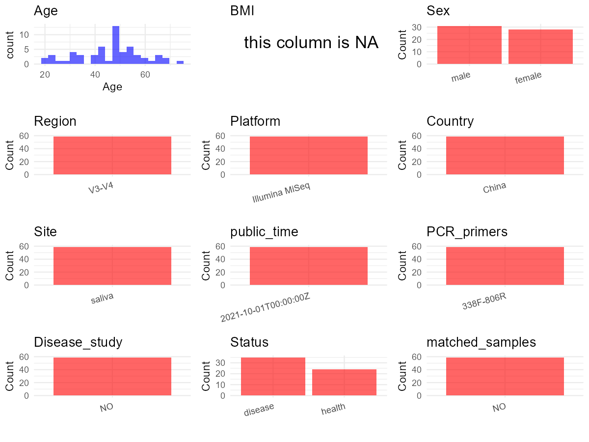

# Step 1: Obtain Initial Metadata from Each Project

This step sets the project directory, loads the raw SRA metadata, and optionally merges supplement tables.


``` r
# Load libraries
library(dplyr)
library(ggplot2)
library(cowplot)

# (1) Setting working directory
# EDIT HERE: change project_id for each study
project_id <- "PRJNA750937"

base_dir <- "/beegfs/huangxiaochang/global_oral/global-oral-microbiome/data/projects/"
setwd(file.path(base_dir, project_id))

# (2) Loading raw SRA metadata file
sra_file <- "SraRunTable.csv"
initial_meta <- read.csv("SraRunTable.csv", header = TRUE)

# (3) OPTIONAL: If extra metadata (e.g., Table.x or supplemental materials) are available from the article, you may need to merge the file with initial_meta manually. Below is example code for merging. Depending on the specific case of each study, you can customize the code as needed.
# supp_table <- read.csv("supplemental_table.csv", header = TRUE)
# initial_meta <- left_join(initial_meta, supp_table, by = merge_col_name)
```

# Step 2: Data Overview

First, you need to get an overview of the data, which includes two steps: reading the article and reading the initial metadata. This step is very IMPORTANT!


``` r
# (1) Read the article in the following order: abstract, the beginning of the results section, and the methods. Understand the sample size, experimental design, and disease group overview. Clarify the sampling sites; for oral and gut samples, specify the exact sites like supragingival plaque, tongue, etc.

# (2) IMPORTANT: MUST go through each column of initial_meta
# head(initial_meta, 10)

# IMPORTANT: Check the unique values in the column of interest or query column.
# lapply(initial_meta[c('body_habitat', 'body_product', 'body_site')], table) # site
# table(initial_meta$host_subject_id) # subject id
# table(initial_meta$platform..exp.) # output is Illumina
# table(initial_meta$target_subfragment..exp.)
```

# Step 3: Removing Control and Non-human Samples

First, we need to remove control samples(including both negative controls and positive controls) and non-human samples.


``` r
# (1) EDIT HERE: Parameter setup
# NOTE: This project has no lab control samples (blanks/positives) or non-human samples. Leave keywords empty to skip filtering.
control_column <- NA   # column name in initial_meta
# unique(initial_meta[[control_column]])  # uncomment to explore
control_keywords <- c()     # Enter exact keywords

species_column <- NA          # column name in initial_meta
# unique(initial_meta[[species_column]])  # uncomment to explore
non_human_keywords <- c()            # Enter exact keywords


# (2) Remove controls and non-human samples. DO NOT need to modify code in this part, just run it.
n_samples <- nrow(initial_meta)
# Control evaluation
if (length(control_keywords) > 0) {
  if (is.null(control_column) || control_column == "") {
    stop("Error: control_keywords provided but control_column is missing.")
  }

  if (!(control_column %in% colnames(initial_meta))) {
    stop(sprintf("Error: Column '%s' not found in initial_meta.", control_column))
  }

  control_pattern <- paste(control_keywords, collapse = "|")
  control_text <- initial_meta[[control_column]]
  is_control <- grepl(control_pattern, control_text)

} else {
  is_control <- rep(FALSE, n_samples)
}

# Non-human evaluation
if (length(non_human_keywords) > 0) {
  if (is.null(species_column) || species_column == "") {
    stop("Error: non_human_keywords provided but species_column is missing.")
  }

  if (!(species_column %in% colnames(initial_meta))) {
    stop(sprintf("Error: Column '%s' not found in initial_meta.", control_column))
  }

  non_human_pattern <- paste(non_human_keywords, collapse = "|")
  species_text <- initial_meta[[species_column]]
  is_non_human <- grepl(non_human_pattern, species_text)
} else {
  is_non_human <- rep(FALSE, n_samples)
}

# Execute removal
samples_to_remove <- is_control | is_non_human
initial_meta <- initial_meta[!samples_to_remove, ]

cat("Initial samples counts:",n_samples,"\n")
```

```
## Initial samples counts: 59
```

``` r
cat("Removed control samples:", sum(is_control), "\n")
```

```
## Removed control samples: 0
```

``` r
cat("Removed non-human samples:", sum(is_non_human), "\n")
```

```
## Removed non-human samples: 0
```

``` r
cat("Total samples removed ", sum(samples_to_remove), "\n")
```

```
## Total samples removed  0
```

``` r
cat("Remaining samples after Step 2:", nrow(initial_meta), "\n")
```

```
## Remaining samples after Step 2: 59
```

# Step 4: Creating a Uniform Metadata Template

This step converts the raw SRA table into the standard metadata format used in our meta-analysis.
The uniform metadata should include the following columns:
1. **bioproject**: Project ID from SRA or other database
2. **sample_id**: SRA sample/run ID. Unique id for each sample!
3. **subject_id**: subject id for each person if available.
4. **age**: Age of the subject if available. e.g. `35`, `42`
5. **age_info**: If the age is not explicitly stated but approximate age range information is available, mark it in this column.
6. **bmi**: Body Mass Index if available.
7. **sex**: Sex of the subject. Mandatory to write as M/F
8. **sequencing_region**: Targeted 16S rRNA region.
9. **platform**: Sequencing platform.
10. **country**: Country of sample origin.
11. **site**: Sampling site. For oral and gut sites, specify the exact sites as detailed as possible.
12. **site_group**: only accepts one of following three values: 'oral', 'gut', or 'other'.
13. **public_time**: Data release date.
14. **pcr_primers**: PCR primers used.
15. **title**: Title of the associated publication.
16. **disease_study**: Whether the study involves disease samples. Only three values accepted: 'yes', 'no' or NA
17. **status**: Disease status for each sample if available, else record as NA.
18. **matched_samples**: Whether the subject has matched samples. Only accept 'yes' or 'no'.
19. **is_time_series**: Whether the study is a time series study. Only accept 'yes' or 'no'.


``` r
# Extract columns from initial_meta as follows:
# (1) No modification needed → extract directly.
# (2) Modification needed → create a column start with 'raw_' and mark the target column as "pending".
# (3) Need to find or determine based on the article.

metadata <- data.frame(
  bioproject = initial_meta$BioProject,
  sample_id = initial_meta$Run,
  subject_id = initial_meta$Sample.Name,
  age = initial_meta$AGE,
  age_info = NA,
  bmi = NA,
  raw_sex = initial_meta$sex,
  sex = "pending",
  sequencing_region = "V3-V4",
  platform = initial_meta$Instrument,
  country = "China",
  raw_site = initial_meta$tissue,
  site = "pending",
  site_group = "pending",
  public_time = initial_meta$ReleaseDate,
  raw_status = initial_meta$health_state,
  pcr_primers = NA,
  title = NA,
  disease_study = NA,
  status = "pending",
  matched_samples = "pending",
  is_time_series = "no",
  stringsAsFactors = FALSE
)

metadata$public_time <- as.Date(metadata$public_time)
```

# Step 5: Manually solving pending issues

This step involves two parts: (1) handle the columns with the `raw_` prefix, and next (2) handle the `site_group` and `matched_samples` columns.


``` r
# (1) Handle the columns with the `raw_` prefix.
# IMPORTANT: Add comments if the modification is not straightforward!!
# Convert raw_sex to standard F/M encoding
# SRA raw_sex values: male/female
metadata <- metadata %>%
  mutate(sex = case_when(
    tolower(raw_sex) %in% c("female", "f") ~ "F",
    tolower(raw_sex) %in% c("male", "m") ~ "M",
    TRUE ~ NA_character_
  ))

# Clean age column by removing ' years' suffix and converting to numeric
metadata$age <- as.numeric(gsub(" years", "", metadata$age)) # AGE column in SRA contained 'X years' format

# Disease status from SRA health_state column
metadata$status <- metadata$raw_status

# Add publication information
metadata$pcr_primers <- "338F-806R"
metadata$title <- "Association Between Oral Microbiota and Human Brain Glioma Grade A Case-Control Study"
metadata$disease_study <- "yes" # NOTE: original had 'no' but this is a case-control study

# Keep only saliva samples
keep_subjects <- metadata$sample_id[metadata$raw_site == "saliva"]
metadata <- metadata[metadata$sample_id %in% keep_subjects, ]

# Set site to saliva for all remaining samples (filtered above)
metadata$site <- "saliva"
```


``` r
# (2) Filling the 'site_group' and 'matched_samples' columns
# editing site_group
unique(metadata$site)
```

```
## [1] "saliva"
```

``` r
# EDIT HERE: add oral sites
Oral_site = c("saliva", "mouth", "tongue coating", "supragingival plaque", "subgingival plaque", "oral swab", "denture", "tooth", "abscess pus", "adjacent periodontal pocket", "patient healthy crevice", "healthy control crevice", "gingival crevicular fluid", "subgingival plaque")
# EDIT HERE: add gut sites
Gut_site = c("feces", "stool")
# just run
metadata <- metadata %>%
  mutate(site_group = case_when(
    site %in% Oral_site ~ "oral",
    site %in% Gut_site ~ "gut",
    TRUE ~ "other"
  ))

# editing matched_samples, just run.
metadata$matched_samples <- ifelse(
  ave(metadata$subject_id, metadata$subject_id, FUN = length) > 1,
  "yes",
  "no"
)
```


``` r
# (3) check if there is pending value in metadata. If there is pending value, go on modify the metadata.
# Function to check if a column contains "pending"
has_pending <- function(col) {
  if (is.character(col) || is.factor(col)) {
    any(col == "pending", na.rm = TRUE)
  } else {
    FALSE
  }
}

# Check for any pending value
any_pending_value <- any(sapply(metadata, has_pending))

if (!any_pending_value) {
  message("Good! No cell contains the value 'pending'.")
} else {
  pending_cols <- names(metadata)[sapply(metadata, has_pending)]
  message("Columns containing 'pending': ", paste(pending_cols, collapse = ", "))
  message("Please continue to resolve these pending columns!")
}
```

```
## Good! No cell contains the value 'pending'.
```

# Step 6: Visualize the Metadata

This step makes a quick set of plots for checking the distribution of key metadata fields.


``` r
# Select columns for visualization, just run
plot_data <- metadata %>%
  select(-bioproject, -sample_id, -subject_id, -title)

create_simple_plots <- function(data) {
  plots <- list()
  continuous_vars <- c("age", "bmi")

  for (col in colnames(data)) {
    if (all(is.na(data[[col]]))) {
      p <- ggplot() +
        annotate("text", x = 0.5, y = 0.5, label = "this column is NA", size = 6) +
        labs(title = col) +
        theme_void()
    } else if (col %in% continuous_vars && is.numeric(data[[col]])) {
      p <- ggplot(data, aes(x = .data[[col]])) +
        geom_histogram(fill = "blue", alpha = 0.6, bins = 20, na.rm = TRUE) +
        labs(title = col, x = col, y = "Count") +
        theme_minimal()
    } else {
      count_data <- as.data.frame(table(data[[col]], useNA = "ifany"))
      p <- ggplot(count_data, aes(x = reorder(Var1, -Freq), y = Freq)) +
        geom_col(fill = "red", alpha = 0.6) +
        labs(title = col, x = NULL, y = "Count") +
        theme_minimal() +
        theme(axis.text.x = element_text(angle = 15, hjust = 1))
    }
    plots[[col]] <- p
  }

  return(plots)
}

# Generate and arrange plots
plots <- create_simple_plots(plot_data)
p <- plot_grid(plots$age,
               plots$age_info,
               plots$bmi,
               plots$sex,
               plots$site,
               plots$site_group,
               plots$sequencing_region,
               plots$platform,
               plots$country,
               plots$pcr_primers,
               plots$status,
               plots$matched_samples,
               ncol = 3, align = "hv", axis = "lb")
ggsave("Metadata_Summary.png", plot = p, width = 8, height = 6, dpi = 150)
```


``` r
# Insert Metadata_Summary.png into the current Rmd output

```

<div class="figure">

<p class="caption">plot of chunk unnamed-chunk-9</p>
</div>

# Step 7: Sort and export the metadata

This step saves the cleaned metadata table as the final `metadata.csv` file.


``` r
# Reorder the data frame
fixed_cols <- c("bioproject", "sample_id", "subject_id", "age", "age_info",
                "bmi", "sex", "platform", "sequencing_region", "pcr_primers",
                "country", "site", "site_group", "disease_study", "status",
                "title", "public_time", "matched_samples", "is_time_series")
metadata <- metadata %>%
  select(all_of(fixed_cols), everything())

# save metadata
# head(metadata)
write.csv(metadata, file = "metadata_v2.csv", quote = TRUE, row.names = FALSE)
```
