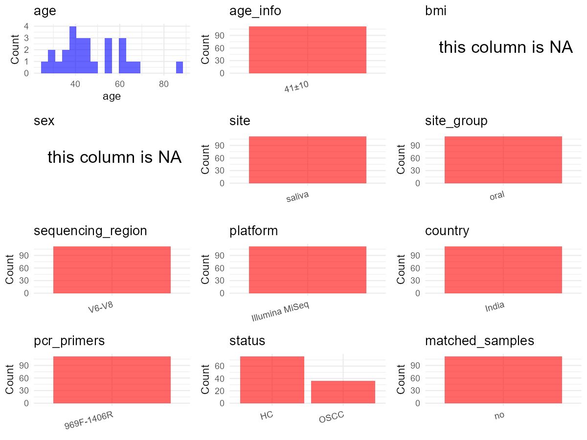

R Notebook: Metadata Processing Workflow
================

# Step 1: Obtain Initial Metadata from Each Project

This step sets the project directory, loads the raw SRA metadata, and
optionally merges supplement tables.

``` r
# Load libraries
library(dplyr)
library(ggplot2)
library(cowplot)

# (1) Setting working directory
# EDIT HERE: change project_id for each study
project_id <- "PRJNA751046" 

base_dir <- "E:/oral/26/metadata-2604/Oral-Metadata-YL-03"
setwd(file.path(base_dir, project_id))

# (2) Loading raw SRA metadata file
sra_file <- "SraRunTable.csv"
initial_meta <- read.csv(sra_file, header = TRUE)

# (3) OPTIONAL: If extra metadata (e.g., Table.x or supplemental materials) are available from the article, you may need to merge the file with initial_meta manually. Below is example code for merging. Depending on the specific case of each study, you can customize the code as needed.
# supp_table <- read.csv("supplemental_table.csv", header = TRUE)
# initial_meta <- left_join(initial_meta, supp_table, by = merge_col_name)
```

# Step 2: Data Overview

First, you need to get an overview of the data, which includes two
steps: reading the article and reading the initial metadata. This step
is very IMPORTANT!

``` r
# (1) Read the article in the following order: abstract, the beginning of the results section, and the methods. Understand the sample size, experimental design, and disease group overview. Clarify the sampling sites; for oral and gut samples, specify the exact sites like supragingival plaque, tongue, etc.

# (2) IMPORTANT: MUST go through each column of initial_meta
head(initial_meta, 10)
```

    ##            Run Assay.Type AvgSpotLen    Bases  BioProject    BioSample
    ## 1  SRR21474439   AMPLICON        602 27906312 PRJNA751046 SAMN30722502
    ## 2  SRR21474444   AMPLICON        602 20545056 PRJNA751046 SAMN30722497
    ## 3  SRR21474445   AMPLICON        602 21061572 PRJNA751046 SAMN30722514
    ## 4  SRR21474446   AMPLICON        602 20053824 PRJNA751046 SAMN30722513
    ## 5  SRR21474447   AMPLICON        602 38658634 PRJNA751046 SAMN30722512
    ## 6  SRR21474448   AMPLICON        602 33532604 PRJNA751046 SAMN30722511
    ## 7  SRR21474449   AMPLICON        602 28434266 PRJNA751046 SAMN30722510
    ## 8  SRR21474450   AMPLICON        602 36920058 PRJNA751046 SAMN30722509
    ## 9  SRR21474451   AMPLICON        602 28743694 PRJNA751046 SAMN30722508
    ## 10 SRR21474452   AMPLICON        602 35230244 PRJNA751046 SAMN30722507
    ##                                 BioSampleModel    Bytes
    ## 1  MIMARKS.survey,MIGS/MIMS/MIMARKS.human-oral 15448020
    ## 2  MIMARKS.survey,MIGS/MIMS/MIMARKS.human-oral 11755738
    ## 3  MIMARKS.survey,MIGS/MIMS/MIMARKS.human-oral 11939899
    ## 4  MIMARKS.survey,MIGS/MIMS/MIMARKS.human-oral 11211379
    ## 5  MIMARKS.survey,MIGS/MIMS/MIMARKS.human-oral 21645710
    ## 6  MIMARKS.survey,MIGS/MIMS/MIMARKS.human-oral 18653819
    ## 7  MIMARKS.survey,MIGS/MIMS/MIMARKS.human-oral 16053649
    ## 8  MIMARKS.survey,MIGS/MIMS/MIMARKS.human-oral 20145434
    ## 9  MIMARKS.survey,MIGS/MIMS/MIMARKS.human-oral 16293854
    ## 10 MIMARKS.survey,MIGS/MIMS/MIMARKS.human-oral 19413365
    ##                                              Center.Name Collection_Date
    ## 1  NARSEE MONJEE INSTITUTE OF MANAGEMENT STUDIES (NMIMS)      2018-03-03
    ## 2  NARSEE MONJEE INSTITUTE OF MANAGEMENT STUDIES (NMIMS)      2018-01-07
    ## 3  NARSEE MONJEE INSTITUTE OF MANAGEMENT STUDIES (NMIMS)      2018-04-25
    ## 4  NARSEE MONJEE INSTITUTE OF MANAGEMENT STUDIES (NMIMS)      2018-04-20
    ## 5  NARSEE MONJEE INSTITUTE OF MANAGEMENT STUDIES (NMIMS)      2018-04-22
    ## 6  NARSEE MONJEE INSTITUTE OF MANAGEMENT STUDIES (NMIMS)      2018-04-16
    ## 7  NARSEE MONJEE INSTITUTE OF MANAGEMENT STUDIES (NMIMS)      2018-04-13
    ## 8  NARSEE MONJEE INSTITUTE OF MANAGEMENT STUDIES (NMIMS)      2018-04-10
    ## 9  NARSEE MONJEE INSTITUTE OF MANAGEMENT STUDIES (NMIMS)      2018-03-27
    ## 10 NARSEE MONJEE INSTITUTE OF MANAGEMENT STUDIES (NMIMS)      2018-03-24
    ##    Consent DATASTORE.filetype DATASTORE.provider
    ## 1   public   fastq,run.zq,sra         gs,ncbi,s3
    ## 2   public   fastq,run.zq,sra         gs,ncbi,s3
    ## 3   public   fastq,run.zq,sra         gs,ncbi,s3
    ## 4   public   fastq,run.zq,sra         gs,ncbi,s3
    ## 5   public   fastq,run.zq,sra         gs,ncbi,s3
    ## 6   public   fastq,run.zq,sra         gs,ncbi,s3
    ## 7   public   fastq,run.zq,sra         gs,ncbi,s3
    ## 8   public   fastq,run.zq,sra         gs,ncbi,s3
    ## 9   public   fastq,run.zq,sra         gs,ncbi,s3
    ## 10  public   fastq,run.zq,sra         gs,ncbi,s3
    ##                        DATASTORE.region env_broad_scale env_local_scale
    ## 1  gs.us-east1,ncbi.public,s3.us-east-1     oral cavity  not applicable
    ## 2  gs.us-east1,ncbi.public,s3.us-east-1     oral cavity  not applicable
    ## 3  gs.us-east1,ncbi.public,s3.us-east-1     oral cavity  not applicable
    ## 4  gs.us-east1,ncbi.public,s3.us-east-1     oral cavity  not applicable
    ## 5  gs.us-east1,ncbi.public,s3.us-east-1     oral cavity  not applicable
    ## 6  gs.us-east1,ncbi.public,s3.us-east-1     oral cavity  not applicable
    ## 7  gs.us-east1,ncbi.public,s3.us-east-1     oral cavity  not applicable
    ## 8  gs.us-east1,ncbi.public,s3.us-east-1     oral cavity  not applicable
    ## 9  gs.us-east1,ncbi.public,s3.us-east-1     oral cavity  not applicable
    ## 10 gs.us-east1,ncbi.public,s3.us-east-1     oral cavity  not applicable
    ##    env_medium  Experiment geo_loc_name_country geo_loc_name_country_continent
    ## 1        <NA> SRX17478094                India                           Asia
    ## 2        <NA> SRX17478089                India                           Asia
    ## 3        <NA> SRX17478088                India                           Asia
    ## 4        <NA> SRX17478087                India                           Asia
    ## 5        <NA> SRX17478086                India                           Asia
    ## 6        <NA> SRX17478085                India                           Asia
    ## 7        <NA> SRX17478084                India                           Asia
    ## 8        <NA> SRX17478083                India                           Asia
    ## 9        <NA> SRX17478082                India                           Asia
    ## 10       <NA> SRX17478081                India                           Asia
    ##    geo_loc_name         HOST     Instrument lat_lon Library.Name LibraryLayout
    ## 1         India Homo sapiens Illumina MiSeq    <NA>         S243        PAIRED
    ## 2         India Homo sapiens Illumina MiSeq    <NA>         S278        PAIRED
    ## 3         India Homo sapiens Illumina MiSeq    <NA>         S209        PAIRED
    ## 4         India Homo sapiens Illumina MiSeq    <NA>         S197        PAIRED
    ## 5         India Homo sapiens Illumina MiSeq    <NA>         S280        PAIRED
    ## 6         India Homo sapiens Illumina MiSeq    <NA>         S268        PAIRED
    ## 7         India Homo sapiens Illumina MiSeq    <NA>         S256        PAIRED
    ## 8         India Homo sapiens Illumina MiSeq    <NA>         S244        PAIRED
    ## 9         India Homo sapiens Illumina MiSeq    <NA>         S232        PAIRED
    ## 10        India Homo sapiens Illumina MiSeq    <NA>         S220        PAIRED
    ##    LibrarySelection LibrarySource              Organism Platform
    ## 1               PCR   METAGENOMIC human oral metagenome ILLUMINA
    ## 2               PCR   METAGENOMIC human oral metagenome ILLUMINA
    ## 3               PCR   METAGENOMIC human oral metagenome ILLUMINA
    ## 4               PCR   METAGENOMIC human oral metagenome ILLUMINA
    ## 5               PCR   METAGENOMIC human oral metagenome ILLUMINA
    ## 6               PCR   METAGENOMIC human oral metagenome ILLUMINA
    ## 7               PCR   METAGENOMIC human oral metagenome ILLUMINA
    ## 8               PCR   METAGENOMIC human oral metagenome ILLUMINA
    ## 9               PCR   METAGENOMIC human oral metagenome ILLUMINA
    ## 10              PCR   METAGENOMIC human oral metagenome ILLUMINA
    ##             ReleaseDate          create_date version Sample.Name SRA.Study
    ## 1  2022-09-08T00:00:00Z 2022-09-08T17:03:00Z       1         C24 SRP330565
    ## 2  2022-09-08T00:00:00Z 2022-09-08T17:06:00Z       1         C19 SRP330565
    ## 3  2022-09-08T00:00:00Z 2022-09-08T17:06:00Z       1         C45 SRP330565
    ## 4  2022-09-08T00:00:00Z 2022-09-08T17:48:00Z       1         C44 SRP330565
    ## 5  2022-09-08T00:00:00Z 2022-09-08T18:35:00Z       1         C43 SRP330565
    ## 6  2022-09-08T00:00:00Z 2022-09-08T17:48:00Z       1         C39 SRP330565
    ## 7  2022-09-08T00:00:00Z 2022-09-08T17:07:00Z       1         C37 SRP330565
    ## 8  2022-09-08T00:00:00Z 2022-09-08T17:22:00Z       1         C36 SRP330565
    ## 9  2022-09-08T00:00:00Z 2022-09-08T17:09:00Z       1         C34 SRP330565
    ## 10 2022-09-08T00:00:00Z 2022-09-08T17:27:00Z       1         C33 SRP330565
    ##    Host_Age
    ## 1        NA
    ## 2        NA
    ## 3        NA
    ## 4        NA
    ## 5        NA
    ## 6        NA
    ## 7        NA
    ## 8        NA
    ## 9        NA
    ## 10       NA

``` r
# IMPORTANT: Check the unique values in the column of interest or query column.
lapply(initial_meta[c('env_local_scale', 'env_medium')], table) # site
```

    ## $env_local_scale
    ## 
    ##                healthy         not applicable                   Oral 
    ##                     18                     20                     40 
    ## oral cavity microbiome        oral microbiome           Stage 2 OSCC 
    ##                     20                      5                      7 
    ##           Stage 3 OSCC 
    ##                      2 
    ## 
    ## $env_medium
    ## 
    ##    missing oral rinse 
    ##         65         27

``` r
lapply(initial_meta[c('env_broad_scale', 'HOST', 'Organism')], table) # organism
```

    ## $env_broad_scale
    ## 
    ##                     human oral microbiome 
    ##                                         5 
    ##                     Human oral microbiome 
    ##                                        20 
    ##                     Human Oral microbiome 
    ##                                        40 
    ##                               oral cavity 
    ##                                        20 
    ##           oral cavity\\, gutka\\, smoking 
    ##                                         1 
    ##                  oral cavity\\, no habits 
    ##                                         5 
    ##                oral cavity\\, non smoking 
    ##                                         9 
    ##            oral cavity\\, tobacco chewing 
    ##                                        11 
    ## oral cavity\\, tobacco chewing\\, smoking 
    ##                                         1 
    ## 
    ## $HOST
    ## 
    ## Homo sapiens 
    ##          112 
    ## 
    ## $Organism
    ## 
    ## human oral metagenome 
    ##                   112

``` r
table(initial_meta$Sample.Name) # subject id
```

    ## 
    ##   C1  C10  C13  C14  C15  C17  C18  C19   C2  C20  C21  C22  C23  C24  C27  C29 
    ##    1    1    1    1    1    1    1    1    1    1    1    1    1    1    1    1 
    ##  C31  C32  C33  C34  C36  C37  C39   C4  C43  C44  C45  C46  C47  C48  C49   C5 
    ##    1    1    1    1    1    1    1    1    1    1    1    1    1    1    1    1 
    ##  C50  C51  C52  C53   C6   O1  O23  O25  O28  O31  O32  O33  O34  O36  O37  O38 
    ##    1    1    1    1    1    1    1    1    1    1    1    1    1    1    1    1 
    ##  O39  O40  O47  O49  O50  O51  O53  O54  O55  O57  O60  O61  O62  O65   O7   O9 
    ##    1    1    1    1    1    1    1    1    1    1    1    1    1    1    1    1 
    ## OC13 OC15 OC16 OC17  OC2 OC21 OC22  OC4  OC6   T1  T10  T11  T12  T13  T14  T15 
    ##    1    1    1    1    1    1    1    1    1    1    1    1    1    1    1    1 
    ##  T16  T18  T19   T2  T20  T21  T22  T23  T24  T25  T26  T27  T28  T29   T3  T30 
    ##    1    1    1    1    1    1    1    1    1    1    1    1    1    1    1    1 
    ##  T31  T32  T33  T34  T35  T36  T37  T39   T4  T41  T43  T44  T45   T6   T7   T9 
    ##    1    1    1    1    1    1    1    1    1    1    1    1    1    1    1    1

``` r
#table(initial_meta$sequencing_meth..exp.) # output is Sequencing by synthesis
table(initial_meta$Platform) # output is Illumina. according to the methods,  Illumina is correct.
```

    ## 
    ## ILLUMINA 
    ##      112

``` r
#table(initial_meta$target_subfragment) # output is V4
```

# Step 3: Removing Control and Non-human Samples

First, we need to remove control samples(including both negative
controls and positive controls) and non-human samples.

``` r
# (1) EDIT HERE: Parameter setup
control_column <- "" # column name in initial_meta
# unique(initial_meta[[control_column]])
control_keywords <- c() # Enter exact keywords

species_column <- "" # column name in initial_meta
unique(initial_meta[[species_column]])
```

    ## NULL

``` r
non_human_keywords <- c() # Enter exact keywords

# (2) Remove controls and non-human samples. DO NOT need to modify code in this part, just run it.
n_samples <- nrow(initial_meta)
# Control evaluation
if (length(control_keywords) > 0) {
  if (is.null(control_column) || control_column == "") {
    stop("Error: control_keywords provided but control_column is missing.")
  }
  
  if (!(control_column %in% colnames(initial_meta))) {
    stop(sprintf("Error: Column '%s' not found in initial_meta.", control_column))
  }
  
  control_pattern <- paste(control_keywords, collapse = "|")
  control_text <- initial_meta[[control_column]]
  is_control <- grepl(control_pattern, control_text)
  
} else {
  is_control <- rep(FALSE, n_samples)
}

# Non-human evaluation
if (length(non_human_keywords) > 0) {
  if (is.null(species_column) || species_column == "") {
    stop("Error: non_human_keywords provided but species_column is missing.")
  }
  
  if (!(species_column %in% colnames(initial_meta))) {
    stop(sprintf("Error: Column '%s' not found in initial_meta.", species_column))
  }
  
  non_human_pattern <- paste(non_human_keywords, collapse = "|")
  species_text <- initial_meta[[species_column]]
  is_non_human <- grepl(non_human_pattern, species_text)
} else {
  is_non_human <- rep(FALSE, n_samples)
}

# Execute removal
samples_to_remove <- is_control | is_non_human
initial_meta <- initial_meta[!samples_to_remove, ]

cat("Initial samples counts:",n_samples,"\n")
```

    ## Initial samples counts: 112

``` r
cat("Removed control samples:", sum(is_control), "\n")
```

    ## Removed control samples: 0

``` r
cat("Removed non-human samples:", sum(is_non_human), "\n")
```

    ## Removed non-human samples: 0

``` r
cat("Total samples removed ", sum(samples_to_remove), "\n")
```

    ## Total samples removed  0

``` r
cat("Remaining samples after Step 2:", nrow(initial_meta), "\n")
```

    ## Remaining samples after Step 2: 112

# Step 4: Creating a Uniform Metadata Template

This step converts the raw SRA table into the standard metadata format
used in our meta-analysis. The uniform metadata should include the
following columns: 1. **bioproject**: Project ID from SRA or other
database e.g. `PRJNA1234`, `CNP1234`, ‘OEP1234’, ‘qiita_1234’ 2.
**sample_id**: SRA sample/run ID. Unique id for each sample!
e.g. `DRR1234567`, `ERR1234567` and `SRR1234567`. If no such column
exists, can use column like sample_name. 3. **subject_id**: subject id
for each person if available. e.g. `patient_01`, `Host_03_before`,
`subject12` 4. **age**: Age of the subject if available. e.g. `35`, `42`
\| not `adult`, `chilren` 5. **age_info**: If the age is not explicitly
stated but approximate age range information is available, mark it in
this column. e.g., `18-55`, `children`, `infant`, `elder` 6. **bmi**:
Body Mass Index if available. e.g. `22.5`, `18.9` \| not `normal`,
`overweight` 7. **sex**: Sex of the subject. Mandatory to write as M/F
\| not `female`, `woman` 8. **sequencing_region**: Targeted 16S rRNA
region. e.g. `V3-V4`, `V4` 9. **platform**: Sequencing platform.
e.g. `Illumina MiSeq`, `454 GS FLX Titanium`, `Ion Torrent` 10.
**country**: Country of sample origin. e.g. `China`, `Japan` \| not city
name like `Beijing` 11. **site**: Sampling site. For oral and gut sites,
specify the exact sites as detailed as possible. For example, if it is
known to be supragingival plaque, do not record it as ‘dental plaque’,
unless the original text provides only a vague description.
e.g. `saliva`, `tongue coating` \| not broad term like `oral` 12.
**site_group**: only accepts one of following three values: ‘oral’,
‘gut’, or ‘other’. 13. **public_time**: Data release date.
e.g. `2021-06-22` \| not `June 2021` 14. **pcr_primers**: PCR primers
used. e.g. `515F-806R`, `27F-338R` \| not primer sequences 15.
**title**: Title of the associated publication. 16. **disease_study**:
Whether the study involves disease samples. If it’s not clear, can
record as NA. Only three values accepted: ‘yes’, ‘no’ or NA 17.
**status**: Disease status for each sample if available, else record as
NA. Only accept following abbreviations, Write full names for all other
diseases. HC: healthy control CD: Crohn’s disease CRC: colorectal cancer
COPD: chronic obstructive pulmonary disease HIV: human immunodeficiency
virus ICU: intensive care unit OSCC: oral squamous cell carcinoma RA:
rheumatoid arthritis UC: ulcerative colitis 18. **matched_samples**:
Whether the subject has matched samples. Only accept ‘yes’ or ‘no’. 19.
**is_time_series**: Whether the study is a time series study. Only
accept ‘yes’ or ‘no’.

``` r
# Extract columns from initial_meta as follows: (1) No modification needed → extract directly. (2) Modification needed → create a new column with the prefix raw_ and mark the original column as “pending”. (3) Need to find or determine based on the article.
metadata <- data.frame(
  bioproject = initial_meta$BioProject,
  sample_id = initial_meta$Run,
  subject_id = initial_meta$Sample.Name,
  age = initial_meta$Host_Age, 
  age_info = "41±10", # extract from Table S1: Control 
  bmi = NA,
  sex = NA,
  sequencing_region = "V6-V8", # extract from methods section
  platform = "Illumina MiSeq", # extract from methods section, NOT initial_meta
  country = initial_meta$geo_loc_name_country,
  site = "saliva",
  site_group = "pending", # modify later
  public_time = initial_meta$ReleaseDate,
  pcr_primers = "969F-1406R", # Format: xxF-xxR
  title = "Oral microbial signatures of tobacco chewers and oral cancer patients in India", # extract from article
  disease_study = "yes", # determine according to the article
  raw_status = initial_meta$Sample.Name, 
  status = "pending", # modify later
  matched_samples = "pending", # modify later
  is_time_series = "no", 
  stringsAsFactors = FALSE
)
metadata$public_time <- as.Date(metadata$public_time)
```

# Step 5: Manually solving pending issues

This step involves two parts: (1) handle the columns with the `raw_`
prefix, and next (2) handle the `site_group` and `matched_samples`
columns.

``` r
# (1) Handle the columns with the `raw_` prefix.
# In this part, you need to customize the code based on the situation of the raw_ columns to obtain the content of the target columns. IMPORTANT: Add comments if the modification is not straightforward!!
metadata <- metadata %>%
  mutate(status = case_when(
    grepl("OC|O", raw_status) ~ "OSCC",
    grepl("C|T", raw_status) ~ "HC", # According to Table S1 : Clinical characteristics of participants, long-term tobacco chewers are healthy people
    TRUE ~ NA_character_
  )) # according to the 'Sample.Name' column of initial_meta
```

``` r
# (2) Filling the 'site_group' and 'matched_samples' columns
# editing site_group
unique(metadata$site)
```

    ## [1] "saliva"

``` r
# EDIT HERE: add oral sites
Oral_site = unique(metadata$site)
# EDIT HERE: add gut sites
Gut_site = c()
# just run
metadata <- metadata %>%
  mutate(site_group = case_when(
    site %in% Oral_site ~ "oral",
    site %in% Gut_site ~ "gut",
    TRUE ~ "other" 
  ))

# editing matched_samples, just run.
metadata$matched_samples <- ifelse(
  ave(metadata$subject_id, metadata$subject_id, FUN = length) > 1, 
  "yes", 
  "no"
)
```

``` r
# (3) check if there is pending value in metadata. If there is pending value, go on modify the metadata.
# Function to check if a column contains "pending"
has_pending <- function(col) {
  if (is.character(col) || is.factor(col)) {
    any(col == "pending", na.rm = TRUE)
  } else {
    FALSE
  }
}

# Check for any pending value
any_pending_value <- any(sapply(metadata, has_pending))

if (!any_pending_value) {
  message("Good! No cell contains the value 'pending'.")
} else {
  pending_cols <- names(metadata)[sapply(metadata, has_pending)]
  message("Columns containing 'pending': ", paste(pending_cols, collapse = ", "))
  message("Please continue to resolve these pending columns!")
}
```

    ## Good! No cell contains the value 'pending'.

# Step 6: Visualize the Metadata

This step makes a quick set of plots for checking the distribution of
key metadata fields.

``` r
# Select columns for visualization, just run
plot_data <- metadata %>%
  select(-bioproject, -sample_id, -subject_id, -title)

create_simple_plots <- function(data) {
  plots <- list()
  continuous_vars <- c("age", "bmi")

  for (col in colnames(data)) {
    if (all(is.na(data[[col]]))) {
      p <- ggplot() +
        annotate("text", x = 0.5, y = 0.5, label = "this column is NA", size = 6) +
        labs(title = col) +
        theme_void()
    } else if (col %in% continuous_vars && is.numeric(data[[col]])) {
      p <- ggplot(data, aes(x = .data[[col]])) +
        geom_histogram(fill = "blue", alpha = 0.6, bins = 20, na.rm = TRUE) +
        labs(title = col, x = col, y = "Count") +
        theme_minimal()
    } else {
      count_data <- as.data.frame(table(data[[col]], useNA = "ifany"))
      p <- ggplot(count_data, aes(x = reorder(Var1, -Freq), y = Freq)) +
        geom_col(fill = "red", alpha = 0.6) +
        labs(title = col, x = NULL, y = "Count") +
        theme_minimal() +
        theme(axis.text.x = element_text(angle = 15, hjust = 1))
    }
    plots[[col]] <- p
  }

  return(plots)
}

# Generate and arrange plots
plots <- create_simple_plots(plot_data)
p <- plot_grid(plots$age,
               plots$age_info,
               plots$bmi,
               plots$sex,
               plots$site,
               plots$site_group,
               plots$sequencing_region,
               plots$platform,
               plots$country,
               plots$pcr_primers,
               plots$status,
               plots$matched_samples,
               ncol = 3, align = "hv", axis = "lb")
ggsave("Metadata_Summary_v2.png", plot = p, width = 8, height = 6, dpi = 150)
```

``` r
# Insert Metadata_Summary.png into the current Rmd output

```


# Step 7: Sort and export the metadata

This step saves the cleaned metadata table as the final `metadata.csv`
file.

``` r
# Reorder the data frame
fixed_cols <- c("bioproject", "sample_id", "subject_id", "age", "age_info",
                "bmi", "sex", "platform", "sequencing_region", "pcr_primers", 
                "country", "site", "site_group", "disease_study", "status", 
                "title", "public_time", "matched_samples", "is_time_series")  
metadata <- metadata %>%
  select(all_of(fixed_cols), everything())

# save metadata 
# head(metadata)
write.csv(metadata, file = "metadata_v2.csv", quote = TRUE)
```
