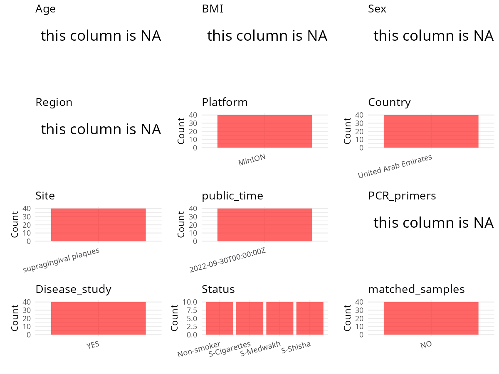

R Notebook: Metadata Processing Workflow
================

# Step 1: Obtain Initial Metadata from Each Project

To obtain the initial metadata: 1. Search for the BioProject ID (e.g.,
“PRJEBXXXX”) on the [NCBI SRA
website](https://www.ncbi.nlm.nih.gov/Traces/study/). 2. In the “Select”
table, click on “Metadata” and download the file. 3. The downloaded file
is typically named “SraRunTable.csv” and contains metadata for the
project.

``` r
# Load necessary libraries
library(dplyr)
library(ggplot2)
library(cowplot)
library(stringr)

# Set working directory (update this path to your local directory)
setwd("/home/hby/oral_project/PRJNA752710")

# Read the initial metadata files
initial_meta <- read.csv("SraRunTable.csv", header = T)

# Combine the two metadata files
# meta <- rbind(initial_meta, initial_meta1)

# Remove entries non-oral samples
# initial_meta <- subset(initial_meta,isolate %in% c("saliva","tongue coat"))

# Check the number of samples containing "HT" in Sample.Name (e.g., healthy controls)
# nrow(subset(meta, grepl("HT", Sample.Name)))

# Display the first few rows of the metadata
head(initial_meta)
```

    ##           Run             aliquot Assay.Type AvgSpotLen     Bases  BioProject    BioSample              BioSampleModel     Bytes Center.Name Collection_Date Consent DATASTORE.filetype
    ## 1 SRR15373485 S-Cigarettes SAMP10   AMPLICON       1399 592088107 PRJNA752710 SAMN20606006 Metagenome or environmental 556859587        UAEU  not applicable  public          fastq,sra
    ## 2 SRR15373486  S-Cigarettes SAMP9   AMPLICON       1395 407607407 PRJNA752710 SAMN20606005 Metagenome or environmental 380334190        UAEU  not applicable  public          fastq,sra
    ## 3 SRR15373487  S-Cigarettes SAMP8   AMPLICON       1403 514199707 PRJNA752710 SAMN20606004 Metagenome or environmental 483500725        UAEU  not applicable  public          fastq,sra
    ## 4 SRR15373488  S-Cigarettes SAMP7   AMPLICON       1416 584814608 PRJNA752710 SAMN20606003 Metagenome or environmental 550112160        UAEU  not applicable  public          fastq,sra
    ## 5 SRR15373489  S-Cigarettes SAMP6   AMPLICON       1407 566034081 PRJNA752710 SAMN20606002 Metagenome or environmental 530517986        UAEU  not applicable  public          fastq,sra
    ## 6 SRR15373490  S-Cigarettes SAMP5   AMPLICON       1410 316454716 PRJNA752710 SAMN20606001 Metagenome or environmental 297629754        UAEU  not applicable  public          fastq,sra
    ##   DATASTORE.provider                     DATASTORE.region  Experiment geo_loc_name_country geo_loc_name_country_continent         geo_loc_name         HOST Instrument isolate
    ## 1         gs,ncbi,s3 gs.us-east1,ncbi.public,s3.us-east-1 SRX11676076 United Arab Emirates                           Asia United Arab Emirates Homo sapiens     MinION  mixed1
    ## 2         gs,ncbi,s3 gs.us-east1,ncbi.public,s3.us-east-1 SRX11676075 United Arab Emirates                           Asia United Arab Emirates Homo sapiens     MinION  mixed1
    ## 3         gs,ncbi,s3 gs.us-east1,ncbi.public,s3.us-east-1 SRX11676074 United Arab Emirates                           Asia United Arab Emirates Homo sapiens     MinION  mixed1
    ## 4         gs,ncbi,s3 gs.us-east1,ncbi.public,s3.us-east-1 SRX11676073 United Arab Emirates                           Asia United Arab Emirates Homo sapiens     MinION  mixed1
    ## 5         gs,ncbi,s3 gs.us-east1,ncbi.public,s3.us-east-1 SRX11676072 United Arab Emirates                           Asia United Arab Emirates Homo sapiens     MinION  mixed1
    ## 6         gs,ncbi,s3 gs.us-east1,ncbi.public,s3.us-east-1 SRX11676071 United Arab Emirates                           Asia United Arab Emirates Homo sapiens     MinION  mixed1
    ##   isolation_source             lat_lon Library.Name LibraryLayout LibrarySelection LibrarySource              Organism        Platform          ReleaseDate          create_date version
    ## 1             oral 23.4241 N 53.8478 E         SC76        SINGLE              PCR   METAGENOMIC human oral metagenome OXFORD_NANOPORE 2022-09-30T00:00:00Z 2021-08-11T02:30:00Z       1
    ## 2             oral 23.4241 N 53.8478 E         SC75        SINGLE              PCR   METAGENOMIC human oral metagenome OXFORD_NANOPORE 2022-09-30T00:00:00Z 2021-08-11T02:31:00Z       1
    ## 3             oral 23.4241 N 53.8478 E         SC55        SINGLE              PCR   METAGENOMIC human oral metagenome OXFORD_NANOPORE 2022-09-30T00:00:00Z 2021-08-11T02:32:00Z       1
    ## 4             oral 23.4241 N 53.8478 E         SC51        SINGLE              PCR   METAGENOMIC human oral metagenome OXFORD_NANOPORE 2022-09-30T00:00:00Z 2021-08-11T02:32:00Z       1
    ## 5             oral 23.4241 N 53.8478 E         SC49        SINGLE              PCR   METAGENOMIC human oral metagenome OXFORD_NANOPORE 2022-09-30T00:00:00Z 2021-08-11T02:32:00Z       1
    ## 6             oral 23.4241 N 53.8478 E         SC38        SINGLE              PCR   METAGENOMIC human oral metagenome OXFORD_NANOPORE 2022-09-30T00:00:00Z 2021-08-11T02:31:00Z       1
    ##   Sample_Name   sample_type      smoking SRA.Study strain
    ## 1        SC76 Supragingival S-Cigarettes SRP331639  mixed
    ## 2        SC75 Supragingival S-Cigarettes SRP331639  mixed
    ## 3        SC55 Supragingival S-Cigarettes SRP331639  mixed
    ## 4        SC51 Supragingival S-Cigarettes SRP331639  mixed
    ## 5        SC49 Supragingival S-Cigarettes SRP331639  mixed
    ## 6        SC38 Supragingival S-Cigarettes SRP331639  mixed

# Step 2: Create a Uniform Metadata Template

The uniform metadata should include the following columns:

1.  **BioProject**: Project ID (e.g., “PRJNA339212”)
2.  **Run**: Sample ID (e.g., “ERRXXXXXX” or “SRRXXXXXX”)
3.  **sample_name**: Original sample name submitted by the authors (not
    the database-assigned ID)
4.  **Age**: Age of the subject (if available)
5.  **BMI**: Body Mass Index (if available)
6.  **Sex**: Sex of the subject (“F” or “M”)
7.  **Region**: Targeted 16S rRNA region (e.g., “V3-V4”)
8.  **Platform**: Sequencing platform (e.g., “Illumina MiSeq”)
9.  **Country**: Country of sample origin (e.g., “China”)
10. **Site**: Sample site (e.g., “saliva”, “dental plaque”)
11. **public_time**: Data release date (format: “YYYY-MM-DD”)
12. **PCR_primers**: PCR primers used (e.g., “515F-806R”)
13. **title**: Title of the associated publication
14. **Disease_study**: Whether the study involves a disease (“YES” or
    “NO”)
15. **Status**: Disease status (e.g., “T2DM”, “HC”). Note: If the study
    includes both disease and healthy samples, this must be specified
    per sample.
16. **matched_samples**: matched samples (“YES” or “NO”)

``` r
# Create a uniform metadata dataframe
metadata <- data.frame(
  BioProject = initial_meta$BioProject,
  Run = initial_meta$Run,
  sample_name = initial_meta$Sample_Name,
  Platform = initial_meta$Instrument,
  Country = initial_meta$geo_loc_name_country,
  public_time = initial_meta$ReleaseDate,
  Status = initial_meta$smoking,
  BMI = NA,
  stringsAsFactors = FALSE,
  Sex = NA,
  Age = NA,
  PCR_primers = NA,
  Region = NA
)
```

# Step 3: Manually Add Information from the Publication

Some information (e.g. PCR primers, study title, disease status) must be
manually extracted from the publication and added to the metadata.

``` r
# Add information obtained from the publication
metadata$Site <- "supragingival plaques"
metadata$title <- "Supragingival microbiome alternations as a consequence of smoking different tobacco types and its relation to dental caries"
metadata$Disease_study <- "YES"
metadata$matched_samples <- "NO"
```

# Step 4: Summarize and Validate the Metadata

``` r
# Check the number of unique runs and sample names
print(paste("Number of unique runs:", length(unique(metadata$Run))))
```

    ## [1] "Number of unique runs: 40"

``` r
print(paste("Number of unique sample names:", length(unique(metadata$sample_name))))
```

    ## [1] "Number of unique sample names: 40"

# Step 5: Visualize the Metadata

``` r

```


# Step 6: Finalize and Export the Metadata

``` r
# Reorder columns to match the desired format
metadata <- metadata[, c(
  "BioProject", "Run", "sample_name", "Age", "BMI", "Sex",
  "Region", "Platform", "Country", "Site", "public_time",
  "PCR_primers", "title", "Disease_study", "Status", "matched_samples"
)]

# Export the uniform metadata to a CSV file
write.csv(metadata, file = "metadata.csv", quote = FALSE)
head(metadata)
```

    ##    BioProject         Run sample_name Age BMI Sex Region Platform              Country                  Site          public_time PCR_primers
    ## 1 PRJNA752710 SRR15373485        SC76  NA  NA  NA     NA   MinION United Arab Emirates supragingival plaques 2022-09-30T00:00:00Z          NA
    ## 2 PRJNA752710 SRR15373486        SC75  NA  NA  NA     NA   MinION United Arab Emirates supragingival plaques 2022-09-30T00:00:00Z          NA
    ## 3 PRJNA752710 SRR15373487        SC55  NA  NA  NA     NA   MinION United Arab Emirates supragingival plaques 2022-09-30T00:00:00Z          NA
    ## 4 PRJNA752710 SRR15373488        SC51  NA  NA  NA     NA   MinION United Arab Emirates supragingival plaques 2022-09-30T00:00:00Z          NA
    ## 5 PRJNA752710 SRR15373489        SC49  NA  NA  NA     NA   MinION United Arab Emirates supragingival plaques 2022-09-30T00:00:00Z          NA
    ## 6 PRJNA752710 SRR15373490        SC38  NA  NA  NA     NA   MinION United Arab Emirates supragingival plaques 2022-09-30T00:00:00Z          NA
    ##                                                                                                                         title Disease_study       Status matched_samples
    ## 1 Supragingival microbiome alternations as a consequence of smoking different tobacco types and its relation to dental caries           YES S-Cigarettes              NO
    ## 2 Supragingival microbiome alternations as a consequence of smoking different tobacco types and its relation to dental caries           YES S-Cigarettes              NO
    ## 3 Supragingival microbiome alternations as a consequence of smoking different tobacco types and its relation to dental caries           YES S-Cigarettes              NO
    ## 4 Supragingival microbiome alternations as a consequence of smoking different tobacco types and its relation to dental caries           YES S-Cigarettes              NO
    ## 5 Supragingival microbiome alternations as a consequence of smoking different tobacco types and its relation to dental caries           YES S-Cigarettes              NO
    ## 6 Supragingival microbiome alternations as a consequence of smoking different tobacco types and its relation to dental caries           YES S-Cigarettes              NO

## Notes for Students:

1.  **Metadata Accuracy**: Always cross-check the metadata with the
    original publication to ensure accuracy.
2.  **Manual Entries**: Columns like `PCR_primers`, and `Status` often
    require manual entry based on the publication.
3.  **Disease Status**: Be careful when assigning `Status`—some studies
    include both disease and healthy samples.
4.  **Visualization**: The plots help quickly identify the distribution
    of values in each column, which is useful for quality control.
5.  **Reproducibility**: Update the working directory and file paths to
    match your local environment.
