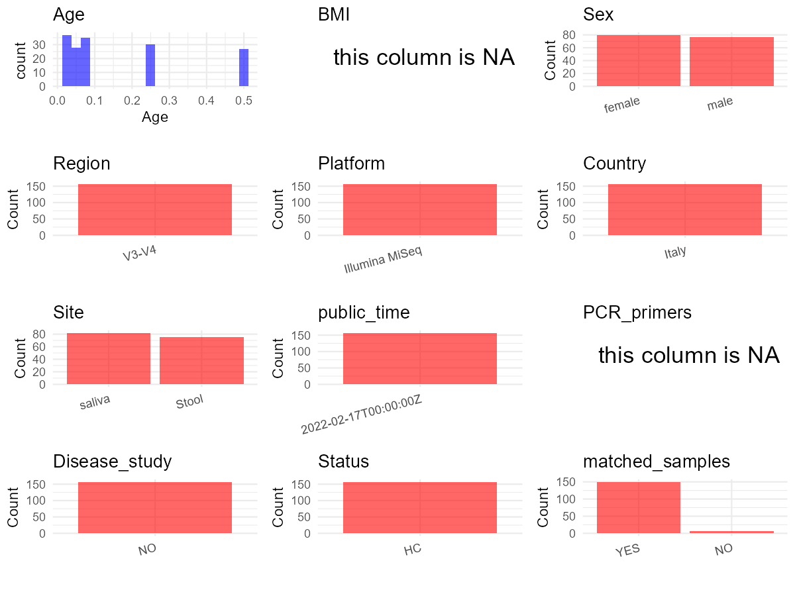

R Notebook: Metadata Processing Workflow
================

# Step 1: Obtain Initial Metadata from Each Project

To obtain the initial metadata: 1. Search for the BioProject ID (e.g.,
“PRJEBXXXX”) on the [NCBI SRA
website](https://www.ncbi.nlm.nih.gov/Traces/study/). 2. In the “Select”
table, click on “Metadata” and download the file. 3. The downloaded file
is typically named “SraRunTable.csv” and contains metadata for the
project.

``` r
# Load necessary libraries
library(dplyr)
library(ggplot2)
library(cowplot)

# Set working directory (update this path to your local directory)
setwd("D:/studylearning/董彪师兄项目/任务4_20251009/PRJNA753008")

# Read the initial metadata files
initial_meta<-read.csv("SraRunTable.csv",header = T)

# Display the first few rows of the metadata
head(initial_meta)
```

    ##           Run Assay.Type AvgSpotLen    Bases  BioProject    BioSample
    ## 1 SRR15404046   AMPLICON        501 55410116 PRJNA753008 SAMN20692353
    ## 2 SRR15404047   AMPLICON        501 95413244 PRJNA753008 SAMN20692352
    ## 3 SRR15404048   AMPLICON        500 36520989 PRJNA753008 SAMN20692423
    ## 4 SRR15404049   AMPLICON        501 14721249 PRJNA753008 SAMN20692422
    ## 5 SRR15404050   AMPLICON        497  6470061 PRJNA753008 SAMN20692421
    ## 6 SRR15404051   AMPLICON        499  9475767 PRJNA753008 SAMN20692420
    ##                               BioSampleModel    Bytes
    ## 1 MIMARKS.survey,MIGS/MIMS/MIMARKS.human-gut 34123129
    ## 2 MIMARKS.survey,MIGS/MIMS/MIMARKS.human-gut 58738075
    ## 3 MIMARKS.survey,MIGS/MIMS/MIMARKS.human-gut 21350942
    ## 4 MIMARKS.survey,MIGS/MIMS/MIMARKS.human-gut  8975074
    ## 5 MIMARKS.survey,MIGS/MIMS/MIMARKS.human-gut  3974440
    ## 6 MIMARKS.survey,MIGS/MIMS/MIMARKS.human-gut  5492112
    ##                                            Center.Name Collection_Date Consent
    ## 1 BAMBINO GESU CHILDREN S HOSPITAL, IRCCS, ROME, ITALY      2016-10-22  public
    ## 2 BAMBINO GESU CHILDREN S HOSPITAL, IRCCS, ROME, ITALY      2017-10-20  public
    ## 3 BAMBINO GESU CHILDREN S HOSPITAL, IRCCS, ROME, ITALY      2016-05-18  public
    ## 4 BAMBINO GESU CHILDREN S HOSPITAL, IRCCS, ROME, ITALY      2016-07-27  public
    ## 5 BAMBINO GESU CHILDREN S HOSPITAL, IRCCS, ROME, ITALY      2015-05-26  public
    ## 6 BAMBINO GESU CHILDREN S HOSPITAL, IRCCS, ROME, ITALY      2016-05-28  public
    ##   DATASTORE.filetype DATASTORE.provider                     DATASTORE.region
    ## 1   fastq,run.zq,sra         gs,ncbi,s3 gs.us-east1,ncbi.public,s3.us-east-1
    ## 2   fastq,run.zq,sra         gs,ncbi,s3 gs.us-east1,ncbi.public,s3.us-east-1
    ## 3   fastq,run.zq,sra         gs,ncbi,s3 gs.us-east1,ncbi.public,s3.us-east-1
    ## 4   fastq,run.zq,sra         gs,ncbi,s3 gs.us-east1,ncbi.public,s3.us-east-1
    ## 5   fastq,run.zq,sra         gs,ncbi,s3 gs.us-east1,ncbi.public,s3.us-east-1
    ## 6   fastq,run.zq,sra         gs,ncbi,s3 gs.us-east1,ncbi.public,s3.us-east-1
    ##   env_broad_scale   env_local_scale env_medium  Experiment geo_loc_name_country
    ## 1     fecal biome biological sample      Stool SRX11706299                Italy
    ## 2     fecal biome biological sample      Stool SRX11706298                Italy
    ## 3     fecal biome biological sample      Stool SRX11706297                Italy
    ## 4     fecal biome biological sample      Stool SRX11706296                Italy
    ## 5     fecal biome biological sample      Stool SRX11706295                Italy
    ## 6     fecal biome biological sample      Stool SRX11706294                Italy
    ##   geo_loc_name_country_continent  geo_loc_name host_age_.days.
    ## 1                         Europe Italy: Europe             180
    ## 2                         Europe Italy: Europe               7
    ## 3                         Europe Italy: Europe              30
    ## 4                         Europe Italy: Europe             180
    ## 5                         Europe Italy: Europe               7
    ## 6                         Europe Italy: Europe              90
    ##             Host_Diet         HOST host_sex     Instrument isol_growth_condt
    ## 1 Breast/Formula milk Homo sapiens   female Illumina MiSeq              NONE
    ## 2         Breast milk Homo sapiens   female Illumina MiSeq              NONE
    ## 3         Breast milk Homo sapiens   female Illumina MiSeq              NONE
    ## 4 Breast/Formula milk Homo sapiens   female Illumina MiSeq              NONE
    ## 5 Breast/Formula milk Homo sapiens   female Illumina MiSeq              NONE
    ## 6         Breast milk Homo sapiens   female Illumina MiSeq              NONE
    ##    isolate                 lat_lon Library.Name LibraryLayout LibrarySelection
    ## 1 Bacteria 41.897382 N 12.460856 E    STOOL-111        PAIRED              PCR
    ## 2 Bacteria 41.897382 N 12.460856 E     STOOL-11        PAIRED              PCR
    ## 3 Bacteria 41.897382 N 12.460856 E     STOOL-96        PAIRED              PCR
    ## 4 Bacteria 41.897382 N 12.460856 E     STOOL-94        PAIRED              PCR
    ## 5 Bacteria 41.897382 N 12.460856 E     STOOL-92        PAIRED              PCR
    ## 6 Bacteria 41.897382 N 12.460856 E     STOOL-91        PAIRED              PCR
    ##   LibrarySource             Organism Platform          ReleaseDate
    ## 1   METAGENOMIC human gut metagenome ILLUMINA 2022-02-17T00:00:00Z
    ## 2   METAGENOMIC human gut metagenome ILLUMINA 2022-02-17T00:00:00Z
    ## 3   METAGENOMIC human gut metagenome ILLUMINA 2022-02-17T00:00:00Z
    ## 4   METAGENOMIC human gut metagenome ILLUMINA 2022-02-17T00:00:00Z
    ## 5   METAGENOMIC human gut metagenome ILLUMINA 2022-02-17T00:00:00Z
    ## 6   METAGENOMIC human gut metagenome ILLUMINA 2022-02-17T00:00:00Z
    ##            create_date version Sample_code Sample.Name SRA.Study Cultivar
    ## 1 2021-08-10T21:05:00Z       1          10   STOOL-111 SRP331688     none
    ## 2 2021-08-10T21:05:00Z       1           9    STOOL-11 SRP331688     none
    ## 3 2021-08-10T21:05:00Z       1          80    STOOL-96 SRP331688     none
    ## 4 2021-08-10T21:05:00Z       1          79    STOOL-94 SRP331688     none
    ## 5 2021-08-10T21:05:00Z       1          78    STOOL-92 SRP331688     none
    ## 6 2021-08-10T21:05:00Z       1          77    STOOL-91 SRP331688     none
    ##   strain
    ## 1   none
    ## 2   none
    ## 3   none
    ## 4   none
    ## 5   none
    ## 6   none

# Step 2: Create a Uniform Metadata Template

The uniform metadata should include the following columns:

1.  **BioProject**: Project ID (e.g., “PRJNA339212”)
2.  **Run**: Sample ID (e.g., “ERRXXXXXX” or “SRRXXXXXX”)
3.  **sample_name**: Original sample name submitted by the authors (not
    the database-assigned ID)
4.  **Age**: Age of the subject (if available)
5.  **BMI**: Body Mass Index (if available)
6.  **Sex**: Sex of the subject (“F” or “M”)
7.  **Region**: Targeted 16S rRNA region (e.g., “V3-V4”)
8.  **Platform**: Sequencing platform (e.g., “Illumina MiSeq”)
9.  **Country**: Country of sample origin (e.g., “China”)
10. **Site**: Sample site (e.g., “saliva”, “dental plaque”)
11. **public_time**: Data release date (format: “YYYY-MM-DD”)
12. **PCR_primers**: PCR primers used (e.g., “515F-806R”)
13. **title**: Title of the associated publication
14. **Disease_study**: Whether the study involves a disease (“YES” or
    “NO”)
15. **Status**: Disease status (e.g., “T2DM”, “HC”). Note: If the study
    includes both disease and healthy samples, this must be specified
    per sample.

``` r
# Create a uniform metadata dataframe
metadata <- data.frame(
  BioProject = initial_meta$BioProject,
  Run = initial_meta$Run,
  sample_name = initial_meta$Sample.Name,
  Age = initial_meta$host_age_.days./365,
  BMI = NA,
  Sex= initial_meta$host_sex,
  Region = "V3-V4",
  Platform = initial_meta$Instrument,
  Country = initial_meta$geo_loc_name_country,
  Site = initial_meta$env_medium,
  public_time = initial_meta$ReleaseDate,
  stringsAsFactors = FALSE
)
```

# Step 3: Manually Add Information from the Publication

Some information (e.g. PCR primers, study title, disease status) must be
manually extracted from the publication and added to the metadata.

``` r
# Add information obtained from the publication
metadata$PCR_primers <- NA_character_  # Update based on the publication
metadata$title <- "A Parallel Tracking of Salivary and Gut Microbiota Profiles Can Reveal Maturation and Interplay of Early Life Microbial Communities in Healthy Infants"
metadata$Disease_study <- "NO"
metadata$Status <- "HC"

#extract subject id by remove prefix of sample_name
metadata$sample_name <- gsub("STOOL-|DICO-", "", metadata$sample_name)

# Check initial data distribution
cat("Initial sample distribution:\n")
```

    ## Initial sample distribution:

``` r
table(metadata$sample_name)
```

    ## 
    ##   1 102 103 104 106 107 108 109  11 111 112 113 114 115  12  13  14  15  16  18 
    ##   2   2   2   2   2   2   2   2   1   2   2   2   2   2   2   2   2   2   2   2 
    ##  19   2  20  21  22  23  25  26  27  28   3  30  31  32  34  36  37  38  43  44 
    ##   2   1   2   1   2   2   1   1   2   2   2   1   2   1   2   2   2   2   2   2 
    ##  45  46  47  48  49  50  51  53  54  55  56  57  59   6  60  62  63  64  65  66 
    ##   2   2   1   1   2   2   2   2   2   2   2   2   2   2   2   2   2   2   2   2 
    ##  68  69   7  70  71  72  73  74  75  76  78  79   8  82  83  84  85  86  88  89 
    ##   1   1   2   2   2   2   2   2   2   2   2   2   2   2   2   2   2   2   2   2 
    ##   9  90  91  92  94  95  96 
    ##   2   2   2   2   2   1   2

``` r
table(metadata$Site)
```

    ## 
    ## saliva  Stool 
    ##     82     80

``` r
# Calculate sampling frequency per subject
sample_counts <- table(metadata$sample_name)
cat("\nNumber of samples per subject:\n")
```

    ## 
    ## Number of samples per subject:

``` r
print(sample_counts)
```

    ## 
    ##   1 102 103 104 106 107 108 109  11 111 112 113 114 115  12  13  14  15  16  18 
    ##   2   2   2   2   2   2   2   2   1   2   2   2   2   2   2   2   2   2   2   2 
    ##  19   2  20  21  22  23  25  26  27  28   3  30  31  32  34  36  37  38  43  44 
    ##   2   1   2   1   2   2   1   1   2   2   2   1   2   1   2   2   2   2   2   2 
    ##  45  46  47  48  49  50  51  53  54  55  56  57  59   6  60  62  63  64  65  66 
    ##   2   2   1   1   2   2   2   2   2   2   2   2   2   2   2   2   2   2   2   2 
    ##  68  69   7  70  71  72  73  74  75  76  78  79   8  82  83  84  85  86  88  89 
    ##   1   1   2   2   2   2   2   2   2   2   2   2   2   2   2   2   2   2   2   2 
    ##   9  90  91  92  94  95  96 
    ##   2   2   2   2   2   1   2

``` r
# Create matched_samples column
metadata$matched_samples <- ifelse(metadata$sample_name %in% names(sample_counts[sample_counts >= 2]), "YES", "NO")

cat("\nMatched samples distribution:\n")
```

    ## 
    ## Matched samples distribution:

``` r
table(metadata$matched_samples)
```

    ## 
    ##  NO YES 
    ##  12 150

``` r
# Identify samples for removal: single samples excluding saliva
single_samples <- names(sample_counts[sample_counts == 1])
samples_to_remove <- metadata$sample_name %in% single_samples & !(metadata$Site %in% c("saliva"))

cat("\nNumber of samples to be removed:", sum(samples_to_remove), "\n")
```

    ## 
    ## Number of samples to be removed: 5

``` r
# Remove identified samples
metadata_clean <- metadata[!samples_to_remove, ]

cat("\nFinal sample distribution after cleaning:\n")
```

    ## 
    ## Final sample distribution after cleaning:

``` r
table(metadata_clean$sample_name)
```

    ## 
    ##   1 102 103 104 106 107 108 109 111 112 113 114 115  12  13  14  15  16  18  19 
    ##   2   2   2   2   2   2   2   2   2   2   2   2   2   2   2   2   2   2   2   2 
    ##   2  20  22  23  26  27  28   3  31  34  36  37  38  43  44  45  46  47  48  49 
    ##   1   2   2   2   1   2   2   2   2   2   2   2   2   2   2   2   2   1   1   2 
    ##  50  51  53  54  55  56  57  59   6  60  62  63  64  65  66  68  69   7  70  71 
    ##   2   2   2   2   2   2   2   2   2   2   2   2   2   2   2   1   1   2   2   2 
    ##  72  73  74  75  76  78  79   8  82  83  84  85  86  88  89   9  90  91  92  94 
    ##   2   2   2   2   2   2   2   2   2   2   2   2   2   2   2   2   2   2   2   2 
    ##  95  96 
    ##   1   2

``` r
table(metadata_clean$Site)
```

    ## 
    ## saliva  Stool 
    ##     82     75

``` r
table(metadata_clean$matched_samples)
```

    ## 
    ##  NO YES 
    ##   7 150

``` r
# Use cleaned dataset for subsequent analysis
metadata <- metadata_clean
```

# Step 4: Summarize and Validate the Metadata

``` r
# Check the number of unique runs and sample names
print(paste("Number of unique runs:", length(unique(metadata$Run))))
```

    ## [1] "Number of unique runs: 157"

``` r
print(paste("Number of unique sample names:", length(unique(metadata$sample_name))))
```

    ## [1] "Number of unique sample names: 82"

# Step 5: Visualize the Metadata

``` r

```


# Step 6: Finalize and Export the Metadata

``` r
# Reorder columns to match the desired format
metadata <- metadata[, c(
  "BioProject", "Run", "sample_name", "Age", "BMI", "Sex", 
  "Region", "Platform", "Country", "Site", "public_time", 
  "PCR_primers", "title", "Disease_study", "Status","matched_samples"
)]

# Export the uniform metadata to a CSV file
write.csv(metadata, file = "metadata.csv", quote = FALSE)
head(metadata)
```

    ##    BioProject         Run sample_name        Age BMI    Sex Region
    ## 1 PRJNA753008 SRR15404046         111 0.49315068  NA female  V3-V4
    ## 3 PRJNA753008 SRR15404048          96 0.08219178  NA female  V3-V4
    ## 4 PRJNA753008 SRR15404049          94 0.49315068  NA female  V3-V4
    ## 5 PRJNA753008 SRR15404050          92 0.01917808  NA female  V3-V4
    ## 6 PRJNA753008 SRR15404051          91 0.24657534  NA female  V3-V4
    ## 7 PRJNA753008 SRR15404052          90 0.08219178  NA female  V3-V4
    ##         Platform Country  Site          public_time PCR_primers
    ## 1 Illumina MiSeq   Italy Stool 2022-02-17T00:00:00Z        <NA>
    ## 3 Illumina MiSeq   Italy Stool 2022-02-17T00:00:00Z        <NA>
    ## 4 Illumina MiSeq   Italy Stool 2022-02-17T00:00:00Z        <NA>
    ## 5 Illumina MiSeq   Italy Stool 2022-02-17T00:00:00Z        <NA>
    ## 6 Illumina MiSeq   Italy Stool 2022-02-17T00:00:00Z        <NA>
    ## 7 Illumina MiSeq   Italy Stool 2022-02-17T00:00:00Z        <NA>
    ##                                                                                                                                                    title
    ## 1 A Parallel Tracking of Salivary and Gut Microbiota Profiles Can Reveal Maturation and Interplay of Early Life Microbial Communities in Healthy Infants
    ## 3 A Parallel Tracking of Salivary and Gut Microbiota Profiles Can Reveal Maturation and Interplay of Early Life Microbial Communities in Healthy Infants
    ## 4 A Parallel Tracking of Salivary and Gut Microbiota Profiles Can Reveal Maturation and Interplay of Early Life Microbial Communities in Healthy Infants
    ## 5 A Parallel Tracking of Salivary and Gut Microbiota Profiles Can Reveal Maturation and Interplay of Early Life Microbial Communities in Healthy Infants
    ## 6 A Parallel Tracking of Salivary and Gut Microbiota Profiles Can Reveal Maturation and Interplay of Early Life Microbial Communities in Healthy Infants
    ## 7 A Parallel Tracking of Salivary and Gut Microbiota Profiles Can Reveal Maturation and Interplay of Early Life Microbial Communities in Healthy Infants
    ##   Disease_study Status matched_samples
    ## 1            NO     HC             YES
    ## 3            NO     HC             YES
    ## 4            NO     HC             YES
    ## 5            NO     HC             YES
    ## 6            NO     HC             YES
    ## 7            NO     HC             YES

## Notes for Students:

1.  **Metadata Accuracy**: Always cross-check the metadata with the
    original publication to ensure accuracy.
2.  **Manual Entries**: Columns like `PCR_primers`, and `Status` often
    require manual entry based on the publication.
3.  **Disease Status**: Be careful when assigning `Status`—some studies
    include both disease and healthy samples.
4.  **Visualization**: The plots help quickly identify the distribution
    of values in each column, which is useful for quality control.
5.  **Reproducibility**: Update the working directory and file paths to
    match your local environment.
