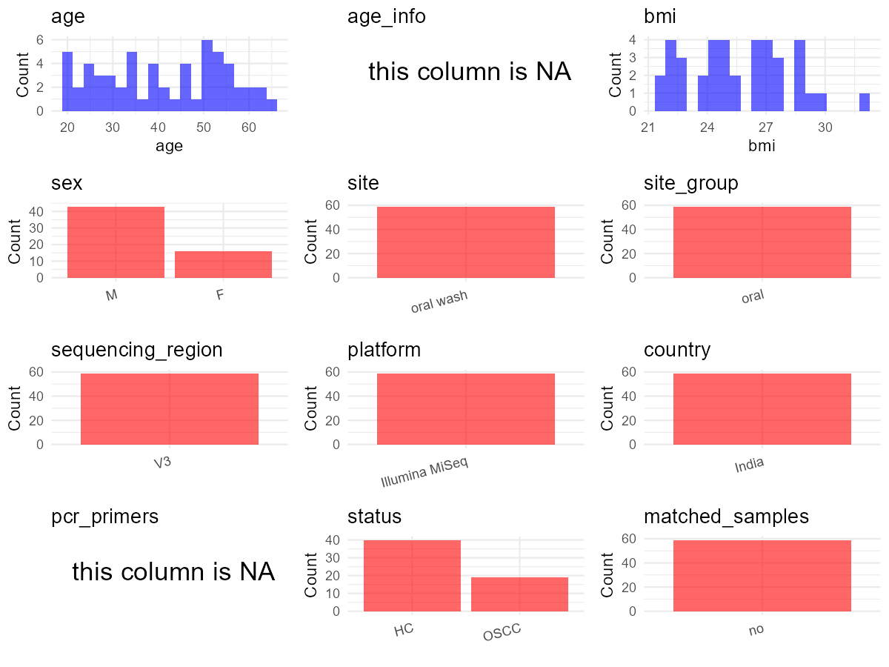

R Notebook: Metadata Processing Workflow
================

# Step 1: Obtain Initial Metadata from Each Project

This step sets the project directory, loads the raw SRA metadata, and
optionally merges supplement tables.

``` r
# Load libraries
library(dplyr)
library(ggplot2)
library(cowplot)

# (1) Setting working directory
# EDIT HERE: change project_id for each study
project_id <- "PRJNA756784" 

base_dir <- "E:/oral/26/metadata-2604/Oral-Metadata-YL-03"
setwd(file.path(base_dir, project_id))

# (2) Loading raw SRA metadata file
sra_file <- "SraRunTable.csv"
initial_meta <- read.csv(sra_file, header = TRUE)

# (3) OPTIONAL: If extra metadata (e.g., Table.x or supplemental materials) are available from the article, you may need to merge the file with initial_meta manually. Below is example code for merging. Depending on the specific case of each study, you can customize the code as needed.
supp_table <- read.csv("supplemental_table_v2.csv", header = TRUE)
supp_table$Sample_number <- gsub("^HTC-", "HTC", supp_table$Sample_number)
initial_meta$Sample.Name[initial_meta$Sample.Name == "TC18"] <- "HTC18"
initial_meta$Sample.Name[initial_meta$Sample.Name == "CP21"] <- "CP20"
initial_meta <- inner_join(initial_meta, supp_table, by = c("Sample.Name" = "Sample_number"))
```

# Step 2: Data Overview

First, you need to get an overview of the data, which includes two
steps: reading the article and reading the initial metadata. This step
is very IMPORTANT!

``` r
# (1) Read the article in the following order: abstract, the beginning of the results section, and the methods. Understand the sample size, experimental design, and disease group overview. Clarify the sampling sites; for oral and gut samples, specify the exact sites like supragingival plaque, tongue, etc.

# (2) IMPORTANT: MUST go through each column of initial_meta
head(initial_meta, 10)
```

    ##            Run Assay.Type AvgSpotLen     Bases  BioProject    BioSample
    ## 1  SRR15560887   AMPLICON        300 195696000 PRJNA756784 SAMN20926076
    ## 2  SRR15560888   AMPLICON        300 202776600 PRJNA756784 SAMN20926075
    ## 3  SRR15560889   AMPLICON        300 171236400 PRJNA756784 SAMN20926074
    ## 4  SRR15560890   AMPLICON        300 186323100 PRJNA756784 SAMN20926073
    ## 5  SRR15560891   AMPLICON        300 223891200 PRJNA756784 SAMN20926126
    ## 6  SRR15560892   AMPLICON        300 227489100 PRJNA756784 SAMN20926125
    ## 7  SRR15560893   AMPLICON        300 191937600 PRJNA756784 SAMN20926124
    ## 8  SRR15560894   AMPLICON        300 168841500 PRJNA756784 SAMN20926123
    ## 9  SRR15560895   AMPLICON        300 203960100 PRJNA756784 SAMN20926122
    ## 10 SRR15560896   AMPLICON        300 215620800 PRJNA756784 SAMN20926121
    ##                          BioSampleModel    Bytes
    ## 1  MIMS.me,MIGS/MIMS/MIMARKS.human-oral 81167346
    ## 2  MIMS.me,MIGS/MIMS/MIMARKS.human-oral 80524214
    ## 3  MIMS.me,MIGS/MIMS/MIMARKS.human-oral 70755584
    ## 4  MIMS.me,MIGS/MIMS/MIMARKS.human-oral 77023989
    ## 5  MIMS.me,MIGS/MIMS/MIMARKS.human-oral 89719844
    ## 6  MIMS.me,MIGS/MIMS/MIMARKS.human-oral 90913520
    ## 7  MIMS.me,MIGS/MIMS/MIMARKS.human-oral 75730928
    ## 8  MIMS.me,MIGS/MIMS/MIMARKS.human-oral 67427514
    ## 9  MIMS.me,MIGS/MIMS/MIMARKS.human-oral 81858652
    ## 10 MIMS.me,MIGS/MIMS/MIMARKS.human-oral 85280466
    ##                              Center.Name Collection_Date Consent
    ## 1  BABASAHEB BHIMRAO AMBEDAKR UNIVERSITY         2016-04  public
    ## 2  BABASAHEB BHIMRAO AMBEDAKR UNIVERSITY         2016-04  public
    ## 3  BABASAHEB BHIMRAO AMBEDAKR UNIVERSITY         2016-04  public
    ## 4  BABASAHEB BHIMRAO AMBEDAKR UNIVERSITY         2016-04  public
    ## 5  BABASAHEB BHIMRAO AMBEDAKR UNIVERSITY         2016-03  public
    ## 6  BABASAHEB BHIMRAO AMBEDAKR UNIVERSITY         2016-02  public
    ## 7  BABASAHEB BHIMRAO AMBEDAKR UNIVERSITY         2016-02  public
    ## 8  BABASAHEB BHIMRAO AMBEDAKR UNIVERSITY         2016-01  public
    ## 9  BABASAHEB BHIMRAO AMBEDAKR UNIVERSITY         2016-01  public
    ## 10 BABASAHEB BHIMRAO AMBEDAKR UNIVERSITY         2016-01  public
    ##    DATASTORE.filetype DATASTORE.provider                     DATASTORE.region
    ## 1    fastq,run.zq,sra         gs,ncbi,s3 gs.us-east1,ncbi.public,s3.us-east-1
    ## 2    fastq,run.zq,sra         gs,ncbi,s3 gs.us-east1,ncbi.public,s3.us-east-1
    ## 3    fastq,run.zq,sra         gs,ncbi,s3 gs.us-east1,ncbi.public,s3.us-east-1
    ## 4    fastq,run.zq,sra         gs,ncbi,s3 gs.us-east1,ncbi.public,s3.us-east-1
    ## 5    fastq,run.zq,sra         gs,ncbi,s3 gs.us-east1,ncbi.public,s3.us-east-1
    ## 6    fastq,run.zq,sra         gs,ncbi,s3 gs.us-east1,ncbi.public,s3.us-east-1
    ## 7    fastq,run.zq,sra         gs,ncbi,s3 gs.us-east1,ncbi.public,s3.us-east-1
    ## 8    fastq,run.zq,sra         gs,ncbi,s3 gs.us-east1,ncbi.public,s3.us-east-1
    ## 9    fastq,run.zq,sra         gs,ncbi,s3 gs.us-east1,ncbi.public,s3.us-east-1
    ## 10   fastq,run.zq,sra         gs,ncbi,s3 gs.us-east1,ncbi.public,s3.us-east-1
    ##    env_broad_scale env_local_scale           env_medium  Experiment
    ## 1  Oral Microbiome      Mouth Wash Sterile Saline Water SRX11859069
    ## 2  Oral Microbiome      Mouth Wash Sterile Saline Water SRX11859068
    ## 3  Oral Microbiome      Mouth Wash Sterile Saline Water SRX11859067
    ## 4  Oral Microbiome      Mouth Wash Sterile Saline Water SRX11859066
    ## 5  Oral Microbiome      Mouth Wash Sterile Saline Water SRX11859065
    ## 6  Oral Microbiome      Mouth Wash Sterile Saline Water SRX11859064
    ## 7  Oral Microbiome      Mouth Wash Sterile Saline Water SRX11859063
    ## 8  Oral Microbiome      Mouth Wash Sterile Saline Water SRX11859062
    ## 9  Oral Microbiome      Mouth Wash Sterile Saline Water SRX11859061
    ## 10 Oral Microbiome      Mouth Wash Sterile Saline Water SRX11859060
    ##    geo_loc_name_country geo_loc_name_country_continent geo_loc_name
    ## 1                 India                           Asia        India
    ## 2                 India                           Asia        India
    ## 3                 India                           Asia        India
    ## 4                 India                           Asia        India
    ## 5                 India                           Asia        India
    ## 6                 India                           Asia        India
    ## 7                 India                           Asia        India
    ## 8                 India                           Asia        India
    ## 9                 India                           Asia        India
    ## 10                India                           Asia        India
    ##            HOST          Instrument             lat_lon Library.Name
    ## 1  Homo sapiens Illumina HiSeq 2500     28.61 N 77.03 E     Lib_HI11
    ## 2  Homo sapiens Illumina HiSeq 2500     28.61 N 77.03 E     Lib_HI10
    ## 3  Homo sapiens Illumina HiSeq 2500     28.61 N 77.03 E      Lib_HI9
    ## 4  Homo sapiens Illumina HiSeq 2500     28.61 N 77.03 E      Lib_HI8
    ## 5  Homo sapiens Illumina HiSeq 2500 28.5659 N 77.2111 E     Lib_CP20
    ## 6  Homo sapiens Illumina HiSeq 2500 28.5659 N 77.2111 E     Lib_CP19
    ## 7  Homo sapiens Illumina HiSeq 2500 28.5659 N 77.2111 E     Lib_CP18
    ## 8  Homo sapiens Illumina HiSeq 2500 28.5659 N 77.2111 E     Lib_CP17
    ## 9  Homo sapiens Illumina HiSeq 2500 28.5659 N 77.2111 E     Lib_CP16
    ## 10 Homo sapiens Illumina HiSeq 2500 28.5659 N 77.2111 E     Lib_CP15
    ##    LibraryLayout LibrarySelection LibrarySource              Organism Platform
    ## 1         PAIRED              PCR   METAGENOMIC human oral metagenome ILLUMINA
    ## 2         PAIRED              PCR   METAGENOMIC human oral metagenome ILLUMINA
    ## 3         PAIRED              PCR   METAGENOMIC human oral metagenome ILLUMINA
    ## 4         PAIRED              PCR   METAGENOMIC human oral metagenome ILLUMINA
    ## 5         PAIRED              PCR   METAGENOMIC human oral metagenome ILLUMINA
    ## 6         PAIRED              PCR   METAGENOMIC human oral metagenome ILLUMINA
    ## 7         PAIRED              PCR   METAGENOMIC human oral metagenome ILLUMINA
    ## 8         PAIRED              PCR   METAGENOMIC human oral metagenome ILLUMINA
    ## 9         PAIRED              PCR   METAGENOMIC human oral metagenome ILLUMINA
    ## 10        PAIRED              PCR   METAGENOMIC human oral metagenome ILLUMINA
    ##             ReleaseDate          create_date version Sample.Name SRA.Study
    ## 1  2021-08-22T00:00:00Z 2021-08-22T19:38:00Z       1        HI11 SRP333603
    ## 2  2021-08-22T00:00:00Z 2021-08-22T19:38:00Z       1        HI10 SRP333603
    ## 3  2021-08-22T00:00:00Z 2021-08-22T19:38:00Z       1         HI9 SRP333603
    ## 4  2021-08-22T00:00:00Z 2021-08-22T19:38:00Z       1         HI8 SRP333603
    ## 5  2021-08-22T00:00:00Z 2021-08-22T19:38:00Z       1        CP20 SRP333603
    ## 6  2021-08-22T00:00:00Z 2021-08-22T19:38:00Z       1        CP19 SRP333603
    ## 7  2021-08-22T00:00:00Z 2021-08-22T19:38:00Z       1        CP18 SRP333603
    ## 8  2021-08-22T00:00:00Z 2021-08-22T19:38:00Z       1        CP17 SRP333603
    ## 9  2021-08-22T00:00:00Z 2021-08-22T19:38:00Z       1        CP16 SRP333603
    ## 10 2021-08-22T00:00:00Z 2021-08-22T19:38:00Z       1        CP15 SRP333603
    ##    hypervariable_region sample_id        sample_site sample_type
    ## 1             V3 region      HI11 New Delhi\\, India   Oral Wash
    ## 2             V3 region      HI10 New Delhi\\, India   Oral Wash
    ## 3             V3 region       HI9 New Delhi\\, India   Oral Wash
    ## 4             V3 region       HI8 New Delhi\\, India   Oral Wash
    ## 5             V3 region      CP20 New Delhi\\, India   Oral Wash
    ## 6             V3 region      CP19 New Delhi\\, India   Oral Wash
    ## 7             V3 region      CP18 New Delhi\\, India   Oral Wash
    ## 8             V3 region      CP17 New Delhi\\, India   Oral Wash
    ## 9             V3 region      CP16 New Delhi\\, India   Oral Wash
    ## 10            V3 region      CP15 New Delhi\\, India   Oral Wash
    ##    sequence_length sequencing_platform Gender     Food.habit Age     Place
    ## 1            150bp      Illumina Miseq   Male Non-Vegetarian  24 New Delhi
    ## 2            150bp      Illumina Miseq   Male Non-Vegetarian  22 New Delhi
    ## 3            150bp      Illumina Miseq   Male     Vegetarian  34 New Delhi
    ## 4            150bp      Illumina Miseq   Male     Vegetarian  30 New Delhi
    ## 5            150bp      Illumina Miseq   Male Non-vegetarian  33      <NA>
    ## 6            150bp      Illumina Miseq Female     Vegetarian  56      <NA>
    ## 7            150bp      Illumina Miseq Female Non-vegetarian  52      <NA>
    ## 8            150bp      Illumina Miseq   Male Non-vegetarian  46      <NA>
    ## 9            150bp      Illumina Miseq   Male Non-vegetarian  50      <NA>
    ## 10           150bp      Illumina Miseq   Male Non-vegetarian  27      <NA>
    ##                       Tobacco Diabetic.status Systolic.BP.mean  BMI
    ## 1                        <NA>            <NA>               NA   NA
    ## 2                        <NA>            <NA>               NA   NA
    ## 3                        <NA>            <NA>               NA   NA
    ## 4                        <NA>            <NA>               NA   NA
    ## 5           Leaves and khaini              No              130 26.7
    ## 6           Leaves and khaini              No              120 21.8
    ## 7           Leaves and khaini              No              118 22.3
    ## 8  Leaves, khaini, and gutkha              No              128 28.7
    ## 9  Leaves, khaini, and gutkha              No              120 27.4
    ## 10    Loose leaves and gutkha              No              124 24.8
    ##       Area.affected Family.history Duration.of.chewing..years.
    ## 1              <NA>           <NA>                          NA
    ## 2              <NA>           <NA>                          NA
    ## 3              <NA>           <NA>                          NA
    ## 4              <NA>           <NA>                          NA
    ## 5        Left cheek             No                           6
    ## 6        Left cheek             No                           5
    ## 7  Right cheek OSCC             No                           5
    ## 8    Lateral tongue             No                           5
    ## 9        Left cheek             No                           5
    ## 10             OSCC             No                           5

``` r
# IMPORTANT: Check the unique values in the column of interest or query column.
lapply(initial_meta[c('env_local_scale', 'sample_type')], table) # site
```

    ## $env_local_scale
    ## 
    ## Mouth Wash 
    ##         59 
    ## 
    ## $sample_type
    ## 
    ##           Oral Wash 
    ##         1        58

``` r
lapply(initial_meta[c('env_broad_scale', 'Organism')], table) # organism
```

    ## $env_broad_scale
    ## 
    ## Oral Microbiome 
    ##              59 
    ## 
    ## $Organism
    ## 
    ## human oral metagenome 
    ##                    59

``` r
table(initial_meta$Sample.Name) # subject id
```

    ## 
    ##  CP10  CP11  CP12  CP13  CP14  CP15  CP16  CP17  CP18  CP19   CP2  CP20   CP3 
    ##     1     1     1     1     1     1     1     1     1     1     1     1     1 
    ##   CP4   CP5   CP6   CP7   CP8   CP9   HI1  HI10  HI11  HI12  HI13  HI14  HI16 
    ##     1     1     1     1     1     1     1     1     1     1     1     1     1 
    ##  HI17  HI18  HI19   HI2  HI20  HI21  HI22   HI3   HI4   HI5   HI7   HI8   HI9 
    ##     1     1     1     1     1     1     1     1     1     1     1     1     1 
    ##  HTC1 HTC10 HTC11 HTC12 HTC13 HTC14 HTC15 HTC16 HTC17 HTC18 HTC19  HTC2 HTC20 
    ##     1     1     1     1     1     1     1     1     1     1     1     1     1 
    ##  HTC3  HTC4  HTC5  HTC6  HTC7  HTC8  HTC9 
    ##     1     1     1     1     1     1     1

``` r
#table(initial_meta$sequencing_meth..exp.) # output is Sequencing by synthesis
table(initial_meta$Platform) # output is Illumina. according to the methods,  Illumina is correct.
```

    ## 
    ## ILLUMINA 
    ##       59

``` r
#table(initial_meta$target_subfragment) # output is V4
```

# Step 3: Removing Control and Non-human Samples

First, we need to remove control samples(including both negative
controls and positive controls) and non-human samples.

``` r
# (1) EDIT HERE: Parameter setup
control_column <- "" # column name in initial_meta
# unique(initial_meta[[control_column]])
control_keywords <- c() # Enter exact keywords

species_column <- "" # column name in initial_meta
unique(initial_meta[[species_column]])
```

    ## NULL

``` r
non_human_keywords <- c() # Enter exact keywords

# (2) Remove controls and non-human samples. DO NOT need to modify code in this part, just run it.
n_samples <- nrow(initial_meta)
# Control evaluation
if (length(control_keywords) > 0) {
  if (is.null(control_column) || control_column == "") {
    stop("Error: control_keywords provided but control_column is missing.")
  }
  
  if (!(control_column %in% colnames(initial_meta))) {
    stop(sprintf("Error: Column '%s' not found in initial_meta.", control_column))
  }
  
  control_pattern <- paste(control_keywords, collapse = "|")
  control_text <- initial_meta[[control_column]]
  is_control <- grepl(control_pattern, control_text)
  
} else {
  is_control <- rep(FALSE, n_samples)
}

# Non-human evaluation
if (length(non_human_keywords) > 0) {
  if (is.null(species_column) || species_column == "") {
    stop("Error: non_human_keywords provided but species_column is missing.")
  }
  
  if (!(species_column %in% colnames(initial_meta))) {
    stop(sprintf("Error: Column '%s' not found in initial_meta.", species_column))
  }
  
  non_human_pattern <- paste(non_human_keywords, collapse = "|")
  species_text <- initial_meta[[species_column]]
  is_non_human <- grepl(non_human_pattern, species_text)
} else {
  is_non_human <- rep(FALSE, n_samples)
}

# Execute removal
samples_to_remove <- is_control | is_non_human
initial_meta <- initial_meta[!samples_to_remove, ]

cat("Initial samples counts:",n_samples,"\n")
```

    ## Initial samples counts: 59

``` r
cat("Removed control samples:", sum(is_control), "\n")
```

    ## Removed control samples: 0

``` r
cat("Removed non-human samples:", sum(is_non_human), "\n")
```

    ## Removed non-human samples: 0

``` r
cat("Total samples removed ", sum(samples_to_remove), "\n")
```

    ## Total samples removed  0

``` r
cat("Remaining samples after Step 2:", nrow(initial_meta), "\n")
```

    ## Remaining samples after Step 2: 59

# Step 4: Creating a Uniform Metadata Template

This step converts the raw SRA table into the standard metadata format
used in our meta-analysis. The uniform metadata should include the
following columns: 1. **bioproject**: Project ID from SRA or other
database e.g. `PRJNA1234`, `CNP1234`, ‘OEP1234’, ‘qiita_1234’ 2.
**sample_id**: SRA sample/run ID. Unique id for each sample!
e.g. `DRR1234567`, `ERR1234567` and `SRR1234567`. If no such column
exists, can use column like sample_name. 3. **subject_id**: subject id
for each person if available. e.g. `patient_01`, `Host_03_before`,
`subject12` 4. **age**: Age of the subject if available. e.g. `35`, `42`
\| not `adult`, `chilren` 5. **age_info**: If the age is not explicitly
stated but approximate age range information is available, mark it in
this column. e.g., `18-55`, `children`, `infant`, `elder` 6. **bmi**:
Body Mass Index if available. e.g. `22.5`, `18.9` \| not `normal`,
`overweight` 7. **sex**: Sex of the subject. Mandatory to write as M/F
\| not `female`, `woman` 8. **sequencing_region**: Targeted 16S rRNA
region. e.g. `V3-V4`, `V4` 9. **platform**: Sequencing platform.
e.g. `Illumina MiSeq`, `454 GS FLX Titanium`, `Ion Torrent` 10.
**country**: Country of sample origin. e.g. `China`, `Japan` \| not city
name like `Beijing` 11. **site**: Sampling site. For oral and gut sites,
specify the exact sites as detailed as possible. For example, if it is
known to be supragingival plaque, do not record it as ‘dental plaque’,
unless the original text provides only a vague description.
e.g. `saliva`, `tongue coating` \| not broad term like `oral` 12.
**site_group**: only accepts one of following three values: ‘oral’,
‘gut’, or ‘other’. 13. **public_time**: Data release date.
e.g. `2021-06-22` \| not `June 2021` 14. **pcr_primers**: PCR primers
used. e.g. `515F-806R`, `27F-338R` \| not primer sequences 15.
**title**: Title of the associated publication. 16. **disease_study**:
Whether the study involves disease samples. If it’s not clear, can
record as NA. Only three values accepted: ‘yes’, ‘no’ or NA 17.
**status**: Disease status for each sample if available, else record as
NA. Only accept following abbreviations, Write full names for all other
diseases. HC: healthy control CD: Crohn’s disease CRC: colorectal cancer
COPD: chronic obstructive pulmonary disease HIV: human immunodeficiency
virus ICU: intensive care unit OSCC: oral squamous cell carcinoma RA:
rheumatoid arthritis UC: ulcerative colitis 18. **matched_samples**:
Whether the subject has matched samples. Only accept ‘yes’ or ‘no’. 19.
**is_time_series**: Whether the study is a time series study. Only
accept ‘yes’ or ‘no’.

``` r
# Extract columns from initial_meta as follows: (1) No modification needed → extract directly. (2) Modification needed → create a new column with the prefix raw_ and mark the original column as “pending”. (3) Need to find or determine based on the article.
metadata <- data.frame(
  bioproject = initial_meta$BioProject,
  sample_id = initial_meta$Run,
  subject_id = initial_meta$Sample.Name,
  age = initial_meta$Age, 
  age_info = NA,
  bmi = initial_meta$BMI,
  raw_sex = initial_meta$Gender,
  sex = "pending", # modify later
  sequencing_region = "V3", # extract from methods section
  platform = "Illumina MiSeq", # extract from methods section, NOT initial_meta
  country = initial_meta$geo_loc_name_country,
  raw_site = initial_meta$env_local_scale,
  site = "pending", # modify later
  site_group = "pending", # modify later
  public_time = initial_meta$ReleaseDate,
  pcr_primers = NA, # Format: xxF-xxR
  title = "Comparative and analytical characterization of the oral bacteriome of smokeless tobacco users with oral squamous cell carcinoma", # extract from article
  disease_study = "yes", # determine according to the article
  raw_status = initial_meta$Sample.Name, 
  status = "pending", # modify later
  matched_samples = "pending", # modify later
  is_time_series = "no", 
  stringsAsFactors = FALSE
)
metadata$public_time <- as.Date(metadata$public_time)
```

# Step 5: Manually solving pending issues

This step involves two parts: (1) handle the columns with the `raw_`
prefix, and next (2) handle the `site_group` and `matched_samples`
columns.

``` r
# (1) Handle the columns with the `raw_` prefix.
# In this part, you need to customize the code based on the situation of the raw_ columns to obtain the content of the target columns. IMPORTANT: Add comments if the modification is not straightforward!!
metadata <- metadata %>%
  mutate(sex = case_when(
    raw_sex == "Male" ~ "M",
    raw_sex == "Female" ~ "F",
    TRUE ~ NA_character_
  )) # according to the 'Gender' column of initial_meta

metadata <- metadata %>%
  mutate(site = case_when(
    grepl("Mouth Wash", raw_site) ~ "oral wash",
    TRUE ~ NA_character_
  )) # according to the 'env_local_scale' column of initial_meta

metadata <- metadata %>%
  mutate(status = case_when(
    grepl("CP", raw_status) ~ "OSCC",
    grepl("HTC|HI", raw_status) ~ "HC",
    TRUE ~ NA_character_
  )) # according to the 'Sample.Name' column of initial_meta
```

``` r
# (2) Filling the 'site_group' and 'matched_samples' columns
# editing site_group
unique(metadata$site)
```

    ## [1] "oral wash"

``` r
# EDIT HERE: add oral sites
Oral_site = unique(metadata$site)
# EDIT HERE: add gut sites
Gut_site = c()
# just run
metadata <- metadata %>%
  mutate(site_group = case_when(
    site %in% Oral_site ~ "oral",
    site %in% Gut_site ~ "gut",
    TRUE ~ "other" 
  ))

# editing matched_samples, just run.
metadata$matched_samples <- ifelse(
  ave(metadata$subject_id, metadata$subject_id, FUN = length) > 1, 
  "yes", 
  "no"
)
```

``` r
# (3) check if there is pending value in metadata. If there is pending value, go on modify the metadata.
# Function to check if a column contains "pending"
has_pending <- function(col) {
  if (is.character(col) || is.factor(col)) {
    any(col == "pending", na.rm = TRUE)
  } else {
    FALSE
  }
}

# Check for any pending value
any_pending_value <- any(sapply(metadata, has_pending))

if (!any_pending_value) {
  message("Good! No cell contains the value 'pending'.")
} else {
  pending_cols <- names(metadata)[sapply(metadata, has_pending)]
  message("Columns containing 'pending': ", paste(pending_cols, collapse = ", "))
  message("Please continue to resolve these pending columns!")
}
```

    ## Good! No cell contains the value 'pending'.

# Step 6: Visualize the Metadata

This step makes a quick set of plots for checking the distribution of
key metadata fields.

``` r
# Select columns for visualization, just run
plot_data <- metadata %>%
  select(-bioproject, -sample_id, -subject_id, -title)

create_simple_plots <- function(data) {
  plots <- list()
  continuous_vars <- c("age", "bmi")

  for (col in colnames(data)) {
    if (all(is.na(data[[col]]))) {
      p <- ggplot() +
        annotate("text", x = 0.5, y = 0.5, label = "this column is NA", size = 6) +
        labs(title = col) +
        theme_void()
    } else if (col %in% continuous_vars && is.numeric(data[[col]])) {
      p <- ggplot(data, aes(x = .data[[col]])) +
        geom_histogram(fill = "blue", alpha = 0.6, bins = 20, na.rm = TRUE) +
        labs(title = col, x = col, y = "Count") +
        theme_minimal()
    } else {
      count_data <- as.data.frame(table(data[[col]], useNA = "ifany"))
      p <- ggplot(count_data, aes(x = reorder(Var1, -Freq), y = Freq)) +
        geom_col(fill = "red", alpha = 0.6) +
        labs(title = col, x = NULL, y = "Count") +
        theme_minimal() +
        theme(axis.text.x = element_text(angle = 15, hjust = 1))
    }
    plots[[col]] <- p
  }

  return(plots)
}

# Generate and arrange plots
plots <- create_simple_plots(plot_data)
p <- plot_grid(plots$age,
               plots$age_info,
               plots$bmi,
               plots$sex,
               plots$site,
               plots$site_group,
               plots$sequencing_region,
               plots$platform,
               plots$country,
               plots$pcr_primers,
               plots$status,
               plots$matched_samples,
               ncol = 3, align = "hv", axis = "lb")
ggsave("Metadata_Summary_v2.png", plot = p, width = 8, height = 6, dpi = 150)
```

``` r
# Insert Metadata_Summary.png into the current Rmd output

```


# Step 7: Sort and export the metadata

This step saves the cleaned metadata table as the final `metadata.csv`
file.

``` r
# Reorder the data frame
fixed_cols <- c("bioproject", "sample_id", "subject_id", "age", "age_info",
                "bmi", "sex", "platform", "sequencing_region", "pcr_primers", 
                "country", "site", "site_group", "disease_study", "status", 
                "title", "public_time", "matched_samples", "is_time_series")  
metadata <- metadata %>%
  select(all_of(fixed_cols), everything())

# save metadata 
# head(metadata)
write.csv(metadata, file = "metadata_v2.csv", quote = TRUE)
```
