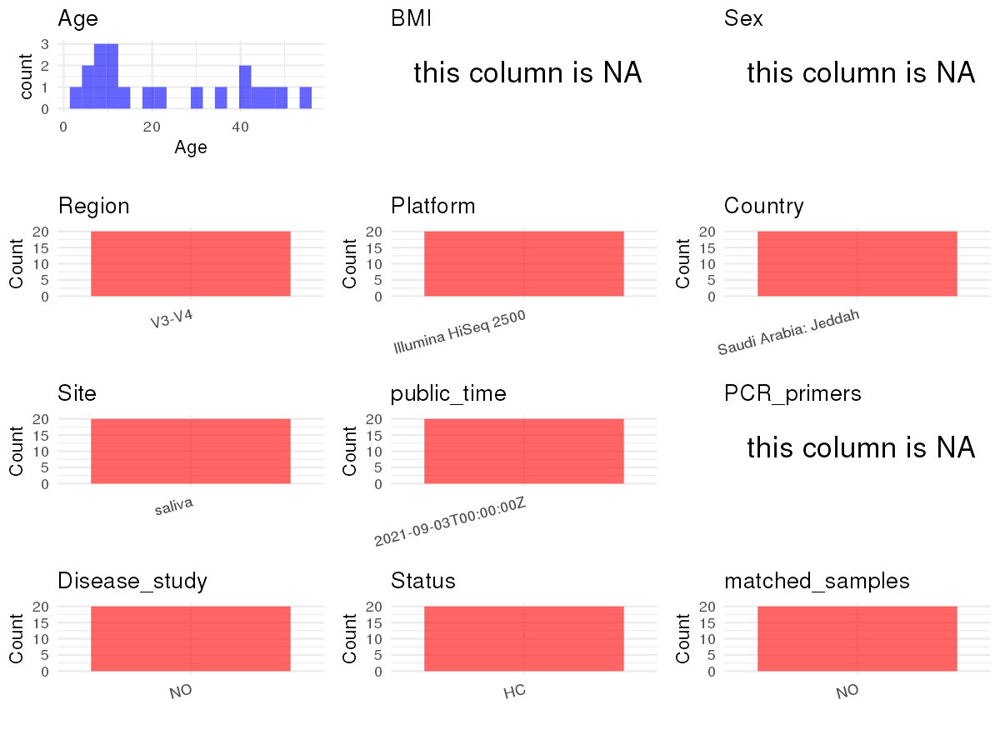

R Notebook: Metadata Processing Workflow
================

# Step 1: Obtain Initial Metadata from Each Project

To obtain the initial metadata: 1. Search for the BioProject ID (e.g.,
“PRJEBXXXX”) on the [NCBI SRA
website](https://www.ncbi.nlm.nih.gov/Traces/study/). 2. In the “Select”
table, click on “Metadata” and download the file. 3. The downloaded file
is typically named “SraRunTable.csv” and contains metadata for the
project.

``` r
# Load necessary libraries
library(dplyr)
library(ggplot2)
library(cowplot)
library(readxl)

# Set working directory (update this path to your local directory)
setwd("/home/dongbiao/word_embedding_microbiome/all_data/oral/global-oral-microbiome/data/projects/PRJNA760299")

# Read the initial metadata files
initial_meta<-read.csv("SraRunTable.csv")

head(initial_meta)
```

    ##           Run       Assay.Type AvgSpotLen    Bases  BioProject    BioSample
    ## 1 SRR15711545 Targeted-Capture        259 38770160 PRJNA760299 SAMN21212365
    ## 2 SRR15711546 Targeted-Capture        259 38660480 PRJNA760299 SAMN21212364
    ## 3 SRR15711547 Targeted-Capture        259 38370040 PRJNA760299 SAMN21212363
    ## 4 SRR15711548 Targeted-Capture        259 37970280 PRJNA760299 SAMN21212362
    ## 5 SRR15711549 Targeted-Capture        259 38630500 PRJNA760299 SAMN21212361
    ## 6 SRR15711550 Targeted-Capture        259 38150330 PRJNA760299 SAMN21212360
    ##                                BioSampleModel    Bytes
    ## 1 MIMARKS.survey,MIGS/MIMS/MIMARKS.human-oral 22625351
    ## 2 MIMARKS.survey,MIGS/MIMS/MIMARKS.human-oral 23185361
    ## 3 MIMARKS.survey,MIGS/MIMS/MIMARKS.human-oral 22854140
    ## 4 MIMARKS.survey,MIGS/MIMS/MIMARKS.human-oral 22377673
    ## 5 MIMARKS.survey,MIGS/MIMS/MIMARKS.human-oral 22616340
    ## 6 MIMARKS.survey,MIGS/MIMS/MIMARKS.human-oral 22335696
    ##                 Center.Name Collection_Date Consent DATASTORE.filetype
    ## 1 KING ABDULAZIZ UNIVERSITY      2020-03-04  public   fastq,run.zq,sra
    ## 2 KING ABDULAZIZ UNIVERSITY      2020-03-04  public   fastq,run.zq,sra
    ## 3 KING ABDULAZIZ UNIVERSITY      2020-03-04  public   fastq,run.zq,sra
    ## 4 KING ABDULAZIZ UNIVERSITY      2020-03-04  public   fastq,run.zq,sra
    ## 5 KING ABDULAZIZ UNIVERSITY      2020-03-04  public   fastq,run.zq,sra
    ## 6 KING ABDULAZIZ UNIVERSITY      2020-03-04  public   fastq,run.zq,sra
    ##   DATASTORE.provider                     DATASTORE.region env_broad_scale
    ## 1         gs,ncbi,s3 gs.us-east1,ncbi.public,s3.us-east-1   not collected
    ## 2         gs,ncbi,s3 gs.us-east1,ncbi.public,s3.us-east-1   not collected
    ## 3         gs,ncbi,s3 gs.us-east1,ncbi.public,s3.us-east-1   not collected
    ## 4         gs,ncbi,s3 gs.us-east1,ncbi.public,s3.us-east-1   not collected
    ## 5         gs,ncbi,s3 gs.us-east1,ncbi.public,s3.us-east-1   not collected
    ## 6         gs,ncbi,s3 gs.us-east1,ncbi.public,s3.us-east-1   not collected
    ##   env_local_scale    env_medium ETHNICITY  Experiment geo_loc_name_country
    ## 1   not collected not collected     Saudi SRX12007283         Saudi Arabia
    ## 2   not collected not collected     Saudi SRX12007282         Saudi Arabia
    ## 3   not collected not collected     Saudi SRX12007281         Saudi Arabia
    ## 4   not collected not collected     Saudi SRX12007280         Saudi Arabia
    ## 5   not collected not collected     Saudi SRX12007279         Saudi Arabia
    ## 6   not collected not collected  Sudanese SRX12007278         Saudi Arabia
    ##   geo_loc_name_country_continent         geo_loc_name Host_Age
    ## 1                           Asia Saudi Arabia: Jeddah       12
    ## 2                           Asia Saudi Arabia: Jeddah       15
    ## 3                           Asia Saudi Arabia: Jeddah       23
    ## 4                           Asia Saudi Arabia: Jeddah       45
    ## 5                           Asia Saudi Arabia: Jeddah       56
    ## 6                           Asia Saudi Arabia: Jeddah        4
    ##   host_body_product         HOST          Instrument             lat_lon
    ## 1            Saliva Homo sapiens Illumina HiSeq 2500 21.4858 N 39.1925 E
    ## 2            Saliva Homo sapiens Illumina HiSeq 2500 21.4858 N 39.1925 E
    ## 3            Saliva Homo sapiens Illumina HiSeq 2500 21.4858 N 39.1925 E
    ## 4            Saliva Homo sapiens Illumina HiSeq 2500 21.4858 N 39.1925 E
    ## 5            Saliva Homo sapiens Illumina HiSeq 2500 21.4858 N 39.1925 E
    ## 6            Saliva Homo sapiens Illumina HiSeq 2500 21.4858 N 39.1925 E
    ##   Library.Name LibraryLayout LibrarySelection LibrarySource
    ## 1           5M        PAIRED              PCR   METAGENOMIC
    ## 2           4M        PAIRED              PCR   METAGENOMIC
    ## 3           3M        PAIRED              PCR   METAGENOMIC
    ## 4           2M        PAIRED              PCR   METAGENOMIC
    ## 5           1M        PAIRED              PCR   METAGENOMIC
    ## 6           5H        PAIRED              PCR   METAGENOMIC
    ##                Organism Platform          ReleaseDate          create_date
    ## 1 human oral metagenome ILLUMINA 2021-09-03T00:00:00Z 2021-09-03T09:24:00Z
    ## 2 human oral metagenome ILLUMINA 2021-09-03T00:00:00Z 2021-09-03T09:24:00Z
    ## 3 human oral metagenome ILLUMINA 2021-09-03T00:00:00Z 2021-09-03T09:25:00Z
    ## 4 human oral metagenome ILLUMINA 2021-09-03T00:00:00Z 2021-09-03T09:25:00Z
    ## 5 human oral metagenome ILLUMINA 2021-09-03T00:00:00Z 2021-09-03T09:25:00Z
    ## 6 human oral metagenome ILLUMINA 2021-09-03T00:00:00Z 2021-09-03T09:25:00Z
    ##   version Sample.Name SRA.Study
    ## 1       1          B5 SRP335502
    ## 2       1          B4 SRP335502
    ## 3       1          B3 SRP335502
    ## 4       1          B2 SRP335502
    ## 5       1          B1 SRP335502
    ## 6       1          A5 SRP335502

# Step 2: Create a Uniform Metadata Template

The uniform metadata should include the following columns:

1.  **BioProject**: Project ID (e.g., “PRJNA339212”)
2.  **Run**: Sample ID (e.g., “ERRXXXXXX” or “SRRXXXXXX”)
3.  **sample_name**: Original sample name submitted by the authors (not
    the database-assigned ID)
4.  **Age**: Age of the subject (if available)
5.  **BMI**: Body Mass Index (if available)
6.  **Sex**: Sex of the subject (“F” or “M”)
7.  **Region**: Targeted 16S rRNA region (e.g., “V3-V4”)
8.  **Platform**: Sequencing platform (e.g., “Illumina MiSeq”)
9.  **Country**: Country of sample origin (e.g., “China”)
10. **Site**: Sample site (e.g., “saliva”, “dental plaque”)
11. **public_time**: Data release date (format: “YYYY-MM-DD”)
12. **PCR_primers**: PCR primers used (e.g., “515F-806R”)
13. **title**: Title of the associated publication
14. **Disease_study**: Whether the study involves a disease (“YES” or
    “NO”)
15. **Status**: Disease status (e.g., “T2DM”, “HC”). Note: If the study
    includes both disease and healthy samples, this must be specified
    per sample.

``` r
# Create a uniform metadata dataframe
metadata <- data.frame(
  BioProject = initial_meta$BioProject,
  Run = initial_meta$Run,
  sample_name = initial_meta$Sample.Name,
  Age = initial_meta$Host_Age,
  BMI = NA,
  Sex = NA,
  Region = "V3-V4",
  Platform = initial_meta$Instrument,
  Country = initial_meta$geo_loc_name,
  Site = "saliva",
  public_time = initial_meta$ReleaseDate,
  stringsAsFactors = FALSE
)
metadata<-unique(metadata)
```

# Step 3: Manually Add Information from the Publication

Some information (e.g. PCR primers, study title, disease status) must be
manually extracted from the publication and added to the metadata.

``` r
# Add information obtained from the publication
metadata$PCR_primers <- NA
metadata$title <- "Study of oral microbiota diversity among groups of families originally from different countries"
metadata$Disease_study <- "NO"

# Assign disease status based on sample_name patterns
metadata$Status <-"HC"
metadata$matched_samples <- "NO"
```

# Step 4: Summarize and Validate the Metadata

``` r
# Check the number of unique runs and sample names
print(paste("Number of unique runs:", length(unique(metadata$Run))))
```

    ## [1] "Number of unique runs: 20"

``` r
print(paste("Number of unique sample names:", length(unique(metadata$sample_name))))
```

    ## [1] "Number of unique sample names: 20"

# Step 5: Visualize the Metadata

``` r

```


# Step 6: Finalize and Export the Metadata

``` r
# Reorder columns to match the desired format
metadata <- metadata[, c(
  "BioProject", "Run", "sample_name", "Age", "BMI", "Sex", 
  "Region", "Platform", "Country", "Site", "public_time", 
  "PCR_primers", "title", "Disease_study", "Status","matched_samples"
)]

# Export the uniform metadata to a CSV file
metadata<-unique(metadata)
write.csv(metadata, file = "metadata.csv", quote = FALSE)
head(metadata)
```

    ##    BioProject         Run sample_name Age BMI Sex Region            Platform
    ## 1 PRJNA760299 SRR15711545          B5  12  NA  NA  V3-V4 Illumina HiSeq 2500
    ## 2 PRJNA760299 SRR15711546          B4  15  NA  NA  V3-V4 Illumina HiSeq 2500
    ## 3 PRJNA760299 SRR15711547          B3  23  NA  NA  V3-V4 Illumina HiSeq 2500
    ## 4 PRJNA760299 SRR15711548          B2  45  NA  NA  V3-V4 Illumina HiSeq 2500
    ## 5 PRJNA760299 SRR15711549          B1  56  NA  NA  V3-V4 Illumina HiSeq 2500
    ## 6 PRJNA760299 SRR15711550          A5   4  NA  NA  V3-V4 Illumina HiSeq 2500
    ##                Country   Site          public_time PCR_primers
    ## 1 Saudi Arabia: Jeddah saliva 2021-09-03T00:00:00Z          NA
    ## 2 Saudi Arabia: Jeddah saliva 2021-09-03T00:00:00Z          NA
    ## 3 Saudi Arabia: Jeddah saliva 2021-09-03T00:00:00Z          NA
    ## 4 Saudi Arabia: Jeddah saliva 2021-09-03T00:00:00Z          NA
    ## 5 Saudi Arabia: Jeddah saliva 2021-09-03T00:00:00Z          NA
    ## 6 Saudi Arabia: Jeddah saliva 2021-09-03T00:00:00Z          NA
    ##                                                                                             title
    ## 1 Study of oral microbiota diversity among groups of families originally from different countries
    ## 2 Study of oral microbiota diversity among groups of families originally from different countries
    ## 3 Study of oral microbiota diversity among groups of families originally from different countries
    ## 4 Study of oral microbiota diversity among groups of families originally from different countries
    ## 5 Study of oral microbiota diversity among groups of families originally from different countries
    ## 6 Study of oral microbiota diversity among groups of families originally from different countries
    ##   Disease_study Status matched_samples
    ## 1            NO     HC              NO
    ## 2            NO     HC              NO
    ## 3            NO     HC              NO
    ## 4            NO     HC              NO
    ## 5            NO     HC              NO
    ## 6            NO     HC              NO

## Notes for Students:

1.  **Metadata Accuracy**: Always cross-check the metadata with the
    original publication to ensure accuracy.
2.  **Manual Entries**: Columns like `PCR_primers`, and `Status` often
    require manual entry based on the publication.
3.  **Disease Status**: Be careful when assigning `Status`—some studies
    include both disease and healthy samples.
4.  **Visualization**: The plots help quickly identify the distribution
    of values in each column, which is useful for quality control.
5.  **Reproducibility**: Update the working directory and file paths to
    match your local environment.
