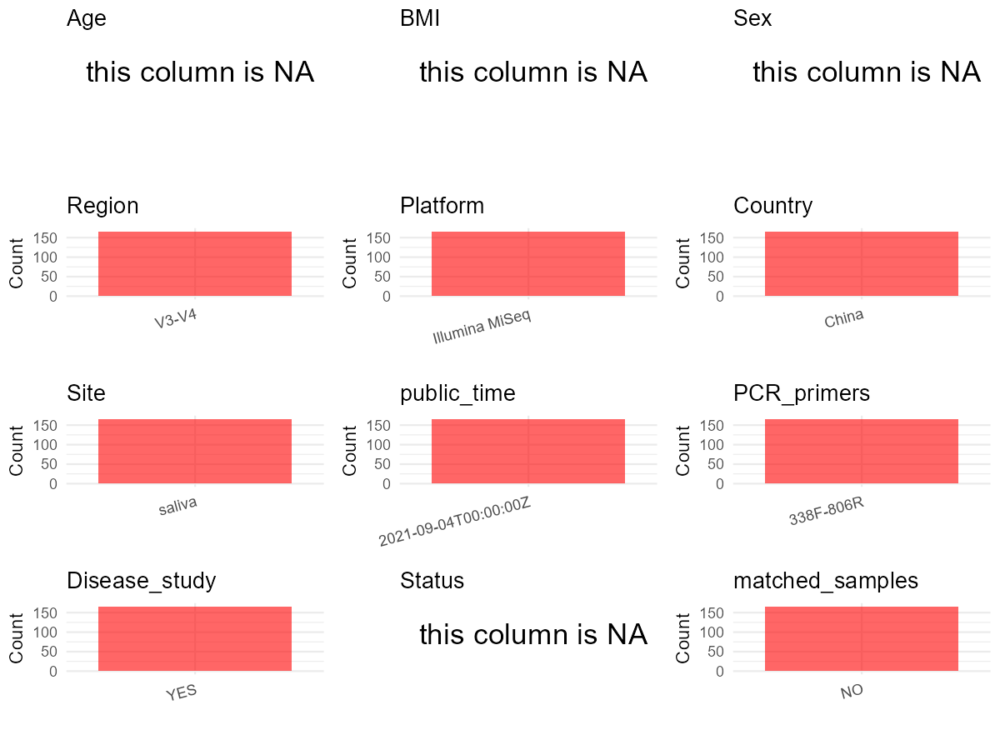

R Notebook: Metadata Processing Workflow
================

# Step 1: Obtain Initial Metadata from Each Project

To obtain the initial metadata: 1. Search for the BioProject ID (e.g.,
“PRJEBXXXX”) on the [NCBI SRA
website](https://www.ncbi.nlm.nih.gov/Traces/study/). 2. In the “Select”
table, click on “Metadata” and download the file. 3. The downloaded file
is typically named “SraRunTable.csv” and contains metadata for the
project.

``` r
# Load necessary libraries
library(dplyr)
library(ggplot2)
library(cowplot)

# Set working directory (update this path to your local directory)
setwd("D:/oral_project/PRJNA760654")

# Read the initial metadata files
initial_meta<-read.csv("SraRunTable.csv",header = T)

# Combine the two metadata files
#meta <- rbind(initial_meta, initial_meta1)

#Remove entries non-oral samples
#initial_meta <- subset(initial_meta,isolate %in% c("saliva","tongue coat"))

# Check the number of samples containing "HT" in Sample.Name (e.g., healthy controls)
#nrow(subset(meta, grepl("HT", Sample.Name)))

# Display the first few rows of the metadata
head(initial_meta)
```

    ##           Run Assay.Type AvgSpotLen    Bases  BioProject    BioSample
    ## 1 SRR15719048   AMPLICON        428 20259637 PRJNA760654 SAMN21220171
    ## 2 SRR15719049   AMPLICON        428 18620990 PRJNA760654 SAMN21220171
    ## 3 SRR15719050   AMPLICON        427 21178143 PRJNA760654 SAMN21220171
    ## 4 SRR15719051   AMPLICON        424 15899157 PRJNA760654 SAMN21220171
    ## 5 SRR15719052   AMPLICON        428 20456309 PRJNA760654 SAMN21220171
    ## 6 SRR15719053   AMPLICON        428 15749719 PRJNA760654 SAMN21220171
    ##                BioSampleModel    Bytes
    ## 1 Metagenome or environmental  9347115
    ## 2 Metagenome or environmental  6809960
    ## 3 Metagenome or environmental 10055000
    ## 4 Metagenome or environmental  7583364
    ## 5 Metagenome or environmental  8893736
    ## 6 Metagenome or environmental  5833356
    ##                                                        Center.Name
    ## 1 SHENZHEN BAOAN WOMEN'S AND CHILDREN'S HOSPITAL, JINAN UNIVERSITY
    ## 2 SHENZHEN BAOAN WOMEN'S AND CHILDREN'S HOSPITAL, JINAN UNIVERSITY
    ## 3 SHENZHEN BAOAN WOMEN'S AND CHILDREN'S HOSPITAL, JINAN UNIVERSITY
    ## 4 SHENZHEN BAOAN WOMEN'S AND CHILDREN'S HOSPITAL, JINAN UNIVERSITY
    ## 5 SHENZHEN BAOAN WOMEN'S AND CHILDREN'S HOSPITAL, JINAN UNIVERSITY
    ## 6 SHENZHEN BAOAN WOMEN'S AND CHILDREN'S HOSPITAL, JINAN UNIVERSITY
    ##   Collection_Date Consent DATASTORE.filetype DATASTORE.provider
    ## 1         2021-01  public   fastq,run.zq,sra         gs,ncbi,s3
    ## 2         2021-01  public   fastq,run.zq,sra         gs,ncbi,s3
    ## 3         2021-01  public   fastq,run.zq,sra         gs,ncbi,s3
    ## 4         2021-01  public   fastq,run.zq,sra         gs,ncbi,s3
    ## 5         2021-01  public   fastq,run.zq,sra         gs,ncbi,s3
    ## 6         2021-01  public   fastq,run.zq,sra         gs,ncbi,s3
    ##                       DATASTORE.region  Experiment geo_loc_name_country
    ## 1 gs.us-east1,ncbi.public,s3.us-east-1 SRX12014777                China
    ## 2 gs.us-east1,ncbi.public,s3.us-east-1 SRX12014776                China
    ## 3 gs.us-east1,ncbi.public,s3.us-east-1 SRX12014775                China
    ## 4 gs.us-east1,ncbi.public,s3.us-east-1 SRX12014774                China
    ## 5 gs.us-east1,ncbi.public,s3.us-east-1 SRX12014773                China
    ## 6 gs.us-east1,ncbi.public,s3.us-east-1 SRX12014772                China
    ##   geo_loc_name_country_continent    geo_loc_name         HOST     Instrument
    ## 1                           Asia China:Guangdong Homo sapiens Illumina MiSeq
    ## 2                           Asia China:Guangdong Homo sapiens Illumina MiSeq
    ## 3                           Asia China:Guangdong Homo sapiens Illumina MiSeq
    ## 4                           Asia China:Guangdong Homo sapiens Illumina MiSeq
    ## 5                           Asia China:Guangdong Homo sapiens Illumina MiSeq
    ## 6                           Asia China:Guangdong Homo sapiens Illumina MiSeq
    ##   isolation_source          lat_lon      Library.Name LibraryLayout
    ## 1             oral 22.38 N 114.05 E MJ20210408119_100        PAIRED
    ## 2             oral 22.38 N 114.05 E  MJ20210408119_99        PAIRED
    ## 3             oral 22.38 N 114.05 E  MJ20210408119_98        PAIRED
    ## 4             oral 22.38 N 114.05 E  MJ20210408119_97        PAIRED
    ## 5             oral 22.38 N 114.05 E  MJ20210408119_96        PAIRED
    ## 6             oral 22.38 N 114.05 E  MJ20210408119_95        PAIRED
    ##   LibrarySelection LibrarySource              Organism Platform
    ## 1              PCR   METAGENOMIC human oral metagenome ILLUMINA
    ## 2              PCR   METAGENOMIC human oral metagenome ILLUMINA
    ## 3              PCR   METAGENOMIC human oral metagenome ILLUMINA
    ## 4              PCR   METAGENOMIC human oral metagenome ILLUMINA
    ## 5              PCR   METAGENOMIC human oral metagenome ILLUMINA
    ## 6              PCR   METAGENOMIC human oral metagenome ILLUMINA
    ##            ReleaseDate          create_date version
    ## 1 2021-09-04T00:00:00Z 2021-09-04T04:03:00Z       1
    ## 2 2021-09-04T00:00:00Z 2021-09-04T04:04:00Z       1
    ## 3 2021-09-04T00:00:00Z 2021-09-04T04:04:00Z       1
    ## 4 2021-09-04T00:00:00Z 2021-09-04T04:04:00Z       1
    ## 5 2021-09-04T00:00:00Z 2021-09-04T04:04:00Z       1
    ## 6 2021-09-04T00:00:00Z 2021-09-04T04:04:00Z       1
    ##                                                           Sample.Name SRA.Study
    ## 1 Neonatal oral microbiome at D1 and D30 day with 16S rRNA sequencing SRP335649
    ## 2 Neonatal oral microbiome at D1 and D30 day with 16S rRNA sequencing SRP335649
    ## 3 Neonatal oral microbiome at D1 and D30 day with 16S rRNA sequencing SRP335649
    ## 4 Neonatal oral microbiome at D1 and D30 day with 16S rRNA sequencing SRP335649
    ## 5 Neonatal oral microbiome at D1 and D30 day with 16S rRNA sequencing SRP335649
    ## 6 Neonatal oral microbiome at D1 and D30 day with 16S rRNA sequencing SRP335649

# Step 2: Create a Uniform Metadata Template

The uniform metadata should include the following columns:

1.  **BioProject**: Project ID (e.g., “PRJNA339212”)
2.  **Run**: Sample ID (e.g., “ERRXXXXXX” or “SRRXXXXXX”)
3.  **sample_name**: Original sample name submitted by the authors (not
    the database-assigned ID)
4.  **Age**: Age of the subject (if available)
5.  **BMI**: Body Mass Index (if available)
6.  **Sex**: Sex of the subject (“F” or “M”)
7.  **Region**: Targeted 16S rRNA region (e.g., “V3-V4”)
8.  **Platform**: Sequencing platform (e.g., “Illumina MiSeq”)
9.  **Country**: Country of sample origin (e.g., “China”)
10. **Site**: Sample site (e.g., “saliva”, “dental plaque”)
11. **public_time**: Data release date (format: “YYYY-MM-DD”)
12. **PCR_primers**: PCR primers used (e.g., “515F-806R”)
13. **title**: Title of the associated publication
14. **Disease_study**: Whether the study involves a disease (“YES” or
    “NO”)
15. **Status**: Disease status (e.g., “T2DM”, “HC”). Note: If the study
    includes both disease and healthy samples, this must be specified
    per sample.
16. **matched_samples**: matched samples (“YES” or “NO”)

``` r
# Create a uniform metadata dataframe
metadata <- data.frame(
  BioProject = initial_meta$BioProject,
  Run = initial_meta$Run,
  sample_name = initial_meta$Library.Name,
  Age = NA,
  BMI = NA,
  Sex = NA,
  Region = "V3-V4",
  Platform = initial_meta$Instrument,
  Country = initial_meta$geo_loc_name_country,
  Site = replace(initial_meta$Organism, initial_meta$Organism == "human oral metagenome", "saliva"),
  public_time = initial_meta$ReleaseDate,
  stringsAsFactors = FALSE
)
```

# Step 3: Manually Add Information from the Publication

Some information (e.g. PCR primers, study title, disease status) must be
manually extracted from the publication and added to the metadata.

``` r
# Add information obtained from the publication
metadata$PCR_primers <- "338F-806R"
metadata$title <- "Influences of gestational diabetes mellitus on the oral microbiota in offspring from birth to 1 month old"
metadata$Disease_study <- "YES"
# Assign disease status based on sample_name patterns
metadata$Status<-NA

#get subjects id according to sample id
metadata$sample_name<-gsub("MJ20210408119_","",metadata$sample_name)
#get subjects id with Saliva available
keep_subjects<-subset(metadata,Site %in% "saliva")
#remove subjects without Saliva samples
metadata<-subset(metadata,sample_name %in% keep_subjects$sample_name)
#get subjects sampling counts
sample_counts <- table(metadata$sample_name)
# Create matched_samples column, any subjects have >=2 samples will be label "YES", otherwise "NO"
metadata$matched_samples <- ifelse(metadata$sample_name %in% names(sample_counts[sample_counts >= 2]), "YES", "NO")
```

# Step 4: Summarize and Validate the Metadata

``` r
# Check the number of unique runs and sample names
print(paste("Number of unique runs:", length(unique(metadata$Run))))
```

    ## [1] "Number of unique runs: 166"

``` r
print(paste("Number of unique sample names:", length(unique(metadata$sample_name))))
```

    ## [1] "Number of unique sample names: 166"

# Step 5: Visualize the Metadata

``` r

```


# Step 6: Finalize and Export the Metadata

``` r
# Reorder columns to match the desired format
metadata <- metadata[, c(
  "BioProject", "Run", "sample_name", "Age", "BMI", "Sex", 
  "Region", "Platform", "Country", "Site", "public_time", 
  "PCR_primers", "title", "Disease_study", "Status","matched_samples"
)]

# Export the uniform metadata to a CSV file
write.csv(metadata, file = "metadata.csv", quote = TRUE)
head(metadata)
```

    ##    BioProject         Run sample_name Age BMI Sex Region       Platform Country
    ## 1 PRJNA760654 SRR15719048         100  NA  NA  NA  V3-V4 Illumina MiSeq   China
    ## 2 PRJNA760654 SRR15719049          99  NA  NA  NA  V3-V4 Illumina MiSeq   China
    ## 3 PRJNA760654 SRR15719050          98  NA  NA  NA  V3-V4 Illumina MiSeq   China
    ## 4 PRJNA760654 SRR15719051          97  NA  NA  NA  V3-V4 Illumina MiSeq   China
    ## 5 PRJNA760654 SRR15719052          96  NA  NA  NA  V3-V4 Illumina MiSeq   China
    ## 6 PRJNA760654 SRR15719053          95  NA  NA  NA  V3-V4 Illumina MiSeq   China
    ##     Site          public_time PCR_primers
    ## 1 saliva 2021-09-04T00:00:00Z   338F-806R
    ## 2 saliva 2021-09-04T00:00:00Z   338F-806R
    ## 3 saliva 2021-09-04T00:00:00Z   338F-806R
    ## 4 saliva 2021-09-04T00:00:00Z   338F-806R
    ## 5 saliva 2021-09-04T00:00:00Z   338F-806R
    ## 6 saliva 2021-09-04T00:00:00Z   338F-806R
    ##                                                                                                       title
    ## 1 Influences of gestational diabetes mellitus on the oral microbiota in offspring from birth to 1 month old
    ## 2 Influences of gestational diabetes mellitus on the oral microbiota in offspring from birth to 1 month old
    ## 3 Influences of gestational diabetes mellitus on the oral microbiota in offspring from birth to 1 month old
    ## 4 Influences of gestational diabetes mellitus on the oral microbiota in offspring from birth to 1 month old
    ## 5 Influences of gestational diabetes mellitus on the oral microbiota in offspring from birth to 1 month old
    ## 6 Influences of gestational diabetes mellitus on the oral microbiota in offspring from birth to 1 month old
    ##   Disease_study Status matched_samples
    ## 1           YES     NA              NO
    ## 2           YES     NA              NO
    ## 3           YES     NA              NO
    ## 4           YES     NA              NO
    ## 5           YES     NA              NO
    ## 6           YES     NA              NO

## Notes for Students:

1.  **Metadata Accuracy**: Always cross-check the metadata with the
    original publication to ensure accuracy.
2.  **Manual Entries**: Columns like `PCR_primers`, and `Status` often
    require manual entry based on the publication.
3.  **Disease Status**: Be careful when assigning `Status`—some studies
    include both disease and healthy samples.
4.  **Visualization**: The plots help quickly identify the distribution
    of values in each column, which is useful for quality control.
5.  **Reproducibility**: Update the working directory and file paths to
    match your local environment.
