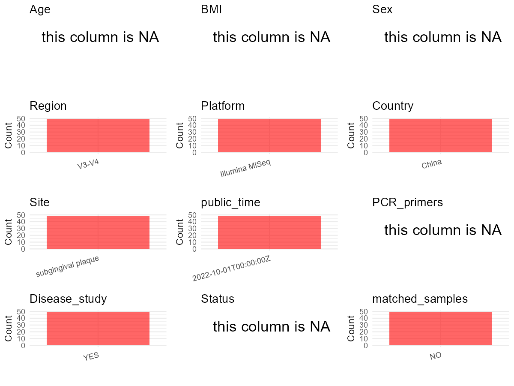

R Notebook: Metadata Processing Workflow
================

# Step 1: Obtain Initial Metadata from Each Project

To obtain the initial metadata: 1. Search for the BioProject ID (e.g.,
“PRJEBXXXX”) on the [NCBI SRA
website](https://www.ncbi.nlm.nih.gov/Traces/study/). 2. In the “Select”
table, click on “Metadata” and download the file. 3. The downloaded file
is typically named “SraRunTable.csv” and contains metadata for the
project.

``` r
# Load necessary libraries
library(dplyr)
library(ggplot2)
library(cowplot)

# Set working directory (update this path to your local directory)
setwd("D:/studylearning/董彪师兄项目/任务4_20251009/PRJNA763000")

# Read the initial metadata files
initial_meta<-read.csv("SraRunTable.csv",header = T)

# Display the first few rows of the metadata
head(initial_meta)
```

    ##           Run Assay.Type AvgSpotLen    Bases  BioProject    BioSample
    ## 1 SRR15883910   AMPLICON        602 21123578 PRJNA763000 SAMN21419556
    ## 2 SRR15883913   AMPLICON        602 24907148 PRJNA763000 SAMN21419597
    ## 3 SRR15883914   AMPLICON        602 29570842 PRJNA763000 SAMN21419596
    ## 4 SRR15883915   AMPLICON        602  3867850 PRJNA763000 SAMN21419595
    ## 5 SRR15883916   AMPLICON        602 28038752 PRJNA763000 SAMN21419594
    ## 6 SRR15883917   AMPLICON        602 28947772 PRJNA763000 SAMN21419593
    ##                BioSampleModel    Bytes        Center.Name Collection_Date
    ## 1 Metagenome or environmental 13041333 SICHUAN UNIVERSITY      2016-01-08
    ## 2 Metagenome or environmental 14623397 SICHUAN UNIVERSITY      2016-02-21
    ## 3 Metagenome or environmental 16728312 SICHUAN UNIVERSITY      2016-02-20
    ## 4 Metagenome or environmental  2306527 SICHUAN UNIVERSITY      2016-02-19
    ## 5 Metagenome or environmental 15650782 SICHUAN UNIVERSITY      2016-02-18
    ## 6 Metagenome or environmental 16382365 SICHUAN UNIVERSITY      2016-02-17
    ##   Consent DATASTORE.filetype DATASTORE.provider
    ## 1  public   fastq,run.zq,sra         gs,ncbi,s3
    ## 2  public   fastq,run.zq,sra         gs,ncbi,s3
    ## 3  public   fastq,run.zq,sra         gs,ncbi,s3
    ## 4  public   fastq,run.zq,sra         gs,ncbi,s3
    ## 5  public   fastq,run.zq,sra         gs,ncbi,s3
    ## 6  public   fastq,run.zq,sra         gs,ncbi,s3
    ##                       DATASTORE.region  Experiment geo_loc_name_country
    ## 1 gs.us-east1,ncbi.public,s3.us-east-1 SRX12174815                China
    ## 2 gs.us-east1,ncbi.public,s3.us-east-1 SRX12174812                China
    ## 3 gs.us-east1,ncbi.public,s3.us-east-1 SRX12174811                China
    ## 4 gs.us-east1,ncbi.public,s3.us-east-1 SRX12174810                China
    ## 5 gs.us-east1,ncbi.public,s3.us-east-1 SRX12174809                China
    ## 6 gs.us-east1,ncbi.public,s3.us-east-1 SRX12174808                China
    ##   geo_loc_name_country_continent  geo_loc_name           HOST     Instrument
    ## 1                           Asia China:Sichuan pregnant women Illumina MiSeq
    ## 2                           Asia China:Sichuan pregnant women Illumina MiSeq
    ## 3                           Asia China:Sichuan pregnant women Illumina MiSeq
    ## 4                           Asia China:Sichuan pregnant women Illumina MiSeq
    ## 5                           Asia China:Sichuan pregnant women Illumina MiSeq
    ## 6                           Asia China:Sichuan pregnant women Illumina MiSeq
    ##     isolation_source          lat_lon Library.Name LibraryLayout
    ## 1 subgingival plaque 30.74 N 104.06 E            8        PAIRED
    ## 2 subgingival plaque 29.16 N 105.01 E          216        PAIRED
    ## 3 subgingival plaque 29.15 N 105.01 E          209        PAIRED
    ## 4 subgingival plaque 29.14 N 105.01 E          166        PAIRED
    ## 5 subgingival plaque 29.13 N 105.01 E          165        PAIRED
    ## 6 subgingival plaque 29.12 N 105.01 E          164        PAIRED
    ##   LibrarySelection LibrarySource        Organism Platform          ReleaseDate
    ## 1              PCR   METAGENOMIC oral metagenome ILLUMINA 2022-10-01T00:00:00Z
    ## 2              PCR   METAGENOMIC oral metagenome ILLUMINA 2022-10-01T00:00:00Z
    ## 3              PCR   METAGENOMIC oral metagenome ILLUMINA 2022-10-01T00:00:00Z
    ## 4              PCR   METAGENOMIC oral metagenome ILLUMINA 2022-10-01T00:00:00Z
    ## 5              PCR   METAGENOMIC oral metagenome ILLUMINA 2022-10-01T00:00:00Z
    ## 6              PCR   METAGENOMIC oral metagenome ILLUMINA 2022-10-01T00:00:00Z
    ##            create_date version Sample.Name SRA.Study
    ## 1 2021-09-14T08:05:00Z       1           8 SRP336943
    ## 2 2021-09-14T08:06:00Z       1         216 SRP336943
    ## 3 2021-09-14T08:05:00Z       1         209 SRP336943
    ## 4 2021-09-14T08:05:00Z       1         166 SRP336943
    ## 5 2021-09-14T08:06:00Z       1         165 SRP336943
    ## 6 2021-09-14T08:06:00Z       1         164 SRP336943

# Step 2: Create a Uniform Metadata Template

The uniform metadata should include the following columns:

1.  **BioProject**: Project ID (e.g., “PRJNA339212”)
2.  **Run**: Sample ID (e.g., “ERRXXXXXX” or “SRRXXXXXX”)
3.  **sample_name**: Original sample name submitted by the authors (not
    the database-assigned ID)
4.  **Age**: Age of the subject (if available)
5.  **BMI**: Body Mass Index (if available)
6.  **Sex**: Sex of the subject (“F” or “M”)
7.  **Region**: Targeted 16S rRNA region (e.g., “V3-V4”)
8.  **Platform**: Sequencing platform (e.g., “Illumina MiSeq”)
9.  **Country**: Country of sample origin (e.g., “China”)
10. **Site**: Sample site (e.g., “saliva”, “dental plaque”)
11. **public_time**: Data release date (format: “YYYY-MM-DD”)
12. **PCR_primers**: PCR primers used (e.g., “515F-806R”)
13. **title**: Title of the associated publication
14. **Disease_study**: Whether the study involves a disease (“YES” or
    “NO”)
15. **Status**: Disease status (e.g., “T2DM”, “HC”). Note: If the study
    includes both disease and healthy samples, this must be specified
    per sample.

``` r
# Create a uniform metadata dataframe
metadata <- data.frame(
  BioProject = initial_meta$BioProject,
  Run = initial_meta$Run,
  sample_name = initial_meta$Sample.Name,
  Age = NA,
  BMI = NA,
  Sex= NA,
  Region = "V3-V4",
  Platform = initial_meta$Instrument,
  Country = initial_meta$geo_loc_name_country,
  Site = initial_meta$isolation_source,
  public_time = initial_meta$ReleaseDate,
  stringsAsFactors = FALSE
)
```

# Step 3: Manually Add Information from the Publication

Some information (e.g. PCR primers, study title, disease status) must be
manually extracted from the publication and added to the metadata.

``` r
# Add information obtained from the publication
metadata$PCR_primers <- NA_character_  # Update based on the publication
metadata$title <- "Clinical study showing a lower abundance of Neisseria in the oral microbiome aligns with low birth weight pregnancy outcomes"
metadata$Disease_study <- "YES"
metadata$Status <- NA_character_

#extract subject id by remove prefix of sample_name
#metadata$sample_name <- gsub("_st|_sal", "", metadata$sample_name)

# Check initial data distribution
cat("Initial sample distribution:\n")
```

    ## Initial sample distribution:

``` r
table(metadata$sample_name)
```

    ## 
    ##   1   2   3   4   5   6   7   8  10  12  13  16  18  20  21  26  28  29  30  31 
    ##   1   1   1   1   1   1   1   1   1   1   1   1   1   1   1   1   1   1   1   1 
    ##  32  37  40  41  43  44  47  48  54  58  59  62  67  77  84  85  96 118 119 144 
    ##   1   1   1   1   1   1   1   1   1   1   1   1   1   1   1   1   1   1   1   1 
    ## 159 161 162 163 164 165 166 209 216 
    ##   1   1   1   1   1   1   1   1   1

``` r
table(metadata$Site)
```

    ## 
    ## subgingival plaque 
    ##                 49

``` r
# Calculate sampling frequency per subject
sample_counts <- table(metadata$sample_name)
cat("\nNumber of samples per subject:\n")
```

    ## 
    ## Number of samples per subject:

``` r
print(sample_counts)
```

    ## 
    ##   1   2   3   4   5   6   7   8  10  12  13  16  18  20  21  26  28  29  30  31 
    ##   1   1   1   1   1   1   1   1   1   1   1   1   1   1   1   1   1   1   1   1 
    ##  32  37  40  41  43  44  47  48  54  58  59  62  67  77  84  85  96 118 119 144 
    ##   1   1   1   1   1   1   1   1   1   1   1   1   1   1   1   1   1   1   1   1 
    ## 159 161 162 163 164 165 166 209 216 
    ##   1   1   1   1   1   1   1   1   1

``` r
# Create matched_samples column
metadata$matched_samples <- ifelse(metadata$sample_name %in% names(sample_counts[sample_counts >= 2]), "YES", "NO")

cat("\nMatched samples distribution:\n")
```

    ## 
    ## Matched samples distribution:

``` r
table(metadata$matched_samples)
```

    ## 
    ## NO 
    ## 49

``` r
# Identify samples for removal: single samples excluding subgingival plaque 
single_samples <- names(sample_counts[sample_counts == 1])
samples_to_remove <- metadata$sample_name %in% single_samples & !(metadata$Site %in% c("subgingival plaque"))

cat("\nNumber of samples to be removed:", sum(samples_to_remove), "\n")
```

    ## 
    ## Number of samples to be removed: 0

``` r
# Remove identified samples
metadata_clean <- metadata[!samples_to_remove, ]

cat("\nFinal sample distribution after cleaning:\n")
```

    ## 
    ## Final sample distribution after cleaning:

``` r
table(metadata_clean$sample_name)
```

    ## 
    ##   1   2   3   4   5   6   7   8  10  12  13  16  18  20  21  26  28  29  30  31 
    ##   1   1   1   1   1   1   1   1   1   1   1   1   1   1   1   1   1   1   1   1 
    ##  32  37  40  41  43  44  47  48  54  58  59  62  67  77  84  85  96 118 119 144 
    ##   1   1   1   1   1   1   1   1   1   1   1   1   1   1   1   1   1   1   1   1 
    ## 159 161 162 163 164 165 166 209 216 
    ##   1   1   1   1   1   1   1   1   1

``` r
table(metadata_clean$Site)
```

    ## 
    ## subgingival plaque 
    ##                 49

``` r
table(metadata_clean$matched_samples)
```

    ## 
    ## NO 
    ## 49

``` r
# Use cleaned dataset for subsequent analysis
metadata <- metadata_clean
```

# Step 4: Summarize and Validate the Metadata

``` r
# Check the number of unique runs and sample names
print(paste("Number of unique runs:", length(unique(metadata$Run))))
```

    ## [1] "Number of unique runs: 49"

``` r
print(paste("Number of unique sample names:", length(unique(metadata$sample_name))))
```

    ## [1] "Number of unique sample names: 49"

# Step 5: Visualize the Metadata

``` r

```


# Step 6: Finalize and Export the Metadata

``` r
# Reorder columns to match the desired format
metadata <- metadata[, c(
  "BioProject", "Run", "sample_name", "Age", "BMI", "Sex", 
  "Region", "Platform", "Country", "Site", "public_time", 
  "PCR_primers", "title", "Disease_study", "Status","matched_samples"
)]

# Export the uniform metadata to a CSV file
write.csv(metadata, file = "metadata.csv", quote = FALSE)
head(metadata)
```

    ##    BioProject         Run sample_name Age BMI Sex Region       Platform Country
    ## 1 PRJNA763000 SRR15883910           8  NA  NA  NA  V3-V4 Illumina MiSeq   China
    ## 2 PRJNA763000 SRR15883913         216  NA  NA  NA  V3-V4 Illumina MiSeq   China
    ## 3 PRJNA763000 SRR15883914         209  NA  NA  NA  V3-V4 Illumina MiSeq   China
    ## 4 PRJNA763000 SRR15883915         166  NA  NA  NA  V3-V4 Illumina MiSeq   China
    ## 5 PRJNA763000 SRR15883916         165  NA  NA  NA  V3-V4 Illumina MiSeq   China
    ## 6 PRJNA763000 SRR15883917         164  NA  NA  NA  V3-V4 Illumina MiSeq   China
    ##                 Site          public_time PCR_primers
    ## 1 subgingival plaque 2022-10-01T00:00:00Z        <NA>
    ## 2 subgingival plaque 2022-10-01T00:00:00Z        <NA>
    ## 3 subgingival plaque 2022-10-01T00:00:00Z        <NA>
    ## 4 subgingival plaque 2022-10-01T00:00:00Z        <NA>
    ## 5 subgingival plaque 2022-10-01T00:00:00Z        <NA>
    ## 6 subgingival plaque 2022-10-01T00:00:00Z        <NA>
    ##                                                                                                                          title
    ## 1 Clinical study showing a lower abundance of Neisseria in the oral microbiome aligns with low birth weight pregnancy outcomes
    ## 2 Clinical study showing a lower abundance of Neisseria in the oral microbiome aligns with low birth weight pregnancy outcomes
    ## 3 Clinical study showing a lower abundance of Neisseria in the oral microbiome aligns with low birth weight pregnancy outcomes
    ## 4 Clinical study showing a lower abundance of Neisseria in the oral microbiome aligns with low birth weight pregnancy outcomes
    ## 5 Clinical study showing a lower abundance of Neisseria in the oral microbiome aligns with low birth weight pregnancy outcomes
    ## 6 Clinical study showing a lower abundance of Neisseria in the oral microbiome aligns with low birth weight pregnancy outcomes
    ##   Disease_study Status matched_samples
    ## 1           YES   <NA>              NO
    ## 2           YES   <NA>              NO
    ## 3           YES   <NA>              NO
    ## 4           YES   <NA>              NO
    ## 5           YES   <NA>              NO
    ## 6           YES   <NA>              NO

## Notes for Students:

1.  **Metadata Accuracy**: Always cross-check the metadata with the
    original publication to ensure accuracy.
2.  **Manual Entries**: Columns like `PCR_primers`, and `Status` often
    require manual entry based on the publication.
3.  **Disease Status**: Be careful when assigning `Status`—some studies
    include both disease and healthy samples.
4.  **Visualization**: The plots help quickly identify the distribution
    of values in each column, which is useful for quality control.
5.  **Reproducibility**: Update the working directory and file paths to
    match your local environment.
