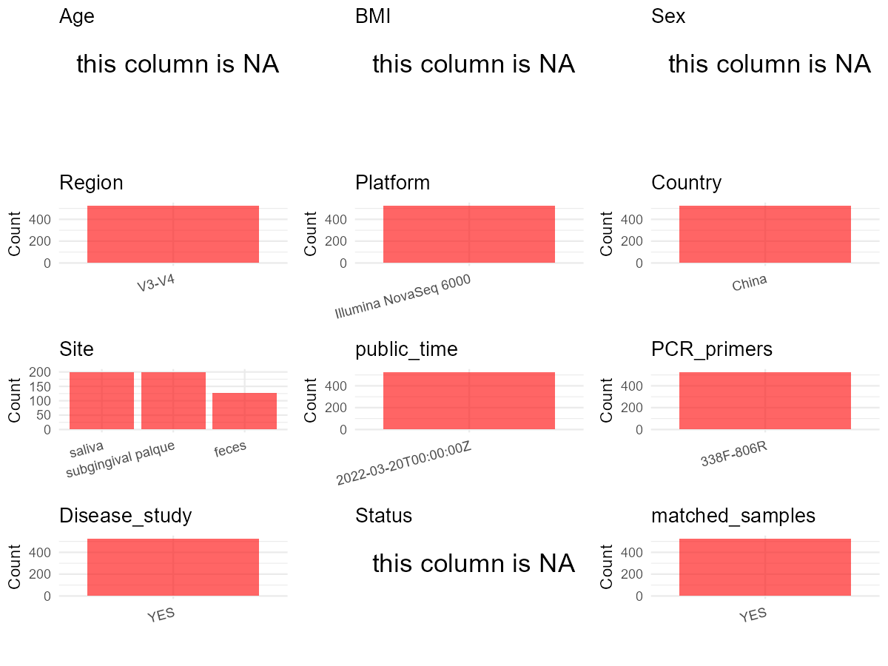

R Notebook: Metadata Processing Workflow
================

# Step 1: Obtain Initial Metadata from Each Project

To obtain the initial metadata: 1. Search for the BioProject ID (e.g.,
“PRJEBXXXX”) on the [NCBI SRA
website](https://www.ncbi.nlm.nih.gov/Traces/study/). 2. In the “Select”
table, click on “Metadata” and download the file. 3. The downloaded file
is typically named “SraRunTable.csv” and contains metadata for the
project.

``` r
# Load necessary libraries
library(dplyr)
library(ggplot2)
library(cowplot)

# Set working directory (update this path to your local directory)
setwd("D:/oral_project/PRJNA764503")

# Read the initial metadata files
initial_meta<-read.csv("SraRunTable.csv",header = T)

# Combine the two metadata files
#meta <- rbind(initial_meta, initial_meta1)

#Remove entries where Organism is "gut metagenome" (non-oral samples)
#initial_meta <- subset(initial_meta,isolation_source!= "feces")

# Check the number of samples containing "HT" in Sample.Name (e.g., healthy controls)
#nrow(subset(meta, grepl("HT", Sample.Name)))

# Display the first few rows of the metadata
head(initial_meta)
```

    ##           Run Assay.Type AvgSpotLen    Bases  BioProject    BioSample
    ## 1 SRR15974348   AMPLICON        494 20680371 PRJNA764503 SAMN21505219
    ## 2 SRR15974349   AMPLICON        494 14550699 PRJNA764503 SAMN21505218
    ## 3 SRR15974350   AMPLICON        481 17725768 PRJNA764503 SAMN21505217
    ## 4 SRR15974351   AMPLICON        494 24959796 PRJNA764503 SAMN21505216
    ## 5 SRR15974352   AMPLICON        494 23485895 PRJNA764503 SAMN21505215
    ## 6 SRR15974353   AMPLICON        494 19814076 PRJNA764503 SAMN21505214
    ##                BioSampleModel    Bytes
    ## 1 Metagenome or environmental 10506984
    ## 2 Metagenome or environmental  7484078
    ## 3 Metagenome or environmental  5477215
    ## 4 Metagenome or environmental 12840182
    ## 5 Metagenome or environmental 11837646
    ## 6 Metagenome or environmental 10067550
    ##                                        Center.Name      Collection_Date Consent
    ## 1 SHANGHAI JIAO TONG UNIVERSITY SCHOOL OF MEDICINE 2020-10-11T13:34:46Z  public
    ## 2 SHANGHAI JIAO TONG UNIVERSITY SCHOOL OF MEDICINE 2020-10-11T13:34:45Z  public
    ## 3 SHANGHAI JIAO TONG UNIVERSITY SCHOOL OF MEDICINE 2020-10-11T13:34:44Z  public
    ## 4 SHANGHAI JIAO TONG UNIVERSITY SCHOOL OF MEDICINE 2020-10-11T13:34:43Z  public
    ## 5 SHANGHAI JIAO TONG UNIVERSITY SCHOOL OF MEDICINE 2020-10-11T13:34:42Z  public
    ## 6 SHANGHAI JIAO TONG UNIVERSITY SCHOOL OF MEDICINE 2020-10-11T13:34:41Z  public
    ##   DATASTORE.filetype DATASTORE.provider                     DATASTORE.region
    ## 1   fastq,run.zq,sra         gs,ncbi,s3 gs.us-east1,ncbi.public,s3.us-east-1
    ## 2   fastq,run.zq,sra         gs,ncbi,s3 gs.us-east1,ncbi.public,s3.us-east-1
    ## 3   fastq,run.zq,sra         gs,ncbi,s3 gs.us-east1,ncbi.public,s3.us-east-1
    ## 4   fastq,run.zq,sra         gs,ncbi,s3 gs.us-east1,ncbi.public,s3.us-east-1
    ## 5   fastq,run.zq,sra         gs,ncbi,s3 gs.us-east1,ncbi.public,s3.us-east-1
    ## 6   fastq,run.zq,sra         gs,ncbi,s3 gs.us-east1,ncbi.public,s3.us-east-1
    ##    Experiment geo_loc_name_country geo_loc_name_country_continent
    ## 1 SRX12263469                China                           Asia
    ## 2 SRX12263468                China                           Asia
    ## 3 SRX12263467                China                           Asia
    ## 4 SRX12263466                China                           Asia
    ## 5 SRX12263465                China                           Asia
    ## 6 SRX12263464                China                           Asia
    ##     geo_loc_name         HOST            Instrument isolation_source
    ## 1 China:Shanghai Homo sapiens Illumina NovaSeq 6000            feces
    ## 2 China:Shanghai Homo sapiens Illumina NovaSeq 6000            feces
    ## 3 China:Shanghai Homo sapiens Illumina NovaSeq 6000            feces
    ## 4 China:Shanghai Homo sapiens Illumina NovaSeq 6000            feces
    ## 5 China:Shanghai Homo sapiens Illumina NovaSeq 6000            feces
    ## 6 China:Shanghai Homo sapiens Illumina NovaSeq 6000            feces
    ##         lat_lon Library.Name LibraryLayout LibrarySelection LibrarySource
    ## 1 not collected     181215F2        PAIRED              PCR       GENOMIC
    ## 2 not collected     181215F1        PAIRED              PCR       GENOMIC
    ## 3 not collected     181201F7        PAIRED              PCR       GENOMIC
    ## 4 not collected     181117F2        PAIRED              PCR       GENOMIC
    ## 5 not collected     181020F2        PAIRED              PCR       GENOMIC
    ## 6 not collected     181013F5        PAIRED              PCR       GENOMIC
    ##               Organism Platform          ReleaseDate          create_date
    ## 1 human gut metagenome ILLUMINA 2022-03-20T00:00:00Z 2021-09-20T14:27:00Z
    ## 2 human gut metagenome ILLUMINA 2022-03-20T00:00:00Z 2021-09-20T14:28:00Z
    ## 3 human gut metagenome ILLUMINA 2022-03-20T00:00:00Z 2021-09-20T14:28:00Z
    ## 4 human gut metagenome ILLUMINA 2022-03-20T00:00:00Z 2021-09-20T14:28:00Z
    ## 5 human gut metagenome ILLUMINA 2022-03-20T00:00:00Z 2021-09-20T14:28:00Z
    ## 6 human gut metagenome ILLUMINA 2022-03-20T00:00:00Z 2021-09-20T14:29:00Z
    ##   version Sample.Name SRA.Study
    ## 1       1    181215F2 SRP337928
    ## 2       1    181215F1 SRP337928
    ## 3       1    181201F7 SRP337928
    ## 4       1    181117F2 SRP337928
    ## 5       1    181020F2 SRP337928
    ## 6       1    181013F5 SRP337928

# Step 2: Create a Uniform Metadata Template

The uniform metadata should include the following columns:

1.  **BioProject**: Project ID (e.g., “PRJNA339212”)
2.  **Run**: Sample ID (e.g., “ERRXXXXXX” or “SRRXXXXXX”)
3.  **sample_name**: Original sample name submitted by the authors (not
    the database-assigned ID)
4.  **Age**: Age of the subject (if available)
5.  **BMI**: Body Mass Index (if available)
6.  **Sex**: Sex of the subject (“F” or “M”)
7.  **Region**: Targeted 16S rRNA region (e.g., “V3-V4”)
8.  **Platform**: Sequencing platform (e.g., “Illumina MiSeq”)
9.  **Country**: Country of sample origin (e.g., “China”)
10. **Site**: Sample site (e.g., “saliva”, “dental plaque”)
11. **public_time**: Data release date (format: “YYYY-MM-DD”)
12. **PCR_primers**: PCR primers used (e.g., “515F-806R”)
13. **title**: Title of the associated publication
14. **Disease_study**: Whether the study involves a disease (“YES” or
    “NO”)
15. **Status**: Disease status (e.g., “T2DM”, “HC”). Note: If the study
    includes both disease and healthy samples, this must be specified
    per sample.

``` r
# Create a uniform metadata dataframe
metadata <- data.frame(
  BioProject = initial_meta$BioProject,
  Run = initial_meta$Run,
  sample_name = initial_meta$Sample.Name,
  Age = NA,
  BMI = NA,
  Sex=NA,
  Region = "V3-V4",
  Platform = initial_meta$Instrument,
  Country = initial_meta$geo_loc_name_country,
  Site = initial_meta$isolation_source,
  public_time = initial_meta$ReleaseDate,
  stringsAsFactors = FALSE
)
```

# Step 3: Manually Add Information from the Publication

Some information (e.g. PCR primers, study title, disease status) must be
manually extracted from the publication and added to the metadata.

``` r
# Add information obtained from the publication
metadata$PCR_primers <- "338F-806R"
metadata$title <- "Integrated Omic Analysis of Human Plasma Metabolites and Microbiota in a Hypertension Cohort"
#metadata<-subset(uniform_meta,Site!="feces")
metadata$Disease_study <- "YES"
# Assign disease status based on sample_name patterns
metadata$Status <- NA
#extract subject id by remove prefix of sample_name
metadata$sample_name <- gsub("[FSP].*", "", metadata$sample_name)
#get subjects id with Saliva available
keep_subjects<-subset(metadata,Site %in% c("saliva","subginigival palque"))
#remove subjects without Saliva samples
metadata<-subset(metadata,sample_name %in% keep_subjects$sample_name)
#get subjects sampling counts
sample_counts <- table(metadata$sample_name)
# Create matched_samples column, any subjects have >=2 samples will be label "YES", otherwise "NO"
metadata$matched_samples <- ifelse(metadata$sample_name %in% names(sample_counts[sample_counts >= 2]), "YES", "NO")
```

# Step 4: Summarize and Validate the Metadata

``` r
# Check the number of unique runs and sample names
print(paste("Number of unique runs:", length(unique(metadata$Run))))
```

    ## [1] "Number of unique runs: 527"

``` r
print(paste("Number of unique sample names:", length(unique(metadata$sample_name))))
```

    ## [1] "Number of unique sample names: 61"

# Step 5: Visualize the Metadata

``` r

```


# Step 6: Finalize and Export the Metadata

``` r
# Reorder columns to match the desired format
metadata <- metadata[, c(
  "BioProject", "Run", "sample_name", "Age", "BMI", "Sex", 
  "Region", "Platform", "Country", "Site", "public_time", 
  "PCR_primers", "title", "Disease_study", "Status","matched_samples"
)]

# Export the uniform metadata to a CSV file
write.csv(metadata, file = "metadata.csv", quote = FALSE)
head(metadata)
```

    ##    BioProject         Run sample_name Age BMI Sex Region              Platform
    ## 1 PRJNA764503 SRR15974348      181215  NA  NA  NA  V3-V4 Illumina NovaSeq 6000
    ## 2 PRJNA764503 SRR15974349      181215  NA  NA  NA  V3-V4 Illumina NovaSeq 6000
    ## 3 PRJNA764503 SRR15974350      181201  NA  NA  NA  V3-V4 Illumina NovaSeq 6000
    ## 4 PRJNA764503 SRR15974351      181117  NA  NA  NA  V3-V4 Illumina NovaSeq 6000
    ## 5 PRJNA764503 SRR15974352      181020  NA  NA  NA  V3-V4 Illumina NovaSeq 6000
    ## 6 PRJNA764503 SRR15974353      181013  NA  NA  NA  V3-V4 Illumina NovaSeq 6000
    ##   Country  Site          public_time PCR_primers
    ## 1   China feces 2022-03-20T00:00:00Z   338F-806R
    ## 2   China feces 2022-03-20T00:00:00Z   338F-806R
    ## 3   China feces 2022-03-20T00:00:00Z   338F-806R
    ## 4   China feces 2022-03-20T00:00:00Z   338F-806R
    ## 5   China feces 2022-03-20T00:00:00Z   338F-806R
    ## 6   China feces 2022-03-20T00:00:00Z   338F-806R
    ##                                                                                          title
    ## 1 Integrated Omic Analysis of Human Plasma Metabolites and Microbiota in a Hypertension Cohort
    ## 2 Integrated Omic Analysis of Human Plasma Metabolites and Microbiota in a Hypertension Cohort
    ## 3 Integrated Omic Analysis of Human Plasma Metabolites and Microbiota in a Hypertension Cohort
    ## 4 Integrated Omic Analysis of Human Plasma Metabolites and Microbiota in a Hypertension Cohort
    ## 5 Integrated Omic Analysis of Human Plasma Metabolites and Microbiota in a Hypertension Cohort
    ## 6 Integrated Omic Analysis of Human Plasma Metabolites and Microbiota in a Hypertension Cohort
    ##   Disease_study Status matched_samples
    ## 1           YES     NA             YES
    ## 2           YES     NA             YES
    ## 3           YES     NA             YES
    ## 4           YES     NA             YES
    ## 5           YES     NA             YES
    ## 6           YES     NA             YES

## Notes for Students:

1.  **Metadata Accuracy**: Always cross-check the metadata with the
    original publication to ensure accuracy.
2.  **Manual Entries**: Columns like `PCR_primers`, and `Status` often
    require manual entry based on the publication.
3.  **Disease Status**: Be careful when assigning `Status`—some studies
    include both disease and healthy samples.
4.  **Visualization**: The plots help quickly identify the distribution
    of values in each column, which is useful for quality control.
5.  **Reproducibility**: Update the working directory and file paths to
    match your local environment.
