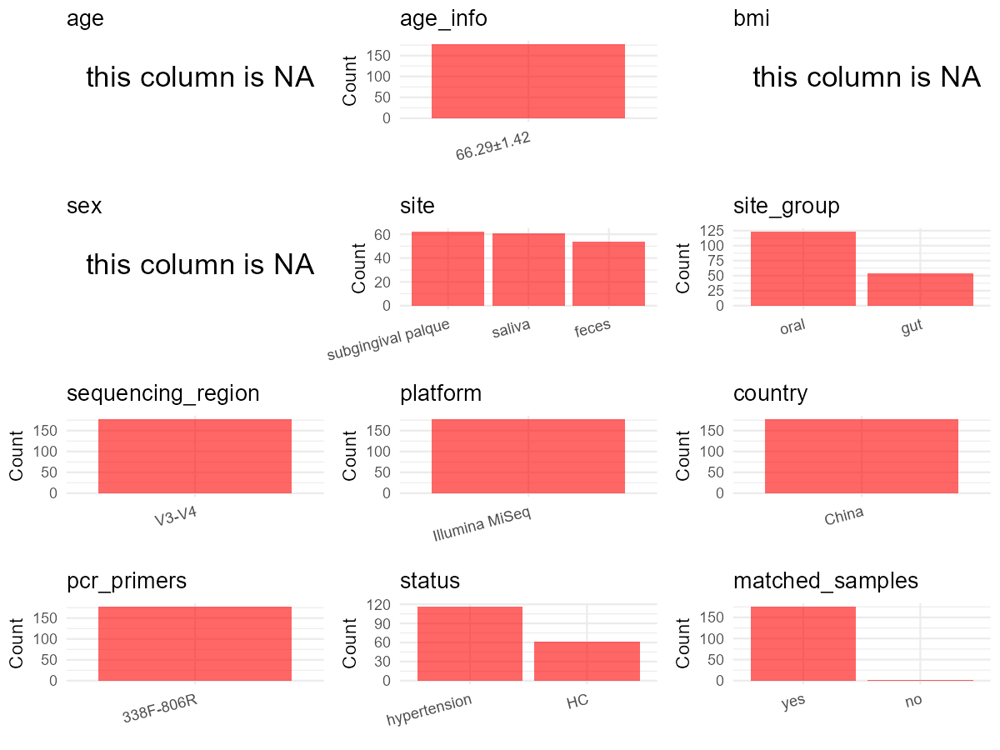

R Notebook: Metadata Processing Workflow
================

# Step 1: Obtain Initial Metadata from Each Project

This step sets the project directory, loads the raw SRA metadata, and
optionally merges supplement tables.

``` r
# Load libraries
library(dplyr)
library(ggplot2)
library(cowplot)

# (1) Setting working directory
# EDIT HERE: change project_id for each study
project_id <- "PRJNA764503" 

base_dir <- "E:/oral/26/metadata-2604/Oral-Metadata-YL-02"
setwd(file.path(base_dir, project_id))

# (2) Loading raw SRA metadata file
sra_file <- "SraRunTable.csv"
initial_meta <- read.csv(sra_file, header = TRUE)

# (3) OPTIONAL: If extra metadata (e.g., Table.x or supplemental materials) are available from the article, you may need to merge the file with initial_meta manually. Below is example code for merging. Depending on the specific case of each study, you can customize the code as needed.
# supp_table <- read.csv("supplemental_table.csv", header = TRUE)
# initial_meta <- left_join(initial_meta, supp_table, by = merge_col_name)
```

# Step 2: Data Overview

First, you need to get an overview of the data, which includes two
steps: reading the article and reading the initial metadata. This step
is very IMPORTANT!

``` r
# (1) Read the article in the following order: abstract, the beginning of the results section, and the methods. Understand the sample size, experimental design, and disease group overview. Clarify the sampling sites; for oral and gut samples, specify the exact sites like supragingival plaque, tongue, etc.

# (2) IMPORTANT: MUST go through each column of initial_meta
head(initial_meta, 10)
```

    ##            Run Assay.Type AvgSpotLen    Bases  BioProject    BioSample
    ## 1  SRR15974348   AMPLICON        494 20680371 PRJNA764503 SAMN21505219
    ## 2  SRR15974349   AMPLICON        494 14550699 PRJNA764503 SAMN21505218
    ## 3  SRR15974350   AMPLICON        481 17725768 PRJNA764503 SAMN21505217
    ## 4  SRR15974351   AMPLICON        494 24959796 PRJNA764503 SAMN21505216
    ## 5  SRR15974352   AMPLICON        494 23485895 PRJNA764503 SAMN21505215
    ## 6  SRR15974353   AMPLICON        494 19814076 PRJNA764503 SAMN21505214
    ## 7  SRR15974354   AMPLICON        494 17775987 PRJNA764503 SAMN21505213
    ## 8  SRR15974355   AMPLICON        494 55638232 PRJNA764503 SAMN21505212
    ## 9  SRR15974356   AMPLICON        492 66432300 PRJNA764503 SAMN21505211
    ## 10 SRR15974357   AMPLICON        495 57234375 PRJNA764503 SAMN21504824
    ##                 BioSampleModel    Bytes
    ## 1  Metagenome or environmental 10506984
    ## 2  Metagenome or environmental  7484078
    ## 3  Metagenome or environmental  5477215
    ## 4  Metagenome or environmental 12840182
    ## 5  Metagenome or environmental 11837646
    ## 6  Metagenome or environmental 10067550
    ## 7  Metagenome or environmental  9026062
    ## 8  Metagenome or environmental 17644984
    ## 9  Metagenome or environmental 21410004
    ## 10 Metagenome or environmental 18245781
    ##                                         Center.Name      Collection_Date
    ## 1  SHANGHAI JIAO TONG UNIVERSITY SCHOOL OF MEDICINE 2020-10-11T13:34:46Z
    ## 2  SHANGHAI JIAO TONG UNIVERSITY SCHOOL OF MEDICINE 2020-10-11T13:34:45Z
    ## 3  SHANGHAI JIAO TONG UNIVERSITY SCHOOL OF MEDICINE 2020-10-11T13:34:44Z
    ## 4  SHANGHAI JIAO TONG UNIVERSITY SCHOOL OF MEDICINE 2020-10-11T13:34:43Z
    ## 5  SHANGHAI JIAO TONG UNIVERSITY SCHOOL OF MEDICINE 2020-10-11T13:34:42Z
    ## 6  SHANGHAI JIAO TONG UNIVERSITY SCHOOL OF MEDICINE 2020-10-11T13:34:41Z
    ## 7  SHANGHAI JIAO TONG UNIVERSITY SCHOOL OF MEDICINE 2020-10-11T13:34:40Z
    ## 8  SHANGHAI JIAO TONG UNIVERSITY SCHOOL OF MEDICINE 2020-10-11T13:34:39Z
    ## 9  SHANGHAI JIAO TONG UNIVERSITY SCHOOL OF MEDICINE 2020-10-11T13:34:38Z
    ## 10 SHANGHAI JIAO TONG UNIVERSITY SCHOOL OF MEDICINE 2020-10-11T17:53:46Z
    ##    Consent DATASTORE.filetype DATASTORE.provider
    ## 1   public   fastq,run.zq,sra         gs,ncbi,s3
    ## 2   public   fastq,run.zq,sra         gs,ncbi,s3
    ## 3   public   fastq,run.zq,sra         gs,ncbi,s3
    ## 4   public   fastq,run.zq,sra         gs,ncbi,s3
    ## 5   public   fastq,run.zq,sra         gs,ncbi,s3
    ## 6   public   fastq,run.zq,sra         gs,ncbi,s3
    ## 7   public   fastq,run.zq,sra         gs,ncbi,s3
    ## 8   public   fastq,run.zq,sra         gs,ncbi,s3
    ## 9   public   fastq,run.zq,sra         gs,ncbi,s3
    ## 10  public   fastq,run.zq,sra         gs,ncbi,s3
    ##                        DATASTORE.region  Experiment geo_loc_name_country
    ## 1  gs.us-east1,ncbi.public,s3.us-east-1 SRX12263469                China
    ## 2  gs.us-east1,ncbi.public,s3.us-east-1 SRX12263468                China
    ## 3  gs.us-east1,ncbi.public,s3.us-east-1 SRX12263467                China
    ## 4  gs.us-east1,ncbi.public,s3.us-east-1 SRX12263466                China
    ## 5  gs.us-east1,ncbi.public,s3.us-east-1 SRX12263465                China
    ## 6  gs.us-east1,ncbi.public,s3.us-east-1 SRX12263464                China
    ## 7  gs.us-east1,ncbi.public,s3.us-east-1 SRX12263463                China
    ## 8  gs.us-east1,ncbi.public,s3.us-east-1 SRX12263462                China
    ## 9  gs.us-east1,ncbi.public,s3.us-east-1 SRX12263461                China
    ## 10 gs.us-east1,ncbi.public,s3.us-east-1 SRX12263460                China
    ##    geo_loc_name_country_continent   geo_loc_name         HOST
    ## 1                            Asia China:Shanghai Homo sapiens
    ## 2                            Asia China:Shanghai Homo sapiens
    ## 3                            Asia China:Shanghai Homo sapiens
    ## 4                            Asia China:Shanghai Homo sapiens
    ## 5                            Asia China:Shanghai Homo sapiens
    ## 6                            Asia China:Shanghai Homo sapiens
    ## 7                            Asia China:Shanghai Homo sapiens
    ## 8                            Asia China:Shanghai Homo sapiens
    ## 9                            Asia China:Shanghai Homo sapiens
    ## 10                           Asia China:Shanghai Homo sapiens
    ##               Instrument isolation_source       lat_lon Library.Name
    ## 1  Illumina NovaSeq 6000            feces not collected     181215F2
    ## 2  Illumina NovaSeq 6000            feces not collected     181215F1
    ## 3  Illumina NovaSeq 6000            feces not collected     181201F7
    ## 4  Illumina NovaSeq 6000            feces not collected     181117F2
    ## 5  Illumina NovaSeq 6000            feces not collected     181020F2
    ## 6  Illumina NovaSeq 6000            feces not collected     181013F5
    ## 7  Illumina NovaSeq 6000            feces not collected     181013F4
    ## 8  Illumina NovaSeq 6000            feces not collected     191102F1
    ## 9  Illumina NovaSeq 6000            feces not collected     191012F1
    ## 10 Illumina NovaSeq 6000           saliva not collected    1907127S3
    ##    LibraryLayout LibrarySelection LibrarySource              Organism Platform
    ## 1         PAIRED              PCR       GENOMIC  human gut metagenome ILLUMINA
    ## 2         PAIRED              PCR       GENOMIC  human gut metagenome ILLUMINA
    ## 3         PAIRED              PCR       GENOMIC  human gut metagenome ILLUMINA
    ## 4         PAIRED              PCR       GENOMIC  human gut metagenome ILLUMINA
    ## 5         PAIRED              PCR       GENOMIC  human gut metagenome ILLUMINA
    ## 6         PAIRED              PCR       GENOMIC  human gut metagenome ILLUMINA
    ## 7         PAIRED              PCR       GENOMIC  human gut metagenome ILLUMINA
    ## 8         PAIRED              PCR       GENOMIC  human gut metagenome ILLUMINA
    ## 9         PAIRED              PCR       GENOMIC  human gut metagenome ILLUMINA
    ## 10        PAIRED              PCR       GENOMIC human oral metagenome ILLUMINA
    ##             ReleaseDate          create_date version Sample.Name SRA.Study
    ## 1  2022-03-20T00:00:00Z 2021-09-20T14:27:00Z       1    181215F2 SRP337928
    ## 2  2022-03-20T00:00:00Z 2021-09-20T14:28:00Z       1    181215F1 SRP337928
    ## 3  2022-03-20T00:00:00Z 2021-09-20T14:28:00Z       1    181201F7 SRP337928
    ## 4  2022-03-20T00:00:00Z 2021-09-20T14:28:00Z       1    181117F2 SRP337928
    ## 5  2022-03-20T00:00:00Z 2021-09-20T14:28:00Z       1    181020F2 SRP337928
    ## 6  2022-03-20T00:00:00Z 2021-09-20T14:29:00Z       1    181013F5 SRP337928
    ## 7  2022-03-20T00:00:00Z 2021-09-20T14:29:00Z       1    181013F4 SRP337928
    ## 8  2022-03-20T00:00:00Z 2021-09-20T14:29:00Z       1    191102F1 SRP337928
    ## 9  2022-03-20T00:00:00Z 2021-09-20T14:29:00Z       1    191012F1 SRP337928
    ## 10 2022-03-20T00:00:00Z 2021-09-20T14:29:00Z       1   1907127S3 SRP337928

``` r
# IMPORTANT: Check the unique values in the column of interest or query column.
lapply(initial_meta[c('isolation_source')], table) # site
```

    ## $isolation_source
    ## 
    ##              feces             saliva subgingival palque 
    ##                138                200                200

``` r
lapply(initial_meta[c('HOST', 'Organism')], table) # organism
```

    ## $HOST
    ## 
    ## Homo sapiens 
    ##          538 
    ## 
    ## $Organism
    ## 
    ##  human gut metagenome human oral metagenome 
    ##                   138                   400

``` r
table(initial_meta$Sample.Name) # subject id
```

    ## 
    ##  181013F4  181013F5 181013P10  181013P2  181013P4  181013P5 181013P5X  181013P6 
    ##         1         1         1         1         1         1         1         1 
    ##  181013P7  181013P8  181013P9 181013S10  181013S2  181013S3  181013S4  181013S5 
    ##         1         1         1         1         1         1         1         1 
    ##  181013S6  181013S7  181013S8  181013S9  181020F2  181020P1  181020P2  181020P3 
    ##         1         1         1         1         1         1         1         1 
    ##  181020P4  181020P5  181020S1  181020S2  181020S3  181020S4  181020S5  181027P1 
    ##         1         1         1         1         1         1         1         1 
    ##  181027S1  181103P2  181103P3  181103P5  181103S2  181103S3  181103S5  181110P1 
    ##         1         1         1         1         1         1         1         1 
    ##  181110P2  181110P3  181110P4  181110S1  181110S2  181110S3  181110S4  181117F2 
    ##         1         1         1         1         1         1         1         1 
    ##  181117P1  181117P2  181117P3  181117S1  181117S2  181117S3  181124P1  181124P3 
    ##         1         1         1         1         1         1         1         1 
    ##  181124P4  181124S1  181124S3  181124S4  181201F5  181201F7  181201F8  181201P1 
    ##         1         1         1         1         1         1         1         1 
    ##  181201P3  181201P4  181201P5  181201P7  181201P8  181201S1  181201S3  181201S4 
    ##         1         1         1         1         1         1         1         1 
    ##  181201S5  181201S7  181201S8  181208F1  181208F2  181208F3  181208F4  181208P1 
    ##         1         1         1         1         1         1         1         1 
    ##  181208P2  181208P3  181208P4  181208S1  181208S2  181208S3  181208S4  181215F1 
    ##         1         1         1         1         1         1         1         1 
    ##  181215F2  181215F3  181215F4  181215P1  181215P2  181215P3  181215P4  181215S1 
    ##         1         1         1         1         1         1         1         1 
    ##  181215S2  181215S3  181215S4 181222-F1 181222-F2 181222-F3 181222-F4 181222-F5 
    ##         1         1         1         1         1         1         1         1 
    ## 181222-F6  181222F7  181222P1  181222P2  181222P3  181222P4  181222P5  181222P6 
    ##         1         1         1         1         1         1         1         1 
    ##  181222P7  181222S1  181222S2  181222S3  181222S4  181222S5  181222S6  181222S7 
    ##         1         1         1         1         1         1         1         1 
    ##  190105F1  190105F2  190105F3  190105F5  190105F7  190105F8  190105F9  190105P1 
    ##         1         1         1         1         1         1         1         1 
    ##  190105P2  190105P3  190105P4  190105P5  190105P8  190105P9  190105S1  190105S2 
    ##         1         1         1         1         1         1         1         1 
    ##  190105S3  190105S4  190105S5  190105S7  190105S8  190105S9  190112F2  190112F3 
    ##         1         1         1         1         1         1         1         1 
    ##  190112P1  190112P2  190112P3  190112P4  190112S1  190112S2  190112S3  190112S4 
    ##         1         1         1         1         1         1         1         1 
    ##  190126F1  190126P1  190126S1  190216F1  190216F2  190216F3  190216F4  190216F5 
    ##         1         1         1         1         1         1         1         1 
    ##  190216P1  190216P2  190216P3  190216P4  190216P5  190216S1  190216S2  190216S3 
    ##         1         1         1         1         1         1         1         1 
    ##  190216S4  190216S5  190223F2  190223P2  190223S2  190302F4  190302F5  190302F6 
    ##         1         1         1         1         1         1         1         1 
    ##  190302P1  190302P2  190302P3  190302P4  190302P5  190302P6  190302S1  190302S2 
    ##         1         1         1         1         1         1         1         1 
    ##  190302S3  190302S4  190302S5  190302S6  190306P6  190306S6  190309F1  190309F3 
    ##         1         1         1         1         1         1         1         1 
    ##  190309P1  190309P2  190309P3  190309P4  190309P5  190309S1  190309S2  190309S3 
    ##         1         1         1         1         1         1         1         1 
    ##  190309S4  190309S5  190316F1  190316F3  190316P1  190316P2  190316P3  190316S1 
    ##         1         1         1         1         1         1         1         1 
    ##  190316S2  190316S3  190316S4  190323F1  190323S1  190412F1  190413F1  190413P1 
    ##         1         1         1         1         1         1         1         1 
    ##  190413P2  190413S1  190413S2  190420F1  190420P1  190420S1  190427F1  190427F2 
    ##         1         1         1         1         1         1         1         1 
    ##  190427F3  190427P1  190427P2  190427P3  190427P4  190427P5  190427S1  190427S2 
    ##         1         1         1         1         1         1         1         1 
    ##  190427S3  190427S4  190427S5  190511F1  190511P1  190511S1  190525F1  190525P1 
    ##         1         1         1         1         1         1         1         1 
    ##  190525S1  190601F1  190601P1  190601S1  190615F1  190615F2  190615P1  190615P2 
    ##         1         1         1         1         1         1         1         1 
    ##  190615P3  190615P4  190615S1  190615S2  190615S3  190615S4  190629F3  190629P2 
    ##         1         1         1         1         1         1         1         1 
    ##  190629P3  190629S2  190629S3  190706P1  190706P3  190706S1  190706S3 1907127P1 
    ##         1         1         1         1         1         1         1         1 
    ## 1907127P3 1907127P4 1907127P5 1907127S1 1907127S3 1907127S4 1907127S5  190713F1 
    ##         1         1         1         1         1         1         1         1 
    ##  190713F2  190713P1  190713P2  190713P3  190713S1  190713S2  190713S3  190727F1 
    ##         1         1         1         1         1         1         1         1 
    ##  190727F5  190803F2  190803F3  190803F4  190803F6  190803F8  190803P1  190803P2 
    ##         1         1         1         1         1         1         1         1 
    ##  190803P3  190803P4  190803P5  190803P6  190803P8  190803S1  190803S2  190803S3 
    ##         1         1         1         1         1         1         1         1 
    ##  190803S4  190803S5  190803S6  190803S8  190810F1  190810F2  190810P1  190810P2 
    ##         1         1         1         1         1         1         1         1 
    ##  190810S1  190810S2  190824F2  190824P1  190824P2  190824S1  190824S2  190831F1 
    ##         1         1         1         1         1         1         1         1 
    ##  190831F3  190831P1  190831P2  190831P3  190831S1  190831S2  190831S3  190928F2 
    ##         1         1         1         1         1         1         1         1 
    ##  190928P1  190928P2  190928S1  190928S2  191012F1  191012P1  191012S1  191026F1 
    ##         1         1         1         1         1         1         1         1 
    ##  191026P1  191026S1  191102F1  191102P1  191102S1   19110P1   19110P2   19110P3 
    ##         1         1         1         1         1         1         1         1 
    ##   19110S1   19110S2   19110S3  X00104F1  X00104F2  X00104F3  X00104P1  X00104P2 
    ##         1         1         1         1         1         1         1         1 
    ##  X00104P3  X00104S1  X00104S2  X00104S3  X00111P2  X00111P3  X00111S1  X00111S2 
    ##         1         1         1         1         1         1         1         1 
    ##  X00411F1  X00411F2  X00411F3  X00411P1  X00411P2  X00411P3  X00411S1  X00411S2 
    ##         1         1         1         1         1         1         1         1 
    ##  X00411S3  X00418F2  X00418F3  X00418P1  X00418P2  X00418P3  X00418P4  X00418S1 
    ##         1         1         1         1         1         1         1         1 
    ##  X00418S2  X00418S3  X00418S4  X00425F1  X00425F2  X00425F3  X00425P1  X00425P2 
    ##         1         1         1         1         1         1         1         1 
    ##  X00425P3  X00425S1  X00425S2  X00425S3  X00509P1  X00509S1  X00516F1  X00516P1 
    ##         1         1         1         1         1         1         1         1 
    ##  X00516S1  X90518F1  X90518F2  X90518F3  X90518P1  X90518P2  X90518P3  X90518S1 
    ##         1         1         1         1         1         1         1         1 
    ##  X90518S2  X90518S3  X90622F1  X90622F2  X90622F3  X90622F4  X90622F5  X90622F6 
    ##         1         1         1         1         1         1         1         1 
    ##  X90622F7  X90622F8  X90622P1  X90622P2  X90622P3  X90622P4  X90622P5  X90622P6 
    ##         1         1         1         1         1         1         1         1 
    ##  X90622P7  X90622P8  X90622S1  X90622S2  X90622S3  X90622S4  X90622S5  X90622S6 
    ##         1         1         1         1         1         1         1         1 
    ##  X90622S8  X90629F2  X90629F4  X90629F5  X90629F6  X90629P1  X90629P2  X90629P4 
    ##         1         1         1         1         1         1         1         1 
    ##  X90629P5  X90629P6  X90629S1  X90629S2  X90629S4  X90629S5  X90629S6  X90706F2 
    ##         1         1         1         1         1         1         1         1 
    ##  X90706F6  X90706F7  X90706P2  X90706P6  X90706P7  X90706S2  X90706S6  X90706S7 
    ##         1         1         1         1         1         1         1         1 
    ##  X90720F1  X90720F2  X90720F3  X90720P1  X90720P2  X90720P3  X90720P4  X90720S1 
    ##         1         1         1         1         1         1         1         1 
    ##  X90720S2  X90720S3  X90720S4  X90824F1  X90824F2  X90824F4  X90824F5  X90824F6 
    ##         1         1         1         1         1         1         1         1 
    ##  X90824F7  X90824F8  X90824P1  X90824P2  X90824P4  X90824P5  X90824P6  X90824P7 
    ##         1         1         1         1         1         1         1         1 
    ##  X90824P8  X90824S1  X90824S2  X90824S4  X90824S5  X90824S6  X90824S7  X90824S8 
    ##         1         1         1         1         1         1         1         1 
    ##  X90831F1  X90831F2  X90831P1  X90831P2  X90831S1  X90831S2  X90921F1  X90921F3 
    ##         1         1         1         1         1         1         1         1 
    ##  X90921F4  X90921F5  X90921P1  X90921P3  X90921P4  X90921P5  X90921S1  X90921S3 
    ##         1         1         1         1         1         1         1         1 
    ##  X90921S4  X90921S5  X90928F2  X90928F3  X90928P2  X90928P3  X90928S2  X90928S3 
    ##         1         1         1         1         1         1         1         1 
    ##  X91012F1  X91012F2  X91012F3  X91012F4  X91012F5  X91012F6  X91012P1  X91012P2 
    ##         1         1         1         1         1         1         1         1 
    ##  X91012P3  X91012P4  X91012P5  X91012P6  X91012S1  X91012S2  X91012S3  X91012S4 
    ##         1         1         1         1         1         1         1         1 
    ##  X91012S5  X91012S6  X91026F1  X91026F2  X91026P1  X91026P2  X91026S1  X91026S2 
    ##         1         1         1         1         1         1         1         1 
    ##  X91116F1  X91116F2  X91116P1  X91116P2  X91116S1  X91116S2  X91214F1  X91214F2 
    ##         1         1         1         1         1         1         1         1 
    ##  X91214P1  X91214P2  X91214S1  X91214S2  X91221F1  X91221F2  X91221P1  X91221P2 
    ##         1         1         1         1         1         1         1         1 
    ##  X91221S1  X91221S2 
    ##         1         1

``` r
#table(initial_meta$sequencing_meth..exp.) # output is Sequencing by synthesis
table(initial_meta$Platform) # output is Illumina. according to the methods,  Illumina is correct.
```

    ## 
    ## ILLUMINA 
    ##      538

``` r
#table(initial_meta$target_subfragment..exp.)
```

# Step 3: Removing Control and Non-human Samples

First, we need to remove control samples(including both negative
controls and positive controls) and non-human samples.

``` r
# (1) EDIT HERE: Parameter setup
control_column <- "" # column name in initial_meta
# unique(initial_meta[[control_column]])
control_keywords <- c() # Enter exact keywords

species_column <- "" # column name in initial_meta
unique(initial_meta[[species_column]])
```

    ## NULL

``` r
non_human_keywords <- c() # Enter exact keywords

# (2) Remove controls and non-human samples. DO NOT need to modify code in this part, just run it.
n_samples <- nrow(initial_meta)
# Control evaluation
if (length(control_keywords) > 0) {
  if (is.null(control_column) || control_column == "") {
    stop("Error: control_keywords provided but control_column is missing.")
  }
  
  if (!(control_column %in% colnames(initial_meta))) {
    stop(sprintf("Error: Column '%s' not found in initial_meta.", control_column))
  }
  
  control_pattern <- paste(control_keywords, collapse = "|")
  control_text <- initial_meta[[control_column]]
  is_control <- grepl(control_pattern, control_text)
  
} else {
  is_control <- rep(FALSE, n_samples)
}

# Non-human evaluation
if (length(non_human_keywords) > 0) {
  if (is.null(species_column) || species_column == "") {
    stop("Error: non_human_keywords provided but species_column is missing.")
  }
  
  if (!(species_column %in% colnames(initial_meta))) {
    stop(sprintf("Error: Column '%s' not found in initial_meta.", species_column))
  }
  
  non_human_pattern <- paste(non_human_keywords, collapse = "|")
  species_text <- initial_meta[[species_column]]
  is_non_human <- grepl(non_human_pattern, species_text)
} else {
  is_non_human <- rep(FALSE, n_samples)
}

# Execute removal
samples_to_remove <- is_control | is_non_human
initial_meta <- initial_meta[!samples_to_remove, ]

cat("Initial samples counts:",n_samples,"\n")
```

    ## Initial samples counts: 538

``` r
cat("Removed control samples:", sum(is_control), "\n")
```

    ## Removed control samples: 0

``` r
cat("Removed non-human samples:", sum(is_non_human), "\n")
```

    ## Removed non-human samples: 0

``` r
cat("Total samples removed ", sum(samples_to_remove), "\n")
```

    ## Total samples removed  0

``` r
cat("Remaining samples after Step 2:", nrow(initial_meta), "\n")
```

    ## Remaining samples after Step 2: 538

# Step 4: Creating a Uniform Metadata Template

This step converts the raw SRA table into the standard metadata format
used in our meta-analysis. The uniform metadata should include the
following columns: 1. **bioproject**: Project ID from SRA or other
database e.g. `PRJNA1234`, `CNP1234`, ‘OEP1234’, ‘qiita_1234’ 2.
**sample_id**: SRA sample/run ID. Unique id for each sample!
e.g. `DRR1234567`, `ERR1234567` and `SRR1234567`. If no such column
exists, can use column like sample_name. 3. **subject_id**: subject id
for each person if available. e.g. `patient_01`, `Host_03_before`,
`subject12` 4. **age**: Age of the subject if available. e.g. `35`, `42`
\| not `adult`, `chilren` 5. **age_info**: If the age is not explicitly
stated but approximate age range information is available, mark it in
this column. e.g., `18-55`, `children`, `infant`, `elder` 6. **bmi**:
Body Mass Index if available. e.g. `22.5`, `18.9` \| not `normal`,
`overweight` 7. **sex**: Sex of the subject. Mandatory to write as M/F
\| not `female`, `woman` 8. **sequencing_region**: Targeted 16S rRNA
region. e.g. `V3-V4`, `V4` 9. **platform**: Sequencing platform.
e.g. `Illumina MiSeq`, `454 GS FLX Titanium`, `Ion Torrent` 10.
**country**: Country of sample origin. e.g. `China`, `Japan` \| not city
name like `Beijing` 11. **site**: Sampling site. For oral and gut sites,
specify the exact sites as detailed as possible. For example, if it is
known to be supragingival plaque, do not record it as ‘dental plaque’,
unless the original text provides only a vague description.
e.g. `saliva`, `tongue coating` \| not broad term like `oral` 12.
**site_group**: only accepts one of following three values: ‘oral’,
‘gut’, or ‘other’. 13. **public_time**: Data release date.
e.g. `2021-06-22` \| not `June 2021` 14. **pcr_primers**: PCR primers
used. e.g. `515F-806R`, `27F-338R` \| not primer sequences 15.
**title**: Title of the associated publication. 16. **disease_study**:
Whether the study involves disease samples. If it’s not clear, can
record as NA. Only three values accepted: ‘yes’, ‘no’ or NA 17.
**status**: Disease status for each sample if available, else record as
NA. Only accept following abbreviations, Write full names for all other
diseases. HC: healthy control CD: Crohn’s disease CRC: colorectal cancer
COPD: chronic obstructive pulmonary disease HIV: human immunodeficiency
virus ICU: intensive care unit OSCC: oral squamous cell carcinoma RA:
rheumatoid arthritis UC: ulcerative colitis 18. **matched_samples**:
Whether the subject has matched samples. Only accept ‘yes’ or ‘no’. 19.
**is_time_series**: Whether the study is a time series study. Only
accept ‘yes’ or ‘no’.

``` r
# Extract columns from initial_meta as follows: (1) No modification needed → extract directly. (2) Modification needed → create a new column with the prefix raw_ and mark the original column as “pending”. (3) Need to find or determine based on the article.
metadata <- data.frame(
  bioproject = initial_meta$BioProject,
  sample_id = initial_meta$Run,
  raw_subject_id = initial_meta$Sample.Name,
  subject_id = "pending", # modify later
  age = NA,
  age_info = "66.29±1.42", # extract from Table 1: No HTN
  bmi = NA,
  sex = NA,
  sequencing_region = "V3-V4", # extract from methods section
  platform = "Illumina MiSeq", # extract from methods section, NOT initial_meta
  country = initial_meta$geo_loc_name_country,
  site = initial_meta$isolation_source, 
  site_group = "pending", # modify later
  public_time = initial_meta$ReleaseDate,
  pcr_primers = "338F-806R", # Format: xxF-xxR
  title = "Integrated omic analysis of human plasma metabolites and microbiota in a hypertension cohort", # extract from article
  disease_study = "yes", # determine according to the article
  raw_status = initial_meta$Sample.Name,
  status = "pending", # modify later 
  matched_samples = "pending", # modify later
  is_time_series = "no", 
  stringsAsFactors = FALSE
)
metadata$public_time <- as.Date(metadata$public_time)
```

# Step 5: Manually solving pending issues

This step involves two parts: (1) handle the columns with the `raw_`
prefix, and next (2) handle the `site_group` and `matched_samples`
columns.

``` r
# (1) Handle the columns with the `raw_` prefix.
# In this part, you need to customize the code based on the situation of the raw_ columns to obtain the content of the target columns. IMPORTANT: Add comments if the modification is not straightforward!!
# Standardize raw_subject_id: replace hyphens in 181222-F* with no separator
metadata$raw_subject_id <- gsub("^181222-F", "181222F", metadata$raw_subject_id)

# Generate subject_id by removing trailing letters/numbers
metadata$subject_id <- gsub("[A-Za-z]+[0-9]*$", "", metadata$raw_subject_id)

# Remove the specific value 181013P5X
metadata <- metadata[metadata$raw_subject_id != "181013P5X", ]

# Extract sample identifiers
metadata$sample_code <- gsub("^[0-9]+", "", metadata$raw_subject_id)
metadata$site_letter <- gsub("[0-9]", "", metadata$sample_code)
metadata$site_number <- as.numeric(gsub("[A-Za-z]", "", metadata$sample_code))

# Deduplicate: keep the site_number group with the most diverse site_letters per subject_id
metadata <- metadata %>%
  group_by(subject_id, site_number) %>%
  mutate(letter_count = n_distinct(site_letter)) %>%
  ungroup() %>%
  group_by(subject_id) %>%
  filter(letter_count == max(letter_count)) %>%
  distinct(subject_id, site_letter, .keep_all = TRUE) %>%
  ungroup() %>%
  select(-site_letter, -site_number, -letter_count) # according to the 'Sample.Name' column of initial_meta. # Remove repeated sampling of the same person

metadata <- metadata %>%
  mutate(status = case_when(
    !grepl("^X", raw_status) ~ "hypertension",
    grepl("^X", raw_status) ~ "HC",
    TRUE ~ NA_character_
  )) # according to the 'Sample.Name' column of initial_meta. # According to the number of people in the health group and the disease group in the article, it can be determined that the value starting with X in the upper metadata is the health group, and the value not starting with X is the disease group.
```

``` r
# (2) Filling the 'site_group' and 'matched_samples' columns
# editing site_group
unique(metadata$site)
```

    ## [1] "feces"              "saliva"             "subgingival palque"

``` r
# EDIT HERE: add oral sites
Oral_site = c("saliva", "subgingival palque")
# EDIT HERE: add gut sites
Gut_site = c("feces")
# just run
metadata <- metadata %>%
  mutate(site_group = case_when(
    site %in% Oral_site ~ "oral",
    site %in% Gut_site ~ "gut",
    TRUE ~ "other" 
  ))

# editing matched_samples, just run.
metadata$matched_samples <- ifelse(
  ave(metadata$subject_id, metadata$subject_id, FUN = length) > 1, 
  "yes", 
  "no"
)
```

``` r
# (3) check if there is pending value in metadata. If there is pending value, go on modify the metadata.
# Function to check if a column contains "pending"
has_pending <- function(col) {
  if (is.character(col) || is.factor(col)) {
    any(col == "pending", na.rm = TRUE)
  } else {
    FALSE
  }
}

# Check for any pending value
any_pending_value <- any(sapply(metadata, has_pending))

if (!any_pending_value) {
  message("Good! No cell contains the value 'pending'.")
} else {
  pending_cols <- names(metadata)[sapply(metadata, has_pending)]
  message("Columns containing 'pending': ", paste(pending_cols, collapse = ", "))
  message("Please continue to resolve these pending columns!")
}
```

    ## Good! No cell contains the value 'pending'.

# Step 6: Visualize the Metadata

This step makes a quick set of plots for checking the distribution of
key metadata fields.

``` r
# Select columns for visualization, just run
plot_data <- metadata %>%
  select(-bioproject, -sample_id, -subject_id, -title)

create_simple_plots <- function(data) {
  plots <- list()
  continuous_vars <- c("age", "bmi")

  for (col in colnames(data)) {
    if (all(is.na(data[[col]]))) {
      p <- ggplot() +
        annotate("text", x = 0.5, y = 0.5, label = "this column is NA", size = 6) +
        labs(title = col) +
        theme_void()
    } else if (col %in% continuous_vars && is.numeric(data[[col]])) {
      p <- ggplot(data, aes(x = .data[[col]])) +
        geom_histogram(fill = "blue", alpha = 0.6, bins = 20, na.rm = TRUE) +
        labs(title = col, x = col, y = "Count") +
        theme_minimal()
    } else {
      count_data <- as.data.frame(table(data[[col]], useNA = "ifany"))
      p <- ggplot(count_data, aes(x = reorder(Var1, -Freq), y = Freq)) +
        geom_col(fill = "red", alpha = 0.6) +
        labs(title = col, x = NULL, y = "Count") +
        theme_minimal() +
        theme(axis.text.x = element_text(angle = 15, hjust = 1))
    }
    plots[[col]] <- p
  }

  return(plots)
}

# Generate and arrange plots
plots <- create_simple_plots(plot_data)
p <- plot_grid(plots$age,
               plots$age_info,
               plots$bmi,
               plots$sex,
               plots$site,
               plots$site_group,
               plots$sequencing_region,
               plots$platform,
               plots$country,
               plots$pcr_primers,
               plots$status,
               plots$matched_samples,
               ncol = 3, align = "hv", axis = "lb")
ggsave("Metadata_Summary_v2.png", plot = p, width = 8, height = 6, dpi = 150)
```

``` r
# Insert Metadata_Summary.png into the current Rmd output

```


# Step 7: Sort and export the metadata

This step saves the cleaned metadata table as the final `metadata.csv`
file.

``` r
# Reorder the data frame
fixed_cols <- c("bioproject", "sample_id", "subject_id", "age", "age_info",
                "bmi", "sex", "platform", "sequencing_region", "pcr_primers", 
                "country", "site", "site_group", "disease_study", "status", 
                "title", "public_time", "matched_samples", "is_time_series")  
metadata <- metadata %>%
  select(all_of(fixed_cols), everything())

# save metadata 
# head(metadata)
write.csv(metadata, file = "metadata_v2.csv", quote = TRUE)
```
