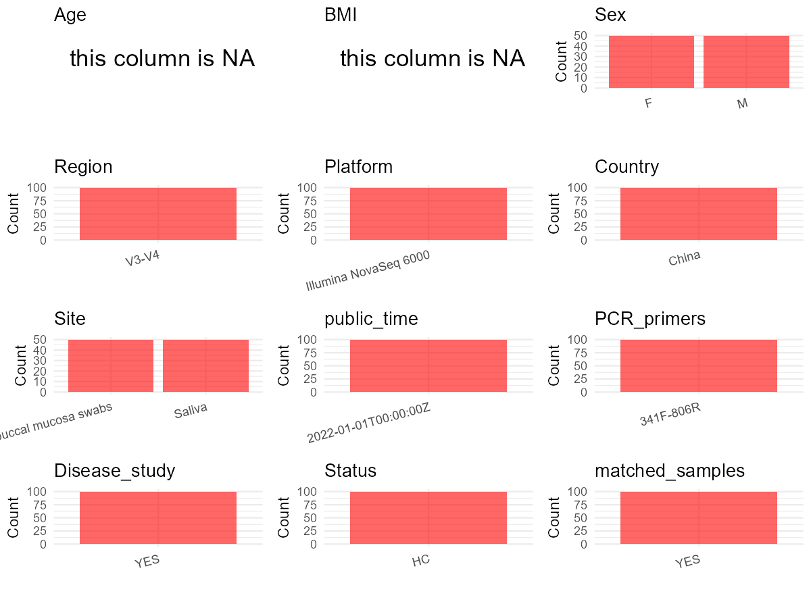

R Notebook: Metadata Processing Workflow
================

# Step 1: Obtain Initial Metadata from Each Project

To obtain the initial metadata: 1. Search for the BioProject ID (e.g.,
“PRJEBXXXX”) on the [NCBI SRA
website](https://www.ncbi.nlm.nih.gov/Traces/study/). 2. In the “Select”
table, click on “Metadata” and download the file. 3. The downloaded file
is typically named “SraRunTable.csv” and contains metadata for the
project.

``` r
# Load necessary libraries
library(dplyr)
library(ggplot2)
library(cowplot)

# Set working directory (update this path to your local directory)
setwd("D:/oral_project/PRJNA765405")

# Read the initial metadata files
initial_meta<-read.csv("SraRunTable.csv",header = T)

# Combine the two metadata files
#meta <- rbind(initial_meta, initial_meta1)

#Remove entries non-oral samples
#initial_meta <- subset(initial_meta,isolate %in% c("saliva","tongue coat"))

# Check the number of samples containing "HT" in Sample.Name (e.g., healthy controls)
#nrow(subset(meta, grepl("HT", Sample.Name)))

# Display the first few rows of the metadata
head(initial_meta)
```

    ##           Run Assay.Type AvgSpotLen     Bases  BioProject    BioSample
    ## 1 SRR16016307   AMPLICON        495  86985855 PRJNA765405 SAMN21557913
    ## 2 SRR16016308   AMPLICON        495  67337820 PRJNA765405 SAMN21557912
    ## 3 SRR16016309   AMPLICON        495 100813680 PRJNA765405 SAMN21557911
    ## 4 SRR16016310   AMPLICON        495  83320380 PRJNA765405 SAMN21557910
    ## 5 SRR16016311   AMPLICON        495  67024980 PRJNA765405 SAMN21557909
    ## 6 SRR16016312   AMPLICON        495  81836865 PRJNA765405 SAMN21557908
    ##                                  BioSampleModel    Bytes        Center.Name
    ## 1 MIMARKS.specimen,MIGS/MIMS/MIMARKS.human-oral 29009189 SICHUAN UNIVERSITY
    ## 2 MIMARKS.specimen,MIGS/MIMS/MIMARKS.human-oral 22678080 SICHUAN UNIVERSITY
    ## 3 MIMARKS.specimen,MIGS/MIMS/MIMARKS.human-oral 33709107 SICHUAN UNIVERSITY
    ## 4 MIMARKS.specimen,MIGS/MIMS/MIMARKS.human-oral 27636822 SICHUAN UNIVERSITY
    ## 5 MIMARKS.specimen,MIGS/MIMS/MIMARKS.human-oral 22173792 SICHUAN UNIVERSITY
    ## 6 MIMARKS.specimen,MIGS/MIMS/MIMARKS.human-oral 27149452 SICHUAN UNIVERSITY
    ##   Collection_Date Consent DATASTORE.filetype DATASTORE.provider
    ## 1      2020-11-02  public   fastq,run.zq,sra         gs,ncbi,s3
    ## 2      2020-10-27  public   fastq,run.zq,sra         gs,ncbi,s3
    ## 3      2020-10-27  public   fastq,run.zq,sra         gs,ncbi,s3
    ## 4      2020-10-27  public   fastq,run.zq,sra         gs,ncbi,s3
    ## 5      2020-10-26  public   fastq,run.zq,sra         gs,ncbi,s3
    ## 6      2020-10-26  public   fastq,run.zq,sra         gs,ncbi,s3
    ##                       DATASTORE.region env_broad_scale env_local_scale
    ## 1 gs.us-east1,ncbi.public,s3.us-east-1  not applicable  not applicable
    ## 2 gs.us-east1,ncbi.public,s3.us-east-1  not applicable  not applicable
    ## 3 gs.us-east1,ncbi.public,s3.us-east-1  not applicable  not applicable
    ## 4 gs.us-east1,ncbi.public,s3.us-east-1  not applicable  not applicable
    ## 5 gs.us-east1,ncbi.public,s3.us-east-1  not applicable  not applicable
    ## 6 gs.us-east1,ncbi.public,s3.us-east-1  not applicable  not applicable
    ##       env_medium  Experiment geo_loc_name_country
    ## 1 not applicable SRX12303317                China
    ## 2 not applicable SRX12303316                China
    ## 3 not applicable SRX12303315                China
    ## 4 not applicable SRX12303314                China
    ## 5 not applicable SRX12303313                China
    ## 6 not applicable SRX12303312                China
    ##   geo_loc_name_country_continent   geo_loc_name         HOST
    ## 1                           Asia China: Chengdu Homo sapiens
    ## 2                           Asia China: Chengdu Homo sapiens
    ## 3                           Asia China: Chengdu Homo sapiens
    ## 4                           Asia China: Chengdu Homo sapiens
    ## 5                           Asia China: Chengdu Homo sapiens
    ## 6                           Asia China: Chengdu Homo sapiens
    ##              Instrument isol_growth_condt          lat_lon Library.Name
    ## 1 Illumina NovaSeq 6000    not applicable 30.38 N 104.39 E       TS-M63
    ## 2 Illumina NovaSeq 6000    not applicable 30.38 N 104.38 E       TS-M60
    ## 3 Illumina NovaSeq 6000    not applicable 30.38 N 104.37 E       TS-M59
    ## 4 Illumina NovaSeq 6000    not applicable 30.38 N 104.36 E       TS-M58
    ## 5 Illumina NovaSeq 6000    not applicable 30.38 N 104.35 E       TS-M55
    ## 6 Illumina NovaSeq 6000    not applicable 30.38 N 104.34 E       TS-M53
    ##   LibraryLayout LibrarySelection LibrarySource        Organism Platform
    ## 1        PAIRED              PCR       GENOMIC oral metagenome ILLUMINA
    ## 2        PAIRED              PCR       GENOMIC oral metagenome ILLUMINA
    ## 3        PAIRED              PCR       GENOMIC oral metagenome ILLUMINA
    ## 4        PAIRED              PCR       GENOMIC oral metagenome ILLUMINA
    ## 5        PAIRED              PCR       GENOMIC oral metagenome ILLUMINA
    ## 6        PAIRED              PCR       GENOMIC oral metagenome ILLUMINA
    ##            ReleaseDate          create_date version Sample.Name SRA.Study
    ## 1 2022-01-01T00:00:00Z 2021-09-22T21:48:00Z       1      TS-M63 SRP338297
    ## 2 2022-01-01T00:00:00Z 2021-09-22T21:49:00Z       1      TS-M60 SRP338297
    ## 3 2022-01-01T00:00:00Z 2021-09-22T21:49:00Z       1      TS-M59 SRP338297
    ## 4 2022-01-01T00:00:00Z 2021-09-22T21:49:00Z       1      TS-M58 SRP338297
    ## 5 2022-01-01T00:00:00Z 2021-09-22T21:49:00Z       1      TS-M55 SRP338297
    ## 6 2022-01-01T00:00:00Z 2021-09-22T21:49:00Z       1      TS-M53 SRP338297
    ##           strain
    ## 1 not applicable
    ## 2 not applicable
    ## 3 not applicable
    ## 4 not applicable
    ## 5 not applicable
    ## 6 not applicable

# Step 2: Create a Uniform Metadata Template

The uniform metadata should include the following columns:

1.  **BioProject**: Project ID (e.g., “PRJNA339212”)
2.  **Run**: Sample ID (e.g., “ERRXXXXXX” or “SRRXXXXXX”)
3.  **sample_name**: Original sample name submitted by the authors (not
    the database-assigned ID)
4.  **Age**: Age of the subject (if available)
5.  **BMI**: Body Mass Index (if available)
6.  **Sex**: Sex of the subject (“F” or “M”)
7.  **Region**: Targeted 16S rRNA region (e.g., “V3-V4”)
8.  **Platform**: Sequencing platform (e.g., “Illumina MiSeq”)
9.  **Country**: Country of sample origin (e.g., “China”)
10. **Site**: Sample site (e.g., “saliva”, “dental plaque”)
11. **public_time**: Data release date (format: “YYYY-MM-DD”)
12. **PCR_primers**: PCR primers used (e.g., “515F-806R”)
13. **title**: Title of the associated publication
14. **Disease_study**: Whether the study involves a disease (“YES” or
    “NO”)
15. **Status**: Disease status (e.g., “T2DM”, “HC”). Note: If the study
    includes both disease and healthy samples, this must be specified
    per sample.
16. **matched_samples**: matched samples (“YES” or “NO”)

``` r
# Create a uniform metadata dataframe
metadata <- data.frame(
  BioProject = initial_meta$BioProject,
  Run = initial_meta$Run,
  sample_name = initial_meta$Sample.Name,
  Age = NA,
  BMI = NA,
  #Sex = NA,
  Region = "V3-V4",
  Platform = initial_meta$Instrument,
  Country = initial_meta$geo_loc_name_country,
  #Site = initial_meta$isolate,
  public_time = initial_meta$ReleaseDate,
  stringsAsFactors = FALSE
)
```

# Step 3: Manually Add Information from the Publication

Some information (e.g. PCR primers, study title, disease status) must be
manually extracted from the publication and added to the metadata.

``` r
metadata<-metadata%>%
  mutate(Site=case_when(grepl("TS-",sample_name)~"Saliva",grepl("T-",sample_name)~"buccal mucosa swabs"))
metadata<-metadata%>%
  mutate(Sex=case_when(grepl("F",sample_name)~"F",grepl("M",sample_name)~"M"))
# Add information obtained from the publication
metadata$PCR_primers <- "341F-806R"
metadata$title <- "Comparative Evaluation of the Salivary and Buccal Mucosal Microbiota by 16S rRNA Sequencing for Forensic Investigations"
metadata$Disease_study <- "YES"
# Assign disease status based on sample_name patterns
metadata$Status<-"HC"

#get subjects id according to sample id
metadata$sample_name<-gsub("TS-|T-","",metadata$sample_name)
#get subjects id with Saliva available
keep_subjects<-subset(metadata,Site %in% "Saliva")
#remove subjects without Saliva samples
metadata<-subset(metadata,sample_name %in% keep_subjects$sample_name)
#get subjects sampling counts
sample_counts <- table(metadata$sample_name)
# Create matched_samples column, any subjects have >=2 samples will be label "YES", otherwise "NO"
metadata$matched_samples <- ifelse(metadata$sample_name %in% names(sample_counts[sample_counts >= 2]), "YES", "NO")
```

# Step 4: Summarize and Validate the Metadata

``` r
# Check the number of unique runs and sample names
print(paste("Number of unique runs:", length(unique(metadata$Run))))
```

    ## [1] "Number of unique runs: 100"

``` r
print(paste("Number of unique sample names:", length(unique(metadata$sample_name))))
```

    ## [1] "Number of unique sample names: 50"

# Step 5: Visualize the Metadata

``` r

```


# Step 6: Finalize and Export the Metadata

``` r
# Reorder columns to match the desired format
metadata <- metadata[, c(
  "BioProject", "Run", "sample_name", "Age", "BMI", "Sex", 
  "Region", "Platform", "Country", "Site", "public_time", 
  "PCR_primers", "title", "Disease_study", "Status","matched_samples"
)]

# Export the uniform metadata to a CSV file
write.csv(metadata, file = "metadata.csv", quote = TRUE)
head(metadata)
```

    ##    BioProject         Run sample_name Age BMI Sex Region              Platform
    ## 1 PRJNA765405 SRR16016307         M63  NA  NA   M  V3-V4 Illumina NovaSeq 6000
    ## 2 PRJNA765405 SRR16016308         M60  NA  NA   M  V3-V4 Illumina NovaSeq 6000
    ## 3 PRJNA765405 SRR16016309         M59  NA  NA   M  V3-V4 Illumina NovaSeq 6000
    ## 4 PRJNA765405 SRR16016310         M58  NA  NA   M  V3-V4 Illumina NovaSeq 6000
    ## 5 PRJNA765405 SRR16016311         M55  NA  NA   M  V3-V4 Illumina NovaSeq 6000
    ## 6 PRJNA765405 SRR16016312         M53  NA  NA   M  V3-V4 Illumina NovaSeq 6000
    ##   Country   Site          public_time PCR_primers
    ## 1   China Saliva 2022-01-01T00:00:00Z   341F-806R
    ## 2   China Saliva 2022-01-01T00:00:00Z   341F-806R
    ## 3   China Saliva 2022-01-01T00:00:00Z   341F-806R
    ## 4   China Saliva 2022-01-01T00:00:00Z   341F-806R
    ## 5   China Saliva 2022-01-01T00:00:00Z   341F-806R
    ## 6   China Saliva 2022-01-01T00:00:00Z   341F-806R
    ##                                                                                                                     title
    ## 1 Comparative Evaluation of the Salivary and Buccal Mucosal Microbiota by 16S rRNA Sequencing for Forensic Investigations
    ## 2 Comparative Evaluation of the Salivary and Buccal Mucosal Microbiota by 16S rRNA Sequencing for Forensic Investigations
    ## 3 Comparative Evaluation of the Salivary and Buccal Mucosal Microbiota by 16S rRNA Sequencing for Forensic Investigations
    ## 4 Comparative Evaluation of the Salivary and Buccal Mucosal Microbiota by 16S rRNA Sequencing for Forensic Investigations
    ## 5 Comparative Evaluation of the Salivary and Buccal Mucosal Microbiota by 16S rRNA Sequencing for Forensic Investigations
    ## 6 Comparative Evaluation of the Salivary and Buccal Mucosal Microbiota by 16S rRNA Sequencing for Forensic Investigations
    ##   Disease_study Status matched_samples
    ## 1           YES     HC             YES
    ## 2           YES     HC             YES
    ## 3           YES     HC             YES
    ## 4           YES     HC             YES
    ## 5           YES     HC             YES
    ## 6           YES     HC             YES

## Notes for Students:

1.  **Metadata Accuracy**: Always cross-check the metadata with the
    original publication to ensure accuracy.
2.  **Manual Entries**: Columns like `PCR_primers`, and `Status` often
    require manual entry based on the publication.
3.  **Disease Status**: Be careful when assigning `Status`—some studies
    include both disease and healthy samples.
4.  **Visualization**: The plots help quickly identify the distribution
    of values in each column, which is useful for quality control.
5.  **Reproducibility**: Update the working directory and file paths to
    match your local environment.
