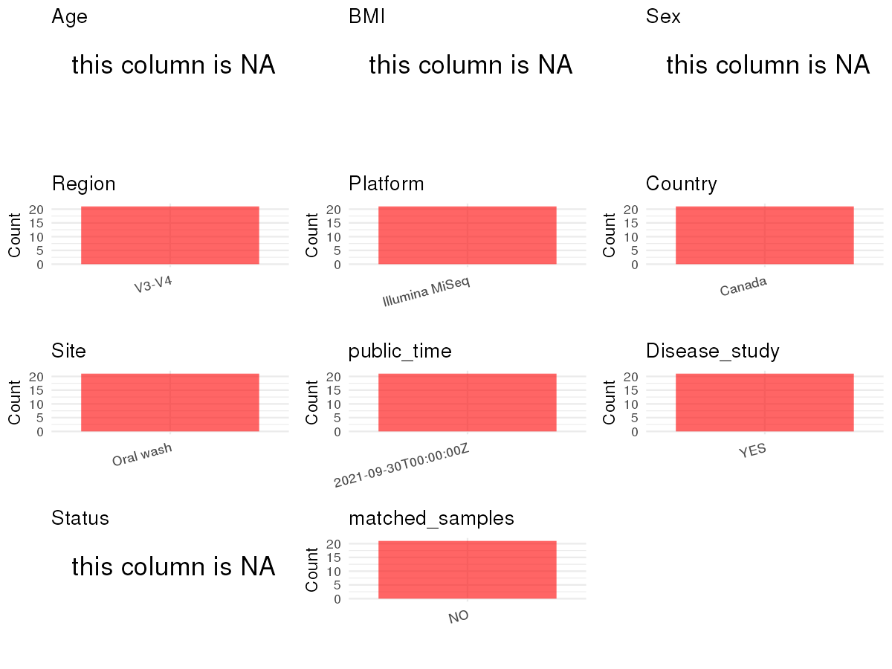

R Notebook: Metadata Processing Workflow
================

# Step 1: Obtain Initial Metadata from Each Project

To obtain the initial metadata: 1. Search for the BioProject ID (e.g.,
“PRJEBXXXX”) on the [NCBI SRA
website](https://www.ncbi.nlm.nih.gov/Traces/study/). 2. In the “Select”
table, click on “Metadata” and download the file. 3. The downloaded file
is typically named “SraRunTable.csv” and contains metadata for the
project.

``` r
# Load necessary libraries
library(dplyr)
library(ggplot2)
library(cowplot)
library(readxl)

# Set working directory (update this path to your local directory)
setwd("/home/dongbiao/word_embedding_microbiome/all_data/oral/global-oral-microbiome/data/projects/PRJNA766045")

# Read the initial metadata files
initial_meta<-read.csv("SraRunTable.csv")

head(initial_meta)
```

    ##           Run Assay.Type AvgSpotLen     Bases  BioProject    BioSample
    ## 1 SRR16086780   AMPLICON        600 318410685 PRJNA766045 SAMN21601537
    ## 2 SRR16086781   AMPLICON        600 291475584 PRJNA766045 SAMN21601536
    ## 3 SRR16086782   AMPLICON        600 255398003 PRJNA766045 SAMN21601535
    ## 4 SRR16086783   AMPLICON        600 306947595 PRJNA766045 SAMN21601534
    ## 5 SRR16086784   AMPLICON        601 379948041 PRJNA766045 SAMN21601533
    ## 6 SRR16086785   AMPLICON        601 305890971 PRJNA766045 SAMN21601532
    ##                BioSampleModel     Bytes           Center.Name Collection_Date
    ## 1 Metagenome or environmental 180828695 UNIVERSITY OF ALBERTA   not collected
    ## 2 Metagenome or environmental 164416787 UNIVERSITY OF ALBERTA   not collected
    ## 3 Metagenome or environmental 143673681 UNIVERSITY OF ALBERTA   not collected
    ## 4 Metagenome or environmental 173759233 UNIVERSITY OF ALBERTA   not collected
    ## 5 Metagenome or environmental 218547731 UNIVERSITY OF ALBERTA   not collected
    ## 6 Metagenome or environmental 177093274 UNIVERSITY OF ALBERTA   not collected
    ##   Consent DATASTORE.filetype DATASTORE.provider
    ## 1  public   fastq,run.zq,sra         gs,ncbi,s3
    ## 2  public   fastq,run.zq,sra         gs,ncbi,s3
    ## 3  public   fastq,run.zq,sra         gs,ncbi,s3
    ## 4  public   fastq,run.zq,sra         gs,ncbi,s3
    ## 5  public   fastq,run.zq,sra         gs,ncbi,s3
    ## 6  public   fastq,run.zq,sra         gs,ncbi,s3
    ##                       DATASTORE.region  Experiment geo_loc_name_country
    ## 1 gs.us-east1,ncbi.public,s3.us-east-1 SRX12373217         uncalculated
    ## 2 gs.us-east1,ncbi.public,s3.us-east-1 SRX12373216         uncalculated
    ## 3 gs.us-east1,ncbi.public,s3.us-east-1 SRX12373215         uncalculated
    ## 4 gs.us-east1,ncbi.public,s3.us-east-1 SRX12373214         uncalculated
    ## 5 gs.us-east1,ncbi.public,s3.us-east-1 SRX12373213         uncalculated
    ## 6 gs.us-east1,ncbi.public,s3.us-east-1 SRX12373212         uncalculated
    ##   geo_loc_name_country_continent  geo_loc_name         HOST     Instrument
    ## 1                   uncalculated not collected Homo sapiens Illumina MiSeq
    ## 2                   uncalculated not collected Homo sapiens Illumina MiSeq
    ## 3                   uncalculated not collected Homo sapiens Illumina MiSeq
    ## 4                   uncalculated not collected Homo sapiens Illumina MiSeq
    ## 5                   uncalculated not collected Homo sapiens Illumina MiSeq
    ## 6                   uncalculated not collected Homo sapiens Illumina MiSeq
    ##   isolation_source       lat_lon Library.Name LibraryLayout LibrarySelection
    ## 1      oral cavity not collected          202        PAIRED              PCR
    ## 2      oral cavity not collected          201        PAIRED              PCR
    ## 3      oral cavity not collected          199        PAIRED              PCR
    ## 4      oral cavity not collected          198        PAIRED              PCR
    ## 5      oral cavity not collected          193        PAIRED              PCR
    ## 6      oral cavity not collected          191        PAIRED              PCR
    ##   LibrarySource              Organism Platform          ReleaseDate
    ## 1   METAGENOMIC human oral metagenome ILLUMINA 2021-09-30T00:00:00Z
    ## 2   METAGENOMIC human oral metagenome ILLUMINA 2021-09-30T00:00:00Z
    ## 3   METAGENOMIC human oral metagenome ILLUMINA 2021-09-30T00:00:00Z
    ## 4   METAGENOMIC human oral metagenome ILLUMINA 2021-09-30T00:00:00Z
    ## 5   METAGENOMIC human oral metagenome ILLUMINA 2021-09-30T00:00:00Z
    ## 6   METAGENOMIC human oral metagenome ILLUMINA 2021-09-30T00:00:00Z
    ##            create_date version Sample.Name SRA.Study
    ## 1 2021-09-27T13:26:00Z       1         202 SRP338885
    ## 2 2021-09-27T13:26:00Z       1         201 SRP338885
    ## 3 2021-09-27T13:26:00Z       1         199 SRP338885
    ## 4 2021-09-27T13:26:00Z       1         198 SRP338885
    ## 5 2021-09-27T13:26:00Z       1         193 SRP338885
    ## 6 2021-09-27T13:26:00Z       1         191 SRP338885

# Step 2: Create a Uniform Metadata Template

The uniform metadata should include the following columns:

1.  **BioProject**: Project ID (e.g., “PRJNA339212”)
2.  **Run**: Sample ID (e.g., “ERRXXXXXX” or “SRRXXXXXX”)
3.  **sample_name**: Original sample name submitted by the authors (not
    the database-assigned ID)
4.  **Age**: Age of the subject (if available)
5.  **BMI**: Body Mass Index (if available)
6.  **Sex**: Sex of the subject (“F” or “M”)
7.  **Region**: Targeted 16S rRNA region (e.g., “V3-V4”)
8.  **Platform**: Sequencing platform (e.g., “Illumina MiSeq”)
9.  **Country**: Country of sample origin (e.g., “China”)
10. **Site**: Sample site (e.g., “saliva”, “dental plaque”)
11. **public_time**: Data release date (format: “YYYY-MM-DD”)
12. **PCR_primers**: PCR primers used (e.g., “515F-806R”)
13. **title**: Title of the associated publication
14. **Disease_study**: Whether the study involves a disease (“YES” or
    “NO”)
15. **Status**: Disease status (e.g., “T2DM”, “HC”). Note: If the study
    includes both disease and healthy samples, this must be specified
    per sample.

``` r
# Create a uniform metadata dataframe
metadata <- data.frame(
  BioProject = initial_meta$BioProject,
  Run = initial_meta$Run,
  sample_name = initial_meta$`Sample.Name`,
  Age = NA,
  BMI = NA,
  Sex=NA,
  Region = "V3-V4",
  Platform = initial_meta$Instrument,
  Country = "Canada",
  Site = "Oral wash",
  public_time = initial_meta$ReleaseDate,
  stringsAsFactors = FALSE
)
metadata<-unique(metadata)
```

# Step 3: Manually Add Information from the Publication

Some information (e.g. PCR primers, study title, disease status) must be
manually extracted from the publication and added to the metadata.

``` r
# Add information obtained from the publication
metadata$PCR_primers <- "F: CGTCGGCAGCGTCAGATGTGTATAAGAGACAGCCTACGGGNGGCWGCAG; R: TCTCGTGGGCTCGGAGATGTGTATAAGAGACAGGACTACHVGGGTATCTAATCC"
metadata$title <- "Differential Signature of the Microbiome and Neutrophils in the Oral Cavity of HIV-Infected Individuals"
metadata$Disease_study <- "YES"

# Assign disease status based on sample_name patterns
metadata$Status <- NA
metadata$matched_samples <- "NO"
```

# Step 4: Summarize and Validate the Metadata

``` r
# Check the number of unique runs and sample names
print(paste("Number of unique runs:", length(unique(metadata$Run))))
```

    ## [1] "Number of unique runs: 21"

``` r
print(paste("Number of unique sample names:", length(unique(metadata$sample_name))))
```

    ## [1] "Number of unique sample names: 21"

# Step 5: Visualize the Metadata

``` r

```


# Step 6: Finalize and Export the Metadata

``` r
# Reorder columns to match the desired format
metadata <- metadata[, c(
  "BioProject", "Run", "sample_name", "Age", "BMI", "Sex", 
  "Region", "Platform", "Country", "Site", "public_time", 
  "PCR_primers", "title", "Disease_study", "Status","matched_samples"
)]

# Export the uniform metadata to a CSV file
metadata<-unique(metadata)
write.csv(metadata, file = "metadata.csv", quote = FALSE)
head(metadata)
```

    ##    BioProject         Run sample_name Age BMI Sex Region       Platform Country
    ## 1 PRJNA766045 SRR16086780         202  NA  NA  NA  V3-V4 Illumina MiSeq  Canada
    ## 2 PRJNA766045 SRR16086781         201  NA  NA  NA  V3-V4 Illumina MiSeq  Canada
    ## 3 PRJNA766045 SRR16086782         199  NA  NA  NA  V3-V4 Illumina MiSeq  Canada
    ## 4 PRJNA766045 SRR16086783         198  NA  NA  NA  V3-V4 Illumina MiSeq  Canada
    ## 5 PRJNA766045 SRR16086784         193  NA  NA  NA  V3-V4 Illumina MiSeq  Canada
    ## 6 PRJNA766045 SRR16086785         191  NA  NA  NA  V3-V4 Illumina MiSeq  Canada
    ##        Site          public_time
    ## 1 Oral wash 2021-09-30T00:00:00Z
    ## 2 Oral wash 2021-09-30T00:00:00Z
    ## 3 Oral wash 2021-09-30T00:00:00Z
    ## 4 Oral wash 2021-09-30T00:00:00Z
    ## 5 Oral wash 2021-09-30T00:00:00Z
    ## 6 Oral wash 2021-09-30T00:00:00Z
    ##                                                                                                       PCR_primers
    ## 1 F: CGTCGGCAGCGTCAGATGTGTATAAGAGACAGCCTACGGGNGGCWGCAG; R: TCTCGTGGGCTCGGAGATGTGTATAAGAGACAGGACTACHVGGGTATCTAATCC
    ## 2 F: CGTCGGCAGCGTCAGATGTGTATAAGAGACAGCCTACGGGNGGCWGCAG; R: TCTCGTGGGCTCGGAGATGTGTATAAGAGACAGGACTACHVGGGTATCTAATCC
    ## 3 F: CGTCGGCAGCGTCAGATGTGTATAAGAGACAGCCTACGGGNGGCWGCAG; R: TCTCGTGGGCTCGGAGATGTGTATAAGAGACAGGACTACHVGGGTATCTAATCC
    ## 4 F: CGTCGGCAGCGTCAGATGTGTATAAGAGACAGCCTACGGGNGGCWGCAG; R: TCTCGTGGGCTCGGAGATGTGTATAAGAGACAGGACTACHVGGGTATCTAATCC
    ## 5 F: CGTCGGCAGCGTCAGATGTGTATAAGAGACAGCCTACGGGNGGCWGCAG; R: TCTCGTGGGCTCGGAGATGTGTATAAGAGACAGGACTACHVGGGTATCTAATCC
    ## 6 F: CGTCGGCAGCGTCAGATGTGTATAAGAGACAGCCTACGGGNGGCWGCAG; R: TCTCGTGGGCTCGGAGATGTGTATAAGAGACAGGACTACHVGGGTATCTAATCC
    ##                                                                                                     title
    ## 1 Differential Signature of the Microbiome and Neutrophils in the Oral Cavity of HIV-Infected Individuals
    ## 2 Differential Signature of the Microbiome and Neutrophils in the Oral Cavity of HIV-Infected Individuals
    ## 3 Differential Signature of the Microbiome and Neutrophils in the Oral Cavity of HIV-Infected Individuals
    ## 4 Differential Signature of the Microbiome and Neutrophils in the Oral Cavity of HIV-Infected Individuals
    ## 5 Differential Signature of the Microbiome and Neutrophils in the Oral Cavity of HIV-Infected Individuals
    ## 6 Differential Signature of the Microbiome and Neutrophils in the Oral Cavity of HIV-Infected Individuals
    ##   Disease_study Status matched_samples
    ## 1           YES     NA              NO
    ## 2           YES     NA              NO
    ## 3           YES     NA              NO
    ## 4           YES     NA              NO
    ## 5           YES     NA              NO
    ## 6           YES     NA              NO

## Notes for Students:

1.  **Metadata Accuracy**: Always cross-check the metadata with the
    original publication to ensure accuracy.
2.  **Manual Entries**: Columns like `PCR_primers`, and `Status` often
    require manual entry based on the publication.
3.  **Disease Status**: Be careful when assigning `Status`—some studies
    include both disease and healthy samples.
4.  **Visualization**: The plots help quickly identify the distribution
    of values in each column, which is useful for quality control.
5.  **Reproducibility**: Update the working directory and file paths to
    match your local environment.
