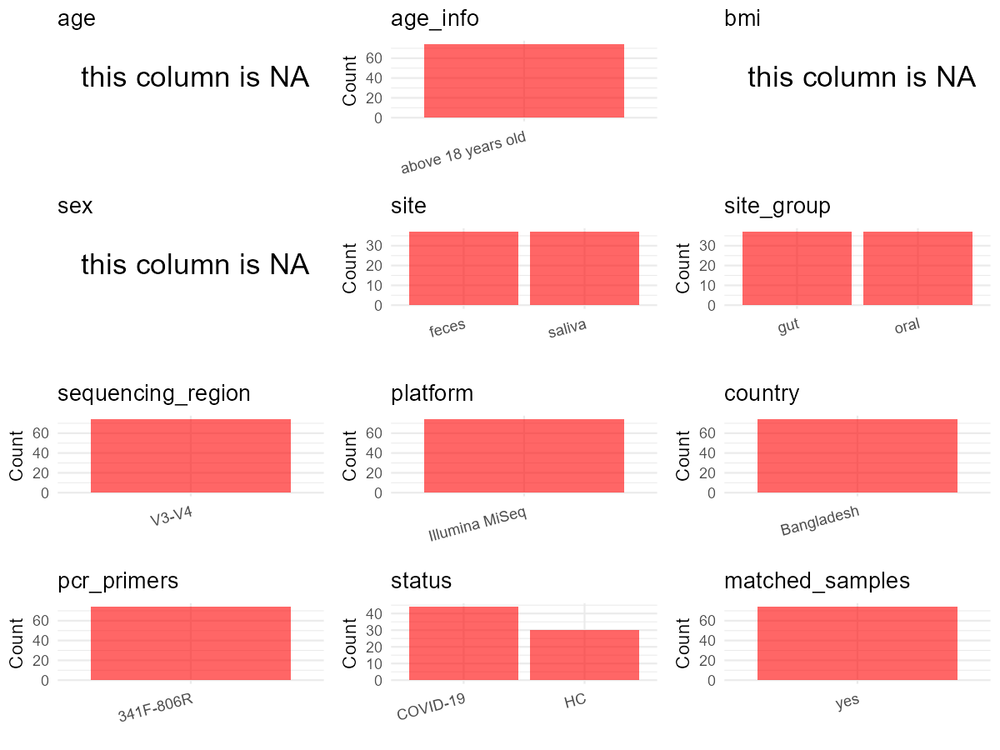

R Notebook: Metadata Processing Workflow
================

# Step 1: Obtain Initial Metadata from Each Project

This step sets the project directory, loads the raw SRA metadata, and
optionally merges supplement tables.

``` r
# Load libraries
library(dplyr)
library(ggplot2)
library(cowplot)

# (1) Setting working directory
# EDIT HERE: change project_id for each study
project_id <- "PRJNA767939" 

base_dir <- "E:/oral/26/metadata-2604/Oral-Metadata-YL-02"
setwd(file.path(base_dir, project_id))

# (2) Loading raw SRA metadata file
sra_file <- "SraRunTable.csv"
initial_meta <- read.csv(sra_file, header = TRUE)

# (3) OPTIONAL: If extra metadata (e.g., Table.x or supplemental materials) are available from the article, you may need to merge the file with initial_meta manually. Below is example code for merging. Depending on the specific case of each study, you can customize the code as needed.
# supp_table <- read.csv("supplemental_table.csv", header = TRUE)
# initial_meta <- left_join(initial_meta, supp_table, by = merge_col_name)
```

# Step 2: Data Overview

First, you need to get an overview of the data, which includes two
steps: reading the article and reading the initial metadata. This step
is very IMPORTANT!

``` r
# (1) Read the article in the following order: abstract, the beginning of the results section, and the methods. Understand the sample size, experimental design, and disease group overview. Clarify the sampling sites; for oral and gut samples, specify the exact sites like supragingival plaque, tongue, etc.

# (2) IMPORTANT: MUST go through each column of initial_meta
head(initial_meta, 10)
```

    ##            Run Assay.Type AvgSpotLen    Bases  BioProject    BioSample
    ## 1  SRR17066268   AMPLICON        580 24380172 PRJNA767939 SAMN21987271
    ## 2  SRR17066269   AMPLICON        599 28447196 PRJNA767939 SAMN21987270
    ## 3  SRR17066270   AMPLICON        555 18036856 PRJNA767939 SAMN21987335
    ## 4  SRR17066271   AMPLICON        568 24074033 PRJNA767939 SAMN21987334
    ## 5  SRR17066272   AMPLICON        560 21892925 PRJNA767939 SAMN21987333
    ## 6  SRR17066273   AMPLICON        594 27163494 PRJNA767939 SAMN21987332
    ## 7  SRR17066274   AMPLICON        582 25190030 PRJNA767939 SAMN21987269
    ## 8  SRR17066275   AMPLICON        566 24003951 PRJNA767939 SAMN21987331
    ## 9  SRR17066276   AMPLICON        574 23655011 PRJNA767939 SAMN21987330
    ## 10 SRR17066277   AMPLICON        600 28546289 PRJNA767939 SAMN21987329
    ##                 BioSampleModel    Bytes
    ## 1  Metagenome or environmental 13737669
    ## 2  Metagenome or environmental 16185500
    ## 3  Metagenome or environmental 10178453
    ## 4  Metagenome or environmental 13654857
    ## 5  Metagenome or environmental 12365053
    ## 6  Metagenome or environmental 15735887
    ## 7  Metagenome or environmental 14022430
    ## 8  Metagenome or environmental 13690027
    ## 9  Metagenome or environmental 13515533
    ## 10 Metagenome or environmental 16730783
    ##                                       Center.Name Collection_Date Consent
    ## 1  SHAHJALAL UNIVERSITY OF SCIENCE AND TECHNOLOGY      2020-07-01  public
    ## 2  SHAHJALAL UNIVERSITY OF SCIENCE AND TECHNOLOGY      2020-06-30  public
    ## 3  SHAHJALAL UNIVERSITY OF SCIENCE AND TECHNOLOGY      2020-09-30  public
    ## 4  SHAHJALAL UNIVERSITY OF SCIENCE AND TECHNOLOGY      2020-09-29  public
    ## 5  SHAHJALAL UNIVERSITY OF SCIENCE AND TECHNOLOGY      2020-09-27  public
    ## 6  SHAHJALAL UNIVERSITY OF SCIENCE AND TECHNOLOGY      2020-09-24  public
    ## 7  SHAHJALAL UNIVERSITY OF SCIENCE AND TECHNOLOGY      2020-06-30  public
    ## 8  SHAHJALAL UNIVERSITY OF SCIENCE AND TECHNOLOGY      2020-09-22  public
    ## 9  SHAHJALAL UNIVERSITY OF SCIENCE AND TECHNOLOGY      2020-09-17  public
    ## 10 SHAHJALAL UNIVERSITY OF SCIENCE AND TECHNOLOGY      2020-09-15  public
    ##    DATASTORE.filetype DATASTORE.provider                     DATASTORE.region
    ## 1    fastq,run.zq,sra         gs,ncbi,s3 gs.us-east1,ncbi.public,s3.us-east-1
    ## 2    fastq,run.zq,sra         gs,ncbi,s3 gs.us-east1,ncbi.public,s3.us-east-1
    ## 3    fastq,run.zq,sra         gs,ncbi,s3 gs.us-east1,ncbi.public,s3.us-east-1
    ## 4    fastq,run.zq,sra         gs,ncbi,s3 gs.us-east1,ncbi.public,s3.us-east-1
    ## 5    fastq,run.zq,sra         gs,ncbi,s3 gs.us-east1,ncbi.public,s3.us-east-1
    ## 6    fastq,run.zq,sra         gs,ncbi,s3 gs.us-east1,ncbi.public,s3.us-east-1
    ## 7    fastq,run.zq,sra         gs,ncbi,s3 gs.us-east1,ncbi.public,s3.us-east-1
    ## 8    fastq,run.zq,sra         gs,ncbi,s3 gs.us-east1,ncbi.public,s3.us-east-1
    ## 9    fastq,run.zq,sra         gs,ncbi,s3 gs.us-east1,ncbi.public,s3.us-east-1
    ## 10   fastq,run.zq,sra         gs,ncbi,s3 gs.us-east1,ncbi.public,s3.us-east-1
    ##     Experiment geo_loc_name_country geo_loc_name_country_continent
    ## 1  SRX13254971           Bangladesh                           Asia
    ## 2  SRX13254970           Bangladesh                           Asia
    ## 3  SRX13254969           Bangladesh                           Asia
    ## 4  SRX13254968           Bangladesh                           Asia
    ## 5  SRX13254967           Bangladesh                           Asia
    ## 6  SRX13254966           Bangladesh                           Asia
    ## 7  SRX13254965           Bangladesh                           Asia
    ## 8  SRX13254964           Bangladesh                           Asia
    ## 9  SRX13254963           Bangladesh                           Asia
    ## 10 SRX13254962           Bangladesh                           Asia
    ##              geo_loc_name         HOST     Instrument         isolation_source
    ## 1  Bangladesh: Chattogram Homo sapiens Illumina MiSeq Homo sapiens_healthy gut
    ## 2  Bangladesh: Chattogram Homo sapiens Illumina MiSeq Homo sapiens_healthy gut
    ## 3  Bangladesh: Chattogram Homo sapiens Illumina MiSeq  Homo sapiens_COVID oral
    ## 4  Bangladesh: Chattogram Homo sapiens Illumina MiSeq  Homo sapiens_COVID oral
    ## 5  Bangladesh: Chattogram Homo sapiens Illumina MiSeq  Homo sapiens_COVID oral
    ## 6  Bangladesh: Chattogram Homo sapiens Illumina MiSeq  Homo sapiens_COVID oral
    ## 7  Bangladesh: Chattogram Homo sapiens Illumina MiSeq Homo sapiens_healthy gut
    ## 8  Bangladesh: Chattogram Homo sapiens Illumina MiSeq  Homo sapiens_COVID oral
    ## 9  Bangladesh: Chattogram Homo sapiens Illumina MiSeq  Homo sapiens_COVID oral
    ## 10 Bangladesh: Chattogram Homo sapiens Illumina MiSeq  Homo sapiens_COVID oral
    ##                lat_lon           Library.Name LibraryLayout LibrarySelection
    ## 1  22.3407 N 91.8377 E Healthy control gut_10        PAIRED              PCR
    ## 2  22.3407 N 91.8377 E  Healthy control gut_9        PAIRED              PCR
    ## 3  22.3407 N 91.8377 E          COVID oral_22        PAIRED              PCR
    ## 4  22.3407 N 91.8377 E          COVID oral_21        PAIRED              PCR
    ## 5  22.3407 N 91.8377 E          COVID oral_20        PAIRED              PCR
    ## 6  22.3407 N 91.8377 E          COVID oral_19        PAIRED              PCR
    ## 7  22.3407 N 91.8377 E  Healthy control gut_8        PAIRED              PCR
    ## 8  22.3407 N 91.8377 E          COVID oral_18        PAIRED              PCR
    ## 9  22.3407 N 91.8377 E          COVID oral_17        PAIRED              PCR
    ## 10 22.3407 N 91.8377 E          COVID oral_16        PAIRED              PCR
    ##    LibrarySource        Organism Platform          ReleaseDate
    ## 1    METAGENOMIC  gut metagenome ILLUMINA 2021-11-29T00:00:00Z
    ## 2    METAGENOMIC  gut metagenome ILLUMINA 2021-11-29T00:00:00Z
    ## 3    METAGENOMIC oral metagenome ILLUMINA 2021-11-29T00:00:00Z
    ## 4    METAGENOMIC oral metagenome ILLUMINA 2021-11-29T00:00:00Z
    ## 5    METAGENOMIC oral metagenome ILLUMINA 2021-11-29T00:00:00Z
    ## 6    METAGENOMIC oral metagenome ILLUMINA 2021-11-29T00:00:00Z
    ## 7    METAGENOMIC  gut metagenome ILLUMINA 2021-11-29T00:00:00Z
    ## 8    METAGENOMIC oral metagenome ILLUMINA 2021-11-29T00:00:00Z
    ## 9    METAGENOMIC oral metagenome ILLUMINA 2021-11-29T00:00:00Z
    ## 10   METAGENOMIC oral metagenome ILLUMINA 2021-11-29T00:00:00Z
    ##             create_date version Sample.Name SRA.Study
    ## 1  2021-11-29T13:49:00Z       1       CTG10 SRP348427
    ## 2  2021-11-29T13:50:00Z       1        CTG9 SRP348427
    ## 3  2021-11-29T13:49:00Z       1     COVO143 SRP348427
    ## 4  2021-11-29T13:49:00Z       1     COVO142 SRP348427
    ## 5  2021-11-29T13:49:00Z       1     COVO141 SRP348427
    ## 6  2021-11-29T13:49:00Z       1     COVO140 SRP348427
    ## 7  2021-11-29T13:49:00Z       1        CTG8 SRP348427
    ## 8  2021-11-29T13:50:00Z       1     COVO139 SRP348427
    ## 9  2021-11-29T13:49:00Z       1     COVO138 SRP348427
    ## 10 2021-11-29T13:50:00Z       1     COVO137 SRP348427

``` r
# IMPORTANT: Check the unique values in the column of interest or query column.
lapply(initial_meta[c('isolation_source')], table) # site
```

    ## $isolation_source
    ## 
    ##    Homo sapiens_COVID gut   Homo sapiens_COVID oral  Homo sapiens_healthy gut 
    ##                        22                        22                        15 
    ## Homo sapiens_healthy oral 
    ##                        15

``` r
lapply(initial_meta[c('HOST', 'Organism')], table) # organism
```

    ## $HOST
    ## 
    ## Homo sapiens 
    ##           74 
    ## 
    ## $Organism
    ## 
    ##  gut metagenome oral metagenome 
    ##              37              37

``` r
table(initial_meta$Library.Name) # subject id
```

    ## 
    ##             COVID gut_1            COVID gut_10            COVID gut_11 
    ##                       1                       1                       1 
    ##            COVID gut_12            COVID gut_13            COVID gut_14 
    ##                       1                       1                       1 
    ##            COVID gut_15            COVID gut_16            COVID gut_17 
    ##                       1                       1                       1 
    ##            COVID gut_18            COVID gut_19             COVID gut_2 
    ##                       1                       1                       1 
    ##            COVID gut_20            COVID gut_21            COVID gut_22 
    ##                       1                       1                       1 
    ##             COVID gut_3             COVID gut_4             COVID gut_5 
    ##                       1                       1                       1 
    ##             COVID gut_6             COVID gut_7             COVID gut_8 
    ##                       1                       1                       1 
    ##             COVID gut_9            COVID oral_1           COVID oral_10 
    ##                       1                       1                       1 
    ##           COVID oral_11           COVID oral_12           COVID oral_13 
    ##                       1                       1                       1 
    ##           COVID oral_14           COVID oral_15           COVID oral_16 
    ##                       1                       1                       1 
    ##           COVID oral_17           COVID oral_18           COVID oral_19 
    ##                       1                       1                       1 
    ##            COVID oral_2           COVID oral_20           COVID oral_21 
    ##                       1                       1                       1 
    ##           COVID oral_22            COVID oral_3            COVID oral_4 
    ##                       1                       1                       1 
    ##            COVID oral_5            COVID oral_6            COVID oral_7 
    ##                       1                       1                       1 
    ##            COVID oral_8            COVID oral_9   Healthy control gut_1 
    ##                       1                       1                       1 
    ##  Healthy control gut_10  Healthy control gut_11  Healthy control gut_12 
    ##                       1                       1                       1 
    ##  Healthy control gut_13  Healthy control gut_14  Healthy control gut_15 
    ##                       1                       1                       1 
    ##   Healthy control gut_2   Healthy control gut_3   Healthy control gut_4 
    ##                       1                       1                       1 
    ##   Healthy control gut_5   Healthy control gut_6   Healthy control gut_7 
    ##                       1                       1                       1 
    ##   Healthy control gut_8   Healthy control gut_9  Healthy control oral_1 
    ##                       1                       1                       1 
    ## Healthy control oral_10 Healthy control oral_11 Healthy control oral_12 
    ##                       1                       1                       1 
    ## Healthy control oral_13 Healthy control oral_14 Healthy control oral_15 
    ##                       1                       1                       1 
    ##  Healthy control oral_2  Healthy control oral_3  Healthy control oral_4 
    ##                       1                       1                       1 
    ##  Healthy control oral_5  Healthy control oral_6  Healthy control oral_7 
    ##                       1                       1                       1 
    ##  Healthy control oral_8  Healthy control oral_9 
    ##                       1                       1

``` r
#table(initial_meta$sequencing_meth..exp.) # output is Sequencing by synthesis
table(initial_meta$Platform) # output is Illumina. according to the methods,  Illumina is correct.
```

    ## 
    ## ILLUMINA 
    ##       74

``` r
#table(initial_meta$target_subfragment) # output is V4
```

# Step 3: Removing Control and Non-human Samples

First, we need to remove control samples(including both negative
controls and positive controls) and non-human samples.

``` r
# (1) EDIT HERE: Parameter setup
control_column <- "" # column name in initial_meta
# unique(initial_meta[[control_column]])
control_keywords <- c() # Enter exact keywords

species_column <- "" # column name in initial_meta
unique(initial_meta[[species_column]])
```

    ## NULL

``` r
non_human_keywords <- c() # Enter exact keywords

# (2) Remove controls and non-human samples. DO NOT need to modify code in this part, just run it.
n_samples <- nrow(initial_meta)
# Control evaluation
if (length(control_keywords) > 0) {
  if (is.null(control_column) || control_column == "") {
    stop("Error: control_keywords provided but control_column is missing.")
  }
  
  if (!(control_column %in% colnames(initial_meta))) {
    stop(sprintf("Error: Column '%s' not found in initial_meta.", control_column))
  }
  
  control_pattern <- paste(control_keywords, collapse = "|")
  control_text <- initial_meta[[control_column]]
  is_control <- grepl(control_pattern, control_text)
  
} else {
  is_control <- rep(FALSE, n_samples)
}

# Non-human evaluation
if (length(non_human_keywords) > 0) {
  if (is.null(species_column) || species_column == "") {
    stop("Error: non_human_keywords provided but species_column is missing.")
  }
  
  if (!(species_column %in% colnames(initial_meta))) {
    stop(sprintf("Error: Column '%s' not found in initial_meta.", species_column))
  }
  
  non_human_pattern <- paste(non_human_keywords, collapse = "|")
  species_text <- initial_meta[[species_column]]
  is_non_human <- grepl(non_human_pattern, species_text)
} else {
  is_non_human <- rep(FALSE, n_samples)
}

# Execute removal
samples_to_remove <- is_control | is_non_human
initial_meta <- initial_meta[!samples_to_remove, ]

cat("Initial samples counts:",n_samples,"\n")
```

    ## Initial samples counts: 74

``` r
cat("Removed control samples:", sum(is_control), "\n")
```

    ## Removed control samples: 0

``` r
cat("Removed non-human samples:", sum(is_non_human), "\n")
```

    ## Removed non-human samples: 0

``` r
cat("Total samples removed ", sum(samples_to_remove), "\n")
```

    ## Total samples removed  0

``` r
cat("Remaining samples after Step 2:", nrow(initial_meta), "\n")
```

    ## Remaining samples after Step 2: 74

# Step 4: Creating a Uniform Metadata Template

This step converts the raw SRA table into the standard metadata format
used in our meta-analysis. The uniform metadata should include the
following columns: 1. **bioproject**: Project ID from SRA or other
database e.g. `PRJNA1234`, `CNP1234`, ‘OEP1234’, ‘qiita_1234’ 2.
**sample_id**: SRA sample/run ID. Unique id for each sample!
e.g. `DRR1234567`, `ERR1234567` and `SRR1234567`. If no such column
exists, can use column like sample_name. 3. **subject_id**: subject id
for each person if available. e.g. `patient_01`, `Host_03_before`,
`subject12` 4. **age**: Age of the subject if available. e.g. `35`, `42`
\| not `adult`, `chilren` 5. **age_info**: If the age is not explicitly
stated but approximate age range information is available, mark it in
this column. e.g., `18-55`, `children`, `infant`, `elder` 6. **bmi**:
Body Mass Index if available. e.g. `22.5`, `18.9` \| not `normal`,
`overweight` 7. **sex**: Sex of the subject. Mandatory to write as M/F
\| not `female`, `woman` 8. **sequencing_region**: Targeted 16S rRNA
region. e.g. `V3-V4`, `V4` 9. **platform**: Sequencing platform.
e.g. `Illumina MiSeq`, `454 GS FLX Titanium`, `Ion Torrent` 10.
**country**: Country of sample origin. e.g. `China`, `Japan` \| not city
name like `Beijing` 11. **site**: Sampling site. For oral and gut sites,
specify the exact sites as detailed as possible. For example, if it is
known to be supragingival plaque, do not record it as ‘dental plaque’,
unless the original text provides only a vague description.
e.g. `saliva`, `tongue coating` \| not broad term like `oral` 12.
**site_group**: only accepts one of following three values: ‘oral’,
‘gut’, or ‘other’. 13. **public_time**: Data release date.
e.g. `2021-06-22` \| not `June 2021` 14. **pcr_primers**: PCR primers
used. e.g. `515F-806R`, `27F-338R` \| not primer sequences 15.
**title**: Title of the associated publication. 16. **disease_study**:
Whether the study involves disease samples. If it’s not clear, can
record as NA. Only three values accepted: ‘yes’, ‘no’ or NA 17.
**status**: Disease status for each sample if available, else record as
NA. Only accept following abbreviations, Write full names for all other
diseases. HC: healthy control CD: Crohn’s disease CRC: colorectal cancer
COPD: chronic obstructive pulmonary disease HIV: human immunodeficiency
virus ICU: intensive care unit OSCC: oral squamous cell carcinoma RA:
rheumatoid arthritis UC: ulcerative colitis 18. **matched_samples**:
Whether the subject has matched samples. Only accept ‘yes’ or ‘no’. 19.
**is_time_series**: Whether the study is a time series study. Only
accept ‘yes’ or ‘no’.

``` r
# Extract columns from initial_meta as follows: (1) No modification needed → extract directly. (2) Modification needed → create a new column with the prefix raw_ and mark the original column as “pending”. (3) Need to find or determine based on the article.
metadata <- data.frame(
  bioproject = initial_meta$BioProject,
  sample_id = initial_meta$Run,
  raw_subject_id = initial_meta$Library.Name,
  subject_id = "pending", # modify later
  age = NA, 
  age_info = "above 18 years old", # extract from methods section 
  bmi = NA,
  sex = NA,
  sequencing_region = "V3-V4", # extract from methods section
  platform = "Illumina MiSeq", # extract from methods section, NOT initial_meta
  country = initial_meta$geo_loc_name_country,
  raw_site = initial_meta$isolation_source, 
  site = "pending", # modify later
  site_group = "pending", # modify later
  public_time = initial_meta$ReleaseDate,
  pcr_primers = "341F-806R", # Format: xxF-xxR
  title = "Dysbiosis of oral and gut microbiomes in SARS-CoV-2 infected patients in Bangladesh elucidating the role of opportunistic gut microbes", # extract from article
  disease_study = "yes", # determine according to the article
  raw_status = initial_meta$isolation_source,
  status = "pending", # modify later 
  matched_samples = "pending", # modify later
  is_time_series = "no", 
  stringsAsFactors = FALSE
)
metadata$public_time <- as.Date(metadata$public_time)
```

# Step 5: Manually solving pending issues

This step involves two parts: (1) handle the columns with the `raw_`
prefix, and next (2) handle the `site_group` and `matched_samples`
columns.

``` r
# (1) Handle the columns with the `raw_` prefix.
# In this part, you need to customize the code based on the situation of the raw_ columns to obtain the content of the target columns. IMPORTANT: Add comments if the modification is not straightforward!!
metadata$subject_id <- gsub(" oral| gut", "", metadata$raw_subject_id) # according to the 'Library.Name' column of initial_meta

metadata <- metadata %>%
  mutate(site = case_when(
    grepl("gut", raw_site) ~ "feces",
    grepl("oral", raw_site) ~ "saliva",
    TRUE ~ NA_character_
  )) # according to the 'isolation_source' column of initial_meta

metadata <- metadata %>%
  mutate(status = case_when(
    grepl("COVID", raw_status) ~ "COVID-19",
    grepl("healthy", raw_status) ~ "HC",
    TRUE ~ NA_character_
  )) # according to the 'isolation_source' column of initial_meta
```

``` r
# (2) Filling the 'site_group' and 'matched_samples' columns
# editing site_group
unique(metadata$site)
```

    ## [1] "feces"  "saliva"

``` r
# EDIT HERE: add oral sites
Oral_site = c("saliva")
# EDIT HERE: add gut sites
Gut_site = c("feces")
# just run
metadata <- metadata %>%
  mutate(site_group = case_when(
    site %in% Oral_site ~ "oral",
    site %in% Gut_site ~ "gut",
    TRUE ~ "other" 
  ))

# editing matched_samples, just run.
metadata$matched_samples <- ifelse(
  ave(metadata$subject_id, metadata$subject_id, FUN = length) > 1, 
  "yes", 
  "no"
)
```

``` r
# (3) check if there is pending value in metadata. If there is pending value, go on modify the metadata.
# Function to check if a column contains "pending"
has_pending <- function(col) {
  if (is.character(col) || is.factor(col)) {
    any(col == "pending", na.rm = TRUE)
  } else {
    FALSE
  }
}

# Check for any pending value
any_pending_value <- any(sapply(metadata, has_pending))

if (!any_pending_value) {
  message("Good! No cell contains the value 'pending'.")
} else {
  pending_cols <- names(metadata)[sapply(metadata, has_pending)]
  message("Columns containing 'pending': ", paste(pending_cols, collapse = ", "))
  message("Please continue to resolve these pending columns!")
}
```

    ## Good! No cell contains the value 'pending'.

# Step 6: Visualize the Metadata

This step makes a quick set of plots for checking the distribution of
key metadata fields.

``` r
# Select columns for visualization, just run
plot_data <- metadata %>%
  select(-bioproject, -sample_id, -subject_id, -title)

create_simple_plots <- function(data) {
  plots <- list()
  continuous_vars <- c("age", "bmi")

  for (col in colnames(data)) {
    if (all(is.na(data[[col]]))) {
      p <- ggplot() +
        annotate("text", x = 0.5, y = 0.5, label = "this column is NA", size = 6) +
        labs(title = col) +
        theme_void()
    } else if (col %in% continuous_vars && is.numeric(data[[col]])) {
      p <- ggplot(data, aes(x = .data[[col]])) +
        geom_histogram(fill = "blue", alpha = 0.6, bins = 20, na.rm = TRUE) +
        labs(title = col, x = col, y = "Count") +
        theme_minimal()
    } else {
      count_data <- as.data.frame(table(data[[col]], useNA = "ifany"))
      p <- ggplot(count_data, aes(x = reorder(Var1, -Freq), y = Freq)) +
        geom_col(fill = "red", alpha = 0.6) +
        labs(title = col, x = NULL, y = "Count") +
        theme_minimal() +
        theme(axis.text.x = element_text(angle = 15, hjust = 1))
    }
    plots[[col]] <- p
  }

  return(plots)
}

# Generate and arrange plots
plots <- create_simple_plots(plot_data)
p <- plot_grid(plots$age,
               plots$age_info,
               plots$bmi,
               plots$sex,
               plots$site,
               plots$site_group,
               plots$sequencing_region,
               plots$platform,
               plots$country,
               plots$pcr_primers,
               plots$status,
               plots$matched_samples,
               ncol = 3, align = "hv", axis = "lb")
ggsave("Metadata_Summary_v2.png", plot = p, width = 8, height = 6, dpi = 150)
```

``` r
# Insert Metadata_Summary.png into the current Rmd output

```


# Step 7: Sort and export the metadata

This step saves the cleaned metadata table as the final `metadata.csv`
file.

``` r
# Reorder the data frame
fixed_cols <- c("bioproject", "sample_id", "subject_id", "age", "age_info",
                "bmi", "sex", "platform", "sequencing_region", "pcr_primers", 
                "country", "site", "site_group", "disease_study", "status", 
                "title", "public_time", "matched_samples", "is_time_series")  
metadata <- metadata %>%
  select(all_of(fixed_cols), everything())

# save metadata 
# head(metadata)
write.csv(metadata, file = "metadata_v2.csv", quote = TRUE)
```
