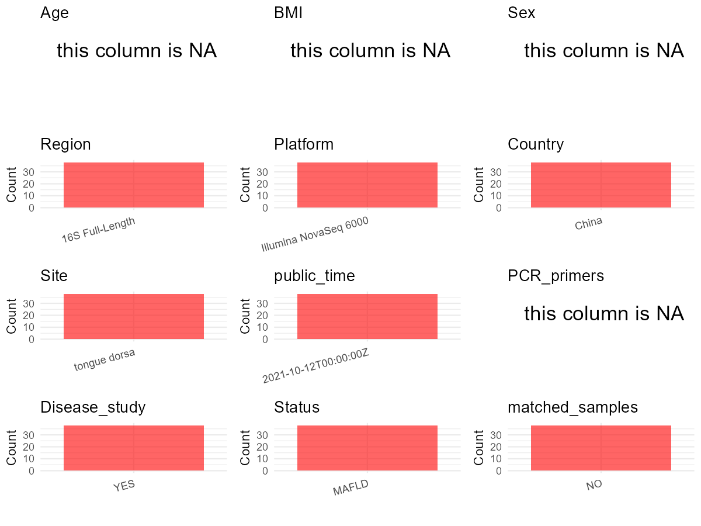

R Notebook: Metadata Processing Workflow
================

# Step 1: Obtain Initial Metadata from Each Project

To obtain the initial metadata: 1. Search for the BioProject ID (e.g.,
“PRJEBXXXX”) on the [NCBI SRA
website](https://www.ncbi.nlm.nih.gov/Traces/study/). 2. In the “Select”
table, click on “Metadata” and download the file. 3. The downloaded file
is typically named “SraRunTable.csv” and contains metadata for the
project.

``` r
# Load necessary libraries
library(dplyr)
library(ggplot2)
library(cowplot)

# Set working directory (update this path to your local directory)
setwd("D:/oral_project/PRJNA770736")

# Read the initial metadata files
initial_meta<-read.csv("SraRunTable.csv",header = T)

# Combine the two metadata files
#meta <- rbind(initial_meta, initial_meta1)

#Remove entries where Organism is "gut metagenome" (non-oral samples)
#initial_meta <- subset(initial_meta,isolation_source!= "feces")

# Check the number of samples containing "HT" in Sample.Name (e.g., healthy controls)
#nrow(subset(meta, grepl("HT", Sample.Name)))

# Display the first few rows of the metadata
head(initial_meta)
```

    ##           Run Assay.Type AvgSpotLen    Bases  BioProject    BioSample
    ## 1 SRR16302829   AMPLICON       1401 13143911 PRJNA770736 SAMN22232767
    ## 2 SRR16302830   AMPLICON       1467 30487602 PRJNA770736 SAMN22232766
    ## 3 SRR16302831   AMPLICON       1418 23768022 PRJNA770736 SAMN22232765
    ## 4 SRR16302832   AMPLICON       1432 25538496 PRJNA770736 SAMN22232764
    ## 5 SRR16302833   AMPLICON       1307 26659002 PRJNA770736 SAMN22232763
    ## 6 SRR16302834   AMPLICON       1351 24802883 PRJNA770736 SAMN22232762
    ##                BioSampleModel   Bytes                      Center.Name
    ## 1 Metagenome or environmental 3492965 HUBEI PROVINCIAL HOSPITAL OF TCM
    ## 2 Metagenome or environmental 7904523 HUBEI PROVINCIAL HOSPITAL OF TCM
    ## 3 Metagenome or environmental 6261081 HUBEI PROVINCIAL HOSPITAL OF TCM
    ## 4 Metagenome or environmental 6704842 HUBEI PROVINCIAL HOSPITAL OF TCM
    ## 5 Metagenome or environmental 7064203 HUBEI PROVINCIAL HOSPITAL OF TCM
    ## 6 Metagenome or environmental 6566305 HUBEI PROVINCIAL HOSPITAL OF TCM
    ##   Collection_Date Consent DATASTORE.filetype DATASTORE.provider
    ## 1      2020-10-06  public   fastq,run.zq,sra         gs,ncbi,s3
    ## 2      2020-10-03  public   fastq,run.zq,sra         gs,ncbi,s3
    ## 3      2020-12-01  public   fastq,run.zq,sra         gs,ncbi,s3
    ## 4      2020-11-17  public   fastq,run.zq,sra         gs,ncbi,s3
    ## 5      2020-09-15  public   fastq,run.zq,sra         gs,ncbi,s3
    ## 6      2020-08-21  public   fastq,run.zq,sra         gs,ncbi,s3
    ##                       DATASTORE.region  Experiment geo_loc_name_country
    ## 1 gs.us-east1,ncbi.public,s3.us-east-1 SRX12581416                China
    ## 2 gs.us-east1,ncbi.public,s3.us-east-1 SRX12581415                China
    ## 3 gs.us-east1,ncbi.public,s3.us-east-1 SRX12581414                China
    ## 4 gs.us-east1,ncbi.public,s3.us-east-1 SRX12581413                China
    ## 5 gs.us-east1,ncbi.public,s3.us-east-1 SRX12581412                China
    ## 6 gs.us-east1,ncbi.public,s3.us-east-1 SRX12581411                China
    ##   geo_loc_name_country_continent geo_loc_name         HOST
    ## 1                           Asia  China:Wuhan Homo sapiens
    ## 2                           Asia  China:Wuhan Homo sapiens
    ## 3                           Asia  China:Wuhan Homo sapiens
    ## 4                           Asia  China:Wuhan Homo sapiens
    ## 5                           Asia  China:Wuhan Homo sapiens
    ## 6                           Asia  China:Wuhan Homo sapiens
    ##              Instrument          lat_lon Library.Name LibraryLayout
    ## 1 Illumina NovaSeq 6000 30.11 N 113.50 E  ABC60000229        PAIRED
    ## 2 Illumina NovaSeq 6000 30.11 N 113.49 E           ZB        PAIRED
    ## 3 Illumina NovaSeq 6000 30.11 N 113.48 E  ABC60000093        PAIRED
    ## 4 Illumina NovaSeq 6000 30.11 N 113.47 E           LH        PAIRED
    ## 5 Illumina NovaSeq 6000 30.11 N 113.46 E           WQ        PAIRED
    ## 6 Illumina NovaSeq 6000 30.11 N 113.45 E          ZYH        PAIRED
    ##   LibrarySelection LibrarySource        Organism Platform          ReleaseDate
    ## 1              PCR       GENOMIC oral metagenome ILLUMINA 2021-10-12T00:00:00Z
    ## 2              PCR       GENOMIC oral metagenome ILLUMINA 2021-10-12T00:00:00Z
    ## 3              PCR       GENOMIC oral metagenome ILLUMINA 2021-10-12T00:00:00Z
    ## 4              PCR       GENOMIC oral metagenome ILLUMINA 2021-10-12T00:00:00Z
    ## 5              PCR       GENOMIC oral metagenome ILLUMINA 2021-10-12T00:00:00Z
    ## 6              PCR       GENOMIC oral metagenome ILLUMINA 2021-10-12T00:00:00Z
    ##            create_date version Sample.Name SRA.Study
    ## 1 2021-10-12T19:17:00Z       1 ABC60000229 SRP341078
    ## 2 2021-10-12T19:17:00Z       1          ZB SRP341078
    ## 3 2021-10-12T19:17:00Z       1 ABC60000093 SRP341078
    ## 4 2021-10-12T19:17:00Z       1          LH SRP341078
    ## 5 2021-10-12T19:17:00Z       1          WQ SRP341078
    ## 6 2021-10-12T19:17:00Z       1         ZYH SRP341078

# Step 2: Create a Uniform Metadata Template

The uniform metadata should include the following columns:

1.  **BioProject**: Project ID (e.g., “PRJNA339212”)
2.  **Run**: Sample ID (e.g., “ERRXXXXXX” or “SRRXXXXXX”)
3.  **sample_name**: Original sample name submitted by the authors (not
    the database-assigned ID)
4.  **Age**: Age of the subject (if available)
5.  **BMI**: Body Mass Index (if available)
6.  **Sex**: Sex of the subject (“F” or “M”)
7.  **Region**: Targeted 16S rRNA region (e.g., “V3-V4”)
8.  **Platform**: Sequencing platform (e.g., “Illumina MiSeq”)
9.  **Country**: Country of sample origin (e.g., “China”)
10. **Site**: Sample site (e.g., “saliva”, “dental plaque”)
11. **public_time**: Data release date (format: “YYYY-MM-DD”)
12. **PCR_primers**: PCR primers used (e.g., “515F-806R”)
13. **title**: Title of the associated publication
14. **Disease_study**: Whether the study involves a disease (“YES” or
    “NO”)
15. **Status**: Disease status (e.g., “T2DM”, “HC”). Note: If the study
    includes both disease and healthy samples, this must be specified
    per sample.

``` r
# Create a uniform metadata dataframe
metadata <- data.frame(
  BioProject = initial_meta$BioProject,
  Run = initial_meta$Run,
  sample_name = initial_meta$Sample.Name,
  Age = NA,
  BMI = NA,
  Sex=NA,
  Region = "16S Full-Length",
  Platform = initial_meta$Instrument,
  Country = initial_meta$geo_loc_name_country,
  Site = "tongue dorsa",
  public_time = initial_meta$ReleaseDate,
  stringsAsFactors = FALSE
)
```

# Step 3: Manually Add Information from the Publication

Some information (e.g. PCR primers, study title, disease status) must be
manually extracted from the publication and added to the metadata.

``` r
# Add information obtained from the publication
metadata$PCR_primers <- NA
metadata$title <- "Oral-Gut Microbiome Analysis in Patients With Metabolic-Associated Fatty Liver Disease Having Different Tongue Image Feature"
#metadata<-subset(uniform_meta,Site!="feces")
metadata$Disease_study <- "YES"
# Assign disease status based on sample_name patterns
metadata$Status <- "MAFLD"
#extract subject id by remove prefix of sample_name
#metadata$sample_name <- gsub("S-Saliva-.*|F", "", metadata$sample_name)
#get subjects id with Saliva available
#keep_subjects<-subset(metadata,Site %in% c("Saliva"))
#remove subjects without Saliva samples
#metadata<-subset(metadata,sample_name %in% keep_subjects$sample_name)
#get subjects sampling counts
#sample_counts <- table(metadata$sample_name)
# Create matched_samples column, any subjects have >=2 samples will be label "YES", otherwise "NO"
#metadata$matched_samples <- ifelse(metadata$sample_name %in% names(sample_counts[sample_counts >= 2]), "YES", "NO")
metadata$matched_samples<-"NO"
```

# Step 4: Summarize and Validate the Metadata

``` r
# Check the number of unique runs and sample names
print(paste("Number of unique runs:", length(unique(metadata$Run))))
```

    ## [1] "Number of unique runs: 38"

``` r
print(paste("Number of unique sample names:", length(unique(metadata$sample_name))))
```

    ## [1] "Number of unique sample names: 38"

# Step 5: Visualize the Metadata

``` r

```


# Step 6: Finalize and Export the Metadata

``` r
# Reorder columns to match the desired format
metadata <- metadata[, c(
  "BioProject", "Run", "sample_name", "Age", "BMI", "Sex", 
  "Region", "Platform", "Country", "Site", "public_time", 
  "PCR_primers", "title", "Disease_study", "Status","matched_samples"
)]

# Export the uniform metadata to a CSV file
write.csv(metadata, file = "metadata.csv", quote = FALSE)
head(metadata)
```

    ##    BioProject         Run sample_name Age BMI Sex          Region
    ## 1 PRJNA770736 SRR16302829 ABC60000229  NA  NA  NA 16S Full-Length
    ## 2 PRJNA770736 SRR16302830          ZB  NA  NA  NA 16S Full-Length
    ## 3 PRJNA770736 SRR16302831 ABC60000093  NA  NA  NA 16S Full-Length
    ## 4 PRJNA770736 SRR16302832          LH  NA  NA  NA 16S Full-Length
    ## 5 PRJNA770736 SRR16302833          WQ  NA  NA  NA 16S Full-Length
    ## 6 PRJNA770736 SRR16302834         ZYH  NA  NA  NA 16S Full-Length
    ##                Platform Country         Site          public_time PCR_primers
    ## 1 Illumina NovaSeq 6000   China tongue dorsa 2021-10-12T00:00:00Z          NA
    ## 2 Illumina NovaSeq 6000   China tongue dorsa 2021-10-12T00:00:00Z          NA
    ## 3 Illumina NovaSeq 6000   China tongue dorsa 2021-10-12T00:00:00Z          NA
    ## 4 Illumina NovaSeq 6000   China tongue dorsa 2021-10-12T00:00:00Z          NA
    ## 5 Illumina NovaSeq 6000   China tongue dorsa 2021-10-12T00:00:00Z          NA
    ## 6 Illumina NovaSeq 6000   China tongue dorsa 2021-10-12T00:00:00Z          NA
    ##                                                                                                                          title
    ## 1 Oral-Gut Microbiome Analysis in Patients With Metabolic-Associated Fatty Liver Disease Having Different Tongue Image Feature
    ## 2 Oral-Gut Microbiome Analysis in Patients With Metabolic-Associated Fatty Liver Disease Having Different Tongue Image Feature
    ## 3 Oral-Gut Microbiome Analysis in Patients With Metabolic-Associated Fatty Liver Disease Having Different Tongue Image Feature
    ## 4 Oral-Gut Microbiome Analysis in Patients With Metabolic-Associated Fatty Liver Disease Having Different Tongue Image Feature
    ## 5 Oral-Gut Microbiome Analysis in Patients With Metabolic-Associated Fatty Liver Disease Having Different Tongue Image Feature
    ## 6 Oral-Gut Microbiome Analysis in Patients With Metabolic-Associated Fatty Liver Disease Having Different Tongue Image Feature
    ##   Disease_study Status matched_samples
    ## 1           YES  MAFLD              NO
    ## 2           YES  MAFLD              NO
    ## 3           YES  MAFLD              NO
    ## 4           YES  MAFLD              NO
    ## 5           YES  MAFLD              NO
    ## 6           YES  MAFLD              NO

## Notes for Students:

1.  **Metadata Accuracy**: Always cross-check the metadata with the
    original publication to ensure accuracy.
2.  **Manual Entries**: Columns like `PCR_primers`, and `Status` often
    require manual entry based on the publication.
3.  **Disease Status**: Be careful when assigning `Status`—some studies
    include both disease and healthy samples.
4.  **Visualization**: The plots help quickly identify the distribution
    of values in each column, which is useful for quality control.
5.  **Reproducibility**: Update the working directory and file paths to
    match your local environment.
