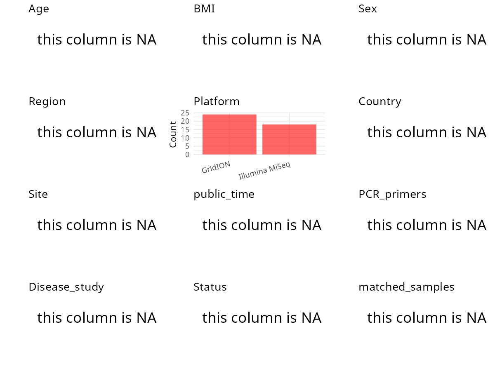

R Notebook: Metadata Processing Workflow
================

# Step 1: Obtain Initial Metadata from Each Project

To obtain the initial metadata: 1. Search for the BioProject ID (e.g.,
“PRJEBXXXX”) on the [NCBI SRA
website](https://www.ncbi.nlm.nih.gov/Traces/study/). 2. In the “Select”
table, click on “Metadata” and download the file. 3. The downloaded file
is typically named “SraRunTable.csv” and contains metadata for the
project.

``` r
# Load necessary libraries
library(dplyr)
library(ggplot2)
library(cowplot)
library(stringr)

# Set working directory (update this path to your local directory)
setwd("/home/hby/oral_project/PRJNA773113")

# Read the initial metadata files
initial_meta <- read.csv("SraRunTable.csv", header = T)

# Combine the two metadata files
# meta <- rbind(initial_meta, initial_meta1)

# Remove entries non-oral samples
# initial_meta <- subset(initial_meta,isolate %in% c("saliva","tongue coat"))

# Check the number of samples containing "HT" in Sample.Name (e.g., healthy controls)
# nrow(subset(meta, grepl("HT", Sample.Name)))

# Display the first few rows of the metadata
head(initial_meta)
```

    ##           Run Assay.Type AvgSpotLen     Bases  BioProject    BioSample              BioSampleModel    Bytes               Center.Name Collection_Date Consent DATASTORE.filetype
    ## 1 SRR16506474   AMPLICON        602  90469162 PRJNA773113 SAMN22443231 Metagenome or environmental 51655397 J. CRAIG VENTER INSTITUTE       2021/8/20  public   fastq,run.zq,sra
    ## 2 SRR16506475   AMPLICON        602  91587076 PRJNA773113 SAMN22443230 Metagenome or environmental 51720066 J. CRAIG VENTER INSTITUTE       2021/8/20  public   fastq,run.zq,sra
    ## 3 SRR16506476   AMPLICON        602 137966962 PRJNA773113 SAMN22443229 Metagenome or environmental 77841817 J. CRAIG VENTER INSTITUTE       2021/8/20  public   fastq,run.zq,sra
    ## 4 SRR16506477   AMPLICON        602 175633500 PRJNA773113 SAMN22443228 Metagenome or environmental 98661508 J. CRAIG VENTER INSTITUTE       2021/8/20  public   fastq,run.zq,sra
    ## 5 SRR16506478   AMPLICON        602 120191708 PRJNA773113 SAMN22443227 Metagenome or environmental 66372233 J. CRAIG VENTER INSTITUTE       2021/8/20  public   fastq,run.zq,sra
    ## 6 SRR16506479   AMPLICON        602 136484838 PRJNA773113 SAMN22443226 Metagenome or environmental 76537790 J. CRAIG VENTER INSTITUTE       2021/8/20  public   fastq,run.zq,sra
    ##   DATASTORE.provider                     DATASTORE.region  Experiment geo_loc_name_country geo_loc_name_country_continent  geo_loc_name         HOST     Instrument isolation_source
    ## 1         gs,ncbi,s3 gs.us-east1,ncbi.public,s3.us-east-1 SRX12709289                  USA                  North America USA: La Jolla Homo sapiens Illumina MiSeq           saliva
    ## 2         gs,ncbi,s3 gs.us-east1,ncbi.public,s3.us-east-1 SRX12709288                  USA                  North America USA: La Jolla Homo sapiens Illumina MiSeq           saliva
    ## 3         gs,ncbi,s3 gs.us-east1,ncbi.public,s3.us-east-1 SRX12709287                  USA                  North America USA: La Jolla Homo sapiens Illumina MiSeq           saliva
    ## 4         gs,ncbi,s3 gs.us-east1,ncbi.public,s3.us-east-1 SRX12709286                  USA                  North America USA: La Jolla Homo sapiens Illumina MiSeq           saliva
    ## 5         gs,ncbi,s3 gs.us-east1,ncbi.public,s3.us-east-1 SRX12709285                  USA                  North America USA: La Jolla Homo sapiens Illumina MiSeq           saliva
    ## 6         gs,ncbi,s3 gs.us-east1,ncbi.public,s3.us-east-1 SRX12709284                  USA                  North America USA: La Jolla Homo sapiens Illumina MiSeq           saliva
    ##            lat_lon Library.Name LibraryLayout LibrarySelection LibrarySource              Organism Platform          ReleaseDate          create_date version          Sample.Name
    ## 1 32.87 N 117.24 W          CB1        PAIRED              PCR   METAGENOMIC human oral metagenome ILLUMINA 2021-10-20T00:00:00Z 2021-10-20T17:56:00Z       1 1CB_1-PE-D703-D502-1
    ## 2 32.87 N 117.24 W          MP3        PAIRED              PCR   METAGENOMIC human oral metagenome ILLUMINA 2021-10-20T00:00:00Z 2021-10-20T17:56:00Z       1 1MP_3-PE-D703-D501-1
    ## 3 32.87 N 117.24 W          MP2        PAIRED              PCR   METAGENOMIC human oral metagenome ILLUMINA 2021-10-20T00:00:00Z 2021-10-20T17:56:00Z       1 1MP_2-PE-D702-D508-1
    ## 4 32.87 N 117.24 W          MP1        PAIRED              PCR   METAGENOMIC human oral metagenome ILLUMINA 2021-10-20T00:00:00Z 2021-10-20T17:56:00Z       1 1MP_1-PE-D702-D507-1
    ## 5 32.87 N 117.24 W          RP3        PAIRED              PCR   METAGENOMIC human oral metagenome ILLUMINA 2021-10-20T00:00:00Z 2021-10-20T17:56:00Z       1 1RP_3-PE-D702-D506-1
    ## 6 32.87 N 117.24 W          RP2        PAIRED              PCR   METAGENOMIC human oral metagenome ILLUMINA 2021-10-20T00:00:00Z 2021-10-20T17:56:00Z       1 1RP_2-PE-D702-D505-1
    ##          source_material_id SRA.Study samp_mat_process
    ## 1          control-biofilm1 SRP342425               NA
    ## 2  mutanocyclin-planktonic3 SRP342425               NA
    ## 3  mutanocyclin-planktonic2 SRP342425               NA
    ## 4  mutanocyclin-planktonic1 SRP342425               NA
    ## 5 reutericyclin-planktonic3 SRP342425               NA
    ## 6 reutericyclin-planktonic2 SRP342425               NA

# Step 2: Create a Uniform Metadata Template

The uniform metadata should include the following columns:

1.  **BioProject**: Project ID (e.g., “PRJNA339212”)
2.  **Run**: Sample ID (e.g., “ERRXXXXXX” or “SRRXXXXXX”)
3.  **sample_name**: Original sample name submitted by the authors (not
    the database-assigned ID)
4.  **Age**: Age of the subject (if available)
5.  **BMI**: Body Mass Index (if available)
6.  **Sex**: Sex of the subject (“F” or “M”)
7.  **Region**: Targeted 16S rRNA region (e.g., “V3-V4”)
8.  **Platform**: Sequencing platform (e.g., “Illumina MiSeq”)
9.  **Country**: Country of sample origin (e.g., “China”)
10. **Site**: Sample site (e.g., “saliva”, “dental plaque”)
11. **public_time**: Data release date (format: “YYYY-MM-DD”)
12. **PCR_primers**: PCR primers used (e.g., “515F-806R”)
13. **title**: Title of the associated publication
14. **Disease_study**: Whether the study involves a disease (“YES” or
    “NO”)
15. **Status**: Disease status (e.g., “T2DM”, “HC”). Note: If the study
    includes both disease and healthy samples, this must be specified
    per sample.
16. **matched_samples**: matched samples (“YES” or “NO”)

``` r
# Create a uniform metadata dataframe
metadata <- data.frame(
  BioProject = initial_meta$BioProject,
  Run = initial_meta$Run,
  sample_name = NA,
  Platform = initial_meta$Instrument,
  Country = NA,
  public_time = NA,
  Site = NA,
  Sex = NA,
  Age = NA,
  BMI = NA,
  Status = NA,
  Region = NA,
  PCR_primers = NA,
  title = NA,
  Disease_study = NA,
  matched_samples = NA
)
```

# Step 3: Manually Add Information from the Publication

Some information (e.g. PCR primers, study title, disease status) must be
manually extracted from the publication and added to the metadata.

``` r
# Add information obtained from the publication
```

# Step 4: Summarize and Validate the Metadata

``` r
# Check the number of unique runs and sample names
print(paste("Number of unique runs:", length(unique(metadata$Run))))
```

    ## [1] "Number of unique runs: 42"

``` r
print(paste("Number of unique sample names:", length(unique(metadata$sample_name))))
```

    ## [1] "Number of unique sample names: 1"

# Step 5: Visualize the Metadata

``` r

```


# Step 6: Finalize and Export the Metadata

``` r
# Reorder columns to match the desired format
metadata <- metadata[, c(
  "BioProject", "Run", "sample_name", "Age", "BMI", "Sex",
  "Region", "Platform", "Country", "Site", "public_time",
  "PCR_primers", "title", "Disease_study", "Status", "matched_samples"
)]

# Export the uniform metadata to a CSV file
write.csv(metadata, file = "metadata.csv", quote = FALSE)
head(metadata)
```

    ##    BioProject         Run sample_name Age BMI Sex Region       Platform Country Site public_time PCR_primers title Disease_study Status matched_samples
    ## 1 PRJNA773113 SRR16506474          NA  NA  NA  NA     NA Illumina MiSeq      NA   NA          NA          NA    NA            NA     NA              NA
    ## 2 PRJNA773113 SRR16506475          NA  NA  NA  NA     NA Illumina MiSeq      NA   NA          NA          NA    NA            NA     NA              NA
    ## 3 PRJNA773113 SRR16506476          NA  NA  NA  NA     NA Illumina MiSeq      NA   NA          NA          NA    NA            NA     NA              NA
    ## 4 PRJNA773113 SRR16506477          NA  NA  NA  NA     NA Illumina MiSeq      NA   NA          NA          NA    NA            NA     NA              NA
    ## 5 PRJNA773113 SRR16506478          NA  NA  NA  NA     NA Illumina MiSeq      NA   NA          NA          NA    NA            NA     NA              NA
    ## 6 PRJNA773113 SRR16506479          NA  NA  NA  NA     NA Illumina MiSeq      NA   NA          NA          NA    NA            NA     NA              NA

## Notes for Students:

1.  **Metadata Accuracy**: Always cross-check the metadata with the
    original publication to ensure accuracy.
2.  **Manual Entries**: Columns like `PCR_primers`, and `Status` often
    require manual entry based on the publication.
3.  **Disease Status**: Be careful when assigning `Status`—some studies
    include both disease and healthy samples.
4.  **Visualization**: The plots help quickly identify the distribution
    of values in each column, which is useful for quality control.
5.  **Reproducibility**: Update the working directory and file paths to
    match your local environment.
