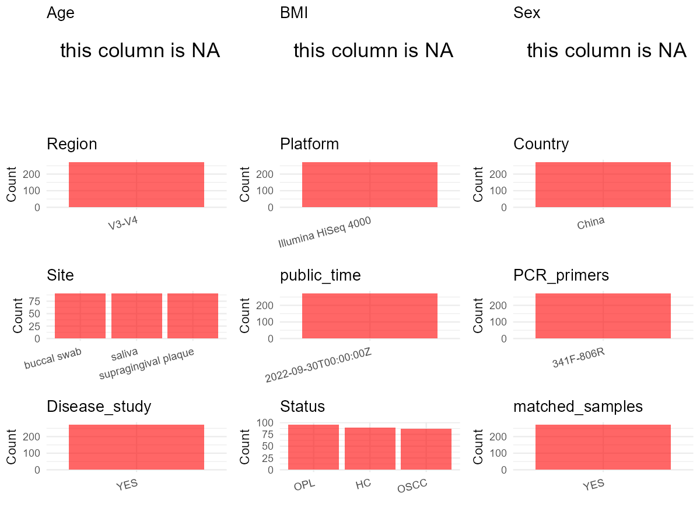

R Notebook: Metadata Processing Workflow
================

# Step 1: Obtain Initial Metadata from Each Project

To obtain the initial metadata: 1. Search for the BioProject ID (e.g.,
“PRJEBXXXX”) on the [NCBI SRA
website](https://www.ncbi.nlm.nih.gov/Traces/study/). 2. In the “Select”
table, click on “Metadata” and download the file. 3. The downloaded file
is typically named “SraRunTable.csv” and contains metadata for the
project.

``` r
# Load necessary libraries
library(dplyr)
library(ggplot2)
library(cowplot)
library(stringr)

# Set working directory (update this path to your local directory)
setwd("E:/bioproject_YL/PRJNA777754")

# Read the initial metadata files
initial_meta <- read.csv("SraRunTable.csv", header = T)

# Display the first few rows of the metadata
head(initial_meta)
```

    ##           Run Assay.Type AvgSpotLen    Bases  BioProject    BioSample
    ## 1 SRR16774659        WGA        255 24200098 PRJNA777754 SAMN22874852
    ## 2 SRR16774660        WGA        250 24439602 PRJNA777754 SAMN22874851
    ## 3 SRR16774661        WGA        246 21692840 PRJNA777754 SAMN22874850
    ## 4 SRR16774662        WGA        476 12125308 PRJNA777754 SAMN22874823
    ## 5 SRR16774663        WGA        254 26320847 PRJNA777754 SAMN22874849
    ## 6 SRR16774664        WGA        252 26283093 PRJNA777754 SAMN22874848
    ##                BioSampleModel    Bytes
    ## 1 Metagenome or environmental 11072963
    ## 2 Metagenome or environmental 11153754
    ## 3 Metagenome or environmental  9902686
    ## 4 Metagenome or environmental  6662232
    ## 5 Metagenome or environmental 11926149
    ## 6 Metagenome or environmental 11942549
    ##                                                             Center.Name
    ## 1 NANJING STOMATOLOGICAL HOSPITAL, MEDICAL SCHOOL OF NANJING UNIVERSITY
    ## 2 NANJING STOMATOLOGICAL HOSPITAL, MEDICAL SCHOOL OF NANJING UNIVERSITY
    ## 3 NANJING STOMATOLOGICAL HOSPITAL, MEDICAL SCHOOL OF NANJING UNIVERSITY
    ## 4 NANJING STOMATOLOGICAL HOSPITAL, MEDICAL SCHOOL OF NANJING UNIVERSITY
    ## 5 NANJING STOMATOLOGICAL HOSPITAL, MEDICAL SCHOOL OF NANJING UNIVERSITY
    ## 6 NANJING STOMATOLOGICAL HOSPITAL, MEDICAL SCHOOL OF NANJING UNIVERSITY
    ##   Collection_Date Consent DATASTORE.filetype DATASTORE.provider
    ## 1      2020/11/28  public   fastq,run.zq,sra         gs,ncbi,s3
    ## 2      2020/11/28  public   fastq,run.zq,sra         gs,ncbi,s3
    ## 3      2020/11/28  public   fastq,run.zq,sra         gs,ncbi,s3
    ## 4      2020/11/28  public   fastq,run.zq,sra         gs,ncbi,s3
    ## 5      2020/11/28  public   fastq,run.zq,sra         gs,ncbi,s3
    ## 6      2020/11/28  public   fastq,run.zq,sra         gs,ncbi,s3
    ##                       DATASTORE.region env_broad_scale env_local_scale
    ## 1 gs.us-east1,ncbi.public,s3.us-east-1   not collected   not collected
    ## 2 gs.us-east1,ncbi.public,s3.us-east-1   not collected   not collected
    ## 3 gs.us-east1,ncbi.public,s3.us-east-1   not collected   not collected
    ## 4 gs.us-east1,ncbi.public,s3.us-east-1   not collected   not collected
    ## 5 gs.us-east1,ncbi.public,s3.us-east-1   not collected   not collected
    ## 6 gs.us-east1,ncbi.public,s3.us-east-1   not collected   not collected
    ##      env_medium  Experiment geo_loc_name_country geo_loc_name_country_continent
    ## 1 not collected SRX12974171                China                           Asia
    ## 2 not collected SRX12974170                China                           Asia
    ## 3 not collected SRX12974169                China                           Asia
    ## 4 not collected SRX12974168                China                           Asia
    ## 5 not collected SRX12974167                China                           Asia
    ## 6 not collected SRX12974166                China                           Asia
    ##   geo_loc_name          Instrument     isolate isolation_source
    ## 1        China Illumina HiSeq 4000 I_Oral_L_33    not collected
    ## 2        China Illumina HiSeq 4000 I_Oral_L_32    not collected
    ## 3        China Illumina HiSeq 4000 I_Oral_L_31    not collected
    ## 4        China Illumina HiSeq 4000  I_Oral_L_4    not collected
    ## 5        China Illumina HiSeq 4000 I_Oral_L_30    not collected
    ## 6        China Illumina HiSeq 4000 I_Oral_L_29    not collected
    ##            lat_lon Library.Name LibraryLayout LibrarySelection LibrarySource
    ## 1 32.06 N 118.78 E  I_Oral_L_33        PAIRED              PCR   METAGENOMIC
    ## 2 32.06 N 118.78 E  I_Oral_L_32        PAIRED              PCR   METAGENOMIC
    ## 3 32.06 N 118.78 E  I_Oral_L_31        PAIRED              PCR   METAGENOMIC
    ## 4 32.06 N 118.78 E   I_Oral_L_4        PAIRED              PCR   METAGENOMIC
    ## 5 32.06 N 118.78 E  I_Oral_L_30        PAIRED              PCR   METAGENOMIC
    ## 6 32.06 N 118.78 E  I_Oral_L_29        PAIRED              PCR   METAGENOMIC
    ##                Organism Platform          ReleaseDate          create_date
    ## 1 human oral metagenome ILLUMINA 2022-09-30T00:00:00Z 2021-11-05T02:20:00Z
    ## 2 human oral metagenome ILLUMINA 2022-09-30T00:00:00Z 2021-11-05T02:20:00Z
    ## 3 human oral metagenome ILLUMINA 2022-09-30T00:00:00Z 2021-11-05T02:20:00Z
    ## 4 human oral metagenome ILLUMINA 2022-09-30T00:00:00Z 2021-11-04T20:29:00Z
    ## 5 human oral metagenome ILLUMINA 2022-09-30T00:00:00Z 2021-11-05T02:20:00Z
    ## 6 human oral metagenome ILLUMINA 2022-09-30T00:00:00Z 2021-11-05T02:20:00Z
    ##   version Sample.Name SRA.Study
    ## 1       1 I_Oral_L_33 SRP344617
    ## 2       1 I_Oral_L_32 SRP344617
    ## 3       1 I_Oral_L_31 SRP344617
    ## 4       1  I_Oral_L_4 SRP344617
    ## 5       1 I_Oral_L_30 SRP344617
    ## 6       1 I_Oral_L_29 SRP344617

# Step 2: Create a Uniform Metadata Template

The uniform metadata should include the following columns:

1.  **BioProject**: Project ID (e.g., “PRJNA339212”)
2.  **Run**: Sample ID (e.g., “ERRXXXXXX” or “SRRXXXXXX”)
3.  **sample_name**: Original sample name submitted by the authors (not
    the database-assigned ID)
4.  **Age**: Age of the subject (if available)
5.  **BMI**: Body Mass Index (if available)
6.  **Sex**: Sex of the subject (“F” or “M”)
7.  **Region**: Targeted 16S rRNA region (e.g., “V3-V4”)
8.  **Platform**: Sequencing platform (e.g., “Illumina MiSeq”)
9.  **Country**: Country of sample origin (e.g., “China”)
10. **Site**: Sample site (e.g., “saliva”, “dental plaque”)
11. **public_time**: Data release date (format: “YYYY-MM-DD”)
12. **PCR_primers**: PCR primers used (e.g., “515F-806R”)
13. **title**: Title of the associated publication
14. **Disease_study**: Whether the study involves a disease (“YES” or
    “NO”)
15. **Status**: Disease status (e.g., “T2DM”, “HC”). Note: If the study
    includes both disease and healthy samples, this must be specified
    per sample.
16. **matched_samples**: matched samples (“YES” or “NO”)

``` r
# Create a uniform metadata dataframe
metadata <- data.frame(
  BioProject = initial_meta$BioProject,
  Run = initial_meta$Run,
  sample_name = initial_meta$Sample.Name,
  Age = NA,
  BMI = NA,  
  Sex = NA,
  Region = "V3-V4",
  Platform = initial_meta$Instrument,
  Country = initial_meta$geo_loc_name_country,
  public_time = initial_meta$ReleaseDate,
  stringsAsFactors = FALSE
)

# Assign site based on sample_name patterns
metadata <- metadata %>%
  mutate(Site = case_when(
    str_detect(sample_name, "S") ~ "saliva",
    str_detect(sample_name, "P") ~ "supragingival plaque",
    TRUE ~ "buccal swab"
  ))
```

# Step 3: Manually Add Information from the Publication

Some information (e.g. PCR primers, study title, disease status) must be
manually extracted from the publication and added to the metadata.

``` r
# Add information obtained from the publication
metadata$PCR_primers <- "341F-806R"
metadata$title <- "Oral bacteriome and mycobiome across stages of oral carcinogenesis"
metadata$Disease_study <- "YES"
# Assign disease status based on sample_name patterns
metadata <- metadata %>%
  mutate(
    Status = case_when(
      as.numeric(str_extract(sample_name, "[0-9]+")) %in% 1:30 ~ "HC",
      as.numeric(str_extract(sample_name, "[0-9]+")) %in% 31:62 ~ "OPL",
      as.numeric(str_extract(sample_name, "[0-9]+")) %in% 63:91 ~ "OSCC",
      TRUE ~ NA_character_
    )
    )

#extract subject id by remove prefix of sample_name
metadata$sample_name <- gsub("I_Oral_L_|I_Oral_S_|I_Oral_P_", "", metadata$sample_name)

# Check initial data distribution
cat("Initial sample distribution:\n")
```

    ## Initial sample distribution:

``` r
table(metadata$sample_name)
```

    ## 
    ##  1 10 11 12 13 14 15 16 17 18 19  2 20 21 22 23 24 25 26 27 28 29  3 30 31 32 
    ##  3  3  3  3  3  3  3  3  3  3  3  3  3  3  3  3  3  3  3  3  3  3  3  3  3  3 
    ## 33 34 35 36 37 38 39  4 40 41 42 43 44 45 46 47 48 49  5 50 51 52 53 54 55 56 
    ##  3  3  3  3  3  3  3  3  3  3  3  3  3  3  3  3  3  3  3  3  3  3  3  3  3  3 
    ## 57 58 59  6 60 61 62 63 64 65 66 67 68 69  7 70 71 72 73 74 75 76 77 78 79  8 
    ##  3  3  3  3  3  3  3  3  3  3  3  3  3  3  3  3  3  3  3  3  3  3  3  3  3  3 
    ## 80 81 82 83 84 85 86 87 88 89  9 90 91 
    ##  3  3  3  3  3  3  3  3  3  3  3  3  3

``` r
table(metadata$Site)
```

    ## 
    ##          buccal swab               saliva supragingival plaque 
    ##                   91                   91                   91

``` r
# Calculate sampling frequency per subject
sample_counts <- table(metadata$sample_name)
cat("\nNumber of samples per subject:\n")
```

    ## 
    ## Number of samples per subject:

``` r
print(sample_counts)
```

    ## 
    ##  1 10 11 12 13 14 15 16 17 18 19  2 20 21 22 23 24 25 26 27 28 29  3 30 31 32 
    ##  3  3  3  3  3  3  3  3  3  3  3  3  3  3  3  3  3  3  3  3  3  3  3  3  3  3 
    ## 33 34 35 36 37 38 39  4 40 41 42 43 44 45 46 47 48 49  5 50 51 52 53 54 55 56 
    ##  3  3  3  3  3  3  3  3  3  3  3  3  3  3  3  3  3  3  3  3  3  3  3  3  3  3 
    ## 57 58 59  6 60 61 62 63 64 65 66 67 68 69  7 70 71 72 73 74 75 76 77 78 79  8 
    ##  3  3  3  3  3  3  3  3  3  3  3  3  3  3  3  3  3  3  3  3  3  3  3  3  3  3 
    ## 80 81 82 83 84 85 86 87 88 89  9 90 91 
    ##  3  3  3  3  3  3  3  3  3  3  3  3  3

``` r
# Create matched_samples column
metadata$matched_samples <- ifelse(metadata$sample_name %in% names(sample_counts[sample_counts >= 2]), "YES", "NO")

cat("\nMatched samples distribution:\n")
```

    ## 
    ## Matched samples distribution:

``` r
table(metadata$matched_samples)
```

    ## 
    ## YES 
    ## 273

``` r
# Identify samples for removal: single samples excluding saliva,  supragingival plaque and buccal swab
single_samples <- names(sample_counts[sample_counts == 1])
samples_to_remove <- metadata$sample_name %in% single_samples & 
                     !(metadata$Site %in% c("saliva", "supragingival plaque", "buccal swab"))

cat("\nNumber of samples to be removed:", sum(samples_to_remove), "\n")
```

    ## 
    ## Number of samples to be removed: 0

``` r
# Remove identified samples
metadata_clean <- metadata[!samples_to_remove, ]

cat("\nFinal sample distribution after cleaning:\n")
```

    ## 
    ## Final sample distribution after cleaning:

``` r
table(metadata_clean$sample_name)
```

    ## 
    ##  1 10 11 12 13 14 15 16 17 18 19  2 20 21 22 23 24 25 26 27 28 29  3 30 31 32 
    ##  3  3  3  3  3  3  3  3  3  3  3  3  3  3  3  3  3  3  3  3  3  3  3  3  3  3 
    ## 33 34 35 36 37 38 39  4 40 41 42 43 44 45 46 47 48 49  5 50 51 52 53 54 55 56 
    ##  3  3  3  3  3  3  3  3  3  3  3  3  3  3  3  3  3  3  3  3  3  3  3  3  3  3 
    ## 57 58 59  6 60 61 62 63 64 65 66 67 68 69  7 70 71 72 73 74 75 76 77 78 79  8 
    ##  3  3  3  3  3  3  3  3  3  3  3  3  3  3  3  3  3  3  3  3  3  3  3  3  3  3 
    ## 80 81 82 83 84 85 86 87 88 89  9 90 91 
    ##  3  3  3  3  3  3  3  3  3  3  3  3  3

``` r
table(metadata_clean$Site)
```

    ## 
    ##          buccal swab               saliva supragingival plaque 
    ##                   91                   91                   91

``` r
table(metadata_clean$matched_samples)
```

    ## 
    ## YES 
    ## 273

``` r
# Use cleaned dataset for subsequent analysis
metadata <- metadata_clean
```

# Step 4: Summarize and Validate the Metadata

``` r
# Check the number of unique runs and sample names
print(paste("Number of unique runs:", length(unique(metadata$Run))))
```

    ## [1] "Number of unique runs: 273"

``` r
print(paste("Number of unique sample names:", length(unique(metadata$sample_name))))
```

    ## [1] "Number of unique sample names: 91"

# Step 5: Visualize the Metadata

``` r

```


# Step 6: Finalize and Export the Metadata

``` r
# Reorder columns to match the desired format
metadata <- metadata[, c(
  "BioProject", "Run", "sample_name", "Age", "BMI", "Sex", 
  "Region", "Platform", "Country", "Site", "public_time", 
  "PCR_primers", "title", "Disease_study", "Status", "matched_samples"
)]

# Export the uniform metadata to a CSV file
write.csv(metadata, file = "metadata.csv", quote = FALSE)
head(metadata)
```

    ##    BioProject         Run sample_name Age BMI Sex Region            Platform
    ## 1 PRJNA777754 SRR16774659          33  NA  NA  NA  V3-V4 Illumina HiSeq 4000
    ## 2 PRJNA777754 SRR16774660          32  NA  NA  NA  V3-V4 Illumina HiSeq 4000
    ## 3 PRJNA777754 SRR16774661          31  NA  NA  NA  V3-V4 Illumina HiSeq 4000
    ## 4 PRJNA777754 SRR16774662           4  NA  NA  NA  V3-V4 Illumina HiSeq 4000
    ## 5 PRJNA777754 SRR16774663          30  NA  NA  NA  V3-V4 Illumina HiSeq 4000
    ## 6 PRJNA777754 SRR16774664          29  NA  NA  NA  V3-V4 Illumina HiSeq 4000
    ##   Country        Site          public_time PCR_primers
    ## 1   China buccal swab 2022-09-30T00:00:00Z   341F-806R
    ## 2   China buccal swab 2022-09-30T00:00:00Z   341F-806R
    ## 3   China buccal swab 2022-09-30T00:00:00Z   341F-806R
    ## 4   China buccal swab 2022-09-30T00:00:00Z   341F-806R
    ## 5   China buccal swab 2022-09-30T00:00:00Z   341F-806R
    ## 6   China buccal swab 2022-09-30T00:00:00Z   341F-806R
    ##                                                                title
    ## 1 Oral bacteriome and mycobiome across stages of oral carcinogenesis
    ## 2 Oral bacteriome and mycobiome across stages of oral carcinogenesis
    ## 3 Oral bacteriome and mycobiome across stages of oral carcinogenesis
    ## 4 Oral bacteriome and mycobiome across stages of oral carcinogenesis
    ## 5 Oral bacteriome and mycobiome across stages of oral carcinogenesis
    ## 6 Oral bacteriome and mycobiome across stages of oral carcinogenesis
    ##   Disease_study Status matched_samples
    ## 1           YES    OPL             YES
    ## 2           YES    OPL             YES
    ## 3           YES    OPL             YES
    ## 4           YES     HC             YES
    ## 5           YES     HC             YES
    ## 6           YES     HC             YES

## Notes for Students:

1.  **Metadata Accuracy**: Always cross-check the metadata with the
    original publication to ensure accuracy.
2.  **Manual Entries**: Columns like `PCR_primers`, and `Status` often
    require manual entry based on the publication.
3.  **Disease Status**: Be careful when assigning `Status`—some studies
    include both disease and healthy samples.
4.  **Visualization**: The plots help quickly identify the distribution
    of values in each column, which is useful for quality control.
5.  **Reproducibility**: Update the working directory and file paths to
    match your local environment.
