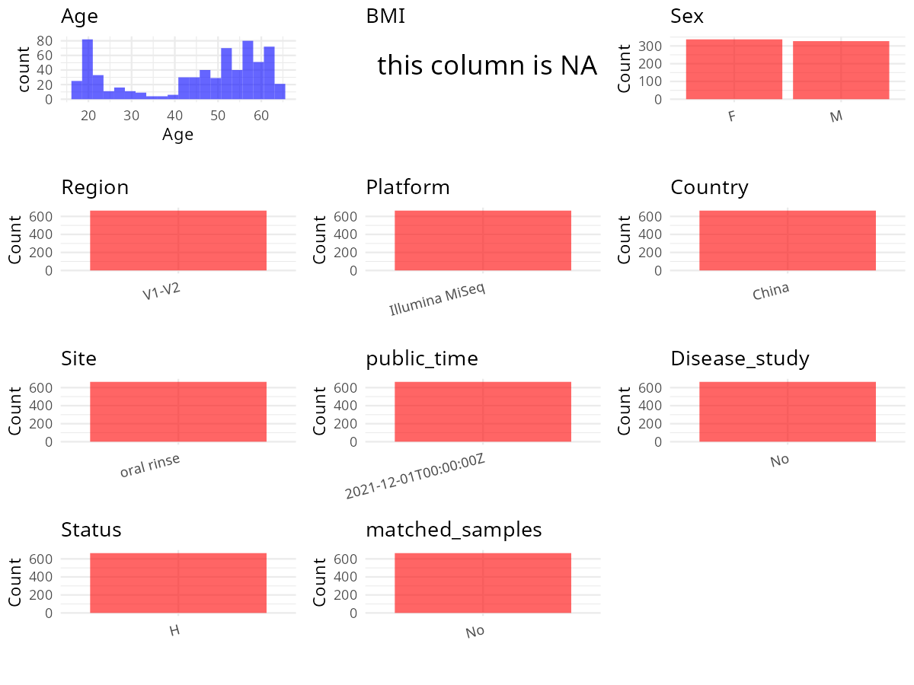

R Notebook: Metadata Processing Workflow
================

# Step 1: Obtain Initial Metadata from Each Project

To obtain the initial metadata: 1. Search for the BioProject ID (e.g.,
“PRJEBXXXX”) on the [NCBI SRA
website](https://www.ncbi.nlm.nih.gov/Traces/study/). 2. In the “Select”
table, click on “Metadata” and download the file. 3. The downloaded file
is typically named “SraRunTable.csv” and contains metadata for the
project.

``` r
# Load necessary libraries
library(dplyr)
library(ggplot2)
library(cowplot)
library(stringr)

# Set working directory (update this path to your local directory)
setwd("/home/hby/oral_project/PRJNA778006")

# Read the initial metadata files
initial_meta <- read.csv("SraRunTable.csv", header = T)

# Combine the two metadata files
# meta <- rbind(initial_meta, initial_meta1)

# Remove entries non-oral samples
# initial_meta <- subset(initial_meta,isolate %in% c("saliva","tongue coat"))

# Check the number of samples containing "HT" in Sample.Name (e.g., healthy controls)
# nrow(subset(meta, grepl("HT", Sample.Name)))

# Display the first few rows of the metadata
head(initial_meta)
```

    ##           Run Age_gp AGE Assay.Type AvgSpotLen   Bases  BioProject    BioSample                              BioSampleModel   Bytes                         Center.Name collection_date
    ## 1 SRR16784782 middle  48   AMPLICON        600 4270200 PRJNA778006 SAMN22897730 MIMARKS.survey,MIGS/MIMS/MIMARKS.human-oral 2739847 THE CHINESE UNIVERSITY OF HONG KONG         missing
    ## 2 SRR16784783  young  19   AMPLICON        600 2637000 PRJNA778006 SAMN22897793 MIMARKS.survey,MIGS/MIMS/MIMARKS.human-oral 1696582 THE CHINESE UNIVERSITY OF HONG KONG         missing
    ## 3 SRR16784784  young  21   AMPLICON        600 2976000 PRJNA778006 SAMN22897792 MIMARKS.survey,MIGS/MIMS/MIMARKS.human-oral 1909384 THE CHINESE UNIVERSITY OF HONG KONG         missing
    ## 4 SRR16784785  young  32   AMPLICON        600 2065800 PRJNA778006 SAMN22897791 MIGS/MIMS/MIMARKS.human-oral,MIMARKS.survey 1368546 THE CHINESE UNIVERSITY OF HONG KONG         missing
    ## 5 SRR16784786  young  18   AMPLICON        600 2776200 PRJNA778006 SAMN22897790 MIMARKS.survey,MIGS/MIMS/MIMARKS.human-oral 1786285 THE CHINESE UNIVERSITY OF HONG KONG         missing
    ## 6 SRR16784787  young  20   AMPLICON        600 1722000 PRJNA778006 SAMN22897789 MIMARKS.survey,MIGS/MIMS/MIMARKS.human-oral 1179960 THE CHINESE UNIVERSITY OF HONG KONG         missing
    ##   Consent DATASTORE.filetype DATASTORE.provider                     DATASTORE.region Domain env_broad_scale env_local_scale env_medium ETHNICITY  Experiment Fruit_vegetable
    ## 1  public   fastq,run.zq,sra         gs,ncbi,s3 gs.us-east1,ncbi.public,s3.us-east-1  fungi  not applicable  not applicable oral rinse     China SRX12984717           never
    ## 2  public   fastq,run.zq,sra         gs,ncbi,s3 gs.us-east1,ncbi.public,s3.us-east-1  fungi  not applicable  not applicable oral rinse     China SRX12984046          common
    ## 3  public   fastq,run.zq,sra         gs,ncbi,s3 gs.us-east1,ncbi.public,s3.us-east-1  fungi  not applicable  not applicable oral rinse     China SRX12984045          common
    ## 4  public   fastq,run.zq,sra         gs,ncbi,s3 gs.us-east1,ncbi.public,s3.us-east-1  fungi  not applicable  not applicable oral rinse     China SRX12984044          common
    ## 5  public   fastq,run.zq,sra         gs,ncbi,s3 gs.us-east1,ncbi.public,s3.us-east-1  fungi  not applicable  not applicable oral rinse     China SRX12984043          common
    ## 6  public   fastq,run.zq,sra         gs,ncbi,s3 gs.us-east1,ncbi.public,s3.us-east-1  fungi  not applicable  not applicable oral rinse     China SRX12984042          common
    ##   geo_loc_name_country geo_loc_name_country_continent geo_loc_name health_state         Host     Instrument          lat_lon Library.Name LibraryLayout LibrarySelection LibrarySource
    ## 1            Hong Kong                           Asia    Hong Kong      healthy Homo sapiens Illumina MiSeq 22.18 N 114.10 E   TG0178-ITS        PAIRED              PCR   METAGENOMIC
    ## 2            Hong Kong                           Asia    Hong Kong      healthy Homo sapiens Illumina MiSeq 22.18 N 114.10 E   TG0608-ITS        PAIRED              PCR   METAGENOMIC
    ## 3            Hong Kong                           Asia    Hong Kong      healthy Homo sapiens Illumina MiSeq 22.18 N 114.10 E   TG0607-ITS        PAIRED              PCR   METAGENOMIC
    ## 4            Hong Kong                           Asia    Hong Kong      healthy Homo sapiens Illumina MiSeq 22.18 N 114.10 E   TG0582-ITS        PAIRED              PCR   METAGENOMIC
    ## 5            Hong Kong                           Asia    Hong Kong      healthy Homo sapiens Illumina MiSeq 22.18 N 114.10 E   TG0581-ITS        PAIRED              PCR   METAGENOMIC
    ## 6            Hong Kong                           Asia    Hong Kong      healthy Homo sapiens Illumina MiSeq 22.18 N 114.10 E   TG0579-ITS        PAIRED              PCR   METAGENOMIC
    ##   marital_status monthly_income              Organism Platform          ReleaseDate          create_date version Sample_Name    sex SRA.Study     tissue Brush_before_bed education_level
    ## 1        married        10k-20k human oral metagenome ILLUMINA 2021-12-01T00:00:00Z 2021-11-05T00:16:00Z       1  TG0178-ITS   male SRP344672 oral rinse           common           f6to7
    ## 2      unmarried     below-3.6K human oral metagenome ILLUMINA 2021-12-01T00:00:00Z 2021-11-05T00:16:00Z       1  TG0608-ITS female SRP344672 oral rinse           common      university
    ## 3      unmarried     below-3.6K human oral metagenome ILLUMINA 2021-12-01T00:00:00Z 2021-11-05T00:16:00Z       1  TG0607-ITS female SRP344672 oral rinse           common      university
    ## 4      unmarried  above-10k-20k human oral metagenome ILLUMINA 2021-12-01T00:00:00Z 2021-11-05T00:16:00Z       1  TG0582-ITS   male SRP344672 oral rinse           common      university
    ## 5      unmarried     below-3.6K human oral metagenome ILLUMINA 2021-12-01T00:00:00Z 2021-11-05T00:16:00Z       1  TG0581-ITS female SRP344672 oral rinse           common      university
    ## 6      unmarried     below-3.6K human oral metagenome ILLUMINA 2021-12-01T00:00:00Z 2021-11-05T00:16:00Z       1  TG0579-ITS female SRP344672 oral rinse           common      university
    ##   Work_status Drinking Hot_food Nail_biting Chewing_gum Mouthwash Spicy_food Kiss_past1month Pickled_food smoking Oral_sex_past2year False_teeth missing_teeth Mouth_ulcer
    ## 1   full-time       no    never                   never    common      never           never        never  former              never          no           yes          no
    ## 2     student       no      few         few       never       few     common           never        never      no              never          no            no          no
    ## 3     student      yes    never         few       never    common      never           never        never      no              never          no            no          no
    ## 4   full-time       no    never       never       never    common        few          single        never      no          4or5times          no            no          no
    ## 5     student       no      few       never         few       few      never           never        never      no              never          no            no          no
    ## 6     student       no   common       never       never    common      never           never        never      no              never          no            no         yes
    ##   Pharyngolaryngitis Tonsillitis Bleeding_gums Decayed_teeth
    ## 1                 no          no            no           yes
    ## 2                 no          no            no            no
    ## 3                 no          no           yes            no
    ## 4                 no          no            no            no
    ## 5                 no          no            no              
    ## 6                 no          no            no            no

# Step 2: Create a Uniform Metadata Template

The uniform metadata should include the following columns:

1.  **BioProject**: Project ID (e.g., “PRJNA339212”)
2.  **Run**: Sample ID (e.g., “ERRXXXXXX” or “SRRXXXXXX”)
3.  **sample_name**: Original sample name submitted by the authors (not
    the database-assigned ID)
4.  **Age**: Age of the subject (if available)
5.  **BMI**: Body Mass Index (if available)
6.  **Sex**: Sex of the subject (“F” or “M”)
7.  **Region**: Targeted 16S rRNA region (e.g., “V3-V4”)
8.  **Platform**: Sequencing platform (e.g., “Illumina MiSeq”)
9.  **Country**: Country of sample origin (e.g., “China”)
10. **Site**: Sample site (e.g., “saliva”, “dental plaque”)
11. **public_time**: Data release date (format: “YYYY-MM-DD”)
12. **PCR_primers**: PCR primers used (e.g., “515F-806R”)
13. **title**: Title of the associated publication
14. **Disease_study**: Whether the study involves a disease (“YES” or
    “NO”)
15. **Status**: Disease status (e.g., “T2DM”, “HC”). Note: If the study
    includes both disease and healthy samples, this must be specified
    per sample.
16. **matched_samples**: matched samples (“YES” or “NO”)

``` r
# Create a uniform metadata dataframe
metadata <- data.frame(
  BioProject = initial_meta$BioProject,
  Run = initial_meta$Run,
  sample_name = initial_meta$Sample_Name,
  Sex = initial_meta$sex,
  Age = initial_meta$AGE,
  Platform = initial_meta$Instrument,
  Country = initial_meta$ETHNICITY,
  Site = initial_meta$env_medium,
  public_time = initial_meta$ReleaseDate,
  Status = initial_meta$health_state,
  BMI = NA,
  stringsAsFactors = FALSE
) %>%
  mutate(
    Status = case_when(
      Status == "healthy" ~ "H",
      TRUE ~ as.character(Status)
    ),
    Sex = case_when(
      Sex == "male" ~ "M",
      Sex == "female" ~ "F"
    )
  ) %>%
  # --- This is the new line to filter the rows ---
  filter(!grepl("ITS", sample_name))
```

# Step 3: Manually Add Information from the Publication

Some information (e.g. PCR primers, study title, disease status) must be
manually extracted from the publication and added to the metadata.

``` r
# Add information obtained from the publication
metadata$Region <- "V1-V2"
metadata$matched_samples <- "No"
metadata$PCR_primers <- "27F-YM (5′-AGA GTT TGA TYM TGG CTC AG-3′) - 338R (5′-TGC TGC CTC CCG TAG GAG T-3′)"
metadata$title <- "Determinants and Interactions of Oral Bacterial and Fungal Microbiota in Healthy Chinese Adults"
metadata$Disease_study <- "No"
```

# Step 4: Summarize and Validate the Metadata

``` r
# Check the number of unique runs and sample names
print(paste("Number of unique runs:", length(unique(metadata$Run))))
```

    ## [1] "Number of unique runs: 664"

``` r
print(paste("Number of unique sample names:", length(unique(metadata$sample_name))))
```

    ## [1] "Number of unique sample names: 664"

# Step 5: Visualize the Metadata

``` r

```


# Step 6: Finalize and Export the Metadata

``` r
# Reorder columns to match the desired format
metadata <- metadata[, c(
  "BioProject", "Run", "sample_name", "Age", "BMI", "Sex",
  "Region", "Platform", "Country", "Site", "public_time",
  "PCR_primers", "title", "Disease_study", "Status", "matched_samples"
)]

# Export the uniform metadata to a CSV file
write.csv(metadata, file = "metadata.csv", quote = FALSE)
head(metadata)
```

    ##    BioProject         Run sample_name Age BMI Sex Region       Platform Country       Site          public_time
    ## 1 PRJNA778006 SRR16784789  TG1097-16S  45  NA   M  V1-V2 Illumina MiSeq   China oral rinse 2021-12-01T00:00:00Z
    ## 2 PRJNA778006 SRR16784800   TG109-16S  49  NA   F  V1-V2 Illumina MiSeq   China oral rinse 2021-12-01T00:00:00Z
    ## 3 PRJNA778006 SRR16784804   TG464-16S  25  NA   M  V1-V2 Illumina MiSeq   China oral rinse 2021-12-01T00:00:00Z
    ## 4 PRJNA778006 SRR16784805   TG463-16S  18  NA   F  V1-V2 Illumina MiSeq   China oral rinse 2021-12-01T00:00:00Z
    ## 5 PRJNA778006 SRR16784806   TG462-16S  22  NA   F  V1-V2 Illumina MiSeq   China oral rinse 2021-12-01T00:00:00Z
    ## 6 PRJNA778006 SRR16784807   TG100-16S  43  NA   F  V1-V2 Illumina MiSeq   China oral rinse 2021-12-01T00:00:00Z
    ##                                                                          PCR_primers                                                                                           title
    ## 1 27F-YM (5′-AGA GTT TGA TYM TGG CTC AG-3′) - 338R (5′-TGC TGC CTC CCG TAG GAG T-3′) Determinants and Interactions of Oral Bacterial and Fungal Microbiota in Healthy Chinese Adults
    ## 2 27F-YM (5′-AGA GTT TGA TYM TGG CTC AG-3′) - 338R (5′-TGC TGC CTC CCG TAG GAG T-3′) Determinants and Interactions of Oral Bacterial and Fungal Microbiota in Healthy Chinese Adults
    ## 3 27F-YM (5′-AGA GTT TGA TYM TGG CTC AG-3′) - 338R (5′-TGC TGC CTC CCG TAG GAG T-3′) Determinants and Interactions of Oral Bacterial and Fungal Microbiota in Healthy Chinese Adults
    ## 4 27F-YM (5′-AGA GTT TGA TYM TGG CTC AG-3′) - 338R (5′-TGC TGC CTC CCG TAG GAG T-3′) Determinants and Interactions of Oral Bacterial and Fungal Microbiota in Healthy Chinese Adults
    ## 5 27F-YM (5′-AGA GTT TGA TYM TGG CTC AG-3′) - 338R (5′-TGC TGC CTC CCG TAG GAG T-3′) Determinants and Interactions of Oral Bacterial and Fungal Microbiota in Healthy Chinese Adults
    ## 6 27F-YM (5′-AGA GTT TGA TYM TGG CTC AG-3′) - 338R (5′-TGC TGC CTC CCG TAG GAG T-3′) Determinants and Interactions of Oral Bacterial and Fungal Microbiota in Healthy Chinese Adults
    ##   Disease_study Status matched_samples
    ## 1            No      H              No
    ## 2            No      H              No
    ## 3            No      H              No
    ## 4            No      H              No
    ## 5            No      H              No
    ## 6            No      H              No

## Notes for Students:

1.  **Metadata Accuracy**: Always cross-check the metadata with the
    original publication to ensure accuracy.
2.  **Manual Entries**: Columns like `PCR_primers`, and `Status` often
    require manual entry based on the publication.
3.  **Disease Status**: Be careful when assigning `Status`—some studies
    include both disease and healthy samples.
4.  **Visualization**: The plots help quickly identify the distribution
    of values in each column, which is useful for quality control.
5.  **Reproducibility**: Update the working directory and file paths to
    match your local environment.
