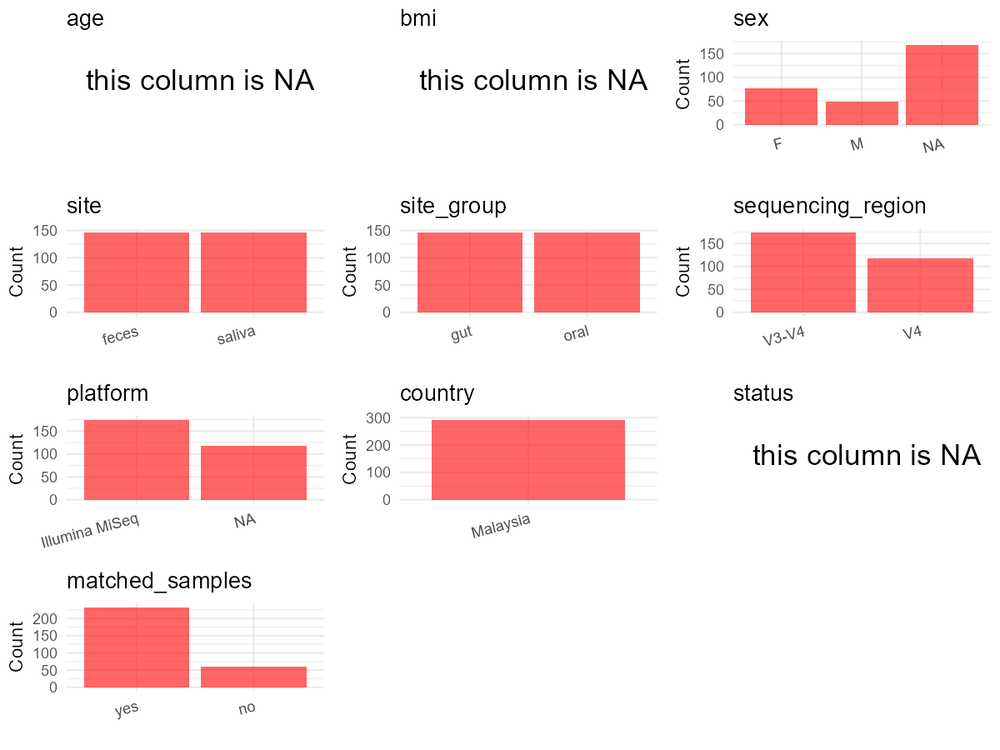

# Step 1: Obtain Initial Metadata from Each Project

This step sets the project directory and loads the raw SRA metadata.

```{r message=FALSE, warning=FALSE}
# Load libraries
library(dplyr)
library(ggplot2)
library(cowplot)

# (1) Setting working directory
project_id <- "PRJNA778070"

base_dir <- "D:/YL2025/2026/global-oral-github-YL-v2/global-oral-microbiome/data/projects/"
setwd(file.path(base_dir, project_id))

# (2) Loading raw SRA metadata file
sra_file <- "SraRunTable.csv"
initial_meta <- read.csv(sra_file, header = TRUE, stringsAsFactors = FALSE, check.names = FALSE)
```

# Step 2: Data Overview

First, you need to get an overview of the data, which includes two steps: reading the article and reading the initial metadata. This step is very IMPORTANT!

```{r message=FALSE, warning=FALSE}
# (1) Read the article in the following order: abstract, the beginning of the results section, and the methods.
# Paper summary used for this project:
# - Title: The Oral, Gut Microbiota and Cardiometabolic Health of Indigenous Orang Asli Communities.
# - Study design: cross-sectional Malaysia community microbiome study across four Orang Asli communities; not a disease case-control study.
# - Recruitment in the paper: 216 participants recruited; 214 with cardiometabolic assessment.
# - Paper-level microbiome counts: 210 saliva samples analyzed after four oral QC failures; 165 gut microbiota analyzed after two stool QC failures.
# - Sample collection in Methods: raw saliva and stool were collected without preservatives and stored on dry ice.
# - Methods describe two sequencing workflows: (a) Temuan + Temiar GM saliva/stool were sequenced at the V4 region by uBiome with 515F/806R primers; (b) Temiar PP + Jehai saliva/stool used V3-V4 primers and were sequenced on Illumina MiSeq 2 x 250.
# - Sequencing-data comparability section states that three stool and three saliva samples were sequenced on both V4 and V3-V4 workflows, so this BioProject includes a small comparability subset in addition to the main cohort runs.
# - Local SRA table under PRJNA778070 contains 298 rows. After removing five control rows, 293 biological saliva/feces rows remain (146 saliva, 147 feces).
# - The SRA row counts do not match the paper's analysis totals one-to-one, so retain all biological saliva/feces rows present in this BioProject and document the discrepancy instead of guessing exclusions.
# - Useful external resources mentioned by the article: Frontiers article page and supplementary-material anchor, plus a Monash Bridges metadata repository link.
# - Downloaded supplement check: Data Sheet 1 is a taxonomy/abundance table for repeat samples and controls, with SampleType labels such as GutRepeat, SalivaRepeat, QC, Kit, and PCR; it is useful for confirming the comparability subset and control identities, but it is not a sample-level clinical metadata table.
# - Downloaded supplement check: Data Sheet 2 is a supplementary results document containing Supplementary Tables 1-2 and Supplementary Figures 3-4; it supports the V4 vs V3-V4 comparability narrative, but it does not provide per-sample age, BMI, sex, or cohort-manifest metadata.
# - Supplementary items explicitly cited in the paper are Supplementary Figures 1-4 and Data Sheet 1. The paper text does not point to a per-sample supplementary table in the Frontiers supplement.

# (2) IMPORTANT: MUST go through each column of initial_meta
head(initial_meta, 10)
colnames(initial_meta)
table(initial_meta$isolation_source)
table(initial_meta$Instrument)
table(initial_meta$geo_loc_name_country)
table(initial_meta$geo_loc_name)
table(initial_meta$Organism)
table(initial_meta$oa_group)
table(initial_meta$`Sample Name`)
# Raw SRA fields already useful for the 19-column target:
# - sample_id: Run
# - subject_id clues: Sample Name
# - country: geo_loc_name_country
# - site: isolation_source
# - public_time: ReleaseDate
# - cohort/location clues: geo_loc_name, oa_group, Collection_Date
# Fields that still need paper evidence: age, age_info, bmi, sequencing_region, platform, pcr_primers, disease_study, status, matched_samples, is_time_series.
# All retained rows are Malaysia saliva or feces samples. Sample Name encodes multiple subject naming schemes and a small V4/V3-V4 comparability subset.
```

# Step 3: Removing Control and Non-human Samples

First, we need to remove control samples(including both negative controls and positive controls) and non-human samples.

```{r}
# (1) Parameter setup
control_column <- "isolation_source"
# unique(initial_meta[[control_column]])
control_keywords <- c("ATCC", "MiliQ water", "Qiagen Mini Stool Kit", "Saliva in-house extraction kit")

species_column <- "Sample Name"
unique(initial_meta[[species_column]])
non_human_keywords <- c("LF-Mock", "LF-Negative", "Stool-neg", "Saliva-neg", "Mock")

# (2) Remove controls and non-human samples. DO NOT need to modify code in this part, just run it.
n_samples <- nrow(initial_meta)
# Control evaluation
if (length(control_keywords) > 0) {
  if (is.null(control_column) || control_column == "") {
    stop("Error: control_keywords provided but control_column is missing.")
  }

  if (!(control_column %in% colnames(initial_meta))) {
    stop(sprintf("Error: Column '%s' not found in initial_meta.", control_column))
  }

  control_pattern <- paste(control_keywords, collapse = "|")
  control_text <- initial_meta[[control_column]]
  is_control <- grepl(control_pattern, control_text)

} else {
  is_control <- rep(FALSE, n_samples)
}

# Non-human evaluation
if (length(non_human_keywords) > 0) {
  if (is.null(species_column) || species_column == "") {
    stop("Error: non_human_keywords provided but species_column is missing.")
  }

  if (!(species_column %in% colnames(initial_meta))) {
    stop(sprintf("Error: Column '%s' not found in initial_meta.", species_column))
  }

  non_human_pattern <- paste(non_human_keywords, collapse = "|")
  species_text <- initial_meta[[species_column]]
  is_non_human <- grepl(non_human_pattern, species_text)
} else {
  is_non_human <- rep(FALSE, n_samples)
}

# Execute removal
samples_to_remove <- is_control | is_non_human
initial_meta <- initial_meta[!samples_to_remove, ]

cat("Initial samples counts:", n_samples, "\n")
cat("Removed control samples:", sum(is_control), "\n")
cat("Removed non-human samples:", sum(is_non_human), "\n")
cat("Total samples removed ", sum(samples_to_remove), "\n")
cat("Remaining samples after Step 2:", nrow(initial_meta), "\n")
```

# Step 4: Creating a Uniform Metadata Template

This step converts the raw SRA table into the standard metadata format used in our meta-analysis.

```{r}
metadata <- data.frame(
  bioproject = initial_meta$BioProject,
  sample_id = initial_meta$Run,
  raw_sample_name = initial_meta$`Sample Name`,
  subject_id = "pending",
  age = NA_real_,
  age_info = "participants >18 years; health-assessed cohort mean age women 33 ± 1.9, men 40 ± 3.4",
  bmi = NA_real_,
  raw_instrument = initial_meta$Instrument,
  raw_site = initial_meta$isolation_source,
  raw_sex = NA_character_,
  sex = NA_character_,
  sequencing_region = "pending",
  platform = NA_character_,
  country = initial_meta$geo_loc_name_country,
  site = "pending",
  site_group = "pending",
  public_time = sub("T.*$", "", initial_meta$ReleaseDate),
  pcr_primers = "pending",
  title = "The Oral, Gut Microbiota and Cardiometabolic Health of Indigenous Orang Asli Communities",
  disease_study = "no",
  status = NA_character_,
  matched_samples = "pending",
  is_time_series = "no",
  stringsAsFactors = FALSE
)

# Source notes for non-obvious fields:
# - subject_id is normalized from Sample Name so saliva/feces pairs and the small V4 vs V3-V4 comparability resequencing subset collapse to participant-level identifiers.
# - age is NA because no per-subject ages are present in SRA or in the paper's exposed supplement links; age_info stores the paper's adult eligibility and cohort-level sex-stratified mean ages.
# - bmi is NA because the paper reports BMI only as group-level categories in Table 1, not as per-subject values.
# - sex starts as NA and is filled only where Sample Name contains an explicit M/F suffix; remaining rows stay NA because the paper and downloaded supplements do not provide a complete sample-level sex manifest.
# - sequencing_region and pcr_primers are assigned row-wise from the two paper-described workflows. The local SRA Instrument column is used only to align each run to the matching paper workflow after checking that Temuan/Temiar GM runs cluster on NextSeq 500 and Temiar PP/Jehai runs cluster on Illumina MiSeq.
# - platform is set only where the paper explicitly names it (Illumina MiSeq for the V3-V4 subset). The V4/uBiome subset platform is not explicitly named in the paper, so those rows remain NA instead of copying a platform claim from SRA.
# - status is NA because this is not a disease case-control design, so there is no justified per-sample disease-status label to export.
metadata$public_time <- as.Date(metadata$public_time)
```

# Step 5: Manually solving pending issues

This step involves two parts: (1) handle the columns with the `raw_` prefix, and next (2) handle the `site_group` and `matched_samples` columns.

```{r}
# (1) Handle the columns with the `raw_` prefix.
metadata <- metadata %>%
  mutate(
    subject_id = case_when(
      grepl("^LF-(JH[0-9]+)(Saliva|Stool)$", raw_sample_name) ~ sub("^LF-(JH[0-9]+)(Saliva|Stool)$", "\\1", raw_sample_name),
      grepl("^LF-(TRk[0-9]+)(Saliva|Stool)$", raw_sample_name) ~ sub("^LF-(TRk[0-9]+)(Saliva|Stool)$", "\\1", raw_sample_name),
      grepl("^LF-(TM[0-9]+)(Saliva|Stool)$", raw_sample_name) ~ sub("^LF-(TM[0-9]+)(Saliva|Stool)$", "\\1", raw_sample_name),
      grepl("^TRks[0-9]+[FM]$", raw_sample_name) ~ sub("^TRks([0-9]+)[FM]$", "TRk\\1", raw_sample_name),
      grepl("^TRk[0-9]+[FM]$", raw_sample_name) ~ sub("^TRk([0-9]+)[FM]$", "TRk\\1", raw_sample_name),
      grepl("^TMs[0-9]+[FM]$", raw_sample_name) ~ sub("^TMs([0-9]+)[FM]$", "TM\\1", raw_sample_name),
      grepl("^TM[0-9]+[FM]$", raw_sample_name) ~ sub("^TM([0-9]+)[FM]$", "TM\\1", raw_sample_name),
      grepl("^TRs[0-9]+$", raw_sample_name) ~ sub("^TRs([0-9]+)$", "TR\\1", raw_sample_name),
      grepl("^Js[0-9]+$", raw_sample_name) ~ sub("^Js([0-9]+)$", "J\\1", raw_sample_name),
      grepl("^J[0-9]+$", raw_sample_name) ~ raw_sample_name,
      TRUE ~ raw_sample_name
    ),
    raw_sex = case_when(
      grepl("^(TM|TMs|TRk|TRks)[0-9]+[FM]$", raw_sample_name) ~ sub("^.*([FM])$", "\\1", raw_sample_name),
      TRUE ~ NA_character_
    ),
    # Sex remains NA for naming schemes such as J..., Js..., TRs..., and LF-JH... because they do not encode M/F and no sample-level sex table was released.
    sequencing_region = case_when(
      raw_instrument == "NextSeq 500" ~ "V4",
      raw_instrument == "Illumina MiSeq" ~ "V3-V4",
      TRUE ~ NA_character_
    ),
    platform = case_when(
      raw_instrument == "Illumina MiSeq" ~ "Illumina MiSeq",
      raw_instrument == "NextSeq 500" ~ NA_character_,
      TRUE ~ NA_character_
    ),
    # Platform stays NA for the V4/uBiome subset because the paper methods do not explicitly name the sequencing platform for those rows.
    site = case_when(
      raw_site == "saliva" ~ "saliva",
      raw_site == "feces" ~ "feces",
      TRUE ~ NA_character_
    ),
    pcr_primers = case_when(
      raw_instrument == "NextSeq 500" ~ "F-GTGCCAGCMGCCGCGGTAA,R-GGACTACHVGGGTWTCTAAT",
      raw_instrument == "Illumina MiSeq" ~ "F-TCGTCGGCAGCGTCAGATGTGTATAAGAGACAGCCTACGGGNGGCWGCAG,R-GTCTCGTGGGCTCGGAGATGTGTATAAGAGACAGGACTACHVGGGTATCTAATCC",
      TRUE ~ NA_character_
    )
  )

sex_lookup <- metadata %>%
  filter(!is.na(raw_sex)) %>%
  group_by(subject_id) %>%
  summarise(sex = if (n_distinct(raw_sex) == 1) first(raw_sex) else NA_character_, .groups = "drop")

metadata <- metadata %>%
  select(-sex) %>%
  left_join(sex_lookup, by = "subject_id")
```

```{r}
# (2) Filling the 'site_group' and 'matched_samples' columns
unique(metadata$site)
Oral_site = c("saliva")
Gut_site = c("feces")

metadata <- metadata %>%
  mutate(site_group = case_when(
    site %in% Oral_site ~ "oral",
    site %in% Gut_site ~ "gut",
    TRUE ~ "other"
  ))

metadata$matched_samples <- ifelse(
  ave(metadata$subject_id, metadata$subject_id, FUN = length) > 1,
  "yes",
  "no"
)
# matched_samples becomes yes for paired saliva/feces subjects and for the small V4 vs V3-V4 comparability resequencing subset.
# This does not imply longitudinal follow-up; is_time_series stays no because the study design is cross-sectional.
```

```{r}
# (3) check if there is pending value in metadata. If there is pending value, go on modify the metadata.
has_pending <- function(col) {
  if (is.character(col) || is.factor(col)) {
    any(col == "pending", na.rm = TRUE)
  } else {
    FALSE
  }
}

any_pending_value <- any(sapply(metadata, has_pending))

if (!any_pending_value) {
  message("Good! No cell contains the value 'pending'.")
} else {
  pending_cols <- names(metadata)[sapply(metadata, has_pending)]
  message("Columns containing 'pending': ", paste(pending_cols, collapse = ", "))
  message("Please continue to resolve these pending columns!")
}
```

# Step 6: Visualize the Metadata

This step makes a quick set of plots for checking the distribution of key metadata fields.

```{r}
plot_data <- metadata %>%
  select(-bioproject, -sample_id, -subject_id, -title, -raw_sample_name, -raw_instrument, -raw_site, -raw_sex)

create_simple_plots <- function(data) {
  plots <- list()
  continuous_vars <- c("age", "bmi")

  for (col in colnames(data)) {
    if (all(is.na(data[[col]]))) {
      p <- ggplot() +
        annotate("text", x = 0.5, y = 0.5, label = "this column is NA", size = 6) +
        labs(title = col) +
        theme_void()
    } else if (col %in% continuous_vars && is.numeric(data[[col]])) {
      p <- ggplot(data, aes(x = .data[[col]])) +
        geom_histogram(fill = "blue", alpha = 0.6, bins = 20, na.rm = TRUE) +
        labs(title = col, x = col, y = "Count") +
        theme_minimal()
    } else {
      count_data <- as.data.frame(table(data[[col]], useNA = "ifany"))
      p <- ggplot(count_data, aes(x = reorder(Var1, -Freq), y = Freq)) +
        geom_col(fill = "red", alpha = 0.6) +
        labs(title = col, x = NULL, y = "Count") +
        theme_minimal() +
        theme(axis.text.x = element_text(angle = 15, hjust = 1))
    }
    plots[[col]] <- p
  }

  return(plots)
}

plots <- create_simple_plots(plot_data)
p <- plot_grid(plots$age,
               plots$bmi,
               plots$sex,
               plots$site,
               plots$site_group,
               plots$sequencing_region,
               plots$platform,
               plots$country,
               plots$status,
               plots$matched_samples,
               ncol = 3, align = "hv", axis = "lb")
ggsave("Metadata_Summary_v2.png", plot = p, width = 8, height = 6, dpi = 150)
```

```{r}

```

# Step 7: Sort and export the metadata

This step saves the cleaned metadata table as the final `metadata_v2.csv` file.

```{r}
fixed_cols <- c("bioproject", "sample_id", "subject_id", "age", "age_info",
                "bmi", "sex", "platform", "sequencing_region", "pcr_primers",
                "country", "site", "site_group", "disease_study", "status",
                "title", "public_time", "matched_samples", "is_time_series")
metadata <- metadata %>%
  select(all_of(fixed_cols), starts_with("raw_"))

write.csv(metadata, file = "metadata_v2.csv", quote = TRUE, row.names = FALSE)
```
