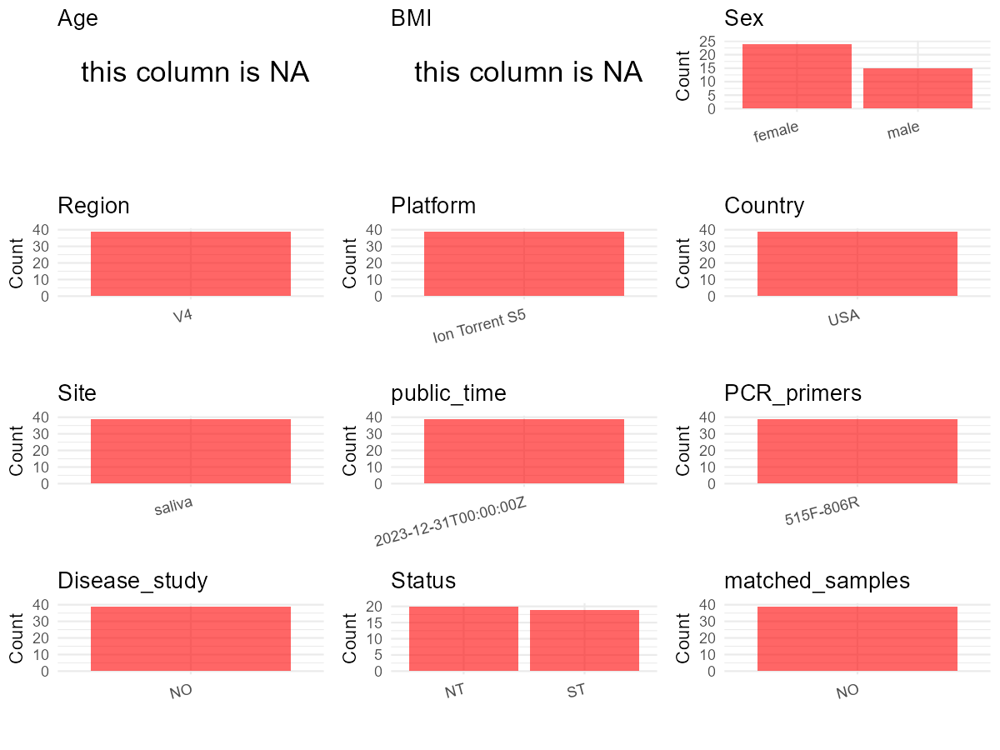

R Notebook: Metadata Processing Workflow
================

# Step 1: Obtain Initial Metadata from Each Project

To obtain the initial metadata: 1. Search for the BioProject ID (e.g.,
“PRJEBXXXX”) on the [NCBI SRA
website](https://www.ncbi.nlm.nih.gov/Traces/study/). 2. In the “Select”
table, click on “Metadata” and download the file. 3. The downloaded file
is typically named “SraRunTable.csv” and contains metadata for the
project.

``` r
# Load necessary libraries
library(dplyr)
library(ggplot2)
library(cowplot)

# Set working directory (update this path to your local directory)
setwd("D:/studylearning/董彪师兄项目/任务4_20251009/PRJNA778221")

# Read the initial metadata files
initial_meta<-read.csv("SraRunTable.csv",header = T)

# Display the first few rows of the metadata
head(initial_meta)
```

    ##           Run Assay.Type AvgSpotLen    Bases  BioProject    BioSample
    ## 1 SRR16820388   AMPLICON        275 48116936 PRJNA778221 SAMN22933854
    ## 2 SRR16820389   AMPLICON        277 40508742 PRJNA778221 SAMN22933853
    ## 3 SRR16820390   AMPLICON        280 46500892 PRJNA778221 SAMN22933852
    ## 4 SRR16820392   AMPLICON        278 50455052 PRJNA778221 SAMN22933850
    ## 5 SRR16820394   AMPLICON        277 34606177 PRJNA778221 SAMN22933883
    ## 6 SRR16820395   AMPLICON        282 43588403 PRJNA778221 SAMN22933882
    ##                                BioSampleModel    Bytes        Center.Name
    ## 1 MIMARKS.survey,MIGS/MIMS/MIMARKS.human-oral 36154874 RUTGERS UNIVERSITY
    ## 2 MIMARKS.survey,MIGS/MIMS/MIMARKS.human-oral 30257850 RUTGERS UNIVERSITY
    ## 3 MIMARKS.survey,MIGS/MIMS/MIMARKS.human-oral 34408743 RUTGERS UNIVERSITY
    ## 4 MIMARKS.survey,MIGS/MIMS/MIMARKS.human-oral 37289604 RUTGERS UNIVERSITY
    ## 5 MIMARKS.survey,MIGS/MIMS/MIMARKS.human-oral 25566411 RUTGERS UNIVERSITY
    ## 6 MIMARKS.survey,MIGS/MIMS/MIMARKS.human-oral 32047172 RUTGERS UNIVERSITY
    ##   Collection_Date Consent DATASTORE.filetype DATASTORE.provider
    ## 1            2019  public   fastq,run.zq,sra         gs,ncbi,s3
    ## 2            2019  public   fastq,run.zq,sra         gs,ncbi,s3
    ## 3            2019  public   fastq,run.zq,sra         gs,ncbi,s3
    ## 4            2019  public   fastq,run.zq,sra         gs,ncbi,s3
    ## 5            2019  public   fastq,run.zq,sra         gs,ncbi,s3
    ## 6            2019  public   fastq,run.zq,sra         gs,ncbi,s3
    ##                       DATASTORE.region env_broad_scale env_local_scale
    ## 1 gs.us-east1,ncbi.public,s3.us-east-1           Human            Oral
    ## 2 gs.us-east1,ncbi.public,s3.us-east-1           Human            Oral
    ## 3 gs.us-east1,ncbi.public,s3.us-east-1           Human            Oral
    ## 4 gs.us-east1,ncbi.public,s3.us-east-1           Human            Oral
    ## 5 gs.us-east1,ncbi.public,s3.us-east-1           Human            Oral
    ## 6 gs.us-east1,ncbi.public,s3.us-east-1           Human            Oral
    ##   env_medium  Experiment geo_loc_name_country geo_loc_name_country_continent
    ## 1     saliva SRX13013739                  USA                  North America
    ## 2     saliva SRX13013738                  USA                  North America
    ## 3     saliva SRX13013737                  USA                  North America
    ## 4     saliva SRX13013735                  USA                  North America
    ## 5     saliva SRX13013733                  USA                  North America
    ## 6     saliva SRX13013732                  USA                  North America
    ##   geo_loc_name         HOST     Instrument         lat_lon   Library.Name
    ## 1          USA Homo sapiens Ion Torrent S5 40.47 N 74.43 W 20200208_1_010
    ## 2          USA Homo sapiens Ion Torrent S5 40.47 N 74.43 W 20200208_1_009
    ## 3          USA Homo sapiens Ion Torrent S5 40.47 N 74.43 W 20200208_1_008
    ## 4          USA Homo sapiens Ion Torrent S5 40.47 N 74.43 W 20200208_1_006
    ## 5          USA Homo sapiens Ion Torrent S5 40.47 N 74.43 W 20200208_1_040
    ## 6          USA Homo sapiens Ion Torrent S5 40.47 N 74.43 W 20200208_1_039
    ##   LibraryLayout LibrarySelection LibrarySource   Organism    Platform
    ## 1        SINGLE              PCR   METAGENOMIC metagenome ION_TORRENT
    ## 2        SINGLE              PCR   METAGENOMIC metagenome ION_TORRENT
    ## 3        SINGLE              PCR   METAGENOMIC metagenome ION_TORRENT
    ## 4        SINGLE              PCR   METAGENOMIC metagenome ION_TORRENT
    ## 5        SINGLE              PCR   METAGENOMIC metagenome ION_TORRENT
    ## 6        SINGLE              PCR   METAGENOMIC metagenome ION_TORRENT
    ##            ReleaseDate          create_date version Sample.Name    sex
    ## 1 2023-12-31T00:00:00Z 2021-11-05T15:07:00Z       1   ORS2 1010 female
    ## 2 2023-12-31T00:00:00Z 2021-11-05T15:07:00Z       1   ORS2 1009   male
    ## 3 2023-12-31T00:00:00Z 2021-11-05T15:07:00Z       1   ORS2 1008   male
    ## 4 2023-12-31T00:00:00Z 2021-11-05T15:07:00Z       1   ORS2 1006   male
    ## 5 2023-12-31T00:00:00Z 2021-11-05T15:07:00Z       1   ORS1 1020 female
    ## 6 2023-12-31T00:00:00Z 2021-11-05T15:07:00Z       1   ORS1 1019 female
    ##   SRA.Study subject TasterStatus timepoint
    ## 1 SRP344788    1010           NT     After
    ## 2 SRP344788    1009           ST     After
    ## 3 SRP344788    1008           NT     After
    ## 4 SRP344788    1006           NT     After
    ## 5 SRP344788    1020           NT    Before
    ## 6 SRP344788    1019           NT    Before

# Step 2: Create a Uniform Metadata Template

The uniform metadata should include the following columns:

1.  **BioProject**: Project ID (e.g., “PRJNA339212”)
2.  **Run**: Sample ID (e.g., “ERRXXXXXX” or “SRRXXXXXX”)
3.  **sample_name**: Original sample name submitted by the authors (not
    the database-assigned ID)
4.  **Age**: Age of the subject (if available)
5.  **BMI**: Body Mass Index (if available)
6.  **Sex**: Sex of the subject (“F” or “M”)
7.  **Region**: Targeted 16S rRNA region (e.g., “V3-V4”)
8.  **Platform**: Sequencing platform (e.g., “Illumina MiSeq”)
9.  **Country**: Country of sample origin (e.g., “China”)
10. **Site**: Sample site (e.g., “saliva”, “dental plaque”)
11. **public_time**: Data release date (format: “YYYY-MM-DD”)
12. **PCR_primers**: PCR primers used (e.g., “515F-806R”)
13. **title**: Title of the associated publication
14. **Disease_study**: Whether the study involves a disease (“YES” or
    “NO”)
15. **Status**: Disease status (e.g., “T2DM”, “HC”). Note: If the study
    includes both disease and healthy samples, this must be specified
    per sample.

``` r
# Create a uniform metadata dataframe
metadata <- data.frame(
  BioProject = initial_meta$BioProject,
  Run = initial_meta$Run,
  sample_name = initial_meta$Sample.Name,
  Age = NA,
  BMI = NA,
  Sex= initial_meta$sex,
  Region = "V4",
  Platform = initial_meta$Instrument,
  Country = initial_meta$geo_loc_name_country,
  Site = initial_meta$env_medium,
  public_time = initial_meta$ReleaseDate,
  stringsAsFactors = FALSE
)
```

# Step 3: Manually Add Information from the Publication

Some information (e.g. PCR primers, study title, disease status) must be
manually extracted from the publication and added to the metadata.

``` r
# Add information obtained from the publication
metadata$PCR_primers <- "515F-806R"  # Update based on the publication
metadata$title <- "Daily Exposure to a Cranberry Polyphenol Oral Rinse Alters the Oral Microbiome but Not Taste Perception in PROP Taster Status Classified Individuals"
metadata$Disease_study <- "NO"
metadata$Status <- initial_meta$TasterStatus

#extract subject id by remove prefix of sample_name
#metadata$sample_name <- gsub("_st|_sal", "", metadata$sample_name)

# Check initial data distribution
cat("Initial sample distribution:\n")
```

    ## Initial sample distribution:

``` r
table(metadata$sample_name)
```

    ## 
    ##   ORS 1001   ORS 1002   ORS 1003   ORS 1004   ORS 1005   ORS 1006   ORS 1007 
    ##          1          1          1          1          1          1          1 
    ##   ORS 1008   ORS 1009   ORS 1010   ORS 1011   ORS 1012   ORS 1013   ORS 1014 
    ##          1          1          1          1          1          1          1 
    ##   ORS 1015  ORS1 1016  ORS1 1017  ORS1 1018  ORS1 1019  ORS1 1020  ORS2 1001 
    ##          1          1          1          1          1          1          1 
    ##  ORS2 1002  ORS2 1003  ORS2 1004  ORS2 1005  ORS2 1006  ORS2 1007  ORS2 1008 
    ##          1          1          1          1          1          1          1 
    ##  ORS2 1009  ORS2 1010 ORS2R 1011 ORS2R 1013 ORS2R 1014 ORS2R 1015 ORS2R 1016 
    ##          1          1          1          1          1          1          1 
    ## ORS2R 1017 ORS2R 1018 ORS2R 1019 ORS2R 1020 
    ##          1          1          1          1

``` r
table(metadata$Site)
```

    ## 
    ## saliva 
    ##     39

``` r
# Calculate sampling frequency per subject
sample_counts <- table(metadata$sample_name)
cat("\nNumber of samples per subject:\n")
```

    ## 
    ## Number of samples per subject:

``` r
print(sample_counts)
```

    ## 
    ##   ORS 1001   ORS 1002   ORS 1003   ORS 1004   ORS 1005   ORS 1006   ORS 1007 
    ##          1          1          1          1          1          1          1 
    ##   ORS 1008   ORS 1009   ORS 1010   ORS 1011   ORS 1012   ORS 1013   ORS 1014 
    ##          1          1          1          1          1          1          1 
    ##   ORS 1015  ORS1 1016  ORS1 1017  ORS1 1018  ORS1 1019  ORS1 1020  ORS2 1001 
    ##          1          1          1          1          1          1          1 
    ##  ORS2 1002  ORS2 1003  ORS2 1004  ORS2 1005  ORS2 1006  ORS2 1007  ORS2 1008 
    ##          1          1          1          1          1          1          1 
    ##  ORS2 1009  ORS2 1010 ORS2R 1011 ORS2R 1013 ORS2R 1014 ORS2R 1015 ORS2R 1016 
    ##          1          1          1          1          1          1          1 
    ## ORS2R 1017 ORS2R 1018 ORS2R 1019 ORS2R 1020 
    ##          1          1          1          1

``` r
# Create matched_samples column
metadata$matched_samples <- ifelse(metadata$sample_name %in% names(sample_counts[sample_counts >= 2]), "YES", "NO")

cat("\nMatched samples distribution:\n")
```

    ## 
    ## Matched samples distribution:

``` r
table(metadata$matched_samples)
```

    ## 
    ## NO 
    ## 39

``` r
# Identify samples for removal: single samples excluding saliva 
single_samples <- names(sample_counts[sample_counts == 1])
samples_to_remove <- metadata$sample_name %in% single_samples & !(metadata$Site %in% c("saliva"))

cat("\nNumber of samples to be removed:", sum(samples_to_remove), "\n")
```

    ## 
    ## Number of samples to be removed: 0

``` r
# Remove identified samples
metadata_clean <- metadata[!samples_to_remove, ]

cat("\nFinal sample distribution after cleaning:\n")
```

    ## 
    ## Final sample distribution after cleaning:

``` r
table(metadata_clean$sample_name)
```

    ## 
    ##   ORS 1001   ORS 1002   ORS 1003   ORS 1004   ORS 1005   ORS 1006   ORS 1007 
    ##          1          1          1          1          1          1          1 
    ##   ORS 1008   ORS 1009   ORS 1010   ORS 1011   ORS 1012   ORS 1013   ORS 1014 
    ##          1          1          1          1          1          1          1 
    ##   ORS 1015  ORS1 1016  ORS1 1017  ORS1 1018  ORS1 1019  ORS1 1020  ORS2 1001 
    ##          1          1          1          1          1          1          1 
    ##  ORS2 1002  ORS2 1003  ORS2 1004  ORS2 1005  ORS2 1006  ORS2 1007  ORS2 1008 
    ##          1          1          1          1          1          1          1 
    ##  ORS2 1009  ORS2 1010 ORS2R 1011 ORS2R 1013 ORS2R 1014 ORS2R 1015 ORS2R 1016 
    ##          1          1          1          1          1          1          1 
    ## ORS2R 1017 ORS2R 1018 ORS2R 1019 ORS2R 1020 
    ##          1          1          1          1

``` r
table(metadata_clean$Site)
```

    ## 
    ## saliva 
    ##     39

``` r
table(metadata_clean$matched_samples)
```

    ## 
    ## NO 
    ## 39

``` r
# Use cleaned dataset for subsequent analysis
metadata <- metadata_clean
```

# Step 4: Summarize and Validate the Metadata

``` r
# Check the number of unique runs and sample names
print(paste("Number of unique runs:", length(unique(metadata$Run))))
```

    ## [1] "Number of unique runs: 39"

``` r
print(paste("Number of unique sample names:", length(unique(metadata$sample_name))))
```

    ## [1] "Number of unique sample names: 39"

# Step 5: Visualize the Metadata

``` r

```


# Step 6: Finalize and Export the Metadata

``` r
# Reorder columns to match the desired format
metadata <- metadata[, c(
  "BioProject", "Run", "sample_name", "Age", "BMI", "Sex", 
  "Region", "Platform", "Country", "Site", "public_time", 
  "PCR_primers", "title", "Disease_study", "Status","matched_samples"
)]

# Export the uniform metadata to a CSV file
write.csv(metadata, file = "metadata.csv", quote = FALSE)
head(metadata)
```

    ##    BioProject         Run sample_name Age BMI    Sex Region       Platform
    ## 1 PRJNA778221 SRR16820388   ORS2 1010  NA  NA female     V4 Ion Torrent S5
    ## 2 PRJNA778221 SRR16820389   ORS2 1009  NA  NA   male     V4 Ion Torrent S5
    ## 3 PRJNA778221 SRR16820390   ORS2 1008  NA  NA   male     V4 Ion Torrent S5
    ## 4 PRJNA778221 SRR16820392   ORS2 1006  NA  NA   male     V4 Ion Torrent S5
    ## 5 PRJNA778221 SRR16820394   ORS1 1020  NA  NA female     V4 Ion Torrent S5
    ## 6 PRJNA778221 SRR16820395   ORS1 1019  NA  NA female     V4 Ion Torrent S5
    ##   Country   Site          public_time PCR_primers
    ## 1     USA saliva 2023-12-31T00:00:00Z   515F-806R
    ## 2     USA saliva 2023-12-31T00:00:00Z   515F-806R
    ## 3     USA saliva 2023-12-31T00:00:00Z   515F-806R
    ## 4     USA saliva 2023-12-31T00:00:00Z   515F-806R
    ## 5     USA saliva 2023-12-31T00:00:00Z   515F-806R
    ## 6     USA saliva 2023-12-31T00:00:00Z   515F-806R
    ##                                                                                                                                                  title
    ## 1 Daily Exposure to a Cranberry Polyphenol Oral Rinse Alters the Oral Microbiome but Not Taste Perception in PROP Taster Status Classified Individuals
    ## 2 Daily Exposure to a Cranberry Polyphenol Oral Rinse Alters the Oral Microbiome but Not Taste Perception in PROP Taster Status Classified Individuals
    ## 3 Daily Exposure to a Cranberry Polyphenol Oral Rinse Alters the Oral Microbiome but Not Taste Perception in PROP Taster Status Classified Individuals
    ## 4 Daily Exposure to a Cranberry Polyphenol Oral Rinse Alters the Oral Microbiome but Not Taste Perception in PROP Taster Status Classified Individuals
    ## 5 Daily Exposure to a Cranberry Polyphenol Oral Rinse Alters the Oral Microbiome but Not Taste Perception in PROP Taster Status Classified Individuals
    ## 6 Daily Exposure to a Cranberry Polyphenol Oral Rinse Alters the Oral Microbiome but Not Taste Perception in PROP Taster Status Classified Individuals
    ##   Disease_study Status matched_samples
    ## 1            NO     NT              NO
    ## 2            NO     ST              NO
    ## 3            NO     NT              NO
    ## 4            NO     NT              NO
    ## 5            NO     NT              NO
    ## 6            NO     NT              NO

## Notes for Students:

1.  **Metadata Accuracy**: Always cross-check the metadata with the
    original publication to ensure accuracy.
2.  **Manual Entries**: Columns like `PCR_primers`, and `Status` often
    require manual entry based on the publication.
3.  **Disease Status**: Be careful when assigning `Status`—some studies
    include both disease and healthy samples.
4.  **Visualization**: The plots help quickly identify the distribution
    of values in each column, which is useful for quality control.
5.  **Reproducibility**: Update the working directory and file paths to
    match your local environment.
