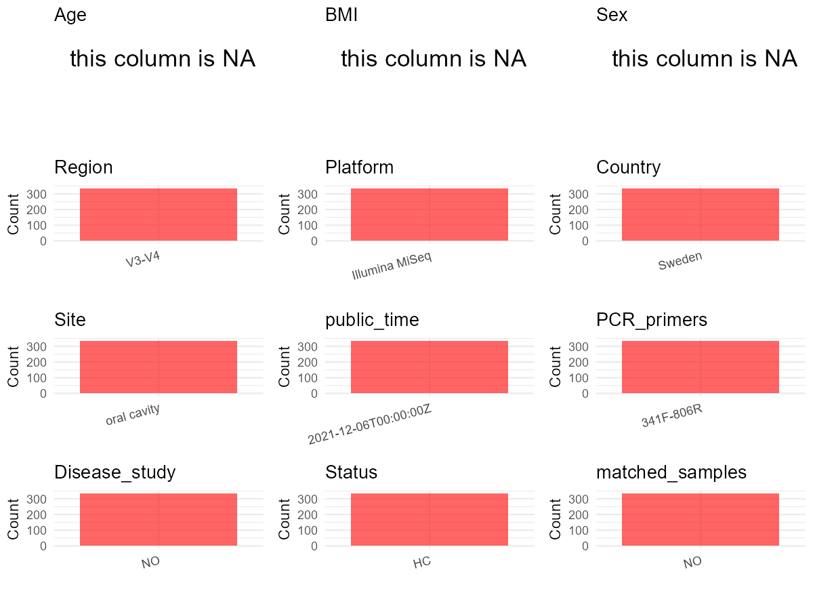

# Step 1: Obtain Initial Metadata from Each Project

To obtain the initial metadata: 1. Search for the BioProject ID (e.g.,
“PRJEBXXXX”) on the [NCBI SRA
website](https://www.ncbi.nlm.nih.gov/Traces/study/). 2. In the “Select”
table, click on “Metadata” and download the file. 3. The downloaded file
is typically named “SraRunTable.csv” and contains metadata for the
project.

    library(tidyverse)
    library(ggplot2)
    library(cowplot)

    setwd("C:/Users/zyc/Desktop/oral_project/data/projects/PRJNA779698")
    initial_meta <- read.csv("SraRunTable.csv", header = TRUE) 
    head(initial_meta)

    ##           Run Assay.Type AvgSpotLen    Bases  BioProject    BioSample                              BioSampleModel BREED    Bytes Center.Name
    ## 1 SRR17061255   AMPLICON        601 68048844 PRJNA779698 SAMN23070848 MIMARKS.survey,MIGS/MIMS/MIMARKS.human-oral Human 52622407  ODONTOLOGY
    ## 2 SRR17061256   AMPLICON        601 75368185 PRJNA779698 SAMN23070848 MIMARKS.survey,MIGS/MIMS/MIMARKS.human-oral Human 58211081  ODONTOLOGY
    ## 3 SRR17061257   AMPLICON        601 47330762 PRJNA779698 SAMN23070848 MIMARKS.survey,MIGS/MIMS/MIMARKS.human-oral Human 36351766  ODONTOLOGY
    ## 4 SRR17061258   AMPLICON        601 83426567 PRJNA779698 SAMN23070848 MIMARKS.survey,MIGS/MIMS/MIMARKS.human-oral Human 63088437  ODONTOLOGY
    ## 5 SRR17061259   AMPLICON        601 70124733 PRJNA779698 SAMN23070848 MIMARKS.survey,MIGS/MIMS/MIMARKS.human-oral Human 53617051  ODONTOLOGY
    ## 6 SRR17061260   AMPLICON        601 65369409 PRJNA779698 SAMN23070848 MIMARKS.survey,MIGS/MIMS/MIMARKS.human-oral Human 50007105  ODONTOLOGY
    ##   Collection_Date Consent DATASTORE.filetype DATASTORE.provider                     DATASTORE.region env_broad_scale env_local_scale
    ## 1      2021-05-20  public   fastq,run.zq,sra         gs,ncbi,s3 gs.us-east1,ncbi.public,s3.us-east-1           Biome            Oral
    ## 2      2021-05-20  public   fastq,run.zq,sra         gs,ncbi,s3 gs.us-east1,ncbi.public,s3.us-east-1           Biome            Oral
    ## 3      2021-05-20  public   fastq,run.zq,sra         gs,ncbi,s3 gs.us-east1,ncbi.public,s3.us-east-1           Biome            Oral
    ## 4      2021-05-20  public   fastq,run.zq,sra         gs,ncbi,s3 gs.us-east1,ncbi.public,s3.us-east-1           Biome            Oral
    ## 5      2021-05-20  public   fastq,run.zq,sra         gs,ncbi,s3 gs.us-east1,ncbi.public,s3.us-east-1           Biome            Oral
    ## 6      2021-05-20  public   fastq,run.zq,sra         gs,ncbi,s3 gs.us-east1,ncbi.public,s3.us-east-1           Biome            Oral
    ##    env_medium  Experiment geo_loc_name_country geo_loc_name_country_continent geo_loc_name         HOST     Instrument
    ## 1 oral cavity SRX13250495               Sweden                         Europe       Sweden Homo sapiens Illumina MiSeq
    ## 2 oral cavity SRX13250494               Sweden                         Europe       Sweden Homo sapiens Illumina MiSeq
    ## 3 oral cavity SRX13250493               Sweden                         Europe       Sweden Homo sapiens Illumina MiSeq
    ## 4 oral cavity SRX13250492               Sweden                         Europe       Sweden Homo sapiens Illumina MiSeq
    ## 5 oral cavity SRX13250491               Sweden                         Europe       Sweden Homo sapiens Illumina MiSeq
    ## 6 oral cavity SRX13250490               Sweden                         Europe       Sweden Homo sapiens Illumina MiSeq
    ##          isolation_source               lat_lon Library.Name LibraryLayout LibrarySelection LibrarySource              Organism Platform
    ## 1 saliva\\, tooth biofilm 63.82842 N 20.25972 E     Sample10        PAIRED              PCR   METAGENOMIC human oral metagenome ILLUMINA
    ## 2 saliva\\, tooth biofilm 63.82842 N 20.25972 E     Sample90        PAIRED              PCR   METAGENOMIC human oral metagenome ILLUMINA
    ## 3 saliva\\, tooth biofilm 63.82842 N 20.25972 E     Sample89        PAIRED              PCR   METAGENOMIC human oral metagenome ILLUMINA
    ## 4 saliva\\, tooth biofilm 63.82842 N 20.25972 E     Sample88        PAIRED              PCR   METAGENOMIC human oral metagenome ILLUMINA
    ## 5 saliva\\, tooth biofilm 63.82842 N 20.25972 E     Sample87        PAIRED              PCR   METAGENOMIC human oral metagenome ILLUMINA
    ## 6 saliva\\, tooth biofilm 63.82842 N 20.25972 E     Sample86        PAIRED              PCR   METAGENOMIC human oral metagenome ILLUMINA
    ##            ReleaseDate          create_date version      Sample.Name SRA.Study strain
    ## 1 2021-12-06T00:00:00Z 2021-11-29T05:42:00Z       1 oral metagenomes SRP348316  mixed
    ## 2 2021-12-06T00:00:00Z 2021-11-29T05:42:00Z       1 oral metagenomes SRP348316  mixed
    ## 3 2021-12-06T00:00:00Z 2021-11-29T05:42:00Z       1 oral metagenomes SRP348316  mixed
    ## 4 2021-12-06T00:00:00Z 2021-11-29T05:42:00Z       1 oral metagenomes SRP348316  mixed
    ## 5 2021-12-06T00:00:00Z 2021-11-29T05:42:00Z       1 oral metagenomes SRP348316  mixed
    ## 6 2021-12-06T00:00:00Z 2021-11-29T05:42:00Z       1 oral metagenomes SRP348316  mixed

# Step 2: Create a Uniform Metadata Template

The uniform metadata should include the following columns:

1.  **BioProject**: Project ID (e.g., “PRJNA339212”)
2.  **Run**: Sample ID (e.g., “ERRXXXXXX” or “SRRXXXXXX”)
3.  **sample\_name**: Original sample name submitted by the authors (not
    the database-assigned ID)
4.  **Age**: Age of the subject (if available)
5.  **BMI**: Body Mass Index (if available)
6.  **Sex**: Sex of the subject (“F” or “M”)
7.  **Region**: Targeted 16S rRNA region (e.g., “V3-V4”)
8.  **Platform**: Sequencing platform (e.g., “Illumina MiSeq”)
9.  **Country**: Country of sample origin (e.g., “China”)
10. **Site**: Sample site (e.g., “saliva”, “dental plaque”)
11. **public\_time**: Data release date (format: “YYYY-MM-DD”)
12. **PCR\_primers**: PCR primers used (e.g., “515F-806R”)
13. **title**: Title of the associated publication
14. **Disease\_study**: Whether the study involves a disease (“YES” or
    “NO”)
15. **Status**: Disease status (e.g., “T2DM”, “HC”). Note: If the study
    includes both disease and healthy samples, this must be specified
    per sample.
16. **matched\_samples**: matched samples (“YES” or “NO”)

<!-- -->

    metadata <- data.frame(
      BioProject = initial_meta$BioProject,
      Run = initial_meta$Run,
      sample_name = initial_meta$Library.Name,
      Age = NA,
      BMI = NA,
      Sex = NA,
      Platform = initial_meta$Instrument,
      Country = initial_meta$geo_loc_name_country,
      Site = initial_meta$env_medium,
      public_time = initial_meta$ReleaseDate,
      # Status = initial_meta$Sample.Name,
      stringsAsFactors = FALSE
    )

# Step 3: Manually Add Information from the Publication

Some information (e.g. PCR primers, study title, disease status) must be
manually extracted from the publication and added to the metadata.

     # metadata <- metadata %>%
     #  mutate(Sex = recode(Sex, "female" = "F", "male" = "M"))
    # metadata <-metadata%>%
    #   mutate(Status = case_when(Site == "mucous" ~ "OSCC",
    #                             Site == "dental plaque" ~ "OSCC",
    #                             Site == "tumor" ~ "OSCC",
    #                             TRUE ~ NA))

    metadata$Status <- "HC"
    metadata$matched_samples <- "NO"
    metadata$Region <- "V3-V4"
    metadata$title <- "Site- and Time-Dependent Compositional Shifts in Oral Microbiota Communities"
    metadata$Disease_study <- "NO"
    metadata$PCR_primers <- "341F-806R"
    head(metadata)

    ##    BioProject         Run sample_name Age BMI Sex       Platform Country        Site          public_time Status matched_samples Region
    ## 1 PRJNA779698 SRR17061255    Sample10  NA  NA  NA Illumina MiSeq  Sweden oral cavity 2021-12-06T00:00:00Z     HC              NO  V3-V4
    ## 2 PRJNA779698 SRR17061256    Sample90  NA  NA  NA Illumina MiSeq  Sweden oral cavity 2021-12-06T00:00:00Z     HC              NO  V3-V4
    ## 3 PRJNA779698 SRR17061257    Sample89  NA  NA  NA Illumina MiSeq  Sweden oral cavity 2021-12-06T00:00:00Z     HC              NO  V3-V4
    ## 4 PRJNA779698 SRR17061258    Sample88  NA  NA  NA Illumina MiSeq  Sweden oral cavity 2021-12-06T00:00:00Z     HC              NO  V3-V4
    ## 5 PRJNA779698 SRR17061259    Sample87  NA  NA  NA Illumina MiSeq  Sweden oral cavity 2021-12-06T00:00:00Z     HC              NO  V3-V4
    ## 6 PRJNA779698 SRR17061260    Sample86  NA  NA  NA Illumina MiSeq  Sweden oral cavity 2021-12-06T00:00:00Z     HC              NO  V3-V4
    ##                                                                          title Disease_study PCR_primers
    ## 1 Site- and Time-Dependent Compositional Shifts in Oral Microbiota Communities            NO   341F-806R
    ## 2 Site- and Time-Dependent Compositional Shifts in Oral Microbiota Communities            NO   341F-806R
    ## 3 Site- and Time-Dependent Compositional Shifts in Oral Microbiota Communities            NO   341F-806R
    ## 4 Site- and Time-Dependent Compositional Shifts in Oral Microbiota Communities            NO   341F-806R
    ## 5 Site- and Time-Dependent Compositional Shifts in Oral Microbiota Communities            NO   341F-806R
    ## 6 Site- and Time-Dependent Compositional Shifts in Oral Microbiota Communities            NO   341F-806R

# Step 4: Summarize and Validate the Metadata

    print(paste("Number of unique runs:", length(unique(metadata$Run))))

    ## [1] "Number of unique runs: 336"

    print(paste("Number of unique sample names:", length(unique(metadata$sample_name))))

    ## [1] "Number of unique sample names: 336"

# Step 5: Visualize the Metadata

    plot_data <- metadata %>%
      select(-BioProject, -Run, -sample_name, -title)

    # Function to create simple plots for each column
    create_simple_plots <- function(data) {
      plots <- list()

      for (col in colnames(data)) {
        # Check if the column is all NA
        if (all(is.na(data[[col]]))) {
          # Create an empty plot with text indicating all NA
          p <- ggplot() +
            annotate("text", x = 0.5, y = 0.5, label = "this column is NA", size = 6) +
            labs(title = col) +
            theme_void()
        } else if (is.numeric(data[[col]])) {
          # Numeric variable: histogram
          p <- ggplot(data, aes(x = .data[[col]])) +
            geom_histogram(fill = "blue", alpha = 0.6, bins = 20, na.rm = T) +
            labs(title = col) +
            theme_minimal()
        } else {
          # Categorical variable: bar plot (remove NA values)
          count_data <- as.data.frame(table(data[[col]], useNA = "ifany"))
          p <- ggplot(count_data, aes(x = reorder(Var1, -Freq), y = Freq)) +
            geom_col(fill = "red", alpha = 0.6) +
            labs(title = col, x = NULL, y = "Count") +
            theme_minimal() +
            theme(axis.text.x = element_text(angle = 15, hjust = 1))
        }
        plots[[col]] <- p
      }

      return(plots)
    }

    plots <- create_simple_plots(plot_data)
    p<-plot_grid(plots$Age,
              plots$BMI,
              plots$Sex,
              plots$Region,
              plots$Platform,
              plots$Country,
              plots$Site,
              plots$public_time,
              plots$PCR_primers,
              plots$Disease_study,
              plots$Status,
              plots$matched_samples,# add
              ncol = 3, align = "hv", axis = "lb")
    ggsave("Metadata_Summary.png", plot = p, width = 8, height = 6, dpi = 150)

    

 \# Step 6: Finalize and Export the Metadata

    metadata <- metadata[, c(
      "BioProject", "Run", "sample_name", "Age", "BMI", "Sex",
      "Region", "Platform", "Country", "Site", "public_time",
      "PCR_primers", "title", "Disease_study", "Status","matched_samples"
    )]

    write.csv(metadata, file = "metadata.csv", quote = FALSE)
