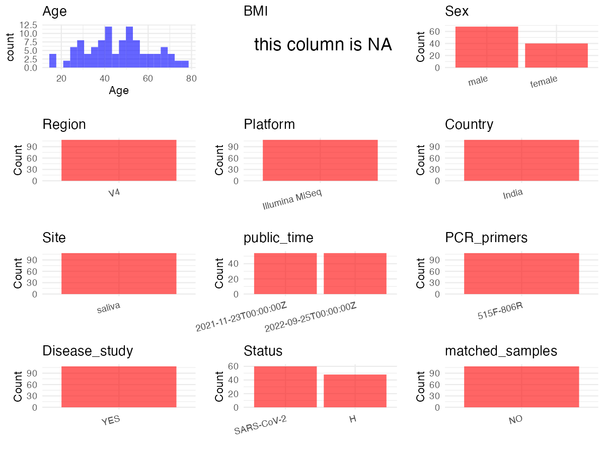

R Notebook: Metadata Processing Workflow
================

# Step 1: Obtain Initial Metadata from Each Project

To obtain the initial metadata: 1. Search for the BioProject ID (e.g.,
“PRJEBXXXX”) on the [NCBI SRA
website](https://www.ncbi.nlm.nih.gov/Traces/study/). 2. In the “Select”
table, click on “Metadata” and download the file. 3. The downloaded file
is typically named “SraRunTable.csv” and contains metadata for the
project.

``` r
# Load necessary libraries
library(dplyr)
library(ggplot2)
library(cowplot)
# Set working directory (update this path to your local directory)
setwd("/Users/dongbiao/Documents/oral/global-oral-microbiome/data/projects/PRJNA780671/")

# Read the initial metadata files
initial_meta<-read.csv("SraRunTable.csv",header = T)

head(initial_meta)
```

    ##           Run AGE Assay.Type AvgSpotLen    Bases BIOMATERIAL_PROVIDER
    ## 1 SRR21700079  50   AMPLICON        479 40539602                 DYPU
    ## 2 SRR21700080  50   AMPLICON        471 36288493                 DYPU
    ## 3 SRR21700081  66   AMPLICON        479 24614379                 DYPU
    ## 4 SRR21700082  25   AMPLICON        454 28314148                 DYPU
    ## 5 SRR21700083  55   AMPLICON        475 45504193                 DYPU
    ## 6 SRR21700084  34   AMPLICON        474 23193156                 DYPU
    ##    BioProject    BioSample BioSampleModel    Bytes
    ## 1 PRJNA780671 SAMN23377227          Human 28396306
    ## 2 PRJNA780671 SAMN23377226          Human 25197545
    ## 3 PRJNA780671 SAMN23377225          Human 17047549
    ## 4 PRJNA780671 SAMN23377224          Human 19820774
    ## 5 PRJNA780671 SAMN23377223          Human 31444095
    ## 6 PRJNA780671 SAMN23377222          Human 16240222
    ##                        Center.Name Consent DATASTORE.filetype
    ## 1 NATIONAL CENTRE FOR CELL SCIENCE  public   fastq,run.zq,sra
    ## 2 NATIONAL CENTRE FOR CELL SCIENCE  public   fastq,run.zq,sra
    ## 3 NATIONAL CENTRE FOR CELL SCIENCE  public   fastq,run.zq,sra
    ## 4 NATIONAL CENTRE FOR CELL SCIENCE  public   fastq,run.zq,sra
    ## 5 NATIONAL CENTRE FOR CELL SCIENCE  public   fastq,run.zq,sra
    ## 6 NATIONAL CENTRE FOR CELL SCIENCE  public   fastq,run.zq,sra
    ##   DATASTORE.provider                     DATASTORE.region description_2
    ## 1         gs,ncbi,s3 gs.us-east1,ncbi.public,s3.us-east-1   N18_FMale50
    ## 2         gs,ncbi,s3 gs.us-east1,ncbi.public,s3.us-east-1   N17_FMale50
    ## 3         gs,ncbi,s3 gs.us-east1,ncbi.public,s3.us-east-1 N16_FFemale66
    ## 4         gs,ncbi,s3 gs.us-east1,ncbi.public,s3.us-east-1 N15_FFemale25
    ## 5         gs,ncbi,s3 gs.us-east1,ncbi.public,s3.us-east-1 N14_FFemale55
    ## 6         gs,ncbi,s3 gs.us-east1,ncbi.public,s3.us-east-1   N13_FMale34
    ##    Experiment     Instrument isolate Library.Name LibraryLayout
    ## 1 SRX17697624 Illumina MiSeq    Male        N18_F        PAIRED
    ## 2 SRX17697623 Illumina MiSeq    Male        N17_F        PAIRED
    ## 3 SRX17697622 Illumina MiSeq  Female        N16_F        PAIRED
    ## 4 SRX17697621 Illumina MiSeq  Female        N15_F        PAIRED
    ## 5 SRX17697620 Illumina MiSeq  Female        N14_F        PAIRED
    ## 6 SRX17697619 Illumina MiSeq    Male        N13_F        PAIRED
    ##   LibrarySelection LibrarySource     Organism Platform          ReleaseDate
    ## 1              PCR   METAGENOMIC Homo sapiens ILLUMINA 2022-09-25T00:00:00Z
    ## 2              PCR   METAGENOMIC Homo sapiens ILLUMINA 2022-09-25T00:00:00Z
    ## 3              PCR   METAGENOMIC Homo sapiens ILLUMINA 2022-09-25T00:00:00Z
    ## 4              PCR   METAGENOMIC Homo sapiens ILLUMINA 2022-09-25T00:00:00Z
    ## 5              PCR   METAGENOMIC Homo sapiens ILLUMINA 2022-09-25T00:00:00Z
    ## 6              PCR   METAGENOMIC Homo sapiens ILLUMINA 2022-09-25T00:00:00Z
    ##            create_date version Sample.Name  sample_type    sex SRA.Study
    ## 1 2022-09-25T06:19:00Z       1       N18_F Non-infected   male SRP347341
    ## 2 2022-09-25T06:20:00Z       1       N17_F Non-infected   male SRP347341
    ## 3 2022-09-25T06:21:00Z       1       N16_F Non-infected female SRP347341
    ## 4 2022-09-25T06:21:00Z       1       N15_F Non-infected female SRP347341
    ## 5 2022-09-25T06:21:00Z       1       N14_F Non-infected female SRP347341
    ## 6 2022-09-25T06:21:00Z       1       N13_F Non-infected   male SRP347341
    ##          tissue
    ## 1 oral drooling
    ## 2 oral drooling
    ## 3 oral drooling
    ## 4 oral drooling
    ## 5 oral drooling
    ## 6 oral drooling

# Step 2: Create a Uniform Metadata Template

The uniform metadata should include the following columns:

1.  **BioProject**: Project ID (e.g., “PRJNA339212”)
2.  **Run**: Sample ID (e.g., “ERRXXXXXX” or “SRRXXXXXX”)
3.  **sample_name**: Original sample name submitted by the authors (not
    the database-assigned ID)
4.  **Age**: Age of the subject (if available)
5.  **BMI**: Body Mass Index (if available)
6.  **Sex**: Sex of the subject (“F” or “M”)
7.  **Region**: Targeted 16S rRNA region (e.g., “V3-V4”)
8.  **Platform**: Sequencing platform (e.g., “Illumina MiSeq”)
9.  **Country**: Country of sample origin (e.g., “China”)
10. **Site**: Sample site (e.g., “saliva”, “dental plaque”)
11. **public_time**: Data release date (format: “YYYY-MM-DD”)
12. **PCR_primers**: PCR primers used (e.g., “515F-806R”)
13. **title**: Title of the associated publication
14. **Disease_study**: Whether the study involves a disease (“YES” or
    “NO”)
15. **Status**: Disease status (e.g., “T2DM”, “HC”). Note: If the study
    includes both disease and healthy samples, this must be specified
    per sample.
16. **matched_samples** : matched samples (“YES” or “NO”)

``` r
# Create a uniform metadata dataframe
metadata <- data.frame(
  BioProject = initial_meta$BioProject,
  Run = initial_meta$Run,
  sample_name = initial_meta$`Sample.Name`,
  Age = initial_meta$AGE,
  BMI = NA,
  Sex = initial_meta$sex,
  Region = "V4",
  Platform = initial_meta$Instrument,
  Country = "India",
  Site = "saliva",
  public_time = initial_meta$ReleaseDate,
  stringsAsFactors = FALSE
)
```

# Step 3: Manually Add Information from the Publication

Some information (e.g. PCR primers, study title, disease status) must be
manually extracted from the publication and added to the metadata.

``` r
# Add information obtained from the publication
metadata$PCR_primers <- "515F-806R"
metadata$title <- "Oral dysbiosis and its linkage with SARS-CoV-2 infection"
metadata$Disease_study <- "YES"

# Assign disease status based on sample_name patterns
metadata$Status <- ifelse(grepl("^N", initial_meta$`Sample.Name`), "H", ifelse(grepl("^SA", initial_meta$`Sample.Name`), "SARS-CoV-2", initial_meta$`Sample.Name`))

# Create matched_samples column
metadata$matched_samples <- "NO"

# Check initial data distribution
cat("Initial sample distribution:\n")
```

    ## Initial sample distribution:

``` r
table(metadata$sample_name)
```

    ## 
    ##     N1   N1_F    N10  N10_F    N11  N11_F    N12  N12_F    N13  N13_F    N14 
    ##      1      1      1      1      1      1      1      1      1      1      1 
    ##  N14_F    N15  N15_F    N16  N16_F    N17  N17_F    N18  N18_F     N2   N2_F 
    ##      1      1      1      1      1      1      1      1      1      1      1 
    ##    N20  N20_F    N21  N21_F    N22  N22_F    N23  N23_F    N24  N24_F    N25 
    ##      1      1      1      1      1      1      1      1      1      1      1 
    ##  N25_F     N3   N3_F     N4   N4_F     N5   N5_F     N6   N6_F     N7   N7_F 
    ##      1      1      1      1      1      1      1      1      1      1      1 
    ##     N8   N8_F     N9   N9_F    SA1  SA1_F   SA11 SA11_F   SA13 SA13_F   SA15 
    ##      1      1      1      1      1      1      1      1      1      1      1 
    ## SA15_F   SA17 SA17_F   SA21 SA21_F   SA23 SA23_F   SA25 SA25_F   SA27 SA27_F 
    ##      1      1      1      1      1      1      1      1      1      1      1 
    ##   SA29 SA29_F    SA3  SA3_F   SA31 SA31_F   SA33 SA33_F   SA35 SA35_F   SA37 
    ##      1      1      1      1      1      1      1      1      1      1      1 
    ## SA37_F   SA39 SA39_F   SA41 SA41_F   SA43 SA43_F   SA45 SA45_F   SA47 SA47_F 
    ##      1      1      1      1      1      1      1      1      1      1      1 
    ##   SA49 SA49_F    SA5  SA5_F   SA51 SA51_F   SA53 SA53_F   SA55 SA55_F   SA57 
    ##      1      1      1      1      1      1      1      1      1      1      1 
    ## SA57_F   SA59 SA59_F   SA63 SA63_F   SA65 SA65_F    SA7  SA7_F 
    ##      1      1      1      1      1      1      1      1      1

``` r
table(metadata$Site)
```

    ## 
    ## saliva 
    ##    108

# Step 4: Summarize and Validate the Metadata

``` r
# Check the number of unique runs and sample names
print(paste("Number of unique runs:", length(unique(metadata$Run))))
```

    ## [1] "Number of unique runs: 108"

``` r
print(paste("Number of unique sample names:", length(unique(metadata$sample_name))))
```

    ## [1] "Number of unique sample names: 108"

# Step 5: Visualize the Metadata

``` r
# Select columns for visualization
plot_data <- metadata %>%
  select(-BioProject, -Run, -sample_name, -title)

# Function to create simple plots for each column
create_simple_plots <- function(data) {
  plots <- list()
  
  for (col in colnames(data)) {
    # Check if the column is all NA
    if (all(is.na(data[[col]]))) {
      # Create an empty plot with text indicating all NA
      p <- ggplot() +
        annotate("text", x = 0.5, y = 0.5, label = "this column is NA", size = 6) +
        labs(title = col) +
        theme_void()
    } else if (is.numeric(data[[col]])) {
      # Numeric variable: histogram
      p <- ggplot(data, aes(x = .data[[col]])) +
        geom_histogram(fill = "blue", alpha = 0.6, bins = 20, na.rm = TRUE) +
        labs(title = col) +
        theme_minimal()
    } else {
      # Categorical variable: bar plot (remove NA values)
      count_data <- as.data.frame(table(data[[col]], useNA = "ifany"))
      p <- ggplot(count_data, aes(x = reorder(Var1, -Freq), y = Freq)) +
        geom_col(fill = "red", alpha = 0.6) +
        labs(title = col, x = NULL, y = "Count") +
        theme_minimal() +
        theme(axis.text.x = element_text(angle = 15, hjust = 1))
    }
    plots[[col]] <- p
  }
  
  return(plots)
}

# Generate and arrange plots
plots <- create_simple_plots(plot_data)
p<-plot_grid(plots$Age, 
          plots$BMI, 
          plots$Sex, 
          plots$Region, 
          plots$Platform, 
          plots$Country, 
          plots$Site,
          plots$public_time, 
          plots$PCR_primers,
          plots$Disease_study,
          plots$Status,
          plots$matched_samples,# add 
          ncol = 3, align = "hv", axis = "lb")
ggsave("Metadata_Summary.png", plot = p, width = 8, height = 6, dpi = 150)
```

``` r

```


# Step 6: Finalize and Export the Metadata

``` r
# Reorder columns to match the desired format
metadata <- metadata[, c(
  "BioProject", "Run", "sample_name", "Age", "BMI", "Sex", 
  "Region", "Platform", "Country", "Site", "public_time", 
  "PCR_primers", "title", "Disease_study", "Status","matched_samples"
)]

# Export the uniform metadata to a CSV file
write.csv(metadata, file = "metadata.csv", quote = FALSE)
head(metadata)
```

    ##    BioProject         Run sample_name Age BMI    Sex Region       Platform
    ## 1 PRJNA780671 SRR21700079       N18_F  50  NA   male     V4 Illumina MiSeq
    ## 2 PRJNA780671 SRR21700080       N17_F  50  NA   male     V4 Illumina MiSeq
    ## 3 PRJNA780671 SRR21700081       N16_F  66  NA female     V4 Illumina MiSeq
    ## 4 PRJNA780671 SRR21700082       N15_F  25  NA female     V4 Illumina MiSeq
    ## 5 PRJNA780671 SRR21700083       N14_F  55  NA female     V4 Illumina MiSeq
    ## 6 PRJNA780671 SRR21700084       N13_F  34  NA   male     V4 Illumina MiSeq
    ##   Country   Site          public_time PCR_primers
    ## 1   India saliva 2022-09-25T00:00:00Z   515F-806R
    ## 2   India saliva 2022-09-25T00:00:00Z   515F-806R
    ## 3   India saliva 2022-09-25T00:00:00Z   515F-806R
    ## 4   India saliva 2022-09-25T00:00:00Z   515F-806R
    ## 5   India saliva 2022-09-25T00:00:00Z   515F-806R
    ## 6   India saliva 2022-09-25T00:00:00Z   515F-806R
    ##                                                      title Disease_study Status
    ## 1 Oral dysbiosis and its linkage with SARS-CoV-2 infection           YES      H
    ## 2 Oral dysbiosis and its linkage with SARS-CoV-2 infection           YES      H
    ## 3 Oral dysbiosis and its linkage with SARS-CoV-2 infection           YES      H
    ## 4 Oral dysbiosis and its linkage with SARS-CoV-2 infection           YES      H
    ## 5 Oral dysbiosis and its linkage with SARS-CoV-2 infection           YES      H
    ## 6 Oral dysbiosis and its linkage with SARS-CoV-2 infection           YES      H
    ##   matched_samples
    ## 1              NO
    ## 2              NO
    ## 3              NO
    ## 4              NO
    ## 5              NO
    ## 6              NO

## Notes for Students:

1.  **Metadata Accuracy**: Always cross-check the metadata with the
    original publication to ensure accuracy.
2.  **Manual Entries**: Columns like `PCR_primers`, and `Status` often
    require manual entry based on the publication.
3.  **Disease Status**: Be careful when assigning `Status`—some studies
    include both disease and healthy samples.
4.  **Visualization**: The plots help quickly identify the distribution
    of values in each column, which is useful for quality control.
5.  **Reproducibility**: Update the working directory and file paths to
    match your local environment.
