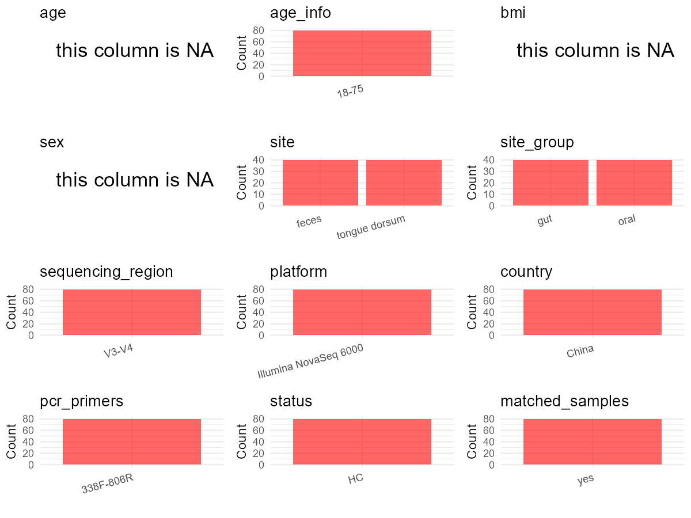

R Notebook: Metadata Processing Workflow
================

# Step 1: Obtain Initial Metadata from Each Project

This step sets the project directory, loads the raw SRA metadata, and
optionally merges supplement tables.

``` r
# Load libraries
library(dplyr)
library(ggplot2)
library(cowplot)

# (1) Setting working directory
# EDIT HERE: change project_id for each study
project_id <- "PRJNA782768" 

base_dir <- "E:/oral/26/metadata-2604/Oral-Metadata-YL-02"
setwd(file.path(base_dir, project_id))

# (2) Loading raw SRA metadata file
sra_file <- "SraRunTable.csv"
initial_meta <- read.csv(sra_file, header = TRUE)

# (3) OPTIONAL: If extra metadata (e.g., Table.x or supplemental materials) are available from the article, you may need to merge the file with initial_meta manually. Below is example code for merging. Depending on the specific case of each study, you can customize the code as needed.
# supp_table <- read.csv("supplemental_table.csv", header = TRUE)
# initial_meta <- left_join(initial_meta, supp_table, by = merge_col_name)
```

# Step 2: Data Overview

First, you need to get an overview of the data, which includes two
steps: reading the article and reading the initial metadata. This step
is very IMPORTANT!

``` r
# (1) Read the article in the following order: abstract, the beginning of the results section, and the methods. Understand the sample size, experimental design, and disease group overview. Clarify the sampling sites; for oral and gut samples, specify the exact sites like supragingival plaque, tongue, etc.

# (2) IMPORTANT: MUST go through each column of initial_meta
head(initial_meta, 10)
```

    ##            Run Assay.Type AvgSpotLen    Bases  BioProject    BioSample
    ## 1  SRR17012663   AMPLICON        495 39118365 PRJNA782768 SAMN23394823
    ## 2  SRR17012664   AMPLICON        493 48684243 PRJNA782768 SAMN23394825
    ## 3  SRR17012665   AMPLICON        492 42691824 PRJNA782768 SAMN23394822
    ## 4  SRR17012666   AMPLICON        493 40515726 PRJNA782768 SAMN23394821
    ## 5  SRR17012667   AMPLICON        494 49553634 PRJNA782768 SAMN23394820
    ## 6  SRR17012668   AMPLICON        495 52647210 PRJNA782768 SAMN23394819
    ## 7  SRR17012669   AMPLICON        493 37097757 PRJNA782768 SAMN23394818
    ## 8  SRR17012670   AMPLICON        494 33641400 PRJNA782768 SAMN23394817
    ## 9  SRR17012671   AMPLICON        495 40158360 PRJNA782768 SAMN23394816
    ## 10 SRR17012672   AMPLICON        494 40280266 PRJNA782768 SAMN23394824
    ##                 BioSampleModel    Bytes              Center.Name
    ## 1  Metagenome or environmental 13124801 SCHOOL OF BASIC MEDICINE
    ## 2  Metagenome or environmental 16341806 SCHOOL OF BASIC MEDICINE
    ## 3  Metagenome or environmental 14354884 SCHOOL OF BASIC MEDICINE
    ## 4  Metagenome or environmental 13825252 SCHOOL OF BASIC MEDICINE
    ## 5  Metagenome or environmental 16530367 SCHOOL OF BASIC MEDICINE
    ## 6  Metagenome or environmental 17690855 SCHOOL OF BASIC MEDICINE
    ## 7  Metagenome or environmental 12347851 SCHOOL OF BASIC MEDICINE
    ## 8  Metagenome or environmental 11136098 SCHOOL OF BASIC MEDICINE
    ## 9  Metagenome or environmental 13328799 SCHOOL OF BASIC MEDICINE
    ## 10 Metagenome or environmental 13377619 SCHOOL OF BASIC MEDICINE
    ##    Collection_Date Consent DATASTORE.filetype DATASTORE.provider
    ## 1       2021-01-06  public   fastq,run.zq,sra         gs,ncbi,s3
    ## 2       2021-01-06  public   fastq,run.zq,sra         gs,ncbi,s3
    ## 3       2021-01-06  public   fastq,run.zq,sra         gs,ncbi,s3
    ## 4       2021-01-06  public   fastq,run.zq,sra         gs,ncbi,s3
    ## 5       2021-01-06  public   fastq,run.zq,sra         gs,ncbi,s3
    ## 6       2021-01-06  public   fastq,run.zq,sra         gs,ncbi,s3
    ## 7       2021-01-06  public   fastq,run.zq,sra         gs,ncbi,s3
    ## 8       2021-01-06  public   fastq,run.zq,sra         gs,ncbi,s3
    ## 9       2021-01-06  public   fastq,run.zq,sra         gs,ncbi,s3
    ## 10      2021-01-06  public   fastq,run.zq,sra         gs,ncbi,s3
    ##                        DATASTORE.region  Experiment geo_loc_name_country
    ## 1  gs.us-east1,ncbi.public,s3.us-east-1 SRX13202890                China
    ## 2  gs.us-east1,ncbi.public,s3.us-east-1 SRX13202883                China
    ## 3  gs.us-east1,ncbi.public,s3.us-east-1 SRX13202889                China
    ## 4  gs.us-east1,ncbi.public,s3.us-east-1 SRX13202888                China
    ## 5  gs.us-east1,ncbi.public,s3.us-east-1 SRX13202887                China
    ## 6  gs.us-east1,ncbi.public,s3.us-east-1 SRX13202886                China
    ## 7  gs.us-east1,ncbi.public,s3.us-east-1 SRX13202885                China
    ## 8  gs.us-east1,ncbi.public,s3.us-east-1 SRX13202884                China
    ## 9  gs.us-east1,ncbi.public,s3.us-east-1 SRX13202842                China
    ## 10 gs.us-east1,ncbi.public,s3.us-east-1 SRX13202882                China
    ##    geo_loc_name_country_continent   geo_loc_name    HOST     Instrument
    ## 1                            Asia China:Shanghai missing Illumina MiSeq
    ## 2                            Asia China:Shanghai missing Illumina MiSeq
    ## 3                            Asia China:Shanghai missing Illumina MiSeq
    ## 4                            Asia China:Shanghai missing Illumina MiSeq
    ## 5                            Asia China:Shanghai missing Illumina MiSeq
    ## 6                            Asia China:Shanghai missing Illumina MiSeq
    ## 7                            Asia China:Shanghai missing Illumina MiSeq
    ## 8                            Asia China:Shanghai missing Illumina MiSeq
    ## 9                            Asia China:Shanghai missing Illumina MiSeq
    ## 10                           Asia China:Shanghai missing Illumina MiSeq
    ##    isolation_source          lat_lon Library.Name LibraryLayout
    ## 1           missing 31.19 N 121.60 E          F20        PAIRED
    ## 2           missing 31.19 N 121.60 E          F22        PAIRED
    ## 3           missing 31.19 N 121.60 E          F19        PAIRED
    ## 4           missing 31.19 N 121.60 E          F18        PAIRED
    ## 5           missing 31.19 N 121.60 E          F17        PAIRED
    ## 6           missing 31.19 N 121.60 E          F16        PAIRED
    ## 7           missing 31.19 N 121.60 E          F15        PAIRED
    ## 8           missing 31.19 N 121.60 E          F14        PAIRED
    ## 9           missing 31.19 N 121.60 E          F13        PAIRED
    ## 10          missing 31.19 N 121.60 E          F21        PAIRED
    ##    LibrarySelection LibrarySource       Organism Platform          ReleaseDate
    ## 1               PCR   METAGENOMIC gut metagenome ILLUMINA 2022-03-19T00:00:00Z
    ## 2               PCR   METAGENOMIC gut metagenome ILLUMINA 2022-03-19T00:00:00Z
    ## 3               PCR   METAGENOMIC gut metagenome ILLUMINA 2022-03-19T00:00:00Z
    ## 4               PCR   METAGENOMIC gut metagenome ILLUMINA 2022-03-19T00:00:00Z
    ## 5               PCR   METAGENOMIC gut metagenome ILLUMINA 2022-03-19T00:00:00Z
    ## 6               PCR   METAGENOMIC gut metagenome ILLUMINA 2022-03-19T00:00:00Z
    ## 7               PCR   METAGENOMIC gut metagenome ILLUMINA 2022-03-19T00:00:00Z
    ## 8               PCR   METAGENOMIC gut metagenome ILLUMINA 2022-03-19T00:00:00Z
    ## 9               PCR   METAGENOMIC gut metagenome ILLUMINA 2022-03-19T00:00:00Z
    ## 10              PCR   METAGENOMIC gut metagenome ILLUMINA 2022-03-19T00:00:00Z
    ##             create_date version Sample.Name SRA.Study
    ## 1  2021-11-23T02:11:00Z       1         F20 SRP347352
    ## 2  2021-11-23T02:11:00Z       1         F22 SRP347352
    ## 3  2021-11-23T02:11:00Z       1         F19 SRP347352
    ## 4  2021-11-23T02:11:00Z       1         F18 SRP347352
    ## 5  2021-11-23T02:11:00Z       1         F17 SRP347352
    ## 6  2021-11-23T02:11:00Z       1         F16 SRP347352
    ## 7  2021-11-23T02:11:00Z       1         F15 SRP347352
    ## 8  2021-11-23T02:11:00Z       1         F14 SRP347352
    ## 9  2021-11-23T02:11:00Z       1         F13 SRP347352
    ## 10 2021-11-23T02:11:00Z       1         F21 SRP347352

``` r
# IMPORTANT: Check the unique values in the column of interest or query column.
lapply(initial_meta[c('isolation_source')], table) # site
```

    ## $isolation_source
    ## 
    ## missing 
    ##     120

``` r
lapply(initial_meta[c('HOST', 'Organism')], table) # organism
```

    ## $HOST
    ## 
    ## missing 
    ##     120 
    ## 
    ## $Organism
    ## 
    ##  gut metagenome oral metagenome 
    ##              40              80

``` r
table(initial_meta$Sample.Name) # subject id
```

    ## 
    ##  F01  F02  F03  F04  F05  F06  F07  F08  F09  F10  F11  F12  F13  F14  F15  F16 
    ##    1    1    1    1    1    1    1    1    1    1    1    1    1    1    1    1 
    ##  F17  F18  F19  F20  F21  F22  F23  F24  F25  F26  F27  F28  F29  F30  F31  F32 
    ##    1    1    1    1    1    1    1    1    1    1    1    1    1    1    1    1 
    ##  F33  F34  F35  F36  F37  F38  F39  F40 T01a T02a T03a T04a T05a T06a T07a T08a 
    ##    1    1    1    1    1    1    1    1    1    1    1    1    1    1    1    1 
    ## T09a T10a T11a T12a T13a T14a T15a T16a T17a T18a T19a T20a T21a T22a T23a T24a 
    ##    1    1    1    1    1    1    1    1    1    1    1    1    1    1    1    1 
    ## T25a T26a T27a T28a T29a T30a T31a T32a T33a T34a T35a T36a T37a T38a T39a T40a 
    ##    1    1    1    1    1    1    1    1    1    1    1    1    1    1    1    1 
    ## Tb01 Tb02 Tb03 Tb04 Tb05 Tb06 Tb07 Tb08 Tb09 Tb10 Tb11 Tb12 Tb13 Tb14 Tb15 Tb16 
    ##    1    1    1    1    1    1    1    1    1    1    1    1    1    1    1    1 
    ## Tb17 Tb18 Tb19 Tb20 Tb21 Tb22 Tb23 Tb24 Tb25 Tb26 Tb27 Tb28 Tb29 Tb30 Tb31 Tb32 
    ##    1    1    1    1    1    1    1    1    1    1    1    1    1    1    1    1 
    ## Tb33 Tb34 Tb35 Tb36 Tb37 Tb38 Tb39 Tb40 
    ##    1    1    1    1    1    1    1    1

``` r
#table(initial_meta$sequencing_meth..exp.) # output is Sequencing by synthesis
table(initial_meta$Platform) # output is Illumina. according to the methods,  Illumina is correct.
```

    ## 
    ## ILLUMINA 
    ##      120

``` r
#table(initial_meta$target_subfragment) # output is V4
```

# Step 3: Removing Control and Non-human Samples

First, we need to remove control samples(including both negative
controls and positive controls) and non-human samples.

``` r
# Exclude repeated collection of samples
initial_meta <- initial_meta[!grepl("^Tb", initial_meta$Sample.Name), ]
# The sequencing data of this article are in two PRJNA782768 and PRJNA910326. According to the article, there are 74 oral samples of healthy people, while PRJNA910326 already has 34 oral samples of healthy people and all samples of the disease group. Therefore, in the current PRJNA782768, there are 40 oral samples of healthy people and their intestinal samples. However, there are 80 oral samples of healthy people, so 40 oral samples collected repeatedly should be removed.
  # The original words in the article are：183 patients and 74 healthy volunteers participated in this study. 425 microbial samples were collected, including 183 oral and 128 fecal samples from T2DM, 74 oral samples, and 40 fecal samples from the health, Figure 1.

# (1) EDIT HERE: Parameter setup
control_column <- "" # column name in initial_meta
# unique(initial_meta[[control_column]])
control_keywords <- c() # Enter exact keywords

species_column <- "" # column name in initial_meta
unique(initial_meta[[species_column]])
```

    ## NULL

``` r
non_human_keywords <- c() # Enter exact keywords

# (2) Remove controls and non-human samples. DO NOT need to modify code in this part, just run it.
n_samples <- nrow(initial_meta)
# Control evaluation
if (length(control_keywords) > 0) {
  if (is.null(control_column) || control_column == "") {
    stop("Error: control_keywords provided but control_column is missing.")
  }
  
  if (!(control_column %in% colnames(initial_meta))) {
    stop(sprintf("Error: Column '%s' not found in initial_meta.", control_column))
  }
  
  control_pattern <- paste(control_keywords, collapse = "|")
  control_text <- initial_meta[[control_column]]
  is_control <- grepl(control_pattern, control_text)
  
} else {
  is_control <- rep(FALSE, n_samples)
}

# Non-human evaluation
if (length(non_human_keywords) > 0) {
  if (is.null(species_column) || species_column == "") {
    stop("Error: non_human_keywords provided but species_column is missing.")
  }
  
  if (!(species_column %in% colnames(initial_meta))) {
    stop(sprintf("Error: Column '%s' not found in initial_meta.", species_column))
  }
  
  non_human_pattern <- paste(non_human_keywords, collapse = "|")
  species_text <- initial_meta[[species_column]]
  is_non_human <- grepl(non_human_pattern, species_text)
} else {
  is_non_human <- rep(FALSE, n_samples)
}

# Execute removal
samples_to_remove <- is_control | is_non_human
initial_meta <- initial_meta[!samples_to_remove, ]

cat("Initial samples counts:",n_samples,"\n")
```

    ## Initial samples counts: 80

``` r
cat("Removed control samples:", sum(is_control), "\n")
```

    ## Removed control samples: 0

``` r
cat("Removed non-human samples:", sum(is_non_human), "\n")
```

    ## Removed non-human samples: 0

``` r
cat("Total samples removed ", sum(samples_to_remove), "\n")
```

    ## Total samples removed  0

``` r
cat("Remaining samples after Step 2:", nrow(initial_meta), "\n")
```

    ## Remaining samples after Step 2: 80

# Step 4: Creating a Uniform Metadata Template

This step converts the raw SRA table into the standard metadata format
used in our meta-analysis. The uniform metadata should include the
following columns: 1. **bioproject**: Project ID from SRA or other
database e.g. `PRJNA1234`, `CNP1234`, ‘OEP1234’, ‘qiita_1234’ 2.
**sample_id**: SRA sample/run ID. Unique id for each sample!
e.g. `DRR1234567`, `ERR1234567` and `SRR1234567`. If no such column
exists, can use column like sample_name. 3. **subject_id**: subject id
for each person if available. e.g. `patient_01`, `Host_03_before`,
`subject12` 4. **age**: Age of the subject if available. e.g. `35`, `42`
\| not `adult`, `chilren` 5. **age_info**: If the age is not explicitly
stated but approximate age range information is available, mark it in
this column. e.g., `18-55`, `children`, `infant`, `elder` 6. **bmi**:
Body Mass Index if available. e.g. `22.5`, `18.9` \| not `normal`,
`overweight` 7. **sex**: Sex of the subject. Mandatory to write as M/F
\| not `female`, `woman` 8. **sequencing_region**: Targeted 16S rRNA
region. e.g. `V3-V4`, `V4` 9. **platform**: Sequencing platform.
e.g. `Illumina MiSeq`, `454 GS FLX Titanium`, `Ion Torrent` 10.
**country**: Country of sample origin. e.g. `China`, `Japan` \| not city
name like `Beijing` 11. **site**: Sampling site. For oral and gut sites,
specify the exact sites as detailed as possible. For example, if it is
known to be supragingival plaque, do not record it as ‘dental plaque’,
unless the original text provides only a vague description.
e.g. `saliva`, `tongue coating` \| not broad term like `oral` 12.
**site_group**: only accepts one of following three values: ‘oral’,
‘gut’, or ‘other’. 13. **public_time**: Data release date.
e.g. `2021-06-22` \| not `June 2021` 14. **pcr_primers**: PCR primers
used. e.g. `515F-806R`, `27F-338R` \| not primer sequences 15.
**title**: Title of the associated publication. 16. **disease_study**:
Whether the study involves disease samples. If it’s not clear, can
record as NA. Only three values accepted: ‘yes’, ‘no’ or NA 17.
**status**: Disease status for each sample if available, else record as
NA. Only accept following abbreviations, Write full names for all other
diseases. HC: healthy control CD: Crohn’s disease CRC: colorectal cancer
COPD: chronic obstructive pulmonary disease HIV: human immunodeficiency
virus ICU: intensive care unit OSCC: oral squamous cell carcinoma RA:
rheumatoid arthritis UC: ulcerative colitis 18. **matched_samples**:
Whether the subject has matched samples. Only accept ‘yes’ or ‘no’. 19.
**is_time_series**: Whether the study is a time series study. Only
accept ‘yes’ or ‘no’.

``` r
# Extract columns from initial_meta as follows: (1) No modification needed → extract directly. (2) Modification needed → create a new column with the prefix raw_ and mark the original column as “pending”. (3) Need to find or determine based on the article.
metadata <- data.frame(
  bioproject = initial_meta$BioProject,
  sample_id = initial_meta$Run,
  raw_subject_id = initial_meta$Sample.Name,
  subject_id = "pending", # modify later
  age = NA, 
  age_info = "18-75", # extract from methods section 
  bmi = NA,
  sex = NA,
  sequencing_region = "V3-V4", # extract from methods section
  platform = "Illumina NovaSeq 6000", # extract from methods section, NOT initial_meta
  country = initial_meta$geo_loc_name_country,
  raw_site = initial_meta$Organism, 
  site = "pending", # modify later
  site_group = "pending", # modify later
  public_time = initial_meta$ReleaseDate,
  pcr_primers = "338F-806R", # Format: xxF-xxR
  title = "Distribution characteristics of oral microbiota and its relationship with intestinal microbiota in patients with type 2 diabetes mellitus", # extract from article
  disease_study = "yes", # determine according to the article
  status = "HC", # The sequencing data of this article are in two PRJNA782768 and PRJNA910326. According to the article, there are 74 oral samples of healthy people, while PRJNA910326 already has 34 oral samples of healthy people and all samples of the disease group. Therefore, in the current PRJNA782768, there are 40 oral samples of healthy people and their intestinal samples. However, there are 80 oral samples of healthy people, so 40 oral samples collected repeatedly should be removed.
  # The original words in the article are：183 patients and 74 healthy volunteers participated in this study. 425 microbial samples were collected, including 183 oral and 128 fecal samples from T2DM, 74 oral samples, and 40 fecal samples from the health, Figure 1.
  matched_samples = "pending", # modify later
  is_time_series = "no", 
  stringsAsFactors = FALSE
)
metadata$public_time <- as.Date(metadata$public_time)
```

# Step 5: Manually solving pending issues

This step involves two parts: (1) handle the columns with the `raw_`
prefix, and next (2) handle the `site_group` and `matched_samples`
columns.

``` r
# (1) Handle the columns with the `raw_` prefix.
# In this part, you need to customize the code based on the situation of the raw_ columns to obtain the content of the target columns. IMPORTANT: Add comments if the modification is not straightforward!!
metadata$subject_id <- gsub("F|T|a|Tb", "", metadata$raw_subject_id) # according to the 'Library.Name' column of initial_meta

metadata <- metadata %>%
  mutate(site = case_when(
    grepl("gut", raw_site) ~ "feces",
    grepl("oral", raw_site) ~ "tongue dorsum",
    TRUE ~ NA_character_
  )) # according to the 'Organism' column of initial_meta
```

``` r
# (2) Filling the 'site_group' and 'matched_samples' columns
# editing site_group
unique(metadata$site)
```

    ## [1] "feces"         "tongue dorsum"

``` r
# EDIT HERE: add oral sites
Oral_site = c("tongue dorsum")
# EDIT HERE: add gut sites
Gut_site = c("feces")
# just run
metadata <- metadata %>%
  mutate(site_group = case_when(
    site %in% Oral_site ~ "oral",
    site %in% Gut_site ~ "gut",
    TRUE ~ "other" 
  ))

# editing matched_samples, just run.
metadata$matched_samples <- ifelse(
  ave(metadata$subject_id, metadata$subject_id, FUN = length) > 1, 
  "yes", 
  "no"
)
```

``` r
# (3) check if there is pending value in metadata. If there is pending value, go on modify the metadata.
# Function to check if a column contains "pending"
has_pending <- function(col) {
  if (is.character(col) || is.factor(col)) {
    any(col == "pending", na.rm = TRUE)
  } else {
    FALSE
  }
}

# Check for any pending value
any_pending_value <- any(sapply(metadata, has_pending))

if (!any_pending_value) {
  message("Good! No cell contains the value 'pending'.")
} else {
  pending_cols <- names(metadata)[sapply(metadata, has_pending)]
  message("Columns containing 'pending': ", paste(pending_cols, collapse = ", "))
  message("Please continue to resolve these pending columns!")
}
```

    ## Good! No cell contains the value 'pending'.

# Step 6: Visualize the Metadata

This step makes a quick set of plots for checking the distribution of
key metadata fields.

``` r
# Select columns for visualization, just run
plot_data <- metadata %>%
  select(-bioproject, -sample_id, -subject_id, -title)

create_simple_plots <- function(data) {
  plots <- list()
  continuous_vars <- c("age", "bmi")

  for (col in colnames(data)) {
    if (all(is.na(data[[col]]))) {
      p <- ggplot() +
        annotate("text", x = 0.5, y = 0.5, label = "this column is NA", size = 6) +
        labs(title = col) +
        theme_void()
    } else if (col %in% continuous_vars && is.numeric(data[[col]])) {
      p <- ggplot(data, aes(x = .data[[col]])) +
        geom_histogram(fill = "blue", alpha = 0.6, bins = 20, na.rm = TRUE) +
        labs(title = col, x = col, y = "Count") +
        theme_minimal()
    } else {
      count_data <- as.data.frame(table(data[[col]], useNA = "ifany"))
      p <- ggplot(count_data, aes(x = reorder(Var1, -Freq), y = Freq)) +
        geom_col(fill = "red", alpha = 0.6) +
        labs(title = col, x = NULL, y = "Count") +
        theme_minimal() +
        theme(axis.text.x = element_text(angle = 15, hjust = 1))
    }
    plots[[col]] <- p
  }

  return(plots)
}

# Generate and arrange plots
plots <- create_simple_plots(plot_data)
p <- plot_grid(plots$age,
               plots$age_info,
               plots$bmi,
               plots$sex,
               plots$site,
               plots$site_group,
               plots$sequencing_region,
               plots$platform,
               plots$country,
               plots$pcr_primers,
               plots$status,
               plots$matched_samples,
               ncol = 3, align = "hv", axis = "lb")
ggsave("Metadata_Summary_v2.png", plot = p, width = 8, height = 6, dpi = 150)
```

``` r
# Insert Metadata_Summary.png into the current Rmd output

```


# Step 7: Sort and export the metadata

This step saves the cleaned metadata table as the final `metadata.csv`
file.

``` r
# Reorder the data frame
fixed_cols <- c("bioproject", "sample_id", "subject_id", "age", "age_info",
                "bmi", "sex", "platform", "sequencing_region", "pcr_primers", 
                "country", "site", "site_group", "disease_study", "status", 
                "title", "public_time", "matched_samples", "is_time_series")  
metadata <- metadata %>%
  select(all_of(fixed_cols), everything())

# save metadata 
# head(metadata)
write.csv(metadata, file = "metadata_v2.csv", quote = TRUE)
```
