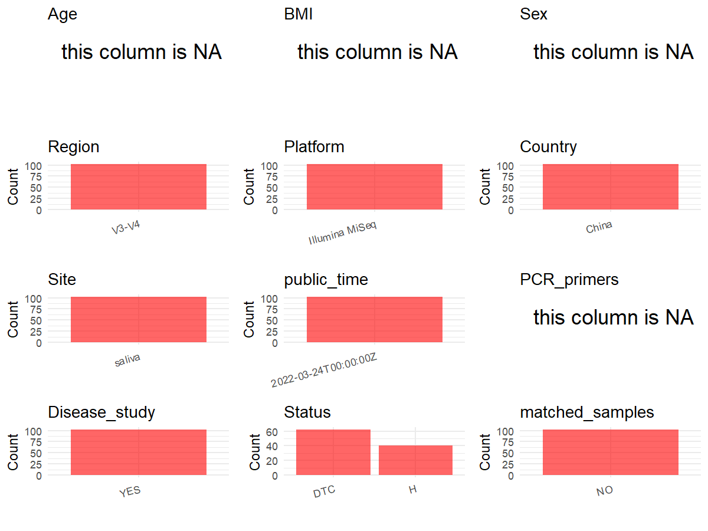

R Notebook: Metadata Processing Workflow
================

# Step 1: Obtain Initial Metadata from Each Project

To obtain the initial metadata: 1. Search for the BioProject ID (e.g.,
“PRJEBXXXX”) on the [NCBI SRA
website](https://www.ncbi.nlm.nih.gov/Traces/study/). 2. In the “Select”
table, click on “Metadata” and download the file. 3. The downloaded file
is typically named “SraRunTable.csv” and contains metadata for the
project.

``` r
# Load necessary libraries
library(dplyr)
library(ggplot2)
library(cowplot)

# Set working directory (update this path to your local directory)
setwd("D:/metadata/3/PRJNA784772")

# Read the initial metadata files
initial_meta<-read.csv("SraRunTable.csv",header = T)

# Combine the two metadata files
#meta <- rbind(initial_meta, initial_meta1)

#Remove entries non-oral samples
#initial_meta <- subset(initial_meta,BioSampleModel != "Metagenome or environmental")

# Check the number of samples containing "HT" in Sample.Name (e.g., healthy controls)
#nrow(subset(meta, grepl("HT", Sample.Name)))

# Display the first few rows of the metadata
head(initial_meta)
```

    ##           Run Assay.Type AvgSpotLen    Bases  BioProject    BioSample
    ## 1 SRR17072140   AMPLICON        415 37036835 PRJNA784772 SAMN23500924
    ## 2 SRR17072141   AMPLICON        405 34356244 PRJNA784772 SAMN23500923
    ## 3 SRR17072142   AMPLICON        414 34428505 PRJNA784772 SAMN23500922
    ## 4 SRR17072143   AMPLICON        420 35110534 PRJNA784772 SAMN23500921
    ## 5 SRR17072144   AMPLICON        414 28910252 PRJNA784772 SAMN23500849
    ## 6 SRR17072145   AMPLICON        402 34932948 PRJNA784772 SAMN23500920
    ##                BioSampleModel    Bytes
    ## 1 Metagenome or environmental 29781743
    ## 2 Metagenome or environmental 27939469
    ## 3 Metagenome or environmental 27808392
    ## 4 Metagenome or environmental 28513930
    ## 5 Metagenome or environmental 22954381
    ## 6 Metagenome or environmental 28639543
    ##                                                  Center.Name Collection_Date
    ## 1 THE FIRST AFFILIATED HOSPITAL OF HARBIN MEDICAL UNIVERSITY         2019-05
    ## 2 THE FIRST AFFILIATED HOSPITAL OF HARBIN MEDICAL UNIVERSITY         2019-05
    ## 3 THE FIRST AFFILIATED HOSPITAL OF HARBIN MEDICAL UNIVERSITY         2019-05
    ## 4 THE FIRST AFFILIATED HOSPITAL OF HARBIN MEDICAL UNIVERSITY         2019-05
    ## 5 THE FIRST AFFILIATED HOSPITAL OF HARBIN MEDICAL UNIVERSITY         2019-03
    ## 6 THE FIRST AFFILIATED HOSPITAL OF HARBIN MEDICAL UNIVERSITY         2019-05
    ##   Consent DATASTORE.filetype DATASTORE.provider
    ## 1  public   fastq,run.zq,sra         gs,ncbi,s3
    ## 2  public   fastq,run.zq,sra         gs,ncbi,s3
    ## 3  public   fastq,run.zq,sra         gs,ncbi,s3
    ## 4  public   fastq,run.zq,sra         gs,ncbi,s3
    ## 5  public   fastq,run.zq,sra         gs,ncbi,s3
    ## 6  public   fastq,run.zq,sra         gs,ncbi,s3
    ##                       DATASTORE.region  Experiment geo_loc_name_country
    ## 1 gs.us-east1,ncbi.public,s3.us-east-1 SRX13260733                China
    ## 2 gs.us-east1,ncbi.public,s3.us-east-1 SRX13260732                China
    ## 3 gs.us-east1,ncbi.public,s3.us-east-1 SRX13260731                China
    ## 4 gs.us-east1,ncbi.public,s3.us-east-1 SRX13260730                China
    ## 5 gs.us-east1,ncbi.public,s3.us-east-1 SRX13260729                China
    ## 6 gs.us-east1,ncbi.public,s3.us-east-1 SRX13260728                China
    ##   geo_loc_name_country_continent geo_loc_name         HOST     Instrument
    ## 1                           Asia        China Homo sapiens Illumina MiSeq
    ## 2                           Asia        China Homo sapiens Illumina MiSeq
    ## 3                           Asia        China Homo sapiens Illumina MiSeq
    ## 4                           Asia        China Homo sapiens Illumina MiSeq
    ## 5                           Asia        China Homo sapiens Illumina MiSeq
    ## 6                           Asia        China Homo sapiens Illumina MiSeq
    ##   isolation_source lat_lon Library.Name LibraryLayout LibrarySelection
    ## 1             oral missing          S84        SINGLE              PCR
    ## 2             oral missing          S83        SINGLE              PCR
    ## 3             oral missing          S82        SINGLE              PCR
    ## 4             oral missing          S81        SINGLE              PCR
    ## 5             oral missing           S9        SINGLE              PCR
    ## 6             oral missing          S80        SINGLE              PCR
    ##   LibrarySource              Organism Platform          ReleaseDate
    ## 1       GENOMIC human oral metagenome ILLUMINA 2022-03-24T00:00:00Z
    ## 2       GENOMIC human oral metagenome ILLUMINA 2022-03-24T00:00:00Z
    ## 3       GENOMIC human oral metagenome ILLUMINA 2022-03-24T00:00:00Z
    ## 4       GENOMIC human oral metagenome ILLUMINA 2022-03-24T00:00:00Z
    ## 5       GENOMIC human oral metagenome ILLUMINA 2022-03-24T00:00:00Z
    ## 6       GENOMIC human oral metagenome ILLUMINA 2022-03-24T00:00:00Z
    ##            create_date version Sample.Name SRA.Study
    ## 1 2021-11-30T08:40:00Z       1       CON22 SRP348598
    ## 2 2021-11-30T08:40:00Z       1       CON21 SRP348598
    ## 3 2021-11-30T08:40:00Z       1       CON20 SRP348598
    ## 4 2021-11-30T08:40:00Z       1       CON19 SRP348598
    ## 5 2021-11-30T08:40:00Z       1         MD2 SRP348598
    ## 6 2021-11-30T08:40:00Z       1       CON18 SRP348598

# Step 2: Create a Uniform Metadata Template

The uniform metadata should include the following columns:

1.  **BioProject**: Project ID (e.g., “PRJNA339212”)
2.  **Run**: Sample ID (e.g., “ERRXXXXXX” or “SRRXXXXXX”)
3.  **sample_name**: Original sample name submitted by the authors (not
    the database-assigned ID)
4.  **Age**: Age of the subject (if available)
5.  **BMI**: Body Mass Index (if available)
6.  **Sex**: Sex of the subject (“F” or “M”)
7.  **Region**: Targeted 16S rRNA region (e.g., “V3-V4”)
8.  **Platform**: Sequencing platform (e.g., “Illumina MiSeq”)
9.  **Country**: Country of sample origin (e.g., “China”)
10. **Site**: Sample site (e.g., “saliva”, “dental plaque”)
11. **public_time**: Data release date (format: “YYYY-MM-DD”)
12. **PCR_primers**: PCR primers used (e.g., “515F-806R”)
13. **title**: Title of the associated publication
14. **Disease_study**: Whether the study involves a disease (“YES” or
    “NO”)
15. **Status**: Disease status (e.g., “T2DM”, “HC”). Note: If the study
    includes both disease and healthy samples, this must be specified
    per sample.
16. **matched_samples**: matched samples (“YES” or “NO”)

``` r
# Create a uniform metadata dataframe
metadata <- data.frame(
  BioProject = initial_meta$BioProject,
  Run = initial_meta$Run,
  sample_name = initial_meta$Sample.Name,
  Age = NA,
  BMI = NA,
  Sex=NA,
  Region = "V3-V4",
  Platform = initial_meta$Instrument,
  Country = initial_meta$geo_loc_name_country,
  Site = "saliva",
  public_time = initial_meta$ReleaseDate,
  Status      = ifelse(grepl("^MD",  initial_meta$Sample.Name), "DTC",
                       ifelse(grepl("^CON",  initial_meta$Sample.Name), "H",NA)),
  PCR_primers = NA,
  stringsAsFactors = FALSE
)
```

# Step 3: Manually Add Information from the Publication

Some information (e.g. PCR primers, study title, disease status) must be
manually extracted from the publication and added to the metadata.

``` r
# Add information obtained from the publication
#metadata$PCR_primers <- "515F-806R"
metadata$title <- "Alterations in Oral Microbiota of Differentiated Thyroid Carcinoma Patients With Xerostomia After Radioiodine Therapy"
metadata$Disease_study <- "YES"
# Assign disease status based on sample_name patterns

keep_subjects <- unique(subset(metadata, Site == "saliva")$sample_name)
metadata <- subset(metadata, sample_name %in% keep_subjects)


metadata$matched_samples <- "NO"
```

# Step 4: Summarize and Validate the Metadata

``` r
# Check the number of unique runs and sample names
print(paste("Number of unique runs:", length(unique(metadata$Run))))
```

    ## [1] "Number of unique runs: 102"

``` r
print(paste("Number of unique sample names:", length(unique(metadata$sample_name))))
```

    ## [1] "Number of unique sample names: 102"

# Step 5: Visualize the Metadata

``` r

```

<!-- -->

# Step 6: Finalize and Export the Metadata

``` r
# Reorder columns to match the desired format
metadata <- metadata[, c(
  "BioProject", "Run", "sample_name", "Age", "BMI", "Sex", 
  "Region", "Platform", "Country", "Site", "public_time", 
  "PCR_primers", "title", "Disease_study", "Status","matched_samples"
)]

# Export the uniform metadata to a CSV file
write.csv(metadata, file = "metadata.csv", quote = TRUE)
head(metadata)
```

    ##    BioProject         Run sample_name Age BMI Sex Region       Platform Country
    ## 1 PRJNA784772 SRR17072140       CON22  NA  NA  NA  V3-V4 Illumina MiSeq   China
    ## 2 PRJNA784772 SRR17072141       CON21  NA  NA  NA  V3-V4 Illumina MiSeq   China
    ## 3 PRJNA784772 SRR17072142       CON20  NA  NA  NA  V3-V4 Illumina MiSeq   China
    ## 4 PRJNA784772 SRR17072143       CON19  NA  NA  NA  V3-V4 Illumina MiSeq   China
    ## 5 PRJNA784772 SRR17072144         MD2  NA  NA  NA  V3-V4 Illumina MiSeq   China
    ## 6 PRJNA784772 SRR17072145       CON18  NA  NA  NA  V3-V4 Illumina MiSeq   China
    ##     Site          public_time PCR_primers
    ## 1 saliva 2022-03-24T00:00:00Z          NA
    ## 2 saliva 2022-03-24T00:00:00Z          NA
    ## 3 saliva 2022-03-24T00:00:00Z          NA
    ## 4 saliva 2022-03-24T00:00:00Z          NA
    ## 5 saliva 2022-03-24T00:00:00Z          NA
    ## 6 saliva 2022-03-24T00:00:00Z          NA
    ##                                                                                                                   title
    ## 1 Alterations in Oral Microbiota of Differentiated Thyroid Carcinoma Patients With Xerostomia After Radioiodine Therapy
    ## 2 Alterations in Oral Microbiota of Differentiated Thyroid Carcinoma Patients With Xerostomia After Radioiodine Therapy
    ## 3 Alterations in Oral Microbiota of Differentiated Thyroid Carcinoma Patients With Xerostomia After Radioiodine Therapy
    ## 4 Alterations in Oral Microbiota of Differentiated Thyroid Carcinoma Patients With Xerostomia After Radioiodine Therapy
    ## 5 Alterations in Oral Microbiota of Differentiated Thyroid Carcinoma Patients With Xerostomia After Radioiodine Therapy
    ## 6 Alterations in Oral Microbiota of Differentiated Thyroid Carcinoma Patients With Xerostomia After Radioiodine Therapy
    ##   Disease_study Status matched_samples
    ## 1           YES      H              NO
    ## 2           YES      H              NO
    ## 3           YES      H              NO
    ## 4           YES      H              NO
    ## 5           YES    DTC              NO
    ## 6           YES      H              NO

## Notes for Students:

1.  **Metadata Accuracy**: Always cross-check the metadata with the
    original publication to ensure accuracy.
2.  **Manual Entries**: Columns like `PCR_primers`, and `Status` often
    require manual entry based on the publication.
3.  **Disease Status**: Be careful when assigning `Status`—some studies
    include both disease and healthy samples.
4.  **Visualization**: The plots help quickly identify the distribution
    of values in each column, which is useful for quality control.
5.  **Reproducibility**: Update the working directory and file paths to
    match your local environment.
