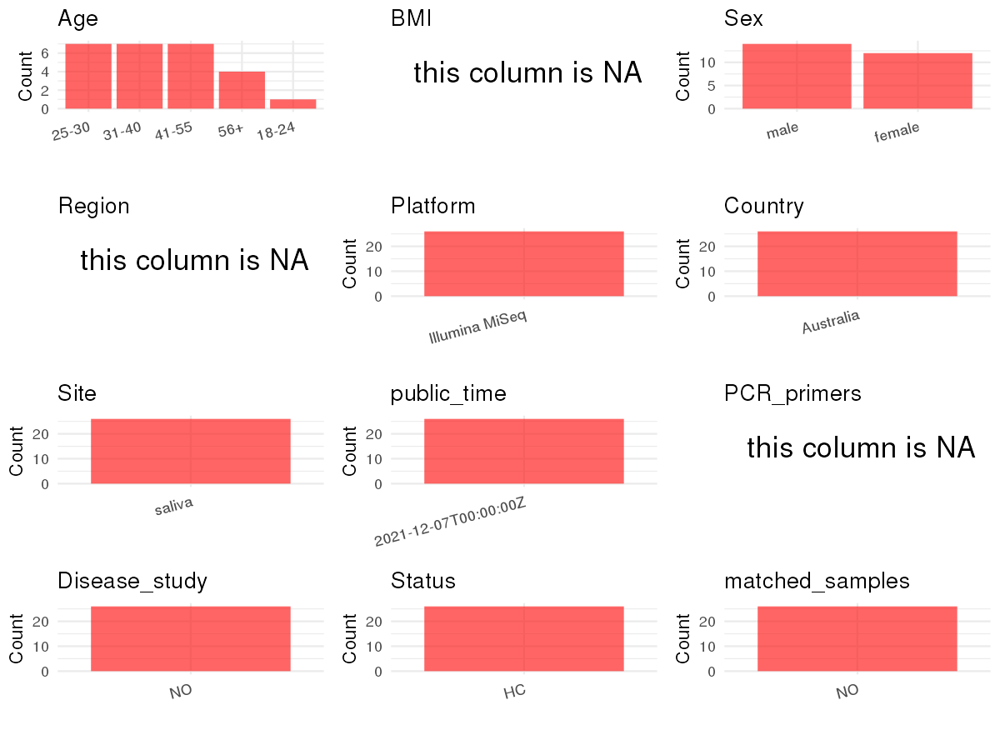

R Notebook: Metadata Processing Workflow
================

# Step 1: Obtain Initial Metadata from Each Project

To obtain the initial metadata: 1. Search for the BioProject ID (e.g.,
“PRJEBXXXX”) on the [NCBI SRA
website](https://www.ncbi.nlm.nih.gov/Traces/study/). 2. In the “Select”
table, click on “Metadata” and download the file. 3. The downloaded file
is typically named “SraRunTable.csv” and contains metadata for the
project.

``` r
# Load necessary libraries
library(dplyr)
library(stringr)
library(ggplot2)
library(cowplot)

# Set working directory (update this path to your local directory)
setwd("/home/dongbiao/word_embedding_microbiome/all_data/oral/global-oral-microbiome/data/projects/PRJNA786805")

# Read the initial metadata files
initial_meta <- read.csv("SraRunTable.csv", header = T)

# Display the first few rows of the metadata
head(initial_meta)
```

    ##           Run Assay.Type AvgSpotLen   Bases  BioProject    BioSample
    ## 1 SRR17155312   AMPLICON        150 5456392 PRJNA786805 SAMN23722100
    ## 2 SRR17155313   AMPLICON        150 7082633 PRJNA786805 SAMN23722099
    ## 3 SRR17155314   AMPLICON        150 3748891 PRJNA786805 SAMN23722098
    ## 4 SRR17155315   AMPLICON        150 5522344 PRJNA786805 SAMN23722097
    ## 5 SRR17155316   AMPLICON        150 5492394 PRJNA786805 SAMN23722096
    ## 6 SRR17155317   AMPLICON        150 2908622 PRJNA786805 SAMN23722095
    ##                                BioSampleModel   Bytes
    ## 1 MIMARKS.survey,MIGS/MIMS/MIMARKS.human-oral 3984721
    ## 2 MIMARKS.survey,MIGS/MIMS/MIMARKS.human-oral 5190960
    ## 3 MIMARKS.survey,MIGS/MIMS/MIMARKS.human-oral 2751639
    ## 4 MIMARKS.survey,MIGS/MIMS/MIMARKS.human-oral 4001369
    ## 5 MIMARKS.survey,MIGS/MIMS/MIMARKS.human-oral 4056676
    ## 6 MIMARKS.survey,MIGS/MIMS/MIMARKS.human-oral 2146708
    ##                   Center.Name Collection_Date Consent DATASTORE.filetype
    ## 1 THE UNIVERSITY OF MELBOURNE            2019  public   fastq,run.zq,sra
    ## 2 THE UNIVERSITY OF MELBOURNE            2019  public   fastq,run.zq,sra
    ## 3 THE UNIVERSITY OF MELBOURNE            2019  public   fastq,run.zq,sra
    ## 4 THE UNIVERSITY OF MELBOURNE            2019  public   fastq,run.zq,sra
    ## 5 THE UNIVERSITY OF MELBOURNE            2019  public   fastq,run.zq,sra
    ## 6 THE UNIVERSITY OF MELBOURNE            2019  public   fastq,run.zq,sra
    ##   DATASTORE.provider                     DATASTORE.region env_broad_scale
    ## 1         gs,ncbi,s3 gs.us-east1,ncbi.public,s3.us-east-1          saliva
    ## 2         gs,ncbi,s3 gs.us-east1,ncbi.public,s3.us-east-1          saliva
    ## 3         gs,ncbi,s3 gs.us-east1,ncbi.public,s3.us-east-1          saliva
    ## 4         gs,ncbi,s3 gs.us-east1,ncbi.public,s3.us-east-1          saliva
    ## 5         gs,ncbi,s3 gs.us-east1,ncbi.public,s3.us-east-1          saliva
    ## 6         gs,ncbi,s3 gs.us-east1,ncbi.public,s3.us-east-1          saliva
    ##   env_local_scale env_medium ethnicity  Experiment geo_loc_name_country
    ## 1      stimulated Western_09   Western SRX13339348            Australia
    ## 2      stimulated Western_08   Western SRX13339347            Australia
    ## 3      stimulated Western_07   Western SRX13339346            Australia
    ## 4      stimulated Western_06   Western SRX13339345            Australia
    ## 5      stimulated Western_05   Western SRX13339344            Australia
    ## 6      stimulated Western_04   Western SRX13339343            Australia
    ##   geo_loc_name_country_continent         geo_loc_name Host_Age         HOST
    ## 1                        Oceania Australia: Melbourne    41-55 Homo sapiens
    ## 2                        Oceania Australia: Melbourne      56+ Homo sapiens
    ## 3                        Oceania Australia: Melbourne    41-55 Homo sapiens
    ## 4                        Oceania Australia: Melbourne    41-55 Homo sapiens
    ## 5                        Oceania Australia: Melbourne    31-40 Homo sapiens
    ## 6                        Oceania Australia: Melbourne    41-55 Homo sapiens
    ##   host_sex     Instrument        lat_lon Library.Name LibraryLayout
    ## 1     male Illumina MiSeq not applicable          S12        SINGLE
    ## 2     male Illumina MiSeq not applicable          S11        SINGLE
    ## 3   female Illumina MiSeq not applicable           S8        SINGLE
    ## 4     male Illumina MiSeq not applicable           S7        SINGLE
    ## 5   female Illumina MiSeq not applicable           S6        SINGLE
    ## 6   female Illumina MiSeq not applicable           S5        SINGLE
    ##   LibrarySelection LibrarySource              Organism Platform
    ## 1              PCR   METAGENOMIC human oral metagenome ILLUMINA
    ## 2              PCR   METAGENOMIC human oral metagenome ILLUMINA
    ## 3              PCR   METAGENOMIC human oral metagenome ILLUMINA
    ## 4              PCR   METAGENOMIC human oral metagenome ILLUMINA
    ## 5              PCR   METAGENOMIC human oral metagenome ILLUMINA
    ## 6              PCR   METAGENOMIC human oral metagenome ILLUMINA
    ##            ReleaseDate          create_date version Sample.Name SRA.Study
    ## 1 2021-12-07T00:00:00Z 2021-12-07T11:07:00Z       1   XAVIERS12 SRP349610
    ## 2 2021-12-07T00:00:00Z 2021-12-07T11:07:00Z       1   XAVIERS11 SRP349610
    ## 3 2021-12-07T00:00:00Z 2021-12-07T11:06:00Z       1   XAVIERS08 SRP349610
    ## 4 2021-12-07T00:00:00Z 2021-12-07T11:07:00Z       1   XAVIERS07 SRP349610
    ## 5 2021-12-07T00:00:00Z 2021-12-07T11:06:00Z       1   XAVIERS06 SRP349610
    ## 6 2021-12-07T00:00:00Z 2021-12-07T11:06:00Z       1   XAVIERS05 SRP349610

# Step 2: Create a Uniform Metadata Template

The uniform metadata should include the following columns:

1.  **BioProject**: Project ID (e.g., “PRJNA339212”)
2.  **Run**: Sample ID (e.g., “ERRXXXXXX” or “SRRXXXXXX”)
3.  **sample_name**: Original sample name submitted by the authors (not
    the database-assigned ID)
4.  **Age**: Age of the subject (if available)
5.  **BMI**: Body Mass Index (if available)
6.  **Sex**: Sex of the subject (“F” or “M”)
7.  **Region**: Targeted 16S rRNA region (e.g., “V3-V4”)
8.  **Platform**: Sequencing platform (e.g., “Illumina MiSeq”)
9.  **Country**: Country of sample origin (e.g., “China”)
10. **Site**: Sample site (e.g., “saliva”, “dental plaque”)
11. **public_time**: Data release date (format: “YYYY-MM-DD”)
12. **PCR_primers**: PCR primers used (e.g., “515F-806R”)
13. **title**: Title of the associated publication
14. **Disease_study**: Whether the study involves a disease (“YES” or
    “NO”)
15. **Status**: Disease status (e.g., “T2DM”, “HC”). Note: If the study
    includes both disease and healthy samples, this must be specified
    per sample.
16. **matched_samples**: matched samples (“YES” or “NO”)

``` r
# Create a uniform metadata dataframe
metadata <- data.frame(
  BioProject = initial_meta$BioProject,
  Run = initial_meta$Run,
  sample_name = initial_meta$Sample.Name,
  Age = initial_meta$Host_Age,
  Sex = initial_meta$host_sex,
  BMI = NA,  
  Region = NA,
  Platform = initial_meta$Instrument,
  Country = initial_meta$geo_loc_name_country,
  Site = "saliva",
  public_time = initial_meta$ReleaseDate,
  stringsAsFactors = FALSE
)
```

# Step 3: Manually Add Information from the Publication

Some information (e.g. PCR primers, study title, disease status) must be
manually extracted from the publication and added to the metadata.

``` r
# Add information obtained from the publication
metadata$PCR_primers <- NA
metadata$title <- "The salivary microbiome shows a high prevalence of core bacterial members yet variability across human populations"
metadata$Disease_study <- "NO"

metadata$Status <- "HC"

# Check initial data distribution
cat("Initial sample distribution:\n")
```

    ## Initial sample distribution:

``` r
table(metadata$sample_name)
```

    ## 
    ## XAVIERS01 XAVIERS02 XAVIERS03 XAVIERS04 XAVIERS05 XAVIERS06 XAVIERS07 XAVIERS08 
    ##         1         1         1         1         1         1         1         1 
    ## XAVIERS11 XAVIERS12 XAVIERS13 XAVIERS17 XAVIERS18 XAVIERS19 XAVIERS21 XAVIERS22 
    ##         1         1         1         1         1         1         1         1 
    ## XAVIERS23 XAVIERS24 XAVIERS25 XAVIERS26 XAVIERS27 XAVIERS29 XAVIERS32 XAVIERS34 
    ##         1         1         1         1         1         1         1         1 
    ## XAVIERS35 XAVIERS36 
    ##         1         1

``` r
table(metadata$Site)
```

    ## 
    ## saliva 
    ##     26

``` r
# Calculate sampling frequency per subject
sample_counts <- table(metadata$sample_name)
cat("\nNumber of samples per subject:\n")
```

    ## 
    ## Number of samples per subject:

``` r
print(sample_counts)
```

    ## 
    ## XAVIERS01 XAVIERS02 XAVIERS03 XAVIERS04 XAVIERS05 XAVIERS06 XAVIERS07 XAVIERS08 
    ##         1         1         1         1         1         1         1         1 
    ## XAVIERS11 XAVIERS12 XAVIERS13 XAVIERS17 XAVIERS18 XAVIERS19 XAVIERS21 XAVIERS22 
    ##         1         1         1         1         1         1         1         1 
    ## XAVIERS23 XAVIERS24 XAVIERS25 XAVIERS26 XAVIERS27 XAVIERS29 XAVIERS32 XAVIERS34 
    ##         1         1         1         1         1         1         1         1 
    ## XAVIERS35 XAVIERS36 
    ##         1         1

``` r
# Create matched_samples column
metadata$matched_samples <- "NO"
```

# Step 4: Summarize and Validate the Metadata

``` r
# Check the number of unique runs and sample names
print(paste("Number of unique runs:", length(unique(metadata$Run))))
```

    ## [1] "Number of unique runs: 26"

``` r
print(paste("Number of unique sample names:", length(unique(metadata$sample_name))))
```

    ## [1] "Number of unique sample names: 26"

# Step 5: Visualize the Metadata

``` r

```


# Step 6: Finalize and Export the Metadata

``` r
# Reorder columns to match the desired format
metadata <- metadata[, c(
  "BioProject", "Run", "sample_name", "Age", "BMI", "Sex", 
  "Region", "Platform", "Country", "Site", "public_time", 
  "PCR_primers", "title", "Disease_study", "Status", "matched_samples"
)]

# Export the uniform metadata to a CSV file
write.csv(metadata, file = "metadata.csv", quote = TRUE)
head(metadata)
```

    ##    BioProject         Run sample_name   Age BMI    Sex Region       Platform
    ## 1 PRJNA786805 SRR17155312   XAVIERS12 41-55  NA   male     NA Illumina MiSeq
    ## 2 PRJNA786805 SRR17155313   XAVIERS11   56+  NA   male     NA Illumina MiSeq
    ## 3 PRJNA786805 SRR17155314   XAVIERS08 41-55  NA female     NA Illumina MiSeq
    ## 4 PRJNA786805 SRR17155315   XAVIERS07 41-55  NA   male     NA Illumina MiSeq
    ## 5 PRJNA786805 SRR17155316   XAVIERS06 31-40  NA female     NA Illumina MiSeq
    ## 6 PRJNA786805 SRR17155317   XAVIERS05 41-55  NA female     NA Illumina MiSeq
    ##     Country   Site          public_time PCR_primers
    ## 1 Australia saliva 2021-12-07T00:00:00Z          NA
    ## 2 Australia saliva 2021-12-07T00:00:00Z          NA
    ## 3 Australia saliva 2021-12-07T00:00:00Z          NA
    ## 4 Australia saliva 2021-12-07T00:00:00Z          NA
    ## 5 Australia saliva 2021-12-07T00:00:00Z          NA
    ## 6 Australia saliva 2021-12-07T00:00:00Z          NA
    ##                                                                                                                title
    ## 1 The salivary microbiome shows a high prevalence of core bacterial members yet variability across human populations
    ## 2 The salivary microbiome shows a high prevalence of core bacterial members yet variability across human populations
    ## 3 The salivary microbiome shows a high prevalence of core bacterial members yet variability across human populations
    ## 4 The salivary microbiome shows a high prevalence of core bacterial members yet variability across human populations
    ## 5 The salivary microbiome shows a high prevalence of core bacterial members yet variability across human populations
    ## 6 The salivary microbiome shows a high prevalence of core bacterial members yet variability across human populations
    ##   Disease_study Status matched_samples
    ## 1            NO     HC              NO
    ## 2            NO     HC              NO
    ## 3            NO     HC              NO
    ## 4            NO     HC              NO
    ## 5            NO     HC              NO
    ## 6            NO     HC              NO

## Notes for Students:

1.  **Metadata Accuracy**: Always cross-check the metadata with the
    original publication to ensure accuracy.
2.  **Manual Entries**: Columns like `PCR_primers`, and `Status` often
    require manual entry based on the publication.
3.  **Disease Status**: Be careful when assigning `Status`—some studies
    include both disease and healthy samples.
4.  **Visualization**: The plots help quickly identify the distribution
    of values in each column, which is useful for quality control.
5.  **Reproducibility**: Update the working directory and file paths to
    match your local environment.
