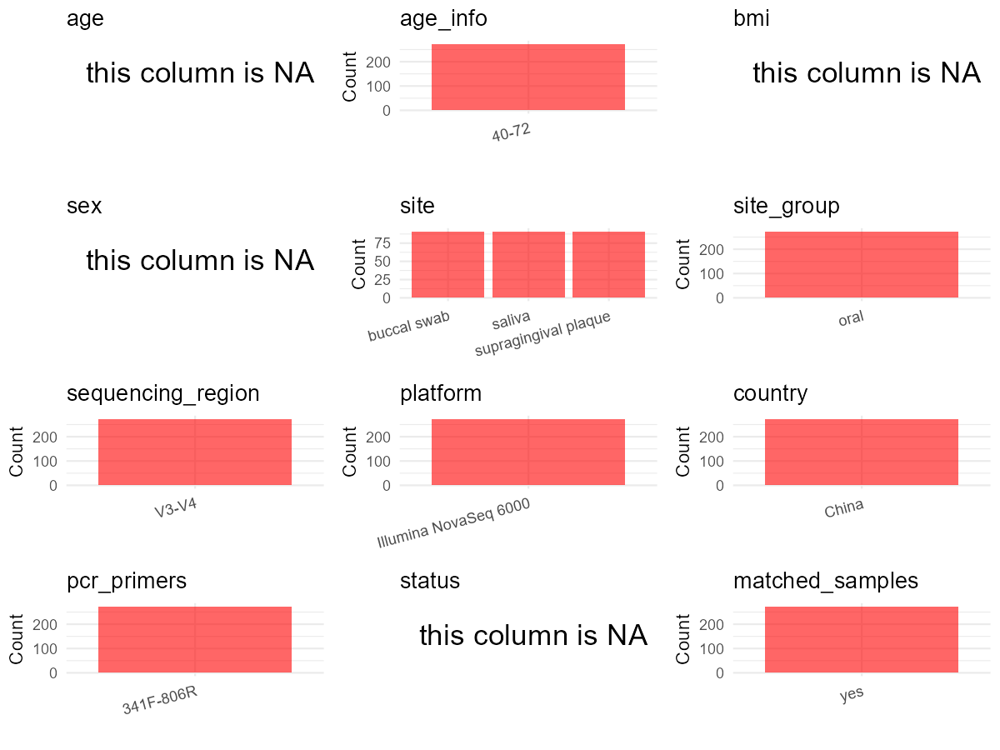

R Notebook: Metadata Processing Workflow
================

# Step 1: Obtain Initial Metadata from Each Project

This step sets the project directory, loads the raw SRA metadata, and
optionally merges supplement tables.

``` r
# Load libraries
library(dplyr)
library(ggplot2)
library(cowplot)

# (1) Setting working directory
# EDIT HERE: change project_id for each study
project_id <- "PRJNA788378" 

base_dir <- "E:/oral/26/metadata-2604/Oral-Metadata-YL"
setwd(file.path(base_dir, project_id))

# (2) Loading raw SRA metadata file
sra_file <- "SraRunTable.csv"
initial_meta <- read.csv(sra_file, header = TRUE)

# (3) OPTIONAL: If extra metadata (e.g., Table.x or supplemental materials) are available from the article, you may need to merge the file with initial_meta manually. Below is example code for merging. Depending on the specific case of each study, you can customize the code as needed.
# supp_table <- read.csv("supplemental_table.csv", header = TRUE)
# initial_meta <- left_join(initial_meta, supp_table, by = merge_col_name)
```

# Step 2: Data Overview

First, you need to get an overview of the data, which includes two
steps: reading the article and reading the initial metadata. This step
is very IMPORTANT!

``` r
# (1) Read the article in the following order: abstract, the beginning of the results section, and the methods. Understand the sample size, experimental design, and disease group overview. Clarify the sampling sites; for oral and gut samples, specify the exact sites like supragingival plaque, tongue, etc.

# (2) IMPORTANT: MUST go through each column of initial_meta
head(initial_meta, 10)
```

    ##            Run Assay.Type AvgSpotLen    Bases  BioProject    BioSample    Bytes
    ## 1  SRR17236859        WGA        463 58372174 PRJNA788378 SAMN23968705 22415757
    ## 2  SRR17236860        WGA        462 53165585 PRJNA788378 SAMN23968704 20529014
    ## 3  SRR17236861        WGA        461 53691818 PRJNA788378 SAMN23968703 20789035
    ## 4  SRR17236862        WGA        460 92999328 PRJNA788378 SAMN23968676 34827026
    ## 5  SRR17236863        WGA        462 57607894 PRJNA788378 SAMN23968702 22318864
    ## 6  SRR17236864        WGA        464 54260884 PRJNA788378 SAMN23968701 20893683
    ## 7  SRR17236865        WGA        461 50504499 PRJNA788378 SAMN23968945 18717617
    ## 8  SRR17236866        WGA        462 45655045 PRJNA788378 SAMN23968944 16919813
    ## 9  SRR17236867        WGA        462 48895387 PRJNA788378 SAMN23968943 17833807
    ## 10 SRR17236868        WGA        462 55977336 PRJNA788378 SAMN23968700 21360266
    ##                                                              Center.Name
    ## 1  NANJING STOMATOLOGICAL HOSPITAL, MEDICAL SCHOOL OF NANJING UNIVERSITY
    ## 2  NANJING STOMATOLOGICAL HOSPITAL, MEDICAL SCHOOL OF NANJING UNIVERSITY
    ## 3  NANJING STOMATOLOGICAL HOSPITAL, MEDICAL SCHOOL OF NANJING UNIVERSITY
    ## 4  NANJING STOMATOLOGICAL HOSPITAL, MEDICAL SCHOOL OF NANJING UNIVERSITY
    ## 5  NANJING STOMATOLOGICAL HOSPITAL, MEDICAL SCHOOL OF NANJING UNIVERSITY
    ## 6  NANJING STOMATOLOGICAL HOSPITAL, MEDICAL SCHOOL OF NANJING UNIVERSITY
    ## 7  NANJING STOMATOLOGICAL HOSPITAL, MEDICAL SCHOOL OF NANJING UNIVERSITY
    ## 8  NANJING STOMATOLOGICAL HOSPITAL, MEDICAL SCHOOL OF NANJING UNIVERSITY
    ## 9  NANJING STOMATOLOGICAL HOSPITAL, MEDICAL SCHOOL OF NANJING UNIVERSITY
    ## 10 NANJING STOMATOLOGICAL HOSPITAL, MEDICAL SCHOOL OF NANJING UNIVERSITY
    ##    Consent DATASTORE.filetype DATASTORE.provider
    ## 1   public   fastq,run.zq,sra         gs,ncbi,s3
    ## 2   public   fastq,run.zq,sra         gs,ncbi,s3
    ## 3   public   fastq,run.zq,sra         gs,ncbi,s3
    ## 4   public   fastq,run.zq,sra         gs,ncbi,s3
    ## 5   public   fastq,run.zq,sra         gs,ncbi,s3
    ## 6   public   fastq,run.zq,sra         gs,ncbi,s3
    ## 7   public   fastq,run.zq,sra         gs,ncbi,s3
    ## 8   public   fastq,run.zq,sra         gs,ncbi,s3
    ## 9   public   fastq,run.zq,sra         gs,ncbi,s3
    ## 10  public   fastq,run.zq,sra         gs,ncbi,s3
    ##                        DATASTORE.region  Experiment          Instrument
    ## 1  gs.us-east1,ncbi.public,s3.us-east-1 SRX13416238 Illumina HiSeq 4000
    ## 2  gs.us-east1,ncbi.public,s3.us-east-1 SRX13416237 Illumina HiSeq 4000
    ## 3  gs.us-east1,ncbi.public,s3.us-east-1 SRX13416236 Illumina HiSeq 4000
    ## 4  gs.us-east1,ncbi.public,s3.us-east-1 SRX13416235 Illumina HiSeq 4000
    ## 5  gs.us-east1,ncbi.public,s3.us-east-1 SRX13416234 Illumina HiSeq 4000
    ## 6  gs.us-east1,ncbi.public,s3.us-east-1 SRX13416233 Illumina HiSeq 4000
    ## 7  gs.us-east1,ncbi.public,s3.us-east-1 SRX13416232 Illumina HiSeq 4000
    ## 8  gs.us-east1,ncbi.public,s3.us-east-1 SRX13416231 Illumina HiSeq 4000
    ## 9  gs.us-east1,ncbi.public,s3.us-east-1 SRX13416230 Illumina HiSeq 4000
    ## 10 gs.us-east1,ncbi.public,s3.us-east-1 SRX13416229 Illumina HiSeq 4000
    ##    Library.Name LibraryLayout LibrarySelection LibrarySource
    ## 1   1_Oral_L_33        PAIRED              PCR   METAGENOMIC
    ## 2   1_Oral_L_32        PAIRED              PCR   METAGENOMIC
    ## 3   1_Oral_L_31        PAIRED              PCR   METAGENOMIC
    ## 4    1_Oral_L_4        PAIRED              PCR   METAGENOMIC
    ## 5   1_Oral_L_30        PAIRED              PCR   METAGENOMIC
    ## 6   1_Oral_L_29        PAIRED              PCR   METAGENOMIC
    ## 7   1_Oral_S_91        PAIRED              PCR   METAGENOMIC
    ## 8   1_Oral_S_90        PAIRED              PCR   METAGENOMIC
    ## 9   1_Oral_S_89        PAIRED              PCR   METAGENOMIC
    ## 10  1_Oral_L_28        PAIRED              PCR   METAGENOMIC
    ##                 Organism Platform          ReleaseDate          create_date
    ## 1  human oral metagenome ILLUMINA 2022-09-30T00:00:00Z 2021-12-15T10:36:00Z
    ## 2  human oral metagenome ILLUMINA 2022-09-30T00:00:00Z 2021-12-15T10:36:00Z
    ## 3  human oral metagenome ILLUMINA 2022-09-30T00:00:00Z 2021-12-15T10:36:00Z
    ## 4  human oral metagenome ILLUMINA 2022-09-30T00:00:00Z 2021-12-15T08:51:00Z
    ## 5  human oral metagenome ILLUMINA 2022-09-30T00:00:00Z 2021-12-15T10:36:00Z
    ## 6  human oral metagenome ILLUMINA 2022-09-30T00:00:00Z 2021-12-15T10:36:00Z
    ## 7  human oral metagenome ILLUMINA 2022-09-30T00:00:00Z 2021-12-15T10:36:00Z
    ## 8  human oral metagenome ILLUMINA 2022-09-30T00:00:00Z 2021-12-15T10:36:00Z
    ## 9  human oral metagenome ILLUMINA 2022-09-30T00:00:00Z 2021-12-15T10:36:00Z
    ## 10 human oral metagenome ILLUMINA 2022-09-30T00:00:00Z 2021-12-15T10:36:00Z
    ##    version Sample.Name SRA.Study Collection_Date geo_loc_name_country
    ## 1        1 1_Oral_L_33 SRP350874      2020-11-28                China
    ## 2        1 1_Oral_L_32 SRP350874      2020-11-28                China
    ## 3        1 1_Oral_L_31 SRP350874      2020-11-28                China
    ## 4        1  1_Oral_L_4 SRP350874      2020-11-28                China
    ## 5        1 1_Oral_L_30 SRP350874      2020-11-28                China
    ## 6        1 1_Oral_L_29 SRP350874      2020-11-28                China
    ## 7        1 1_Oral_S_91 SRP350874      2020-11-28                China
    ## 8        1 1_Oral_S_90 SRP350874      2020-11-28                China
    ## 9        1 1_Oral_S_89 SRP350874      2020-11-28                China
    ## 10       1 1_Oral_L_28 SRP350874      2020-11-28                China
    ##    geo_loc_name_country_continent isolation_source
    ## 1                            Asia    not collected
    ## 2                            Asia    not collected
    ## 3                            Asia    not collected
    ## 4                            Asia    not collected
    ## 5                            Asia    not collected
    ## 6                            Asia    not collected
    ## 7                            Asia    not collected
    ## 8                            Asia    not collected
    ## 9                            Asia    not collected
    ## 10                           Asia    not collected
    ##                                 BioSampleModel env_broad_scale env_local_scale
    ## 1  MIMARKS.survey,MIGS/MIMS/MIMARKS.human-oral   not collected   not collected
    ## 2  MIMARKS.survey,MIGS/MIMS/MIMARKS.human-oral   not collected   not collected
    ## 3  MIMARKS.survey,MIGS/MIMS/MIMARKS.human-oral   not collected   not collected
    ## 4  MIMARKS.survey,MIGS/MIMS/MIMARKS.human-oral   not collected   not collected
    ## 5  MIMARKS.survey,MIGS/MIMS/MIMARKS.human-oral   not collected   not collected
    ## 6  MIMARKS.survey,MIGS/MIMS/MIMARKS.human-oral   not collected   not collected
    ## 7  MIMARKS.survey,MIGS/MIMS/MIMARKS.human-oral   not collected   not collected
    ## 8  MIMARKS.survey,MIGS/MIMS/MIMARKS.human-oral   not collected   not collected
    ## 9  MIMARKS.survey,MIGS/MIMS/MIMARKS.human-oral   not collected   not collected
    ## 10 MIMARKS.survey,MIGS/MIMS/MIMARKS.human-oral   not collected   not collected
    ##       env_medium geo_loc_name    Host     isolate          lat_lon AssemblyName
    ## 1  not collected        China missing 1_Oral_L_33 32.06 N 118.78 E             
    ## 2  not collected        China missing 1_Oral_L_32 32.06 N 118.78 E             
    ## 3  not collected        China missing 1_Oral_L_31 32.06 N 118.78 E             
    ## 4  not collected        China missing  1_Oral_L_4 32.06 N 118.78 E             
    ## 5  not collected        China missing 1_Oral_L_30 32.06 N 118.78 E             
    ## 6  not collected        China missing 1_Oral_L_29 32.06 N 118.78 E             
    ## 7  not collected        China missing 1_Oral_S_91 32.06 N 118.78 E             
    ## 8  not collected        China missing 1_Oral_S_90 32.06 N 118.78 E             
    ## 9  not collected        China missing 1_Oral_S_89 32.06 N 118.78 E             
    ## 10 not collected        China missing 1_Oral_L_28 32.06 N 118.78 E             
    ##    analyte_type ArrayExpress.SPECIES biospecimen_repository
    ## 1                                                          
    ## 2                                                          
    ## 3                                                          
    ## 4                                                          
    ## 5                                                          
    ## 6                                                          
    ## 7                                                          
    ## 8                                                          
    ## 9                                                          
    ## 10                                                         
    ##    biospecimen_repository_sample_id body_site Consent.code
    ## 1                                NA                     NA
    ## 2                                NA                     NA
    ## 3                                NA                     NA
    ## 4                                NA                     NA
    ## 5                                NA                     NA
    ## 6                                NA                     NA
    ## 7                                NA                     NA
    ## 8                                NA                     NA
    ## 9                                NA                     NA
    ## 10                               NA                     NA
    ##    ENA.FIRST.PUBLIC..run. ena_first_public ENA.LAST.UPDATE..run.
    ## 1                                                               
    ## 2                                                               
    ## 3                                                               
    ## 4                                                               
    ## 5                                                               
    ## 6                                                               
    ## 7                                                               
    ## 8                                                               
    ## 9                                                               
    ## 10                                                              
    ##    ena_last_update external_id dbGaP.accession
    ## 1                                             
    ## 2                                             
    ## 3                                             
    ## 4                                             
    ## 5                                             
    ## 6                                             
    ## 7                                             
    ## 8                                             
    ## 9                                             
    ## 10                                            
    ##    geographic_location_.country_and.or_sea. host_health_state INSDC_center_name
    ## 1                                                                              
    ## 2                                                                              
    ## 3                                                                              
    ## 4                                                                              
    ## 5                                                                              
    ## 6                                                                              
    ## 7                                                                              
    ## 8                                                                              
    ## 9                                                                              
    ## 10                                                                             
    ##    INSDC_first_public INSDC_last_update INSDC_status Sample_name
    ## 1                                                               
    ## 2                                                               
    ## 3                                                               
    ## 4                                                               
    ## 5                                                               
    ## 6                                                               
    ## 7                                                               
    ## 8                                                               
    ## 9                                                               
    ## 10                                                              
    ##    Scientific_Name Serovar sex specific_host strain study_design study_name
    ## 1                                                NA                        
    ## 2                                                NA                        
    ## 3                                                NA                        
    ## 4                                                NA                        
    ## 5                                                NA                        
    ## 6                                                NA                        
    ## 7                                                NA                        
    ## 8                                                NA                        
    ## 9                                                NA                        
    ## 10                                               NA                        
    ##    submitted_subject_id Submitter_Id
    ## 1                    NA             
    ## 2                    NA             
    ## 3                    NA             
    ## 4                    NA             
    ## 5                    NA             
    ## 6                    NA             
    ## 7                    NA             
    ## 8                    NA             
    ## 9                    NA             
    ## 10                   NA

``` r
# IMPORTANT: Check the unique values in the column of interest or query column.
lapply(initial_meta[c('isolate', 'isolation_source')], table) # site
```

    ## $isolate
    ## 
    ##              1_Oral_L_1 1_Oral_L_10 1_Oral_L_11 1_Oral_L_12 1_Oral_L_13 
    ##           2           1           1           1           1           1 
    ## 1_Oral_L_14 1_Oral_L_15 1_Oral_L_16 1_Oral_L_17 1_Oral_L_18 1_Oral_L_19 
    ##           1           1           1           1           1           1 
    ##  1_Oral_L_2 1_Oral_L_20 1_Oral_L_21 1_Oral_L_22 1_Oral_L_23 1_Oral_L_24 
    ##           1           1           1           1           1           1 
    ## 1_Oral_L_25 1_Oral_L_26 1_Oral_L_27 1_Oral_L_28 1_Oral_L_29  1_Oral_L_3 
    ##           1           1           1           1           1           1 
    ## 1_Oral_L_30 1_Oral_L_31 1_Oral_L_32 1_Oral_L_33 1_Oral_L_34 1_Oral_L_35 
    ##           1           1           1           1           1           1 
    ## 1_Oral_L_36 1_Oral_L_37 1_Oral_L_38 1_Oral_L_39  1_Oral_L_4 1_Oral_L_40 
    ##           1           1           1           1           1           1 
    ## 1_Oral_L_41 1_Oral_L_42 1_Oral_L_43 1_Oral_L_44 1_Oral_L_45 1_Oral_L_46 
    ##           1           1           1           1           1           1 
    ## 1_Oral_L_47 1_Oral_L_48 1_Oral_L_49  1_Oral_L_5 1_Oral_L_50 1_Oral_L_51 
    ##           1           1           1           1           1           1 
    ## 1_Oral_L_52 1_Oral_L_53 1_Oral_L_54 1_Oral_L_55 1_Oral_L_56 1_Oral_L_57 
    ##           1           1           1           1           1           1 
    ## 1_Oral_L_58 1_Oral_L_59  1_Oral_L_6 1_Oral_L_60 1_Oral_L_61 1_Oral_L_62 
    ##           1           1           1           1           1           1 
    ## 1_Oral_L_63 1_Oral_L_64 1_Oral_L_65 1_Oral_L_66 1_Oral_L_67 1_Oral_L_68 
    ##           1           1           1           1           1           1 
    ## 1_Oral_L_69  1_Oral_L_7 1_Oral_L_70 1_Oral_L_71 1_Oral_L_72 1_Oral_L_73 
    ##           1           1           1           1           1           1 
    ## 1_Oral_L_74 1_Oral_L_75 1_Oral_L_76 1_Oral_L_77 1_Oral_L_78 1_Oral_L_79 
    ##           1           1           1           1           1           1 
    ##  1_Oral_L_8 1_Oral_L_80 1_Oral_L_81 1_Oral_L_82 1_Oral_L_83 1_Oral_L_84 
    ##           1           1           1           1           1           1 
    ## 1_Oral_L_85 1_Oral_L_86 1_Oral_L_87 1_Oral_L_88 1_Oral_L_89  1_Oral_L_9 
    ##           1           1           1           1           1           1 
    ## 1_Oral_L_90 1_Oral_L_91  1_Oral_P_1 1_Oral_P_10 1_Oral_P_11 1_Oral_P_12 
    ##           1           1           1           1           1           1 
    ## 1_Oral_P_13 1_Oral_P_14 1_Oral_P_15 1_Oral_P_16 1_Oral_P_17 1_Oral_P_18 
    ##           1           1           1           1           1           1 
    ## 1_Oral_P_19  1_Oral_P_2 1_Oral_P_20 1_Oral_P_21 1_Oral_P_22 1_Oral_P_23 
    ##           1           1           1           1           1           1 
    ## 1_Oral_P_24 1_Oral_P_25 1_Oral_P_26 1_Oral_P_27 1_Oral_P_28 1_Oral_P_29 
    ##           1           1           1           1           1           1 
    ##  1_Oral_P_3 1_Oral_P_30 1_Oral_P_31 1_Oral_P_32 1_Oral_P_33 1_Oral_P_34 
    ##           1           1           1           1           1           1 
    ## 1_Oral_P_35 1_Oral_P_36 1_Oral_P_37 1_Oral_P_38 1_Oral_P_39  1_Oral_P_4 
    ##           1           1           1           1           1           1 
    ## 1_Oral_P_40 1_Oral_P_41 1_Oral_P_42 1_Oral_P_43 1_Oral_P_44 1_Oral_P_45 
    ##           1           1           1           1           1           1 
    ## 1_Oral_P_46 1_Oral_P_47 1_Oral_P_48 1_Oral_P_49  1_Oral_P_5 1_Oral_P_50 
    ##           1           1           1           1           1           1 
    ## 1_Oral_P_51 1_Oral_P_52 1_Oral_P_53 1_Oral_P_54 1_Oral_P_55 1_Oral_P_56 
    ##           1           1           1           1           1           1 
    ## 1_Oral_P_57 1_Oral_P_58 1_Oral_P_59  1_Oral_P_6 1_Oral_P_60 1_Oral_P_61 
    ##           1           1           1           1           1           1 
    ## 1_Oral_P_62 1_Oral_P_63 1_Oral_P_64 1_Oral_P_65 1_Oral_P_66 1_Oral_P_67 
    ##           1           1           1           1           1           1 
    ## 1_Oral_P_68 1_Oral_P_69  1_Oral_P_7 1_Oral_P_70 1_Oral_P_71 1_Oral_P_72 
    ##           1           1           1           1           1           1 
    ## 1_Oral_P_73 1_Oral_P_74 1_Oral_P_75 1_Oral_P_76 1_Oral_P_77 1_Oral_P_78 
    ##           1           1           1           1           1           1 
    ## 1_Oral_P_79  1_Oral_P_8 1_Oral_P_80 1_Oral_P_81 1_Oral_P_82 1_Oral_P_83 
    ##           1           1           1           1           1           1 
    ## 1_Oral_P_84 1_Oral_P_85 1_Oral_P_86 1_Oral_P_87 1_Oral_P_88 1_Oral_P_89 
    ##           1           1           1           1           1           1 
    ##  1_Oral_P_9 1_Oral_P_90 1_Oral_P_91  1_Oral_S_1 1_Oral_S_10 1_Oral_S_11 
    ##           1           1           1           1           1           1 
    ## 1_Oral_S_12 1_Oral_S_13 1_Oral_S_14 1_Oral_S_15 1_Oral_S_16 1_Oral_S_17 
    ##           1           1           1           1           1           1 
    ## 1_Oral_S_18 1_Oral_S_19  1_Oral_S_2 1_Oral_S_20 1_Oral_S_21 1_Oral_S_22 
    ##           1           1           1           1           1           1 
    ## 1_Oral_S_23 1_Oral_S_24 1_Oral_S_25 1_Oral_S_26 1_Oral_S_27 1_Oral_S_28 
    ##           1           1           1           1           1           1 
    ## 1_Oral_S_29  1_Oral_S_3 1_Oral_S_30 1_Oral_S_31 1_Oral_S_32 1_Oral_S_33 
    ##           1           1           1           1           1           1 
    ## 1_Oral_S_34 1_Oral_S_35 1_Oral_S_36 1_Oral_S_37 1_Oral_S_38 1_Oral_S_39 
    ##           1           1           1           1           1           1 
    ##  1_Oral_S_4 1_Oral_S_40 1_Oral_S_41 1_Oral_S_42 1_Oral_S_43 1_Oral_S_44 
    ##           1           1           1           1           1           1 
    ## 1_Oral_S_45 1_Oral_S_46 1_Oral_S_47 1_Oral_S_48 1_Oral_S_49  1_Oral_S_5 
    ##           1           1           1           1           1           1 
    ## 1_Oral_S_50 1_Oral_S_51 1_Oral_S_52 1_Oral_S_53 1_Oral_S_54 1_Oral_S_55 
    ##           1           1           1           1           1           1 
    ## 1_Oral_S_56 1_Oral_S_57 1_Oral_S_58 1_Oral_S_59  1_Oral_S_6 1_Oral_S_60 
    ##           1           1           1           1           1           1 
    ## 1_Oral_S_61 1_Oral_S_62 1_Oral_S_63 1_Oral_S_64 1_Oral_S_65 1_Oral_S_66 
    ##           1           1           1           1           1           1 
    ## 1_Oral_S_67 1_Oral_S_68 1_Oral_S_69  1_Oral_S_7 1_Oral_S_70 1_Oral_S_71 
    ##           1           1           1           1           1           1 
    ## 1_Oral_S_72 1_Oral_S_73 1_Oral_S_74 1_Oral_S_75 1_Oral_S_76 1_Oral_S_77 
    ##           1           1           1           1           1           1 
    ## 1_Oral_S_78 1_Oral_S_79  1_Oral_S_8 1_Oral_S_80 1_Oral_S_81 1_Oral_S_82 
    ##           1           1           1           1           1           1 
    ## 1_Oral_S_83 1_Oral_S_84 1_Oral_S_85 1_Oral_S_86 1_Oral_S_87 1_Oral_S_88 
    ##           1           1           1           1           1           1 
    ## 1_Oral_S_89  1_Oral_S_9 1_Oral_S_90 1_Oral_S_91 
    ##           1           1           1           1 
    ## 
    ## $isolation_source
    ## 
    ##                         Central venous catheter           not collected 
    ##                       1                       1                     273

``` r
lapply(initial_meta[c('env_broad_scale', 'env_local_scale', 'env_medium', 'Organism', 'Host')], table) # organism
```

    ## $env_broad_scale
    ## 
    ##               not collected 
    ##             2           273 
    ## 
    ## $env_local_scale
    ## 
    ##               not collected 
    ##             2           273 
    ## 
    ## $env_medium
    ## 
    ##               not collected 
    ##             2           273 
    ## 
    ## $Organism
    ## 
    ##                Homo sapiens       human oral metagenome 
    ##                           1                         273 
    ## Staphylococcus haemolyticus 
    ##                           1 
    ## 
    ## $Host
    ## 
    ##         missing 
    ##       2     273

``` r
table(initial_meta$Sample.Name) # subject id
```

    ## 
    ##   1_Oral_L_1  1_Oral_L_10  1_Oral_L_11  1_Oral_L_12  1_Oral_L_13  1_Oral_L_14 
    ##            1            1            1            1            1            1 
    ##  1_Oral_L_15  1_Oral_L_16  1_Oral_L_17  1_Oral_L_18  1_Oral_L_19   1_Oral_L_2 
    ##            1            1            1            1            1            1 
    ##  1_Oral_L_20  1_Oral_L_21  1_Oral_L_22  1_Oral_L_23  1_Oral_L_24  1_Oral_L_25 
    ##            1            1            1            1            1            1 
    ##  1_Oral_L_26  1_Oral_L_27  1_Oral_L_28  1_Oral_L_29   1_Oral_L_3  1_Oral_L_30 
    ##            1            1            1            1            1            1 
    ##  1_Oral_L_31  1_Oral_L_32  1_Oral_L_33  1_Oral_L_34  1_Oral_L_35  1_Oral_L_36 
    ##            1            1            1            1            1            1 
    ##  1_Oral_L_37  1_Oral_L_38  1_Oral_L_39   1_Oral_L_4  1_Oral_L_40  1_Oral_L_41 
    ##            1            1            1            1            1            1 
    ##  1_Oral_L_42  1_Oral_L_43  1_Oral_L_44  1_Oral_L_45  1_Oral_L_46  1_Oral_L_47 
    ##            1            1            1            1            1            1 
    ##  1_Oral_L_48  1_Oral_L_49   1_Oral_L_5  1_Oral_L_50  1_Oral_L_51  1_Oral_L_52 
    ##            1            1            1            1            1            1 
    ##  1_Oral_L_53  1_Oral_L_54  1_Oral_L_55  1_Oral_L_56  1_Oral_L_57  1_Oral_L_58 
    ##            1            1            1            1            1            1 
    ##  1_Oral_L_59   1_Oral_L_6  1_Oral_L_60  1_Oral_L_61  1_Oral_L_62  1_Oral_L_63 
    ##            1            1            1            1            1            1 
    ##  1_Oral_L_64  1_Oral_L_65  1_Oral_L_66  1_Oral_L_67  1_Oral_L_68  1_Oral_L_69 
    ##            1            1            1            1            1            1 
    ##   1_Oral_L_7  1_Oral_L_70  1_Oral_L_71  1_Oral_L_72  1_Oral_L_73  1_Oral_L_74 
    ##            1            1            1            1            1            1 
    ##  1_Oral_L_75  1_Oral_L_76  1_Oral_L_77  1_Oral_L_78  1_Oral_L_79   1_Oral_L_8 
    ##            1            1            1            1            1            1 
    ##  1_Oral_L_80  1_Oral_L_81  1_Oral_L_82  1_Oral_L_83  1_Oral_L_84  1_Oral_L_85 
    ##            1            1            1            1            1            1 
    ##  1_Oral_L_86  1_Oral_L_87  1_Oral_L_88  1_Oral_L_89   1_Oral_L_9  1_Oral_L_90 
    ##            1            1            1            1            1            1 
    ##  1_Oral_L_91   1_Oral_P_1  1_Oral_P_10  1_Oral_P_11  1_Oral_P_12  1_Oral_P_13 
    ##            1            1            1            1            1            1 
    ##  1_Oral_P_14  1_Oral_P_15  1_Oral_P_16  1_Oral_P_17  1_Oral_P_18  1_Oral_P_19 
    ##            1            1            1            1            1            1 
    ##   1_Oral_P_2  1_Oral_P_20  1_Oral_P_21  1_Oral_P_22  1_Oral_P_23  1_Oral_P_24 
    ##            1            1            1            1            1            1 
    ##  1_Oral_P_25  1_Oral_P_26  1_Oral_P_27  1_Oral_P_28  1_Oral_P_29   1_Oral_P_3 
    ##            1            1            1            1            1            1 
    ##  1_Oral_P_30  1_Oral_P_31  1_Oral_P_32  1_Oral_P_33  1_Oral_P_34  1_Oral_P_35 
    ##            1            1            1            1            1            1 
    ##  1_Oral_P_36  1_Oral_P_37  1_Oral_P_38  1_Oral_P_39   1_Oral_P_4  1_Oral_P_40 
    ##            1            1            1            1            1            1 
    ##  1_Oral_P_41  1_Oral_P_42  1_Oral_P_43  1_Oral_P_44  1_Oral_P_45  1_Oral_P_46 
    ##            1            1            1            1            1            1 
    ##  1_Oral_P_47  1_Oral_P_48  1_Oral_P_49   1_Oral_P_5  1_Oral_P_50  1_Oral_P_51 
    ##            1            1            1            1            1            1 
    ##  1_Oral_P_52  1_Oral_P_53  1_Oral_P_54  1_Oral_P_55  1_Oral_P_56  1_Oral_P_57 
    ##            1            1            1            1            1            1 
    ##  1_Oral_P_58  1_Oral_P_59   1_Oral_P_6  1_Oral_P_60  1_Oral_P_61  1_Oral_P_62 
    ##            1            1            1            1            1            1 
    ##  1_Oral_P_63  1_Oral_P_64  1_Oral_P_65  1_Oral_P_66  1_Oral_P_67  1_Oral_P_68 
    ##            1            1            1            1            1            1 
    ##  1_Oral_P_69   1_Oral_P_7  1_Oral_P_70  1_Oral_P_71  1_Oral_P_72  1_Oral_P_73 
    ##            1            1            1            1            1            1 
    ##  1_Oral_P_74  1_Oral_P_75  1_Oral_P_76  1_Oral_P_77  1_Oral_P_78  1_Oral_P_79 
    ##            1            1            1            1            1            1 
    ##   1_Oral_P_8  1_Oral_P_80  1_Oral_P_81  1_Oral_P_82  1_Oral_P_83  1_Oral_P_84 
    ##            1            1            1            1            1            1 
    ##  1_Oral_P_85  1_Oral_P_86  1_Oral_P_87  1_Oral_P_88  1_Oral_P_89   1_Oral_P_9 
    ##            1            1            1            1            1            1 
    ##  1_Oral_P_90  1_Oral_P_91   1_Oral_S_1  1_Oral_S_10  1_Oral_S_11  1_Oral_S_12 
    ##            1            1            1            1            1            1 
    ##  1_Oral_S_13  1_Oral_S_14  1_Oral_S_15  1_Oral_S_16  1_Oral_S_17  1_Oral_S_18 
    ##            1            1            1            1            1            1 
    ##  1_Oral_S_19   1_Oral_S_2  1_Oral_S_20  1_Oral_S_21  1_Oral_S_22  1_Oral_S_23 
    ##            1            1            1            1            1            1 
    ##  1_Oral_S_24  1_Oral_S_25  1_Oral_S_26  1_Oral_S_27  1_Oral_S_28  1_Oral_S_29 
    ##            1            1            1            1            1            1 
    ##   1_Oral_S_3  1_Oral_S_30  1_Oral_S_31  1_Oral_S_32  1_Oral_S_33  1_Oral_S_34 
    ##            1            1            1            1            1            1 
    ##  1_Oral_S_35  1_Oral_S_36  1_Oral_S_37  1_Oral_S_38  1_Oral_S_39   1_Oral_S_4 
    ##            1            1            1            1            1            1 
    ##  1_Oral_S_40  1_Oral_S_41  1_Oral_S_42  1_Oral_S_43  1_Oral_S_44  1_Oral_S_45 
    ##            1            1            1            1            1            1 
    ##  1_Oral_S_46  1_Oral_S_47  1_Oral_S_48  1_Oral_S_49   1_Oral_S_5  1_Oral_S_50 
    ##            1            1            1            1            1            1 
    ##  1_Oral_S_51  1_Oral_S_52  1_Oral_S_53  1_Oral_S_54  1_Oral_S_55  1_Oral_S_56 
    ##            1            1            1            1            1            1 
    ##  1_Oral_S_57  1_Oral_S_58  1_Oral_S_59   1_Oral_S_6  1_Oral_S_60  1_Oral_S_61 
    ##            1            1            1            1            1            1 
    ##  1_Oral_S_62  1_Oral_S_63  1_Oral_S_64  1_Oral_S_65  1_Oral_S_66  1_Oral_S_67 
    ##            1            1            1            1            1            1 
    ##  1_Oral_S_68  1_Oral_S_69   1_Oral_S_7  1_Oral_S_70  1_Oral_S_71  1_Oral_S_72 
    ##            1            1            1            1            1            1 
    ##  1_Oral_S_73  1_Oral_S_74  1_Oral_S_75  1_Oral_S_76  1_Oral_S_77  1_Oral_S_78 
    ##            1            1            1            1            1            1 
    ##  1_Oral_S_79   1_Oral_S_8  1_Oral_S_80  1_Oral_S_81  1_Oral_S_82  1_Oral_S_83 
    ##            1            1            1            1            1            1 
    ##  1_Oral_S_84  1_Oral_S_85  1_Oral_S_86  1_Oral_S_87  1_Oral_S_88  1_Oral_S_89 
    ##            1            1            1            1            1            1 
    ##   1_Oral_S_9  1_Oral_S_90  1_Oral_S_91   2893990753 SAMEA1035056 
    ##            1            1            1            1            1

``` r
# table(initial_meta$sequencing_meth..exp.) # output is pyrosequencing
table(initial_meta$Instrument) # output is Illumina. according to the methods, Illumina is correct.
```

    ## 
    ## Illumina HiSeq 2000 Illumina HiSeq 2500 Illumina HiSeq 4000 
    ##                   1                   1                 273

``` r
# table(initial_meta$target_subfragment..exp.)
```

# Step 3: Removing Control and Non-human Samples

First, we need to remove control samples(including both negative
controls and positive controls) and non-human samples.

``` r
# (1) EDIT HERE: Parameter setup
control_column <- "BioProject" # column name in initial_meta
# unique(initial_meta[[control_column]])
control_keywords <- c("PRJNA251915", "PRJEB2705") # Enter exact keywords. Exclude samples that are not PRJNA788378

species_column <- "" # column name in initial_meta
unique(initial_meta[[species_column]])
```

    ## NULL

``` r
non_human_keywords <- c() # Enter exact keywords

# (2) Remove controls and non-human samples. DO NOT need to modify code in this part, just run it.
n_samples <- nrow(initial_meta)
# Control evaluation
if (length(control_keywords) > 0) {
  if (is.null(control_column) || control_column == "") {
    stop("Error: control_keywords provided but control_column is missing.")
  }
  
  if (!(control_column %in% colnames(initial_meta))) {
    stop(sprintf("Error: Column '%s' not found in initial_meta.", control_column))
  }
  
  control_pattern <- paste(control_keywords, collapse = "|")
  control_text <- initial_meta[[control_column]]
  is_control <- grepl(control_pattern, control_text)
  
} else {
  is_control <- rep(FALSE, n_samples)
}

# Non-human evaluation
if (length(non_human_keywords) > 0) {
  if (is.null(species_column) || species_column == "") {
    stop("Error: non_human_keywords provided but species_column is missing.")
  }
  
  if (!(species_column %in% colnames(initial_meta))) {
    stop(sprintf("Error: Column '%s' not found in initial_meta.", species_column))
  }
  
  non_human_pattern <- paste(non_human_keywords, collapse = "|")
  species_text <- initial_meta[[species_column]]
  is_non_human <- grepl(non_human_pattern, species_text)
} else {
  is_non_human <- rep(FALSE, n_samples)
}

# Execute removal
samples_to_remove <- is_control | is_non_human
initial_meta <- initial_meta[!samples_to_remove, ]

cat("Initial samples counts:",n_samples,"\n")
```

    ## Initial samples counts: 275

``` r
cat("Removed control samples:", sum(is_control), "\n")
```

    ## Removed control samples: 2

``` r
cat("Removed non-human samples:", sum(is_non_human), "\n")
```

    ## Removed non-human samples: 0

``` r
cat("Total samples removed ", sum(samples_to_remove), "\n")
```

    ## Total samples removed  2

``` r
cat("Remaining samples after Step 2:", nrow(initial_meta), "\n")
```

    ## Remaining samples after Step 2: 273

# Step 4: Creating a Uniform Metadata Template

This step converts the raw SRA table into the standard metadata format
used in our meta-analysis. The uniform metadata should include the
following columns: 1. **bioproject**: Project ID from SRA or other
database e.g. `PRJNA1234`, `CNP1234`, ‘OEP1234’, ‘qiita_1234’ 2.
**sample_id**: SRA sample/run ID. Unique id for each sample!
e.g. `DRR1234567`, `ERR1234567` and `SRR1234567`. If no such column
exists, can use column like sample_name. 3. **subject_id**: subject id
for each person if available. e.g. `patient_01`, `Host_03_before`,
`subject12` 4. **age**: Age of the subject if available. e.g. `35`, `42`
\| not `adult`, `chilren` 5. **age_info**: If the age is not explicitly
stated but approximate age range information is available, mark it in
this column. e.g., `18-55`, `children`, `infant`, `elder` 6. **bmi**:
Body Mass Index if available. e.g. `22.5`, `18.9` \| not `normal`,
`overweight` 7. **sex**: Sex of the subject. Mandatory to write as M/F
\| not `female`, `woman` 8. **sequencing_region**: Targeted 16S rRNA
region. e.g. `V3-V4`, `V4` 9. **platform**: Sequencing platform.
e.g. `Illumina MiSeq`, `454 GS FLX Titanium`, `Ion Torrent` 10.
**country**: Country of sample origin. e.g. `China`, `Japan` \| not city
name like `Beijing` 11. **site**: Sampling site. For oral and gut sites,
specify the exact sites as detailed as possible. For example, if it is
known to be supragingival plaque, do not record it as ‘dental plaque’,
unless the original text provides only a vague description.
e.g. `saliva`, `tongue coating` \| not broad term like `oral` 12.
**site_group**: only accepts one of following three values: ‘oral’,
‘gut’, or ‘other’. 13. **public_time**: Data release date.
e.g. `2021-06-22` \| not `June 2021` 14. **pcr_primers**: PCR primers
used. e.g. `515F-806R`, `27F-338R` \| not primer sequences 15.
**title**: Title of the associated publication. 16. **disease_study**:
Whether the study involves disease samples. If it’s not clear, can
record as NA. Only three values accepted: ‘yes’, ‘no’ or NA 17.
**status**: Disease status for each sample if available, else record as
NA. Only accept following abbreviations, Write full names for all other
diseases. HC: healthy control CD: Crohn’s disease CRC: colorectal cancer
COPD: chronic obstructive pulmonary disease HIV: human immunodeficiency
virus ICU: intensive care unit OSCC: oral squamous cell carcinoma RA:
rheumatoid arthritis UC: ulcerative colitis 18. **matched_samples**:
Whether the subject has matched samples. Only accept ‘yes’ or ‘no’. 19.
**is_time_series**: Whether the study is a time series study. Only
accept ‘yes’ or ‘no’.

``` r
# Extract columns from initial_meta as follows: (1) No modification needed → extract directly. (2) Modification needed → create a new column with the prefix raw_ and mark the original column as “pending”. (3) Need to find or determine based on the article.
metadata <- data.frame(
  bioproject = initial_meta$BioProject,
  sample_id = initial_meta$Run,
  subject_id = initial_meta$Sample.Name,
  age = NA,
  age_info = "40-72", # Supplementary Table 1
  bmi = NA,
  sex = NA,
  sequencing_region = "V3-V4",
  platform = "Illumina NovaSeq 6000", # extract from methods section, NOT initial_meta
  country = initial_meta$geo_loc_name_country,
  raw_site = initial_meta$Sample.Name,
  site = "pending", # modify later
  site_group = "pending", # modify later
  public_time = initial_meta$ReleaseDate,
  pcr_primers = "341F-806R", # Format: xxF-xxR
  title = "Oral bacteriome and mycobiome across stages of oral carcinogenesis", # extract from article
  disease_study = "yes", # determine according to the article
  status = NA, # There is no column that can represent the health status of each sample
  matched_samples = "pending", # modify later
  is_time_series = "no", # determine according to the article
  stringsAsFactors = FALSE
)
metadata$public_time <- as.Date(metadata$public_time)
```

# Step 5: Manually solving pending issues

This step involves two parts: (1) handle the columns with the `raw_`
prefix, and next (2) handle the `site_group` and `matched_samples`
columns.

``` r
# (1) Handle the columns with the `raw_` prefix.
# In this part, you need to customize the code based on the situation of the raw_ columns to obtain the content of the target columns. IMPORTANT: Add comments if the modification is not straightforward!!
metadata <- metadata %>%
  mutate(site = case_when(
    grepl("L", raw_site) ~ "buccal swab",
    grepl("P", raw_site) ~ "supragingival plaque",
    grepl("S", raw_site) ~ "saliva",
    TRUE ~ NA_character_
  )) # According to the 'Sample.Name' column of initial_meta
```

``` r
# (2) Filling the 'site_group' and 'matched_samples' columns
# editing site_group
unique(metadata$site)
```

    ## [1] "buccal swab"          "saliva"               "supragingival plaque"

``` r
# EDIT HERE: add oral sites
Oral_site = unique(metadata$site)
# EDIT HERE: add gut sites
Gut_site = c()
# just run
metadata <- metadata %>%
  mutate(site_group = case_when(
    site %in% Oral_site ~ "oral",
    site %in% Gut_site ~ "gut",
    TRUE ~ "other" 
  ))

# editing matched_samples, just run.
metadata$matched_samples <- ifelse(
  ave(metadata$subject_id, metadata$subject_id, FUN = length) > 1, 
  "yes", 
  "no"
)
```

``` r
# (3) check if there is pending value in metadata. If there is pending value, go on modify the metadata.
# Function to check if a column contains "pending"
has_pending <- function(col) {
  if (is.character(col) || is.factor(col)) {
    any(col == "pending", na.rm = TRUE)
  } else {
    FALSE
  }
}

# Check for any pending value
any_pending_value <- any(sapply(metadata, has_pending))

if (!any_pending_value) {
  message("Good! No cell contains the value 'pending'.")
} else {
  pending_cols <- names(metadata)[sapply(metadata, has_pending)]
  message("Columns containing 'pending': ", paste(pending_cols, collapse = ", "))
  message("Please continue to resolve these pending columns!")
}
```

    ## Good! No cell contains the value 'pending'.

# Step 6: Visualize the Metadata

This step makes a quick set of plots for checking the distribution of
key metadata fields.

``` r
# Select columns for visualization, just run
plot_data <- metadata %>%
  select(-bioproject, -sample_id, -subject_id, -title)

create_simple_plots <- function(data) {
  plots <- list()
  continuous_vars <- c("age", "bmi")

  for (col in colnames(data)) {
    if (all(is.na(data[[col]]))) {
      p <- ggplot() +
        annotate("text", x = 0.5, y = 0.5, label = "this column is NA", size = 6) +
        labs(title = col) +
        theme_void()
    } else if (col %in% continuous_vars && is.numeric(data[[col]])) {
      p <- ggplot(data, aes(x = .data[[col]])) +
        geom_histogram(fill = "blue", alpha = 0.6, bins = 20, na.rm = TRUE) +
        labs(title = col, x = col, y = "Count") +
        theme_minimal()
    } else {
      count_data <- as.data.frame(table(data[[col]], useNA = "ifany"))
      p <- ggplot(count_data, aes(x = reorder(Var1, -Freq), y = Freq)) +
        geom_col(fill = "red", alpha = 0.6) +
        labs(title = col, x = NULL, y = "Count") +
        theme_minimal() +
        theme(axis.text.x = element_text(angle = 15, hjust = 1))
    }
    plots[[col]] <- p
  }

  return(plots)
}

# Generate and arrange plots
plots <- create_simple_plots(plot_data)
p <- plot_grid(plots$age,
               plots$age_info,
               plots$bmi,
               plots$sex,
               plots$site,
               plots$site_group,
               plots$sequencing_region,
               plots$platform,
               plots$country,
               plots$pcr_primers,
               plots$status,
               plots$matched_samples,
               ncol = 3, align = "hv", axis = "lb")
ggsave("Metadata_Summary.png", plot = p, width = 8, height = 6, dpi = 150)
```

``` r
# Insert Metadata_Summary.png into the current Rmd output

```


# Step 7: Sort and export the metadata

This step saves the cleaned metadata table as the final `metadata.csv`
file.

``` r
# Reorder the data frame
fixed_cols <- c("bioproject", "sample_id", "subject_id", "age", "age_info",
                "bmi", "sex", "platform", "sequencing_region", "pcr_primers", 
                "country", "site", "site_group", "disease_study", "status", 
                "title", "public_time", "matched_samples", "is_time_series")  
metadata <- metadata %>%
  select(all_of(fixed_cols), everything())

# save metadata 
# head(metadata)
write.csv(metadata, file = "metadata_v2.csv", quote = TRUE)
```
