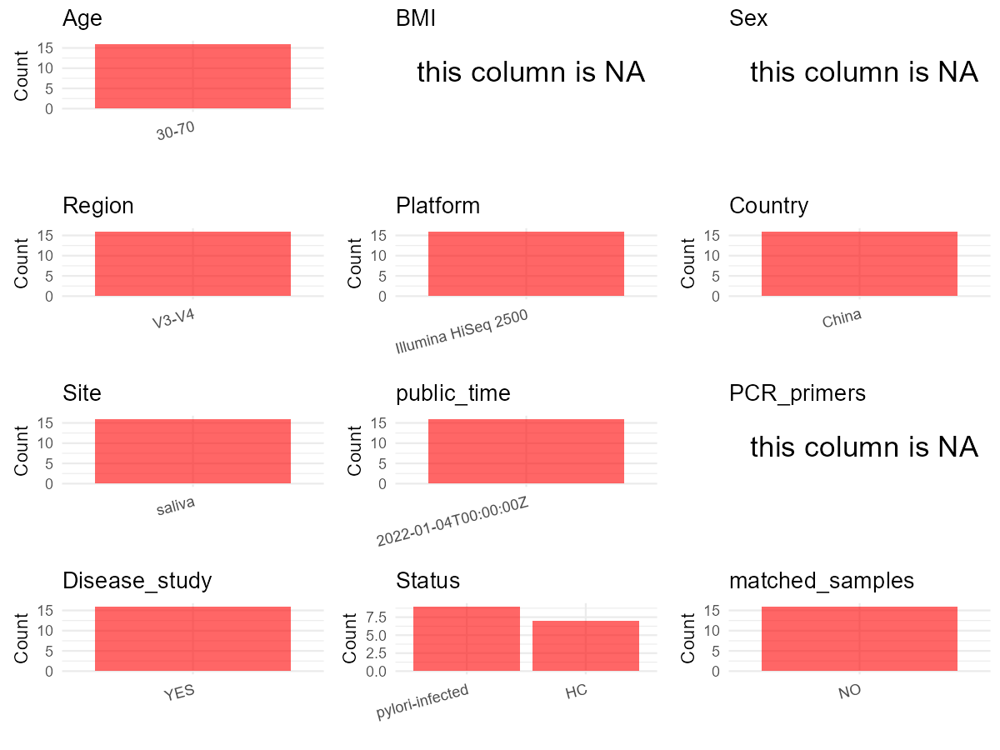

R Notebook: Metadata Processing Workflow
================

# Step 1: Obtain Initial Metadata from Each Project

To obtain the initial metadata: 1. Search for the BioProject ID (e.g.,
“PRJEBXXXX”) on the [NCBI SRA
website](https://www.ncbi.nlm.nih.gov/Traces/study/). 2. In the “Select”
table, click on “Metadata” and download the file. 3. The downloaded file
is typically named “SraRunTable.csv” and contains metadata for the
project.

``` r
# Load necessary libraries
library(dplyr)
library(ggplot2)
library(cowplot)

# Set working directory (update this path to your local directory)
setwd("D:/studylearning/董彪师兄项目/任务3_20251004/PRJNA793997")

# Read the initial metadata files
initial_meta<-read.csv("SraRunTable.csv",header = T)

# Display the first few rows of the metadata
head(initial_meta)
```

    ##           Run Assay.Type AvgSpotLen    Bases  BioProject    BioSample
    ## 1 SRR17423409   AMPLICON        500 44414500 PRJNA793997 SAMN24594565
    ## 2 SRR17423410   AMPLICON        500 35523500 PRJNA793997 SAMN24594564
    ## 3 SRR17423411   AMPLICON        500 32955000 PRJNA793997 SAMN24594563
    ## 4 SRR17423412   AMPLICON        500 41567000 PRJNA793997 SAMN24594562
    ## 5 SRR17423413   AMPLICON        500 39613500 PRJNA793997 SAMN24594561
    ## 6 SRR17423414   AMPLICON        500 38437000 PRJNA793997 SAMN24594560
    ##                BioSampleModel    Bytes                     Center.Name
    ## 1 Metagenome or environmental 27756765 CHINA PHARMACEUTICAL UNIVERSITY
    ## 2 Metagenome or environmental 22663167 CHINA PHARMACEUTICAL UNIVERSITY
    ## 3 Metagenome or environmental 20824371 CHINA PHARMACEUTICAL UNIVERSITY
    ## 4 Metagenome or environmental 26533784 CHINA PHARMACEUTICAL UNIVERSITY
    ## 5 Metagenome or environmental 24813788 CHINA PHARMACEUTICAL UNIVERSITY
    ## 6 Metagenome or environmental 24205163 CHINA PHARMACEUTICAL UNIVERSITY
    ##   Collection_Date Consent DATASTORE.filetype DATASTORE.provider
    ## 1      2018-04-17  public   fastq,run.zq,sra         gs,ncbi,s3
    ## 2      2018-04-17  public   fastq,run.zq,sra         gs,ncbi,s3
    ## 3      2018-04-17  public   fastq,run.zq,sra         gs,ncbi,s3
    ## 4      2018-04-17  public   fastq,run.zq,sra         gs,ncbi,s3
    ## 5      2018-04-17  public   fastq,run.zq,sra         gs,ncbi,s3
    ## 6      2018-04-17  public   fastq,run.zq,sra         gs,ncbi,s3
    ##                       DATASTORE.region  Experiment geo_loc_name_country
    ## 1 gs.us-east1,ncbi.public,s3.us-east-1 SRX13595042                China
    ## 2 gs.us-east1,ncbi.public,s3.us-east-1 SRX13595041                China
    ## 3 gs.us-east1,ncbi.public,s3.us-east-1 SRX13595040                China
    ## 4 gs.us-east1,ncbi.public,s3.us-east-1 SRX13595039                China
    ## 5 gs.us-east1,ncbi.public,s3.us-east-1 SRX13595038                China
    ## 6 gs.us-east1,ncbi.public,s3.us-east-1 SRX13595037                China
    ##   geo_loc_name_country_continent                geo_loc_name         HOST
    ## 1                           Asia China: Jiangsu\\, Changzhou Homo sapiens
    ## 2                           Asia China: Jiangsu\\, Changzhou Homo sapiens
    ## 3                           Asia China: Jiangsu\\, Changzhou Homo sapiens
    ## 4                           Asia China: Jiangsu\\, Changzhou Homo sapiens
    ## 5                           Asia China: Jiangsu\\, Changzhou Homo sapiens
    ## 6                           Asia China: Jiangsu\\, Changzhou Homo sapiens
    ##            Instrument isolation_source          lat_lon Library.Name
    ## 1 Illumina HiSeq 2500      Oral cavity 31.78 N 119.95 E          SE1
    ## 2 Illumina HiSeq 2500      Oral cavity 31.78 N 119.95 E          FE9
    ## 3 Illumina HiSeq 2500      Oral cavity 31.78 N 119.95 E          FE8
    ## 4 Illumina HiSeq 2500      Oral cavity 31.78 N 119.95 E          FE7
    ## 5 Illumina HiSeq 2500      Oral cavity 31.78 N 119.95 E          FE6
    ## 6 Illumina HiSeq 2500      Oral cavity 31.78 N 119.95 E          FE5
    ##   LibraryLayout LibrarySelection LibrarySource        Organism Platform
    ## 1        PAIRED              PCR       GENOMIC oral metagenome ILLUMINA
    ## 2        PAIRED              PCR       GENOMIC oral metagenome ILLUMINA
    ## 3        PAIRED              PCR       GENOMIC oral metagenome ILLUMINA
    ## 4        PAIRED              PCR       GENOMIC oral metagenome ILLUMINA
    ## 5        PAIRED              PCR       GENOMIC oral metagenome ILLUMINA
    ## 6        PAIRED              PCR       GENOMIC oral metagenome ILLUMINA
    ##            ReleaseDate                           replicate          create_date
    ## 1 2022-01-04T00:00:00Z replicate = biological replicate 10 2022-01-04T09:55:00Z
    ## 2 2022-01-04T00:00:00Z  replicate = biological replicate 9 2022-01-04T09:55:00Z
    ## 3 2022-01-04T00:00:00Z  replicate = biological replicate 8 2022-01-04T09:55:00Z
    ## 4 2022-01-04T00:00:00Z  replicate = biological replicate 7 2022-01-04T09:59:00Z
    ## 5 2022-01-04T00:00:00Z  replicate = biological replicate 6 2022-01-04T09:58:00Z
    ## 6 2022-01-04T00:00:00Z  replicate = biological replicate 5 2022-01-04T09:56:00Z
    ##   version Sample.Name SRA.Study
    ## 1       1         SE1 SRP353429
    ## 2       1         FE9 SRP353429
    ## 3       1         FE8 SRP353429
    ## 4       1         FE7 SRP353429
    ## 5       1         FE6 SRP353429
    ## 6       1         FE5 SRP353429

# Step 2: Create a Uniform Metadata Template

The uniform metadata should include the following columns:

1.  **BioProject**: Project ID (e.g., “PRJNA339212”)
2.  **Run**: Sample ID (e.g., “ERRXXXXXX” or “SRRXXXXXX”)
3.  **sample_name**: Original sample name submitted by the authors (not
    the database-assigned ID)
4.  **Age**: Age of the subject (if available)
5.  **BMI**: Body Mass Index (if available)
6.  **Sex**: Sex of the subject (“F” or “M”)
7.  **Region**: Targeted 16S rRNA region (e.g., “V3-V4”)
8.  **Platform**: Sequencing platform (e.g., “Illumina MiSeq”)
9.  **Country**: Country of sample origin (e.g., “China”)
10. **Site**: Sample site (e.g., “saliva”, “dental plaque”)
11. **public_time**: Data release date (format: “YYYY-MM-DD”)
12. **PCR_primers**: PCR primers used (e.g., “515F-806R”)
13. **title**: Title of the associated publication
14. **Disease_study**: Whether the study involves a disease (“YES” or
    “NO”)
15. **Status**: Disease status (e.g., “T2DM”, “HC”). Note: If the study
    includes both disease and healthy samples, this must be specified
    per sample.

``` r
# Create a uniform metadata dataframe
metadata <- data.frame(
  BioProject = initial_meta$BioProject,
  Run = initial_meta$Run,
  sample_name = initial_meta$Sample.Name,
  Age = "30-70",
  BMI = NA,
  Sex= NA,
  Region = "V3-V4",
  Platform = initial_meta$Instrument,
  Country = initial_meta$geo_loc_name_country,
  Site = "saliva",
  public_time = initial_meta$ReleaseDate,
  stringsAsFactors = FALSE
)
```

# Step 3: Manually Add Information from the Publication

Some information (e.g. PCR primers, study title, disease status) must be
manually extracted from the publication and added to the metadata.

``` r
# Add information obtained from the publication
metadata$PCR_primers <- NA_character_  # Update based on the publication
metadata$title <- "Oral Microbiota, a Potential Determinant for the Treatment Efficacy of Gastric Helicobacter Pylori Eradication in Humans"
metadata$Disease_study <- "YES"
metadata <- metadata %>%
  mutate(Status=case_when(
    grepl("S",sample_name)~"HC",
    TRUE~"pylori-infected"
  ))

#extract subject id by remove prefix of sample_name
#metadata$sample_name <- gsub("_st|_sal", "", metadata$sample_name)

# Check initial data distribution
cat("Initial sample distribution:\n")
```

    ## Initial sample distribution:

``` r
table(metadata$sample_name)
```

    ## 
    ## FE1 FE2 FE3 FE4 FE5 FE6 FE7 FE8 FE9 SE1 SE2 SE3 SE4 SE5 SE6 SE7 
    ##   1   1   1   1   1   1   1   1   1   1   1   1   1   1   1   1

``` r
table(metadata$Site)
```

    ## 
    ## saliva 
    ##     16

``` r
# Calculate sampling frequency per subject
sample_counts <- table(metadata$sample_name)
cat("\nNumber of samples per subject:\n")
```

    ## 
    ## Number of samples per subject:

``` r
print(sample_counts)
```

    ## 
    ## FE1 FE2 FE3 FE4 FE5 FE6 FE7 FE8 FE9 SE1 SE2 SE3 SE4 SE5 SE6 SE7 
    ##   1   1   1   1   1   1   1   1   1   1   1   1   1   1   1   1

``` r
# Create matched_samples column
metadata$matched_samples <- ifelse(metadata$sample_name %in% names(sample_counts[sample_counts >= 2]), "YES", "NO")

cat("\nMatched samples distribution:\n")
```

    ## 
    ## Matched samples distribution:

``` r
table(metadata$matched_samples)
```

    ## 
    ## NO 
    ## 16

``` r
# Identify samples for removal: single samples excluding saliva 
single_samples <- names(sample_counts[sample_counts == 1])
samples_to_remove <- metadata$sample_name %in% single_samples & !(metadata$Site %in% c("saliva"))

cat("\nNumber of samples to be removed:", sum(samples_to_remove), "\n")
```

    ## 
    ## Number of samples to be removed: 0

``` r
# Remove identified samples
metadata_clean <- metadata[!samples_to_remove, ]

cat("\nFinal sample distribution after cleaning:\n")
```

    ## 
    ## Final sample distribution after cleaning:

``` r
table(metadata_clean$sample_name)
```

    ## 
    ## FE1 FE2 FE3 FE4 FE5 FE6 FE7 FE8 FE9 SE1 SE2 SE3 SE4 SE5 SE6 SE7 
    ##   1   1   1   1   1   1   1   1   1   1   1   1   1   1   1   1

``` r
table(metadata_clean$Site)
```

    ## 
    ## saliva 
    ##     16

``` r
table(metadata_clean$matched_samples)
```

    ## 
    ## NO 
    ## 16

``` r
# Use cleaned dataset for subsequent analysis
metadata <- metadata_clean
```

# Step 4: Summarize and Validate the Metadata

``` r
# Check the number of unique runs and sample names
print(paste("Number of unique runs:", length(unique(metadata$Run))))
```

    ## [1] "Number of unique runs: 16"

``` r
print(paste("Number of unique sample names:", length(unique(metadata$sample_name))))
```

    ## [1] "Number of unique sample names: 16"

# Step 5: Visualize the Metadata

``` r

```


# Step 6: Finalize and Export the Metadata

``` r
# Reorder columns to match the desired format
metadata <- metadata[, c(
  "BioProject", "Run", "sample_name", "Age", "BMI", "Sex", 
  "Region", "Platform", "Country", "Site", "public_time", 
  "PCR_primers", "title", "Disease_study", "Status","matched_samples"
)]

# Export the uniform metadata to a CSV file
write.csv(metadata, file = "metadata.csv", quote = FALSE)
head(metadata)
```

    ##    BioProject         Run sample_name   Age BMI Sex Region            Platform
    ## 1 PRJNA793997 SRR17423409         SE1 30-70  NA  NA  V3-V4 Illumina HiSeq 2500
    ## 2 PRJNA793997 SRR17423410         FE9 30-70  NA  NA  V3-V4 Illumina HiSeq 2500
    ## 3 PRJNA793997 SRR17423411         FE8 30-70  NA  NA  V3-V4 Illumina HiSeq 2500
    ## 4 PRJNA793997 SRR17423412         FE7 30-70  NA  NA  V3-V4 Illumina HiSeq 2500
    ## 5 PRJNA793997 SRR17423413         FE6 30-70  NA  NA  V3-V4 Illumina HiSeq 2500
    ## 6 PRJNA793997 SRR17423414         FE5 30-70  NA  NA  V3-V4 Illumina HiSeq 2500
    ##   Country   Site          public_time PCR_primers
    ## 1   China saliva 2022-01-04T00:00:00Z        <NA>
    ## 2   China saliva 2022-01-04T00:00:00Z        <NA>
    ## 3   China saliva 2022-01-04T00:00:00Z        <NA>
    ## 4   China saliva 2022-01-04T00:00:00Z        <NA>
    ## 5   China saliva 2022-01-04T00:00:00Z        <NA>
    ## 6   China saliva 2022-01-04T00:00:00Z        <NA>
    ##                                                                                                                      title
    ## 1 Oral Microbiota, a Potential Determinant for the Treatment Efficacy of Gastric Helicobacter Pylori Eradication in Humans
    ## 2 Oral Microbiota, a Potential Determinant for the Treatment Efficacy of Gastric Helicobacter Pylori Eradication in Humans
    ## 3 Oral Microbiota, a Potential Determinant for the Treatment Efficacy of Gastric Helicobacter Pylori Eradication in Humans
    ## 4 Oral Microbiota, a Potential Determinant for the Treatment Efficacy of Gastric Helicobacter Pylori Eradication in Humans
    ## 5 Oral Microbiota, a Potential Determinant for the Treatment Efficacy of Gastric Helicobacter Pylori Eradication in Humans
    ## 6 Oral Microbiota, a Potential Determinant for the Treatment Efficacy of Gastric Helicobacter Pylori Eradication in Humans
    ##   Disease_study          Status matched_samples
    ## 1           YES              HC              NO
    ## 2           YES pylori-infected              NO
    ## 3           YES pylori-infected              NO
    ## 4           YES pylori-infected              NO
    ## 5           YES pylori-infected              NO
    ## 6           YES pylori-infected              NO

## Notes for Students:

1.  **Metadata Accuracy**: Always cross-check the metadata with the
    original publication to ensure accuracy.
2.  **Manual Entries**: Columns like `PCR_primers`, and `Status` often
    require manual entry based on the publication.
3.  **Disease Status**: Be careful when assigning `Status`—some studies
    include both disease and healthy samples.
4.  **Visualization**: The plots help quickly identify the distribution
    of values in each column, which is useful for quality control.
5.  **Reproducibility**: Update the working directory and file paths to
    match your local environment.
