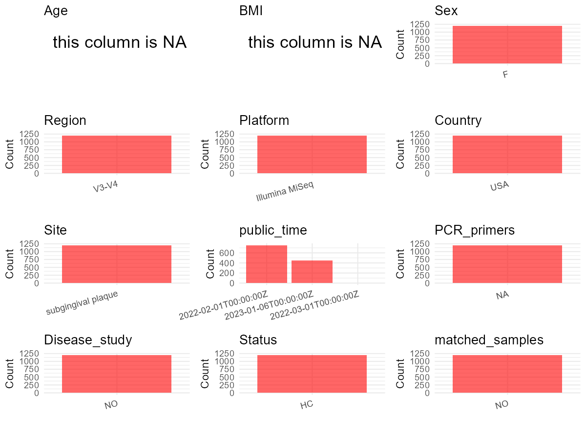

R Notebook: Metadata Processing Workflow
================

# Step 1: Obtain Initial Metadata from Each Project

To obtain the initial metadata: 1. Search for the BioProject ID (e.g.,
“PRJEBXXXX”) on the [NCBI SRA
website](https://www.ncbi.nlm.nih.gov/Traces/study/). 2. In the “Select”
table, click on “Metadata” and download the file. 3. The downloaded file
is typically named “SraRunTable.csv” and contains metadata for the
project.

``` r
# Load necessary libraries
library(dplyr)
library(ggplot2)
library(cowplot)

# Set working directory (update this path to your local directory)
setwd("E:/bioproject_YSD/PRJNA796273")

# Read the initial metadata files
initial_meta <- read.csv("SraRunTable.csv", header = T) 

# Display the first few rows of the metadata
head(initial_meta)
```

    ##           Run Assay.Type AvgSpotLen     Bases  BioProject    BioSample
    ## 1 SRR17549927   AMPLICON        602  47120346 PRJNA796273 SAMN24837585
    ## 2 SRR17549928   AMPLICON        602  44411346 PRJNA796273 SAMN24837584
    ## 3 SRR17549929   AMPLICON        602  69547856 PRJNA796273 SAMN24837583
    ## 4 SRR17549930   AMPLICON        602  17081148 PRJNA796273 SAMN24837582
    ## 5 SRR17549931   AMPLICON        602 114700264 PRJNA796273 SAMN24837186
    ## 6 SRR17549932   AMPLICON        602 111222510 PRJNA796273 SAMN24837581
    ##                         BioSampleModel    Bytes           Center.Name
    ## 1 MIMS.me,MIGS/MIMS/MIMARKS.human-oral 29585876 UNIVERSITY AT BUFFALO
    ## 2 MIMS.me,MIGS/MIMS/MIMARKS.human-oral 26795176 UNIVERSITY AT BUFFALO
    ## 3 MIMS.me,MIGS/MIMS/MIMARKS.human-oral 44276953 UNIVERSITY AT BUFFALO
    ## 4 MIMS.me,MIGS/MIMS/MIMARKS.human-oral 11491883 UNIVERSITY AT BUFFALO
    ## 5 MIMS.me,MIGS/MIMS/MIMARKS.human-oral 76248705 UNIVERSITY AT BUFFALO
    ## 6 MIMS.me,MIGS/MIMS/MIMARKS.human-oral 71764421 UNIVERSITY AT BUFFALO
    ##   Collection_Date Consent DATASTORE.filetype DATASTORE.provider
    ## 1      2000-05-01  public   fastq,run.zq,sra         gs,ncbi,s3
    ## 2      2000-01-01  public   fastq,run.zq,sra         gs,ncbi,s3
    ## 3      2000-11-01  public   fastq,run.zq,sra         gs,ncbi,s3
    ## 4      1998-08-01  public   fastq,run.zq,sra         gs,ncbi,s3
    ## 5      1999-05-01  public   fastq,run.zq,sra         gs,ncbi,s3
    ## 6      1999-09-01  public   fastq,run.zq,sra         gs,ncbi,s3
    ##                       DATASTORE.region     env_broad_scale     env_local_scale
    ## 1 gs.us-east1,ncbi.public,s3.us-east-1 biome ENVO:00000428 mouth ENVO:00000479
    ## 2 gs.us-east1,ncbi.public,s3.us-east-1 biome ENVO:00000428 mouth ENVO:00000479
    ## 3 gs.us-east1,ncbi.public,s3.us-east-1 biome ENVO:00000428 mouth ENVO:00000479
    ## 4 gs.us-east1,ncbi.public,s3.us-east-1 biome ENVO:00000428 mouth ENVO:00000479
    ## 5 gs.us-east1,ncbi.public,s3.us-east-1 biome ENVO:00000428 mouth ENVO:00000479
    ## 6 gs.us-east1,ncbi.public,s3.us-east-1 biome ENVO:00000428 mouth ENVO:00000479
    ##                            env_medium  Experiment geo_loc_name_country
    ## 1 bodily fluid material ENVO:02000019 SRX13719483                  USA
    ## 2 bodily fluid material ENVO:02000019 SRX13719482                  USA
    ## 3 bodily fluid material ENVO:02000019 SRX13719481                  USA
    ## 4 bodily fluid material ENVO:02000019 SRX13719480                  USA
    ## 5 bodily fluid material ENVO:02000019 SRX13719479                  USA
    ## 6 bodily fluid material ENVO:02000019 SRX13719478                  USA
    ##   geo_loc_name_country_continent geo_loc_name         HOST     Instrument
    ## 1                  North America          USA Homo sapiens Illumina MiSeq
    ## 2                  North America          USA Homo sapiens Illumina MiSeq
    ## 3                  North America          USA Homo sapiens Illumina MiSeq
    ## 4                  North America          USA Homo sapiens Illumina MiSeq
    ## 5                  North America          USA Homo sapiens Illumina MiSeq
    ## 6                  North America          USA Homo sapiens Illumina MiSeq
    ##         Label             lat_lon Library.Name LibraryLayout LibrarySelection
    ## 1 MP13603 444 42.8864 N 78.8784 W  MP13603 444        PAIRED              PCR
    ## 2 MP13601 443 42.8864 N 78.8784 W  MP13601 443        PAIRED              PCR
    ## 3 MP13590 442 42.8864 N 78.8784 W  MP13590 442        PAIRED              PCR
    ## 4 MP13589 441 42.8864 N 78.8784 W  MP13589 441        PAIRED              PCR
    ## 5  MP10237 45 42.8864 N 78.8784 W   MP10237 45        PAIRED              PCR
    ## 6 MP13577 440 42.8864 N 78.8784 W  MP13577 440        PAIRED              PCR
    ##   LibrarySource              Organism Platform          ReleaseDate
    ## 1   METAGENOMIC human oral metagenome ILLUMINA 2023-01-06T00:00:00Z
    ## 2   METAGENOMIC human oral metagenome ILLUMINA 2023-01-06T00:00:00Z
    ## 3   METAGENOMIC human oral metagenome ILLUMINA 2023-01-06T00:00:00Z
    ## 4   METAGENOMIC human oral metagenome ILLUMINA 2023-01-06T00:00:00Z
    ## 5   METAGENOMIC human oral metagenome ILLUMINA 2023-01-06T00:00:00Z
    ## 6   METAGENOMIC human oral metagenome ILLUMINA 2023-01-06T00:00:00Z
    ##            create_date version Sample.Name    seq_methods SRA.Study
    ## 1 2022-01-11T11:03:00Z       1     MP13603 Illumina MiSeq SRP354443
    ## 2 2022-01-11T11:03:00Z       1     MP13601 Illumina MiSeq SRP354443
    ## 3 2022-01-11T11:03:00Z       1     MP13590 Illumina MiSeq SRP354443
    ## 4 2022-01-11T11:03:00Z       1     MP13589 Illumina MiSeq SRP354443
    ## 5 2022-01-11T11:04:00Z       1     MP10237 Illumina MiSeq SRP354443
    ## 6 2022-01-11T11:03:00Z       1     MP13577 Illumina MiSeq SRP354443

# Step 2: Create a Uniform Metadata Template

The uniform metadata should include the following columns:

1.  **BioProject**: Project ID (e.g., “PRJNA339212”)
2.  **Run**: Sample ID (e.g., “ERRXXXXXX” or “SRRXXXXXX”)
3.  **sample_name**: Original sample name submitted by the authors (not
    the database-assigned ID)
4.  **Age**: Age of the subject (if available)
5.  **BMI**: Body Mass Index (if available)
6.  **Sex**: Sex of the subject (“F” or “M”)
7.  **Region**: Targeted 16S rRNA region (e.g., “V3-V4”)
8.  **Platform**: Sequencing platform (e.g., “Illumina MiSeq”)
9.  **Country**: Country of sample origin (e.g., “China”)
10. **Site**: Sample site (e.g., “saliva”, “dental plaque”)
11. **public_time**: Data release date (format: “YYYY-MM-DD”)
12. **PCR_primers**: PCR primers used (e.g., “515F-806R”)
13. **title**: Title of the associated publication
14. **Disease_study**: Whether the study involves a disease (“YES” or
    “NO”)
15. **Status**: Disease status (e.g., “T2DM”, “HC”). Note: If the study
    includes both disease and healthy samples, this must be specified
    per sample.
16. **matched_samples**: matched samples (“YES” or “NO”)

``` r
# Create a uniform metadata dataframe
metadata <- data.frame(
  BioProject = initial_meta$BioProject,
  Run = initial_meta$Run,
  sample_name = initial_meta$Sample.Name,
  Age = NA,
  BMI = NA,
  Sex = "F",
  Region = "V3-V4",
  Platform = initial_meta$Instrument,
  Country = initial_meta$geo_loc_name_country,
  Site = "subgingival plaque",
  public_time = initial_meta$ReleaseDate,
  stringsAsFactors = FALSE
)
```

# Step 3: Manually Add Information from the Publication

Some information (e.g. PCR primers, study title, disease status) must be
manually extracted from the publication and added to the metadata.

``` r
# Add information obtained from the publication
metadata$PCR_primers <- "NA"
metadata$title <- "Dietary carbohydrate intake is associated with the subgingival plaque oral microbiome abundance and diversity in a cohort of postmenopausal women"
metadata$Disease_study <- "NO"
# Assign disease status based on sample_name patterns
metadata$Status <- "HC"

# Check initial data distribution
cat("Initial sample distribution:\n")
```

    ## Initial sample distribution:

``` r
table(metadata$sample_name)
```

    ## 
    ## MP10002 MP10006 MP10007 MP10008 MP10009 MP10011 MP10017 MP10030 MP10033 MP10035 
    ##       1       1       1       1       1       1       1       1       1       1 
    ## MP10036 MP10054 MP10064 MP10065 MP10068 MP10069 MP10094 MP10111 MP10112 MP10116 
    ##       1       1       1       1       1       1       1       1       1       1 
    ## MP10120 MP10124 MP10125 MP10128 MP10130 MP10137 MP10143 MP10144 MP10150 MP10151 
    ##       1       1       1       1       1       1       1       1       1       1 
    ## MP10170 MP10174 MP10183 MP10195 MP10196 MP10200 MP10203 MP10212 MP10223 MP10226 
    ##       1       1       1       1       1       1       1       1       1       1 
    ## MP10227 MP10228 MP10231 MP10233 MP10237 MP10238 MP10246 MP10257 MP10266 MP10279 
    ##       1       1       1       1       1       1       1       1       1       1 
    ## MP10292 MP10310 MP10316 MP10326 MP10331 MP10339 MP10351 MP10361 MP10363 MP10367 
    ##       1       1       1       1       1       1       1       1       1       1 
    ## MP10377 MP10398 MP10404 MP10406 MP10431 MP10467 MP10477 MP10506 MP10513 MP10525 
    ##       1       1       1       1       1       1       1       1       1       1 
    ## MP10539 MP10540 MP10545 MP10548 MP10554 MP10579 MP10596 MP10597 MP10598 MP10604 
    ##       1       1       1       1       1       1       1       1       1       1 
    ## MP10605 MP10614 MP10623 MP10643 MP10647 MP10654 MP10655 MP10673 MP10677 MP10679 
    ##       1       1       1       1       1       1       1       1       1       1 
    ## MP10697 MP10710 MP10722 MP10724 MP10730 MP10731 MP10752 MP10763 MP10771 MP10780 
    ##       1       1       1       1       1       1       1       1       1       1 
    ## MP10821 MP10828 MP10829 MP10836 MP10844 MP10845 MP10870 MP10871 MP10880 MP10884 
    ##       1       1       1       1       1       1       1       1       1       1 
    ## MP10888 MP10893 MP10895 MP10896 MP10898 MP10899 MP10901 MP10906 MP10917 MP10919 
    ##       1       1       1       1       1       1       1       1       1       1 
    ## MP10922 MP10939 MP10960 MP10961 MP10970 MP10971 MP10975 MP10976 MP10980 MP10997 
    ##       1       1       1       1       1       1       1       1       1       1 
    ## MP10999 MP11000 MP11009 MP11023 MP11025 MP11027 MP11036 MP11039 MP11040 MP11045 
    ##       1       1       1       1       1       1       1       1       1       1 
    ## MP11057 MP11079 MP11082 MP11093 MP11095 MP11103 MP11106 MP11111 MP11113 MP11133 
    ##       1       1       1       1       1       1       1       1       1       1 
    ## MP11155 MP11156 MP11159 MP11180 MP11192 MP11195 MP11208 MP11214 MP11217 MP11220 
    ##       1       1       1       1       1       1       1       1       1       1 
    ## MP11234 MP11236 MP11237 MP11254 MP11269 MP11270 MP11271 MP11296 MP11302 MP11321 
    ##       1       1       1       1       1       1       1       1       1       1 
    ## MP11331 MP11332 MP11335 MP11342 MP11343 MP11357 MP11372 MP11380 MP11381 MP11385 
    ##       1       1       1       1       1       1       1       1       1       1 
    ## MP11405 MP11406 MP11413 MP11415 MP11429 MP11435 MP11441 MP11459 MP11461 MP11474 
    ##       1       1       1       1       1       1       1       1       1       1 
    ## MP11477 MP11491 MP11495 MP11529 MP11542 MP11564 MP11576 MP11578 MP11587 MP11591 
    ##       1       1       1       1       1       1       1       1       1       1 
    ## MP11593 MP11595 MP11610 MP11629 MP11630 MP11642 MP11646 MP11648 MP11653 MP11685 
    ##       1       1       1       1       1       1       1       1       1       1 
    ## MP11699 MP11708 MP11714 MP11717 MP11728 MP11748 MP11752 MP11753 MP11766 MP11769 
    ##       1       1       1       1       1       1       1       1       1       1 
    ## MP11773 MP11776 MP11790 MP11791 MP11814 MP11818 MP11819 MP11820 MP11822 MP11829 
    ##       1       1       1       1       1       1       1       1       1       1 
    ## MP11835 MP11837 MP11842 MP11853 MP11855 MP11889 MP11892 MP11894 MP11906 MP11907 
    ##       1       1       1       1       1       1       1       1       1       1 
    ## MP11911 MP11919 MP11921 MP11926 MP11947 MP11961 MP11968 MP11974 MP11990 MP11994 
    ##       1       1       1       1       1       1       1       1       1       1 
    ## MP11998 MP12027 MP12033 MP12049 MP12050 MP12051 MP12053 MP12074 MP12089 MP12093 
    ##       1       1       1       1       1       1       1       1       1       1 
    ## MP12096 MP12110 MP12116 MP12133 MP12138 MP12144 MP12149 MP12173 MP12199 MP12205 
    ##       1       1       1       1       1       1       1       1       1       1 
    ## MP12211 MP12215 MP12219 MP12232 MP12243 MP12245 MP12250 MP12251 MP12259 MP12276 
    ##       1       1       1       1       1       1       1       1       1       1 
    ## MP12286 MP12295 MP12304 MP12314 MP12324 MP12327 MP12331 MP12332 MP12334 MP12342 
    ##       1       1       1       1       1       1       1       1       1       1 
    ## MP12343 MP12359 MP12360 MP12364 MP12373 MP12374 MP12385 MP12391 MP12400 MP12417 
    ##       1       1       1       1       1       1       1       1       1       1 
    ## MP12431 MP12440 MP12449 MP12460 MP12465 MP12466 MP12467 MP12495 MP12508 MP12524 
    ##       1       1       1       1       1       1       1       1       1       1 
    ## MP12536 MP12540 MP12548 MP12556 MP12559 MP12569 MP12582 MP12584 MP12593 MP12596 
    ##       1       1       1       1       1       1       1       1       1       1 
    ## MP12601 MP12615 MP12628 MP12643 MP12655 MP12660 MP12662 MP12667 MP12668 MP12669 
    ##       1       1       1       1       1       1       1       1       1       1 
    ## MP12676 MP12691 MP12694 MP12699 MP12706 MP12711 MP12723 MP12726 MP12732 MP12738 
    ##       1       1       1       1       1       1       1       1       1       1 
    ## MP12761 MP12763 MP12765 MP12766 MP12770 MP12771 MP12788 MP12790 MP12791 MP12793 
    ##       1       1       1       1       1       1       1       1       1       1 
    ## MP12816 MP12817 MP12829 MP12842 MP12847 MP12851 MP12858 MP12860 MP12863 MP12870 
    ##       1       1       1       1       1       1       1       1       1       1 
    ## MP12900 MP12906 MP12918 MP12934 MP12936 MP12940 MP12954 MP12964 MP12969 MP12970 
    ##       1       1       1       1       1       1       1       1       1       1 
    ## MP12985 MP12992 MP13003 MP13010 MP13022 MP13025 MP13031 MP13034 MP13036 MP13041 
    ##       1       1       1       1       1       1       1       1       1       1 
    ## MP13042 MP13043 MP13047 MP13049 MP13060 MP13066 MP13081 MP13091 MP13102 MP13112 
    ##       1       1       1       1       1       1       1       1       1       1 
    ## MP13113 MP13131 MP13135 MP13142 MP13143 MP13148 MP13149 MP13154 MP13164 MP13184 
    ##       1       1       1       1       1       1       1       1       1       1 
    ## MP13189 MP13191 MP13202 MP13209 MP13222 MP13253 MP13254 MP13256 MP13282 MP13284 
    ##       1       1       1       1       1       1       1       1       1       1 
    ## MP13289 MP13298 MP13300 MP13301 MP13310 MP13312 MP13319 MP13323 MP13331 MP13333 
    ##       1       1       1       1       1       1       1       1       1       1 
    ## MP13334 MP13335 MP13344 MP13365 MP13381 MP13388 MP13389 MP13405 MP13409 MP13433 
    ##       1       1       1       1       1       1       1       1       1       1 
    ## MP13448 MP13460 MP13478 MP13501 MP13523 MP13528 MP13549 MP13565 MP13569 MP13577 
    ##       1       1       1       1       1       1       1       1       1       1 
    ## MP13589 MP13590 MP13601 MP13603 MP13611 MP13612 MP13624 MP13631 MP13632 MP13642 
    ##       1       1       1       1       1       1       1       1       1       1 
    ## MP13646 MP13650 MP13657 MP13659 MP13666 MP13678 MP13680 MP13688 MP13708 MP13714 
    ##       1       1       1       1       1       1       1       1       1       1 
    ## MP13726 MP13729 MP13731 MP13734 MP13756 MP13759 MP13771 MP13780 MP13781 MP13785 
    ##       1       1       1       1       1       1       1       1       1       1 
    ## MP13790 MP13794 MP13798 MP13808 MP13818 MP13822 MP13823 MP13826 MP13827 MP13833 
    ##       1       1       1       1       1       1       1       1       1       1 
    ## MP13837 MP13854 MP13861 MP13862 MP13874 MP13890 MP13894 MP13913 MP13914 MP13931 
    ##       1       1       1       1       1       1       1       1       1       1 
    ## MP13933 MP13935 MP13949 MP13956 MP13959 MP13965 MP13972 MP13973 MP13978 MP13979 
    ##       1       1       1       1       1       1       1       1       1       1 
    ## MP13995 MP13997 MP13999 MP14006 MP14010 MP14023 MP14024 MP14031 MP14049 MP14056 
    ##       1       1       1       1       1       1       1       1       1       1 
    ## MP14083 MP14094 MP14119 MP14141 MP14153 MP14168 MP14170 MP14183 MP14191 MP14215 
    ##       1       1       1       1       1       1       1       1       1       1 
    ## MP14225 MP14238 MP14240 MP14258 MP14262 MP14268 MP14290 MP14295 MP14304 MP14305 
    ##       1       1       1       1       1       1       1       1       1       1 
    ## MP14306 MP14309 MP14310 MP14315 MP14324 MP14330 MP14343 MP14352 MP14356 MP14357 
    ##       1       1       1       1       1       1       1       1       1       1 
    ## MP14367 MP14389 MP14390 MP14427 MP14435 MP14439 MP14440 MP14462 MP14467 MP14469 
    ##       1       1       1       1       1       1       1       1       1       1 
    ## MP14478 MP14483 MP14488 MP14497 MP14505 MP14506 MP14511 MP14512 MP14513 MP14520 
    ##       1       1       1       1       1       1       1       1       1       1 
    ## MP14529 MP14535 MP14567 MP14572 MP14590 MP14592 MP14596 MP14604 MP14609 MP14614 
    ##       1       1       1       1       1       1       1       1       1       1 
    ## MP14616 MP14625 MP14628 MP14636 MP14637 MP14644 MP14659 MP14667 MP14672 MP14693 
    ##       1       1       1       1       1       1       1       1       1       1 
    ## MP14704 MP14718 MP14721 MP14734 MP14748 MP14769 MP14770 MP14790 MP14795 MP14796 
    ##       1       1       1       1       1       1       1       1       1       1 
    ## MP14801 MP14802 MP14808 MP14815 MP14816 MP14821 MP14826 MP14834 MP14845 MP14849 
    ##       1       1       1       1       1       1       1       1       1       1 
    ## MP14857 MP14870 MP14872 MP14876 MP14877 MP14882 MP14893 MP14896 MP14902 MP14914 
    ##       1       1       1       1       1       1       1       1       1       1 
    ## MP14919 MP14924 MP14926 MP14981 MP14986 MP15003 MP15004 MP15007 MP15008 MP15018 
    ##       1       1       1       1       1       1       1       1       1       1 
    ## MP15019 MP15027 MP15032 MP15041 MP15050 MP15063 MP15068 MP15071 MP15084 MP15086 
    ##       1       1       1       1       1       1       1       1       1       1 
    ## MP15087 MP15090 MP15105 MP15106 MP15109 MP15116 MP15122 MP15127 MP15128 MP15151 
    ##       1       1       1       1       1       1       1       1       1       1 
    ## MP15156 MP15186 MP15187 MP15202 MP15208 MP15227 MP15249 MP15253 MP15254 MP15256 
    ##       1       1       1       1       1       1       1       1       1       1 
    ## MP15263 MP15270 MP15286 MP15287 MP15294 MP15298 MP15324 MP15327 MP15331 MP15334 
    ##       1       1       1       1       1       1       1       1       1       1 
    ## MP15341 MP15344 MP15347 MP15353 MP15358 MP15369 MP15370 MP15372 MP15374 MP15391 
    ##       1       1       1       1       1       1       1       1       1       1 
    ## MP15396 MP15399 MP15404 MP15426 MP15428 MP15431 MP15433 MP15449 MP15468 MP15482 
    ##       1       1       1       1       1       1       1       1       1       1 
    ## MP15484 MP15498 MP15499 MP15503 MP15508 MP15516 MP15530 MP15539 MP15552 MP15554 
    ##       1       1       1       1       1       1       1       1       1       1 
    ## MP15558 MP15563 MP15566 MP15569 MP15571 MP15575 MP15579 MP15580 MP15581 MP15592 
    ##       1       1       1       1       1       1       1       1       1       1 
    ## MP15607 MP15615 MP15638 MP15655 MP15657 MP15661 MP15666 MP15679 MP15683 MP15687 
    ##       1       1       1       1       1       1       1       1       1       1 
    ## MP15688 MP15704 MP15712 MP15717 MP15730 MP15735 MP15745 MP15753 MP15755 MP15767 
    ##       1       1       1       1       1       1       1       1       1       1 
    ## MP15774 MP15778 MP15779 MP15796 MP15806 MP15824 MP15827 MP15830 MP15842 MP15850 
    ##       1       1       1       1       1       1       1       1       1       1 
    ## MP15851 MP15855 MP15866 MP15868 MP15873 MP15884 MP15893 MP15894 MP15896 MP15901 
    ##       1       1       1       1       1       1       1       1       1       1 
    ## MP15914 MP15919 MP15957 MP15990 MP15991 MP15996 MP15999 MP16015 MP16018 MP16035 
    ##       1       1       1       1       1       1       1       1       1       1 
    ## MP16053 MP16054 MP16056 MP16062 MP16069 MP16102 MP16104 MP16106 MP16118 MP16123 
    ##       1       1       1       1       1       1       1       1       1       1 
    ## MP16124 MP16126 MP16131 MP16146 MP16154 MP16169 MP16176 MP16177 MP16192 MP16200 
    ##       1       1       1       1       1       1       1       1       1       1 
    ## MP16205 MP16212 MP16226 MP16227 MP16232 MP16233 MP16247 MP16258 MP16263 MP16267 
    ##       1       1       1       1       1       1       1       1       1       1 
    ## MP16268 MP16274 MP16317 MP16348 MP16361 MP16365 MP16367 MP16369 MP16375 MP16387 
    ##       1       1       1       1       1       1       1       1       1       1 
    ## MP16391 MP16401 MP16405 MP16408 MP16425 MP16451 MP16465 MP16478 MP16502 MP16503 
    ##       1       1       1       1       1       1       1       1       1       1 
    ## MP16568 MP16586 MP16587 MP16595 MP16597 MP16605 MP16619 MP16628 MP16643 MP16646 
    ##       1       1       1       1       1       1       1       1       1       1 
    ## MP16651 MP16659 MP16690 MP16698 MP16709 MP16731 MP16732 MP16734 MP16759 MP16761 
    ##       1       1       1       1       1       1       1       1       1       1 
    ## MP16762 MP16776 MP16785 MP16797 MP16800 MP16814 MP16817 MP16820 MP16824 MP16826 
    ##       1       1       1       1       1       1       1       1       1       1 
    ## MP16827 MP16839 MP16844 MP16856 MP16886 MP16895 MP16905 MP16918 MP16924 MP16926 
    ##       1       1       1       1       1       1       1       1       1       1 
    ## MP16930 MP16932 MP16941 MP16956 MP16966 MP16972 MP16978 MP17010 MP17019 MP17021 
    ##       1       1       1       1       1       1       1       1       1       1 
    ## MP17023 MP17026 MP17027 MP17040 MP17049 MP17062 MP17065 MP17069 MP17080 MP17086 
    ##       1       1       1       1       1       1       1       1       1       1 
    ## MP17088 MP17096 MP17101 MP17110 MP17112 MP17114 MP17115 MP17116 MP17133 MP17137 
    ##       1       1       1       1       1       1       1       1       1       1 
    ## MP17143 MP17157 MP17163 MP17198 MP17207 MP17223 MP17257 MP17294 MP17295 MP17296 
    ##       1       1       1       1       1       1       1       1       1       1 
    ## MP17318 MP17330 MP17349 MP17356 MP17359 MP17368 MP17371 MP17388 MP17394 MP17395 
    ##       1       1       1       1       1       1       1       1       1       1 
    ## MP17412 MP17418 MP17422 MP17430 MP17437 MP17443 MP17447 MP17460 MP17467 MP17468 
    ##       1       1       1       1       1       1       1       1       1       1 
    ## MP17469 MP17472 MP17477 MP17486 MP17487 MP17488 MP17492 MP17508 MP17509 MP17525 
    ##       1       1       1       1       1       1       1       1       1       1 
    ## MP17526 MP17543 MP17554 MP17569 MP17571 MP17578 MP17585 MP17604 MP17607 MP17617 
    ##       1       1       1       1       1       1       1       1       1       1 
    ## MP17618 MP17624 MP17649 MP17653 MP17694 MP17706 MP17726 MP17741 MP17744 MP17755 
    ##       1       1       1       1       1       1       1       1       1       1 
    ## MP17778 MP17798 MP17803 MP17819 MP17820 MP17826 MP17850 MP17851 MP17870 MP17875 
    ##       1       1       1       1       1       1       1       1       1       1 
    ## MP17885 MP17914 MP17918 MP17921 MP17923 MP17927 MP17930 MP17942 MP17948 MP17964 
    ##       1       1       1       1       1       1       1       1       1       1 
    ## MP17966 MP17969 MP17973 MP17983 MP17989 MP17993 MP18003 MP18028 MP18029 MP18041 
    ##       1       1       1       1       1       1       1       1       1       1 
    ## MP18047 MP18048 MP18049 MP18076 MP18080 MP18091 MP18094 MP18095 MP18101 MP18105 
    ##       1       1       1       1       1       1       1       1       1       1 
    ## MP18110 MP18117 MP18132 MP18136 MP18160 MP18174 MP18186 MP18193 MP18197 MP18199 
    ##       1       1       1       1       1       1       1       1       1       1 
    ## MP18203 MP18234 MP18237 MP18243 MP18253 MP18254 MP18257 MP18275 MP18278 MP18302 
    ##       1       1       1       1       1       1       1       1       1       1 
    ## MP18306 MP18314 MP18320 MP18343 MP18345 MP18355 MP18364 MP18378 MP18383 MP18396 
    ##       1       1       1       1       1       1       1       1       1       1 
    ## MP18407 MP18408 MP18409 MP18432 MP18434 MP18444 MP18470 MP18481 MP18482 MP18485 
    ##       1       1       1       1       1       1       1       1       1       1 
    ## MP18489 MP18521 MP18523 MP18524 MP18541 MP18546 MP18548 MP18561 MP18568 MP18570 
    ##       1       1       1       1       1       1       1       1       1       1 
    ## MP18593 MP18629 MP18633 MP18635 MP18638 MP18646 MP18647 MP18650 MP18657 MP18669 
    ##       1       1       1       1       1       1       1       1       1       1 
    ## MP18676 MP18689 MP18691 MP18703 MP18711 MP18712 MP18713 MP18725 MP18726 MP18740 
    ##       1       1       1       1       1       1       1       1       1       1 
    ## MP18766 MP18774 MP18787 MP18795 MP18800 MP18808 MP18809 MP18832 MP18842 MP18850 
    ##       1       1       1       1       1       1       1       1       1       1 
    ## MP18854 MP18856 MP18870 MP18872 MP18876 MP18881 MP18882 MP18885 MP18889 MP18903 
    ##       1       1       1       1       1       1       1       1       1       1 
    ## MP18914 MP18919 MP18922 MP18927 MP18929 MP18933 MP18934 MP18943 MP18960 MP18976 
    ##       1       1       1       1       1       1       1       1       1       1 
    ## MP18977 MP18989 MP18995 MP18999 MP19008 MP19023 MP19029 MP19030 MP19053 MP19070 
    ##       1       1       1       1       1       1       1       1       1       1 
    ## MP19077 MP19078 MP19079 MP19097 MP19135 MP19143 MP19169 MP19176 MP19181 MP19188 
    ##       1       1       1       1       1       1       1       1       1       1 
    ## MP19194 MP19202 MP19227 MP19231 MP19233 MP19245 MP19254 MP19281 MP19288 MP19289 
    ##       1       1       1       1       1       1       1       1       1       1 
    ## MP19291 MP19292 MP19293 MP19297 MP19298 MP19311 MP19315 MP19323 MP19331 MP19334 
    ##       1       1       1       1       1       1       1       1       1       1 
    ## MP19335 MP19336 MP19347 MP19349 MP19357 MP19359 MP19365 MP19369 MP19381 MP19384 
    ##       1       1       1       1       1       1       1       1       1       1 
    ## MP19396 MP19401 MP19414 MP19420 MP19421 MP19423 MP19431 MP19434 MP19435 MP19468 
    ##       1       1       1       1       1       1       1       1       1       1 
    ## MP19475 MP19479 MP19481 MP19487 MP19488 MP19501 MP19510 MP19519 MP19528 MP19541 
    ##       1       1       1       1       1       1       1       1       1       1 
    ## MP19543 MP19551 MP19552 MP19566 MP19570 MP19582 MP19584 MP19589 MP19593 MP19597 
    ##       1       1       1       1       1       1       1       1       1       1 
    ## MP19598 MP19599 MP19602 MP19620 MP19637 MP19638 MP19639 MP19642 MP19649 MP19664 
    ##       1       1       1       1       1       1       1       1       1       1 
    ## MP19665 MP19667 MP19669 MP19688 MP19695 MP19696 MP19698 MP19710 MP19711 MP19727 
    ##       1       1       1       1       1       1       1       1       1       1 
    ## MP19739 MP19743 MP19752 MP19764 MP19787 MP19797 MP19806 MP19813 MP19819 MP19820 
    ##       1       1       1       1       1       1       1       1       1       1 
    ## MP19854 MP19855 MP19856 MP19877 MP19878 MP19882 MP19883 MP19890 MP19895 MP19904 
    ##       1       1       1       1       1       1       1       1       1       1 
    ## MP19909 MP19916 MP19918 MP19932 MP19938 MP19943 MP19964 MP19972 MP19977 MP19979 
    ##       1       1       1       1       1       1       1       1       1       1 
    ## MP19980 MP19982 MP19996 MP19999 
    ##       1       1       1       1

``` r
table(metadata$Site)
```

    ## 
    ## subgingival plaque 
    ##               1204

``` r
# Calculate sampling frequency per subject
sample_counts <- table(metadata$sample_name)
cat("\nNumber of samples per subject:\n")
```

    ## 
    ## Number of samples per subject:

``` r
print(sample_counts)
```

    ## 
    ## MP10002 MP10006 MP10007 MP10008 MP10009 MP10011 MP10017 MP10030 MP10033 MP10035 
    ##       1       1       1       1       1       1       1       1       1       1 
    ## MP10036 MP10054 MP10064 MP10065 MP10068 MP10069 MP10094 MP10111 MP10112 MP10116 
    ##       1       1       1       1       1       1       1       1       1       1 
    ## MP10120 MP10124 MP10125 MP10128 MP10130 MP10137 MP10143 MP10144 MP10150 MP10151 
    ##       1       1       1       1       1       1       1       1       1       1 
    ## MP10170 MP10174 MP10183 MP10195 MP10196 MP10200 MP10203 MP10212 MP10223 MP10226 
    ##       1       1       1       1       1       1       1       1       1       1 
    ## MP10227 MP10228 MP10231 MP10233 MP10237 MP10238 MP10246 MP10257 MP10266 MP10279 
    ##       1       1       1       1       1       1       1       1       1       1 
    ## MP10292 MP10310 MP10316 MP10326 MP10331 MP10339 MP10351 MP10361 MP10363 MP10367 
    ##       1       1       1       1       1       1       1       1       1       1 
    ## MP10377 MP10398 MP10404 MP10406 MP10431 MP10467 MP10477 MP10506 MP10513 MP10525 
    ##       1       1       1       1       1       1       1       1       1       1 
    ## MP10539 MP10540 MP10545 MP10548 MP10554 MP10579 MP10596 MP10597 MP10598 MP10604 
    ##       1       1       1       1       1       1       1       1       1       1 
    ## MP10605 MP10614 MP10623 MP10643 MP10647 MP10654 MP10655 MP10673 MP10677 MP10679 
    ##       1       1       1       1       1       1       1       1       1       1 
    ## MP10697 MP10710 MP10722 MP10724 MP10730 MP10731 MP10752 MP10763 MP10771 MP10780 
    ##       1       1       1       1       1       1       1       1       1       1 
    ## MP10821 MP10828 MP10829 MP10836 MP10844 MP10845 MP10870 MP10871 MP10880 MP10884 
    ##       1       1       1       1       1       1       1       1       1       1 
    ## MP10888 MP10893 MP10895 MP10896 MP10898 MP10899 MP10901 MP10906 MP10917 MP10919 
    ##       1       1       1       1       1       1       1       1       1       1 
    ## MP10922 MP10939 MP10960 MP10961 MP10970 MP10971 MP10975 MP10976 MP10980 MP10997 
    ##       1       1       1       1       1       1       1       1       1       1 
    ## MP10999 MP11000 MP11009 MP11023 MP11025 MP11027 MP11036 MP11039 MP11040 MP11045 
    ##       1       1       1       1       1       1       1       1       1       1 
    ## MP11057 MP11079 MP11082 MP11093 MP11095 MP11103 MP11106 MP11111 MP11113 MP11133 
    ##       1       1       1       1       1       1       1       1       1       1 
    ## MP11155 MP11156 MP11159 MP11180 MP11192 MP11195 MP11208 MP11214 MP11217 MP11220 
    ##       1       1       1       1       1       1       1       1       1       1 
    ## MP11234 MP11236 MP11237 MP11254 MP11269 MP11270 MP11271 MP11296 MP11302 MP11321 
    ##       1       1       1       1       1       1       1       1       1       1 
    ## MP11331 MP11332 MP11335 MP11342 MP11343 MP11357 MP11372 MP11380 MP11381 MP11385 
    ##       1       1       1       1       1       1       1       1       1       1 
    ## MP11405 MP11406 MP11413 MP11415 MP11429 MP11435 MP11441 MP11459 MP11461 MP11474 
    ##       1       1       1       1       1       1       1       1       1       1 
    ## MP11477 MP11491 MP11495 MP11529 MP11542 MP11564 MP11576 MP11578 MP11587 MP11591 
    ##       1       1       1       1       1       1       1       1       1       1 
    ## MP11593 MP11595 MP11610 MP11629 MP11630 MP11642 MP11646 MP11648 MP11653 MP11685 
    ##       1       1       1       1       1       1       1       1       1       1 
    ## MP11699 MP11708 MP11714 MP11717 MP11728 MP11748 MP11752 MP11753 MP11766 MP11769 
    ##       1       1       1       1       1       1       1       1       1       1 
    ## MP11773 MP11776 MP11790 MP11791 MP11814 MP11818 MP11819 MP11820 MP11822 MP11829 
    ##       1       1       1       1       1       1       1       1       1       1 
    ## MP11835 MP11837 MP11842 MP11853 MP11855 MP11889 MP11892 MP11894 MP11906 MP11907 
    ##       1       1       1       1       1       1       1       1       1       1 
    ## MP11911 MP11919 MP11921 MP11926 MP11947 MP11961 MP11968 MP11974 MP11990 MP11994 
    ##       1       1       1       1       1       1       1       1       1       1 
    ## MP11998 MP12027 MP12033 MP12049 MP12050 MP12051 MP12053 MP12074 MP12089 MP12093 
    ##       1       1       1       1       1       1       1       1       1       1 
    ## MP12096 MP12110 MP12116 MP12133 MP12138 MP12144 MP12149 MP12173 MP12199 MP12205 
    ##       1       1       1       1       1       1       1       1       1       1 
    ## MP12211 MP12215 MP12219 MP12232 MP12243 MP12245 MP12250 MP12251 MP12259 MP12276 
    ##       1       1       1       1       1       1       1       1       1       1 
    ## MP12286 MP12295 MP12304 MP12314 MP12324 MP12327 MP12331 MP12332 MP12334 MP12342 
    ##       1       1       1       1       1       1       1       1       1       1 
    ## MP12343 MP12359 MP12360 MP12364 MP12373 MP12374 MP12385 MP12391 MP12400 MP12417 
    ##       1       1       1       1       1       1       1       1       1       1 
    ## MP12431 MP12440 MP12449 MP12460 MP12465 MP12466 MP12467 MP12495 MP12508 MP12524 
    ##       1       1       1       1       1       1       1       1       1       1 
    ## MP12536 MP12540 MP12548 MP12556 MP12559 MP12569 MP12582 MP12584 MP12593 MP12596 
    ##       1       1       1       1       1       1       1       1       1       1 
    ## MP12601 MP12615 MP12628 MP12643 MP12655 MP12660 MP12662 MP12667 MP12668 MP12669 
    ##       1       1       1       1       1       1       1       1       1       1 
    ## MP12676 MP12691 MP12694 MP12699 MP12706 MP12711 MP12723 MP12726 MP12732 MP12738 
    ##       1       1       1       1       1       1       1       1       1       1 
    ## MP12761 MP12763 MP12765 MP12766 MP12770 MP12771 MP12788 MP12790 MP12791 MP12793 
    ##       1       1       1       1       1       1       1       1       1       1 
    ## MP12816 MP12817 MP12829 MP12842 MP12847 MP12851 MP12858 MP12860 MP12863 MP12870 
    ##       1       1       1       1       1       1       1       1       1       1 
    ## MP12900 MP12906 MP12918 MP12934 MP12936 MP12940 MP12954 MP12964 MP12969 MP12970 
    ##       1       1       1       1       1       1       1       1       1       1 
    ## MP12985 MP12992 MP13003 MP13010 MP13022 MP13025 MP13031 MP13034 MP13036 MP13041 
    ##       1       1       1       1       1       1       1       1       1       1 
    ## MP13042 MP13043 MP13047 MP13049 MP13060 MP13066 MP13081 MP13091 MP13102 MP13112 
    ##       1       1       1       1       1       1       1       1       1       1 
    ## MP13113 MP13131 MP13135 MP13142 MP13143 MP13148 MP13149 MP13154 MP13164 MP13184 
    ##       1       1       1       1       1       1       1       1       1       1 
    ## MP13189 MP13191 MP13202 MP13209 MP13222 MP13253 MP13254 MP13256 MP13282 MP13284 
    ##       1       1       1       1       1       1       1       1       1       1 
    ## MP13289 MP13298 MP13300 MP13301 MP13310 MP13312 MP13319 MP13323 MP13331 MP13333 
    ##       1       1       1       1       1       1       1       1       1       1 
    ## MP13334 MP13335 MP13344 MP13365 MP13381 MP13388 MP13389 MP13405 MP13409 MP13433 
    ##       1       1       1       1       1       1       1       1       1       1 
    ## MP13448 MP13460 MP13478 MP13501 MP13523 MP13528 MP13549 MP13565 MP13569 MP13577 
    ##       1       1       1       1       1       1       1       1       1       1 
    ## MP13589 MP13590 MP13601 MP13603 MP13611 MP13612 MP13624 MP13631 MP13632 MP13642 
    ##       1       1       1       1       1       1       1       1       1       1 
    ## MP13646 MP13650 MP13657 MP13659 MP13666 MP13678 MP13680 MP13688 MP13708 MP13714 
    ##       1       1       1       1       1       1       1       1       1       1 
    ## MP13726 MP13729 MP13731 MP13734 MP13756 MP13759 MP13771 MP13780 MP13781 MP13785 
    ##       1       1       1       1       1       1       1       1       1       1 
    ## MP13790 MP13794 MP13798 MP13808 MP13818 MP13822 MP13823 MP13826 MP13827 MP13833 
    ##       1       1       1       1       1       1       1       1       1       1 
    ## MP13837 MP13854 MP13861 MP13862 MP13874 MP13890 MP13894 MP13913 MP13914 MP13931 
    ##       1       1       1       1       1       1       1       1       1       1 
    ## MP13933 MP13935 MP13949 MP13956 MP13959 MP13965 MP13972 MP13973 MP13978 MP13979 
    ##       1       1       1       1       1       1       1       1       1       1 
    ## MP13995 MP13997 MP13999 MP14006 MP14010 MP14023 MP14024 MP14031 MP14049 MP14056 
    ##       1       1       1       1       1       1       1       1       1       1 
    ## MP14083 MP14094 MP14119 MP14141 MP14153 MP14168 MP14170 MP14183 MP14191 MP14215 
    ##       1       1       1       1       1       1       1       1       1       1 
    ## MP14225 MP14238 MP14240 MP14258 MP14262 MP14268 MP14290 MP14295 MP14304 MP14305 
    ##       1       1       1       1       1       1       1       1       1       1 
    ## MP14306 MP14309 MP14310 MP14315 MP14324 MP14330 MP14343 MP14352 MP14356 MP14357 
    ##       1       1       1       1       1       1       1       1       1       1 
    ## MP14367 MP14389 MP14390 MP14427 MP14435 MP14439 MP14440 MP14462 MP14467 MP14469 
    ##       1       1       1       1       1       1       1       1       1       1 
    ## MP14478 MP14483 MP14488 MP14497 MP14505 MP14506 MP14511 MP14512 MP14513 MP14520 
    ##       1       1       1       1       1       1       1       1       1       1 
    ## MP14529 MP14535 MP14567 MP14572 MP14590 MP14592 MP14596 MP14604 MP14609 MP14614 
    ##       1       1       1       1       1       1       1       1       1       1 
    ## MP14616 MP14625 MP14628 MP14636 MP14637 MP14644 MP14659 MP14667 MP14672 MP14693 
    ##       1       1       1       1       1       1       1       1       1       1 
    ## MP14704 MP14718 MP14721 MP14734 MP14748 MP14769 MP14770 MP14790 MP14795 MP14796 
    ##       1       1       1       1       1       1       1       1       1       1 
    ## MP14801 MP14802 MP14808 MP14815 MP14816 MP14821 MP14826 MP14834 MP14845 MP14849 
    ##       1       1       1       1       1       1       1       1       1       1 
    ## MP14857 MP14870 MP14872 MP14876 MP14877 MP14882 MP14893 MP14896 MP14902 MP14914 
    ##       1       1       1       1       1       1       1       1       1       1 
    ## MP14919 MP14924 MP14926 MP14981 MP14986 MP15003 MP15004 MP15007 MP15008 MP15018 
    ##       1       1       1       1       1       1       1       1       1       1 
    ## MP15019 MP15027 MP15032 MP15041 MP15050 MP15063 MP15068 MP15071 MP15084 MP15086 
    ##       1       1       1       1       1       1       1       1       1       1 
    ## MP15087 MP15090 MP15105 MP15106 MP15109 MP15116 MP15122 MP15127 MP15128 MP15151 
    ##       1       1       1       1       1       1       1       1       1       1 
    ## MP15156 MP15186 MP15187 MP15202 MP15208 MP15227 MP15249 MP15253 MP15254 MP15256 
    ##       1       1       1       1       1       1       1       1       1       1 
    ## MP15263 MP15270 MP15286 MP15287 MP15294 MP15298 MP15324 MP15327 MP15331 MP15334 
    ##       1       1       1       1       1       1       1       1       1       1 
    ## MP15341 MP15344 MP15347 MP15353 MP15358 MP15369 MP15370 MP15372 MP15374 MP15391 
    ##       1       1       1       1       1       1       1       1       1       1 
    ## MP15396 MP15399 MP15404 MP15426 MP15428 MP15431 MP15433 MP15449 MP15468 MP15482 
    ##       1       1       1       1       1       1       1       1       1       1 
    ## MP15484 MP15498 MP15499 MP15503 MP15508 MP15516 MP15530 MP15539 MP15552 MP15554 
    ##       1       1       1       1       1       1       1       1       1       1 
    ## MP15558 MP15563 MP15566 MP15569 MP15571 MP15575 MP15579 MP15580 MP15581 MP15592 
    ##       1       1       1       1       1       1       1       1       1       1 
    ## MP15607 MP15615 MP15638 MP15655 MP15657 MP15661 MP15666 MP15679 MP15683 MP15687 
    ##       1       1       1       1       1       1       1       1       1       1 
    ## MP15688 MP15704 MP15712 MP15717 MP15730 MP15735 MP15745 MP15753 MP15755 MP15767 
    ##       1       1       1       1       1       1       1       1       1       1 
    ## MP15774 MP15778 MP15779 MP15796 MP15806 MP15824 MP15827 MP15830 MP15842 MP15850 
    ##       1       1       1       1       1       1       1       1       1       1 
    ## MP15851 MP15855 MP15866 MP15868 MP15873 MP15884 MP15893 MP15894 MP15896 MP15901 
    ##       1       1       1       1       1       1       1       1       1       1 
    ## MP15914 MP15919 MP15957 MP15990 MP15991 MP15996 MP15999 MP16015 MP16018 MP16035 
    ##       1       1       1       1       1       1       1       1       1       1 
    ## MP16053 MP16054 MP16056 MP16062 MP16069 MP16102 MP16104 MP16106 MP16118 MP16123 
    ##       1       1       1       1       1       1       1       1       1       1 
    ## MP16124 MP16126 MP16131 MP16146 MP16154 MP16169 MP16176 MP16177 MP16192 MP16200 
    ##       1       1       1       1       1       1       1       1       1       1 
    ## MP16205 MP16212 MP16226 MP16227 MP16232 MP16233 MP16247 MP16258 MP16263 MP16267 
    ##       1       1       1       1       1       1       1       1       1       1 
    ## MP16268 MP16274 MP16317 MP16348 MP16361 MP16365 MP16367 MP16369 MP16375 MP16387 
    ##       1       1       1       1       1       1       1       1       1       1 
    ## MP16391 MP16401 MP16405 MP16408 MP16425 MP16451 MP16465 MP16478 MP16502 MP16503 
    ##       1       1       1       1       1       1       1       1       1       1 
    ## MP16568 MP16586 MP16587 MP16595 MP16597 MP16605 MP16619 MP16628 MP16643 MP16646 
    ##       1       1       1       1       1       1       1       1       1       1 
    ## MP16651 MP16659 MP16690 MP16698 MP16709 MP16731 MP16732 MP16734 MP16759 MP16761 
    ##       1       1       1       1       1       1       1       1       1       1 
    ## MP16762 MP16776 MP16785 MP16797 MP16800 MP16814 MP16817 MP16820 MP16824 MP16826 
    ##       1       1       1       1       1       1       1       1       1       1 
    ## MP16827 MP16839 MP16844 MP16856 MP16886 MP16895 MP16905 MP16918 MP16924 MP16926 
    ##       1       1       1       1       1       1       1       1       1       1 
    ## MP16930 MP16932 MP16941 MP16956 MP16966 MP16972 MP16978 MP17010 MP17019 MP17021 
    ##       1       1       1       1       1       1       1       1       1       1 
    ## MP17023 MP17026 MP17027 MP17040 MP17049 MP17062 MP17065 MP17069 MP17080 MP17086 
    ##       1       1       1       1       1       1       1       1       1       1 
    ## MP17088 MP17096 MP17101 MP17110 MP17112 MP17114 MP17115 MP17116 MP17133 MP17137 
    ##       1       1       1       1       1       1       1       1       1       1 
    ## MP17143 MP17157 MP17163 MP17198 MP17207 MP17223 MP17257 MP17294 MP17295 MP17296 
    ##       1       1       1       1       1       1       1       1       1       1 
    ## MP17318 MP17330 MP17349 MP17356 MP17359 MP17368 MP17371 MP17388 MP17394 MP17395 
    ##       1       1       1       1       1       1       1       1       1       1 
    ## MP17412 MP17418 MP17422 MP17430 MP17437 MP17443 MP17447 MP17460 MP17467 MP17468 
    ##       1       1       1       1       1       1       1       1       1       1 
    ## MP17469 MP17472 MP17477 MP17486 MP17487 MP17488 MP17492 MP17508 MP17509 MP17525 
    ##       1       1       1       1       1       1       1       1       1       1 
    ## MP17526 MP17543 MP17554 MP17569 MP17571 MP17578 MP17585 MP17604 MP17607 MP17617 
    ##       1       1       1       1       1       1       1       1       1       1 
    ## MP17618 MP17624 MP17649 MP17653 MP17694 MP17706 MP17726 MP17741 MP17744 MP17755 
    ##       1       1       1       1       1       1       1       1       1       1 
    ## MP17778 MP17798 MP17803 MP17819 MP17820 MP17826 MP17850 MP17851 MP17870 MP17875 
    ##       1       1       1       1       1       1       1       1       1       1 
    ## MP17885 MP17914 MP17918 MP17921 MP17923 MP17927 MP17930 MP17942 MP17948 MP17964 
    ##       1       1       1       1       1       1       1       1       1       1 
    ## MP17966 MP17969 MP17973 MP17983 MP17989 MP17993 MP18003 MP18028 MP18029 MP18041 
    ##       1       1       1       1       1       1       1       1       1       1 
    ## MP18047 MP18048 MP18049 MP18076 MP18080 MP18091 MP18094 MP18095 MP18101 MP18105 
    ##       1       1       1       1       1       1       1       1       1       1 
    ## MP18110 MP18117 MP18132 MP18136 MP18160 MP18174 MP18186 MP18193 MP18197 MP18199 
    ##       1       1       1       1       1       1       1       1       1       1 
    ## MP18203 MP18234 MP18237 MP18243 MP18253 MP18254 MP18257 MP18275 MP18278 MP18302 
    ##       1       1       1       1       1       1       1       1       1       1 
    ## MP18306 MP18314 MP18320 MP18343 MP18345 MP18355 MP18364 MP18378 MP18383 MP18396 
    ##       1       1       1       1       1       1       1       1       1       1 
    ## MP18407 MP18408 MP18409 MP18432 MP18434 MP18444 MP18470 MP18481 MP18482 MP18485 
    ##       1       1       1       1       1       1       1       1       1       1 
    ## MP18489 MP18521 MP18523 MP18524 MP18541 MP18546 MP18548 MP18561 MP18568 MP18570 
    ##       1       1       1       1       1       1       1       1       1       1 
    ## MP18593 MP18629 MP18633 MP18635 MP18638 MP18646 MP18647 MP18650 MP18657 MP18669 
    ##       1       1       1       1       1       1       1       1       1       1 
    ## MP18676 MP18689 MP18691 MP18703 MP18711 MP18712 MP18713 MP18725 MP18726 MP18740 
    ##       1       1       1       1       1       1       1       1       1       1 
    ## MP18766 MP18774 MP18787 MP18795 MP18800 MP18808 MP18809 MP18832 MP18842 MP18850 
    ##       1       1       1       1       1       1       1       1       1       1 
    ## MP18854 MP18856 MP18870 MP18872 MP18876 MP18881 MP18882 MP18885 MP18889 MP18903 
    ##       1       1       1       1       1       1       1       1       1       1 
    ## MP18914 MP18919 MP18922 MP18927 MP18929 MP18933 MP18934 MP18943 MP18960 MP18976 
    ##       1       1       1       1       1       1       1       1       1       1 
    ## MP18977 MP18989 MP18995 MP18999 MP19008 MP19023 MP19029 MP19030 MP19053 MP19070 
    ##       1       1       1       1       1       1       1       1       1       1 
    ## MP19077 MP19078 MP19079 MP19097 MP19135 MP19143 MP19169 MP19176 MP19181 MP19188 
    ##       1       1       1       1       1       1       1       1       1       1 
    ## MP19194 MP19202 MP19227 MP19231 MP19233 MP19245 MP19254 MP19281 MP19288 MP19289 
    ##       1       1       1       1       1       1       1       1       1       1 
    ## MP19291 MP19292 MP19293 MP19297 MP19298 MP19311 MP19315 MP19323 MP19331 MP19334 
    ##       1       1       1       1       1       1       1       1       1       1 
    ## MP19335 MP19336 MP19347 MP19349 MP19357 MP19359 MP19365 MP19369 MP19381 MP19384 
    ##       1       1       1       1       1       1       1       1       1       1 
    ## MP19396 MP19401 MP19414 MP19420 MP19421 MP19423 MP19431 MP19434 MP19435 MP19468 
    ##       1       1       1       1       1       1       1       1       1       1 
    ## MP19475 MP19479 MP19481 MP19487 MP19488 MP19501 MP19510 MP19519 MP19528 MP19541 
    ##       1       1       1       1       1       1       1       1       1       1 
    ## MP19543 MP19551 MP19552 MP19566 MP19570 MP19582 MP19584 MP19589 MP19593 MP19597 
    ##       1       1       1       1       1       1       1       1       1       1 
    ## MP19598 MP19599 MP19602 MP19620 MP19637 MP19638 MP19639 MP19642 MP19649 MP19664 
    ##       1       1       1       1       1       1       1       1       1       1 
    ## MP19665 MP19667 MP19669 MP19688 MP19695 MP19696 MP19698 MP19710 MP19711 MP19727 
    ##       1       1       1       1       1       1       1       1       1       1 
    ## MP19739 MP19743 MP19752 MP19764 MP19787 MP19797 MP19806 MP19813 MP19819 MP19820 
    ##       1       1       1       1       1       1       1       1       1       1 
    ## MP19854 MP19855 MP19856 MP19877 MP19878 MP19882 MP19883 MP19890 MP19895 MP19904 
    ##       1       1       1       1       1       1       1       1       1       1 
    ## MP19909 MP19916 MP19918 MP19932 MP19938 MP19943 MP19964 MP19972 MP19977 MP19979 
    ##       1       1       1       1       1       1       1       1       1       1 
    ## MP19980 MP19982 MP19996 MP19999 
    ##       1       1       1       1

``` r
# Create matched_samples column
metadata$matched_samples <- ifelse(metadata$sample_name %in% names(sample_counts[sample_counts >= 2]), "YES", "NO")

cat("\nMatched samples distribution:\n")
```

    ## 
    ## Matched samples distribution:

``` r
table(metadata$matched_samples)
```

    ## 
    ##   NO 
    ## 1204

``` r
# Identify samples for removal: single samples excluding subgingival plaque
single_samples <- names(sample_counts[sample_counts == 1])
samples_to_remove <- metadata$sample_name %in% single_samples & 
                     !(metadata$Site %in% c("subgingival plaque"))

cat("\nNumber of samples to be removed:", sum(samples_to_remove), "\n")
```

    ## 
    ## Number of samples to be removed: 0

``` r
# Remove identified samples
metadata_clean <- metadata[!samples_to_remove, ]

cat("\nFinal sample distribution after cleaning:\n")
```

    ## 
    ## Final sample distribution after cleaning:

``` r
table(metadata_clean$sample_name)
```

    ## 
    ## MP10002 MP10006 MP10007 MP10008 MP10009 MP10011 MP10017 MP10030 MP10033 MP10035 
    ##       1       1       1       1       1       1       1       1       1       1 
    ## MP10036 MP10054 MP10064 MP10065 MP10068 MP10069 MP10094 MP10111 MP10112 MP10116 
    ##       1       1       1       1       1       1       1       1       1       1 
    ## MP10120 MP10124 MP10125 MP10128 MP10130 MP10137 MP10143 MP10144 MP10150 MP10151 
    ##       1       1       1       1       1       1       1       1       1       1 
    ## MP10170 MP10174 MP10183 MP10195 MP10196 MP10200 MP10203 MP10212 MP10223 MP10226 
    ##       1       1       1       1       1       1       1       1       1       1 
    ## MP10227 MP10228 MP10231 MP10233 MP10237 MP10238 MP10246 MP10257 MP10266 MP10279 
    ##       1       1       1       1       1       1       1       1       1       1 
    ## MP10292 MP10310 MP10316 MP10326 MP10331 MP10339 MP10351 MP10361 MP10363 MP10367 
    ##       1       1       1       1       1       1       1       1       1       1 
    ## MP10377 MP10398 MP10404 MP10406 MP10431 MP10467 MP10477 MP10506 MP10513 MP10525 
    ##       1       1       1       1       1       1       1       1       1       1 
    ## MP10539 MP10540 MP10545 MP10548 MP10554 MP10579 MP10596 MP10597 MP10598 MP10604 
    ##       1       1       1       1       1       1       1       1       1       1 
    ## MP10605 MP10614 MP10623 MP10643 MP10647 MP10654 MP10655 MP10673 MP10677 MP10679 
    ##       1       1       1       1       1       1       1       1       1       1 
    ## MP10697 MP10710 MP10722 MP10724 MP10730 MP10731 MP10752 MP10763 MP10771 MP10780 
    ##       1       1       1       1       1       1       1       1       1       1 
    ## MP10821 MP10828 MP10829 MP10836 MP10844 MP10845 MP10870 MP10871 MP10880 MP10884 
    ##       1       1       1       1       1       1       1       1       1       1 
    ## MP10888 MP10893 MP10895 MP10896 MP10898 MP10899 MP10901 MP10906 MP10917 MP10919 
    ##       1       1       1       1       1       1       1       1       1       1 
    ## MP10922 MP10939 MP10960 MP10961 MP10970 MP10971 MP10975 MP10976 MP10980 MP10997 
    ##       1       1       1       1       1       1       1       1       1       1 
    ## MP10999 MP11000 MP11009 MP11023 MP11025 MP11027 MP11036 MP11039 MP11040 MP11045 
    ##       1       1       1       1       1       1       1       1       1       1 
    ## MP11057 MP11079 MP11082 MP11093 MP11095 MP11103 MP11106 MP11111 MP11113 MP11133 
    ##       1       1       1       1       1       1       1       1       1       1 
    ## MP11155 MP11156 MP11159 MP11180 MP11192 MP11195 MP11208 MP11214 MP11217 MP11220 
    ##       1       1       1       1       1       1       1       1       1       1 
    ## MP11234 MP11236 MP11237 MP11254 MP11269 MP11270 MP11271 MP11296 MP11302 MP11321 
    ##       1       1       1       1       1       1       1       1       1       1 
    ## MP11331 MP11332 MP11335 MP11342 MP11343 MP11357 MP11372 MP11380 MP11381 MP11385 
    ##       1       1       1       1       1       1       1       1       1       1 
    ## MP11405 MP11406 MP11413 MP11415 MP11429 MP11435 MP11441 MP11459 MP11461 MP11474 
    ##       1       1       1       1       1       1       1       1       1       1 
    ## MP11477 MP11491 MP11495 MP11529 MP11542 MP11564 MP11576 MP11578 MP11587 MP11591 
    ##       1       1       1       1       1       1       1       1       1       1 
    ## MP11593 MP11595 MP11610 MP11629 MP11630 MP11642 MP11646 MP11648 MP11653 MP11685 
    ##       1       1       1       1       1       1       1       1       1       1 
    ## MP11699 MP11708 MP11714 MP11717 MP11728 MP11748 MP11752 MP11753 MP11766 MP11769 
    ##       1       1       1       1       1       1       1       1       1       1 
    ## MP11773 MP11776 MP11790 MP11791 MP11814 MP11818 MP11819 MP11820 MP11822 MP11829 
    ##       1       1       1       1       1       1       1       1       1       1 
    ## MP11835 MP11837 MP11842 MP11853 MP11855 MP11889 MP11892 MP11894 MP11906 MP11907 
    ##       1       1       1       1       1       1       1       1       1       1 
    ## MP11911 MP11919 MP11921 MP11926 MP11947 MP11961 MP11968 MP11974 MP11990 MP11994 
    ##       1       1       1       1       1       1       1       1       1       1 
    ## MP11998 MP12027 MP12033 MP12049 MP12050 MP12051 MP12053 MP12074 MP12089 MP12093 
    ##       1       1       1       1       1       1       1       1       1       1 
    ## MP12096 MP12110 MP12116 MP12133 MP12138 MP12144 MP12149 MP12173 MP12199 MP12205 
    ##       1       1       1       1       1       1       1       1       1       1 
    ## MP12211 MP12215 MP12219 MP12232 MP12243 MP12245 MP12250 MP12251 MP12259 MP12276 
    ##       1       1       1       1       1       1       1       1       1       1 
    ## MP12286 MP12295 MP12304 MP12314 MP12324 MP12327 MP12331 MP12332 MP12334 MP12342 
    ##       1       1       1       1       1       1       1       1       1       1 
    ## MP12343 MP12359 MP12360 MP12364 MP12373 MP12374 MP12385 MP12391 MP12400 MP12417 
    ##       1       1       1       1       1       1       1       1       1       1 
    ## MP12431 MP12440 MP12449 MP12460 MP12465 MP12466 MP12467 MP12495 MP12508 MP12524 
    ##       1       1       1       1       1       1       1       1       1       1 
    ## MP12536 MP12540 MP12548 MP12556 MP12559 MP12569 MP12582 MP12584 MP12593 MP12596 
    ##       1       1       1       1       1       1       1       1       1       1 
    ## MP12601 MP12615 MP12628 MP12643 MP12655 MP12660 MP12662 MP12667 MP12668 MP12669 
    ##       1       1       1       1       1       1       1       1       1       1 
    ## MP12676 MP12691 MP12694 MP12699 MP12706 MP12711 MP12723 MP12726 MP12732 MP12738 
    ##       1       1       1       1       1       1       1       1       1       1 
    ## MP12761 MP12763 MP12765 MP12766 MP12770 MP12771 MP12788 MP12790 MP12791 MP12793 
    ##       1       1       1       1       1       1       1       1       1       1 
    ## MP12816 MP12817 MP12829 MP12842 MP12847 MP12851 MP12858 MP12860 MP12863 MP12870 
    ##       1       1       1       1       1       1       1       1       1       1 
    ## MP12900 MP12906 MP12918 MP12934 MP12936 MP12940 MP12954 MP12964 MP12969 MP12970 
    ##       1       1       1       1       1       1       1       1       1       1 
    ## MP12985 MP12992 MP13003 MP13010 MP13022 MP13025 MP13031 MP13034 MP13036 MP13041 
    ##       1       1       1       1       1       1       1       1       1       1 
    ## MP13042 MP13043 MP13047 MP13049 MP13060 MP13066 MP13081 MP13091 MP13102 MP13112 
    ##       1       1       1       1       1       1       1       1       1       1 
    ## MP13113 MP13131 MP13135 MP13142 MP13143 MP13148 MP13149 MP13154 MP13164 MP13184 
    ##       1       1       1       1       1       1       1       1       1       1 
    ## MP13189 MP13191 MP13202 MP13209 MP13222 MP13253 MP13254 MP13256 MP13282 MP13284 
    ##       1       1       1       1       1       1       1       1       1       1 
    ## MP13289 MP13298 MP13300 MP13301 MP13310 MP13312 MP13319 MP13323 MP13331 MP13333 
    ##       1       1       1       1       1       1       1       1       1       1 
    ## MP13334 MP13335 MP13344 MP13365 MP13381 MP13388 MP13389 MP13405 MP13409 MP13433 
    ##       1       1       1       1       1       1       1       1       1       1 
    ## MP13448 MP13460 MP13478 MP13501 MP13523 MP13528 MP13549 MP13565 MP13569 MP13577 
    ##       1       1       1       1       1       1       1       1       1       1 
    ## MP13589 MP13590 MP13601 MP13603 MP13611 MP13612 MP13624 MP13631 MP13632 MP13642 
    ##       1       1       1       1       1       1       1       1       1       1 
    ## MP13646 MP13650 MP13657 MP13659 MP13666 MP13678 MP13680 MP13688 MP13708 MP13714 
    ##       1       1       1       1       1       1       1       1       1       1 
    ## MP13726 MP13729 MP13731 MP13734 MP13756 MP13759 MP13771 MP13780 MP13781 MP13785 
    ##       1       1       1       1       1       1       1       1       1       1 
    ## MP13790 MP13794 MP13798 MP13808 MP13818 MP13822 MP13823 MP13826 MP13827 MP13833 
    ##       1       1       1       1       1       1       1       1       1       1 
    ## MP13837 MP13854 MP13861 MP13862 MP13874 MP13890 MP13894 MP13913 MP13914 MP13931 
    ##       1       1       1       1       1       1       1       1       1       1 
    ## MP13933 MP13935 MP13949 MP13956 MP13959 MP13965 MP13972 MP13973 MP13978 MP13979 
    ##       1       1       1       1       1       1       1       1       1       1 
    ## MP13995 MP13997 MP13999 MP14006 MP14010 MP14023 MP14024 MP14031 MP14049 MP14056 
    ##       1       1       1       1       1       1       1       1       1       1 
    ## MP14083 MP14094 MP14119 MP14141 MP14153 MP14168 MP14170 MP14183 MP14191 MP14215 
    ##       1       1       1       1       1       1       1       1       1       1 
    ## MP14225 MP14238 MP14240 MP14258 MP14262 MP14268 MP14290 MP14295 MP14304 MP14305 
    ##       1       1       1       1       1       1       1       1       1       1 
    ## MP14306 MP14309 MP14310 MP14315 MP14324 MP14330 MP14343 MP14352 MP14356 MP14357 
    ##       1       1       1       1       1       1       1       1       1       1 
    ## MP14367 MP14389 MP14390 MP14427 MP14435 MP14439 MP14440 MP14462 MP14467 MP14469 
    ##       1       1       1       1       1       1       1       1       1       1 
    ## MP14478 MP14483 MP14488 MP14497 MP14505 MP14506 MP14511 MP14512 MP14513 MP14520 
    ##       1       1       1       1       1       1       1       1       1       1 
    ## MP14529 MP14535 MP14567 MP14572 MP14590 MP14592 MP14596 MP14604 MP14609 MP14614 
    ##       1       1       1       1       1       1       1       1       1       1 
    ## MP14616 MP14625 MP14628 MP14636 MP14637 MP14644 MP14659 MP14667 MP14672 MP14693 
    ##       1       1       1       1       1       1       1       1       1       1 
    ## MP14704 MP14718 MP14721 MP14734 MP14748 MP14769 MP14770 MP14790 MP14795 MP14796 
    ##       1       1       1       1       1       1       1       1       1       1 
    ## MP14801 MP14802 MP14808 MP14815 MP14816 MP14821 MP14826 MP14834 MP14845 MP14849 
    ##       1       1       1       1       1       1       1       1       1       1 
    ## MP14857 MP14870 MP14872 MP14876 MP14877 MP14882 MP14893 MP14896 MP14902 MP14914 
    ##       1       1       1       1       1       1       1       1       1       1 
    ## MP14919 MP14924 MP14926 MP14981 MP14986 MP15003 MP15004 MP15007 MP15008 MP15018 
    ##       1       1       1       1       1       1       1       1       1       1 
    ## MP15019 MP15027 MP15032 MP15041 MP15050 MP15063 MP15068 MP15071 MP15084 MP15086 
    ##       1       1       1       1       1       1       1       1       1       1 
    ## MP15087 MP15090 MP15105 MP15106 MP15109 MP15116 MP15122 MP15127 MP15128 MP15151 
    ##       1       1       1       1       1       1       1       1       1       1 
    ## MP15156 MP15186 MP15187 MP15202 MP15208 MP15227 MP15249 MP15253 MP15254 MP15256 
    ##       1       1       1       1       1       1       1       1       1       1 
    ## MP15263 MP15270 MP15286 MP15287 MP15294 MP15298 MP15324 MP15327 MP15331 MP15334 
    ##       1       1       1       1       1       1       1       1       1       1 
    ## MP15341 MP15344 MP15347 MP15353 MP15358 MP15369 MP15370 MP15372 MP15374 MP15391 
    ##       1       1       1       1       1       1       1       1       1       1 
    ## MP15396 MP15399 MP15404 MP15426 MP15428 MP15431 MP15433 MP15449 MP15468 MP15482 
    ##       1       1       1       1       1       1       1       1       1       1 
    ## MP15484 MP15498 MP15499 MP15503 MP15508 MP15516 MP15530 MP15539 MP15552 MP15554 
    ##       1       1       1       1       1       1       1       1       1       1 
    ## MP15558 MP15563 MP15566 MP15569 MP15571 MP15575 MP15579 MP15580 MP15581 MP15592 
    ##       1       1       1       1       1       1       1       1       1       1 
    ## MP15607 MP15615 MP15638 MP15655 MP15657 MP15661 MP15666 MP15679 MP15683 MP15687 
    ##       1       1       1       1       1       1       1       1       1       1 
    ## MP15688 MP15704 MP15712 MP15717 MP15730 MP15735 MP15745 MP15753 MP15755 MP15767 
    ##       1       1       1       1       1       1       1       1       1       1 
    ## MP15774 MP15778 MP15779 MP15796 MP15806 MP15824 MP15827 MP15830 MP15842 MP15850 
    ##       1       1       1       1       1       1       1       1       1       1 
    ## MP15851 MP15855 MP15866 MP15868 MP15873 MP15884 MP15893 MP15894 MP15896 MP15901 
    ##       1       1       1       1       1       1       1       1       1       1 
    ## MP15914 MP15919 MP15957 MP15990 MP15991 MP15996 MP15999 MP16015 MP16018 MP16035 
    ##       1       1       1       1       1       1       1       1       1       1 
    ## MP16053 MP16054 MP16056 MP16062 MP16069 MP16102 MP16104 MP16106 MP16118 MP16123 
    ##       1       1       1       1       1       1       1       1       1       1 
    ## MP16124 MP16126 MP16131 MP16146 MP16154 MP16169 MP16176 MP16177 MP16192 MP16200 
    ##       1       1       1       1       1       1       1       1       1       1 
    ## MP16205 MP16212 MP16226 MP16227 MP16232 MP16233 MP16247 MP16258 MP16263 MP16267 
    ##       1       1       1       1       1       1       1       1       1       1 
    ## MP16268 MP16274 MP16317 MP16348 MP16361 MP16365 MP16367 MP16369 MP16375 MP16387 
    ##       1       1       1       1       1       1       1       1       1       1 
    ## MP16391 MP16401 MP16405 MP16408 MP16425 MP16451 MP16465 MP16478 MP16502 MP16503 
    ##       1       1       1       1       1       1       1       1       1       1 
    ## MP16568 MP16586 MP16587 MP16595 MP16597 MP16605 MP16619 MP16628 MP16643 MP16646 
    ##       1       1       1       1       1       1       1       1       1       1 
    ## MP16651 MP16659 MP16690 MP16698 MP16709 MP16731 MP16732 MP16734 MP16759 MP16761 
    ##       1       1       1       1       1       1       1       1       1       1 
    ## MP16762 MP16776 MP16785 MP16797 MP16800 MP16814 MP16817 MP16820 MP16824 MP16826 
    ##       1       1       1       1       1       1       1       1       1       1 
    ## MP16827 MP16839 MP16844 MP16856 MP16886 MP16895 MP16905 MP16918 MP16924 MP16926 
    ##       1       1       1       1       1       1       1       1       1       1 
    ## MP16930 MP16932 MP16941 MP16956 MP16966 MP16972 MP16978 MP17010 MP17019 MP17021 
    ##       1       1       1       1       1       1       1       1       1       1 
    ## MP17023 MP17026 MP17027 MP17040 MP17049 MP17062 MP17065 MP17069 MP17080 MP17086 
    ##       1       1       1       1       1       1       1       1       1       1 
    ## MP17088 MP17096 MP17101 MP17110 MP17112 MP17114 MP17115 MP17116 MP17133 MP17137 
    ##       1       1       1       1       1       1       1       1       1       1 
    ## MP17143 MP17157 MP17163 MP17198 MP17207 MP17223 MP17257 MP17294 MP17295 MP17296 
    ##       1       1       1       1       1       1       1       1       1       1 
    ## MP17318 MP17330 MP17349 MP17356 MP17359 MP17368 MP17371 MP17388 MP17394 MP17395 
    ##       1       1       1       1       1       1       1       1       1       1 
    ## MP17412 MP17418 MP17422 MP17430 MP17437 MP17443 MP17447 MP17460 MP17467 MP17468 
    ##       1       1       1       1       1       1       1       1       1       1 
    ## MP17469 MP17472 MP17477 MP17486 MP17487 MP17488 MP17492 MP17508 MP17509 MP17525 
    ##       1       1       1       1       1       1       1       1       1       1 
    ## MP17526 MP17543 MP17554 MP17569 MP17571 MP17578 MP17585 MP17604 MP17607 MP17617 
    ##       1       1       1       1       1       1       1       1       1       1 
    ## MP17618 MP17624 MP17649 MP17653 MP17694 MP17706 MP17726 MP17741 MP17744 MP17755 
    ##       1       1       1       1       1       1       1       1       1       1 
    ## MP17778 MP17798 MP17803 MP17819 MP17820 MP17826 MP17850 MP17851 MP17870 MP17875 
    ##       1       1       1       1       1       1       1       1       1       1 
    ## MP17885 MP17914 MP17918 MP17921 MP17923 MP17927 MP17930 MP17942 MP17948 MP17964 
    ##       1       1       1       1       1       1       1       1       1       1 
    ## MP17966 MP17969 MP17973 MP17983 MP17989 MP17993 MP18003 MP18028 MP18029 MP18041 
    ##       1       1       1       1       1       1       1       1       1       1 
    ## MP18047 MP18048 MP18049 MP18076 MP18080 MP18091 MP18094 MP18095 MP18101 MP18105 
    ##       1       1       1       1       1       1       1       1       1       1 
    ## MP18110 MP18117 MP18132 MP18136 MP18160 MP18174 MP18186 MP18193 MP18197 MP18199 
    ##       1       1       1       1       1       1       1       1       1       1 
    ## MP18203 MP18234 MP18237 MP18243 MP18253 MP18254 MP18257 MP18275 MP18278 MP18302 
    ##       1       1       1       1       1       1       1       1       1       1 
    ## MP18306 MP18314 MP18320 MP18343 MP18345 MP18355 MP18364 MP18378 MP18383 MP18396 
    ##       1       1       1       1       1       1       1       1       1       1 
    ## MP18407 MP18408 MP18409 MP18432 MP18434 MP18444 MP18470 MP18481 MP18482 MP18485 
    ##       1       1       1       1       1       1       1       1       1       1 
    ## MP18489 MP18521 MP18523 MP18524 MP18541 MP18546 MP18548 MP18561 MP18568 MP18570 
    ##       1       1       1       1       1       1       1       1       1       1 
    ## MP18593 MP18629 MP18633 MP18635 MP18638 MP18646 MP18647 MP18650 MP18657 MP18669 
    ##       1       1       1       1       1       1       1       1       1       1 
    ## MP18676 MP18689 MP18691 MP18703 MP18711 MP18712 MP18713 MP18725 MP18726 MP18740 
    ##       1       1       1       1       1       1       1       1       1       1 
    ## MP18766 MP18774 MP18787 MP18795 MP18800 MP18808 MP18809 MP18832 MP18842 MP18850 
    ##       1       1       1       1       1       1       1       1       1       1 
    ## MP18854 MP18856 MP18870 MP18872 MP18876 MP18881 MP18882 MP18885 MP18889 MP18903 
    ##       1       1       1       1       1       1       1       1       1       1 
    ## MP18914 MP18919 MP18922 MP18927 MP18929 MP18933 MP18934 MP18943 MP18960 MP18976 
    ##       1       1       1       1       1       1       1       1       1       1 
    ## MP18977 MP18989 MP18995 MP18999 MP19008 MP19023 MP19029 MP19030 MP19053 MP19070 
    ##       1       1       1       1       1       1       1       1       1       1 
    ## MP19077 MP19078 MP19079 MP19097 MP19135 MP19143 MP19169 MP19176 MP19181 MP19188 
    ##       1       1       1       1       1       1       1       1       1       1 
    ## MP19194 MP19202 MP19227 MP19231 MP19233 MP19245 MP19254 MP19281 MP19288 MP19289 
    ##       1       1       1       1       1       1       1       1       1       1 
    ## MP19291 MP19292 MP19293 MP19297 MP19298 MP19311 MP19315 MP19323 MP19331 MP19334 
    ##       1       1       1       1       1       1       1       1       1       1 
    ## MP19335 MP19336 MP19347 MP19349 MP19357 MP19359 MP19365 MP19369 MP19381 MP19384 
    ##       1       1       1       1       1       1       1       1       1       1 
    ## MP19396 MP19401 MP19414 MP19420 MP19421 MP19423 MP19431 MP19434 MP19435 MP19468 
    ##       1       1       1       1       1       1       1       1       1       1 
    ## MP19475 MP19479 MP19481 MP19487 MP19488 MP19501 MP19510 MP19519 MP19528 MP19541 
    ##       1       1       1       1       1       1       1       1       1       1 
    ## MP19543 MP19551 MP19552 MP19566 MP19570 MP19582 MP19584 MP19589 MP19593 MP19597 
    ##       1       1       1       1       1       1       1       1       1       1 
    ## MP19598 MP19599 MP19602 MP19620 MP19637 MP19638 MP19639 MP19642 MP19649 MP19664 
    ##       1       1       1       1       1       1       1       1       1       1 
    ## MP19665 MP19667 MP19669 MP19688 MP19695 MP19696 MP19698 MP19710 MP19711 MP19727 
    ##       1       1       1       1       1       1       1       1       1       1 
    ## MP19739 MP19743 MP19752 MP19764 MP19787 MP19797 MP19806 MP19813 MP19819 MP19820 
    ##       1       1       1       1       1       1       1       1       1       1 
    ## MP19854 MP19855 MP19856 MP19877 MP19878 MP19882 MP19883 MP19890 MP19895 MP19904 
    ##       1       1       1       1       1       1       1       1       1       1 
    ## MP19909 MP19916 MP19918 MP19932 MP19938 MP19943 MP19964 MP19972 MP19977 MP19979 
    ##       1       1       1       1       1       1       1       1       1       1 
    ## MP19980 MP19982 MP19996 MP19999 
    ##       1       1       1       1

``` r
table(metadata_clean$Site)
```

    ## 
    ## subgingival plaque 
    ##               1204

``` r
table(metadata_clean$matched_samples)
```

    ## 
    ##   NO 
    ## 1204

``` r
# Use cleaned dataset for subsequent analysis
metadata <- metadata_clean
```

# Step 4: Summarize and Validate the Metadata

``` r
# Check the number of unique runs and sample names
print(paste("Number of unique runs:", length(unique(metadata$Run))))
```

    ## [1] "Number of unique runs: 1204"

``` r
print(paste("Number of unique sample names:", length(unique(metadata$sample_name))))
```

    ## [1] "Number of unique sample names: 1204"

# Step 5: Visualize the Metadata

``` r

```


# Step 6: Finalize and Export the Metadata

``` r
# Reorder columns to match the desired format
metadata <- metadata[, c(
  "BioProject", "Run", "sample_name", "Age", "BMI", "Sex", 
  "Region", "Platform", "Country", "Site", "public_time", 
  "PCR_primers", "title", "Disease_study", "Status", "matched_samples"
)]

# Export the uniform metadata to a CSV file
write.csv(metadata, file = "metadata.csv", quote = FALSE)
head(metadata)
```

    ##    BioProject         Run sample_name Age BMI Sex Region       Platform Country
    ## 1 PRJNA796273 SRR17549927     MP13603  NA  NA   F  V3-V4 Illumina MiSeq     USA
    ## 2 PRJNA796273 SRR17549928     MP13601  NA  NA   F  V3-V4 Illumina MiSeq     USA
    ## 3 PRJNA796273 SRR17549929     MP13590  NA  NA   F  V3-V4 Illumina MiSeq     USA
    ## 4 PRJNA796273 SRR17549930     MP13589  NA  NA   F  V3-V4 Illumina MiSeq     USA
    ## 5 PRJNA796273 SRR17549931     MP10237  NA  NA   F  V3-V4 Illumina MiSeq     USA
    ## 6 PRJNA796273 SRR17549932     MP13577  NA  NA   F  V3-V4 Illumina MiSeq     USA
    ##                 Site          public_time PCR_primers
    ## 1 subgingival plaque 2023-01-06T00:00:00Z          NA
    ## 2 subgingival plaque 2023-01-06T00:00:00Z          NA
    ## 3 subgingival plaque 2023-01-06T00:00:00Z          NA
    ## 4 subgingival plaque 2023-01-06T00:00:00Z          NA
    ## 5 subgingival plaque 2023-01-06T00:00:00Z          NA
    ## 6 subgingival plaque 2023-01-06T00:00:00Z          NA
    ##                                                                                                                                               title
    ## 1 Dietary carbohydrate intake is associated with the subgingival plaque oral microbiome abundance and diversity in a cohort of postmenopausal women
    ## 2 Dietary carbohydrate intake is associated with the subgingival plaque oral microbiome abundance and diversity in a cohort of postmenopausal women
    ## 3 Dietary carbohydrate intake is associated with the subgingival plaque oral microbiome abundance and diversity in a cohort of postmenopausal women
    ## 4 Dietary carbohydrate intake is associated with the subgingival plaque oral microbiome abundance and diversity in a cohort of postmenopausal women
    ## 5 Dietary carbohydrate intake is associated with the subgingival plaque oral microbiome abundance and diversity in a cohort of postmenopausal women
    ## 6 Dietary carbohydrate intake is associated with the subgingival plaque oral microbiome abundance and diversity in a cohort of postmenopausal women
    ##   Disease_study Status matched_samples
    ## 1            NO     HC              NO
    ## 2            NO     HC              NO
    ## 3            NO     HC              NO
    ## 4            NO     HC              NO
    ## 5            NO     HC              NO
    ## 6            NO     HC              NO

## Notes for Students:

1.  **Metadata Accuracy**: Always cross-check the metadata with the
    original publication to ensure accuracy.
2.  **Manual Entries**: Columns like `PCR_primers`, and `Status` often
    require manual entry based on the publication.
3.  **Disease Status**: Be careful when assigning `Status`—some studies
    include both disease and healthy samples.
4.  **Visualization**: The plots help quickly identify the distribution
    of values in each column, which is useful for quality control.
5.  **Reproducibility**: Update the working directory and file paths to
    match your local environment.
