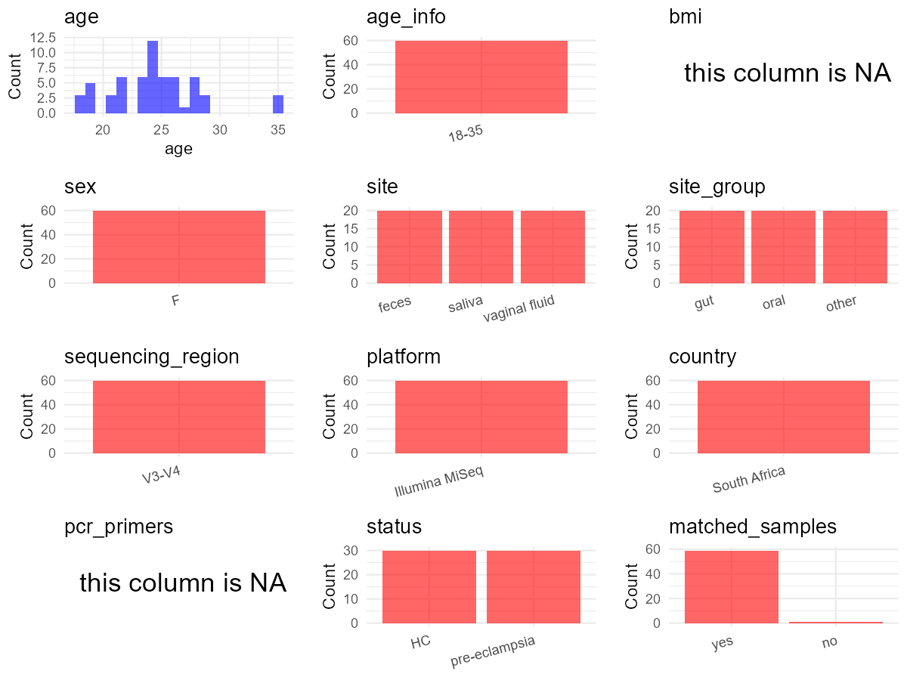

R Notebook: Metadata Processing Workflow
================

# Step 1: Obtain Initial Metadata from Each Project

This step sets the project directory, loads the raw SRA metadata, and
optionally merges supplement tables.

``` r
# Load libraries
library(dplyr)
library(ggplot2)
library(cowplot)

# (1) Setting working directory
# EDIT HERE: change project_id for each study
project_id <- "PRJNA798597" 

base_dir <- "E:/oral/26/metadata-2604/Oral-Metadata-YL-02"
setwd(file.path(base_dir, project_id))

# (2) Loading raw SRA metadata file
sra_file <- "SraRunTable.csv"
initial_meta <- read.csv(sra_file, header = TRUE)

# (3) OPTIONAL: If extra metadata (e.g., Table.x or supplemental materials) are available from the article, you may need to merge the file with initial_meta manually. Below is example code for merging. Depending on the specific case of each study, you can customize the code as needed.
# supp_table <- read.csv("supplemental_table.csv", header = TRUE)
# initial_meta <- left_join(initial_meta, supp_table, by = merge_col_name)
```

# Step 2: Data Overview

First, you need to get an overview of the data, which includes two
steps: reading the article and reading the initial metadata. This step
is very IMPORTANT!

``` r
# (1) Read the article in the following order: abstract, the beginning of the results section, and the methods. Understand the sample size, experimental design, and disease group overview. Clarify the sampling sites; for oral and gut samples, specify the exact sites like supragingival plaque, tongue, etc.

# (2) IMPORTANT: MUST go through each column of initial_meta
head(initial_meta, 10)
```

    ##            Run AGE Assay.Type AvgSpotLen    Bases  BioProject    BioSample
    ## 1  SRR17660545  24    RNA-Seq        447 28039117 PRJNA798597 SAMN25087701
    ## 2  SRR17660546  24    RNA-Seq        451  3921278 PRJNA798597 SAMN25087702
    ## 3  SRR17660547  24    RNA-Seq        447  2726217 PRJNA798597 SAMN25087703
    ## 4  SRR17660548  22    RNA-Seq        444  6730119 PRJNA798597 SAMN25087704
    ## 5  SRR17660549  28    RNA-Seq        468  1237574 PRJNA798597 SAMN25087705
    ## 6  SRR17660550  23    RNA-Seq        447  8169098 PRJNA798597 SAMN25087706
    ## 7  SRR17660551  35    RNA-Seq        463   557575 PRJNA798597 SAMN25087707
    ## 8  SRR17660552  28    RNA-Seq        464   410954 PRJNA798597 SAMN25087708
    ## 9  SRR17660553  26    RNA-Seq        462  1059617 PRJNA798597 SAMN25087709
    ## 10 SRR17660554  19    RNA-Seq        481   172318 PRJNA798597 SAMN25087656
    ##                                BioSampleModel    Bytes            Center.Name
    ## 1  MIMS.me,MIGS/MIMS/MIMARKS.human-associated 14727529 UNIVERSITY OF PRETORIA
    ## 2  MIMS.me,MIGS/MIMS/MIMARKS.human-associated  2210699 UNIVERSITY OF PRETORIA
    ## 3  MIMS.me,MIGS/MIMS/MIMARKS.human-associated  1658395 UNIVERSITY OF PRETORIA
    ## 4  MIMS.me,MIGS/MIMS/MIMARKS.human-associated  3875013 UNIVERSITY OF PRETORIA
    ## 5  MIMS.me,MIGS/MIMS/MIMARKS.human-associated   748667 UNIVERSITY OF PRETORIA
    ## 6  MIMS.me,MIGS/MIMS/MIMARKS.human-associated  4682287 UNIVERSITY OF PRETORIA
    ## 7  MIMS.me,MIGS/MIMS/MIMARKS.human-associated   376102 UNIVERSITY OF PRETORIA
    ## 8  MIMS.me,MIGS/MIMS/MIMARKS.human-associated   299333 UNIVERSITY OF PRETORIA
    ## 9  MIMS.me,MIGS/MIMS/MIMARKS.human-associated   636829 UNIVERSITY OF PRETORIA
    ## 10 MIMS.me,MIGS/MIMS/MIMARKS.human-associated   174645 UNIVERSITY OF PRETORIA
    ##    Collection_Date Consent DATASTORE.filetype DATASTORE.provider
    ## 1             2017  public   fastq,run.zq,sra         gs,ncbi,s3
    ## 2             2017  public   fastq,run.zq,sra         gs,ncbi,s3
    ## 3             2017  public   fastq,run.zq,sra         gs,ncbi,s3
    ## 4             2017  public   fastq,run.zq,sra         gs,ncbi,s3
    ## 5             2017  public   fastq,run.zq,sra         gs,ncbi,s3
    ## 6             2017  public   fastq,run.zq,sra         gs,ncbi,s3
    ## 7             2017  public   fastq,run.zq,sra         gs,ncbi,s3
    ## 8             2017  public   fastq,run.zq,sra         gs,ncbi,s3
    ## 9             2017  public   fastq,run.zq,sra         gs,ncbi,s3
    ## 10            2017  public   fastq,run.zq,sra         gs,ncbi,s3
    ##                        DATASTORE.region env_broad_scale env_local_scale
    ## 1  gs.us-east1,ncbi.public,s3.us-east-1  Gut microbiome   Pre-eclampsia
    ## 2  gs.us-east1,ncbi.public,s3.us-east-1  Gut microbiome   Pre-eclampsia
    ## 3  gs.us-east1,ncbi.public,s3.us-east-1  Gut microbiome   Pre-eclampsia
    ## 4  gs.us-east1,ncbi.public,s3.us-east-1  Gut microbiome   Pre-eclampsia
    ## 5  gs.us-east1,ncbi.public,s3.us-east-1  Gut microbiome   Pre-eclampsia
    ## 6  gs.us-east1,ncbi.public,s3.us-east-1  Gut microbiome   Pre-eclampsia
    ## 7  gs.us-east1,ncbi.public,s3.us-east-1  Gut microbiome   Pre-eclampsia
    ## 8  gs.us-east1,ncbi.public,s3.us-east-1  Gut microbiome   Pre-eclampsia
    ## 9  gs.us-east1,ncbi.public,s3.us-east-1  Gut microbiome   Pre-eclampsia
    ## 10 gs.us-east1,ncbi.public,s3.us-east-1 Oral microbiome    Normotensive
    ##    env_medium ethnicity  Experiment geo_loc_name_country
    ## 1        Swab         W SRX13828631         South Africa
    ## 2        Swab         B SRX13828630         South Africa
    ## 3        Swab         B SRX13828629         South Africa
    ## 4        Swab         B SRX13828628         South Africa
    ## 5        Swab         B SRX13828627         South Africa
    ## 6        Swab         B SRX13828626         South Africa
    ## 7        Swab         B SRX13828625         South Africa
    ## 8        Swab         B SRX13828624         South Africa
    ## 9        Swab         B SRX13828623         South Africa
    ## 10       Swab         B SRX13828622         South Africa
    ##    geo_loc_name_country_continent geo_loc_name gestational_age hiv         HOST
    ## 1                          Africa South Africa              34   N Homo sapiens
    ## 2                          Africa South Africa              34   P Homo sapiens
    ## 3                          Africa South Africa              38   N Homo sapiens
    ## 4                          Africa South Africa              38   N Homo sapiens
    ## 5                          Africa South Africa              30   N Homo sapiens
    ## 6                          Africa South Africa              39   N Homo sapiens
    ## 7                          Africa South Africa              34   N Homo sapiens
    ## 8                          Africa South Africa              36   N Homo sapiens
    ## 9                          Africa South Africa              36   N Homo sapiens
    ## 10                         Africa South Africa              33   N Homo sapiens
    ##        Instrument                 lat_lon Library.Name LibraryLayout
    ## 1  Illumina MiSeq 26.189165 S 27.972363 E    RP2.fastq        SINGLE
    ## 2  Illumina MiSeq 26.189165 S 27.972363 E    RP3.fastq        SINGLE
    ## 3  Illumina MiSeq 26.189165 S 27.972363 E    RP4.fastq        SINGLE
    ## 4  Illumina MiSeq 26.189165 S 27.972363 E    RP5.fastq        SINGLE
    ## 5  Illumina MiSeq 26.189165 S 27.972363 E    RP6.fastq        SINGLE
    ## 6  Illumina MiSeq 26.189165 S 27.972363 E    RP7.fastq        SINGLE
    ## 7  Illumina MiSeq 26.189165 S 27.972363 E    RP8.fastq        SINGLE
    ## 8  Illumina MiSeq 26.189165 S 27.972363 E    RP9.fastq        SINGLE
    ## 9  Illumina MiSeq 26.189165 S 27.972363 E   RP10.fastq        SINGLE
    ## 10 Illumina MiSeq 26.189165 S 27.972363 E    ON8.fastq        SINGLE
    ##    LibrarySelection LibrarySource         Organism Platform
    ## 1               PCR   METAGENOMIC human metagenome ILLUMINA
    ## 2               PCR   METAGENOMIC human metagenome ILLUMINA
    ## 3               PCR   METAGENOMIC human metagenome ILLUMINA
    ## 4               PCR   METAGENOMIC human metagenome ILLUMINA
    ## 5               PCR   METAGENOMIC human metagenome ILLUMINA
    ## 6               PCR   METAGENOMIC human metagenome ILLUMINA
    ## 7               PCR   METAGENOMIC human metagenome ILLUMINA
    ## 8               PCR   METAGENOMIC human metagenome ILLUMINA
    ## 9               PCR   METAGENOMIC human metagenome ILLUMINA
    ## 10              PCR   METAGENOMIC human metagenome ILLUMINA
    ##             ReleaseDate          create_date version Sample.Name SRA.Study
    ## 1  2022-01-19T00:00:00Z 2022-01-19T17:14:00Z       1   RP2.fastq SRP355751
    ## 2  2022-01-19T00:00:00Z 2022-01-19T17:14:00Z       1   RP3.fastq SRP355751
    ## 3  2022-01-19T00:00:00Z 2022-01-19T17:13:00Z       1   RP4.fastq SRP355751
    ## 4  2022-01-19T00:00:00Z 2022-01-19T17:13:00Z       1   RP5.fastq SRP355751
    ## 5  2022-01-19T00:00:00Z 2022-01-19T17:13:00Z       1   RP6.fastq SRP355751
    ## 6  2022-01-19T00:00:00Z 2022-01-19T17:14:00Z       1   RP7.fastq SRP355751
    ## 7  2022-01-19T00:00:00Z 2022-01-19T17:12:00Z       1   RP8.fastq SRP355751
    ## 8  2022-01-19T00:00:00Z 2022-01-19T17:13:00Z       1   RP9.fastq SRP355751
    ## 9  2022-01-19T00:00:00Z 2022-01-19T17:13:00Z       1  RP10.fastq SRP355751
    ## 10 2022-01-19T00:00:00Z 2022-01-19T17:12:00Z       1   ON8.fastq SRP355751
    ##    treatment
    ## 1          P
    ## 2          P
    ## 3          P
    ## 4          P
    ## 5          P
    ## 6          P
    ## 7          P
    ## 8          P
    ## 9          P
    ## 10         N

``` r
# IMPORTANT: Check the unique values in the column of interest or query column.
lapply(initial_meta[c('env_medium')], table) # site
```

    ## $env_medium
    ## 
    ## Swab 
    ##   60

``` r
lapply(initial_meta[c('env_broad_scale', 'env_local_scale', 'HOST', 'Organism')], table) # organism
```

    ## $env_broad_scale
    ## 
    ##     Gut microbiome    Oral microbiome Vaginal microbiome 
    ##                 20                 20                 20 
    ## 
    ## $env_local_scale
    ## 
    ##  Normotensive Pre-eclampsia 
    ##            30            30 
    ## 
    ## $HOST
    ## 
    ## Homo sapiens 
    ##           60 
    ## 
    ## $Organism
    ## 
    ## human metagenome 
    ##               60

``` r
table(initial_meta$Sample.Name) # subject id
```

    ## 
    ## ON10.fastq ON11.fastq ON12.fastq  ON2.fastq  ON3.fastq  ON4.fastq  ON6.fastq 
    ##          1          1          1          1          1          1          1 
    ##  ON7.fastq  ON8.fastq  ON9.fastq  OP1.fastq OP10.fastq  OP2.fastq  OP3.fastq 
    ##          1          1          1          1          1          1          1 
    ##  OP4.fastq  OP5.fastq  OP6.fastq  OP7.fastq  OP8.fastq  OP9.fastq RN10.fastq 
    ##          1          1          1          1          1          1          1 
    ## RN12.fastq  RN2.fastq  RN3.fastq  RN4.fastq  RN5.fastq  RN6.fastq  RN7.fastq 
    ##          1          1          1          1          1          1          1 
    ##  RN8.fastq  RN9.fastq  RP1.fastq RP10.fastq  RP2.fastq  RP3.fastq  RP4.fastq 
    ##          1          1          1          1          1          1          1 
    ##  RP5.fastq  RP6.fastq  RP7.fastq  RP8.fastq  RP9.fastq VN10.fastq VN12.fastq 
    ##          1          1          1          1          1          1          1 
    ##  VN2.fastq  VN3.fastq  VN4.fastq  VN5.fastq  VN6.fastq  VN7.fastq  VN8.fastq 
    ##          1          1          1          1          1          1          1 
    ##  VN9.fastq  VP1.fastq VP10.fastq  VP2.fastq  VP3.fastq  VP4.fastq  VP5.fastq 
    ##          1          1          1          1          1          1          1 
    ##  VP6.fastq  VP7.fastq  VP8.fastq  VP9.fastq 
    ##          1          1          1          1

``` r
#table(initial_meta$sequencing_meth..exp.) # output is pyrosequencing
table(initial_meta$Platform) # output is Illumina. according to the methods, Illumina is correct.
```

    ## 
    ## ILLUMINA 
    ##       60

``` r
# table(initial_meta$target_subfragment..exp.)
```

# Step 3: Removing Control and Non-human Samples

First, we need to remove control samples(including both negative
controls and positive controls) and non-human samples.

``` r
# (1) EDIT HERE: Parameter setup
control_column <- "" # column name in initial_meta
# unique(initial_meta[[control_column]])
control_keywords <- c() # Enter exact keywords

species_column <- "" # column name in initial_meta
unique(initial_meta[[species_column]])
```

    ## NULL

``` r
non_human_keywords <- c() # Enter exact keywords

# (2) Remove controls and non-human samples. DO NOT need to modify code in this part, just run it.
n_samples <- nrow(initial_meta)
# Control evaluation
if (length(control_keywords) > 0) {
  if (is.null(control_column) || control_column == "") {
    stop("Error: control_keywords provided but control_column is missing.")
  }
  
  if (!(control_column %in% colnames(initial_meta))) {
    stop(sprintf("Error: Column '%s' not found in initial_meta.", control_column))
  }
  
  control_pattern <- paste(control_keywords, collapse = "|")
  control_text <- initial_meta[[control_column]]
  is_control <- grepl(control_pattern, control_text)
  
} else {
  is_control <- rep(FALSE, n_samples)
}

# Non-human evaluation
if (length(non_human_keywords) > 0) {
  if (is.null(species_column) || species_column == "") {
    stop("Error: non_human_keywords provided but species_column is missing.")
  }
  
  if (!(species_column %in% colnames(initial_meta))) {
    stop(sprintf("Error: Column '%s' not found in initial_meta.", species_column))
  }
  
  non_human_pattern <- paste(non_human_keywords, collapse = "|")
  species_text <- initial_meta[[species_column]]
  is_non_human <- grepl(non_human_pattern, species_text)
} else {
  is_non_human <- rep(FALSE, n_samples)
}

# Execute removal
samples_to_remove <- is_control | is_non_human
initial_meta <- initial_meta[!samples_to_remove, ]

cat("Initial samples counts:",n_samples,"\n")
```

    ## Initial samples counts: 60

``` r
cat("Removed control samples:", sum(is_control), "\n")
```

    ## Removed control samples: 0

``` r
cat("Removed non-human samples:", sum(is_non_human), "\n")
```

    ## Removed non-human samples: 0

``` r
cat("Total samples removed ", sum(samples_to_remove), "\n")
```

    ## Total samples removed  0

``` r
cat("Remaining samples after Step 2:", nrow(initial_meta), "\n")
```

    ## Remaining samples after Step 2: 60

# Step 4: Creating a Uniform Metadata Template

This step converts the raw SRA table into the standard metadata format
used in our meta-analysis. The uniform metadata should include the
following columns: 1. **bioproject**: Project ID from SRA or other
database e.g. `PRJNA1234`, `CNP1234`, ‘OEP1234’, ‘qiita_1234’ 2.
**sample_id**: SRA sample/run ID. Unique id for each sample!
e.g. `DRR1234567`, `ERR1234567` and `SRR1234567`. If no such column
exists, can use column like sample_name. 3. **subject_id**: subject id
for each person if available. e.g. `patient_01`, `Host_03_before`,
`subject12` 4. **age**: Age of the subject if available. e.g. `35`, `42`
\| not `adult`, `chilren` 5. **age_info**: If the age is not explicitly
stated but approximate age range information is available, mark it in
this column. e.g., `18-55`, `children`, `infant`, `elder` 6. **bmi**:
Body Mass Index if available. e.g. `22.5`, `18.9` \| not `normal`,
`overweight` 7. **sex**: Sex of the subject. Mandatory to write as M/F
\| not `female`, `woman` 8. **sequencing_region**: Targeted 16S rRNA
region. e.g. `V3-V4`, `V4` 9. **platform**: Sequencing platform.
e.g. `Illumina MiSeq`, `454 GS FLX Titanium`, `Ion Torrent` 10.
**country**: Country of sample origin. e.g. `China`, `Japan` \| not city
name like `Beijing` 11. **site**: Sampling site. For oral and gut sites,
specify the exact sites as detailed as possible. For example, if it is
known to be supragingival plaque, do not record it as ‘dental plaque’,
unless the original text provides only a vague description.
e.g. `saliva`, `tongue coating` \| not broad term like `oral` 12.
**site_group**: only accepts one of following three values: ‘oral’,
‘gut’, or ‘other’. 13. **public_time**: Data release date.
e.g. `2021-06-22` \| not `June 2021` 14. **pcr_primers**: PCR primers
used. e.g. `515F-806R`, `27F-338R` \| not primer sequences 15.
**title**: Title of the associated publication. 16. **disease_study**:
Whether the study involves disease samples. If it’s not clear, can
record as NA. Only three values accepted: ‘yes’, ‘no’ or NA 17.
**status**: Disease status for each sample if available, else record as
NA. Only accept following abbreviations, Write full names for all other
diseases. HC: healthy control CD: Crohn’s disease CRC: colorectal cancer
COPD: chronic obstructive pulmonary disease HIV: human immunodeficiency
virus ICU: intensive care unit OSCC: oral squamous cell carcinoma RA:
rheumatoid arthritis UC: ulcerative colitis 18. **matched_samples**:
Whether the subject has matched samples. Only accept ‘yes’ or ‘no’. 19.
**is_time_series**: Whether the study is a time series study. Only
accept ‘yes’ or ‘no’.

``` r
# Extract columns from initial_meta as follows: (1) No modification needed → extract directly. (2) Modification needed → create a new column with the prefix raw_ and mark the original column as “pending”. (3) Need to find or determine based on the article.
metadata <- data.frame(
  bioproject = initial_meta$BioProject,
  sample_id = initial_meta$Run,
  raw_subject_id = initial_meta$Sample.Name,
  subject_id = "pending", # modify later
  age = initial_meta$AGE,
  age_info = "18-35", # extract from results section
  bmi = NA,
  sex = "F", # extract from title
  raw_host = "pregnant women",
  sequencing_region = "V3-V4", # extract from abstract section
  platform = "Illumina MiSeq", # extract from methods section, NOT initial_meta
  country = initial_meta$geo_loc_name_country,
  raw_site = initial_meta$env_broad_scale,
  site = "pending", # modify later
  site_group = "pending", # modify later
  public_time = initial_meta$ReleaseDate,
  pcr_primers = NA, # Format: xxF-xxR
  title = "Diversity of the gut vaginal and oral microbiome among pregnant women in South Africa with and without pre-eclampsia", # extract from article
  disease_study = "yes", # determine according to the article
  raw_status = initial_meta$env_local_scale, 
  status = "pending", # modify later
  matched_samples = "pending", # modify later
  is_time_series = "no", # determine according to the article
  stringsAsFactors = FALSE
)
metadata$public_time <- as.Date(metadata$public_time)
```

# Step 5: Manually solving pending issues

This step involves two parts: (1) handle the columns with the `raw_`
prefix, and next (2) handle the `site_group` and `matched_samples`
columns.

``` r
# (1) Handle the columns with the `raw_` prefix.
# In this part, you need to customize the code based on the situation of the raw_ columns to obtain the content of the target columns. IMPORTANT: Add comments if the modification is not straightforward!!
metadata$subject_id <- gsub("R|V|O", "", metadata$raw_subject_id) # according to the 'Sample.Name' column of initial_meta

metadata <- metadata %>%
  mutate(site = case_when(
    grepl("Gut", raw_site) ~ "feces",
    grepl("Oral", raw_site) ~ "saliva",
    grepl("Vaginal", raw_site) ~ "vaginal fluid",
    TRUE ~ NA_character_
  )) # according to the 'env_broad_scale' column of initial_meta

metadata <- metadata %>%
  mutate(status = case_when(
    grepl("Pre-eclampsia", raw_status) ~ "pre-eclampsia",
    grepl("Normotensive", raw_status) ~ "HC",
    TRUE ~ NA_character_
  )) # according to the 'env_local_scale' column of initial_meta
```

``` r
# (2) Filling the 'site_group' and 'matched_samples' columns
# editing site_group
unique(metadata$site)
```

    ## [1] "feces"         "saliva"        "vaginal fluid"

``` r
# EDIT HERE: add oral sites
Oral_site = c("saliva")
# EDIT HERE: add gut sites
Gut_site = c("feces")
# just run
metadata <- metadata %>%
  mutate(site_group = case_when(
    site %in% Oral_site ~ "oral",
    site %in% Gut_site ~ "gut",
    TRUE ~ "other" 
  ))

# editing matched_samples, just run.
metadata$matched_samples <- ifelse(
  ave(metadata$subject_id, metadata$subject_id, FUN = length) > 1, 
  "yes", 
  "no"
)
```

``` r
# (3) check if there is pending value in metadata. If there is pending value, go on modify the metadata.
# Function to check if a column contains "pending"
has_pending <- function(col) {
  if (is.character(col) || is.factor(col)) {
    any(col == "pending", na.rm = TRUE)
  } else {
    FALSE
  }
}

# Check for any pending value
any_pending_value <- any(sapply(metadata, has_pending))

if (!any_pending_value) {
  message("Good! No cell contains the value 'pending'.")
} else {
  pending_cols <- names(metadata)[sapply(metadata, has_pending)]
  message("Columns containing 'pending': ", paste(pending_cols, collapse = ", "))
  message("Please continue to resolve these pending columns!")
}
```

    ## Good! No cell contains the value 'pending'.

# Step 6: Visualize the Metadata

This step makes a quick set of plots for checking the distribution of
key metadata fields.

``` r
# Select columns for visualization, just run
plot_data <- metadata %>%
  select(-bioproject, -sample_id, -subject_id, -title)

create_simple_plots <- function(data) {
  plots <- list()
  continuous_vars <- c("age", "bmi")

  for (col in colnames(data)) {
    if (all(is.na(data[[col]]))) {
      p <- ggplot() +
        annotate("text", x = 0.5, y = 0.5, label = "this column is NA", size = 6) +
        labs(title = col) +
        theme_void()
    } else if (col %in% continuous_vars && is.numeric(data[[col]])) {
      p <- ggplot(data, aes(x = .data[[col]])) +
        geom_histogram(fill = "blue", alpha = 0.6, bins = 20, na.rm = TRUE) +
        labs(title = col, x = col, y = "Count") +
        theme_minimal()
    } else {
      count_data <- as.data.frame(table(data[[col]], useNA = "ifany"))
      p <- ggplot(count_data, aes(x = reorder(Var1, -Freq), y = Freq)) +
        geom_col(fill = "red", alpha = 0.6) +
        labs(title = col, x = NULL, y = "Count") +
        theme_minimal() +
        theme(axis.text.x = element_text(angle = 15, hjust = 1))
    }
    plots[[col]] <- p
  }

  return(plots)
}

# Generate and arrange plots
plots <- create_simple_plots(plot_data)
p <- plot_grid(plots$age,
               plots$age_info,
               plots$bmi,
               plots$sex,
               plots$site,
               plots$site_group,
               plots$sequencing_region,
               plots$platform,
               plots$country,
               plots$pcr_primers,
               plots$status,
               plots$matched_samples,
               ncol = 3, align = "hv", axis = "lb")
ggsave("Metadata_Summary_v2.png", plot = p, width = 8, height = 6, dpi = 150)
```

``` r
# Insert Metadata_Summary.png into the current Rmd output

```


# Step 7: Sort and export the metadata

This step saves the cleaned metadata table as the final `metadata.csv`
file.

``` r
# Reorder the data frame
fixed_cols <- c("bioproject", "sample_id", "subject_id", "age", "age_info",
                "bmi", "sex", "platform", "sequencing_region", "pcr_primers", 
                "country", "site", "site_group", "disease_study", "status", 
                "title", "public_time", "matched_samples", "is_time_series")  
metadata <- metadata %>%
  select(all_of(fixed_cols), everything())

# save metadata 
# head(metadata)
write.csv(metadata, file = "metadata_v2.csv", quote = TRUE)
```
