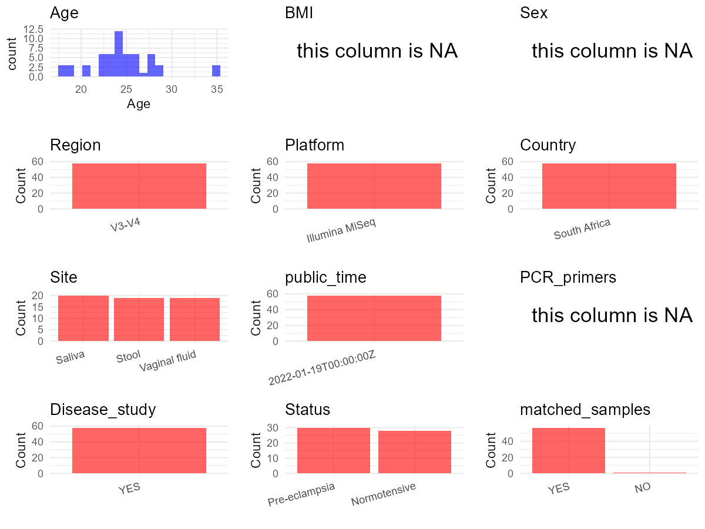

R Notebook: Metadata Processing Workflow
================

# Step 1: Obtain Initial Metadata from Each Project

To obtain the initial metadata: 1. Search for the BioProject ID (e.g.,
“PRJEBXXXX”) on the [NCBI SRA
website](https://www.ncbi.nlm.nih.gov/Traces/study/). 2. In the “Select”
table, click on “Metadata” and download the file. 3. The downloaded file
is typically named “SraRunTable.csv” and contains metadata for the
project.

``` r
# Load necessary libraries
library(dplyr)
library(ggplot2)
library(cowplot)

# Set working directory (update this path to your local directory)
setwd("D:/oral_project/PRJNA798597")

# Read the initial metadata files
initial_meta<-read.csv("SraRunTable.csv",header = T)

# Combine the two metadata files
#meta <- rbind(initial_meta, initial_meta1)

#Remove entries where Organism is "gut metagenome" (non-oral samples)
#initial_meta <- subset(initial_meta,env_broad_scale!= "Oral microbiome")

# Check the number of samples containing "HT" in Sample.Name (e.g., healthy controls)
#nrow(subset(meta, grepl("HT", Sample.Name)))

# Display the first few rows of the metadata
head(initial_meta)
```

    ##           Run AGE Assay.Type AvgSpotLen    Bases  BioProject    BioSample
    ## 1 SRR17660545  24    RNA-Seq        447 28039117 PRJNA798597 SAMN25087701
    ## 2 SRR17660546  24    RNA-Seq        451  3921278 PRJNA798597 SAMN25087702
    ## 3 SRR17660547  24    RNA-Seq        447  2726217 PRJNA798597 SAMN25087703
    ## 4 SRR17660548  22    RNA-Seq        444  6730119 PRJNA798597 SAMN25087704
    ## 5 SRR17660549  28    RNA-Seq        468  1237574 PRJNA798597 SAMN25087705
    ## 6 SRR17660550  23    RNA-Seq        447  8169098 PRJNA798597 SAMN25087706
    ##                               BioSampleModel    Bytes            Center.Name
    ## 1 MIMS.me,MIGS/MIMS/MIMARKS.human-associated 14727529 UNIVERSITY OF PRETORIA
    ## 2 MIMS.me,MIGS/MIMS/MIMARKS.human-associated  2210699 UNIVERSITY OF PRETORIA
    ## 3 MIMS.me,MIGS/MIMS/MIMARKS.human-associated  1658395 UNIVERSITY OF PRETORIA
    ## 4 MIMS.me,MIGS/MIMS/MIMARKS.human-associated  3875013 UNIVERSITY OF PRETORIA
    ## 5 MIMS.me,MIGS/MIMS/MIMARKS.human-associated   748667 UNIVERSITY OF PRETORIA
    ## 6 MIMS.me,MIGS/MIMS/MIMARKS.human-associated  4682287 UNIVERSITY OF PRETORIA
    ##   Collection_Date Consent DATASTORE.filetype DATASTORE.provider
    ## 1            2017  public   fastq,run.zq,sra         gs,ncbi,s3
    ## 2            2017  public   fastq,run.zq,sra         gs,ncbi,s3
    ## 3            2017  public   fastq,run.zq,sra         gs,ncbi,s3
    ## 4            2017  public   fastq,run.zq,sra         gs,ncbi,s3
    ## 5            2017  public   fastq,run.zq,sra         gs,ncbi,s3
    ## 6            2017  public   fastq,run.zq,sra         gs,ncbi,s3
    ##                       DATASTORE.region env_broad_scale env_local_scale
    ## 1 gs.us-east1,ncbi.public,s3.us-east-1  Gut microbiome   Pre-eclampsia
    ## 2 gs.us-east1,ncbi.public,s3.us-east-1  Gut microbiome   Pre-eclampsia
    ## 3 gs.us-east1,ncbi.public,s3.us-east-1  Gut microbiome   Pre-eclampsia
    ## 4 gs.us-east1,ncbi.public,s3.us-east-1  Gut microbiome   Pre-eclampsia
    ## 5 gs.us-east1,ncbi.public,s3.us-east-1  Gut microbiome   Pre-eclampsia
    ## 6 gs.us-east1,ncbi.public,s3.us-east-1  Gut microbiome   Pre-eclampsia
    ##   env_medium ethnicity  Experiment geo_loc_name_country
    ## 1       Swab         W SRX13828631         South Africa
    ## 2       Swab         B SRX13828630         South Africa
    ## 3       Swab         B SRX13828629         South Africa
    ## 4       Swab         B SRX13828628         South Africa
    ## 5       Swab         B SRX13828627         South Africa
    ## 6       Swab         B SRX13828626         South Africa
    ##   geo_loc_name_country_continent geo_loc_name gestational_age hiv         HOST
    ## 1                         Africa South Africa              34   N Homo sapiens
    ## 2                         Africa South Africa              34   P Homo sapiens
    ## 3                         Africa South Africa              38   N Homo sapiens
    ## 4                         Africa South Africa              38   N Homo sapiens
    ## 5                         Africa South Africa              30   N Homo sapiens
    ## 6                         Africa South Africa              39   N Homo sapiens
    ##       Instrument                 lat_lon Library.Name LibraryLayout
    ## 1 Illumina MiSeq 26.189165 S 27.972363 E    RP2.fastq        SINGLE
    ## 2 Illumina MiSeq 26.189165 S 27.972363 E    RP3.fastq        SINGLE
    ## 3 Illumina MiSeq 26.189165 S 27.972363 E    RP4.fastq        SINGLE
    ## 4 Illumina MiSeq 26.189165 S 27.972363 E    RP5.fastq        SINGLE
    ## 5 Illumina MiSeq 26.189165 S 27.972363 E    RP6.fastq        SINGLE
    ## 6 Illumina MiSeq 26.189165 S 27.972363 E    RP7.fastq        SINGLE
    ##   LibrarySelection LibrarySource         Organism Platform          ReleaseDate
    ## 1              PCR   METAGENOMIC human metagenome ILLUMINA 2022-01-19T00:00:00Z
    ## 2              PCR   METAGENOMIC human metagenome ILLUMINA 2022-01-19T00:00:00Z
    ## 3              PCR   METAGENOMIC human metagenome ILLUMINA 2022-01-19T00:00:00Z
    ## 4              PCR   METAGENOMIC human metagenome ILLUMINA 2022-01-19T00:00:00Z
    ## 5              PCR   METAGENOMIC human metagenome ILLUMINA 2022-01-19T00:00:00Z
    ## 6              PCR   METAGENOMIC human metagenome ILLUMINA 2022-01-19T00:00:00Z
    ##            create_date version Sample.Name SRA.Study treatment
    ## 1 2022-01-19T17:14:00Z       1   RP2.fastq SRP355751         P
    ## 2 2022-01-19T17:14:00Z       1   RP3.fastq SRP355751         P
    ## 3 2022-01-19T17:13:00Z       1   RP4.fastq SRP355751         P
    ## 4 2022-01-19T17:13:00Z       1   RP5.fastq SRP355751         P
    ## 5 2022-01-19T17:13:00Z       1   RP6.fastq SRP355751         P
    ## 6 2022-01-19T17:14:00Z       1   RP7.fastq SRP355751         P

# Step 2: Create a Uniform Metadata Template

The uniform metadata should include the following columns:

1.  **BioProject**: Project ID (e.g., “PRJNA339212”)
2.  **Run**: Sample ID (e.g., “ERRXXXXXX” or “SRRXXXXXX”)
3.  **sample_name**: Original sample name submitted by the authors (not
    the database-assigned ID)
4.  **Age**: Age of the subject (if available)
5.  **BMI**: Body Mass Index (if available)
6.  **Sex**: Sex of the subject (“F” or “M”)
7.  **Region**: Targeted 16S rRNA region (e.g., “V3-V4”)
8.  **Platform**: Sequencing platform (e.g., “Illumina MiSeq”)
9.  **Country**: Country of sample origin (e.g., “China”)
10. **Site**: Sample site (e.g., “saliva”, “dental plaque”)
11. **public_time**: Data release date (format: “YYYY-MM-DD”)
12. **PCR_primers**: PCR primers used (e.g., “515F-806R”)
13. **title**: Title of the associated publication
14. **Disease_study**: Whether the study involves a disease (“YES” or
    “NO”)
15. **Status**: Disease status (e.g., “T2DM”, “HC”). Note: If the study
    includes both disease and healthy samples, this must be specified
    per sample.

``` r
# Create a uniform metadata dataframe
metadata <- data.frame(
  BioProject = initial_meta$BioProject,
  Run = initial_meta$Run,
  sample_name = initial_meta$Sample.Name,
  Age = initial_meta$AGE,
  BMI = NA,
  Sex=NA,
  Region = "V3-V4",
  Platform = initial_meta$Instrument,
  Country = initial_meta$geo_loc_name_country,
  #Site = initial_meta$env_medium,
  public_time = initial_meta$ReleaseDate,
  stringsAsFactors = FALSE
)
```

# Step 3: Manually Add Information from the Publication

Some information (e.g. PCR primers, study title, disease status) must be
manually extracted from the publication and added to the metadata.

``` r
# Add information obtained from the publication
metadata$PCR_primers <- NA
metadata$title <- "Diversity of the gut, vaginal and oral microbiome among pregnant women in South Africa with and without pre-eclampsia"
metadata$Disease_study <- "YES"
# Assign disease status based on sample_name patterns
metadata$Status <-initial_meta$env_local_scale
#The sample labeling used in this study refers to the site of collection, i.e., R = rectal/gut, V =vaginal, O = oral sample in both cohorts.
metadata<-metadata%>%
  mutate(Site=case_when(grepl("R",sample_name)~"Stool",
                        grepl("V",sample_name)~"Vaginal fluid",
                        grepl("O",sample_name)~"Saliva"))

#get subjects id according to sample id
metadata$sample_name<-gsub("R|V|O|\\.fastq","",metadata$sample_name)
#get subjects id with Saliva available
keep_subjects<-subset(metadata,Site %in% "Saliva")
#remove subjects without Saliva samples
metadata<-subset(metadata,sample_name %in% keep_subjects$sample_name)
#get subjects sampling counts
sample_counts <- table(metadata$sample_name)
# Create matched_samples column, any subjects have >=2 samples will be label "YES", otherwise "NO"
metadata$matched_samples <- ifelse(metadata$sample_name %in% names(sample_counts[sample_counts >= 2]), "YES", "NO")
```

# Step 4: Summarize and Validate the Metadata

``` r
# Check the number of unique runs and sample names
print(paste("Number of unique runs:", length(unique(metadata$Run))))
```

    ## [1] "Number of unique runs: 58"

``` r
print(paste("Number of unique sample names:", length(unique(metadata$sample_name))))
```

    ## [1] "Number of unique sample names: 20"

# Step 5: Visualize the Metadata

``` r

```


# Step 6: Finalize and Export the Metadata

``` r
# Reorder columns to match the desired format
metadata <- metadata[, c(
  "BioProject", "Run", "sample_name", "Age", "BMI", "Sex", 
  "Region", "Platform", "Country", "Site", "public_time", 
  "PCR_primers", "title", "Disease_study", "Status","matched_samples"
)]

# Export the uniform metadata to a CSV file
write.csv(metadata, file = "metadata.csv", quote = FALSE)
head(metadata)
```

    ##    BioProject         Run sample_name Age BMI Sex Region       Platform
    ## 1 PRJNA798597 SRR17660545          P2  24  NA  NA  V3-V4 Illumina MiSeq
    ## 2 PRJNA798597 SRR17660546          P3  24  NA  NA  V3-V4 Illumina MiSeq
    ## 3 PRJNA798597 SRR17660547          P4  24  NA  NA  V3-V4 Illumina MiSeq
    ## 4 PRJNA798597 SRR17660548          P5  22  NA  NA  V3-V4 Illumina MiSeq
    ## 5 PRJNA798597 SRR17660549          P6  28  NA  NA  V3-V4 Illumina MiSeq
    ## 6 PRJNA798597 SRR17660550          P7  23  NA  NA  V3-V4 Illumina MiSeq
    ##        Country  Site          public_time PCR_primers
    ## 1 South Africa Stool 2022-01-19T00:00:00Z          NA
    ## 2 South Africa Stool 2022-01-19T00:00:00Z          NA
    ## 3 South Africa Stool 2022-01-19T00:00:00Z          NA
    ## 4 South Africa Stool 2022-01-19T00:00:00Z          NA
    ## 5 South Africa Stool 2022-01-19T00:00:00Z          NA
    ## 6 South Africa Stool 2022-01-19T00:00:00Z          NA
    ##                                                                                                                   title
    ## 1 Diversity of the gut, vaginal and oral microbiome among pregnant women in South Africa with and without pre-eclampsia
    ## 2 Diversity of the gut, vaginal and oral microbiome among pregnant women in South Africa with and without pre-eclampsia
    ## 3 Diversity of the gut, vaginal and oral microbiome among pregnant women in South Africa with and without pre-eclampsia
    ## 4 Diversity of the gut, vaginal and oral microbiome among pregnant women in South Africa with and without pre-eclampsia
    ## 5 Diversity of the gut, vaginal and oral microbiome among pregnant women in South Africa with and without pre-eclampsia
    ## 6 Diversity of the gut, vaginal and oral microbiome among pregnant women in South Africa with and without pre-eclampsia
    ##   Disease_study        Status matched_samples
    ## 1           YES Pre-eclampsia             YES
    ## 2           YES Pre-eclampsia             YES
    ## 3           YES Pre-eclampsia             YES
    ## 4           YES Pre-eclampsia             YES
    ## 5           YES Pre-eclampsia             YES
    ## 6           YES Pre-eclampsia             YES

## Notes for Students:

1.  **Metadata Accuracy**: Always cross-check the metadata with the
    original publication to ensure accuracy.
2.  **Manual Entries**: Columns like `PCR_primers`, and `Status` often
    require manual entry based on the publication.
3.  **Disease Status**: Be careful when assigning `Status`—some studies
    include both disease and healthy samples.
4.  **Visualization**: The plots help quickly identify the distribution
    of values in each column, which is useful for quality control.
5.  **Reproducibility**: Update the working directory and file paths to
    match your local environment.
