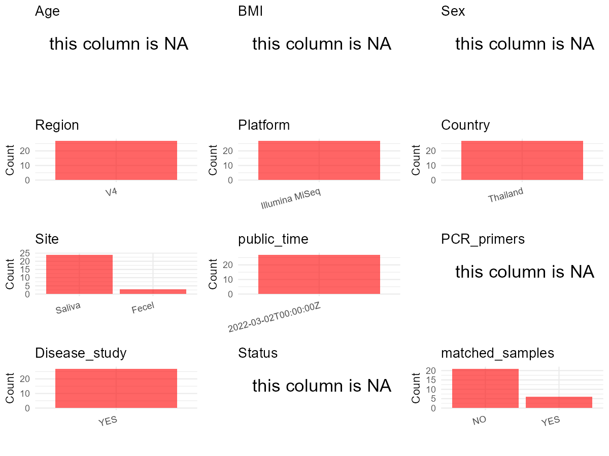

R Notebook: Metadata Processing Workflow
================

# Step 1: Obtain Initial Metadata from Each Project

To obtain the initial metadata: 1. Search for the BioProject ID (e.g.,
“PRJEBXXXX”) on the [NCBI SRA
website](https://www.ncbi.nlm.nih.gov/Traces/study/). 2. In the “Select”
table, click on “Metadata” and download the file. 3. The downloaded file
is typically named “SraRunTable.csv” and contains metadata for the
project.

``` r
# Load necessary libraries
library(dplyr)
library(ggplot2)
library(cowplot)

# Set working directory (update this path to your local directory)
setwd("D:/oral_project/PRJNA799190")

# Read the initial metadata files
initial_meta<-read.csv("SraRunTable.csv",header = T)

# Combine the two metadata files
#meta <- rbind(initial_meta, initial_meta1)

#Remove entries where Organism is "gut metagenome" (non-oral samples)
#initial_meta <- subset(initial_meta,isolation_source!= "feces")

# Check the number of samples containing "HT" in Sample.Name (e.g., healthy controls)
#nrow(subset(meta, grepl("HT", Sample.Name)))

# Display the first few rows of the metadata
head(initial_meta)
```

    ##           Run Assay.Type AvgSpotLen    Bases  BioProject    BioSample
    ## 1 SRR17702049   AMPLICON        496 64312298 PRJNA799190 SAMN25146786
    ## 2 SRR17702050   AMPLICON        493 64843726 PRJNA799190 SAMN25146714
    ## 3 SRR17702051   AMPLICON        495 60335277 PRJNA799190 SAMN25146785
    ## 4 SRR17702052   AMPLICON        495 66069216 PRJNA799190 SAMN25146784
    ## 5 SRR17702053   AMPLICON        492 63392232 PRJNA799190 SAMN25146783
    ## 6 SRR17702054   AMPLICON        493 78738578 PRJNA799190 SAMN25146782
    ##                BioSampleModel    Bytes
    ## 1 Metagenome or environmental 32262448
    ## 2 Metagenome or environmental 32940339
    ## 3 Metagenome or environmental 30621021
    ## 4 Metagenome or environmental 33137521
    ## 5 Metagenome or environmental 34613435
    ## 6 Metagenome or environmental 39762976
    ##                                        Center.Name Collection_Date Consent
    ## 1 FACULTY OF TROPICAL MEDICINE, MAHIDOL UNIVERSITY 2017-12/2018-01  public
    ## 2 FACULTY OF TROPICAL MEDICINE, MAHIDOL UNIVERSITY 2017-12/2018-01  public
    ## 3 FACULTY OF TROPICAL MEDICINE, MAHIDOL UNIVERSITY 2017-12/2018-01  public
    ## 4 FACULTY OF TROPICAL MEDICINE, MAHIDOL UNIVERSITY 2017-12/2018-01  public
    ## 5 FACULTY OF TROPICAL MEDICINE, MAHIDOL UNIVERSITY 2017-12/2018-01  public
    ## 6 FACULTY OF TROPICAL MEDICINE, MAHIDOL UNIVERSITY 2017-12/2018-01  public
    ##   DATASTORE.filetype DATASTORE.provider                     DATASTORE.region
    ## 1   fastq,run.zq,sra         gs,ncbi,s3 gs.us-east1,ncbi.public,s3.us-east-1
    ## 2   fastq,run.zq,sra         gs,ncbi,s3 gs.us-east1,ncbi.public,s3.us-east-1
    ## 3   fastq,run.zq,sra         gs,ncbi,s3 gs.us-east1,ncbi.public,s3.us-east-1
    ## 4   fastq,run.zq,sra         gs,ncbi,s3 gs.us-east1,ncbi.public,s3.us-east-1
    ## 5   fastq,run.zq,sra         gs,ncbi,s3 gs.us-east1,ncbi.public,s3.us-east-1
    ## 6   fastq,run.zq,sra         gs,ncbi,s3 gs.us-east1,ncbi.public,s3.us-east-1
    ##    Experiment geo_loc_name_country geo_loc_name_country_continent
    ## 1 SRX13865185             Thailand                           Asia
    ## 2 SRX13865184             Thailand                           Asia
    ## 3 SRX13865183             Thailand                           Asia
    ## 4 SRX13865182             Thailand                           Asia
    ## 5 SRX13865181             Thailand                           Asia
    ## 6 SRX13865180             Thailand                           Asia
    ##                 geo_loc_name         HOST     Instrument       lat_lon
    ## 1              Thailand: Tak Homo sapiens Illumina MiSeq not collected
    ## 2 Thailand: Ubon Ratchathani Homo sapiens Illumina MiSeq not collected
    ## 3              Thailand: Tak Homo sapiens Illumina MiSeq not collected
    ## 4              Thailand: Tak Homo sapiens Illumina MiSeq not collected
    ## 5          Thailand: Sisaket Homo sapiens Illumina MiSeq not collected
    ## 6          Thailand: Sisaket Homo sapiens Illumina MiSeq not collected
    ##   Library.Name LibraryLayout LibrarySelection LibrarySource       Organism
    ## 1           G9        PAIRED              PCR       GENOMIC gut metagenome
    ## 2           A9        PAIRED              PCR       GENOMIC gut metagenome
    ## 3           G8        PAIRED              PCR       GENOMIC gut metagenome
    ## 4           G7        PAIRED              PCR       GENOMIC gut metagenome
    ## 5           G6        PAIRED              PCR       GENOMIC gut metagenome
    ## 6           G5        PAIRED              PCR       GENOMIC gut metagenome
    ##   Platform          ReleaseDate   replicates          create_date version
    ## 1 ILLUMINA 2022-03-02T00:00:00Z raplicate 81 2022-01-22T11:38:00Z       1
    ## 2 ILLUMINA 2022-03-02T00:00:00Z  raplicate 9 2022-01-22T11:41:00Z       1
    ## 3 ILLUMINA 2022-03-02T00:00:00Z raplicate 80 2022-01-22T11:41:00Z       1
    ## 4 ILLUMINA 2022-03-02T00:00:00Z raplicate 79 2022-01-22T11:41:00Z       1
    ## 5 ILLUMINA 2022-03-02T00:00:00Z raplicate 78 2022-01-22T11:41:00Z       1
    ## 6 ILLUMINA 2022-03-02T00:00:00Z raplicate 77 2022-01-22T11:41:00Z       1
    ##   Sample.Name SRA.Study
    ## 1   TTS018-18 SRP356253
    ## 2   USK188-18 SRP356253
    ## 3   TTS010-18 SRP356253
    ## 4   TTS149-18 SRP356253
    ## 5   SKP098-17 SRP356253
    ## 6   SKP086-17 SRP356253

# Step 2: Create a Uniform Metadata Template

The uniform metadata should include the following columns:

1.  **BioProject**: Project ID (e.g., “PRJNA339212”)
2.  **Run**: Sample ID (e.g., “ERRXXXXXX” or “SRRXXXXXX”)
3.  **sample_name**: Original sample name submitted by the authors (not
    the database-assigned ID)
4.  **Age**: Age of the subject (if available)
5.  **BMI**: Body Mass Index (if available)
6.  **Sex**: Sex of the subject (“F” or “M”)
7.  **Region**: Targeted 16S rRNA region (e.g., “V3-V4”)
8.  **Platform**: Sequencing platform (e.g., “Illumina MiSeq”)
9.  **Country**: Country of sample origin (e.g., “China”)
10. **Site**: Sample site (e.g., “saliva”, “dental plaque”)
11. **public_time**: Data release date (format: “YYYY-MM-DD”)
12. **PCR_primers**: PCR primers used (e.g., “515F-806R”)
13. **title**: Title of the associated publication
14. **Disease_study**: Whether the study involves a disease (“YES” or
    “NO”)
15. **Status**: Disease status (e.g., “T2DM”, “HC”). Note: If the study
    includes both disease and healthy samples, this must be specified
    per sample.

``` r
# Create a uniform metadata dataframe
metadata <- data.frame(
  BioProject = initial_meta$BioProject,
  Run = initial_meta$Run,
  sample_name = initial_meta$Sample.Name,
  Age = NA,
  BMI = NA,
  Sex=NA,
  Region = "V4",
  Platform = initial_meta$Instrument,
  Country = initial_meta$geo_loc_name_country,
  Site = initial_meta$Organism,
  public_time = initial_meta$ReleaseDate,
  stringsAsFactors = FALSE
)%>%
  mutate(Site=case_when(Site=="gut metagenome"~"Fecel",Site=="oral metagenome"~"Saliva"))
```

# Step 3: Manually Add Information from the Publication

Some information (e.g. PCR primers, study title, disease status) must be
manually extracted from the publication and added to the metadata.

``` r
# Add information obtained from the publication
metadata$PCR_primers <- NA
metadata$title <- "Clinical helminth infections alter host gut and saliva microbiota"
#metadata<-subset(uniform_meta,Site!="feces")
metadata$Disease_study <- "YES"
# Assign disease status based on sample_name patterns
metadata$Status <- NA
#extract subject id by remove prefix of sample_name
metadata$sample_name <- gsub("S-Saliva-.*|F", "", metadata$sample_name)
#get subjects id with Saliva available
keep_subjects<-subset(metadata,Site %in% c("Saliva"))
#remove subjects without Saliva samples
metadata<-subset(metadata,sample_name %in% keep_subjects$sample_name)
#get subjects sampling counts
sample_counts <- table(metadata$sample_name)
# Create matched_samples column, any subjects have >=2 samples will be label "YES", otherwise "NO"
metadata$matched_samples <- ifelse(metadata$sample_name %in% names(sample_counts[sample_counts >= 2]), "YES", "NO")
```

# Step 4: Summarize and Validate the Metadata

``` r
# Check the number of unique runs and sample names
print(paste("Number of unique runs:", length(unique(metadata$Run))))
```

    ## [1] "Number of unique runs: 27"

``` r
print(paste("Number of unique sample names:", length(unique(metadata$sample_name))))
```

    ## [1] "Number of unique sample names: 24"

# Step 5: Visualize the Metadata

``` r

```


# Step 6: Finalize and Export the Metadata

``` r
# Reorder columns to match the desired format
metadata <- metadata[, c(
  "BioProject", "Run", "sample_name", "Age", "BMI", "Sex", 
  "Region", "Platform", "Country", "Site", "public_time", 
  "PCR_primers", "title", "Disease_study", "Status","matched_samples"
)]

# Export the uniform metadata to a CSV file
write.csv(metadata, file = "metadata.csv", quote = FALSE)
head(metadata)
```

    ##     BioProject         Run sample_name Age BMI Sex Region       Platform
    ## 20 PRJNA799190 SRR17702068   USK004-18  NA  NA  NA     V4 Illumina MiSeq
    ## 22 PRJNA799190 SRR17702070   USK005-18  NA  NA  NA     V4 Illumina MiSeq
    ## 23 PRJNA799190 SRR17702071   USK039-18  NA  NA  NA     V4 Illumina MiSeq
    ## 24 PRJNA799190 SRR17702072   USK009-18  NA  NA  NA     V4 Illumina MiSeq
    ## 25 PRJNA799190 SRR17702073   USK037-18  NA  NA  NA     V4 Illumina MiSeq
    ## 26 PRJNA799190 SRR17702074   USK053-18  NA  NA  NA     V4 Illumina MiSeq
    ##     Country   Site          public_time PCR_primers
    ## 20 Thailand Saliva 2022-03-02T00:00:00Z          NA
    ## 22 Thailand Saliva 2022-03-02T00:00:00Z          NA
    ## 23 Thailand Saliva 2022-03-02T00:00:00Z          NA
    ## 24 Thailand Saliva 2022-03-02T00:00:00Z          NA
    ## 25 Thailand  Fecel 2022-03-02T00:00:00Z          NA
    ## 26 Thailand Saliva 2022-03-02T00:00:00Z          NA
    ##                                                                title
    ## 20 Clinical helminth infections alter host gut and saliva microbiota
    ## 22 Clinical helminth infections alter host gut and saliva microbiota
    ## 23 Clinical helminth infections alter host gut and saliva microbiota
    ## 24 Clinical helminth infections alter host gut and saliva microbiota
    ## 25 Clinical helminth infections alter host gut and saliva microbiota
    ## 26 Clinical helminth infections alter host gut and saliva microbiota
    ##    Disease_study Status matched_samples
    ## 20           YES     NA              NO
    ## 22           YES     NA             YES
    ## 23           YES     NA              NO
    ## 24           YES     NA              NO
    ## 25           YES     NA             YES
    ## 26           YES     NA              NO

## Notes for Students:

1.  **Metadata Accuracy**: Always cross-check the metadata with the
    original publication to ensure accuracy.
2.  **Manual Entries**: Columns like `PCR_primers`, and `Status` often
    require manual entry based on the publication.
3.  **Disease Status**: Be careful when assigning `Status`—some studies
    include both disease and healthy samples.
4.  **Visualization**: The plots help quickly identify the distribution
    of values in each column, which is useful for quality control.
5.  **Reproducibility**: Update the working directory and file paths to
    match your local environment.
