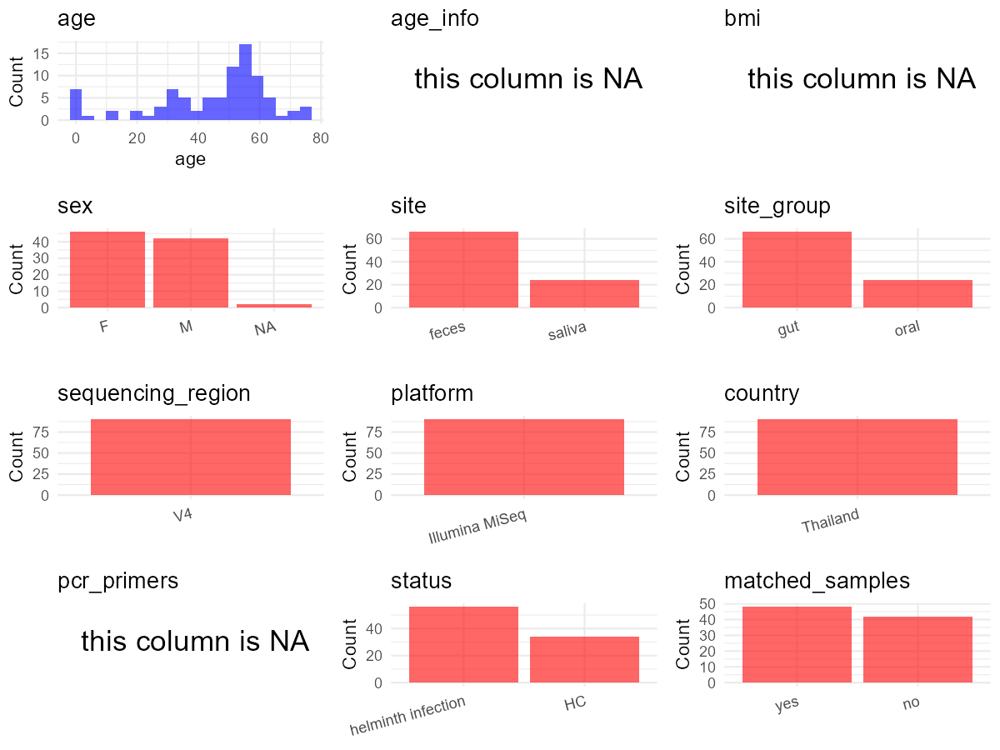

R Notebook: Metadata Processing Workflow
================

# Step 1: Obtain Initial Metadata from Each Project

This step sets the project directory, loads the raw SRA metadata, and
optionally merges supplement tables.

``` r
# Load libraries
library(dplyr)
library(ggplot2)
library(cowplot)

# (1) Setting working directory
# EDIT HERE: change project_id for each study
project_id <- "PRJNA799190" 

base_dir <- "E:/oral/26/metadata-2604/Oral-Metadata-YL-02"
setwd(file.path(base_dir, project_id))

# (2) Loading raw SRA metadata file
sra_file <- "SraRunTable.csv"
initial_meta <- read.csv(sra_file, header = TRUE)

# (3) OPTIONAL: If extra metadata (e.g., Table.x or supplemental materials) are available from the article, you may need to merge the file with initial_meta manually. Below is example code for merging. Depending on the specific case of each study, you can customize the code as needed.
supp_table <- read.csv("supplemental_table_v2.csv", header = TRUE)
initial_meta <- left_join(initial_meta, supp_table, by = "Sample.Name")
initial_meta[["Sample.id"]][is.na(initial_meta[["Sample.id"]])] <- ""
```

# Step 2: Data Overview

First, you need to get an overview of the data, which includes two
steps: reading the article and reading the initial metadata. This step
is very IMPORTANT!

``` r
# (1) Read the article in the following order: abstract, the beginning of the results section, and the methods. Understand the sample size, experimental design, and disease group overview. Clarify the sampling sites; for oral and gut samples, specify the exact sites like supragingival plaque, tongue, etc.

# (2) IMPORTANT: MUST go through each column of initial_meta
head(initial_meta, 10)
```

    ##            Run Assay.Type AvgSpotLen    Bases  BioProject    BioSample
    ## 1  SRR17702049   AMPLICON        496 64312298 PRJNA799190 SAMN25146786
    ## 2  SRR17702050   AMPLICON        493 64843726 PRJNA799190 SAMN25146714
    ## 3  SRR17702051   AMPLICON        495 60335277 PRJNA799190 SAMN25146785
    ## 4  SRR17702052   AMPLICON        495 66069216 PRJNA799190 SAMN25146784
    ## 5  SRR17702053   AMPLICON        492 63392232 PRJNA799190 SAMN25146783
    ## 6  SRR17702054   AMPLICON        493 78738578 PRJNA799190 SAMN25146782
    ## 7  SRR17702055   AMPLICON        452    22195 PRJNA799190 SAMN25146781
    ## 8  SRR17702056   AMPLICON        490 68380173 PRJNA799190 SAMN25146780
    ## 9  SRR17702057   AMPLICON        494 66146630 PRJNA799190 SAMN25146779
    ## 10 SRR17702058   AMPLICON        490 75863117 PRJNA799190 SAMN25146778
    ##                 BioSampleModel    Bytes
    ## 1  Metagenome or environmental 32262448
    ## 2  Metagenome or environmental 32940339
    ## 3  Metagenome or environmental 30621021
    ## 4  Metagenome or environmental 33137521
    ## 5  Metagenome or environmental 34613435
    ## 6  Metagenome or environmental 39762976
    ## 7  Metagenome or environmental    94614
    ## 8  Metagenome or environmental 35287955
    ## 9  Metagenome or environmental 33213882
    ## 10 Metagenome or environmental 39187304
    ##                                         Center.Name Collection_Date Consent
    ## 1  FACULTY OF TROPICAL MEDICINE, MAHIDOL UNIVERSITY 2017-12/2018-01  public
    ## 2  FACULTY OF TROPICAL MEDICINE, MAHIDOL UNIVERSITY 2017-12/2018-01  public
    ## 3  FACULTY OF TROPICAL MEDICINE, MAHIDOL UNIVERSITY 2017-12/2018-01  public
    ## 4  FACULTY OF TROPICAL MEDICINE, MAHIDOL UNIVERSITY 2017-12/2018-01  public
    ## 5  FACULTY OF TROPICAL MEDICINE, MAHIDOL UNIVERSITY 2017-12/2018-01  public
    ## 6  FACULTY OF TROPICAL MEDICINE, MAHIDOL UNIVERSITY 2017-12/2018-01  public
    ## 7  FACULTY OF TROPICAL MEDICINE, MAHIDOL UNIVERSITY 2017-12/2018-01  public
    ## 8  FACULTY OF TROPICAL MEDICINE, MAHIDOL UNIVERSITY 2017-12/2018-01  public
    ## 9  FACULTY OF TROPICAL MEDICINE, MAHIDOL UNIVERSITY 2017-12/2018-01  public
    ## 10 FACULTY OF TROPICAL MEDICINE, MAHIDOL UNIVERSITY 2017-12/2018-01  public
    ##    DATASTORE.filetype DATASTORE.provider                     DATASTORE.region
    ## 1    fastq,run.zq,sra         gs,ncbi,s3 gs.us-east1,ncbi.public,s3.us-east-1
    ## 2    fastq,run.zq,sra         gs,ncbi,s3 gs.us-east1,ncbi.public,s3.us-east-1
    ## 3    fastq,run.zq,sra         gs,ncbi,s3 gs.us-east1,ncbi.public,s3.us-east-1
    ## 4    fastq,run.zq,sra         gs,ncbi,s3 gs.us-east1,ncbi.public,s3.us-east-1
    ## 5    fastq,run.zq,sra         gs,ncbi,s3 gs.us-east1,ncbi.public,s3.us-east-1
    ## 6    fastq,run.zq,sra         gs,ncbi,s3 gs.us-east1,ncbi.public,s3.us-east-1
    ## 7    fastq,run.zq,sra         gs,ncbi,s3 gs.us-east1,ncbi.public,s3.us-east-1
    ## 8    fastq,run.zq,sra         gs,ncbi,s3 gs.us-east1,ncbi.public,s3.us-east-1
    ## 9    fastq,run.zq,sra         gs,ncbi,s3 gs.us-east1,ncbi.public,s3.us-east-1
    ## 10   fastq,run.zq,sra         gs,ncbi,s3 gs.us-east1,ncbi.public,s3.us-east-1
    ##     Experiment geo_loc_name_country geo_loc_name_country_continent
    ## 1  SRX13865185             Thailand                           Asia
    ## 2  SRX13865184             Thailand                           Asia
    ## 3  SRX13865183             Thailand                           Asia
    ## 4  SRX13865182             Thailand                           Asia
    ## 5  SRX13865181             Thailand                           Asia
    ## 6  SRX13865180             Thailand                           Asia
    ## 7  SRX13865179             Thailand                           Asia
    ## 8  SRX13865178             Thailand                           Asia
    ## 9  SRX13865177             Thailand                           Asia
    ## 10 SRX13865176             Thailand                           Asia
    ##                  geo_loc_name         HOST     Instrument       lat_lon
    ## 1               Thailand: Tak Homo sapiens Illumina MiSeq not collected
    ## 2  Thailand: Ubon Ratchathani Homo sapiens Illumina MiSeq not collected
    ## 3               Thailand: Tak Homo sapiens Illumina MiSeq not collected
    ## 4               Thailand: Tak Homo sapiens Illumina MiSeq not collected
    ## 5           Thailand: Sisaket Homo sapiens Illumina MiSeq not collected
    ## 6           Thailand: Sisaket Homo sapiens Illumina MiSeq not collected
    ## 7           Thailand: Sisaket Homo sapiens Illumina MiSeq not collected
    ## 8               Thailand: Tak Homo sapiens Illumina MiSeq not collected
    ## 9               Thailand: Tak Homo sapiens Illumina MiSeq not collected
    ## 10              Thailand: Tak Homo sapiens Illumina MiSeq not collected
    ##    Library.Name LibraryLayout LibrarySelection LibrarySource       Organism
    ## 1            G9        PAIRED              PCR       GENOMIC gut metagenome
    ## 2            A9        PAIRED              PCR       GENOMIC gut metagenome
    ## 3            G8        PAIRED              PCR       GENOMIC gut metagenome
    ## 4            G7        PAIRED              PCR       GENOMIC gut metagenome
    ## 5            G6        PAIRED              PCR       GENOMIC gut metagenome
    ## 6            G5        PAIRED              PCR       GENOMIC gut metagenome
    ## 7            G4        PAIRED              PCR       GENOMIC gut metagenome
    ## 8            G3        PAIRED              PCR       GENOMIC gut metagenome
    ## 9            G2        PAIRED              PCR       GENOMIC gut metagenome
    ## 10           G1        PAIRED              PCR       GENOMIC gut metagenome
    ##    Platform          ReleaseDate   replicates          create_date version
    ## 1  ILLUMINA 2022-03-02T00:00:00Z raplicate 81 2022-01-22T11:38:00Z       1
    ## 2  ILLUMINA 2022-03-02T00:00:00Z  raplicate 9 2022-01-22T11:41:00Z       1
    ## 3  ILLUMINA 2022-03-02T00:00:00Z raplicate 80 2022-01-22T11:41:00Z       1
    ## 4  ILLUMINA 2022-03-02T00:00:00Z raplicate 79 2022-01-22T11:41:00Z       1
    ## 5  ILLUMINA 2022-03-02T00:00:00Z raplicate 78 2022-01-22T11:41:00Z       1
    ## 6  ILLUMINA 2022-03-02T00:00:00Z raplicate 77 2022-01-22T11:41:00Z       1
    ## 7  ILLUMINA 2022-03-02T00:00:00Z raplicate 76 2022-01-22T11:40:00Z       1
    ## 8  ILLUMINA 2022-03-02T00:00:00Z raplicate 75 2022-01-22T11:41:00Z       1
    ## 9  ILLUMINA 2022-03-02T00:00:00Z raplicate 74 2022-01-22T11:38:00Z       1
    ## 10 ILLUMINA 2022-03-02T00:00:00Z raplicate 73 2022-01-22T11:38:00Z       1
    ##    Sample.Name SRA.Study     Sample.id         Label Individual Include
    ## 1    TTS018-18 SRP356253 S81-TTS018-18 S81-TTS018-18        104       1
    ## 2    USK188-18 SRP356253  S9-USK188-18  S9-USK188-18          9       1
    ## 3    TTS010-18 SRP356253 S80-TTS010-18 S80-TTS010-18        103       1
    ## 4    TTS149-18 SRP356253 S79-TTS149-18 S79-TTS149-18        102       1
    ## 5    SKP098-17 SRP356253 S78-SKP098-17 S78-SKP098-17        101       1
    ## 6    SKP086-17 SRP356253 S77-SKP086-17 S77-SKP086-17        100       1
    ## 7    SKP154-17 SRP356253                        <NA>         NA      NA
    ## 8    TTS113-18 SRP356253 S75-TTS113-18 S75-TTS113-18         99       1
    ## 9    TTS107-18 SRP356253 S74-TTS107-18 S74-TTS107-18         98       1
    ## 10   TTS089-18 SRP356253 S73-TTS089-18 S73-TTS089-18         97       1
    ##    Infection.category         Province  Sex Age Code.ID Infection.by.PCR.or.KK
    ## 1                  FU              Tak    F  60  TTS018                      0
    ## 2                  FI Ubon Ratchathani    F  56  USK188                      1
    ## 3                  FU              Tak    M  53  TTS010                      0
    ## 4                  FU              Tak    F  70  TTS149                      0
    ## 5                  FU          Sisaket    M  54  SKP098                      0
    ## 6                  FU          Sisaket    M  65  SKP086                      0
    ## 7                <NA>             <NA> <NA>  NA    <NA>                     NA
    ## 8                  FI              Tak  N/A   0  TTS113                      1
    ## 9                  FI              Tak    F  38  TTS107                      1
    ## 10                 FI              Tak    M  52  TTS089                      1
    ##    Groups.by.PCR.or.KK Parasite.species.richness...PCR.or.KK. Faecal.or.Saliva
    ## 1                    0                                      0                F
    ## 2                   Ov                                      1                F
    ## 3                    0                                      0                F
    ## 4                    0                                      0                F
    ## 5                    0                                      0                F
    ## 6                    0                                      0                F
    ## 7                 <NA>                                     NA             <NA>
    ## 8                   Al                                      1                F
    ## 9               Al--Ev                                      2                F
    ## 10              Al--Ss                                      2                F
    ##    FS.infection.and.number Faecal.Saliva.matched Ov.present
    ## 1                     <NA>                     0          U
    ## 2                     FI-9                     1         Ov
    ## 3                     <NA>                     0          U
    ## 4                     <NA>                     0          U
    ## 5                     <NA>                     0          U
    ## 6                     <NA>                     0          U
    ## 7                     <NA>                    NA       <NA>
    ## 8                     <NA>                     0      Other
    ## 9                     <NA>                     0      Other
    ## 10                    <NA>                     0      Other

``` r
# IMPORTANT: Check the unique values in the column of interest or query column.
lapply(initial_meta[c('Faecal.or.Saliva')], table) # site
```

    ## $Faecal.or.Saliva
    ## 
    ##  F  S 
    ## 66 24

``` r
lapply(initial_meta[c('Organism')], table) # organism
```

    ## $Organism
    ## 
    ##  gut metagenome      metagenome oral metagenome 
    ##              68               1              24

``` r
table(initial_meta$Sample.Name) # subject id
```

    ## 
    ##                Kitome             SKP021-17             SKP080-17 
    ##                     1                     1                     1 
    ##             SKP084-17             SKP086-17             SKP098-17 
    ##                     1                     1                     1 
    ##             SKP154-17             TTS001-18             TTS010-18 
    ##                     1                     1                     1 
    ##             TTS014-18             TTS016-18             TTS018-18 
    ##                     1                     1                     1 
    ##             TTS019-18             TTS021-18             TTS030-18 
    ##                     1                     1                     1 
    ##             TTS033-18             TTS034-18             TTS037-18 
    ##                     1                     1                     1 
    ##             TTS044-18             TTS047-18             TTS051-18 
    ##                     1                     1                     1 
    ##             TTS054-18             TTS062-18             TTS064-18 
    ##                     1                     1                     1 
    ##             TTS066-18             TTS067-18             TTS068-18 
    ##                     1                     1                     1 
    ##             TTS080-18             TTS089-18             TTS097-18 
    ##                     1                     1                     1 
    ##             TTS106-18             TTS107-18             TTS109-18 
    ##                     1                     1                     1 
    ##             TTS113-18             TTS126-18             TTS149-18 
    ##                     1                     1                     1 
    ## USK004-18S-Saliva-005            USK005-18F USK005-18S-Saliva-006 
    ##                     1                     1                     1 
    ##             USK006-18 USK009-18S-Saliva-021 USK013-18S-Saliva-037 
    ##                     1                     1                     1 
    ## USK016-18S-Saliva-056 USK018-18S-Saliva-074 USK020-18S-Saliva-078 
    ##                     1                     1                     1 
    ##            USK021-18F USK021-18S-Saliva-079 USK025-18S-Saliva-090 
    ##                     1                     1                     1 
    ## USK026-18S-Saliva-096 USK028-18S-Saliva-099             USK030-18 
    ##                     1                     1                     1 
    ## USK031-18S-Saliva-103 USK032-18S-Saliva-104            USK033-18F 
    ##                     1                     1                     1 
    ## USK035-18S-Saliva-117 USK036-18S-Saliva-118            USK037-18F 
    ##                     1                     1                     1 
    ## USK037-18S-Saliva-120 USK038-18S-Saliva-121 USK039-18S-Saliva-164 
    ##                     1                     1                     1 
    ## USK041-18S-Saliva-168 USK043-18S-Saliva-173 USK046-18S-Saliva-180 
    ##                     1                     1                     1 
    ##             USK049-18 USK051-18S-Saliva-186 USK052-18S-Saliva-188 
    ##                     1                     1                     1 
    ## USK053-18S-Saliva-191             USK056-18            USK074-18F 
    ##                     1                     1                     1 
    ##            USK078-18F             USK079-18             USK081-18 
    ##                     1                     1                     1 
    ##             USK090-18            USK096-18F            USK099-18F 
    ##                     1                     1                     1 
    ##             USK103-18            USK104-18F            USK111-18F 
    ##                     1                     1                     1 
    ##             USK117-18             USK118-18            USK120-18F 
    ##                     1                     1                     1 
    ##            USK121-18F             USK124-18            USK133-18F 
    ##                     1                     1                     1 
    ##             USK134-18             USK146-18             USK164-18 
    ##                     1                     1                     1 
    ##             USK168-18            USK173-18F             USK180-18 
    ##                     1                     1                     1 
    ##            USK186-18F             USK188-18             USK191-18 
    ##                     1                     1                     1

``` r
#table(initial_meta$sequencing_meth..exp.) # output is pyrosequencing
table(initial_meta$Platform) # output is Illumina. according to the methods, Illumina is correct.
```

    ## 
    ## ILLUMINA 
    ##       93

``` r
# table(initial_meta$target_subfragment..exp.)
```

# Step 3: Removing Control and Non-human Samples

First, we need to remove control samples(including both negative
controls and positive controls) and non-human samples.

``` r
# (1) EDIT HERE: Parameter setup
control_column <- "Sample.id" # column name in initial_meta
# unique(initial_meta[[control_column]])
control_keywords <- c("^$") # Enter exact keywords. Exclusion is not the sample mentioned in the article

species_column <- "Sample.Name" # column name in initial_meta
unique(initial_meta[[species_column]])
```

    ##  [1] "TTS018-18"             "USK188-18"             "TTS010-18"            
    ##  [4] "TTS149-18"             "SKP098-17"             "SKP086-17"            
    ##  [7] "SKP154-17"             "TTS113-18"             "TTS107-18"            
    ## [10] "TTS089-18"             "TTS016-18"             "USK124-18"            
    ## [13] "USK078-18F"            "TTS126-18"             "TTS109-18"            
    ## [16] "TTS106-18"             "TTS080-18"             "TTS034-18"            
    ## [19] "TTS019-18"             "USK004-18S-Saliva-005" "TTS014-18"            
    ## [22] "USK005-18S-Saliva-006" "USK039-18S-Saliva-164" "USK009-18S-Saliva-021"
    ## [25] "USK037-18F"            "USK053-18S-Saliva-191" "USK038-18S-Saliva-121"
    ## [28] "USK016-18S-Saliva-056" "USK031-18S-Saliva-103" "SKP021-17"            
    ## [31] "USK021-18S-Saliva-079" "USK025-18S-Saliva-090" "USK134-18"            
    ## [34] "USK051-18S-Saliva-186" "USK052-18S-Saliva-188" "USK018-18S-Saliva-074"
    ## [37] "USK020-18S-Saliva-078" "USK104-18F"            "USK036-18S-Saliva-118"
    ## [40] "Kitome"                "USK133-18F"            "USK111-18F"           
    ## [43] "USK186-18F"            "USK081-18"             "USK049-18"            
    ## [46] "USK033-18F"            "TTS068-18"             "TTS067-18"            
    ## [49] "TTS064-18"             "TTS051-18"             "TTS044-18"            
    ## [52] "USK032-18S-Saliva-104" "USK013-18S-Saliva-037" "USK041-18S-Saliva-168"
    ## [55] "TTS021-18"             "USK028-18S-Saliva-099" "USK026-18S-Saliva-096"
    ## [58] "USK043-18S-Saliva-173" "USK117-18"             "USK120-18F"           
    ## [61] "USK180-18"             "USK005-18F"            "USK099-18F"           
    ## [64] "USK006-18"             "USK164-18"             "USK021-18F"           
    ## [67] "USK074-18F"            "USK191-18"             "USK121-18F"           
    ## [70] "USK056-18"             "USK103-18"             "USK079-18"            
    ## [73] "USK090-18"             "TTS097-18"             "TTS066-18"            
    ## [76] "TTS062-18"             "USK168-18"             "TTS054-18"            
    ## [79] "TTS047-18"             "TTS037-18"             "TTS033-18"            
    ## [82] "TTS030-18"             "TTS001-18"             "SKP084-17"            
    ## [85] "SKP080-17"             "USK146-18"             "USK118-18"            
    ## [88] "USK030-18"             "USK035-18S-Saliva-117" "USK037-18S-Saliva-120"
    ## [91] "USK046-18S-Saliva-180" "USK096-18F"            "USK173-18F"

``` r
non_human_keywords <- c("Kitome") # Enter exact keywords. Article: A mock kitome control was included. 

# (2) Remove controls and non-human samples. DO NOT need to modify code in this part, just run it.
n_samples <- nrow(initial_meta)
# Control evaluation
if (length(control_keywords) > 0) {
  if (is.null(control_column) || control_column == "") {
    stop("Error: control_keywords provided but control_column is missing.")
  }
  
  if (!(control_column %in% colnames(initial_meta))) {
    stop(sprintf("Error: Column '%s' not found in initial_meta.", control_column))
  }
  
  control_pattern <- paste(control_keywords, collapse = "|")
  control_text <- initial_meta[[control_column]]
  is_control <- grepl(control_pattern, control_text)
  
} else {
  is_control <- rep(FALSE, n_samples)
}

# Non-human evaluation
if (length(non_human_keywords) > 0) {
  if (is.null(species_column) || species_column == "") {
    stop("Error: non_human_keywords provided but species_column is missing.")
  }
  
  if (!(species_column %in% colnames(initial_meta))) {
    stop(sprintf("Error: Column '%s' not found in initial_meta.", species_column))
  }
  
  non_human_pattern <- paste(non_human_keywords, collapse = "|")
  species_text <- initial_meta[[species_column]]
  is_non_human <- grepl(non_human_pattern, species_text)
} else {
  is_non_human <- rep(FALSE, n_samples)
}

# Execute removal
samples_to_remove <- is_control | is_non_human
initial_meta <- initial_meta[!samples_to_remove, ]

cat("Initial samples counts:",n_samples,"\n")
```

    ## Initial samples counts: 93

``` r
cat("Removed control samples:", sum(is_control), "\n")
```

    ## Removed control samples: 3

``` r
cat("Removed non-human samples:", sum(is_non_human), "\n")
```

    ## Removed non-human samples: 1

``` r
cat("Total samples removed ", sum(samples_to_remove), "\n")
```

    ## Total samples removed  3

``` r
cat("Remaining samples after Step 2:", nrow(initial_meta), "\n")
```

    ## Remaining samples after Step 2: 90

# Step 4: Creating a Uniform Metadata Template

This step converts the raw SRA table into the standard metadata format
used in our meta-analysis. The uniform metadata should include the
following columns: 1. **bioproject**: Project ID from SRA or other
database e.g. `PRJNA1234`, `CNP1234`, ‘OEP1234’, ‘qiita_1234’ 2.
**sample_id**: SRA sample/run ID. Unique id for each sample!
e.g. `DRR1234567`, `ERR1234567` and `SRR1234567`. If no such column
exists, can use column like sample_name. 3. **subject_id**: subject id
for each person if available. e.g. `patient_01`, `Host_03_before`,
`subject12` 4. **age**: Age of the subject if available. e.g. `35`, `42`
\| not `adult`, `chilren` 5. **age_info**: If the age is not explicitly
stated but approximate age range information is available, mark it in
this column. e.g., `18-55`, `children`, `infant`, `elder` 6. **bmi**:
Body Mass Index if available. e.g. `22.5`, `18.9` \| not `normal`,
`overweight` 7. **sex**: Sex of the subject. Mandatory to write as M/F
\| not `female`, `woman` 8. **sequencing_region**: Targeted 16S rRNA
region. e.g. `V3-V4`, `V4` 9. **platform**: Sequencing platform.
e.g. `Illumina MiSeq`, `454 GS FLX Titanium`, `Ion Torrent` 10.
**country**: Country of sample origin. e.g. `China`, `Japan` \| not city
name like `Beijing` 11. **site**: Sampling site. For oral and gut sites,
specify the exact sites as detailed as possible. For example, if it is
known to be supragingival plaque, do not record it as ‘dental plaque’,
unless the original text provides only a vague description.
e.g. `saliva`, `tongue coating` \| not broad term like `oral` 12.
**site_group**: only accepts one of following three values: ‘oral’,
‘gut’, or ‘other’. 13. **public_time**: Data release date.
e.g. `2021-06-22` \| not `June 2021` 14. **pcr_primers**: PCR primers
used. e.g. `515F-806R`, `27F-338R` \| not primer sequences 15.
**title**: Title of the associated publication. 16. **disease_study**:
Whether the study involves disease samples. If it’s not clear, can
record as NA. Only three values accepted: ‘yes’, ‘no’ or NA 17.
**status**: Disease status for each sample if available, else record as
NA. Only accept following abbreviations, Write full names for all other
diseases. HC: healthy control CD: Crohn’s disease CRC: colorectal cancer
COPD: chronic obstructive pulmonary disease HIV: human immunodeficiency
virus ICU: intensive care unit OSCC: oral squamous cell carcinoma RA:
rheumatoid arthritis UC: ulcerative colitis 18. **matched_samples**:
Whether the subject has matched samples. Only accept ‘yes’ or ‘no’. 19.
**is_time_series**: Whether the study is a time series study. Only
accept ‘yes’ or ‘no’.

``` r
# Extract columns from initial_meta as follows: (1) No modification needed → extract directly. (2) Modification needed → create a new column with the prefix raw_ and mark the original column as “pending”. (3) Need to find or determine based on the article.
metadata <- data.frame(
  bioproject = initial_meta$BioProject,
  sample_id = initial_meta$Run,
  raw_subject_id = initial_meta$Sample.Name,
  subject_id = "pending", # modify later
  age = initial_meta$Age,
  age_info = NA,
  bmi = NA,
  raw_sex = initial_meta$Sex,
  sex = "pending", # modify later
  raw_oral_gut_matched = initial_meta$Faecal.Saliva.matched,
  sequencing_region = "V4", # extract from methods section
  platform = "Illumina MiSeq", # extract from methods section, NOT initial_meta
  country = initial_meta$geo_loc_name_country,
  raw_site = initial_meta$Faecal.or.Saliva,
  site = "pending", # modify later
  site_group = "pending", # modify later
  public_time = initial_meta$ReleaseDate,
  pcr_primers = NA, # Format: xxF-xxR
  title = "Clinical helminth infections alter host gut and saliva microbiota", # extract from article
  disease_study = "yes", # determine according to the article
  raw_status = initial_meta$Infection.category, 
  status = "pending", # modify later
  matched_samples = "pending", # modify later
  is_time_series = "no", # determine according to the article
  stringsAsFactors = FALSE
)
metadata$public_time <- as.Date(metadata$public_time)
```

# Step 5: Manually solving pending issues

This step involves two parts: (1) handle the columns with the `raw_`
prefix, and next (2) handle the `site_group` and `matched_samples`
columns.

``` r
# (1) Handle the columns with the `raw_` prefix.
# In this part, you need to customize the code based on the situation of the raw_ columns to obtain the content of the target columns. IMPORTANT: Add comments if the modification is not straightforward!!
metadata <- metadata %>%
  mutate(sex = case_when(
    raw_sex == "M" ~ "M",
    raw_sex == "F" ~ "F",
    TRUE ~ NA_character_
  )) # according to the 'Sex' column of initial_meta

metadata <- metadata %>%
  mutate(
    person_code = case_when(
      grepl("Saliva", raw_subject_id) ~ gsub(".*-(\\d+)$", "\\1", raw_subject_id),
      TRUE ~ gsub("\\D+(\\d+).*", "\\1", raw_subject_id)
    ),
    group_code = case_when(
      raw_oral_gut_matched == 1 ~ person_code,
      TRUE ~ raw_subject_id
    ),
    raw_subject_id_unified = case_when(
      raw_oral_gut_matched == 1 ~ ave(raw_subject_id, group_code, 
                                       FUN = function(x) {
                                         fecal_ids <- x[!grepl("Saliva", x)]
                                         if(length(fecal_ids) > 0) {
                                           return(fecal_ids[1])
                                         } else {
                                           return(x[1])
                                         }
                                       }),
      TRUE ~ raw_subject_id
    ),
    subject_id = gsub("^(.*?)-\\d+[A-Za-z]*(?:-Saliva-\\d+)?$", "\\1", raw_subject_id_unified)
  )

metadata$person_code <- NULL
metadata$group_code <- NULL # according to the 'Sample.Name' column of initial_meta. Article: a subset of 44 faecal samples from infected individuals and 22 faecal samples from uninfected individuals were selected for microbiota profiling. Patient matched saliva samples obtained from 12 infected and 12 uninfected individuals within the faecal sample cohort (saliva samples were obtained at the same time as faecal collection), were also analysed.

metadata <- metadata %>%
  mutate(site = case_when(
    grepl("F", raw_site) ~ "feces",
    grepl("S", raw_site) ~ "saliva",
    TRUE ~ NA_character_
  )) # according to the 'Faecal.or.Saliva' column of initial_meta

metadata <- metadata %>%
  mutate(status = case_when(
    grepl("SU|FU", raw_status) ~ "HC",
    grepl("SI|FI", raw_status) ~ "helminth infection",
    TRUE ~ NA_character_
  )) # according to the 'Infection.category' column of initial_meta, and Article: FU = Faecal Uninfected, FI = Faecal Infected, SU = Saliva Uninfected, SI = Saliva Infected.
```

``` r
# (2) Filling the 'site_group' and 'matched_samples' columns
# editing site_group
unique(metadata$site)
```

    ## [1] "feces"  "saliva"

``` r
# EDIT HERE: add oral sites
Oral_site = c("saliva")
# EDIT HERE: add gut sites
Gut_site = c("feces")
# just run
metadata <- metadata %>%
  mutate(site_group = case_when(
    site %in% Oral_site ~ "oral",
    site %in% Gut_site ~ "gut",
    TRUE ~ "other" 
  ))

# editing matched_samples, just run.
metadata$matched_samples <- ifelse(
  ave(metadata$subject_id, metadata$subject_id, FUN = length) > 1, 
  "yes", 
  "no"
)
```

``` r
# (3) check if there is pending value in metadata. If there is pending value, go on modify the metadata.
# Function to check if a column contains "pending"
has_pending <- function(col) {
  if (is.character(col) || is.factor(col)) {
    any(col == "pending", na.rm = TRUE)
  } else {
    FALSE
  }
}

# Check for any pending value
any_pending_value <- any(sapply(metadata, has_pending))

if (!any_pending_value) {
  message("Good! No cell contains the value 'pending'.")
} else {
  pending_cols <- names(metadata)[sapply(metadata, has_pending)]
  message("Columns containing 'pending': ", paste(pending_cols, collapse = ", "))
  message("Please continue to resolve these pending columns!")
}
```

    ## Good! No cell contains the value 'pending'.

# Step 6: Visualize the Metadata

This step makes a quick set of plots for checking the distribution of
key metadata fields.

``` r
# Select columns for visualization, just run
plot_data <- metadata %>%
  select(-bioproject, -sample_id, -subject_id, -title)

create_simple_plots <- function(data) {
  plots <- list()
  continuous_vars <- c("age", "bmi")

  for (col in colnames(data)) {
    if (all(is.na(data[[col]]))) {
      p <- ggplot() +
        annotate("text", x = 0.5, y = 0.5, label = "this column is NA", size = 6) +
        labs(title = col) +
        theme_void()
    } else if (col %in% continuous_vars && is.numeric(data[[col]])) {
      p <- ggplot(data, aes(x = .data[[col]])) +
        geom_histogram(fill = "blue", alpha = 0.6, bins = 20, na.rm = TRUE) +
        labs(title = col, x = col, y = "Count") +
        theme_minimal()
    } else {
      count_data <- as.data.frame(table(data[[col]], useNA = "ifany"))
      p <- ggplot(count_data, aes(x = reorder(Var1, -Freq), y = Freq)) +
        geom_col(fill = "red", alpha = 0.6) +
        labs(title = col, x = NULL, y = "Count") +
        theme_minimal() +
        theme(axis.text.x = element_text(angle = 15, hjust = 1))
    }
    plots[[col]] <- p
  }

  return(plots)
}

# Generate and arrange plots
plots <- create_simple_plots(plot_data)
p <- plot_grid(plots$age,
               plots$age_info,
               plots$bmi,
               plots$sex,
               plots$site,
               plots$site_group,
               plots$sequencing_region,
               plots$platform,
               plots$country,
               plots$pcr_primers,
               plots$status,
               plots$matched_samples,
               ncol = 3, align = "hv", axis = "lb")
ggsave("Metadata_Summary_v2.png", plot = p, width = 8, height = 6, dpi = 150)
```

``` r
# Insert Metadata_Summary.png into the current Rmd output

```


# Step 7: Sort and export the metadata

This step saves the cleaned metadata table as the final `metadata.csv`
file.

``` r
# Reorder the data frame
fixed_cols <- c("bioproject", "sample_id", "subject_id", "age", "age_info",
                "bmi", "sex", "platform", "sequencing_region", "pcr_primers", 
                "country", "site", "site_group", "disease_study", "status", 
                "title", "public_time", "matched_samples", "is_time_series")  
metadata <- metadata %>%
  select(all_of(fixed_cols), everything())

# save metadata 
# head(metadata)
write.csv(metadata, file = "metadata_v2.csv", quote = TRUE)
```
