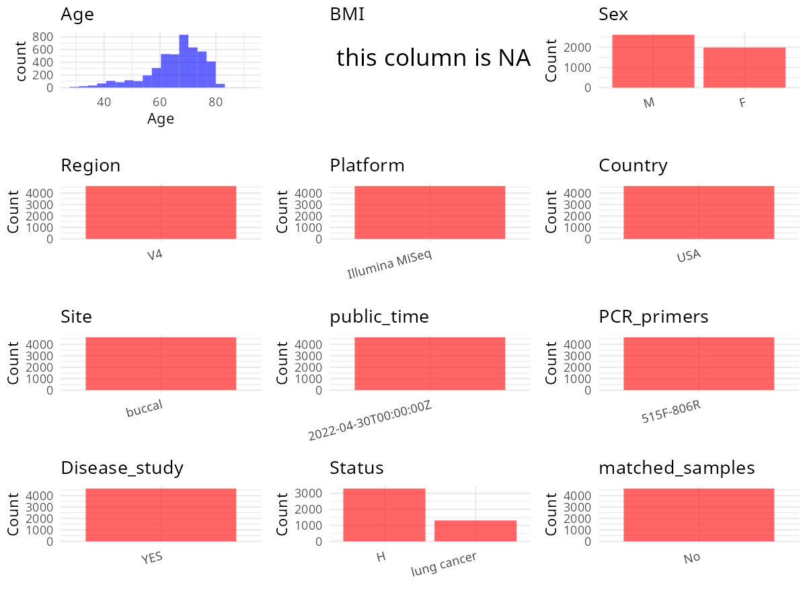

R Notebook: Metadata Processing Workflow
================

# Step 1: Obtain Initial Metadata from Each Project

To obtain the initial metadata: 1. Search for the BioProject ID (e.g.,
“PRJEBXXXX”) on the [NCBI SRA
website](https://www.ncbi.nlm.nih.gov/Traces/study/). 2. In the “Select”
table, click on “Metadata” and download the file. 3. The downloaded file
is typically named “SraRunTable.csv” and contains metadata for the
project.

``` r
# Load necessary libraries
library(dplyr)
library(ggplot2)
library(cowplot)
library(stringr)

# Set working directory (update this path to your local directory)
setwd("/home/hby/oral_project/PRJNA801882")

# Read the initial metadata files
initial_meta <- read.csv("SraRunTable.csv", header = T)

# Combine the two metadata files
# meta <- rbind(initial_meta, initial_meta1)

# Remove entries non-oral samples
# initial_meta <- subset(initial_meta,isolate %in% c("saliva","tongue coat"))

# Check the number of samples containing "HT" in Sample.Name (e.g., healthy controls)
# nrow(subset(meta, grepl("HT", Sample.Name)))

# Display the first few rows of the metadata
head(initial_meta)
```

    ##           Run       Assay.Type AvgSpotLen    Bases  BioProject    BioSample              BioSampleModel    Bytes Center.Name Cohort Collection_Date Consent DATASTORE.filetype
    ## 1 SRR17819092 Targeted-Capture        500 56986608 PRJNA801882 SAMN25409337 Metagenome or environmental 35558158         NCI   AARP              NA  public   fastq,run.zq,sra
    ## 2 SRR17819093 Targeted-Capture        501 60816626 PRJNA801882 SAMN25409336 Metagenome or environmental 40159613         NCI   AARP              NA  public   fastq,run.zq,sra
    ## 3 SRR17819094 Targeted-Capture        501 66705660 PRJNA801882 SAMN25409335 Metagenome or environmental 42998035         NCI   AARP              NA  public   fastq,run.zq,sra
    ## 4 SRR17819095 Targeted-Capture        500 54177504 PRJNA801882 SAMN25409334 Metagenome or environmental 36241816         NCI   AARP              NA  public   fastq,run.zq,sra
    ## 5 SRR17819096 Targeted-Capture        501 53943575 PRJNA801882 SAMN25409333 Metagenome or environmental 33149145         NCI   AARP              NA  public   fastq,run.zq,sra
    ## 6 SRR17819097 Targeted-Capture        501 56411814 PRJNA801882 SAMN25409332 Metagenome or environmental 36158578         NCI   AARP              NA  public   fastq,run.zq,sra
    ##   DATASTORE.provider                     DATASTORE.region  Experiment geo_loc_name_country geo_loc_name_country_continent geo_loc_name         HOST     Instrument             lat_lon
    ## 1         gs,ncbi,s3 gs.us-east1,ncbi.public,s3.us-east-1 SRX13981169                  USA                  North America          USA Homo sapiens Illumina MiSeq 37.0902 N 95.7129 W
    ## 2         gs,ncbi,s3 gs.us-east1,ncbi.public,s3.us-east-1 SRX13981168                  USA                  North America          USA Homo sapiens Illumina MiSeq 37.0902 N 95.7129 W
    ## 3         gs,ncbi,s3 gs.us-east1,ncbi.public,s3.us-east-1 SRX13981167                  USA                  North America          USA Homo sapiens Illumina MiSeq 37.0902 N 95.7129 W
    ## 4         gs,ncbi,s3 gs.us-east1,ncbi.public,s3.us-east-1 SRX13981166                  USA                  North America          USA Homo sapiens Illumina MiSeq 37.0902 N 95.7129 W
    ## 5         gs,ncbi,s3 gs.us-east1,ncbi.public,s3.us-east-1 SRX13981165                  USA                  North America          USA Homo sapiens Illumina MiSeq 37.0902 N 95.7129 W
    ## 6         gs,ncbi,s3 gs.us-east1,ncbi.public,s3.us-east-1 SRX13981164                  USA                  North America          USA Homo sapiens Illumina MiSeq 37.0902 N 95.7129 W
    ##   Library.Name LibraryLayout LibrarySelection LibrarySource   Organism Platform          ReleaseDate          create_date version Sample_age Sample_ID Sample_Name smk_stat SRA.Study
    ## 1     SC144845        PAIRED              PCR       GENOMIC metagenome ILLUMINA 2022-04-30T00:00:00Z 2022-01-29T19:35:00Z       1         63  SC144845    SC144845        2 SRP357392
    ## 2     SC145010        PAIRED              PCR       GENOMIC metagenome ILLUMINA 2022-04-30T00:00:00Z 2022-01-29T19:35:00Z       1         72  SC145010    SC145010        1 SRP357392
    ## 3     SC146020        PAIRED              PCR       GENOMIC metagenome ILLUMINA 2022-04-30T00:00:00Z 2022-01-29T19:35:00Z       1         65  SC146020    SC146020        2 SRP357392
    ## 4     SC144150        PAIRED              PCR       GENOMIC metagenome ILLUMINA 2022-04-30T00:00:00Z 2022-01-29T19:35:00Z       1         69  SC144150    SC144150        2 SRP357392
    ## 5     SC146139        PAIRED              PCR       GENOMIC metagenome ILLUMINA 2022-04-30T00:00:00Z 2022-01-29T19:35:00Z       1         75  SC146139    SC146139        1 SRP357392
    ## 6     SC145970        PAIRED              PCR       GENOMIC metagenome ILLUMINA 2022-04-30T00:00:00Z 2022-01-29T19:35:00Z       1         63  SC145970    SC145970        2 SRP357392
    ##   host_sex lib_const_method lung_cancer    seq_methods source_material target_gene target_subfragment    weight analysis_lung_colorectal colorectal_cancer    sex weight_colorectal
    ## 1     male       paired-end           0 Illumina MiSeq          Buccal    16S rRNA                 V4 19.981481                                          0   male                NA
    ## 2   female       paired-end           0 Illumina MiSeq          Buccal    16S rRNA                 V4  6.571429                                          0 female                NA
    ## 3   female       paired-end           0 Illumina MiSeq          Buccal    16S rRNA                 V4 19.887640                                          0 female                NA
    ## 4     male       paired-end           0 Illumina MiSeq          Buccal    16S rRNA                 V4 19.981481                                          0   male                NA
    ## 5     male       paired-end           0 Illumina MiSeq          Buccal    16S rRNA                 V4  6.666667                                          0   male                NA
    ## 6     male       paired-end           1 Illumina MiSeq          Buccal    16S rRNA                 V4  1.000000                                          1   male                NA

# Step 2: Create a Uniform Metadata Template

The uniform metadata should include the following columns:

1.  **BioProject**: Project ID (e.g., “PRJNA339212”)
2.  **Run**: Sample ID (e.g., “ERRXXXXXX” or “SRRXXXXXX”)
3.  **sample_name**: Original sample name submitted by the authors (not
    the database-assigned ID)
4.  **Age**: Age of the subject (if available)
5.  **BMI**: Body Mass Index (if available)
6.  **Sex**: Sex of the subject (“F” or “M”)
7.  **Region**: Targeted 16S rRNA region (e.g., “V3-V4”)
8.  **Platform**: Sequencing platform (e.g., “Illumina MiSeq”)
9.  **Country**: Country of sample origin (e.g., “China”)
10. **Site**: Sample site (e.g., “saliva”, “dental plaque”)
11. **public_time**: Data release date (format: “YYYY-MM-DD”)
12. **PCR_primers**: PCR primers used (e.g., “515F-806R”)
13. **title**: Title of the associated publication
14. **Disease_study**: Whether the study involves a disease (“YES” or
    “NO”)
15. **Status**: Disease status (e.g., “T2DM”, “HC”). Note: If the study
    includes both disease and healthy samples, this must be specified
    per sample.
16. **matched_samples**: matched samples (“YES” or “NO”)

``` r
# Create a uniform metadata dataframe
metadata <- data.frame(
  BioProject = initial_meta$BioProject,
  Run = initial_meta$Run,
  sample_name = initial_meta$Sample_Name,
  Sex = initial_meta$sex,
  Age = initial_meta$Sample_age,
  Platform = initial_meta$Instrument,
  Country = initial_meta$geo_loc_name_country,
  Site = initial_meta$source_material,
  public_time = initial_meta$ReleaseDate,
  Status = initial_meta$colorectal_cancer,
  Region = initial_meta$target_subfragment,
  BMI = NA,
  stringsAsFactors = FALSE
) %>%
  mutate(
    Status = case_when(
      Status == 0 ~ "H",
      Status == 1 ~ "lung cancer",
      TRUE ~ as.character(Status)
    ),
    Sex = case_when(
      Sex == "male" ~ "M",
      Sex == "female" ~ "F"
    ),
    Site = case_when(
      grepl("Buccal", Site, ignore.case = TRUE) ~ "buccal",
      TRUE ~ as.character(Site)
    ),
  )
```

# Step 3: Manually Add Information from the Publication

Some information (e.g. PCR primers, study title, disease status) must be
manually extracted from the publication and added to the metadata.

``` r
# Add information obtained from the publication
metadata$PCR_primers <- "515F-806R"
metadata$title <- "The Oral Microbiome and Lung Cancer Risk: An Analysis of 3 Prospective Cohort Studies"
metadata$Disease_study <- "YES"
metadata$matched_samples <- "No"

metadata <- metadata[!is.na(metadata$Site), ]

# Check initial data distribution
cat("Initial sample distribution:\n")
```

    ## Initial sample distribution:

``` r
table(metadata$subject_id)
```

    ## < table of extent 0 >

``` r
table(metadata$Site)
```

    ## 
    ## buccal 
    ##   4610

# Step 4: Summarize and Validate the Metadata

``` r
# Check the number of unique runs and sample names
print(paste("Number of unique runs:", length(unique(metadata$Run))))
```

    ## [1] "Number of unique runs: 4610"

``` r
print(paste("Number of unique sample names:", length(unique(metadata$sample_name))))
```

    ## [1] "Number of unique sample names: 4610"

# Step 5: Visualize the Metadata

``` r

```


# Step 6: Finalize and Export the Metadata

``` r
# Reorder columns to match the desired format
metadata <- metadata[, c(
  "BioProject", "Run", "sample_name", "Age", "BMI", "Sex",
  "Region", "Platform", "Country", "Site", "public_time",
  "PCR_primers", "title", "Disease_study", "Status", "matched_samples"
)]

# Export the uniform metadata to a CSV file
write.csv(metadata, file = "metadata.csv", quote = FALSE)
head(metadata)
```

    ##    BioProject         Run sample_name Age BMI Sex Region       Platform Country   Site          public_time PCR_primers
    ## 1 PRJNA801882 SRR17819092    SC144845  63  NA   M     V4 Illumina MiSeq     USA buccal 2022-04-30T00:00:00Z   515F-806R
    ## 2 PRJNA801882 SRR17819093    SC145010  72  NA   F     V4 Illumina MiSeq     USA buccal 2022-04-30T00:00:00Z   515F-806R
    ## 3 PRJNA801882 SRR17819094    SC146020  65  NA   F     V4 Illumina MiSeq     USA buccal 2022-04-30T00:00:00Z   515F-806R
    ## 4 PRJNA801882 SRR17819095    SC144150  69  NA   M     V4 Illumina MiSeq     USA buccal 2022-04-30T00:00:00Z   515F-806R
    ## 5 PRJNA801882 SRR17819096    SC146139  75  NA   M     V4 Illumina MiSeq     USA buccal 2022-04-30T00:00:00Z   515F-806R
    ## 6 PRJNA801882 SRR17819097    SC145970  63  NA   M     V4 Illumina MiSeq     USA buccal 2022-04-30T00:00:00Z   515F-806R
    ##                                                                                   title Disease_study      Status matched_samples
    ## 1 The Oral Microbiome and Lung Cancer Risk: An Analysis of 3 Prospective Cohort Studies           YES           H              No
    ## 2 The Oral Microbiome and Lung Cancer Risk: An Analysis of 3 Prospective Cohort Studies           YES           H              No
    ## 3 The Oral Microbiome and Lung Cancer Risk: An Analysis of 3 Prospective Cohort Studies           YES           H              No
    ## 4 The Oral Microbiome and Lung Cancer Risk: An Analysis of 3 Prospective Cohort Studies           YES           H              No
    ## 5 The Oral Microbiome and Lung Cancer Risk: An Analysis of 3 Prospective Cohort Studies           YES           H              No
    ## 6 The Oral Microbiome and Lung Cancer Risk: An Analysis of 3 Prospective Cohort Studies           YES lung cancer              No

## Notes for Students:

1.  **Metadata Accuracy**: Always cross-check the metadata with the
    original publication to ensure accuracy.
2.  **Manual Entries**: Columns like `PCR_primers`, and `Status` often
    require manual entry based on the publication.
3.  **Disease Status**: Be careful when assigning `Status`—some studies
    include both disease and healthy samples.
4.  **Visualization**: The plots help quickly identify the distribution
    of values in each column, which is useful for quality control.
5.  **Reproducibility**: Update the working directory and file paths to
    match your local environment.
