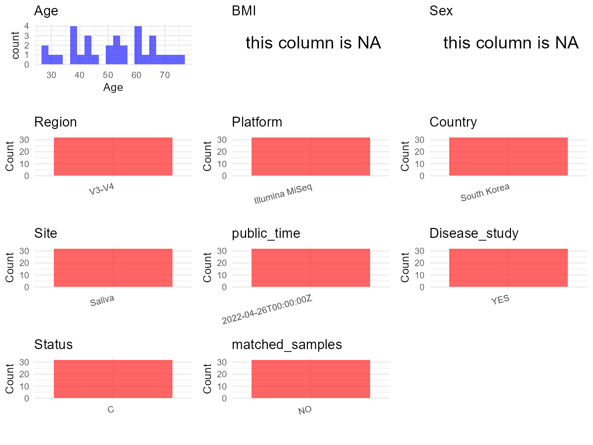

# Step 1: Obtain Initial Metadata from Each Project

To obtain the initial metadata: 1. Search for the BioProject ID (e.g.,
“PRJEBXXXX”) on the [NCBI SRA
website](https://www.ncbi.nlm.nih.gov/Traces/study/). 2. In the “Select”
table, click on “Metadata” and download the file. 3. The downloaded file
is typically named “SraRunTable.csv” and contains metadata for the
project.

    library(tidyverse)
    library(ggplot2)
    library(cowplot)

    setwd("C:/Users/zyc/Desktop/oral_project/data/projects/PRJNA804331")
    initial_meta <- read.csv("SraRunTable.csv", header = TRUE) 
    head(initial_meta)

    ##           Run Assay.Type AvgSpotLen     Bases  BioProject    BioSample                                    BioSampleModel    Bytes
    ## 1 SRR17930954   AMPLICON        602  97725670 PRJNA804331 SAMN25722196 MIMARKS.survey,MIGS/MIMS/MIMARKS.human-associated 48819453
    ## 2 SRR17930955   AMPLICON        602  95479006 PRJNA804331 SAMN25722195 MIMARKS.survey,MIGS/MIMS/MIMARKS.human-associated 48349905
    ## 3 SRR17930956   AMPLICON        602  62164326 PRJNA804331 SAMN25722194 MIMARKS.survey,MIGS/MIMS/MIMARKS.human-associated 33181380
    ## 4 SRR17930957   AMPLICON        602  76303500 PRJNA804331 SAMN25722193 MIMARKS.survey,MIGS/MIMS/MIMARKS.human-associated 40192686
    ## 5 SRR17930958   AMPLICON        602 103406142 PRJNA804331 SAMN25722192 MIMARKS.survey,MIGS/MIMS/MIMARKS.human-associated 62388915
    ## 6 SRR17930959   AMPLICON        602  71102220 PRJNA804331 SAMN25722191 MIMARKS.survey,MIGS/MIMS/MIMARKS.human-associated 37483563
    ##                             Center.Name Collection_Date Consent DATASTORE.filetype DATASTORE.provider                     DATASTORE.region
    ## 1 YONSEI UNIVERSITY COLLEGE OF MEDICINE      2020-06-17  public   fastq,run.zq,sra         gs,ncbi,s3 gs.us-east1,ncbi.public,s3.us-east-1
    ## 2 YONSEI UNIVERSITY COLLEGE OF MEDICINE      2020-06-17  public   fastq,run.zq,sra         gs,ncbi,s3 gs.us-east1,ncbi.public,s3.us-east-1
    ## 3 YONSEI UNIVERSITY COLLEGE OF MEDICINE      2020-06-03  public   fastq,run.zq,sra         gs,ncbi,s3 gs.us-east1,ncbi.public,s3.us-east-1
    ## 4 YONSEI UNIVERSITY COLLEGE OF MEDICINE      2020-05-25  public   fastq,run.zq,sra         gs,ncbi,s3 gs.us-east1,ncbi.public,s3.us-east-1
    ## 5 YONSEI UNIVERSITY COLLEGE OF MEDICINE      2020-04-22  public   fastq,run.zq,sra         gs,ncbi,s3 gs.us-east1,ncbi.public,s3.us-east-1
    ## 6 YONSEI UNIVERSITY COLLEGE OF MEDICINE      2020-04-16  public   fastq,run.zq,sra         gs,ncbi,s3 gs.us-east1,ncbi.public,s3.us-east-1
    ##       env_broad_scale env_local_scale env_medium  Experiment geo_loc_name_country geo_loc_name_country_continent       geo_loc_name Host_Age
    ## 1 Salivary microbiome   Parotid gland     Saliva SRX14089415          South Korea                           Asia South Korea: Seoul       34
    ## 2 Salivary microbiome   Parotid gland     Saliva SRX14089414          South Korea                           Asia South Korea: Seoul       28
    ## 3 Salivary microbiome   Parotid gland     Saliva SRX14089413          South Korea                           Asia South Korea: Seoul       43
    ## 4 Salivary microbiome   Parotid gland     Saliva SRX14089412          South Korea                           Asia South Korea: Seoul       39
    ## 5 Salivary microbiome   Parotid gland     Saliva SRX14089411          South Korea                           Asia South Korea: Seoul       43
    ## 6 Salivary microbiome   Parotid gland     Saliva SRX14089410          South Korea                           Asia South Korea: Seoul       42
    ##           HOST     Instrument          lat_lon Library.Name LibraryLayout LibrarySelection LibrarySource         Organism Platform
    ## 1 Homo sapiens Illumina MiSeq 37.49 N 127.04 E        SS-16        PAIRED              PCR   METAGENOMIC human metagenome ILLUMINA
    ## 2 Homo sapiens Illumina MiSeq 37.49 N 127.04 E        SS-15        PAIRED              PCR   METAGENOMIC human metagenome ILLUMINA
    ## 3 Homo sapiens Illumina MiSeq 37.49 N 127.04 E        SS-14        PAIRED              PCR   METAGENOMIC human metagenome ILLUMINA
    ## 4 Homo sapiens Illumina MiSeq 37.49 N 127.04 E        SS-12        PAIRED              PCR   METAGENOMIC human metagenome ILLUMINA
    ## 5 Homo sapiens Illumina MiSeq 37.49 N 127.04 E        SS-11        PAIRED              PCR   METAGENOMIC human metagenome ILLUMINA
    ## 6 Homo sapiens Illumina MiSeq 37.49 N 127.04 E        SS-10        PAIRED              PCR   METAGENOMIC human metagenome ILLUMINA
    ##            ReleaseDate          create_date version Sample.Name SRA.Study
    ## 1 2022-04-26T00:00:00Z 2022-02-08T05:16:00Z       1       SS-16 SRP358799
    ## 2 2022-04-26T00:00:00Z 2022-02-08T05:16:00Z       1       SS-15 SRP358799
    ## 3 2022-04-26T00:00:00Z 2022-02-08T05:16:00Z       1       SS-14 SRP358799
    ## 4 2022-04-26T00:00:00Z 2022-02-08T05:16:00Z       1       SS-12 SRP358799
    ## 5 2022-04-26T00:00:00Z 2022-02-08T05:16:00Z       1       SS-11 SRP358799
    ## 6 2022-04-26T00:00:00Z 2022-02-08T05:16:00Z       1       SS-10 SRP358799

# Step 2: Create a Uniform Metadata Template

The uniform metadata should include the following columns:

1.  **BioProject**: Project ID (e.g., “PRJNA339212”)
2.  **Run**: Sample ID (e.g., “ERRXXXXXX” or “SRRXXXXXX”)
3.  **sample\_name**: Original sample name submitted by the authors (not
    the database-assigned ID)
4.  **Age**: Age of the subject (if available)
5.  **BMI**: Body Mass Index (if available)
6.  **Sex**: Sex of the subject (“F” or “M”)
7.  **Region**: Targeted 16S rRNA region (e.g., “V3-V4”)
8.  **Platform**: Sequencing platform (e.g., “Illumina MiSeq”)
9.  **Country**: Country of sample origin (e.g., “China”)
10. **Site**: Sample site (e.g., “saliva”, “dental plaque”)
11. **public\_time**: Data release date (format: “YYYY-MM-DD”)
12. **PCR\_primers**: PCR primers used (e.g., “515F-806R”)
13. **title**: Title of the associated publication
14. **Disease\_study**: Whether the study involves a disease (“YES” or
    “NO”)
15. **Status**: Disease status (e.g., “T2DM”, “HC”). Note: If the study
    includes both disease and healthy samples, this must be specified
    per sample.
16. **matched\_samples**: matched samples (“YES” or “NO”)

<!-- -->

    metadata <- data.frame(
      BioProject = initial_meta$BioProject,
      Run = initial_meta$Run,
      sample_name = initial_meta$Sample.Name,
      Age = initial_meta$Host_Age,
      BMI = NA,
      Sex = NA,
      Platform = initial_meta$Instrument,
      Country = initial_meta$geo_loc_name_country,
      Site = initial_meta$env_medium,
      public_time = initial_meta$ReleaseDate,
      # Status = initial_meta$Sample.Name,
      stringsAsFactors = FALSE
    )

# Step 3: Manually Add Information from the Publication

Some information (e.g. PCR primers, study title, disease status) must be
manually extracted from the publication and added to the metadata.

     # metadata <- metadata %>%
     #  mutate(Sex = recode(Sex, "female" = "F", "male" = "M"))
    # metadata <-metadata%>%
    #   mutate(Status = case_when(Site == "mucous" ~ "OSCC",
    #                             Site == "dental plaque" ~ "OSCC",
    #                             Site == "tumor" ~ "OSCC",
    #                             TRUE ~ NA))

    metadata$Status <- "C"
    metadata$matched_samples <- "NO"
    metadata$Region <- "V3-V4"
    metadata$title <- "Correlation Between Salivary Microbiome of Parotid Glands and Clinical Features in Primary Sjogren's Syndrome and Non-Sjogren's Sicca Subjects"
    metadata$Disease_study <- "YES"
    metadata$PCR_primers <- "V3-F:5'TCGTCGGCAGCGTCAGATGTGTATAAGAGACAGCCTACGGGNGGCWGCAG-3',V4-R:5'-GTCTCGTGGGCTCGGAGATGTGTATAAGAGACAGGACTACHVGGGTATCTAATCC-3'"
    head(metadata)

    ##    BioProject         Run sample_name Age BMI Sex       Platform     Country   Site          public_time Status matched_samples Region
    ## 1 PRJNA804331 SRR17930954       SS-16  34  NA  NA Illumina MiSeq South Korea Saliva 2022-04-26T00:00:00Z      C              NO  V3-V4
    ## 2 PRJNA804331 SRR17930955       SS-15  28  NA  NA Illumina MiSeq South Korea Saliva 2022-04-26T00:00:00Z      C              NO  V3-V4
    ## 3 PRJNA804331 SRR17930956       SS-14  43  NA  NA Illumina MiSeq South Korea Saliva 2022-04-26T00:00:00Z      C              NO  V3-V4
    ## 4 PRJNA804331 SRR17930957       SS-12  39  NA  NA Illumina MiSeq South Korea Saliva 2022-04-26T00:00:00Z      C              NO  V3-V4
    ## 5 PRJNA804331 SRR17930958       SS-11  43  NA  NA Illumina MiSeq South Korea Saliva 2022-04-26T00:00:00Z      C              NO  V3-V4
    ## 6 PRJNA804331 SRR17930959       SS-10  42  NA  NA Illumina MiSeq South Korea Saliva 2022-04-26T00:00:00Z      C              NO  V3-V4
    ##                                                                                                                                            title
    ## 1 Correlation Between Salivary Microbiome of Parotid Glands and Clinical Features in Primary Sjogren's Syndrome and Non-Sjogren's Sicca Subjects
    ## 2 Correlation Between Salivary Microbiome of Parotid Glands and Clinical Features in Primary Sjogren's Syndrome and Non-Sjogren's Sicca Subjects
    ## 3 Correlation Between Salivary Microbiome of Parotid Glands and Clinical Features in Primary Sjogren's Syndrome and Non-Sjogren's Sicca Subjects
    ## 4 Correlation Between Salivary Microbiome of Parotid Glands and Clinical Features in Primary Sjogren's Syndrome and Non-Sjogren's Sicca Subjects
    ## 5 Correlation Between Salivary Microbiome of Parotid Glands and Clinical Features in Primary Sjogren's Syndrome and Non-Sjogren's Sicca Subjects
    ## 6 Correlation Between Salivary Microbiome of Parotid Glands and Clinical Features in Primary Sjogren's Syndrome and Non-Sjogren's Sicca Subjects
    ##   Disease_study
    ## 1           YES
    ## 2           YES
    ## 3           YES
    ## 4           YES
    ## 5           YES
    ## 6           YES
    ##                                                                                                                       PCR_primers
    ## 1 V3-F:5'TCGTCGGCAGCGTCAGATGTGTATAAGAGACAGCCTACGGGNGGCWGCAG-3',V4-R:5'-GTCTCGTGGGCTCGGAGATGTGTATAAGAGACAGGACTACHVGGGTATCTAATCC-3'
    ## 2 V3-F:5'TCGTCGGCAGCGTCAGATGTGTATAAGAGACAGCCTACGGGNGGCWGCAG-3',V4-R:5'-GTCTCGTGGGCTCGGAGATGTGTATAAGAGACAGGACTACHVGGGTATCTAATCC-3'
    ## 3 V3-F:5'TCGTCGGCAGCGTCAGATGTGTATAAGAGACAGCCTACGGGNGGCWGCAG-3',V4-R:5'-GTCTCGTGGGCTCGGAGATGTGTATAAGAGACAGGACTACHVGGGTATCTAATCC-3'
    ## 4 V3-F:5'TCGTCGGCAGCGTCAGATGTGTATAAGAGACAGCCTACGGGNGGCWGCAG-3',V4-R:5'-GTCTCGTGGGCTCGGAGATGTGTATAAGAGACAGGACTACHVGGGTATCTAATCC-3'
    ## 5 V3-F:5'TCGTCGGCAGCGTCAGATGTGTATAAGAGACAGCCTACGGGNGGCWGCAG-3',V4-R:5'-GTCTCGTGGGCTCGGAGATGTGTATAAGAGACAGGACTACHVGGGTATCTAATCC-3'
    ## 6 V3-F:5'TCGTCGGCAGCGTCAGATGTGTATAAGAGACAGCCTACGGGNGGCWGCAG-3',V4-R:5'-GTCTCGTGGGCTCGGAGATGTGTATAAGAGACAGGACTACHVGGGTATCTAATCC-3'

# Step 4: Summarize and Validate the Metadata

    print(paste("Number of unique runs:", length(unique(metadata$Run))))

    ## [1] "Number of unique runs: 32"

    print(paste("Number of unique sample names:", length(unique(metadata$sample_name))))

    ## [1] "Number of unique sample names: 32"

# Step 5: Visualize the Metadata

    plot_data <- metadata %>%
      select(-BioProject, -Run, -sample_name, -title)

    # Function to create simple plots for each column
    create_simple_plots <- function(data) {
      plots <- list()

      for (col in colnames(data)) {
        # Check if the column is all NA
        if (all(is.na(data[[col]]))) {
          # Create an empty plot with text indicating all NA
          p <- ggplot() +
            annotate("text", x = 0.5, y = 0.5, label = "this column is NA", size = 6) +
            labs(title = col) +
            theme_void()
        } else if (is.numeric(data[[col]])) {
          # Numeric variable: histogram
          p <- ggplot(data, aes(x = .data[[col]])) +
            geom_histogram(fill = "blue", alpha = 0.6, bins = 20, na.rm = T) +
            labs(title = col) +
            theme_minimal()
        } else {
          # Categorical variable: bar plot (remove NA values)
          count_data <- as.data.frame(table(data[[col]], useNA = "ifany"))
          p <- ggplot(count_data, aes(x = reorder(Var1, -Freq), y = Freq)) +
            geom_col(fill = "red", alpha = 0.6) +
            labs(title = col, x = NULL, y = "Count") +
            theme_minimal() +
            theme(axis.text.x = element_text(angle = 15, hjust = 1))
        }
        plots[[col]] <- p
      }

      return(plots)
    }

    plots <- create_simple_plots(plot_data)
    p<-plot_grid(plots$Age,
              plots$BMI,
              plots$Sex,
              plots$Region,
              plots$Platform,
              plots$Country,
              plots$Site,
              plots$public_time,
              # plots$PCR_primers,
              plots$Disease_study,
              plots$Status,
              plots$matched_samples,# add
              ncol = 3, align = "hv", axis = "lb")
    ggsave("Metadata_Summary.png", plot = p, width = 8, height = 6, dpi = 150)

    

 \# Step 6: Finalize and Export the Metadata

    metadata <- metadata[, c(
      "BioProject", "Run", "sample_name", "Age", "BMI", "Sex",
      "Region", "Platform", "Country", "Site", "public_time",
      "PCR_primers", "title", "Disease_study", "Status","matched_samples"
    )]

    write.csv(metadata, file = "metadata.csv", quote = TRUE )
