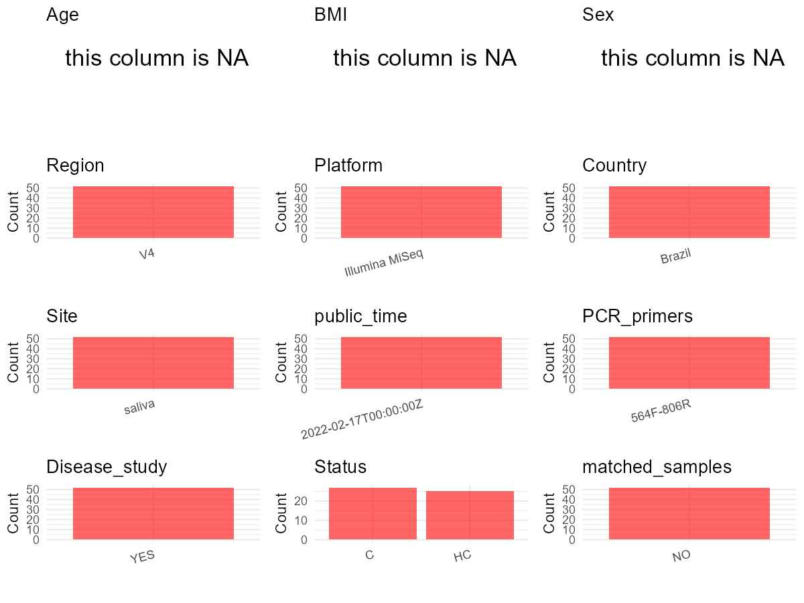

R Notebook: Metadata Processing Workflow
================

# Step 1: Obtain Initial Metadata from Each Project

To obtain the initial metadata: 1. Search for the BioProject ID (e.g.,
“PRJEBXXXX”) on the [NCBI SRA
website](https://www.ncbi.nlm.nih.gov/Traces/study/). 2. In the “Select”
table, click on “Metadata” and download the file. 3. The downloaded file
is typically named “SraRunTable.csv” and contains metadata for the
project.

``` r
# Load necessary libraries
library(dplyr)
library(ggplot2)
library(cowplot)

# Set working directory (update this path to your local directory)
setwd("D:/studylearning/董彪师兄项目/任务3_20251004/PRJNA807496")

# Read the initial metadata files
initial_meta<-read.csv("SraRunTable.csv",header = T)

# Display the first few rows of the metadata
head(initial_meta)
```

    ##           Run Assay.Type AvgSpotLen     Bases  BioProject    BioSample
    ## 1 SRR18047131   AMPLICON        502  61352432 PRJNA807496 SAMN25990285
    ## 2 SRR18047132   AMPLICON        502  31771078 PRJNA807496 SAMN25990249
    ## 3 SRR18047133   AMPLICON        502  68529526 PRJNA807496 SAMN25990284
    ## 4 SRR18047134   AMPLICON        502  49355134 PRJNA807496 SAMN25990283
    ## 5 SRR18047135   AMPLICON        502 115438414 PRJNA807496 SAMN25990282
    ## 6 SRR18047136   AMPLICON        502 117939378 PRJNA807496 SAMN25990281
    ##                BioSampleModel    Bytes            Center.Name Collection_Date
    ## 1 Metagenome or environmental 43266620 UNIVERSITY OF BRASILIA      2018-11-01
    ## 2 Metagenome or environmental 21770595 UNIVERSITY OF BRASILIA      2018-11-01
    ## 3 Metagenome or environmental 46194316 UNIVERSITY OF BRASILIA      2018-11-01
    ## 4 Metagenome or environmental 33505201 UNIVERSITY OF BRASILIA      2018-11-01
    ## 5 Metagenome or environmental 77692694 UNIVERSITY OF BRASILIA      2018-11-01
    ## 6 Metagenome or environmental 84206785 UNIVERSITY OF BRASILIA      2018-10-01
    ##   Consent DATASTORE.filetype DATASTORE.provider
    ## 1  public   fastq,run.zq,sra         gs,ncbi,s3
    ## 2  public   fastq,run.zq,sra         gs,ncbi,s3
    ## 3  public   fastq,run.zq,sra         gs,ncbi,s3
    ## 4  public   fastq,run.zq,sra         gs,ncbi,s3
    ## 5  public   fastq,run.zq,sra         gs,ncbi,s3
    ## 6  public   fastq,run.zq,sra         gs,ncbi,s3
    ##                       DATASTORE.region  Experiment geo_loc_name_country
    ## 1 gs.us-east1,ncbi.public,s3.us-east-1 SRX14199479               Brazil
    ## 2 gs.us-east1,ncbi.public,s3.us-east-1 SRX14199478               Brazil
    ## 3 gs.us-east1,ncbi.public,s3.us-east-1 SRX14199477               Brazil
    ## 4 gs.us-east1,ncbi.public,s3.us-east-1 SRX14199476               Brazil
    ## 5 gs.us-east1,ncbi.public,s3.us-east-1 SRX14199475               Brazil
    ## 6 gs.us-east1,ncbi.public,s3.us-east-1 SRX14199474               Brazil
    ##   geo_loc_name_country_continent     geo_loc_name         HOST     Instrument
    ## 1                  South America Brazil: Brasilia Homo sapiens Illumina MiSeq
    ## 2                  South America Brazil: Brasilia Homo sapiens Illumina MiSeq
    ## 3                  South America Brazil: Brasilia Homo sapiens Illumina MiSeq
    ## 4                  South America Brazil: Brasilia Homo sapiens Illumina MiSeq
    ## 5                  South America Brazil: Brasilia Homo sapiens Illumina MiSeq
    ## 6                  South America Brazil: Brasilia Homo sapiens Illumina MiSeq
    ##                        isolation_source         lat_lon Library.Name
    ## 1 Adult with Diabetes and Periodontitis 15.47 S 47.52 W        DMP48
    ## 2                         Healthy adult 15.47 S 47.52 W          C21
    ## 3 Adult with Diabetes and Periodontitis 15.47 S 47.52 W        DMP46
    ## 4 Adult with Diabetes and Periodontitis 15.47 S 47.52 W        DMP45
    ## 5 Adult with Diabetes and Periodontitis 15.47 S 47.52 W        DMP44
    ## 6 Adult with Diabetes and Periodontitis 15.47 S 47.52 W        DMP43
    ##   LibraryLayout LibrarySelection LibrarySource              Organism Platform
    ## 1        PAIRED              PCR       GENOMIC human oral metagenome ILLUMINA
    ## 2        PAIRED              PCR       GENOMIC human oral metagenome ILLUMINA
    ## 3        PAIRED              PCR       GENOMIC human oral metagenome ILLUMINA
    ## 4        PAIRED              PCR       GENOMIC human oral metagenome ILLUMINA
    ## 5        PAIRED              PCR       GENOMIC human oral metagenome ILLUMINA
    ## 6        PAIRED              PCR       GENOMIC human oral metagenome ILLUMINA
    ##            ReleaseDate          create_date version samp_collect_device
    ## 1 2022-02-17T00:00:00Z 2022-02-17T05:52:00Z       1 Unstimulated saliva
    ## 2 2022-02-17T00:00:00Z 2022-02-17T05:52:00Z       1 Unstimulated saliva
    ## 3 2022-02-17T00:00:00Z 2022-02-17T05:52:00Z       1 Unstimulated saliva
    ## 4 2022-02-17T00:00:00Z 2022-02-17T05:52:00Z       1 Unstimulated saliva
    ## 5 2022-02-17T00:00:00Z 2022-02-17T05:53:00Z       1 Unstimulated saliva
    ## 6 2022-02-17T00:00:00Z 2022-02-17T05:53:00Z       1 Unstimulated saliva
    ##     samp_size Sample.Name SRA.Study
    ## 1 0.14 ml/min       DMP48 SRP360059
    ## 2 0.08 ml/min         C21 SRP360059
    ## 3  0.2 ml/min       DMP46 SRP360059
    ## 4 0.02 ml/min       DMP45 SRP360059
    ## 5 0.16 ml/min       DMP44 SRP360059
    ## 6  0.7 ml/min       DMP43 SRP360059

# Step 2: Create a Uniform Metadata Template

The uniform metadata should include the following columns:

1.  **BioProject**: Project ID (e.g., “PRJNA339212”)
2.  **Run**: Sample ID (e.g., “ERRXXXXXX” or “SRRXXXXXX”)
3.  **sample_name**: Original sample name submitted by the authors (not
    the database-assigned ID)
4.  **Age**: Age of the subject (if available)
5.  **BMI**: Body Mass Index (if available)
6.  **Sex**: Sex of the subject (“F” or “M”)
7.  **Region**: Targeted 16S rRNA region (e.g., “V3-V4”)
8.  **Platform**: Sequencing platform (e.g., “Illumina MiSeq”)
9.  **Country**: Country of sample origin (e.g., “China”)
10. **Site**: Sample site (e.g., “saliva”, “dental plaque”)
11. **public_time**: Data release date (format: “YYYY-MM-DD”)
12. **PCR_primers**: PCR primers used (e.g., “515F-806R”)
13. **title**: Title of the associated publication
14. **Disease_study**: Whether the study involves a disease (“YES” or
    “NO”)
15. **Status**: Disease status (e.g., “T2DM”, “HC”). Note: If the study
    includes both disease and healthy samples, this must be specified
    per sample.

``` r
# Create a uniform metadata dataframe
metadata <- data.frame(
  BioProject = initial_meta$BioProject,
  Run = initial_meta$Run,
  sample_name = initial_meta$Sample.Name,
  Age = NA,
  BMI = NA,
  Sex= NA,
  Region = "V4",
  Platform = initial_meta$Instrument,
  Country = initial_meta$geo_loc_name_country,
  Site = "saliva",
  public_time = initial_meta$ReleaseDate,
  stringsAsFactors = FALSE
)
```

# Step 3: Manually Add Information from the Publication

Some information (e.g. PCR primers, study title, disease status) must be
manually extracted from the publication and added to the metadata.

``` r
# Add information obtained from the publication
metadata$PCR_primers <- "564F-806R"  # Update based on the publication
metadata$title <- "Enrichment of sulphate-reducers and depletion of butyrate-producers may be hyperglycaemia signatures in the diabetic oral microbiome"
metadata$Disease_study <- "YES"
metadata$Status <- initial_meta$isolation_source
metadata <- metadata %>% 
  mutate(Status=case_when(
    grepl("Healthy",Status)~"HC",
    TRUE~"C"
  ))

#extract subject id by remove prefix of sample_name
#metadata$sample_name <- gsub("_st|_sal", "", metadata$sample_name)

# Check initial data distribution
cat("Initial sample distribution:\n")
```

    ## Initial sample distribution:

``` r
table(metadata$sample_name)
```

    ## 
    ##   C10   C12   C13   C17   C21   C23   C25   C26   C29    C3   C30   C31   C36 
    ##     1     1     1     1     1     1     1     1     1     1     1     1     1 
    ##   C39   C43   C45   C46   C47   C48   C49    C5   C50   C51   C52    C9 DMP11 
    ##     1     1     1     1     1     1     1     1     1     1     1     1     1 
    ## DMP19  DMP2 DMP20 DMP25 DMP26 DMP29 DMP31 DMP33 DMP34 DMP36 DMP38 DMP43 DMP44 
    ##     1     1     1     1     1     1     1     1     1     1     1     1     1 
    ## DMP45 DMP46 DMP48 DMP50 DMP51 DMP53 DMP56  DMP7    X1    X2    X4    X5    X6 
    ##     1     1     1     1     1     1     1     1     1     1     1     1     1

``` r
table(metadata$Site)
```

    ## 
    ## saliva 
    ##     52

``` r
# Calculate sampling frequency per subject
sample_counts <- table(metadata$sample_name)
cat("\nNumber of samples per subject:\n")
```

    ## 
    ## Number of samples per subject:

``` r
print(sample_counts)
```

    ## 
    ##   C10   C12   C13   C17   C21   C23   C25   C26   C29    C3   C30   C31   C36 
    ##     1     1     1     1     1     1     1     1     1     1     1     1     1 
    ##   C39   C43   C45   C46   C47   C48   C49    C5   C50   C51   C52    C9 DMP11 
    ##     1     1     1     1     1     1     1     1     1     1     1     1     1 
    ## DMP19  DMP2 DMP20 DMP25 DMP26 DMP29 DMP31 DMP33 DMP34 DMP36 DMP38 DMP43 DMP44 
    ##     1     1     1     1     1     1     1     1     1     1     1     1     1 
    ## DMP45 DMP46 DMP48 DMP50 DMP51 DMP53 DMP56  DMP7    X1    X2    X4    X5    X6 
    ##     1     1     1     1     1     1     1     1     1     1     1     1     1

``` r
# Create matched_samples column
metadata$matched_samples <- ifelse(metadata$sample_name %in% names(sample_counts[sample_counts >= 2]), "YES", "NO")

cat("\nMatched samples distribution:\n")
```

    ## 
    ## Matched samples distribution:

``` r
table(metadata$matched_samples)
```

    ## 
    ## NO 
    ## 52

``` r
# Identify samples for removal: single samples excluding saliva 
single_samples <- names(sample_counts[sample_counts == 1])
samples_to_remove <- metadata$sample_name %in% single_samples & !(metadata$Site %in% c("saliva"))

cat("\nNumber of samples to be removed:", sum(samples_to_remove), "\n")
```

    ## 
    ## Number of samples to be removed: 0

``` r
# Remove identified samples
metadata_clean <- metadata[!samples_to_remove, ]

cat("\nFinal sample distribution after cleaning:\n")
```

    ## 
    ## Final sample distribution after cleaning:

``` r
table(metadata_clean$sample_name)
```

    ## 
    ##   C10   C12   C13   C17   C21   C23   C25   C26   C29    C3   C30   C31   C36 
    ##     1     1     1     1     1     1     1     1     1     1     1     1     1 
    ##   C39   C43   C45   C46   C47   C48   C49    C5   C50   C51   C52    C9 DMP11 
    ##     1     1     1     1     1     1     1     1     1     1     1     1     1 
    ## DMP19  DMP2 DMP20 DMP25 DMP26 DMP29 DMP31 DMP33 DMP34 DMP36 DMP38 DMP43 DMP44 
    ##     1     1     1     1     1     1     1     1     1     1     1     1     1 
    ## DMP45 DMP46 DMP48 DMP50 DMP51 DMP53 DMP56  DMP7    X1    X2    X4    X5    X6 
    ##     1     1     1     1     1     1     1     1     1     1     1     1     1

``` r
table(metadata_clean$Site)
```

    ## 
    ## saliva 
    ##     52

``` r
table(metadata_clean$matched_samples)
```

    ## 
    ## NO 
    ## 52

``` r
# Use cleaned dataset for subsequent analysis
metadata <- metadata_clean
```

# Step 4: Summarize and Validate the Metadata

``` r
# Check the number of unique runs and sample names
print(paste("Number of unique runs:", length(unique(metadata$Run))))
```

    ## [1] "Number of unique runs: 52"

``` r
print(paste("Number of unique sample names:", length(unique(metadata$sample_name))))
```

    ## [1] "Number of unique sample names: 52"

# Step 5: Visualize the Metadata

``` r

```


# Step 6: Finalize and Export the Metadata

``` r
# Reorder columns to match the desired format
metadata <- metadata[, c(
  "BioProject", "Run", "sample_name", "Age", "BMI", "Sex", 
  "Region", "Platform", "Country", "Site", "public_time", 
  "PCR_primers", "title", "Disease_study", "Status","matched_samples"
)]

# Export the uniform metadata to a CSV file
write.csv(metadata, file = "metadata.csv", quote = FALSE)
head(metadata)
```

    ##    BioProject         Run sample_name Age BMI Sex Region       Platform Country
    ## 1 PRJNA807496 SRR18047131       DMP48  NA  NA  NA     V4 Illumina MiSeq  Brazil
    ## 2 PRJNA807496 SRR18047132         C21  NA  NA  NA     V4 Illumina MiSeq  Brazil
    ## 3 PRJNA807496 SRR18047133       DMP46  NA  NA  NA     V4 Illumina MiSeq  Brazil
    ## 4 PRJNA807496 SRR18047134       DMP45  NA  NA  NA     V4 Illumina MiSeq  Brazil
    ## 5 PRJNA807496 SRR18047135       DMP44  NA  NA  NA     V4 Illumina MiSeq  Brazil
    ## 6 PRJNA807496 SRR18047136       DMP43  NA  NA  NA     V4 Illumina MiSeq  Brazil
    ##     Site          public_time PCR_primers
    ## 1 saliva 2022-02-17T00:00:00Z   564F-806R
    ## 2 saliva 2022-02-17T00:00:00Z   564F-806R
    ## 3 saliva 2022-02-17T00:00:00Z   564F-806R
    ## 4 saliva 2022-02-17T00:00:00Z   564F-806R
    ## 5 saliva 2022-02-17T00:00:00Z   564F-806R
    ## 6 saliva 2022-02-17T00:00:00Z   564F-806R
    ##                                                                                                                                  title
    ## 1 Enrichment of sulphate-reducers and depletion of butyrate-producers may be hyperglycaemia signatures in the diabetic oral microbiome
    ## 2 Enrichment of sulphate-reducers and depletion of butyrate-producers may be hyperglycaemia signatures in the diabetic oral microbiome
    ## 3 Enrichment of sulphate-reducers and depletion of butyrate-producers may be hyperglycaemia signatures in the diabetic oral microbiome
    ## 4 Enrichment of sulphate-reducers and depletion of butyrate-producers may be hyperglycaemia signatures in the diabetic oral microbiome
    ## 5 Enrichment of sulphate-reducers and depletion of butyrate-producers may be hyperglycaemia signatures in the diabetic oral microbiome
    ## 6 Enrichment of sulphate-reducers and depletion of butyrate-producers may be hyperglycaemia signatures in the diabetic oral microbiome
    ##   Disease_study Status matched_samples
    ## 1           YES      C              NO
    ## 2           YES     HC              NO
    ## 3           YES      C              NO
    ## 4           YES      C              NO
    ## 5           YES      C              NO
    ## 6           YES      C              NO

## Notes for Students:

1.  **Metadata Accuracy**: Always cross-check the metadata with the
    original publication to ensure accuracy.
2.  **Manual Entries**: Columns like `PCR_primers`, and `Status` often
    require manual entry based on the publication.
3.  **Disease Status**: Be careful when assigning `Status`—some studies
    include both disease and healthy samples.
4.  **Visualization**: The plots help quickly identify the distribution
    of values in each column, which is useful for quality control.
5.  **Reproducibility**: Update the working directory and file paths to
    match your local environment.
