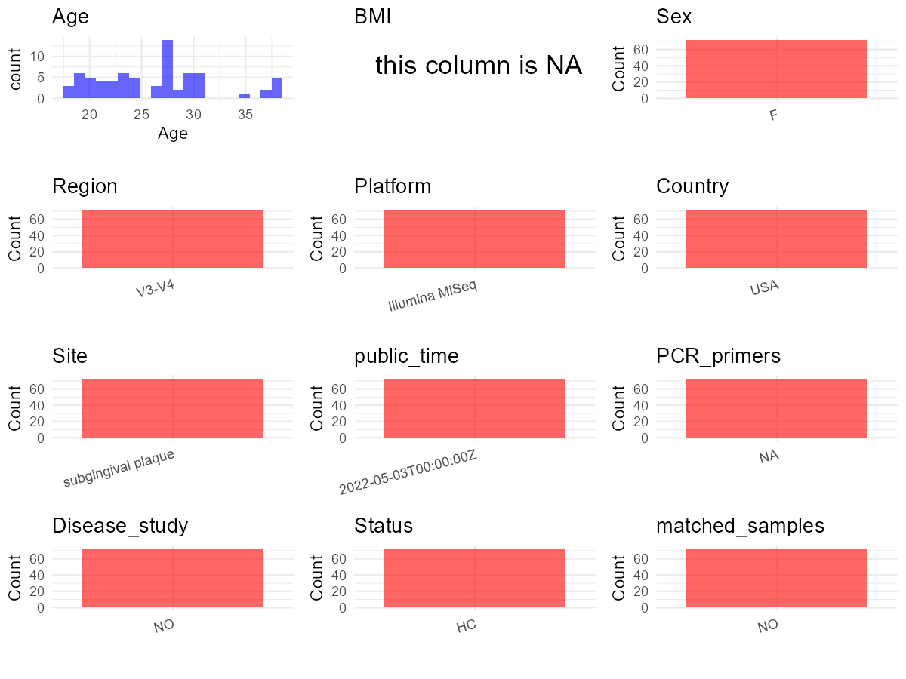

R Notebook: Metadata Processing Workflow
================

# Step 1: Obtain Initial Metadata from Each Project

To obtain the initial metadata: 1. Search for the BioProject ID (e.g.,
“PRJEBXXXX”) on the [NCBI SRA
website](https://www.ncbi.nlm.nih.gov/Traces/study/). 2. In the “Select”
table, click on “Metadata” and download the file. 3. The downloaded file
is typically named “SraRunTable.csv” and contains metadata for the
project.

``` r
# Load necessary libraries
library(dplyr)
library(ggplot2)
library(cowplot)

# Set working directory (update this path to your local directory)
setwd("E:/bioproject_YSD/PRJNA811442")

# Read the initial metadata files
initial_meta <- read.csv("SraRunTable.csv", header = T) 

# Display the first few rows of the metadata
head(initial_meta)
```

    ##           Run AGE Assay.Type AvgSpotLen     Bases BIOMATERIAL_PROVIDER
    ## 1 SRR18181211  28      OTHER        600  92225400    Yang_EmoryNursing
    ## 2 SRR18181212  37      OTHER        600 109896000    Yang_EmoryNursing
    ## 3 SRR18181213  28      OTHER        600 103721400    Yang_EmoryNursing
    ## 4 SRR18181214  28      OTHER        600 117836400    Yang_EmoryNursing
    ## 5 SRR18181215  37      OTHER        600 169616400    Yang_EmoryNursing
    ## 6 SRR18181216  22      OTHER        600 112399200    Yang_EmoryNursing
    ##    BioProject    BioSample BioSampleModel     Bytes      Center.Name Consent
    ## 1 PRJNA811442 SAMN26332423          Human  61907122 EMORY UNIVERSITY  public
    ## 2 PRJNA811442 SAMN26332422          Human  75288984 EMORY UNIVERSITY  public
    ## 3 PRJNA811442 SAMN26332485          Human  70313313 EMORY UNIVERSITY  public
    ## 4 PRJNA811442 SAMN26332484          Human  80268180 EMORY UNIVERSITY  public
    ## 5 PRJNA811442 SAMN26332421          Human 114301176 EMORY UNIVERSITY  public
    ## 6 PRJNA811442 SAMN26332483          Human  78323731 EMORY UNIVERSITY  public
    ##   DATASTORE.filetype DATASTORE.provider                     DATASTORE.region
    ## 1   fastq,run.zq,sra         gs,ncbi,s3 gs.us-east1,ncbi.public,s3.us-east-1
    ## 2   fastq,run.zq,sra         gs,ncbi,s3 gs.us-east1,ncbi.public,s3.us-east-1
    ## 3   fastq,run.zq,sra         gs,ncbi,s3 gs.us-east1,ncbi.public,s3.us-east-1
    ## 4   fastq,run.zq,sra         gs,ncbi,s3 gs.us-east1,ncbi.public,s3.us-east-1
    ## 5   fastq,run.zq,sra         gs,ncbi,s3 gs.us-east1,ncbi.public,s3.us-east-1
    ## 6   fastq,run.zq,sra         gs,ncbi,s3 gs.us-east1,ncbi.public,s3.us-east-1
    ##    Experiment     Instrument isolate                Library.Name LibraryLayout
    ## 1 SRX14328246 Illumina MiSeq      NA ECO12276-0193-E0718-V1-SGP1        PAIRED
    ## 2 SRX14328245 Illumina MiSeq      NA ECO12276-0187-E0716-V1-SGP1        PAIRED
    ## 3 SRX14328244 Illumina MiSeq      NA ECO12276-0161-G0398-V1-SGP1        PAIRED
    ## 4 SRX14328243 Illumina MiSeq      NA ECO12276-0125-G0398-V2-SGP1        PAIRED
    ## 5 SRX14328242 Illumina MiSeq      NA ECO12276-0123-E0716-V2-SGP1        PAIRED
    ## 6 SRX14328241 Illumina MiSeq      NA ECO12276-0112-G0394-V1-SGP1        PAIRED
    ##   LibrarySelection LibrarySource     Organism Platform          ReleaseDate
    ## 1              PCR       GENOMIC Homo sapiens ILLUMINA 2022-05-03T00:00:00Z
    ## 2              PCR       GENOMIC Homo sapiens ILLUMINA 2022-05-03T00:00:00Z
    ## 3              PCR       GENOMIC Homo sapiens ILLUMINA 2022-05-03T00:00:00Z
    ## 4              PCR       GENOMIC Homo sapiens ILLUMINA 2022-05-03T00:00:00Z
    ## 5              PCR       GENOMIC Homo sapiens ILLUMINA 2022-05-03T00:00:00Z
    ## 6              PCR       GENOMIC Homo sapiens ILLUMINA 2022-05-03T00:00:00Z
    ##            create_date version Sample.Name                    sampleid    sex
    ## 1 2022-03-01T09:51:00Z       1     E0718_1 ECO12276-0193-E0718-V1-SGP1 female
    ## 2 2022-03-01T09:51:00Z       1     E0716_2 ECO12276-0123-E0716-V2-SGP1 female
    ## 3 2022-03-01T09:51:00Z       1     G0398_2 ECO12276-0125-G0398-V2-SGP1 female
    ## 4 2022-03-01T09:51:00Z       1     G0398_1 ECO12276-0161-G0398-V1-SGP1 female
    ## 5 2022-03-01T09:51:00Z       1     E0716_1 ECO12276-0187-E0716-V1-SGP1 female
    ## 6 2022-03-01T09:51:00Z       1     G0394_1 ECO12276-0112-G0394-V1-SGP1 female
    ##   SRA.Study time_stamp              tissue DentistVisits_PastMonth Gum_Disease
    ## 1 SRP361975          1 subgingival_biofilm                       0           0
    ## 2 SRP361975          2 subgingival_biofilm                       1           0
    ## 3 SRP361975          2 subgingival_biofilm                       0           0
    ## 4 SRP361975          1 subgingival_biofilm                       0           0
    ## 5 SRP361975          1 subgingival_biofilm                       0           0
    ## 6 SRP361975          1 subgingival_biofilm                       0           0
    ##   Receding_Gums Red_SwollenGums Bleeding_gums Brush_Teeth Floss Mouthwash
    ## 1             0               0             0           1     0         1
    ## 2             0               0             0           1     1         1
    ## 3             0               0             0           1     1         1
    ## 4             0               0             0           1     0         1
    ## 5             0               0             0           1     1         1
    ## 6             0               0             0           1     1         1
    ##   Education Insurance_Type birth_outcome       labor Gestatonal_Age income
    ## 1         0              0      Fullterm        None           40.1      0
    ## 2         1              1                                       NA      1
    ## 3        NA             NA                                       NA     NA
    ## 4         0              0      Fullterm     Induced             NA     NA
    ## 5        NA             NA     EarlyTerm Spontaneous           37.5     NA
    ## 6         1              0     EarlyTerm     Induced           38.2     NA

# Step 2: Create a Uniform Metadata Template

The uniform metadata should include the following columns:

1.  **BioProject**: Project ID (e.g., “PRJNA339212”)
2.  **Run**: Sample ID (e.g., “ERRXXXXXX” or “SRRXXXXXX”)
3.  **sample_name**: Original sample name submitted by the authors (not
    the database-assigned ID)
4.  **Age**: Age of the subject (if available)
5.  **BMI**: Body Mass Index (if available)
6.  **Sex**: Sex of the subject (“F” or “M”)
7.  **Region**: Targeted 16S rRNA region (e.g., “V3-V4”)
8.  **Platform**: Sequencing platform (e.g., “Illumina MiSeq”)
9.  **Country**: Country of sample origin (e.g., “China”)
10. **Site**: Sample site (e.g., “saliva”, “dental plaque”)
11. **public_time**: Data release date (format: “YYYY-MM-DD”)
12. **PCR_primers**: PCR primers used (e.g., “515F-806R”)
13. **title**: Title of the associated publication
14. **Disease_study**: Whether the study involves a disease (“YES” or
    “NO”)
15. **Status**: Disease status (e.g., “T2DM”, “HC”). Note: If the study
    includes both disease and healthy samples, this must be specified
    per sample.
16. **matched_samples**: matched samples (“YES” or “NO”)

``` r
# Create a uniform metadata dataframe
metadata <- data.frame(
  BioProject = initial_meta$BioProject,
  Run = initial_meta$Run,
  sample_name = initial_meta$Sample.Name,
  Age = initial_meta$AGE,
  BMI = NA,
  Sex = initial_meta$sex,
  Region = "V3-V4",
  Platform = initial_meta$Instrument,
  Country = "USA",
  Site = initial_meta$tissue,
  public_time = initial_meta$ReleaseDate,
  stringsAsFactors = FALSE
)

# Use abbreviations to indicate gender
metadata <- metadata %>%
  mutate(Sex = recode(Sex, "female" = "F"))

# Assign Site based on tissue column
metadata <- metadata %>%
  mutate(Site = recode(Site, "subgingival_biofilm" = "subgingival plaque"))
```

# Step 3: Manually Add Information from the Publication

Some information (e.g. PCR primers, study title, disease status) must be
manually extracted from the publication and added to the metadata.

``` r
# Add information obtained from the publication
metadata$PCR_primers <- "NA"
metadata$title <- "Subgingival microbiome in pregnancy and a potential relationship to early term birth"
metadata$Disease_study <- "NO"
# Assign disease status based on sample_name patterns
metadata$Status <- "HC"

# Check initial data distribution
cat("Initial sample distribution:\n")
```

    ## Initial sample distribution:

``` r
table(metadata$sample_name)
```

    ## 
    ## E0704_1 E0704_2 E0712_1 E0712_2 E0713_2 E0714_1 E0715_2 E0716_1 E0716_2 E0718_1 
    ##       1       1       1       1       1       1       1       1       1       1 
    ## E0718_2 E0719_1 E0730_2 E0734_1 E0736_1 E0739_1 E0739_2 E0741_1 E0741_2 E0743_1 
    ##       1       1       1       1       1       1       1       1       1       1 
    ## E0743_2 E0748_1 E0749_1 E0750_1 E0750_2 E0754_2 G0314_2 G0315_1 G0315_2 G0319_2 
    ##       1       1       1       1       1       1       1       1       1       1 
    ## G0320_1 G0320_2 G0333_1 G0333_2 G0334_1 G0336_1 G0340_1 G0343_1 G0343_2 G0347_1 
    ##       1       1       1       1       1       1       1       1       1       1 
    ## G0347_2 G0349_1 G0350_1 G0351_1 G0351_2 G0354_2 G0355_2 G0361_2 G0362_1 G0362_2 
    ##       1       1       1       1       1       1       1       1       1       1 
    ## G0365_1 G0366_1 G0366_2 G0368_2 G0369_1 G0370_1 G0370_2 G0375_1 G0376_1 G0376_2 
    ##       1       1       1       1       1       1       1       1       1       1 
    ## G0377_1 G0377_2 G0378_1 G0378_2 G0379_2 G0386_1 G0386_2 G0388_2 G0392_1 G0394_1 
    ##       1       1       1       1       1       1       1       1       1       1 
    ## G0398_1 G0398_2 
    ##       1       1

``` r
table(metadata$Site)
```

    ## 
    ## subgingival plaque 
    ##                 72

``` r
# Calculate sampling frequency per subject
sample_counts <- table(metadata$sample_name)
cat("\nNumber of samples per subject:\n")
```

    ## 
    ## Number of samples per subject:

``` r
print(sample_counts)
```

    ## 
    ## E0704_1 E0704_2 E0712_1 E0712_2 E0713_2 E0714_1 E0715_2 E0716_1 E0716_2 E0718_1 
    ##       1       1       1       1       1       1       1       1       1       1 
    ## E0718_2 E0719_1 E0730_2 E0734_1 E0736_1 E0739_1 E0739_2 E0741_1 E0741_2 E0743_1 
    ##       1       1       1       1       1       1       1       1       1       1 
    ## E0743_2 E0748_1 E0749_1 E0750_1 E0750_2 E0754_2 G0314_2 G0315_1 G0315_2 G0319_2 
    ##       1       1       1       1       1       1       1       1       1       1 
    ## G0320_1 G0320_2 G0333_1 G0333_2 G0334_1 G0336_1 G0340_1 G0343_1 G0343_2 G0347_1 
    ##       1       1       1       1       1       1       1       1       1       1 
    ## G0347_2 G0349_1 G0350_1 G0351_1 G0351_2 G0354_2 G0355_2 G0361_2 G0362_1 G0362_2 
    ##       1       1       1       1       1       1       1       1       1       1 
    ## G0365_1 G0366_1 G0366_2 G0368_2 G0369_1 G0370_1 G0370_2 G0375_1 G0376_1 G0376_2 
    ##       1       1       1       1       1       1       1       1       1       1 
    ## G0377_1 G0377_2 G0378_1 G0378_2 G0379_2 G0386_1 G0386_2 G0388_2 G0392_1 G0394_1 
    ##       1       1       1       1       1       1       1       1       1       1 
    ## G0398_1 G0398_2 
    ##       1       1

``` r
# Create matched_samples column
metadata$matched_samples <- ifelse(metadata$sample_name %in% names(sample_counts[sample_counts >= 2]), "YES", "NO")

cat("\nMatched samples distribution:\n")
```

    ## 
    ## Matched samples distribution:

``` r
table(metadata$matched_samples)
```

    ## 
    ## NO 
    ## 72

``` r
# Identify samples for removal: single samples excluding subgingival plaque
single_samples <- names(sample_counts[sample_counts == 1])
samples_to_remove <- metadata$sample_name %in% single_samples & 
                     !(metadata$Site %in% c("subgingival plaque"))

cat("\nNumber of samples to be removed:", sum(samples_to_remove), "\n")
```

    ## 
    ## Number of samples to be removed: 0

``` r
# Remove identified samples
metadata_clean <- metadata[!samples_to_remove, ]

cat("\nFinal sample distribution after cleaning:\n")
```

    ## 
    ## Final sample distribution after cleaning:

``` r
table(metadata_clean$sample_name)
```

    ## 
    ## E0704_1 E0704_2 E0712_1 E0712_2 E0713_2 E0714_1 E0715_2 E0716_1 E0716_2 E0718_1 
    ##       1       1       1       1       1       1       1       1       1       1 
    ## E0718_2 E0719_1 E0730_2 E0734_1 E0736_1 E0739_1 E0739_2 E0741_1 E0741_2 E0743_1 
    ##       1       1       1       1       1       1       1       1       1       1 
    ## E0743_2 E0748_1 E0749_1 E0750_1 E0750_2 E0754_2 G0314_2 G0315_1 G0315_2 G0319_2 
    ##       1       1       1       1       1       1       1       1       1       1 
    ## G0320_1 G0320_2 G0333_1 G0333_2 G0334_1 G0336_1 G0340_1 G0343_1 G0343_2 G0347_1 
    ##       1       1       1       1       1       1       1       1       1       1 
    ## G0347_2 G0349_1 G0350_1 G0351_1 G0351_2 G0354_2 G0355_2 G0361_2 G0362_1 G0362_2 
    ##       1       1       1       1       1       1       1       1       1       1 
    ## G0365_1 G0366_1 G0366_2 G0368_2 G0369_1 G0370_1 G0370_2 G0375_1 G0376_1 G0376_2 
    ##       1       1       1       1       1       1       1       1       1       1 
    ## G0377_1 G0377_2 G0378_1 G0378_2 G0379_2 G0386_1 G0386_2 G0388_2 G0392_1 G0394_1 
    ##       1       1       1       1       1       1       1       1       1       1 
    ## G0398_1 G0398_2 
    ##       1       1

``` r
table(metadata_clean$Site)
```

    ## 
    ## subgingival plaque 
    ##                 72

``` r
table(metadata_clean$matched_samples)
```

    ## 
    ## NO 
    ## 72

``` r
# Use cleaned dataset for subsequent analysis
metadata <- metadata_clean
```

# Step 4: Summarize and Validate the Metadata

``` r
# Check the number of unique runs and sample names
print(paste("Number of unique runs:", length(unique(metadata$Run))))
```

    ## [1] "Number of unique runs: 72"

``` r
print(paste("Number of unique sample names:", length(unique(metadata$sample_name))))
```

    ## [1] "Number of unique sample names: 72"

# Step 5: Visualize the Metadata

``` r

```


# Step 6: Finalize and Export the Metadata

``` r
# Reorder columns to match the desired format
metadata <- metadata[, c(
  "BioProject", "Run", "sample_name", "Age", "BMI", "Sex", 
  "Region", "Platform", "Country", "Site", "public_time", 
  "PCR_primers", "title", "Disease_study", "Status", "matched_samples"
)]

# Export the uniform metadata to a CSV file
write.csv(metadata, file = "metadata.csv", quote = TRUE)
head(metadata)
```

    ##    BioProject         Run sample_name Age BMI Sex Region       Platform Country
    ## 1 PRJNA811442 SRR18181211     E0718_1  28  NA   F  V3-V4 Illumina MiSeq     USA
    ## 2 PRJNA811442 SRR18181212     E0716_2  37  NA   F  V3-V4 Illumina MiSeq     USA
    ## 3 PRJNA811442 SRR18181213     G0398_2  28  NA   F  V3-V4 Illumina MiSeq     USA
    ## 4 PRJNA811442 SRR18181214     G0398_1  28  NA   F  V3-V4 Illumina MiSeq     USA
    ## 5 PRJNA811442 SRR18181215     E0716_1  37  NA   F  V3-V4 Illumina MiSeq     USA
    ## 6 PRJNA811442 SRR18181216     G0394_1  22  NA   F  V3-V4 Illumina MiSeq     USA
    ##                 Site          public_time PCR_primers
    ## 1 subgingival plaque 2022-05-03T00:00:00Z          NA
    ## 2 subgingival plaque 2022-05-03T00:00:00Z          NA
    ## 3 subgingival plaque 2022-05-03T00:00:00Z          NA
    ## 4 subgingival plaque 2022-05-03T00:00:00Z          NA
    ## 5 subgingival plaque 2022-05-03T00:00:00Z          NA
    ## 6 subgingival plaque 2022-05-03T00:00:00Z          NA
    ##                                                                                  title
    ## 1 Subgingival microbiome in pregnancy and a potential relationship to early term birth
    ## 2 Subgingival microbiome in pregnancy and a potential relationship to early term birth
    ## 3 Subgingival microbiome in pregnancy and a potential relationship to early term birth
    ## 4 Subgingival microbiome in pregnancy and a potential relationship to early term birth
    ## 5 Subgingival microbiome in pregnancy and a potential relationship to early term birth
    ## 6 Subgingival microbiome in pregnancy and a potential relationship to early term birth
    ##   Disease_study Status matched_samples
    ## 1            NO     HC              NO
    ## 2            NO     HC              NO
    ## 3            NO     HC              NO
    ## 4            NO     HC              NO
    ## 5            NO     HC              NO
    ## 6            NO     HC              NO

## Notes for Students:

1.  **Metadata Accuracy**: Always cross-check the metadata with the
    original publication to ensure accuracy.
2.  **Manual Entries**: Columns like `PCR_primers`, and `Status` often
    require manual entry based on the publication.
3.  **Disease Status**: Be careful when assigning `Status`—some studies
    include both disease and healthy samples.
4.  **Visualization**: The plots help quickly identify the distribution
    of values in each column, which is useful for quality control.
5.  **Reproducibility**: Update the working directory and file paths to
    match your local environment.
