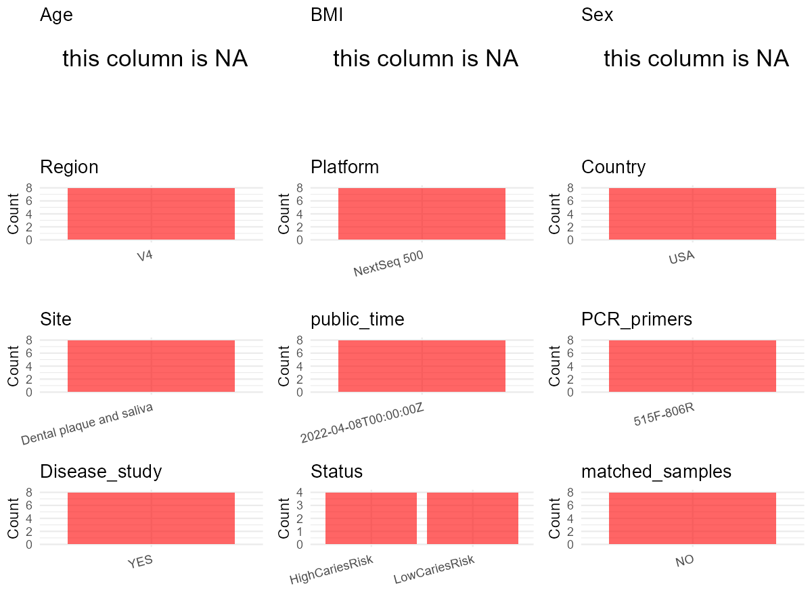

R Notebook: Metadata Processing Workflow
================

# Step 1: Obtain Initial Metadata from Each Project

To obtain the initial metadata: 1. Search for the BioProject ID (e.g.,
“PRJEBXXXX”) on the [NCBI SRA
website](https://www.ncbi.nlm.nih.gov/Traces/study/). 2. In the “Select”
table, click on “Metadata” and download the file. 3. The downloaded file
is typically named “SraRunTable.csv” and contains metadata for the
project.

``` r
# Load necessary libraries
library(dplyr)
library(ggplot2)
library(cowplot)

# Set working directory (update this path to your local directory)
setwd("D:/oral_project/PRJNA813634")

# Read the initial metadata files
initial_meta<-read.csv("SraRunTable.csv",header = T)

# Combine the two metadata files
#meta <- rbind(initial_meta, initial_meta1)

#Remove entries where Organism is "gut metagenome" (non-oral samples)
#initial_meta <- subset(initial_meta,isolation_source!= "feces")

# Check the number of samples containing "HT" in Sample.Name (e.g., healthy controls)
#nrow(subset(meta, grepl("HT", Sample.Name)))

# Display the first few rows of the metadata
head(initial_meta)
```

    ##           Run AGE Assay.Type AvgSpotLen     Bases BIOMATERIAL_PROVIDER
    ## 1 SRR18270576  52   AMPLICON        474  26000375                China
    ## 2 SRR18270577  54   AMPLICON        487  77836077                China
    ## 3 SRR18270578  54   AMPLICON        486  54618739                China
    ## 4 SRR18270579  49   AMPLICON        485 108959180                China
    ## 5 SRR18270580  54   AMPLICON        487 139285684                China
    ## 6 SRR18270581  49   AMPLICON        485  89925979                China
    ##    BioProject    BioSample              BioSampleModel    Bytes
    ## 1 PRJNA813634 SAMN26514049 Metagenome or environmental 14508748
    ## 2 PRJNA813634 SAMN26514122 Metagenome or environmental 27533396
    ## 3 PRJNA813634 SAMN26514121 Metagenome or environmental 19164231
    ## 4 PRJNA813634 SAMN26514039 Metagenome or environmental 39042775
    ## 5 PRJNA813634 SAMN26514120 Metagenome or environmental 48921970
    ## 6 PRJNA813634 SAMN26514039 Metagenome or environmental 32035748
    ##              Center.Name Collection_Date Consent DATASTORE.filetype
    ## 1 SUN YAT-SEN UNIVERSITY         missing  public   fastq,run.zq,sra
    ## 2 SUN YAT-SEN UNIVERSITY         missing  public   fastq,run.zq,sra
    ## 3 SUN YAT-SEN UNIVERSITY         missing  public   fastq,run.zq,sra
    ## 4 SUN YAT-SEN UNIVERSITY         missing  public   fastq,run.zq,sra
    ## 5 SUN YAT-SEN UNIVERSITY         missing  public   fastq,run.zq,sra
    ## 6 SUN YAT-SEN UNIVERSITY         missing  public   fastq,run.zq,sra
    ##   DATASTORE.provider                     DATASTORE.region  Experiment
    ## 1         gs,ncbi,s3 gs.us-east1,ncbi.public,s3.us-east-1 SRX14408983
    ## 2         gs,ncbi,s3 gs.us-east1,ncbi.public,s3.us-east-1 SRX14408982
    ## 3         gs,ncbi,s3 gs.us-east1,ncbi.public,s3.us-east-1 SRX14408981
    ## 4         gs,ncbi,s3 gs.us-east1,ncbi.public,s3.us-east-1 SRX14408980
    ## 5         gs,ncbi,s3 gs.us-east1,ncbi.public,s3.us-east-1 SRX14408979
    ## 6         gs,ncbi,s3 gs.us-east1,ncbi.public,s3.us-east-1 SRX14408978
    ##   geo_loc_name_country geo_loc_name_country_continent geo_loc_name    HOST
    ## 1         uncalculated                   uncalculated      missing missing
    ## 2         uncalculated                   uncalculated      missing missing
    ## 3         uncalculated                   uncalculated      missing missing
    ## 4         uncalculated                   uncalculated      missing missing
    ## 5         uncalculated                   uncalculated      missing missing
    ## 6         uncalculated                   uncalculated      missing missing
    ##            Instrument   isolate isolation_source lat_lon Library.Name
    ## 1 Illumina HiSeq 2500    palate          missing missing         HJC2
    ## 2 Illumina HiSeq 2500 oralfloor          missing missing         ZZL4
    ## 3 Illumina HiSeq 2500 oralfloor          missing missing         ZZL3
    ## 4 Illumina HiSeq 2500    tongue          missing missing         ZZL2
    ## 5 Illumina HiSeq 2500 oralfloor          missing missing         ZZL1
    ## 6 Illumina HiSeq 2500    tongue          missing missing         XXF4
    ##   LibraryLayout LibrarySelection LibrarySource         Organism Platform
    ## 1        PAIRED              PCR   METAGENOMIC human metagenome ILLUMINA
    ## 2        PAIRED              PCR   METAGENOMIC human metagenome ILLUMINA
    ## 3        PAIRED              PCR   METAGENOMIC human metagenome ILLUMINA
    ## 4        PAIRED              PCR   METAGENOMIC human metagenome ILLUMINA
    ## 5        PAIRED              PCR   METAGENOMIC human metagenome ILLUMINA
    ## 6        PAIRED              PCR   METAGENOMIC human metagenome ILLUMINA
    ##            ReleaseDate          create_date version Sample.Name    sex
    ## 1 2022-04-19T00:00:00Z 2022-03-12T15:05:00Z       1       PT4_2 female
    ## 2 2022-04-19T00:00:00Z 2022-03-12T15:05:00Z       1      PT27_4   male
    ## 3 2022-04-19T00:00:00Z 2022-03-08T15:41:00Z       1      PT27_3   male
    ## 4 2022-04-19T00:00:00Z 2022-03-12T15:05:00Z       1       PT1_1   male
    ## 5 2022-04-19T00:00:00Z 2022-03-12T15:06:00Z       1      PT27_1   male
    ## 6 2022-04-19T00:00:00Z 2022-03-08T15:41:00Z       1       PT1_1   male
    ##   SRA.Study tissue Diabetes ln Nstage smoking Tstage
    ## 1 SRP363022   swab       NA NA     NA      NA     NA
    ## 2 SRP363022   para       NA NA     NA      NA     NA
    ## 3 SRP363022  caout        0  1      3       0      4
    ## 4 SRP363022 saliva       NA NA     NA      NA     NA
    ## 5 SRP363022 saliva       NA NA     NA      NA     NA
    ## 6 SRP363022 saliva       NA NA     NA      NA     NA

# Step 2: Create a Uniform Metadata Template

The uniform metadata should include the following columns:

1.  **BioProject**: Project ID (e.g., “PRJNA339212”)
2.  **Run**: Sample ID (e.g., “ERRXXXXXX” or “SRRXXXXXX”)
3.  **sample_name**: Original sample name submitted by the authors (not
    the database-assigned ID)
4.  **Age**: Age of the subject (if available)
5.  **BMI**: Body Mass Index (if available)
6.  **Sex**: Sex of the subject (“F” or “M”)
7.  **Region**: Targeted 16S rRNA region (e.g., “V3-V4”)
8.  **Platform**: Sequencing platform (e.g., “Illumina MiSeq”)
9.  **Country**: Country of sample origin (e.g., “China”)
10. **Site**: Sample site (e.g., “saliva”, “dental plaque”)
11. **public_time**: Data release date (format: “YYYY-MM-DD”)
12. **PCR_primers**: PCR primers used (e.g., “515F-806R”)
13. **title**: Title of the associated publication
14. **Disease_study**: Whether the study involves a disease (“YES” or
    “NO”)
15. **Status**: Disease status (e.g., “T2DM”, “HC”). Note: If the study
    includes both disease and healthy samples, this must be specified
    per sample.

``` r
# Create a uniform metadata dataframe
metadata <- data.frame(
  BioProject = initial_meta$BioProject,
  Run = initial_meta$Run,
  sample_name = initial_meta$Sample.Name,
  Age = initial_meta$AGE,
  BMI = NA,
  Sex=initial_meta$sex,
  Region = "V4",
  Platform = initial_meta$Instrument,
  Country = initial_meta$BIOMATERIAL_PROVIDER,
  Site = initial_meta$isolate,
  public_time = initial_meta$ReleaseDate,
  stringsAsFactors = FALSE
)
```

# Step 3: Manually Add Information from the Publication

Some information (e.g. PCR primers, study title, disease status) must be
manually extracted from the publication and added to the metadata.

``` r
# Add information obtained from the publication
metadata$PCR_primers <- "515F-806R"
metadata$title <- "The oral cancer microbiome contains tumor space specific and clinicopathologyspecific bacteria"
#metadata<-subset(uniform_meta,Site!="feces")
metadata$Disease_study <- "YES"
# Assign disease status based on sample_name patterns
metadata$Status <- "Tumor"
#extract subject id by remove prefix of sample_name
#metadata$sample_name <- gsub("S-Saliva-.*|F", "", metadata$sample_name)
#get subjects id with Saliva available
#keep_subjects<-subset(metadata,Site %in% c("Saliva"))
#remove subjects without Saliva samples
#metadata<-subset(metadata,sample_name %in% keep_subjects$sample_name)
#get subjects sampling counts
#sample_counts <- table(metadata$sample_name)
# Create matched_samples column, any subjects have >=2 samples will be label "YES", otherwise "NO"
#metadata$matched_samples <- ifelse(metadata$sample_name %in% names(sample_counts[sample_counts >= 2]), "YES", "NO")
metadata$matched_samples<-"NO"
```

# Step 4: Summarize and Validate the Metadata

``` r
# Check the number of unique runs and sample names
print(paste("Number of unique runs:", length(unique(metadata$Run))))
```

    ## [1] "Number of unique runs: 85"

``` r
print(paste("Number of unique sample names:", length(unique(metadata$sample_name))))
```

    ## [1] "Number of unique sample names: 63"

# Step 5: Visualize the Metadata

``` r

```


# Step 6: Finalize and Export the Metadata

``` r
# Reorder columns to match the desired format
metadata <- metadata[, c(
  "BioProject", "Run", "sample_name", "Age", "BMI", "Sex", 
  "Region", "Platform", "Country", "Site", "public_time", 
  "PCR_primers", "title", "Disease_study", "Status","matched_samples"
)]

# Export the uniform metadata to a CSV file
write.csv(metadata, file = "metadata.csv", quote = FALSE)
head(metadata)
```

    ##    BioProject         Run sample_name Age BMI    Sex Region            Platform
    ## 1 PRJNA813634 SRR18270576       PT4_2  52  NA female     V4 Illumina HiSeq 2500
    ## 2 PRJNA813634 SRR18270577      PT27_4  54  NA   male     V4 Illumina HiSeq 2500
    ## 3 PRJNA813634 SRR18270578      PT27_3  54  NA   male     V4 Illumina HiSeq 2500
    ## 4 PRJNA813634 SRR18270579       PT1_1  49  NA   male     V4 Illumina HiSeq 2500
    ## 5 PRJNA813634 SRR18270580      PT27_1  54  NA   male     V4 Illumina HiSeq 2500
    ## 6 PRJNA813634 SRR18270581       PT1_1  49  NA   male     V4 Illumina HiSeq 2500
    ##   Country      Site          public_time PCR_primers
    ## 1   China    palate 2022-04-19T00:00:00Z   515F-806R
    ## 2   China oralfloor 2022-04-19T00:00:00Z   515F-806R
    ## 3   China oralfloor 2022-04-19T00:00:00Z   515F-806R
    ## 4   China    tongue 2022-04-19T00:00:00Z   515F-806R
    ## 5   China oralfloor 2022-04-19T00:00:00Z   515F-806R
    ## 6   China    tongue 2022-04-19T00:00:00Z   515F-806R
    ##                                                                                            title
    ## 1 The oral cancer microbiome contains tumor space specific and clinicopathologyspecific bacteria
    ## 2 The oral cancer microbiome contains tumor space specific and clinicopathologyspecific bacteria
    ## 3 The oral cancer microbiome contains tumor space specific and clinicopathologyspecific bacteria
    ## 4 The oral cancer microbiome contains tumor space specific and clinicopathologyspecific bacteria
    ## 5 The oral cancer microbiome contains tumor space specific and clinicopathologyspecific bacteria
    ## 6 The oral cancer microbiome contains tumor space specific and clinicopathologyspecific bacteria
    ##   Disease_study Status matched_samples
    ## 1           YES  Tumor              NO
    ## 2           YES  Tumor              NO
    ## 3           YES  Tumor              NO
    ## 4           YES  Tumor              NO
    ## 5           YES  Tumor              NO
    ## 6           YES  Tumor              NO

## Notes for Students:

1.  **Metadata Accuracy**: Always cross-check the metadata with the
    original publication to ensure accuracy.
2.  **Manual Entries**: Columns like `PCR_primers`, and `Status` often
    require manual entry based on the publication.
3.  **Disease Status**: Be careful when assigning `Status`—some studies
    include both disease and healthy samples.
4.  **Visualization**: The plots help quickly identify the distribution
    of values in each column, which is useful for quality control.
5.  **Reproducibility**: Update the working directory and file paths to
    match your local environment.
