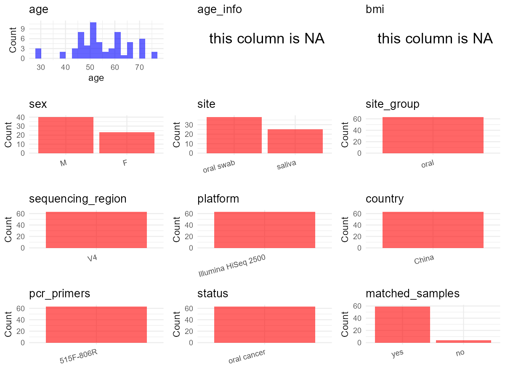

R Notebook: Metadata Processing Workflow
================

# Step 1: Obtain Initial Metadata from Each Project

This step sets the project directory, loads the raw SRA metadata, and
optionally merges supplement tables.

``` r
# Load libraries
library(dplyr)
library(ggplot2)
library(cowplot)

# (1) Setting working directory
# EDIT HERE: change project_id for each study
project_id <- "PRJNA813634" 

base_dir <- "E:/oral/26/metadata-2604/Oral-Metadata-YL-02"
setwd(file.path(base_dir, project_id))

# (2) Loading raw SRA metadata file
sra_file <- "SraRunTable.csv"
initial_meta <- read.csv(sra_file, header = TRUE)

# (3) OPTIONAL: If extra metadata (e.g., Table.x or supplemental materials) are available from the article, you may need to merge the file with initial_meta manually. Below is example code for merging. Depending on the specific case of each study, you can customize the code as needed.
#supp_table <- read.csv("supplemental_table_v2.csv", header = TRUE)
#initial_meta <- left_join(initial_meta, supp_table, by = "Sample.Name")
```

# Step 2: Data Overview

First, you need to get an overview of the data, which includes two
steps: reading the article and reading the initial metadata. This step
is very IMPORTANT!

``` r
# (1) Read the article in the following order: abstract, the beginning of the results section, and the methods. Understand the sample size, experimental design, and disease group overview. Clarify the sampling sites; for oral and gut samples, specify the exact sites like supragingival plaque, tongue, etc.

# (2) IMPORTANT: MUST go through each column of initial_meta
head(initial_meta, 10)
```

    ##            Run AGE Assay.Type AvgSpotLen     Bases BIOMATERIAL_PROVIDER
    ## 1  SRR18270576  52   AMPLICON        474  26000375                China
    ## 2  SRR18270577  54   AMPLICON        487  77836077                China
    ## 3  SRR18270578  54   AMPLICON        486  54618739                China
    ## 4  SRR18270579  49   AMPLICON        485 108959180                China
    ## 5  SRR18270580  54   AMPLICON        487 139285684                China
    ## 6  SRR18270581  49   AMPLICON        485  89925979                China
    ## 7  SRR18270582  52   AMPLICON        474  26000425                China
    ## 8  SRR18270583  49   AMPLICON        487  86508652                China
    ## 9  SRR18270584  63   AMPLICON        486  82240546                China
    ## 10 SRR18270585  60   AMPLICON        485 105751948                China
    ##     BioProject    BioSample              BioSampleModel    Bytes
    ## 1  PRJNA813634 SAMN26514049 Metagenome or environmental 14508748
    ## 2  PRJNA813634 SAMN26514122 Metagenome or environmental 27533396
    ## 3  PRJNA813634 SAMN26514121 Metagenome or environmental 19164231
    ## 4  PRJNA813634 SAMN26514039 Metagenome or environmental 39042775
    ## 5  PRJNA813634 SAMN26514120 Metagenome or environmental 48921970
    ## 6  PRJNA813634 SAMN26514039 Metagenome or environmental 32035748
    ## 7  PRJNA813634 SAMN26514048 Metagenome or environmental 14731767
    ## 8  PRJNA813634 SAMN26514039 Metagenome or environmental 30490934
    ## 9  PRJNA813634 SAMN26514119 Metagenome or environmental 29031446
    ## 10 PRJNA813634 SAMN26514115 Metagenome or environmental 37662632
    ##               Center.Name Collection_Date Consent DATASTORE.filetype
    ## 1  SUN YAT-SEN UNIVERSITY         missing  public   fastq,run.zq,sra
    ## 2  SUN YAT-SEN UNIVERSITY         missing  public   fastq,run.zq,sra
    ## 3  SUN YAT-SEN UNIVERSITY         missing  public   fastq,run.zq,sra
    ## 4  SUN YAT-SEN UNIVERSITY         missing  public   fastq,run.zq,sra
    ## 5  SUN YAT-SEN UNIVERSITY         missing  public   fastq,run.zq,sra
    ## 6  SUN YAT-SEN UNIVERSITY         missing  public   fastq,run.zq,sra
    ## 7  SUN YAT-SEN UNIVERSITY         missing  public   fastq,run.zq,sra
    ## 8  SUN YAT-SEN UNIVERSITY         missing  public   fastq,run.zq,sra
    ## 9  SUN YAT-SEN UNIVERSITY         missing  public   fastq,run.zq,sra
    ## 10 SUN YAT-SEN UNIVERSITY         missing  public   fastq,run.zq,sra
    ##    DATASTORE.provider                     DATASTORE.region  Experiment
    ## 1          gs,ncbi,s3 gs.us-east1,ncbi.public,s3.us-east-1 SRX14408983
    ## 2          gs,ncbi,s3 gs.us-east1,ncbi.public,s3.us-east-1 SRX14408982
    ## 3          gs,ncbi,s3 gs.us-east1,ncbi.public,s3.us-east-1 SRX14408981
    ## 4          gs,ncbi,s3 gs.us-east1,ncbi.public,s3.us-east-1 SRX14408980
    ## 5          gs,ncbi,s3 gs.us-east1,ncbi.public,s3.us-east-1 SRX14408979
    ## 6          gs,ncbi,s3 gs.us-east1,ncbi.public,s3.us-east-1 SRX14408978
    ## 7          gs,ncbi,s3 gs.us-east1,ncbi.public,s3.us-east-1 SRX14408977
    ## 8          gs,ncbi,s3 gs.us-east1,ncbi.public,s3.us-east-1 SRX14408976
    ## 9          gs,ncbi,s3 gs.us-east1,ncbi.public,s3.us-east-1 SRX14408975
    ## 10         gs,ncbi,s3 gs.us-east1,ncbi.public,s3.us-east-1 SRX14408974
    ##    geo_loc_name_country geo_loc_name_country_continent geo_loc_name    HOST
    ## 1          uncalculated                   uncalculated      missing missing
    ## 2          uncalculated                   uncalculated      missing missing
    ## 3          uncalculated                   uncalculated      missing missing
    ## 4          uncalculated                   uncalculated      missing missing
    ## 5          uncalculated                   uncalculated      missing missing
    ## 6          uncalculated                   uncalculated      missing missing
    ## 7          uncalculated                   uncalculated      missing missing
    ## 8          uncalculated                   uncalculated      missing missing
    ## 9          uncalculated                   uncalculated      missing missing
    ## 10         uncalculated                   uncalculated      missing missing
    ##             Instrument   isolate isolation_source lat_lon Library.Name
    ## 1  Illumina HiSeq 2500    palate          missing missing         HJC2
    ## 2  Illumina HiSeq 2500 oralfloor          missing missing         ZZL4
    ## 3  Illumina HiSeq 2500 oralfloor          missing missing         ZZL3
    ## 4  Illumina HiSeq 2500    tongue          missing missing         ZZL2
    ## 5  Illumina HiSeq 2500 oralfloor          missing missing         ZZL1
    ## 6  Illumina HiSeq 2500    tongue          missing missing         XXF4
    ## 7  Illumina HiSeq 2500    palate          missing missing         HJC1
    ## 8  Illumina HiSeq 2500    tongue          missing missing         XXF3
    ## 9  Illumina HiSeq 2500  gingival          missing missing         XXF2
    ## 10 Illumina HiSeq 2500 oralfloor          missing missing         XWQ1
    ##    LibraryLayout LibrarySelection LibrarySource         Organism Platform
    ## 1         PAIRED              PCR   METAGENOMIC human metagenome ILLUMINA
    ## 2         PAIRED              PCR   METAGENOMIC human metagenome ILLUMINA
    ## 3         PAIRED              PCR   METAGENOMIC human metagenome ILLUMINA
    ## 4         PAIRED              PCR   METAGENOMIC human metagenome ILLUMINA
    ## 5         PAIRED              PCR   METAGENOMIC human metagenome ILLUMINA
    ## 6         PAIRED              PCR   METAGENOMIC human metagenome ILLUMINA
    ## 7         PAIRED              PCR   METAGENOMIC human metagenome ILLUMINA
    ## 8         PAIRED              PCR   METAGENOMIC human metagenome ILLUMINA
    ## 9         PAIRED              PCR   METAGENOMIC human metagenome ILLUMINA
    ## 10        PAIRED              PCR   METAGENOMIC human metagenome ILLUMINA
    ##             ReleaseDate          create_date version Sample.Name    sex
    ## 1  2022-04-19T00:00:00Z 2022-03-12T15:05:00Z       1       PT4_2 female
    ## 2  2022-04-19T00:00:00Z 2022-03-12T15:05:00Z       1      PT27_4   male
    ## 3  2022-04-19T00:00:00Z 2022-03-08T15:41:00Z       1      PT27_3   male
    ## 4  2022-04-19T00:00:00Z 2022-03-12T15:05:00Z       1       PT1_1   male
    ## 5  2022-04-19T00:00:00Z 2022-03-12T15:06:00Z       1      PT27_1   male
    ## 6  2022-04-19T00:00:00Z 2022-03-08T15:41:00Z       1       PT1_1   male
    ## 7  2022-04-19T00:00:00Z 2022-03-08T15:41:00Z       1       PT4_1 female
    ## 8  2022-04-19T00:00:00Z 2022-03-08T15:41:00Z       1       PT1_1   male
    ## 9  2022-04-19T00:00:00Z 2022-03-12T15:06:00Z       1      PT26_2   male
    ## 10 2022-04-19T00:00:00Z 2022-03-12T15:05:00Z       1      PT25_1   male
    ##    SRA.Study tissue Diabetes ln Nstage smoking Tstage
    ## 1  SRP363022   swab       NA NA     NA      NA     NA
    ## 2  SRP363022   para       NA NA     NA      NA     NA
    ## 3  SRP363022  caout        0  1      3       0      4
    ## 4  SRP363022 saliva       NA NA     NA      NA     NA
    ## 5  SRP363022 saliva       NA NA     NA      NA     NA
    ## 6  SRP363022 saliva       NA NA     NA      NA     NA
    ## 7  SRP363022 saliva       NA NA     NA      NA     NA
    ## 8  SRP363022 saliva       NA NA     NA      NA     NA
    ## 9  SRP363022   swab       NA NA     NA      NA     NA
    ## 10 SRP363022 saliva       NA NA     NA      NA     NA

``` r
# IMPORTANT: Check the unique values in the column of interest or query column.
lapply(initial_meta[c('isolate')], table) # site
```

    ## $isolate
    ## 
    ##    buccal  gingival oralfloor    palate    tongue 
    ##         8        11         9         5        52

``` r
lapply(initial_meta[c('Organism', 'tissue')], table) # organism
```

    ## $Organism
    ## 
    ## human metagenome 
    ##               85 
    ## 
    ## $tissue
    ## 
    ##  caout   para saliva   swab 
    ##     17      7     47     14

``` r
table(initial_meta$Sample.Name) # subject id
```

    ## 
    ##  PT1_1  PT1_2 PT10_1 PT10_3 PT11_1 PT11_2 PT11_3 PT12_1 PT12_2 PT12_3 PT13_1 
    ##     23      1      1      1      1      1      1      1      1      1      1 
    ## PT13_2 PT14_1 PT14_3 PT15_1 PT15_3 PT16_1 PT16_2 PT17_1 PT17_3 PT17_4 PT18_1 
    ##      1      1      1      1      1      1      1      1      1      1      1 
    ## PT18_3 PT18_4 PT19_1 PT19_3  PT2_1  PT2_2  PT2_3  PT2_4 PT20_1 PT21_3 PT21_4 
    ##      1      1      1      1      1      1      1      1      1      1      1 
    ## PT22_1 PT22_2 PT22_3 PT23_1 PT23_2 PT24_1 PT24_2 PT24_3 PT25_1 PT26_2 PT27_1 
    ##      1      1      1      1      1      1      1      1      1      1      1 
    ## PT27_3 PT27_4  PT3_1  PT4_1  PT4_2  PT5_1  PT5_2  PT6_1  PT6_2  PT6_3  PT7_1 
    ##      1      1      1      1      1      1      1      1      1      1      1 
    ##  PT7_2  PT7_3  PT7_4  PT8_1  PT8_3  PT9_1  PT9_3  PT9_4 
    ##      1      1      1      1      1      1      1      1

``` r
#table(initial_meta$sequencing_meth..exp.) # output is pyrosequencing
table(initial_meta$Platform) # output is Illumina. according to the methods, Illumina is correct.
```

    ## 
    ## ILLUMINA 
    ##       85

``` r
# table(initial_meta$target_subfragment..exp.)
```

# Step 3: Removing Control and Non-human Samples

First, we need to remove control samples(including both negative
controls and positive controls) and non-human samples.

``` r
# (1) EDIT HERE: Parameter setup
control_column <- "" # column name in initial_meta
# unique(initial_meta[[control_column]])
control_keywords <- c() # Enter exact keywords

species_column <- "" # column name in initial_meta
unique(initial_meta[[species_column]])
```

    ## NULL

``` r
non_human_keywords <- c() # Enter exact keywords

# (2) Remove controls and non-human samples. DO NOT need to modify code in this part, just run it.
n_samples <- nrow(initial_meta)
# Control evaluation
if (length(control_keywords) > 0) {
  if (is.null(control_column) || control_column == "") {
    stop("Error: control_keywords provided but control_column is missing.")
  }
  
  if (!(control_column %in% colnames(initial_meta))) {
    stop(sprintf("Error: Column '%s' not found in initial_meta.", control_column))
  }
  
  control_pattern <- paste(control_keywords, collapse = "|")
  control_text <- initial_meta[[control_column]]
  is_control <- grepl(control_pattern, control_text)
  
} else {
  is_control <- rep(FALSE, n_samples)
}

# Non-human evaluation
if (length(non_human_keywords) > 0) {
  if (is.null(species_column) || species_column == "") {
    stop("Error: non_human_keywords provided but species_column is missing.")
  }
  
  if (!(species_column %in% colnames(initial_meta))) {
    stop(sprintf("Error: Column '%s' not found in initial_meta.", species_column))
  }
  
  non_human_pattern <- paste(non_human_keywords, collapse = "|")
  species_text <- initial_meta[[species_column]]
  is_non_human <- grepl(non_human_pattern, species_text)
} else {
  is_non_human <- rep(FALSE, n_samples)
}

# Execute removal
samples_to_remove <- is_control | is_non_human
initial_meta <- initial_meta[!samples_to_remove, ]

cat("Initial samples counts:",n_samples,"\n")
```

    ## Initial samples counts: 85

``` r
cat("Removed control samples:", sum(is_control), "\n")
```

    ## Removed control samples: 0

``` r
cat("Removed non-human samples:", sum(is_non_human), "\n")
```

    ## Removed non-human samples: 0

``` r
cat("Total samples removed ", sum(samples_to_remove), "\n")
```

    ## Total samples removed  0

``` r
cat("Remaining samples after Step 2:", nrow(initial_meta), "\n")
```

    ## Remaining samples after Step 2: 85

# Step 4: Creating a Uniform Metadata Template

This step converts the raw SRA table into the standard metadata format
used in our meta-analysis. The uniform metadata should include the
following columns: 1. **bioproject**: Project ID from SRA or other
database e.g. `PRJNA1234`, `CNP1234`, ‘OEP1234’, ‘qiita_1234’ 2.
**sample_id**: SRA sample/run ID. Unique id for each sample!
e.g. `DRR1234567`, `ERR1234567` and `SRR1234567`. If no such column
exists, can use column like sample_name. 3. **subject_id**: subject id
for each person if available. e.g. `patient_01`, `Host_03_before`,
`subject12` 4. **age**: Age of the subject if available. e.g. `35`, `42`
\| not `adult`, `chilren` 5. **age_info**: If the age is not explicitly
stated but approximate age range information is available, mark it in
this column. e.g., `18-55`, `children`, `infant`, `elder` 6. **bmi**:
Body Mass Index if available. e.g. `22.5`, `18.9` \| not `normal`,
`overweight` 7. **sex**: Sex of the subject. Mandatory to write as M/F
\| not `female`, `woman` 8. **sequencing_region**: Targeted 16S rRNA
region. e.g. `V3-V4`, `V4` 9. **platform**: Sequencing platform.
e.g. `Illumina MiSeq`, `454 GS FLX Titanium`, `Ion Torrent` 10.
**country**: Country of sample origin. e.g. `China`, `Japan` \| not city
name like `Beijing` 11. **site**: Sampling site. For oral and gut sites,
specify the exact sites as detailed as possible. For example, if it is
known to be supragingival plaque, do not record it as ‘dental plaque’,
unless the original text provides only a vague description.
e.g. `saliva`, `tongue coating` \| not broad term like `oral` 12.
**site_group**: only accepts one of following three values: ‘oral’,
‘gut’, or ‘other’. 13. **public_time**: Data release date.
e.g. `2021-06-22` \| not `June 2021` 14. **pcr_primers**: PCR primers
used. e.g. `515F-806R`, `27F-338R` \| not primer sequences 15.
**title**: Title of the associated publication. 16. **disease_study**:
Whether the study involves disease samples. If it’s not clear, can
record as NA. Only three values accepted: ‘yes’, ‘no’ or NA 17.
**status**: Disease status for each sample if available, else record as
NA. Only accept following abbreviations, Write full names for all other
diseases. HC: healthy control CD: Crohn’s disease CRC: colorectal cancer
COPD: chronic obstructive pulmonary disease HIV: human immunodeficiency
virus ICU: intensive care unit OSCC: oral squamous cell carcinoma RA:
rheumatoid arthritis UC: ulcerative colitis 18. **matched_samples**:
Whether the subject has matched samples. Only accept ‘yes’ or ‘no’. 19.
**is_time_series**: Whether the study is a time series study. Only
accept ‘yes’ or ‘no’.

``` r
# Extract columns from initial_meta as follows: (1) No modification needed → extract directly. (2) Modification needed → create a new column with the prefix raw_ and mark the original column as “pending”. (3) Need to find or determine based on the article.
metadata <- data.frame(
  bioproject = initial_meta$BioProject,
  sample_id = initial_meta$Run,
  raw_subject_id = initial_meta$Sample.Name,
  subject_id = "pending", # modify later
  age = initial_meta$AGE,
  age_info = NA,
  bmi = NA,
  raw_sex = initial_meta$sex,
  sex = "pending", # modify later
  sequencing_region = "V4", # extract from methods section
  platform = "Illumina HiSeq 2500", # extract from methods section, NOT initial_meta
  country = "China",
  raw_site = initial_meta$tissue,
  site = "pending", # modify later
  site_group = "pending", # modify later
  public_time = initial_meta$ReleaseDate,
  pcr_primers = "515F-806R", # Format: xxF-xxR
  title = "The oral cancer microbiome contains tumor space–specific and clinicopathology-specific bacteria", # extract from article
  disease_study = "yes", # determine according to the article
  status = "oral cancer", 
  matched_samples = "pending", # modify later
  is_time_series = "no", # determine according to the article
  stringsAsFactors = FALSE
)
metadata$public_time <- as.Date(metadata$public_time)
```

# Step 5: Manually solving pending issues

This step involves two parts: (1) handle the columns with the `raw_`
prefix, and next (2) handle the `site_group` and `matched_samples`
columns.

``` r
# (1) Handle the columns with the `raw_` prefix.
# In this part, you need to customize the code based on the situation of the raw_ columns to obtain the content of the target columns. IMPORTANT: Add comments if the modification is not straightforward!!
metadata <- metadata %>%
  filter(!(raw_subject_id == "PT1_1" & duplicated(raw_subject_id))) # According to the comparison between the article and the initial_metadata, it was found that the PT1_1 value appeared 23 times. According to the normal situation, it should only appear once, on behalf of PT1. The research object was sampled once in the saliva site, so only the PT1_1 value that appeared for the first time was retained.
metadata$subject_id <- gsub("_.*$", "", metadata$raw_subject_id) # according to the 'Sample.Name' column of initial_meta

metadata <- metadata %>%
  mutate(sex = case_when(
    raw_sex == "male" ~ "M",
    raw_sex == "female" ~ "F",
    TRUE ~ NA_character_
  )) # according to the 'sex' column of initial_meta

metadata <- metadata %>%
  mutate(site = case_when(
    grepl("caout", raw_site) ~ "oral swab",
    grepl("para", raw_site) ~ "oral swab",
    grepl("saliva", raw_site) ~ "saliva",
    grepl("swab", raw_site) ~ "oral swab", 
    TRUE ~ NA_character_
  )) # according to the 'tissue' column of initial_meta, Article: Two swabs were collected, one for sequencing and one for bacterial culture. Two kinds of surface tissues (outer tumor tissue and adjacent normal tissue) and inner tumor tissues were collected by the surgeon immediately after tumor resection
```

``` r
# (2) Filling the 'site_group' and 'matched_samples' columns
# editing site_group
unique(metadata$site)
```

    ## [1] "oral swab" "saliva"

``` r
# EDIT HERE: add oral sites
Oral_site = c("saliva", "oral swab")
# EDIT HERE: add gut sites
Gut_site = c()
# just run
metadata <- metadata %>%
  mutate(site_group = case_when(
    site %in% Oral_site ~ "oral",
    site %in% Gut_site ~ "gut",
    TRUE ~ "other" 
  ))

# editing matched_samples, just run.
metadata$matched_samples <- ifelse(
  ave(metadata$subject_id, metadata$subject_id, FUN = length) > 1, 
  "yes", 
  "no"
)
```

``` r
# (3) check if there is pending value in metadata. If there is pending value, go on modify the metadata.
# Function to check if a column contains "pending"
has_pending <- function(col) {
  if (is.character(col) || is.factor(col)) {
    any(col == "pending", na.rm = TRUE)
  } else {
    FALSE
  }
}

# Check for any pending value
any_pending_value <- any(sapply(metadata, has_pending))

if (!any_pending_value) {
  message("Good! No cell contains the value 'pending'.")
} else {
  pending_cols <- names(metadata)[sapply(metadata, has_pending)]
  message("Columns containing 'pending': ", paste(pending_cols, collapse = ", "))
  message("Please continue to resolve these pending columns!")
}
```

    ## Good! No cell contains the value 'pending'.

# Step 6: Visualize the Metadata

This step makes a quick set of plots for checking the distribution of
key metadata fields.

``` r
# Select columns for visualization, just run
plot_data <- metadata %>%
  select(-bioproject, -sample_id, -subject_id, -title)

create_simple_plots <- function(data) {
  plots <- list()
  continuous_vars <- c("age", "bmi")

  for (col in colnames(data)) {
    if (all(is.na(data[[col]]))) {
      p <- ggplot() +
        annotate("text", x = 0.5, y = 0.5, label = "this column is NA", size = 6) +
        labs(title = col) +
        theme_void()
    } else if (col %in% continuous_vars && is.numeric(data[[col]])) {
      p <- ggplot(data, aes(x = .data[[col]])) +
        geom_histogram(fill = "blue", alpha = 0.6, bins = 20, na.rm = TRUE) +
        labs(title = col, x = col, y = "Count") +
        theme_minimal()
    } else {
      count_data <- as.data.frame(table(data[[col]], useNA = "ifany"))
      p <- ggplot(count_data, aes(x = reorder(Var1, -Freq), y = Freq)) +
        geom_col(fill = "red", alpha = 0.6) +
        labs(title = col, x = NULL, y = "Count") +
        theme_minimal() +
        theme(axis.text.x = element_text(angle = 15, hjust = 1))
    }
    plots[[col]] <- p
  }

  return(plots)
}

# Generate and arrange plots
plots <- create_simple_plots(plot_data)
p <- plot_grid(plots$age,
               plots$age_info,
               plots$bmi,
               plots$sex,
               plots$site,
               plots$site_group,
               plots$sequencing_region,
               plots$platform,
               plots$country,
               plots$pcr_primers,
               plots$status,
               plots$matched_samples,
               ncol = 3, align = "hv", axis = "lb")
ggsave("Metadata_Summary_v2.png", plot = p, width = 8, height = 6, dpi = 150)
```

``` r
# Insert Metadata_Summary.png into the current Rmd output

```


# Step 7: Sort and export the metadata

This step saves the cleaned metadata table as the final `metadata.csv`
file.

``` r
# Reorder the data frame
fixed_cols <- c("bioproject", "sample_id", "subject_id", "age", "age_info",
                "bmi", "sex", "platform", "sequencing_region", "pcr_primers", 
                "country", "site", "site_group", "disease_study", "status", 
                "title", "public_time", "matched_samples", "is_time_series")  
metadata <- metadata %>%
  select(all_of(fixed_cols), everything())

# save metadata 
# head(metadata)
write.csv(metadata, file = "metadata_v2.csv", quote = TRUE)
```
