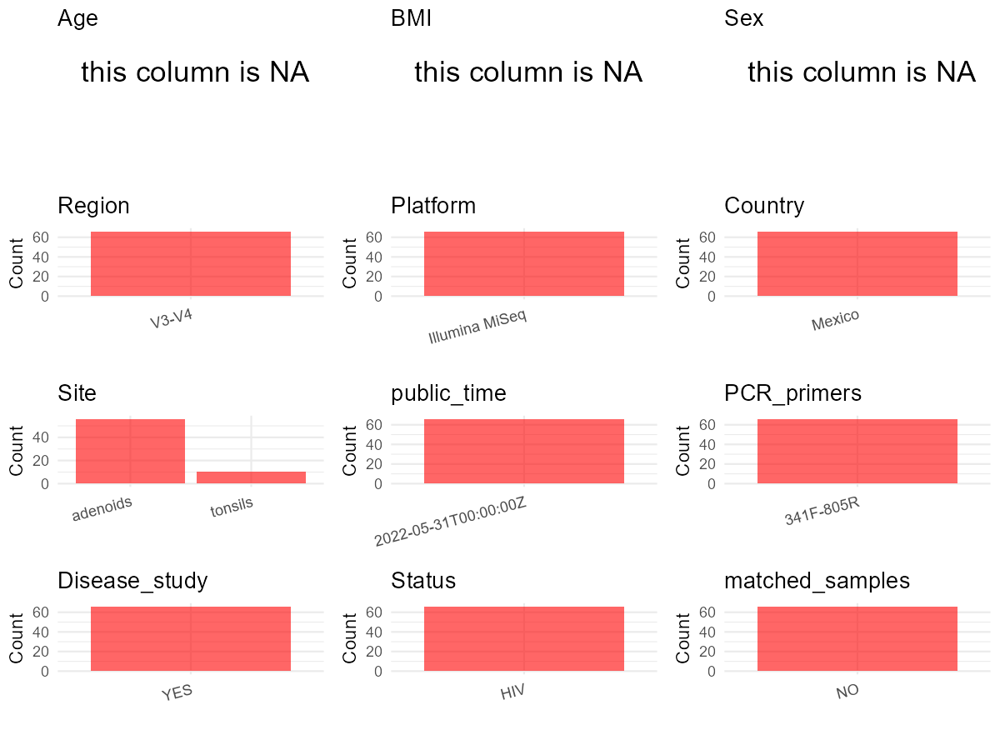

R Notebook: Metadata Processing Workflow
================

# Step 1: Obtain Initial Metadata from Each Project

To obtain the initial metadata: 1. Search for the BioProject ID (e.g.,
“PRJEBXXXX”) on the [NCBI SRA
website](https://www.ncbi.nlm.nih.gov/Traces/study/). 2. In the “Select”
table, click on “Metadata” and download the file. 3. The downloaded file
is typically named “SraRunTable.csv” and contains metadata for the
project.

``` r
# Load necessary libraries
library(dplyr)
library(ggplot2)
library(cowplot)

# Set working directory (update this path to your local directory)
setwd("D:/oral_project/PRJNA820027")

# Read the initial metadata files
initial_meta<-read.csv("SraRunTable.csv",header = T)

# Combine the two metadata files
#meta <- rbind(initial_meta, initial_meta1)

#Remove entries non-oral samples
#initial_meta <- subset(initial_meta,isolate %in% c("saliva","tongue coat"))

# Check the number of samples containing "HT" in Sample.Name (e.g., healthy controls)
#nrow(subset(meta, grepl("HT", Sample.Name)))

# Display the first few rows of the metadata
head(initial_meta)
```

    ##           Run Assay.Type AvgSpotLen     Bases  BioProject    BioSample
    ## 1 SRR18742836   AMPLICON        600 329182558 PRJNA820027 SAMN27549076
    ## 2 SRR18742837   AMPLICON        600 586785765 PRJNA820027 SAMN27549075
    ## 3 SRR18742838   AMPLICON        601 429105145 PRJNA820027 SAMN27549074
    ## 4 SRR18742839   AMPLICON        600 540748351 PRJNA820027 SAMN27549132
    ## 5 SRR18742840   AMPLICON        600 686590911 PRJNA820027 SAMN27549131
    ## 6 SRR18742841   AMPLICON        600 522512280 PRJNA820027 SAMN27549130
    ##                BioSampleModel     Bytes
    ## 1 Metagenome or environmental 245439071
    ## 2 Metagenome or environmental 433749489
    ## 3 Metagenome or environmental 317014712
    ## 4 Metagenome or environmental 381998543
    ## 5 Metagenome or environmental 478924117
    ## 6 Metagenome or environmental 375186722
    ##                                        Center.Name Collection_Date Consent
    ## 1 INSTITUTO NACIONAL DE ENFERMEDADES RESPIRATORIAS      2017-04-19  public
    ## 2 INSTITUTO NACIONAL DE ENFERMEDADES RESPIRATORIAS      2017-04-19  public
    ## 3 INSTITUTO NACIONAL DE ENFERMEDADES RESPIRATORIAS      2017-04-19  public
    ## 4 INSTITUTO NACIONAL DE ENFERMEDADES RESPIRATORIAS      2019-09-09  public
    ## 5 INSTITUTO NACIONAL DE ENFERMEDADES RESPIRATORIAS      2019-07-22  public
    ## 6 INSTITUTO NACIONAL DE ENFERMEDADES RESPIRATORIAS      2019-07-03  public
    ##   DATASTORE.filetype DATASTORE.provider                     DATASTORE.region
    ## 1   fastq,run.zq,sra         gs,ncbi,s3 gs.us-east1,ncbi.public,s3.us-east-1
    ## 2   fastq,run.zq,sra         gs,ncbi,s3 gs.us-east1,ncbi.public,s3.us-east-1
    ## 3   fastq,run.zq,sra         gs,ncbi,s3 gs.us-east1,ncbi.public,s3.us-east-1
    ## 4   fastq,run.zq,sra         gs,ncbi,s3 gs.us-east1,ncbi.public,s3.us-east-1
    ## 5   fastq,run.zq,sra         gs,ncbi,s3 gs.us-east1,ncbi.public,s3.us-east-1
    ## 6   fastq,run.zq,sra         gs,ncbi,s3 gs.us-east1,ncbi.public,s3.us-east-1
    ##    Experiment geo_loc_name_country geo_loc_name_country_continent geo_loc_name
    ## 1 SRX14842938               Mexico                  North America       Mexico
    ## 2 SRX14842937               Mexico                  North America       Mexico
    ## 3 SRX14842936               Mexico                  North America       Mexico
    ## 4 SRX14842935               Mexico                  North America       Mexico
    ## 5 SRX14842934               Mexico                  North America       Mexico
    ## 6 SRX14842933               Mexico                  North America       Mexico
    ##           HOST     Instrument isolation_source              lat_lon
    ## 1 Homo sapiens Illumina MiSeq             NATL 23.6345 N 102.5528 W
    ## 2 Homo sapiens Illumina MiSeq             NATL 23.6345 N 102.5528 W
    ## 3 Homo sapiens Illumina MiSeq             NATL 23.6345 N 102.5528 W
    ## 4 Homo sapiens Illumina MiSeq             NATL 23.6345 N 102.5528 W
    ## 5 Homo sapiens Illumina MiSeq             NATL 23.6345 N 102.5528 W
    ## 6 Homo sapiens Illumina MiSeq             NATL 23.6345 N 102.5528 W
    ##   Library.Name LibraryLayout LibrarySelection LibrarySource
    ## 1    Sample109        PAIRED              PCR   METAGENOMIC
    ## 2    Sample108        PAIRED              PCR   METAGENOMIC
    ## 3    Sample107        PAIRED              PCR   METAGENOMIC
    ## 4    Sample165        PAIRED              PCR   METAGENOMIC
    ## 5    Sample164        PAIRED              PCR   METAGENOMIC
    ## 6    Sample163        PAIRED              PCR   METAGENOMIC
    ##                          Organism Platform          ReleaseDate
    ## 1 human nasopharyngeal metagenome ILLUMINA 2022-05-31T00:00:00Z
    ## 2 human nasopharyngeal metagenome ILLUMINA 2022-05-31T00:00:00Z
    ## 3 human nasopharyngeal metagenome ILLUMINA 2022-05-31T00:00:00Z
    ## 4 human nasopharyngeal metagenome ILLUMINA 2022-05-31T00:00:00Z
    ## 5 human nasopharyngeal metagenome ILLUMINA 2022-05-31T00:00:00Z
    ## 6 human nasopharyngeal metagenome ILLUMINA 2022-05-31T00:00:00Z
    ##            create_date version samp_collect_device
    ## 1 2022-04-13T13:10:00Z       1                Swab
    ## 2 2022-04-13T13:10:00Z       1                Swab
    ## 3 2022-04-13T13:10:00Z       1                Swab
    ## 4 2022-04-13T13:10:00Z       1           Oral wash
    ## 5 2022-04-13T13:10:00Z       1           Oral wash
    ## 6 2022-04-13T13:10:00Z       1           Oral wash
    ##                                            samp_mat_process samp_size
    ## 1 DNA extraction (PureLink Microbiome DNA purification kit)      Swab
    ## 2 DNA extraction (PureLink Microbiome DNA purification kit)      Swab
    ## 3 DNA extraction (PureLink Microbiome DNA purification kit)      Swab
    ## 4 DNA extraction (PureLink Microbiome DNA purification kit)      Swab
    ## 5 DNA extraction (PureLink Microbiome DNA purification kit)      Swab
    ## 6 DNA extraction (PureLink Microbiome DNA purification kit)      Swab
    ##   Sample.Name source_material_id SRA.Study
    ## 1   Sample109          Sample109 SRP370049
    ## 2   Sample108          Sample108 SRP370049
    ## 3   Sample107          Sample107 SRP370049
    ## 4   Sample165          Sample165 SRP370049
    ## 5   Sample164          Sample164 SRP370049
    ## 6   Sample163          Sample163 SRP370049

# Step 2: Create a Uniform Metadata Template

The uniform metadata should include the following columns:

1.  **BioProject**: Project ID (e.g., “PRJNA339212”)
2.  **Run**: Sample ID (e.g., “ERRXXXXXX” or “SRRXXXXXX”)
3.  **sample_name**: Original sample name submitted by the authors (not
    the database-assigned ID)
4.  **Age**: Age of the subject (if available)
5.  **BMI**: Body Mass Index (if available)
6.  **Sex**: Sex of the subject (“F” or “M”)
7.  **Region**: Targeted 16S rRNA region (e.g., “V3-V4”)
8.  **Platform**: Sequencing platform (e.g., “Illumina MiSeq”)
9.  **Country**: Country of sample origin (e.g., “China”)
10. **Site**: Sample site (e.g., “saliva”, “dental plaque”)
11. **public_time**: Data release date (format: “YYYY-MM-DD”)
12. **PCR_primers**: PCR primers used (e.g., “515F-806R”)
13. **title**: Title of the associated publication
14. **Disease_study**: Whether the study involves a disease (“YES” or
    “NO”)
15. **Status**: Disease status (e.g., “T2DM”, “HC”). Note: If the study
    includes both disease and healthy samples, this must be specified
    per sample.
16. **matched_samples**: matched samples (“YES” or “NO”)

``` r
# Create a uniform metadata dataframe
metadata <- data.frame(
  BioProject = initial_meta$BioProject,
  Run = initial_meta$Run,
  sample_name = initial_meta$Sample.Name,
  Age = NA,
  BMI = NA,
  Sex = NA,
  Region = "V3-V4",
  Platform = initial_meta$Instrument,
  Country = initial_meta$geo_loc_name_country,
  Site = initial_meta$samp_collect_device,
  public_time = initial_meta$ReleaseDate,
  stringsAsFactors = FALSE
)
```

# Step 3: Manually Add Information from the Publication

Some information (e.g. PCR primers, study title, disease status) must be
manually extracted from the publication and added to the metadata.

``` r
# Add information obtained from the publication
metadata$PCR_primers <- "341F-805R"
metadata$title <- "Mucosal immune cell populations and the bacteriome of adenoids and tonsils from people living with HIV on suppressive antiretroviral therapy"
metadata$Disease_study <- "YES"
metadata$Site <- ifelse(metadata$Site == "Swab", "adenoids", 
                       ifelse(metadata$Site == "Oral wash", "tonsils", metadata$Site))
# Assign disease status based on sample_name patterns
metadata$Status<-"HIV"
metadata$matched_samples <- "NO"
```

# Step 4: Summarize and Validate the Metadata

``` r
# Check the number of unique runs and sample names
print(paste("Number of unique runs:", length(unique(metadata$Run))))
```

    ## [1] "Number of unique runs: 66"

``` r
print(paste("Number of unique sample names:", length(unique(metadata$sample_name))))
```

    ## [1] "Number of unique sample names: 66"

# Step 5: Visualize the Metadata

``` r

```


# Step 6: Finalize and Export the Metadata

``` r
# Reorder columns to match the desired format
metadata <- metadata[, c(
  "BioProject", "Run", "sample_name", "Age", "BMI", "Sex", 
  "Region", "Platform", "Country", "Site", "public_time", 
  "PCR_primers", "title", "Disease_study", "Status","matched_samples"
)]

# Export the uniform metadata to a CSV file
write.csv(metadata, file = "metadata.csv", quote = TRUE)
head(metadata)
```

    ##    BioProject         Run sample_name Age BMI Sex Region       Platform Country
    ## 1 PRJNA820027 SRR18742836   Sample109  NA  NA  NA  V3-V4 Illumina MiSeq  Mexico
    ## 2 PRJNA820027 SRR18742837   Sample108  NA  NA  NA  V3-V4 Illumina MiSeq  Mexico
    ## 3 PRJNA820027 SRR18742838   Sample107  NA  NA  NA  V3-V4 Illumina MiSeq  Mexico
    ## 4 PRJNA820027 SRR18742839   Sample165  NA  NA  NA  V3-V4 Illumina MiSeq  Mexico
    ## 5 PRJNA820027 SRR18742840   Sample164  NA  NA  NA  V3-V4 Illumina MiSeq  Mexico
    ## 6 PRJNA820027 SRR18742841   Sample163  NA  NA  NA  V3-V4 Illumina MiSeq  Mexico
    ##       Site          public_time PCR_primers
    ## 1 adenoids 2022-05-31T00:00:00Z   341F-805R
    ## 2 adenoids 2022-05-31T00:00:00Z   341F-805R
    ## 3 adenoids 2022-05-31T00:00:00Z   341F-805R
    ## 4  tonsils 2022-05-31T00:00:00Z   341F-805R
    ## 5  tonsils 2022-05-31T00:00:00Z   341F-805R
    ## 6  tonsils 2022-05-31T00:00:00Z   341F-805R
    ##                                                                                                                                          title
    ## 1 Mucosal immune cell populations and the bacteriome of adenoids and tonsils from people living with HIV on suppressive antiretroviral therapy
    ## 2 Mucosal immune cell populations and the bacteriome of adenoids and tonsils from people living with HIV on suppressive antiretroviral therapy
    ## 3 Mucosal immune cell populations and the bacteriome of adenoids and tonsils from people living with HIV on suppressive antiretroviral therapy
    ## 4 Mucosal immune cell populations and the bacteriome of adenoids and tonsils from people living with HIV on suppressive antiretroviral therapy
    ## 5 Mucosal immune cell populations and the bacteriome of adenoids and tonsils from people living with HIV on suppressive antiretroviral therapy
    ## 6 Mucosal immune cell populations and the bacteriome of adenoids and tonsils from people living with HIV on suppressive antiretroviral therapy
    ##   Disease_study Status matched_samples
    ## 1           YES    HIV              NO
    ## 2           YES    HIV              NO
    ## 3           YES    HIV              NO
    ## 4           YES    HIV              NO
    ## 5           YES    HIV              NO
    ## 6           YES    HIV              NO

## Notes for Students:

1.  **Metadata Accuracy**: Always cross-check the metadata with the
    original publication to ensure accuracy.
2.  **Manual Entries**: Columns like `PCR_primers`, and `Status` often
    require manual entry based on the publication.
3.  **Disease Status**: Be careful when assigning `Status`—some studies
    include both disease and healthy samples.
4.  **Visualization**: The plots help quickly identify the distribution
    of values in each column, which is useful for quality control.
5.  **Reproducibility**: Update the working directory and file paths to
    match your local environment.
