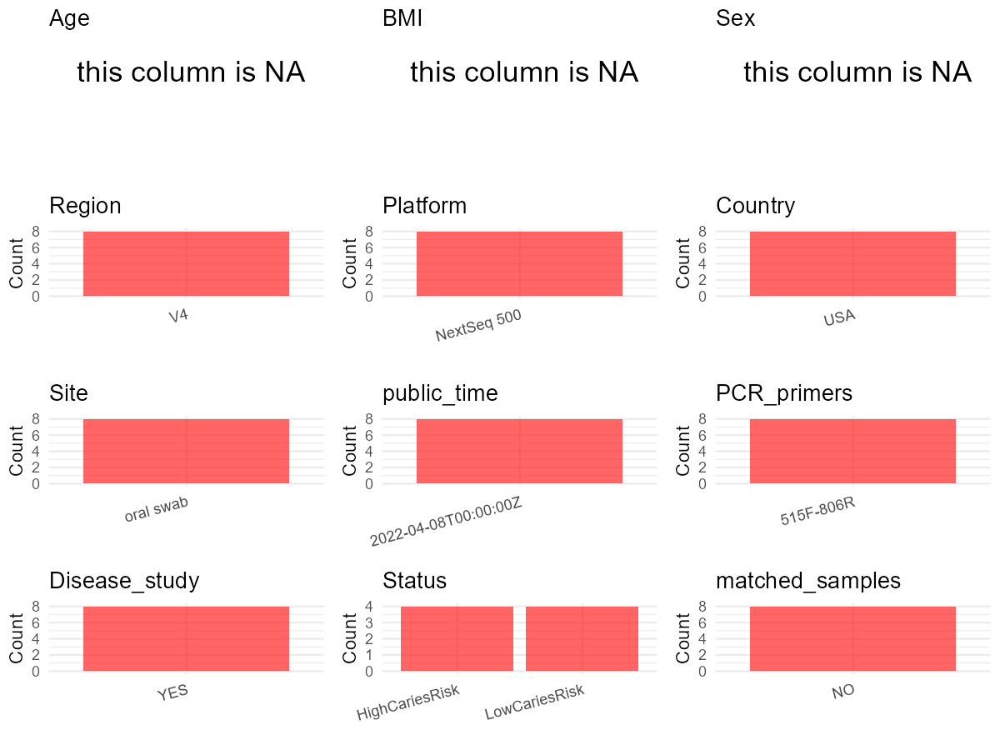

R Notebook: Metadata Processing Workflow
================

# Step 1: Obtain Initial Metadata from Each Project

To obtain the initial metadata: 1. Search for the BioProject ID (e.g.,
“PRJEBXXXX”) on the [NCBI SRA
website](https://www.ncbi.nlm.nih.gov/Traces/study/). 2. In the “Select”
table, click on “Metadata” and download the file. 3. The downloaded file
is typically named “SraRunTable.csv” and contains metadata for the
project.

``` r
# Load necessary libraries
library(dplyr)
library(ggplot2)
library(cowplot)

# Set working directory (update this path to your local directory)
setwd("D:/oral_project/PRJNA822409")

# Read the initial metadata files
initial_meta<-read.csv("SraRunTable.csv",header = T)

# Combine the two metadata files
#meta <- rbind(initial_meta, initial_meta1)

#Remove entries where Organism is "gut metagenome" (non-oral samples)
#initial_meta <- subset(initial_meta,isolation_source!= "feces")

# Check the number of samples containing "HT" in Sample.Name (e.g., healthy controls)
#nrow(subset(meta, grepl("HT", Sample.Name)))

# Display the first few rows of the metadata
head(initial_meta)
```

    ##           Run Assay.Type AvgSpotLen    Bases  BioProject    BioSample    Bytes
    ## 1 SRR18568192      OTHER        125 24694500 PRJNA822409 SAMN27184112 10067124
    ## 2 SRR18568193      OTHER        125  7493000 PRJNA822409 SAMN27184113  3350384
    ## 3 SRR18568194      OTHER        125  9505500 PRJNA822409 SAMN27184106  3915613
    ## 4 SRR18568196      OTHER        125  5920250 PRJNA822409 SAMN27184108  2349425
    ## 5 SRR18568197      OTHER        125 23581500 PRJNA822409 SAMN27184109  9189324
    ## 6 SRR18568198      OTHER        125  5094000 PRJNA822409 SAMN27184110  1893332
    ##      caries_risk Center.Name Consent DATASTORE.filetype DATASTORE.provider
    ## 1  LowCariesRisk        UCSF  public   fastq,run.zq,sra         gs,ncbi,s3
    ## 2  LowCariesRisk        UCSF  public   fastq,run.zq,sra         gs,ncbi,s3
    ## 3 HighCariesRisk        UCSF  public   fastq,run.zq,sra         gs,ncbi,s3
    ## 4  LowCariesRisk        UCSF  public   fastq,run.zq,sra         gs,ncbi,s3
    ## 5  LowCariesRisk        UCSF  public   fastq,run.zq,sra         gs,ncbi,s3
    ## 6 HighCariesRisk        UCSF  public   fastq,run.zq,sra         gs,ncbi,s3
    ##                       DATASTORE.region  Experiment  Instrument Library.Name
    ## 1 gs.us-east1,ncbi.public,s3.us-east-1 SRX14697335 NextSeq 500   GSM6001516
    ## 2 gs.us-east1,ncbi.public,s3.us-east-1 SRX14697334 NextSeq 500   GSM6001515
    ## 3 gs.us-east1,ncbi.public,s3.us-east-1 SRX14697333 NextSeq 500   GSM6001522
    ## 4 gs.us-east1,ncbi.public,s3.us-east-1 SRX14697331 NextSeq 500   GSM6001520
    ## 5 gs.us-east1,ncbi.public,s3.us-east-1 SRX14697330 NextSeq 500   GSM6001519
    ## 6 gs.us-east1,ncbi.public,s3.us-east-1 SRX14697329 NextSeq 500   GSM6001518
    ##   LibraryLayout LibrarySelection LibrarySource Organism Platform
    ## 1        SINGLE            other       GENOMIC Bacteria ILLUMINA
    ## 2        SINGLE            other       GENOMIC Bacteria ILLUMINA
    ## 3        SINGLE            other       GENOMIC Bacteria ILLUMINA
    ## 4        SINGLE            other       GENOMIC Bacteria ILLUMINA
    ## 5        SINGLE            other       GENOMIC Bacteria ILLUMINA
    ## 6        SINGLE            other       GENOMIC Bacteria ILLUMINA
    ##            ReleaseDate          create_date version Sample.Name  sampleid
    ## 1 2022-04-08T00:00:00Z 2022-04-01T17:03:00Z       1  GSM6001516 121865169
    ## 2 2022-04-08T00:00:00Z 2022-04-01T17:05:00Z       1  GSM6001515 112143989
    ## 3 2022-04-08T00:00:00Z 2022-04-01T17:15:00Z       1  GSM6001522 841582737
    ## 4 2022-04-08T00:00:00Z 2022-04-01T17:15:00Z       1  GSM6001520 557081495
    ## 5 2022-04-08T00:00:00Z 2022-04-01T17:15:00Z       1  GSM6001519 345081520
    ## 6 2022-04-08T00:00:00Z 2022-04-01T17:15:00Z       1  GSM6001518 172081528
    ##                source_name SRA.Study subject                   tissue Visit
    ## 1 Dental plaque and saliva SRP366974     A06 Dental plaque and saliva Day14
    ## 2 Dental plaque and saliva SRP366974     B11 Dental plaque and saliva Day14
    ## 3 Dental plaque and saliva SRP366974     C09 Dental plaque and saliva Day14
    ## 4 Dental plaque and saliva SRP366974     B01 Dental plaque and saliva Day14
    ## 5 Dental plaque and saliva SRP366974     B04 Dental plaque and saliva Day14
    ## 6 Dental plaque and saliva SRP366974     B12 Dental plaque and saliva Day14

# Step 2: Create a Uniform Metadata Template

The uniform metadata should include the following columns:

1.  **BioProject**: Project ID (e.g., “PRJNA339212”)
2.  **Run**: Sample ID (e.g., “ERRXXXXXX” or “SRRXXXXXX”)
3.  **sample_name**: Original sample name submitted by the authors (not
    the database-assigned ID)
4.  **Age**: Age of the subject (if available)
5.  **BMI**: Body Mass Index (if available)
6.  **Sex**: Sex of the subject (“F” or “M”)
7.  **Region**: Targeted 16S rRNA region (e.g., “V3-V4”)
8.  **Platform**: Sequencing platform (e.g., “Illumina MiSeq”)
9.  **Country**: Country of sample origin (e.g., “China”)
10. **Site**: Sample site (e.g., “saliva”, “dental plaque”)
11. **public_time**: Data release date (format: “YYYY-MM-DD”)
12. **PCR_primers**: PCR primers used (e.g., “515F-806R”)
13. **title**: Title of the associated publication
14. **Disease_study**: Whether the study involves a disease (“YES” or
    “NO”)
15. **Status**: Disease status (e.g., “T2DM”, “HC”). Note: If the study
    includes both disease and healthy samples, this must be specified
    per sample.

``` r
# Create a uniform metadata dataframe
metadata <- data.frame(
  BioProject = initial_meta$BioProject,
  Run = initial_meta$Run,
  sample_name = initial_meta$Sample.Name,
  Age = NA,
  BMI = NA,
  Sex=NA,
  Region = "V4",
  Platform = initial_meta$Instrument,
  Country = "USA",
  Site = "oral swab",
  public_time = initial_meta$ReleaseDate,
  stringsAsFactors = FALSE
)
```

# Step 3: Manually Add Information from the Publication

Some information (e.g. PCR primers, study title, disease status) must be
manually extracted from the publication and added to the metadata.

``` r
# Add information obtained from the publication
metadata$PCR_primers <- "515F-806R"
metadata$title <- "Dental caries as a risk factor for bacterial blood stream infection (BSI) in children undergoing hematopoietic cell transplantation (HCT)"
#metadata<-subset(uniform_meta,Site!="feces")
metadata$Disease_study <- "YES"
# Assign disease status based on sample_name patterns
metadata$Status <- initial_meta$caries_risk
#extract subject id by remove prefix of sample_name
#metadata$sample_name <- gsub("S-Saliva-.*|F", "", metadata$sample_name)
#get subjects id with Saliva available
#keep_subjects<-subset(metadata,Site %in% c("Saliva"))
#remove subjects without Saliva samples
#metadata<-subset(metadata,sample_name %in% keep_subjects$sample_name)
#get subjects sampling counts
#sample_counts <- table(metadata$sample_name)
# Create matched_samples column, any subjects have >=2 samples will be label "YES", otherwise "NO"
#metadata$matched_samples <- ifelse(metadata$sample_name %in% names(sample_counts[sample_counts >= 2]), "YES", "NO")
metadata$matched_samples<-"NO"
```

# Step 4: Summarize and Validate the Metadata

``` r
# Check the number of unique runs and sample names
print(paste("Number of unique runs:", length(unique(metadata$Run))))
```

    ## [1] "Number of unique runs: 8"

``` r
print(paste("Number of unique sample names:", length(unique(metadata$sample_name))))
```

    ## [1] "Number of unique sample names: 8"

# Step 5: Visualize the Metadata

``` r

```


# Step 6: Finalize and Export the Metadata

``` r
# Reorder columns to match the desired format
metadata <- metadata[, c(
  "BioProject", "Run", "sample_name", "Age", "BMI", "Sex", 
  "Region", "Platform", "Country", "Site", "public_time", 
  "PCR_primers", "title", "Disease_study", "Status","matched_samples"
)]

# Export the uniform metadata to a CSV file
write.csv(metadata, file = "metadata.csv", quote = FALSE)
head(metadata)
```

    ##    BioProject         Run sample_name Age BMI Sex Region    Platform Country
    ## 1 PRJNA822409 SRR18568192  GSM6001516  NA  NA  NA     V4 NextSeq 500     USA
    ## 2 PRJNA822409 SRR18568193  GSM6001515  NA  NA  NA     V4 NextSeq 500     USA
    ## 3 PRJNA822409 SRR18568194  GSM6001522  NA  NA  NA     V4 NextSeq 500     USA
    ## 4 PRJNA822409 SRR18568196  GSM6001520  NA  NA  NA     V4 NextSeq 500     USA
    ## 5 PRJNA822409 SRR18568197  GSM6001519  NA  NA  NA     V4 NextSeq 500     USA
    ## 6 PRJNA822409 SRR18568198  GSM6001518  NA  NA  NA     V4 NextSeq 500     USA
    ##        Site          public_time PCR_primers
    ## 1 oral swab 2022-04-08T00:00:00Z   515F-806R
    ## 2 oral swab 2022-04-08T00:00:00Z   515F-806R
    ## 3 oral swab 2022-04-08T00:00:00Z   515F-806R
    ## 4 oral swab 2022-04-08T00:00:00Z   515F-806R
    ## 5 oral swab 2022-04-08T00:00:00Z   515F-806R
    ## 6 oral swab 2022-04-08T00:00:00Z   515F-806R
    ##                                                                                                                                       title
    ## 1 Dental caries as a risk factor for bacterial blood stream infection (BSI) in children undergoing hematopoietic cell transplantation (HCT)
    ## 2 Dental caries as a risk factor for bacterial blood stream infection (BSI) in children undergoing hematopoietic cell transplantation (HCT)
    ## 3 Dental caries as a risk factor for bacterial blood stream infection (BSI) in children undergoing hematopoietic cell transplantation (HCT)
    ## 4 Dental caries as a risk factor for bacterial blood stream infection (BSI) in children undergoing hematopoietic cell transplantation (HCT)
    ## 5 Dental caries as a risk factor for bacterial blood stream infection (BSI) in children undergoing hematopoietic cell transplantation (HCT)
    ## 6 Dental caries as a risk factor for bacterial blood stream infection (BSI) in children undergoing hematopoietic cell transplantation (HCT)
    ##   Disease_study         Status matched_samples
    ## 1           YES  LowCariesRisk              NO
    ## 2           YES  LowCariesRisk              NO
    ## 3           YES HighCariesRisk              NO
    ## 4           YES  LowCariesRisk              NO
    ## 5           YES  LowCariesRisk              NO
    ## 6           YES HighCariesRisk              NO

## Notes for Students:

1.  **Metadata Accuracy**: Always cross-check the metadata with the
    original publication to ensure accuracy.
2.  **Manual Entries**: Columns like `PCR_primers`, and `Status` often
    require manual entry based on the publication.
3.  **Disease Status**: Be careful when assigning `Status`—some studies
    include both disease and healthy samples.
4.  **Visualization**: The plots help quickly identify the distribution
    of values in each column, which is useful for quality control.
5.  **Reproducibility**: Update the working directory and file paths to
    match your local environment.
