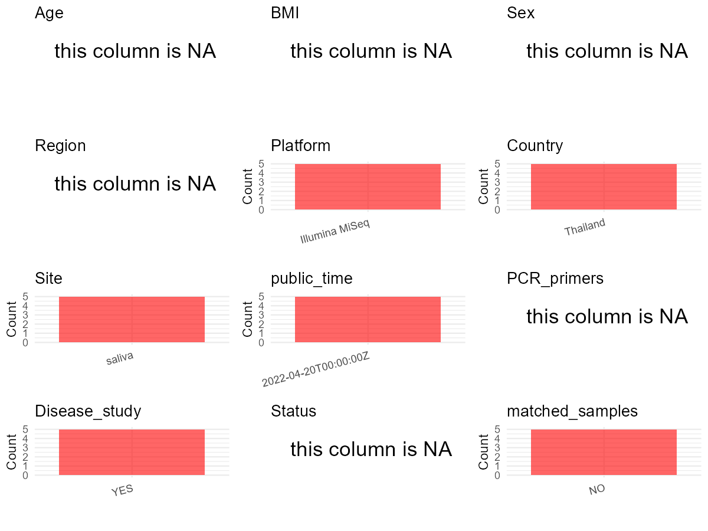

R Notebook: Metadata Processing Workflow
================

# Step 1: Obtain Initial Metadata from Each Project

To obtain the initial metadata: 1. Search for the BioProject ID (e.g.,
“PRJEBXXXX”) on the [NCBI SRA
website](https://www.ncbi.nlm.nih.gov/Traces/study/). 2. In the “Select”
table, click on “Metadata” and download the file. 3. The downloaded file
is typically named “SraRunTable.csv” and contains metadata for the
project.

``` r
# Load necessary libraries
library(dplyr)
library(ggplot2)
library(cowplot)

# Set working directory (update this path to your local directory)
setwd("D:/studylearning/董彪师兄项目/任务3_20251004/PRJNA824062")

# Read the initial metadata files
initial_meta<-read.csv("SraRunTable.csv",header = T)

# Display the first few rows of the metadata
head(initial_meta)
```

    ##           Run Assay.Type AvgSpotLen      Bases batch  BioProject    BioSample
    ## 1 SRR18662651   AMPLICON        403 1610929364     5 PRJNA824062 SAMN27386752
    ## 2 SRR18662652   AMPLICON        411  799036480     4 PRJNA824062 SAMN27386751
    ## 3 SRR18662653   AMPLICON        418 3350494104     3 PRJNA824062 SAMN27386750
    ## 4 SRR18662654   AMPLICON        420 2162885289     2 PRJNA824062 SAMN27386749
    ## 5 SRR18662655   AMPLICON        410  857077394     1 PRJNA824062 SAMN27386748
    ##                                  BioSampleModel     Bytes         Center.Name
    ## 1 MIMARKS.specimen,MIGS/MIMS/MIMARKS.human-oral 422277161 NEW YORK UNIVERSITY
    ## 2 MIMARKS.specimen,MIGS/MIMS/MIMARKS.human-oral 208825462 NEW YORK UNIVERSITY
    ## 3 MIMARKS.specimen,MIGS/MIMS/MIMARKS.human-oral 876827156 NEW YORK UNIVERSITY
    ## 4 MIMARKS.specimen,MIGS/MIMS/MIMARKS.human-oral 563601073 NEW YORK UNIVERSITY
    ## 5 MIMARKS.specimen,MIGS/MIMS/MIMARKS.human-oral 225363813 NEW YORK UNIVERSITY
    ##   Collection_Date Consent DATASTORE.filetype DATASTORE.provider
    ## 1            2009  public   fastq,run.zq,sra         gs,ncbi,s3
    ## 2            2009  public   fastq,run.zq,sra         gs,ncbi,s3
    ## 3            2009  public   fastq,run.zq,sra         gs,ncbi,s3
    ## 4            2009  public   fastq,run.zq,sra         gs,ncbi,s3
    ## 5            2009  public   fastq,run.zq,sra         gs,ncbi,s3
    ##                       DATASTORE.region           Ecotype env_broad_scale
    ## 1 gs.us-east1,ncbi.public,s3.us-east-1 Thailand children   not collected
    ## 2 gs.us-east1,ncbi.public,s3.us-east-1 Thailand children   not collected
    ## 3 gs.us-east1,ncbi.public,s3.us-east-1 Thailand children   not collected
    ## 4 gs.us-east1,ncbi.public,s3.us-east-1 Thailand children   not collected
    ## 5 gs.us-east1,ncbi.public,s3.us-east-1 Thailand children   not collected
    ##   env_local_scale env_medium  Experiment geo_loc_name_country
    ## 1   not collected     saliva SRX14765109             Thailand
    ## 2   not collected     saliva SRX14765108             Thailand
    ## 3   not collected     saliva SRX14765107             Thailand
    ## 4   not collected     saliva SRX14765106             Thailand
    ## 5   not collected     saliva SRX14765105             Thailand
    ##   geo_loc_name_country_continent            geo_loc_name         HOST
    ## 1                           Asia Thailand: Chiang\\, Mai Homo sapiens
    ## 2                           Asia Thailand: Chiang\\, Mai Homo sapiens
    ## 3                           Asia Thailand: Chiang\\, Mai Homo sapiens
    ## 4                           Asia Thailand: Chiang\\, Mai Homo sapiens
    ## 5                           Asia Thailand: Chiang\\, Mai Homo sapiens
    ##       Instrument isol_growth_condt       lat_lon Library.Name LibraryLayout
    ## 1 Illumina MiSeq     Not collected Not collected         NYU5        SINGLE
    ## 2 Illumina MiSeq     Not collected Not collected         NYU4        SINGLE
    ## 3 Illumina MiSeq     Not collected Not collected         NYU3        SINGLE
    ## 4 Illumina MiSeq     Not collected Not collected         NYU2        SINGLE
    ## 5 Illumina MiSeq     Not collected Not collected         NYU1        SINGLE
    ##   LibrarySelection LibrarySource   Organism Platform          ReleaseDate
    ## 1            other       GENOMIC metagenome ILLUMINA 2022-04-20T00:00:00Z
    ## 2            other       GENOMIC metagenome ILLUMINA 2022-04-20T00:00:00Z
    ## 3            other       GENOMIC metagenome ILLUMINA 2022-04-20T00:00:00Z
    ## 4            other       GENOMIC metagenome ILLUMINA 2022-04-20T00:00:00Z
    ## 5            other       GENOMIC metagenome ILLUMINA 2022-04-20T00:00:00Z
    ##            create_date version  Sample.Name SRA.Study
    ## 1 2022-04-06T15:02:00Z       1 SequenceRun5 SRP367886
    ## 2 2022-04-06T15:02:00Z       1 SequenceRun4 SRP367886
    ## 3 2022-04-06T15:07:00Z       1 SequenceRun3 SRP367886
    ## 4 2022-04-06T15:04:00Z       1 SequenceRun2 SRP367886
    ## 5 2022-04-06T15:02:00Z       1 SequenceRun1 SRP367886

# Step 2: Create a Uniform Metadata Template

The uniform metadata should include the following columns:

1.  **BioProject**: Project ID (e.g., “PRJNA339212”)
2.  **Run**: Sample ID (e.g., “ERRXXXXXX” or “SRRXXXXXX”)
3.  **sample_name**: Original sample name submitted by the authors (not
    the database-assigned ID)
4.  **Age**: Age of the subject (if available)
5.  **BMI**: Body Mass Index (if available)
6.  **Sex**: Sex of the subject (“F” or “M”)
7.  **Region**: Targeted 16S rRNA region (e.g., “V3-V4”)
8.  **Platform**: Sequencing platform (e.g., “Illumina MiSeq”)
9.  **Country**: Country of sample origin (e.g., “China”)
10. **Site**: Sample site (e.g., “saliva”, “dental plaque”)
11. **public_time**: Data release date (format: “YYYY-MM-DD”)
12. **PCR_primers**: PCR primers used (e.g., “515F-806R”)
13. **title**: Title of the associated publication
14. **Disease_study**: Whether the study involves a disease (“YES” or
    “NO”)
15. **Status**: Disease status (e.g., “T2DM”, “HC”). Note: If the study
    includes both disease and healthy samples, this must be specified
    per sample.

``` r
# Create a uniform metadata dataframe
metadata <- data.frame(
  BioProject = initial_meta$BioProject,
  Run = initial_meta$Run,
  sample_name = initial_meta$Sample.Name,
  Age = NA,
  BMI = NA,
  Sex= NA,
  Region = NA,
  Platform = initial_meta$Instrument,
  Country = initial_meta$geo_loc_name_country,
  Site = initial_meta$env_medium,
  public_time = initial_meta$ReleaseDate,
  stringsAsFactors = FALSE
)
```

# Step 3: Manually Add Information from the Publication

Some information (e.g. PCR primers, study title, disease status) must be
manually extracted from the publication and added to the metadata.

``` r
# Add information obtained from the publication
metadata$PCR_primers <- NA_character_  # Update based on the publication
metadata$title <- "Multimodal Data Integration Reveals Mode of Delivery and Snack Consumption Outrank Salivary Microbiome in Association With Caries Outcome in Thai Children"
metadata$Disease_study <- "YES"
metadata$Status <- NA_character_

#extract subject id by remove prefix of sample_name
#metadata$sample_name <- gsub("_st|_sal", "", metadata$sample_name)

# Check initial data distribution
cat("Initial sample distribution:\n")
```

    ## Initial sample distribution:

``` r
table(metadata$sample_name)
```

    ## 
    ## SequenceRun1 SequenceRun2 SequenceRun3 SequenceRun4 SequenceRun5 
    ##            1            1            1            1            1

``` r
table(metadata$Site)
```

    ## 
    ## saliva 
    ##      5

``` r
# Calculate sampling frequency per subject
sample_counts <- table(metadata$sample_name)
cat("\nNumber of samples per subject:\n")
```

    ## 
    ## Number of samples per subject:

``` r
print(sample_counts)
```

    ## 
    ## SequenceRun1 SequenceRun2 SequenceRun3 SequenceRun4 SequenceRun5 
    ##            1            1            1            1            1

``` r
# Create matched_samples column
metadata$matched_samples <- ifelse(metadata$sample_name %in% names(sample_counts[sample_counts >= 2]), "YES", "NO")

cat("\nMatched samples distribution:\n")
```

    ## 
    ## Matched samples distribution:

``` r
table(metadata$matched_samples)
```

    ## 
    ## NO 
    ##  5

``` r
# Identify samples for removal: single samples excluding saliva 
single_samples <- names(sample_counts[sample_counts == 1])
samples_to_remove <- metadata$sample_name %in% single_samples & !(metadata$Site %in% c("saliva"))

cat("\nNumber of samples to be removed:", sum(samples_to_remove), "\n")
```

    ## 
    ## Number of samples to be removed: 0

``` r
# Remove identified samples
metadata_clean <- metadata[!samples_to_remove, ]

cat("\nFinal sample distribution after cleaning:\n")
```

    ## 
    ## Final sample distribution after cleaning:

``` r
table(metadata_clean$sample_name)
```

    ## 
    ## SequenceRun1 SequenceRun2 SequenceRun3 SequenceRun4 SequenceRun5 
    ##            1            1            1            1            1

``` r
table(metadata_clean$Site)
```

    ## 
    ## saliva 
    ##      5

``` r
table(metadata_clean$matched_samples)
```

    ## 
    ## NO 
    ##  5

``` r
# Use cleaned dataset for subsequent analysis
metadata <- metadata_clean
```

# Step 4: Summarize and Validate the Metadata

``` r
# Check the number of unique runs and sample names
print(paste("Number of unique runs:", length(unique(metadata$Run))))
```

    ## [1] "Number of unique runs: 5"

``` r
print(paste("Number of unique sample names:", length(unique(metadata$sample_name))))
```

    ## [1] "Number of unique sample names: 5"

# Step 5: Visualize the Metadata

``` r

```


# Step 6: Finalize and Export the Metadata

``` r
# Reorder columns to match the desired format
metadata <- metadata[, c(
  "BioProject", "Run", "sample_name", "Age", "BMI", "Sex", 
  "Region", "Platform", "Country", "Site", "public_time", 
  "PCR_primers", "title", "Disease_study", "Status","matched_samples"
)]

# Export the uniform metadata to a CSV file
write.csv(metadata, file = "metadata.csv", quote = FALSE)
head(metadata)
```

    ##    BioProject         Run  sample_name Age BMI Sex Region       Platform
    ## 1 PRJNA824062 SRR18662651 SequenceRun5  NA  NA  NA     NA Illumina MiSeq
    ## 2 PRJNA824062 SRR18662652 SequenceRun4  NA  NA  NA     NA Illumina MiSeq
    ## 3 PRJNA824062 SRR18662653 SequenceRun3  NA  NA  NA     NA Illumina MiSeq
    ## 4 PRJNA824062 SRR18662654 SequenceRun2  NA  NA  NA     NA Illumina MiSeq
    ## 5 PRJNA824062 SRR18662655 SequenceRun1  NA  NA  NA     NA Illumina MiSeq
    ##    Country   Site          public_time PCR_primers
    ## 1 Thailand saliva 2022-04-20T00:00:00Z        <NA>
    ## 2 Thailand saliva 2022-04-20T00:00:00Z        <NA>
    ## 3 Thailand saliva 2022-04-20T00:00:00Z        <NA>
    ## 4 Thailand saliva 2022-04-20T00:00:00Z        <NA>
    ## 5 Thailand saliva 2022-04-20T00:00:00Z        <NA>
    ##                                                                                                                                                        title
    ## 1 Multimodal Data Integration Reveals Mode of Delivery and Snack Consumption Outrank Salivary Microbiome in Association With Caries Outcome in Thai Children
    ## 2 Multimodal Data Integration Reveals Mode of Delivery and Snack Consumption Outrank Salivary Microbiome in Association With Caries Outcome in Thai Children
    ## 3 Multimodal Data Integration Reveals Mode of Delivery and Snack Consumption Outrank Salivary Microbiome in Association With Caries Outcome in Thai Children
    ## 4 Multimodal Data Integration Reveals Mode of Delivery and Snack Consumption Outrank Salivary Microbiome in Association With Caries Outcome in Thai Children
    ## 5 Multimodal Data Integration Reveals Mode of Delivery and Snack Consumption Outrank Salivary Microbiome in Association With Caries Outcome in Thai Children
    ##   Disease_study Status matched_samples
    ## 1           YES   <NA>              NO
    ## 2           YES   <NA>              NO
    ## 3           YES   <NA>              NO
    ## 4           YES   <NA>              NO
    ## 5           YES   <NA>              NO

## Notes for Students:

1.  **Metadata Accuracy**: Always cross-check the metadata with the
    original publication to ensure accuracy.
2.  **Manual Entries**: Columns like `PCR_primers`, and `Status` often
    require manual entry based on the publication.
3.  **Disease Status**: Be careful when assigning `Status`—some studies
    include both disease and healthy samples.
4.  **Visualization**: The plots help quickly identify the distribution
    of values in each column, which is useful for quality control.
5.  **Reproducibility**: Update the working directory and file paths to
    match your local environment.
